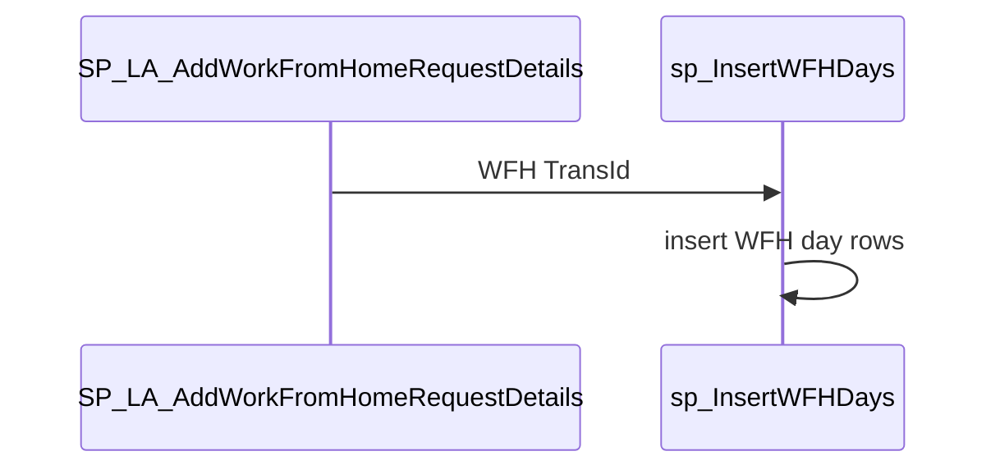
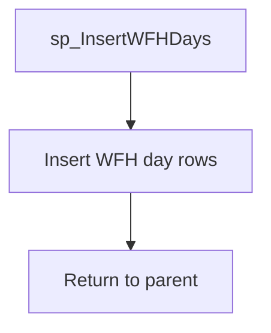

# sp_InsertWFHDays

## What it does

Materializes per-day child rows for a Work From Home request after `SP_LA_AddWorkFromHomeRequestDetails` inserts the header.

## Parameters

| Name | Direction | What it is for |
|---|---|---|
| Parent passes WFH trans id | in | New WFH request id (see script) |

## Call sequence

## Callers

| Object | Kind | Page |
|---|---|---|
| `SP_LA_AddWorkFromHomeRequestDetails` | procedure | [SP_LA_AddWorkFromHomeRequestDetails](/docs/database/hrms/SP_LA_AddWorkFromHomeRequestDetails) |

## Nested

Calls no further procedures for the common path.

## Steps

1. Accept WFH transaction id from parent.
2. Insert day-level WFH child rows for the request range.

## Tables

| Table | Read or write |
|---|---|
| WFH day child table(s) | write |
| `TWorkFromHomeRequest` | read |

## Unresolved calls

None.

## Flow

