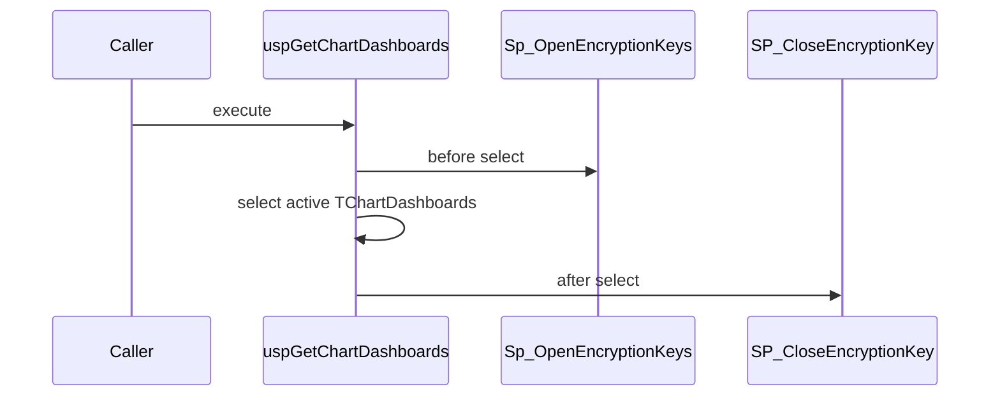
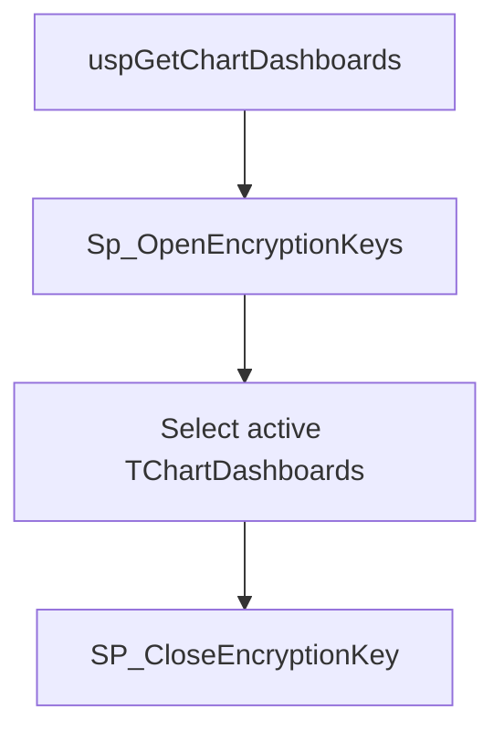

# uspGetChartDashboards

## What it does

Opens encryption keys, returns every active row from `TChartDashboards`, then closes encryption keys. Charts Setup uses the result for the Show Chart on multi-select (`ChartDashboardId`, `DashboardName`).

## Parameters

None.

## Call sequence

## Callers

No other procedure or function calls this object. App caller: `dashBoardDAL.GetDashboardList` from Charts Setup (`SetupCharts.aspx`).

## Nested

| Object | Kind | When | Page |
|---|---|---|---|
| `Sp_OpenEncryptionKeys` | procedure | before the select | [Sp_OpenEncryptionKeys](/docs/database/hrms/Sp_OpenEncryptionKeys) |
| `SP_CloseEncryptionKey` | procedure | after the select | [SP_CloseEncryptionKey](/docs/database/hrms/SP_CloseEncryptionKey) |

## Steps

In `HRMS-DATABASE/HRMS/STOREPROCEDURE/uspGetChartDashboards.sql`:

1. Execute `Sp_OpenEncryptionKeys`.
2. Select all columns from `TChartDashboards` where `isActive = 1`.
3. Execute `SP_CloseEncryptionKey`.

## Tables

| Table | Read or write |
|---|---|
| `dbo.TChartDashboards` | read |

## Flow

