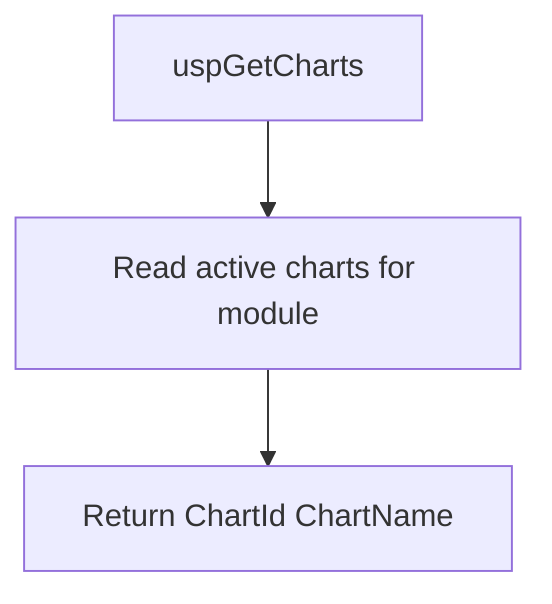

# uspGetCharts

## What it does

Returns distinct active chart ids and names for a module from `TRChartModules` joined to `TCharts`. Used to fill the Chart Name multi-select on Charts Setup.

## Parameters

| Name | Direction | What it is for |
|---|---|---|
| `@pEmployerId` | in | Accepted by the signature. Not referenced in the body |
| `@pModuleId` | in | Module whose chart mappings are returned |

## Call sequence

Calls no other procedures or functions.

## Callers

No other procedure or function calls this object. App caller: `dashBoardDAL.GetChartNameList` from Charts Setup (`SetupCharts.aspx`).

## Nested

Calls no other procedures or functions.

## Steps

In `HRMS-DATABASE/HRMS/STOREPROCEDURE/uspGetCharts.sql`:

1. Select distinct `TRC.ChartId` and `TC.ChartName` from `TRChartModules` inner join `TCharts` where `TRC.ModuleId = @pModuleId`, `TRC.IsActive = 1`, and `ISNULL(TC.IsActive, 1) = 1`.

## Tables

| Table | Read or write |
|---|---|
| `dbo.TRChartModules` | read |
| `dbo.TCharts` | read |

## Flow

