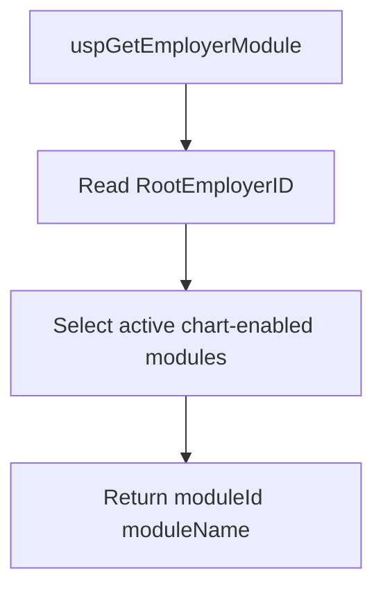

# uspGetEmployerModule

## What it does

Resolves the root employer for `@pEmployerId`, then returns distinct active HRMS modules assigned to that root employer that are in the hard-coded chart-enabled module id list `(18,1,12,9,8,10,7,13,17,20)`. Charts Setup uses the result for the Module dropdown (`moduleId`, `moduleName`).

## Parameters

| Name | Direction | What it is for |
|---|---|---|
| `@pEmployerId` | in | Employer whose `RootEmployerID` drives the module list |

## Call sequence

Calls no other procedures or functions.

## Callers

No other procedure or function executes this object. Comment-only mentions appear in `USP_COB_GetClientMetadata.sql` and related client-onboarding scripts. App caller: `dashBoardDAL.GetChartModuleList` from Charts Setup (`SetupCharts.aspx`).

## Nested

Calls no other procedures or functions.

## Steps

In `HRMS-DATABASE/HRMS/STOREPROCEDURE/uspGetEmployerModule.sql`:

1. Set `READ UNCOMMITTED`.
2. Read `@RootEmployerID` from `TEmployerDetails` where `Employerid = @pEmployerId`.
3. Select distinct `EM.HrmsModuleID` as `moduleId` and `HM.ModuleName` as `moduleName` from `TEmployerModule` inner join `THrmsModules` where `EM.EmployerId = @RootEmployerID`, `EM.HrmsModuleID` is in the chart module id list, and both module rows are active.

The script file begins with `USE [HRM-CL-Prod]`. That does not change the procedure body once deployed into the target database.

## Tables

| Table | Read or write |
|---|---|
| `dbo.TEmployerDetails` | read |
| `dbo.TEmployerModule` | read |
| `dbo.THrmsModules` | read |

## Flow

