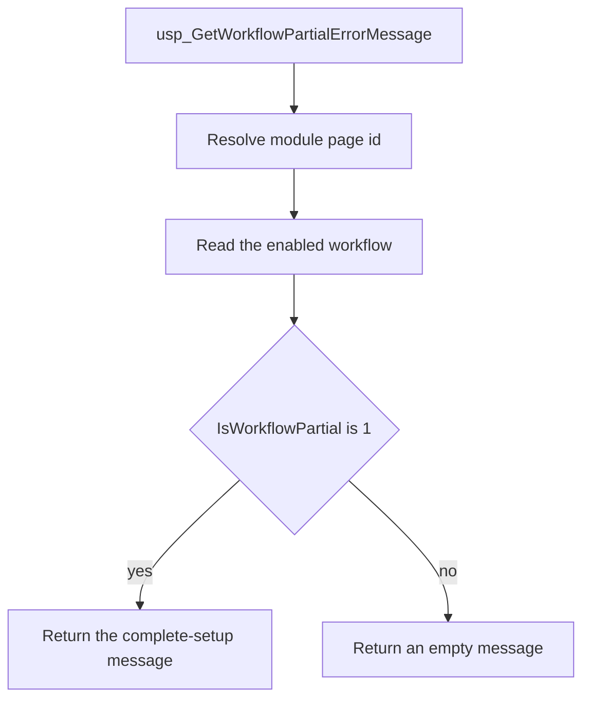

# usp_GetWorkflowPartialErrorMessage

## What it does

Returns whether the enabled workflow for a module page is only partly set up. The message is `Please complete partial workflow setup to send record for approval` when `IsWorkflowPartial` is 1. Otherwise the message is empty. Callers that `INSERT...EXEC` into columns named `ErrorCode` and `ErrorMsg` receive these two columns by position.

## Parameters

| Name | Direction | What it is for |
|---|---|---|
| `@EmployerId` | in | Organisation |
| `@PageTitle` | in | `TModulePages.ModulePageName` |

Both are inputs. The result set is `IsWorkflowPartial` and `ErrMessage`.

## Call sequence

Calls no other procedures or functions.

## Callers

| Object | Kind | Page |
|---|---|---|
| `SP_AdminMstr_AddNewBank` | procedure | [SP_AdminMstr_AddNewBank](/docs/database/hrms/SP_AdminMstr_AddNewBank) |
| `SP_AdminMstr_AddNewBranch` | procedure | No page yet |
| `SP_AdminMstr_UpdBank` | procedure | No page yet |
| `SP_AdminMstr_UpdBankBranch` | procedure | No page yet |

## Nested

Calls no other procedures or functions.

## Steps

1. Read `ModulePageId` from `TModulePages` where `ModulePageName` is `@PageTitle` (`usp_GetWorkflowPartialErrorMessage.sql`).
2. Return the top workflow row for that page, employer, `IsDelete = 0`, and `IsEnable = 1`.
3. Set `ErrMessage` from `IsWorkflowPartial`.

## Tables

| Table | Read or write |
|---|---|
| `TModulePages` | read |
| `TWorkflowManagement` | read |

## Flow

