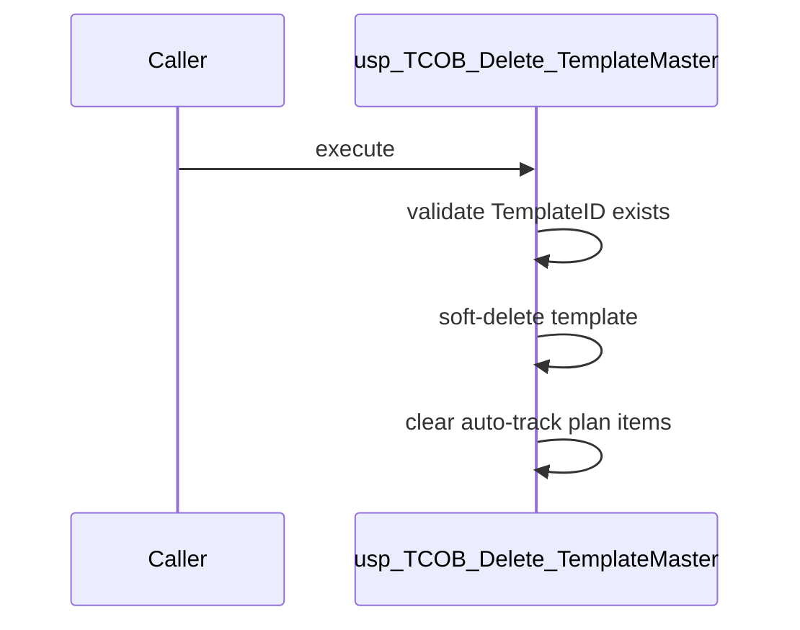
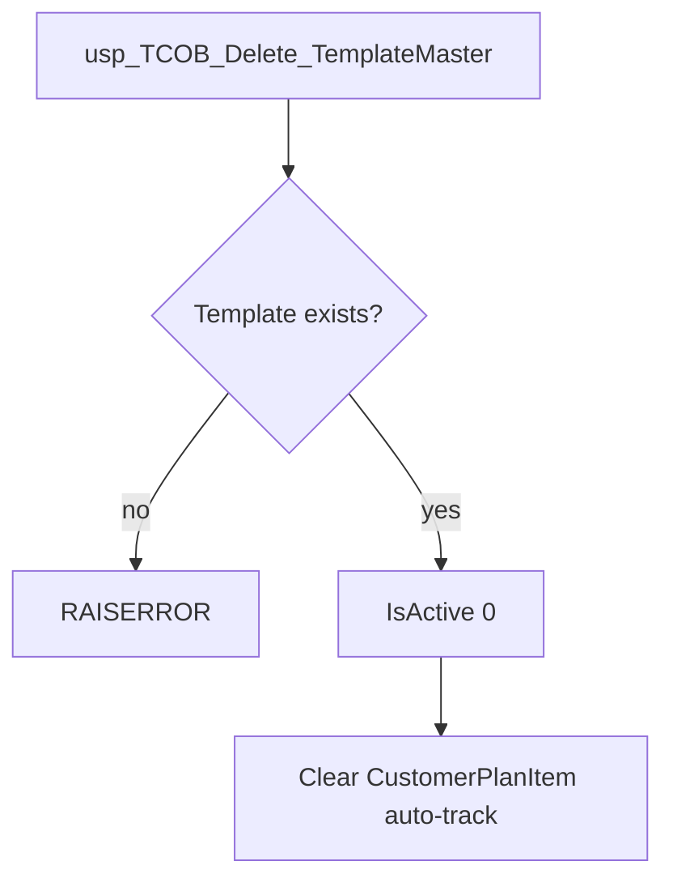

# usp_TCOB_Delete_TemplateMaster

## What it does

Soft-deletes one Config Manager workbook template by setting `IsActive = 0` on `TCOB_TemplateMaster`. Raises if the template id is missing. Also clears auto-tracking on live `TCOB_CustomerPlanItem` rows that still point at the template. Does not hard-delete the row.

## Parameters

| Name | Type | Direction | Default | Meaning |
|---|---|---|---|---|
| `@TemplateID` | INT | in | — | Template to deactivate |
| `@UpdatedBy` | NVARCHAR(100) | in | NULL | Audit user |

## Call sequence

Calls no other procedures or functions.

## Callers

Procedures and functions that call this object.

No other procedure or function calls this object. App caller: `ClientOnboardingDAL.deleteTCOBTemplateMaster` from Config Manager (`POST /api/clientonboard2/cfg/deleteTemplateMaster`).

## Nested

| Object | Kind | When | Page |
|---|---|---|---|
| *(none)* | — | — | — |

## Steps

1. Script is `HRMS-DATABASE/HRMS/STOREPROCEDURE/usp_TCOB_Delete_TemplateMaster.sql`.
2. Raise if `TemplateID` is absent.
3. Soft-delete the template; clear auto-tracked customer-plan items for that template.

## Tables

| Table | Read or write |
|---|---|
| `dbo.TCOB_TemplateMaster` | read + write |
| `dbo.TCOB_CustomerPlanItem` | write |

## Unresolved calls

None.

## Flow

