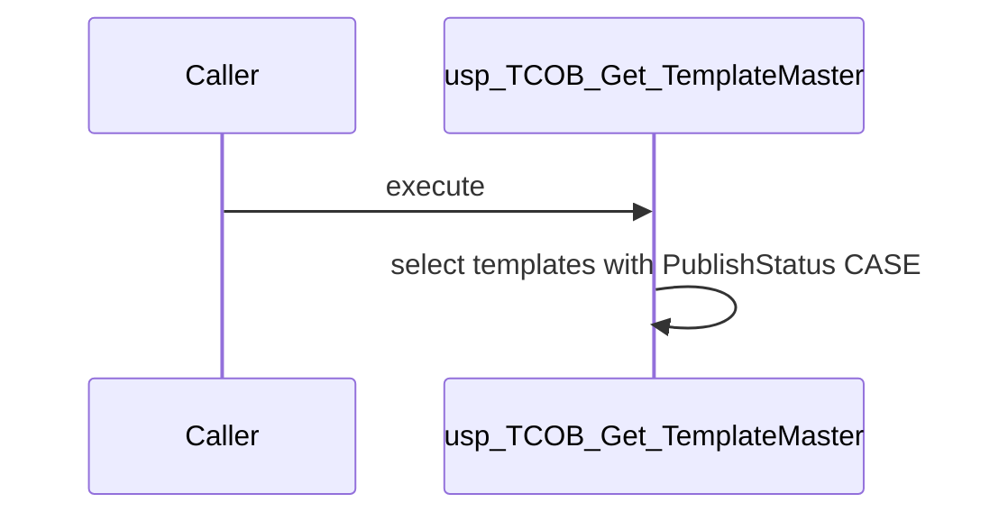
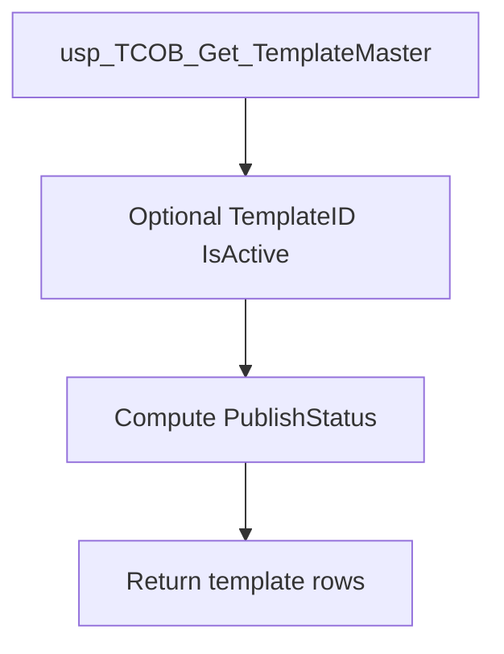

# usp_TCOB_Get_TemplateMaster

## What it does

Returns Client Onboarding Config Manager workbook templates from `TCOB_TemplateMaster`, optionally filtered by template id and active flag. Each row includes a computed `PublishStatus`: Template Pending To Publish, Fields Pending To Publish (when any linked process-section or employee-detail field is unpublished), or Published.

## Parameters

| Name | Type | Direction | Default | Meaning |
|---|---|---|---|---|
| `@TemplateID` | INT | in | NULL | Single template; NULL = all |
| `@IsActive` | BIT | in | NULL | Filter by active; NULL = all |

## Call sequence

Calls no other procedures or functions.

## Callers

Procedures and functions that call this object.

No other procedure or function calls this object. App caller: `ClientOnboardingDAL.getTCOBTemplateMaster` from Config Manager (`GET /api/clientonboard2/cfg/getTemplateMaster`).

## Nested

| Object | Kind | When | Page |
|---|---|---|---|
| *(none)* | — | — | — |

## Steps

1. Script is `HRMS-DATABASE/HRMS/STOREPROCEDURE/usp_TCOB_Get_TemplateMaster.sql`.
2. Select from `TCOB_TemplateMaster` with optional `@TemplateID` / `@IsActive` filters.
3. Compute `PublishStatus` from `IsPublished` and existence of unpublished fields on linked sections.
4. Order by `TemplateID`.

## Tables

| Table | Read or write |
|---|---|
| `dbo.TCOB_TemplateMaster` | read |
| `dbo.TCOB_TemplateSectionMaster` | read (EXISTS) |
| `dbo.TCOB_ProcessSectionMaster` | read (EXISTS) |
| `dbo.TCOB_ProcessSectionMaster_Fields` | read (EXISTS) |
| `dbo.TCOB_EmployeeDetail_Fields` | read (EXISTS) |

## Unresolved calls

None.

## Flow

