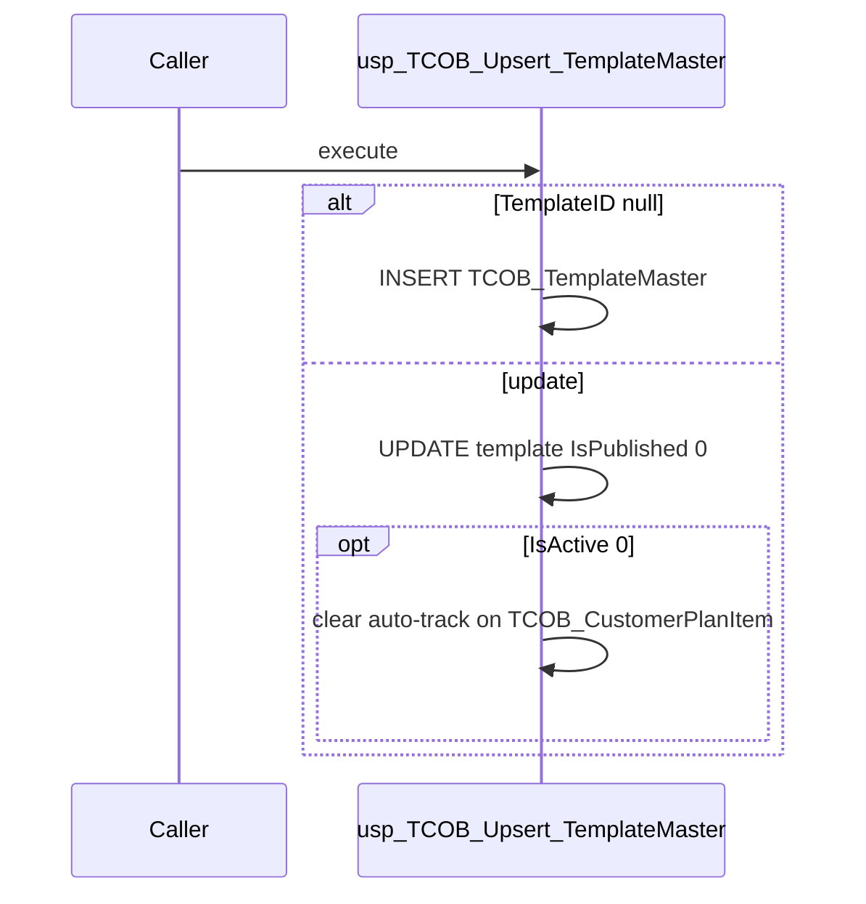
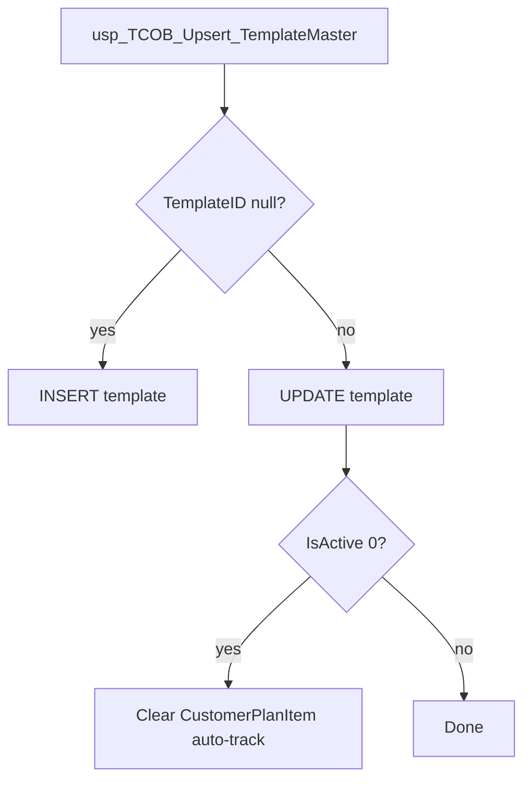

# usp_TCOB_Upsert_TemplateMaster

## What it does

Inserts or updates one Config Manager workbook template in `TCOB_TemplateMaster`. A null `@TemplateID` inserts with `IsPublished = 0`. An update resets `IsPublished` to 0. When the template is deactivated (`@IsActive = 0`), live customer-plan items that auto-track this template have `IsAutoTracked` cleared and `TemplateId` nulled. Baseline plan items are not touched.

## Parameters

| Name | Type | Direction | Default | Meaning |
|---|---|---|---|---|
| `@TemplateID` | INT | in | NULL | NULL = insert; else update |
| `@TemplateName` | NVARCHAR(255) | in | — | Display name |
| `@IsActive` | BIT | in | — | Active flag |
| `@CreatedBy` | NVARCHAR(100) | in | NULL | Insert audit |
| `@UpdatedBy` | NVARCHAR(100) | in | NULL | Update audit |

## Call sequence

Calls no other procedures or functions.

## Callers

Procedures and functions that call this object.

No other procedure or function calls this object. App caller: `ClientOnboardingDAL.upsertTCOBTemplateMaster` from Config Manager (`POST /api/clientonboard2/cfg/upsertTemplateMaster`).

## Nested

| Object | Kind | When | Page |
|---|---|---|---|
| *(none)* | — | — | — |

## Steps

1. Script is `HRMS-DATABASE/HRMS/STOREPROCEDURE/usp_TCOB_Upsert_TemplateMaster.sql`.
2. If `@TemplateID` is null, insert with `IsPublished = 0`.
3. Else update name/active, set `IsPublished = 0`, and if inactive clear matching auto-tracked `TCOB_CustomerPlanItem` rows.

## Tables

| Table | Read or write |
|---|---|
| `dbo.TCOB_TemplateMaster` | write |
| `dbo.TCOB_CustomerPlanItem` | write (when deactivated) |

## Unresolved calls

None.

## Flow

