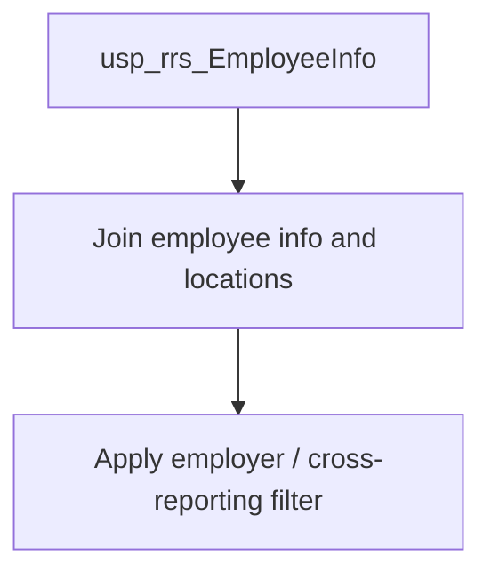

# usp_rrs_EmployeeInfo

## What it does

Returns designation, work location, and base location for a reporting-manager employee. Allows the same organisation always, and parent/child organisations that share `RootEmployerId` when cross reporting is applicable (mirrors `SP_AdminEMP_GetEmpListByOrg` rules).

## Parameters

| Name | Direction | What it is for |
|---|---|---|
| `@EmployeeId` | in | Employee to describe |
| `@EmployerId` | in | Requesting organisation context |

## Call sequence

Calls no other procedures or functions (uses `Fn_GetEmployeeName` inline).

## Callers

No other procedure or function calls this object.

## Nested

| Object | Kind | When | Page |
|---|---|---|---|
| `Fn_GetEmployeeName` | function | employee display name | [Fn_GetEmployeeName](/docs/database/hrms/Fn_GetEmployeeName) |

## Steps

1. Join `TEmployee` / `TEmployeeInfo` to `TTitle` and `TLocation` (work and base).
2. Filter to the requested employer, or to same-root employers when `IsCrossReportingApplicable` is not `N`.

## Tables

| Table | Read or write |
|---|---|
| `TEmployee` | read |
| `TEmployeeInfo` | read |
| `TTitle` | read |
| `TLocation` | read |
| `TEmployerDetails` | read |

## Flow

