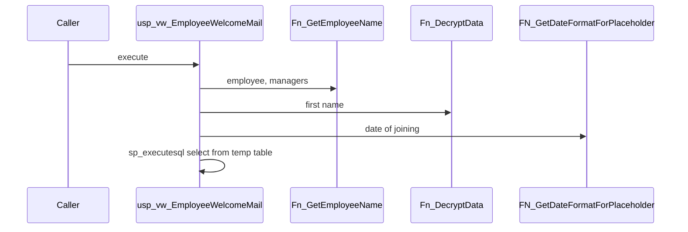
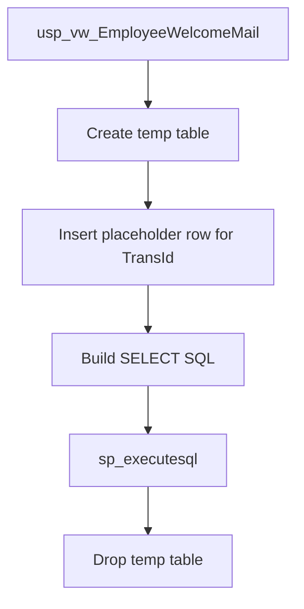

# usp_vw_EmployeeWelcomeMail

## What it does

Builds one placeholder row for a welcome-email request (`TEmployeeWelcomeEmailRequest.Id = @TransId`). It gathers employee identity, organisation, education, experience, managers, skills, and welcome-mail image paths into a temp table, then returns either all columns or a caller-supplied column list via `sp_executesql`. `SP_GetDataForEmailNotIfication` uses this branch when `@RequestType` is `EmployeeWelcomeMail`.

## Parameters

| Name | Direction | What it is for |
|---|---|---|
| `@TransId` | in | Welcome-email request id |
| `@ColumnsList` | in | Optional comma-separated column list; empty returns all columns |

## Call sequence

## Callers

| Object | Kind | Page |
|---|---|---|
| `SP_GetDataForEmailNotIfication` | procedure | [SP_GetDataForEmailNotIfication](/docs/database/hrms/SP_GetDataForEmailNotIfication) |

## Nested

| Object | Kind | When | Page |
|---|---|---|---|
| `Fn_GetEmployeeName` | function | employee, functional manager, reporting manager | [Fn_GetEmployeeName](/docs/database/hrms/Fn_GetEmployeeName) |
| `Fn_DecryptData` | function | decrypt `FName` for FirstName | [Fn_DecryptData](/docs/database/hrms/Fn_DecryptData) |
| `FN_GetDateFormatForPlaceholder` | function | format date of joining | No page yet |

## Steps

1. Create `#EmployeeWelcomeMail` with placeholder columns.
2. Insert one row joined from `TEmployeeWelcomeEmailRequest`, `TEmployee`, and `TEmployeeInfo`, with related lookups for title, employer, location, unit, education, past employment, skills, family relationships, and welcome-mail images.
3. Build dynamic `SELECT` of all columns or `@ColumnsList` from the temp table.
4. Execute with `sp_executesql`.
5. Drop the temp table.

## Tables

| Table | Read or write |
|---|---|
| `dbo.TEmployeeWelcomeEmailRequest` | read |
| `dbo.TEmployee` | read |
| `dbo.TEmployeeInfo` | read |
| `dbo.TTitle` | read |
| `dbo.TEmployerDetails` | read |
| `dbo.TLocation` | read |
| `dbo.TOrgHierarchyDetails` | read |
| `dbo.TEmpWelcomeMail` | read |
| `dbo.TEducationDetails` | read |
| `dbo.TQualificationName` | read |
| `dbo.TEstablishmentName` | read |
| `dbo.TUniversity` | read |
| `dbo.TMaritalStatus` | read |
| `dbo.TEmployeeContactDetails` | read |
| `dbo.TPastEmploymentDetails` | read |
| `dbo.TEmployeeSkillDetails` | read |
| `dbo.TMSkills` | read |
| `dbo.TEmployeeFamilyDetails` | read |
| `dbo.TEmergencyRelationship` | read |
| `dbo.TOrgChart` | read |

## Unresolved calls

`sp_executesql` runs the dynamic column select from `#EmployeeWelcomeMail`. The script header still contains `USE [HRM-CL-Prod]`; object body itself is schema-qualified only through `dbo` references.

## Flow

