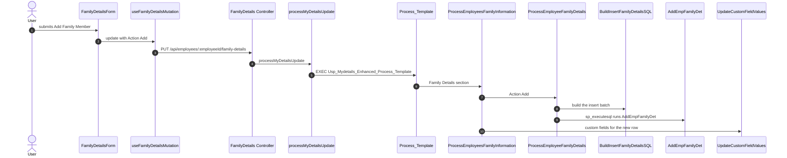

# Add new family record

## Overview

On My Details Family Details, **Add Family Member** opens `FamilyDetailsForm` with an empty family id. Submit sends `Action` `Add` through `useFamilyDetailsMutation`. **Bulk Edit/Add** can add rows in the same PUT. Both calls hit `PUT /api/employees/:employeeId/family-details`.

## Add a family member

## Steps

| Step | What happens | File | Object |
|---|---|---|---|
| 1 | Add Family Member opens `FamilyDetailsForm`. Submit sends `Action` `Add` when `EmployeeFamilyDetailID` is empty | `HRMS.Web/HRMS.Web/HRM/MyDetails_React/src/components/sections/familyDetails/FamilyDetails.tsx:395` | |
| 2 | The form calls `update` with one family row | `HRMS.Web/HRMS.Web/HRM/MyDetails_React/src/components/sections/familyDetails/FamilyDetailsForm.tsx:342` | |
| 3 | The hook PUTs JSON to `employees/{employeeId}/family-details`. The HTTP client prefix is `/api` | `hrms-sdk/src/hooks/employee/family-details/useFamilyDetailsMutation.ts:34` | |
| 4 | `requireEmployeeId` and `validateRequest` run, then `Put` starts the update | `HRMS.CoreAPI/HRMS.Core.WebAPI.Node/Features/Employee/MyDetails/FamilyDetails/Controller.js:38` | |
| 5 | The helper validates the row and executes the template. This PUT has no separate ORM module | `HRMS.CoreAPI/HRMS.Core.WebAPI.Node/Features/Employee/MyDetails/Utils/ProcessMyDetailsUpdate.js:504` | [Usp_Mydetails_Enhanced_Process_Template](/docs/database/hrms/Usp_Mydetails_Enhanced_Process_Template) |
| 6 | After the encryption keys open, Family Details calls the family processor | `HRMS-DATABASE/HRMS/STOREPROCEDURE/Usp_Mydetails_Enhanced_Process_Template.sql:205` | [Usp_Mydetails_Enhanced_ProcessEmployeesFamilyInformation](/docs/database/hrms/Usp_Mydetails_Enhanced_ProcessEmployeesFamilyInformation) |
| 7 | The family processor sends the Add row to the row procedure | `HRMS-DATABASE/HRMS/STOREPROCEDURE/Usp_Mydetails_Enhanced_ProcessEmployeesFamilyInformation.sql:83` | [SP_Mydetails_Enhanced_ProcessEmployeeFamilyDetails](/docs/database/hrms/SP_Mydetails_Enhanced_ProcessEmployeeFamilyDetails) |
| 8 | The Add branch asks the insert function for a batch | `HRMS-DATABASE/HRMS/STOREPROCEDURE/SP_Mydetails_Enhanced_ProcessEmployeeFamilyDetails.sql:145` | [FN_Mydetails_Enhanced_BuildInsertFamilyDetailsSQL](/docs/database/hrms/FN_Mydetails_Enhanced_BuildInsertFamilyDetailsSQL) |
| 9 | `sp_executesql` runs that batch, which names `SP_Mydetails_Enhanced_AddEmpFamilyDet` | `HRMS-DATABASE/HRMS/FUNCTIONS/FN_Mydetails_Enhanced_BuildInsertFamilyDetailsSQL.sql:45` | [SP_Mydetails_Enhanced_AddEmpFamilyDet](/docs/database/hrms/SP_Mydetails_Enhanced_AddEmpFamilyDet) |
| 10 | The family processor then saves custom fields for the new row | `HRMS-DATABASE/HRMS/STOREPROCEDURE/Usp_Mydetails_Enhanced_ProcessEmployeesFamilyInformation.sql:124` | [SP_Mydetails_Enhanced_UpdateCustomFieldValues](/docs/database/hrms/SP_Mydetails_Enhanced_UpdateCustomFieldValues) |

Bulk Edit/Add uses the same PUT. `FamilyDetailsBulkEdit` builds `Action` `Add` for new grid rows and calls `update` at `FamilyDetailsBulkEdit.tsx:394`.

## Stored procedures and functions

| Object | Kind | Leaf | Page |
|---|---|---|---|
| `Usp_Mydetails_Enhanced_Process_Template` | procedure | no | [Usp_Mydetails_Enhanced_Process_Template](/docs/database/hrms/Usp_Mydetails_Enhanced_Process_Template) |
| `Sp_OpenEncryptionKeys` | procedure | yes | [Sp_OpenEncryptionKeys](/docs/database/hrms/Sp_OpenEncryptionKeys) |
| `Sp_OpenEncryptionKeysNew` | procedure | yes | [Sp_OpenEncryptionKeysNew](/docs/database/hrms/Sp_OpenEncryptionKeysNew) |
| `SP_CloseEncryptionKey` | procedure | yes | [SP_CloseEncryptionKey](/docs/database/hrms/SP_CloseEncryptionKey) |
| `SP_CloseEncryptionKeyNew` | procedure | yes | [SP_CloseEncryptionKeyNew](/docs/database/hrms/SP_CloseEncryptionKeyNew) |
| `Usp_Mydetails_Enhanced_ProcessEmployeesFamilyInformation` | procedure | no | [Usp_Mydetails_Enhanced_ProcessEmployeesFamilyInformation](/docs/database/hrms/Usp_Mydetails_Enhanced_ProcessEmployeesFamilyInformation) |
| `SP_Mydetails_Enhanced_ProcessEmployeeFamilyDetails` | procedure | no | [SP_Mydetails_Enhanced_ProcessEmployeeFamilyDetails](/docs/database/hrms/SP_Mydetails_Enhanced_ProcessEmployeeFamilyDetails) |
| `FN_Mydetails_Enhanced_BuildInsertFamilyDetailsSQL` | function | no | [FN_Mydetails_Enhanced_BuildInsertFamilyDetailsSQL](/docs/database/hrms/FN_Mydetails_Enhanced_BuildInsertFamilyDetailsSQL) |
| `FN_Mydetails_Enhanced_BuildUpdateFamilyDetailsSQL` | function | no | [FN_Mydetails_Enhanced_BuildUpdateFamilyDetailsSQL](/docs/database/hrms/FN_Mydetails_Enhanced_BuildUpdateFamilyDetailsSQL) |
| `FN_BulkUpdateProfile_GetFieldValueFromJSON` | function | yes | [FN_BulkUpdateProfile_GetFieldValueFromJSON](/docs/database/hrms/FN_BulkUpdateProfile_GetFieldValueFromJSON) |
| `SP_Mydetails_Enhanced_AddEmpFamilyDet` | procedure | no | [SP_Mydetails_Enhanced_AddEmpFamilyDet](/docs/database/hrms/SP_Mydetails_Enhanced_AddEmpFamilyDet) |
| `SP_Mydetails_Enhanced_UpdEmpFamilyDet` | procedure | no | [SP_Mydetails_Enhanced_UpdEmpFamilyDet](/docs/database/hrms/SP_Mydetails_Enhanced_UpdEmpFamilyDet) |
| `SP_Mydetails_Enhanced_RemoveFamilyDetById` | procedure | yes | [SP_Mydetails_Enhanced_RemoveFamilyDetById](/docs/database/hrms/SP_Mydetails_Enhanced_RemoveFamilyDetById) |
| `SP_CM_GetWorkflowTreeXmlDetailsByPageTitle` | procedure | no | [SP_CM_GetWorkflowTreeXmlDetailsByPageTitle](/docs/database/hrms/SP_CM_GetWorkflowTreeXmlDetailsByPageTitle) |
| `SP_CM_GetWorkflowTreeXmlDetailsByPageTitle_EmpId` | procedure | yes | [SP_CM_GetWorkflowTreeXmlDetailsByPageTitle_EmpId](/docs/database/hrms/SP_CM_GetWorkflowTreeXmlDetailsByPageTitle_EmpId) |
| `SP_Mydetails_Enhanced_UpdateCustomFieldValues` | procedure | no | [SP_Mydetails_Enhanced_UpdateCustomFieldValues](/docs/database/hrms/SP_Mydetails_Enhanced_UpdateCustomFieldValues) |
| `SP_MyDetails_Enhanced_UpdEmpCustomFields` | procedure | no | [SP_MyDetails_Enhanced_UpdEmpCustomFields](/docs/database/hrms/SP_MyDetails_Enhanced_UpdEmpCustomFields) |
| `TVF_Get_AllApprovalsAndNotifications` | function | yes | [TVF_Get_AllApprovalsAndNotifications](/docs/database/hrms/TVF_Get_AllApprovalsAndNotifications) |

Leaf is yes when that object calls no further procedure or function. `SP_Mydetails_Enhanced_UpdEmpFamilyDet` and `SP_Mydetails_Enhanced_RemoveFamilyDetById` are on the Update and Delete branches of the same row procedure. An Add does not execute them.

## Known gaps

`SP_Mydetails_Enhanced_ProcessEmployeeFamilyDetails` runs the insert with `sp_executesql`. The batch text names `SP_Mydetails_Enhanced_AddEmpFamilyDet`. The same pattern names `SP_Mydetails_Enhanced_UpdEmpFamilyDet` on Update.

`Usp_Mydetails_Enhanced_Process_Template` also calls a processor for every other My Details section. Those branches do not run for Family Details and do not have pages from this trace.

`SP_CM_GetWorkflowTreeXmlDetailsByPageTitle` can call `SP_CM_GetWorkflowTreeXmlDetailsByPageTitle_EmpId` when no employee id is passed. The family processor always passes the employee id, so the add path uses the employee branch of that procedure.

## Reference

### SourceCode

- `HRMS.Web/HRMS.Web/HRM/MyDetails_React/src/components/sections/familyDetails/FamilyDetails.tsx`
- `HRMS.Web/HRMS.Web/HRM/MyDetails_React/src/components/sections/familyDetails/FamilyDetailsForm.tsx`
- `HRMS.Web/HRMS.Web/HRM/MyDetails_React/src/components/sections/familyDetails/FamilyDetailsBulkEdit.tsx`
- `hrms-sdk/src/hooks/employee/family-details/useFamilyDetailsMutation.ts`
- `hrms-sdk/src/api/employee/common/updateSectionData.ts`
- `HRMS.CoreAPI/HRMS.Core.WebAPI.Node/Features/Employee/MyDetails/routes.js`
- `HRMS.CoreAPI/HRMS.Core.WebAPI.Node/Features/Employee/MyDetails/FamilyDetails/Controller.js`
- `HRMS.CoreAPI/HRMS.Core.WebAPI.Node/Features/Employee/MyDetails/Utils/ProcessMyDetailsUpdate.js`

### TDG HRMS DB

- `HRMS-DATABASE/HRMS/STOREPROCEDURE/Usp_Mydetails_Enhanced_Process_Template.sql`
- `HRMS-DATABASE/HRMS/STOREPROCEDURE/Usp_Mydetails_Enhanced_ProcessEmployeesFamilyInformation.sql`
- `HRMS-DATABASE/HRMS/STOREPROCEDURE/SP_Mydetails_Enhanced_ProcessEmployeeFamilyDetails.sql`
- `HRMS-DATABASE/HRMS/FUNCTIONS/FN_Mydetails_Enhanced_BuildInsertFamilyDetailsSQL.sql`
- `HRMS-DATABASE/HRMS/STOREPROCEDURE/SP_Mydetails_Enhanced_AddEmpFamilyDet.sql`
- `HRMS-DATABASE/HRMS/STOREPROCEDURE/SP_Mydetails_Enhanced_UpdateCustomFieldValues.sql`
- `HRMS-DATABASE/HRMS/STOREPROCEDURE/SP_MyDetails_Enhanced_UpdEmpCustomFields.sql`
