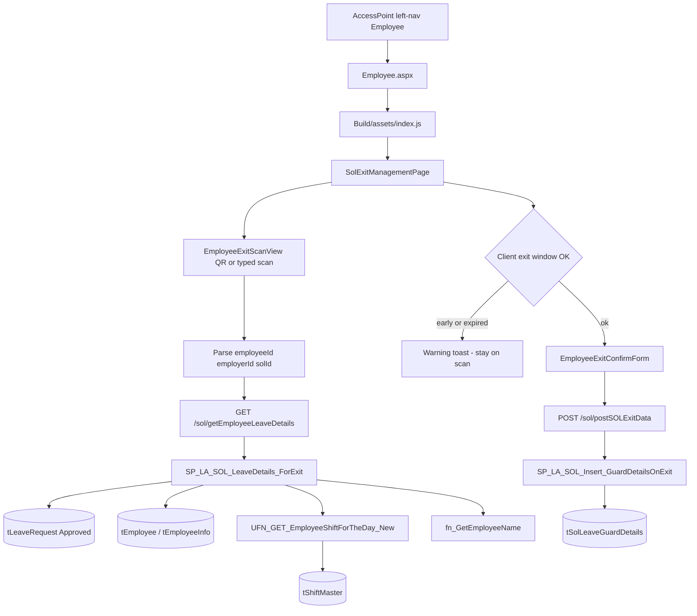
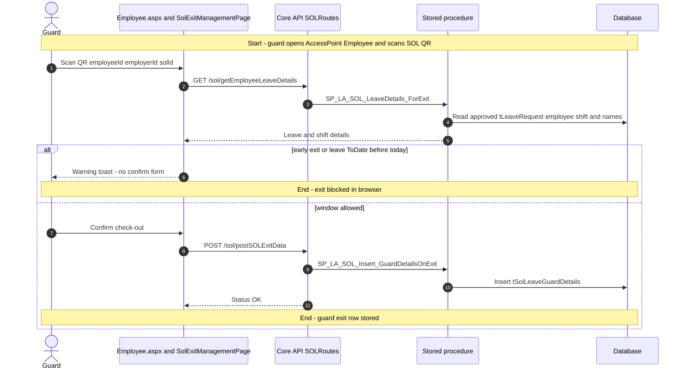
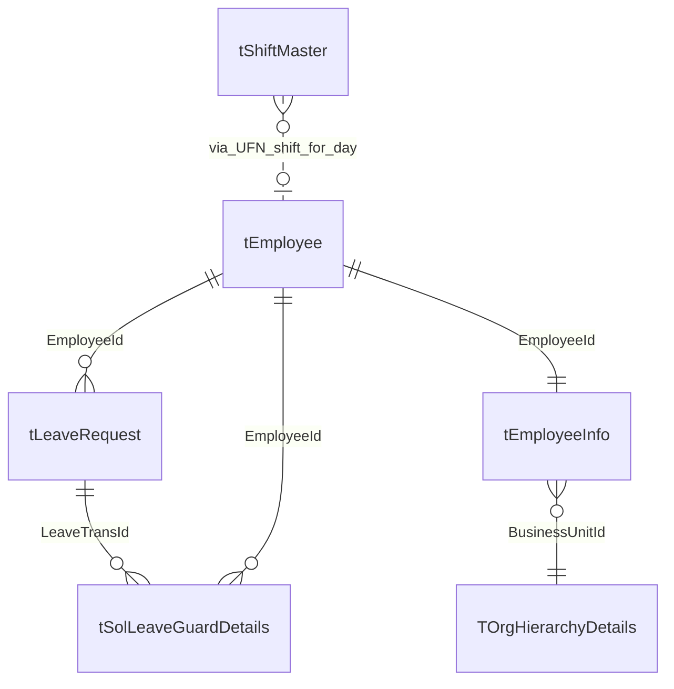

# Employee

## Overview

A security guard or access-point operator opens **AccessPoint → Employee** to verify a short-on-leave (SOL) exit before the employee leaves the premises. The left-nav leaf (menu id **1236**, parent **1235**) loads `~/HRM/AccessPoint_React/Employee.aspx`. The WebForms host only stamps session identity into hidden fields and mounts the Vite AccessPoint React bundle into `#root`. There is no grid binding and no `__doPostBack` on this page.

The live UI is `SolExitManagementPage`. It starts on a QR / scanner prompt. Scanning a payload shaped `employeeId=&employerId=&solId=` calls Core API `GET /sol/getEmployeeLeaveDetails`, which runs `SP_LA_SOL_LeaveDetails_ForExit` against an **Approved** `tLeaveRequest` row and builds shift start/end from `tShiftMaster` via `UFN_GET_EmployeeShiftForTheDay_New`. Client-side logic then blocks early exit (before shift end minus leave duration) and rejects back-dated leave (`ToDate` before today). When confirmation is allowed, the guard confirms check-out; `POST /sol/postSOLExitData` inserts one row into `tSolLeaveGuardDetails` through `SP_LA_SOL_Insert_GuardDetailsOnExit`.

**Who's involved:**

- **Guard / access-point operator** — signed-in employee whose session hidden fields become `GuardId` / `GuardName` on save.
- **Employee on SOL** — presents a QR encoding leave transaction, employee, and employer ids; never uses this screen themselves in the documented flow.

Sibling left-nav leaf **Visitor** (`~/HRM/VMS_React/Visitor.aspx`, menu **1237**) is a separate AccessPoint child and is not covered here.

## Workflow

## Request journey

Opening the leaf only loads the scanner shell. The first database round-trip is the QR lookup; check-out is a second request.

### Scan SOL QR and confirm exit

## Entry points

> The live screen is the WebForms host `HRM/AccessPoint_React/Employee.aspx`. React Router matches `/HRM/AccessPoint_React/Employee.aspx` (and `/`) to `SolExitManagementPage`. Core API mounts `SOLRoutes` at `/api/sol` from `Routes/routeIndex.js`. There is no WebForms postback for SOL exit.

| Entry point | Purpose | Live? |
|---|---|---|
| Left-nav **AccessPoint → Employee** (menu **1236**) | Opens `~/HRM/AccessPoint_React/Employee.aspx` | Yes |
| `Employee.aspx` `Page_Load` | Stamps session into hidden fields (`hdnEmpId`, employer, role, email, …) | Yes — no activity-log call |
| React `SolExitManagementPage` | Scanner → confirm → save | Yes |
| `GET /api/sol/getEmployeeLeaveDetails` | Load approved SOL leave for scanned ids | Yes (`Authorize`) |
| `POST /api/sol/postSOLExitData` | Insert guard exit detail | Yes (`Authorize`) |

## Code → database call chain

| Entry point | DAL / BLL method | Stored procedure |
|---|---|---|
| `Employee.aspx.cs:24` `Page_Load` | Session stamp only | none |
| `SolExitManagementPage.tsx:70-71` → `GET sol/getEmployeeLeaveDetails` (`SOLRoutes.js:7`, `SOLController.js:6`) | `SOLBLL.GetEmployeeLeaveDetails` → `SOLDAL.GetEmployeeLeaveDetails` (`SOLDAL.js:14-21`) | `SP_LA_SOL_LeaveDetails_ForExit` (+ nested `fn_GetEmployeeName`, `UFN_GET_EmployeeShiftForTheDay_New`) |
| `SolExitManagementPage.tsx:28-30` → `POST sol/postSOLExitData` (`SOLRoutes.js:8`, `SOLController.js:22`) | `SOLBLL.PostSOLExitData` → `SOLDAL.PostSOLExitData` (`SOLDAL.js:29-40`) | `SP_LA_SOL_Insert_GuardDetailsOnExit` |

`SOLDAL.PostSOLExitData` sets `@SOLActualOutTime` to `new Date()` and `@CreatedBy` to the same `GuardId` as `@GuardID`.

## API endpoints

Core WebAPI prefix `/api/sol/{action}` (`Authorize` middleware). AccessPoint React constants omit the `/api` segment; the Vite `API_URL` base supplies it.

| Method | Path | Role on this page |
|---|---|---|
| GET | `/sol/getEmployeeLeaveDetails?LeaveTransId=&EmployeeId=&EmployerId=` | Load approved SOL leave + shift window after scan |
| POST | `/sol/postSOLExitData` | Body `EmployeeId`, `LeaveTransId`, `GuardId`, `GuardName` — insert guard exit row |

Missing query/body fields return HTTP **404** with `{ error: "..." }` from `SOLController` (not ActionResult). Success on save is `{ "Status": "OK" }` regardless of whether the insert returned a rowset.

No ASPX `__doPostBack` for this leaf.

## Stored procedures & tables involved

| Procedure / function | Role | Database docs |
|---|---|---|
| [`SP_LA_SOL_LeaveDetails_ForExit`](/docs/database/hrms/SP_LA_SOL_LeaveDetails_ForExit) | Approved leave + employee + shift for exit | written |
| [`SP_LA_SOL_Insert_GuardDetailsOnExit`](/docs/database/hrms/SP_LA_SOL_Insert_GuardDetailsOnExit) | Insert guard exit detail | written |
| [`Fn_GetEmployeeName`](/docs/database/hrms/Fn_GetEmployeeName) | Nested employee / approver display name | existing |
| [`UFN_GET_EmployeeShiftForTheDay_New`](/docs/database/hrms/UFN_GET_EmployeeShiftForTheDay_New) | Nested shift id for leave FromDate | written |

Primary tables: `tLeaveRequest`, `tEmployee`, `tEmployeeInfo`, `TOrgHierarchyDetails`, `tShiftMaster`, `tSolLeaveGuardDetails`. Nested shift resolution reaches attendance/calendar helpers via `UFN_GET_AttendanceCalDateAndShift` (inside `UFN_GET_EmployeeShiftForTheDay_New`; second nesting level, not documented as a separate page in this pass).

## Table relationships

## Known gaps

- **No activity log on `Employee.aspx`** — unlike many React hosts, `Page_Load` does not call `CommonUtil.LogActivity`.
- **Default axios instance** in AccessPoint `apiHelper.ts` does not set `withCredentials` or seed `Authorization` from session the way some sibling modules do; auth depends on how `API_URL` / gateway cookies are configured in the deployed build.
- **Early-exit and back-date gates are client-only** — `SP_LA_SOL_LeaveDetails_ForExit` only requires `LeaveStatus = 'Approved'`; `validateExitTime` in `utils/index.ts` is not re-checked in the API or insert SP.
- **Insert SP has no duplicate / already-exited guard** — repeated confirms can insert multiple `tSolLeaveGuardDetails` rows for the same leave.
- **`@lEmployerID` on `UFN_GET_EmployeeShiftForTheDay_New` is unused** in the live function body (only `UFN_GET_AttendanceCalDateAndShift` is called).
- **SystemModel-2** has no dedicated AccessPoint / SOL exit surface page in this checkout.
- Sibling **Visitor** leaf is not documented in this guide.

## Reference

- `HRMS.Web/HRMS.Web/HRM/AccessPoint_React/Employee.aspx` (+ `.cs`)
- `HRMS.Web/.../HRM/AccessPoint_React/Webapp/src/App.tsx`
- `HRMS.Web/.../HRM/AccessPoint_React/Webapp/src/pages/SolExitManagementPage.tsx`
- `HRMS.Web/.../HRM/AccessPoint_React/Webapp/src/components/EmployeeExitScanView.tsx`
- `HRMS.Web/.../HRM/AccessPoint_React/Webapp/src/components/EmployeeExitConfirmForm.tsx`
- `HRMS.Web/.../HRM/AccessPoint_React/Webapp/src/common/apiURLConstants.ts`
- `HRMS.Web/.../HRM/AccessPoint_React/Webapp/src/common/apiHelper.ts`
- `HRMS.Web/.../HRM/AccessPoint_React/Webapp/src/utils/index.ts`
- `HRMS.CoreAPI/HRMS.Core.WebAPI.Node/Routes/routeIndex.js` (`/sol`)
- `HRMS.CoreAPI/HRMS.Core.WebAPI.Node/Routes/SOLRoutes.js`
- `HRMS.CoreAPI/HRMS.Core.WebAPI.Node/Controllers/SOLController.js`
- `HRMS.CoreAPI/HRMS.Core.WebAPI.Node/Core/BusinessLogicLayer/SOLBLL.js`
- `HRMS.CoreAPI/HRMS.Core.WebAPI.Node/Core/DataAccessLayer/SOLDAL.js`
- `HRMS-DATABASE/HRMS/DML/118596/MenuInsertion.sql` (menu 1235 / 1236 / 1237)
- `HRMS-DATABASE/HRMS/STOREPROCEDURE/SP_LA_SOL_LeaveDetails_ForExit.sql`
- `HRMS-DATABASE/HRMS/STOREPROCEDURE/SP_LA_SOL_Insert_GuardDetailsOnExit.sql`
- `HRMS-DATABASE/HRMS/FUNCTIONS/UFN_GET_EmployeeShiftForTheDay_New.sql`
- `HRMS-DATABASE/HRMS/TABLES/tSolLeaveGuardDetails.sql`
