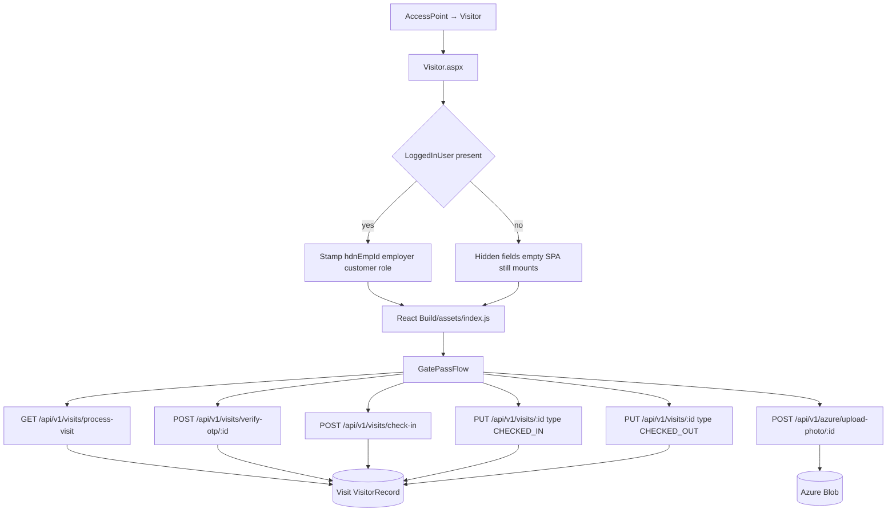
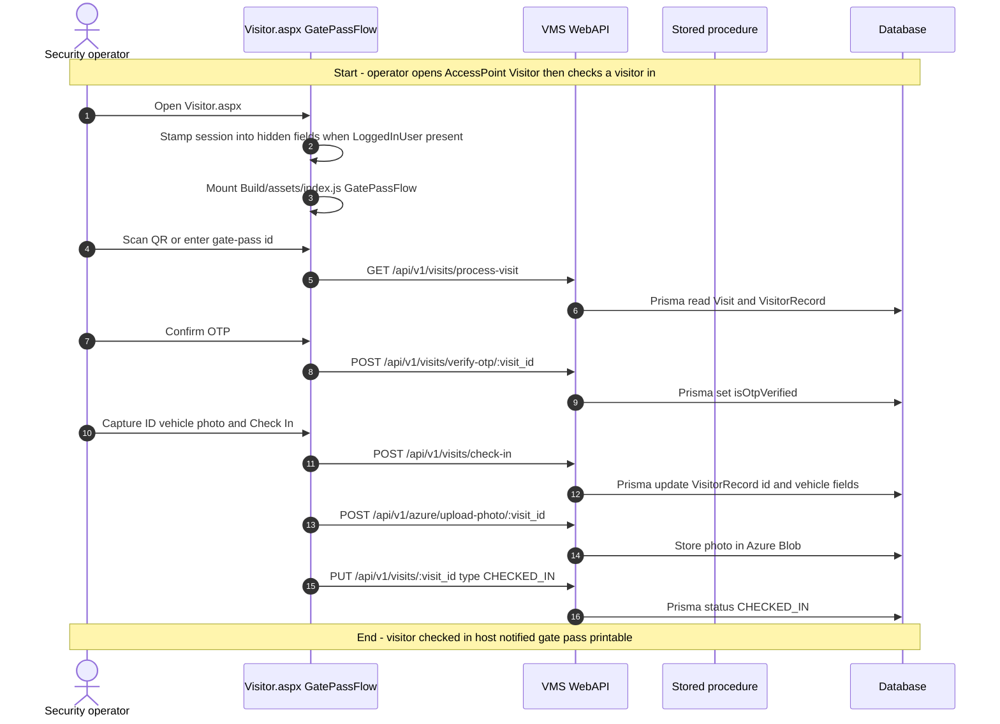
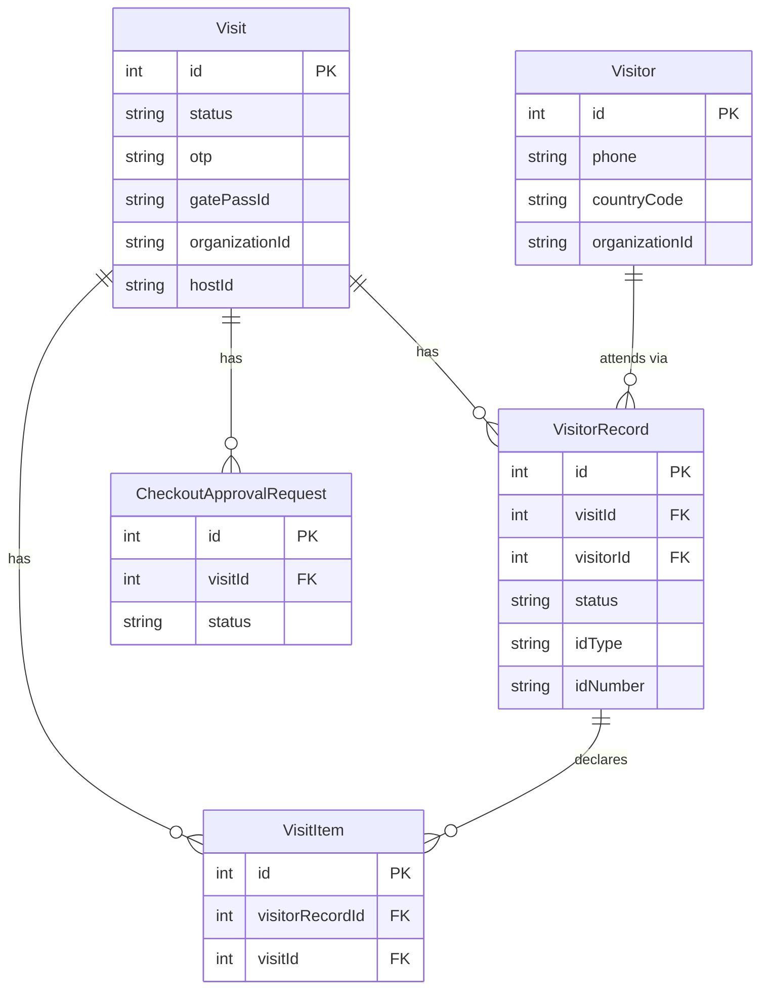

# Visitor

## Overview

A security operator opens **AccessPoint → Visitor** (`~/HRM/VMS_React/Visitor.aspx`, menu id **1237** under parent **AccessPoint** / **1235**) to run the gate **check-in / check-out** flow for arriving and leaving visitors. The WebForms host only stamps the signed-in employee into hidden fields and mounts the shared VMS React bundle at `#root` (`Build/assets/index.js`). It does **not** write an activity-log row, does **not** redirect on a missing session, and does **not** re-check the dynamic menu URL (unlike the sibling host `CheckInCheckOut.aspx`).

Inside the SPA the same screen is `GatePassFlow` (also routed from `CheckInCheckOut.aspx`). The operator finds a visit by scanning a QR code or typing a gate-pass id, verifies a 6-digit OTP, captures government ID / vehicle / photo as the organisation config requires, optionally picks a gate area, then checks the visitor in. Checked-in visitors can be checked out (host approval first when org config requires it). Visit rows and visitor records are persisted by the separate VMS Express API through Prisma (`Visit`, `Visitor`, `VisitorRecord`, …). Photos go to Azure Blob. There is **no stored procedure on the visit check-in / check-out write path**.

Menu DML links AccessPoint / Employee / Visitor to module **32** (Visitor Management). Canonical behaviour for this surface lives in the **VMS** Azure DevOps repo’s SystemModel-2 (`experience/surfaces/operator-surfaces.md`, `behavior/use-cases/check-in-visitor.md`, `behavior/workflows/visitor-check-in.md`). The VMS frontend/backend source and `Build/` bundle are **not** present in the SourceCode workspace analyzed for this guide. There is no llm-wiki domain page for AccessPoint Visitor.

**Who's involved:**

- **Security operator** — opens AccessPoint → Visitor when their menu includes `Visitor.aspx`. SPA UI also expects the `"Validate"` permission tab when embedded in HRMS.
- **Visitor** — presents OTP / QR at the gate; does not open this screen.
- **Host (employee being visited)** — receives check-in / check-out notifications; may approve checkout when org config requires it. Does not operate this AccessPoint screen.

## Workflow

## Request journey

### Security operator — check in a visitor

No WebForms postback journey exists. The aspx does not call a BLL or DAL. Check-out is the same SPA with `PUT /api/v1/visits/:id` and `type=CHECKED_OUT` (optionally after checkout-approval APIs).

## Entry points

`~/HRM/VMS_React/Visitor.aspx` is the live AccessPoint → Visitor host (`PageName` `Visitor.aspx`, menu id **1237**). `Page_Load` only copies `Session["LoggedInUser"]` into page properties used by the aspx hidden inputs. The React module mounts at `#root` via `Build/assets/index.js`.

VMS SystemModel-2 maps this aspx and `CheckInCheckOut.aspx` to the same SPA route/component (`/checkin-checkout`, `GatePassFlow`). `CheckInCheckOut.aspx` adds activity log type `VisitorManagementCheckInCheckOut` (451), login redirect, and a `sp_GetDynamicMenuItems` URL gate; **Visitor.aspx does not**.

| UI page | Purpose |
|---|---|
| `HRM/VMS_REACT/Visitor.aspx` | AccessPoint → Visitor WebForms host and session stamp |
| `HRM/VMS_REACT/CheckInCheckOut.aspx` | Sibling host for the same `GatePassFlow` with activity log and menu gate |
| `HRM/VMS_REACT/Build/assets/index.js` | Deployed VMS SPA bundle (not in SourceCode git tree) |
| VMS repo `frontend/src/pages/GatePassFlow` | Check-in / check-out UI (SystemModel-2) |
| VMS repo `backend` `/api/v1/visits/*` | Visit lookup, OTP, check-in, check-out (SystemModel-2) |

## Code → database call chain

Host-side hops are verified in SourceCode. SPA → API → Prisma / Azure hops are from the VMS SystemModel-2 knowledge base (VMS repo source and Build bundle were not in this workspace).

| Entry | Method | Stored procedure / data access |
|---|---|---|
| Page load (session stamp) | `Page_Load` (`Visitor.aspx.cs:24-40`) | None — reads `Session["LoggedInUser"]` only |
| SPA find visit | `GatePassFlow` → `GET /api/v1/visits/process-visit` → `processVisitsService` (VMS repo) | Prisma read `Visit` / `VisitorRecord` (no SP) |
| SPA verify OTP | → `POST /api/v1/visits/verify-otp/:visit_id` → `verifyVisitOtpService` | Prisma update `isOtpVerified` (no SP) |
| SPA save IDs / vehicle | → `POST /api/v1/visits/check-in` → `saveVisitorIdsService` | Prisma update `VisitorRecord` (no SP) |
| SPA photo | → `POST /api/v1/azure/upload-photo/:visit_id` | Azure Blob (not SQL) |
| SPA check-in / check-out | → `PUT /api/v1/visits/:visit_id` (`type` CHECKED_IN / CHECKED_OUT) | Prisma status / times (no SP) |
| SPA share pass (optional) | → `POST /api/v1/visits/share-gate-pass/:visit_id` | Notifications; may queue email via HRMS helpers (see Known gaps) |

## API endpoints

Not WebForms postback for check-in / check-out. The host page has no PageMethods. After mount, the VMS React app calls the VMS Node API under `/api/v1` (base URL is configured in the VMS frontend env, not in the aspx).

| Verb | Route | Parameters | Purpose | Source |
|---|---|---|---|---|
| GET | `/api/v1/visits/process-visit` | query visit id or gatePassId (required); JWT + org-access | Gate lookup | VMS SystemModel-2 `interface/apis/service-apis.md` |
| POST | `/api/v1/visits/verify-otp/:visit_id` | path `visit_id`; OTP body; JWT + org-access | Verify visit OTP | same |
| POST | `/api/v1/visits/check-in` | visitor id/vehicle payload (`saveVisitorIdsSchema`); JWT + org-access | Save IDs / vehicle (does not flip status) | same |
| POST | `/api/v1/azure/upload-photo/:visit_id` | path `visit_id`; header `x-visitor-record-id`; JWT + org-access | Upload visitor photo | same |
| PUT | `/api/v1/visits/:visit_id` | path `visit_id`; body `type` CHECKED_IN / CHECKED_OUT and times; JWT + org-access | Check in or check out | same |
| POST | `/api/v1/visits/share-gate-pass/:visit_id` | path `visit_id`; JWT + org-access | Email / WhatsApp the pass | same |

Host-only path uses no Enterprise Library DAL and no Core `HRMS.Core.WebAPI.Node` controller. Checkout-approval routes under `/api/v1/checkout-approval/*` apply when org config requires host approval before check-out.

## Stored procedures & tables involved

This AccessPoint host executes **no** stored procedure. Visit check-in / check-out persistence is Prisma against VMS-owned tables (observed under database `HRM-VMS` on DEV for related config; SystemModel describes `prisma-integrated` on the shared HRMS SQL Server). Liquibase tree `HRMS-DATABASE/HRM-VMS` has DML only — no checked-in `STOREPROCEDURE` or `TABLES` scripts for these objects.

| Object | File path | Purpose | llm-wiki |
|---|---|---|---|
| (none on host) | — | `Visitor.aspx.cs` has no DAL / activity / menu calls | — |
| `Visit` / `Visitor` / `VisitorRecord` / `VisitItem` / `CheckoutApprovalRequest` (tables) | Live via VMS Prisma; not in Liquibase `TABLES/` | Gate check-in / check-out write targets | No llm-wiki page |

VMS backend repositories can call HRMS procedures for employee / org / email (`SP_EMPMD_GetEmpSummaryData`, `SP_EMPMD_GetEmpContactDet`, `SP_Admin_GetAllEmployeeListByOrg`, `SP_GetEmployerList`, `SP_AdminORG_GetEmployerDet`, `SP_CM_GetOrganizationDet`, `SP_CM_GetEmployerEmail`, `SP_VMS_GetEmployeesByGroupName`, `SP_SendEmail`) when resolving hosts or sending notifications. Those are **not** invoked by `Visitor.aspx` and are not re-verified as part of this screen’s direct call chain in SourceCode.

## Table relationships

Visit / visitor graphs follow the VMS SystemModel-2 ERD (`data/relationships/erd.md`). Host session fields are not written to SQL on this page.

`hostId` / `organizationId` / `issuedByEmployeeId` are loose strings with no Prisma FK to HRMS employee or employer tables.

## Known gaps

- VMS React source, Vite `Build/` output, and VMS Express API are **not** in the SourceCode workspace; SPA/API call-chain detail is taken from VMS SystemModel-2, not re-read file:line from that repo.
- `Visitor.aspx` omits activity logging, login redirect, and menu URL gating that `CheckInCheckOut.aspx` performs — AccessPoint entry relies on left-nav visibility alone for host-side access control.
- No `ActivityDescription` value is logged for this aspx (`VisitorPass` 450 is used by `VMS.aspx`, not `Visitor.aspx`).
- `HRMS-DATABASE/HRM-VMS` Liquibase baseline contains only DML; there are **no** checked-in SP/table scripts for Visit entities, and visit CRUD is Prisma-only.
- Physical database placement for Prisma tables may differ by environment (SystemModel “shared HRMS DB” vs DEV `HRM-VMS` for related config).
- Supporting HRMS SPs used by the VMS Node pool for employee/org/email were not expanded into Backstage database pages here because they are not direct calls from this aspx.
- No llm-wiki domain or table catalogue page for AccessPoint Visitor / GatePassFlow.

## Reference

Confidence is medium: the ASP.NET host path is clear in SourceCode (session stamp only, no SP). The React → VMS API → Prisma check-in / check-out chain is documented in the VMS SystemModel-2 knowledge base, but the VMS application repo was not present in this workspace for line-level re-verification. Visit persistence has no SP layer.

### SourceCode

- `HRMS.Web/HRMS.Web/HRM/VMS_REACT/Visitor.aspx`
- `HRMS.Web/HRMS.Web/HRM/VMS_REACT/Visitor.aspx.cs`
- `HRMS.Web/HRMS.Web/HRM/VMS_REACT/CheckInCheckOut.aspx` / `.aspx.cs` (sibling GatePassFlow host)
- `HRMS.Shared/HRMS.DataContract/Common/Enums.cs` (`VisitorManagementCheckInCheckOut = 451`, `VisitorPass = 450`)

### VMS repo (SystemModel-2; not in SourceCode workspace)

- `docs/SystemModels/SystemModel-2/experience/surfaces/operator-surfaces.md`
- `docs/SystemModels/SystemModel-2/behavior/use-cases/check-in-visitor.md`
- `docs/SystemModels/SystemModel-2/behavior/use-cases/check-out-visitor.md`
- `docs/SystemModels/SystemModel-2/behavior/workflows/visitor-check-in.md`
- `docs/SystemModels/SystemModel-2/interface/apis/service-apis.md`
- `docs/SystemModels/SystemModel-2/data/relationships/erd.md`
- `docs/SystemModels/SystemModel-2/data/ownership.md`
- `docs/SystemModels/SystemModel-2/operations/integrations/hrms-integrated-db.md`

### TDG HRMS DB

- `HRMS-DATABASE/HRMS/DML/118596/MenuInsertion.sql` (MenuId 1237 → `~/HRM/VMS_React/Visitor.aspx`)
- `HRMS-DATABASE/HRMS/DML/180456/001_DML_QA_MenuModuleLinks.sql` (AccessPoint / Visitor → module 32)
- `HRMS-DATABASE/HRM-VMS/DML/` (config maintenance only; no Visit TABLE/SP scripts)
