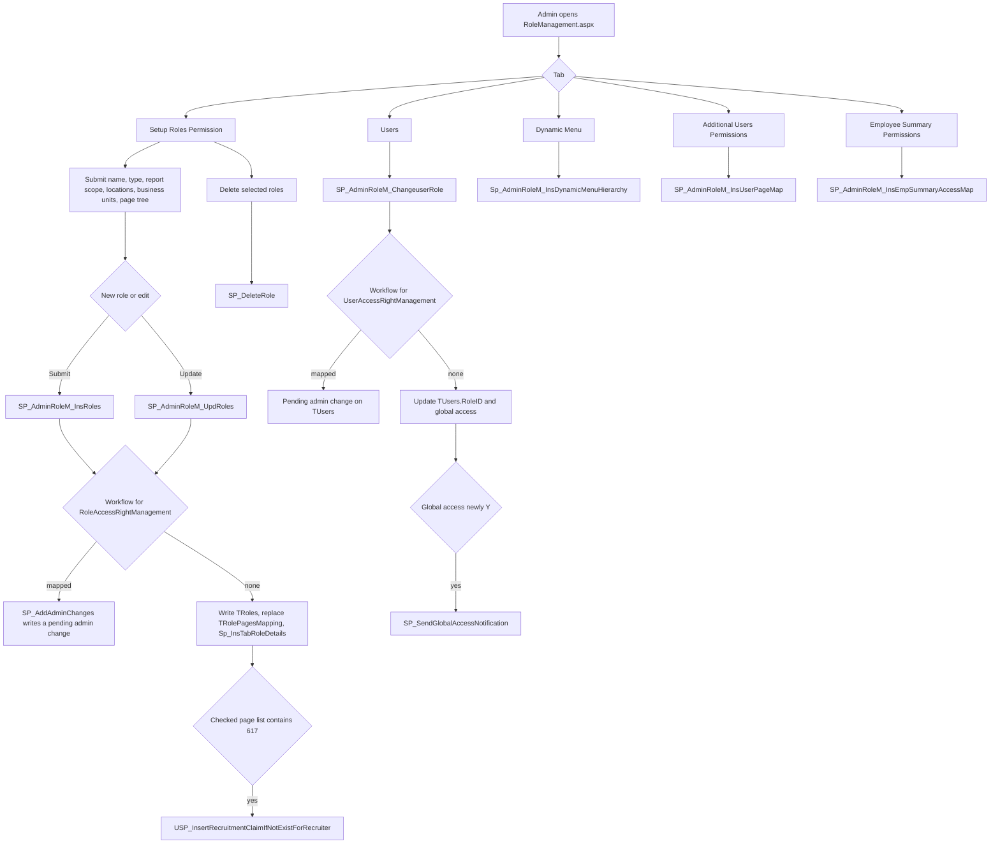
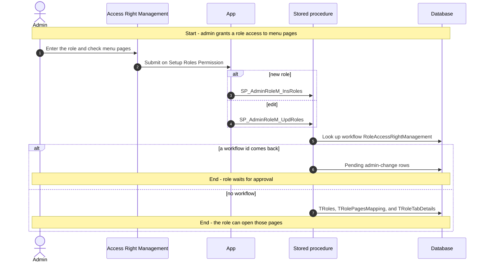
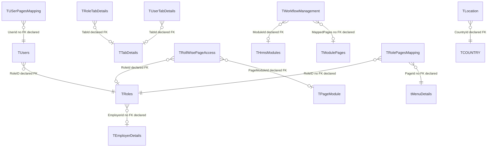

# Access Right Management

## Overview

An administrator needs each job in the company to open a different set of menu pages. On **Access Right Management** they define a **role** (a name, a role type, and a report scope of Self, Team, or All), tick the menu pages that role may open, and optionally limit those pages to locations and business units. Saving that role writes `TRoles` and replaces that role's rows in `TRolePagesMapping` and `TRoleTabDetails`. They then open the **Users** tab, pick people, and assign the role. From then on, those people's left menu and page checks follow the role. A later tab can add pages for one person on top of the role, and another tab can decide which employees a role sees on Employee Summary.

If a workflow is mapped to the page name `RoleAccessRightManagement`, the save does not change `TRoles` yet. It files a pending admin-change request and tells the administrator "Role changes sent for approval." The same pattern applies when assigning a role to a user (`UserAccessRightManagement`), when saving extra per-user pages (`Users Permissions`), and when saving Employee Summary permissions (`EmployeeSummaryPermissions`).

**Who's involved:**

- **Administrator** (`UserType` `A`) or an employee who has this menu — creates roles, assigns them, edits the dynamic menu, and sets extra page or summary permissions. Tab buttons hide when that person's own tab grant is view-only (`RoleManagement.aspx.cs:173-218`).
- **Super Admin** (`UserType` `S`) — the Users, Additional Users Permissions, and Employee Summary tabs are disabled, and the role Submit button stays hidden. The page lands on **Dynamic Menu** (`RoleManagement.aspx.cs:97-110`, `577-584`).
- **Approver** — only when a workflow is mapped. They act on the pending admin-change row; this screen does not host that approval.

This is role-to-page access (`TRoles`, `TRolePagesMapping`, `TRoleTabDetails`). Workflow groups used by the approval designer live in `TRoleManagement` and are a different screen. For how a signed-in person is then allowed or refused a page, see `llm-wiki/architecture/auth-flow.md` and SourceCode `docs/SystemModels/SystemModel-2/security/authorization/role-permission-matrix.md`.

## Workflow

Report scope on the form is the radio **Self** / **Team** / **All**, stored as the `RoleID` of the role named `Employee`, `Manager`, or `Administrator` (`RoleManagement.aspx.cs:1488-1509`). Page checks are a comma-separated list of menu ids. Tab checks are `MenuId~TabId~IsEditable` values, expanded by `Sp_InsTabRoleDetails` or `Sp_InsTabUserDetails`.

## Request journey

Assigning that role to a person is a second postback on the Users tab (`SP_AdminRoleM_ChangeuserRole`). It follows the same approval fork against page name `UserAccessRightManagement`, and writes `TUsers.RoleID` only when no workflow is mapped.

## Entry points

> The live screen is the WebForms page `HRM/Settings/RoleManagement.aspx`. SourceCode `docs/SystemModels/SystemModel-2/security/authorization/role-permission-matrix.md` names this page as the place roles are created (`SP_InsertRoles` is the C# constant; the string it executes is `SP_AdminRoleM_InsRoles`). There is no React route for this screen. Node `GET /api/recruitment/getRoleManagementList` reads workflow groups through `SP_CM_GetAllRoleManagementListDetails` and is not called from this page.

| Entry point | Purpose | Live? |
|---|---|---|
| `~/HRM/Settings/RoleManagement.aspx` (`HRMSConstants.URLs.URL_ROLE_MANAGEMENT`, menu id `ROLE_MANAGEMENT = 17`) | Setup Roles Permission, Users, Dynamic Menu, Additional Users Permissions, Employee Summary Permissions | Yes |
| Setup Roles Permission Submit (`btnRole_Click`) | Create or update a role and its page grants | Yes, for `UserType` `A` and `E`. Hidden for Super Admin |
| Users Submit (`btnChangeUserRoleValidation_Click`) | Assign a role, report scope, and global-access organizations to selected users | Yes. Tab disabled for Super Admin |
| Dynamic Menu Submit (`btnDynamicUpdate_Click`) | Replace the organization's menu tree | Yes. Super Admin lands here |
| Additional Users Permissions Submit (`btnUserPermission_Click`) | Extra pages, tabs, locations, and business units for one user | Yes. Tab disabled for Super Admin |
| Employee Summary Permissions Submit (`btnEmpSummaryPermissionSubmit_Click`) | Active/inactive and employee list for the Employee Summary tab | Yes. Tab disabled for Super Admin |
| `RadPageViewRolePermission` and `btnRoleSubmit_Click` | Older role-page mapping screen | Markup still compiles. The **Roles Permissions** tab is commented out, so the tab strip does not open this page view |

## Code → database call chain

The page calls `RoleManagementDAL` directly. `RoleManagementBLL` only forwards `GetRoleManagementList` and `GetRoleDetailsByRoleId`, and this page does not call it.

| Step | Entry point | App code | Stored procedure |
|---|---|---|---|
| Audit the open | `RoleManagement.aspx.cs:88` | `DBHelper.AuditTrail` (`DBHelper.cs:218`) | `SP_InsertAuditTrail` |
| Organization dropdown | `RoleManagement.aspx.cs:560` | `EmployeeHelper.GetChildOrganizations` (`EmployeeHelper.cs:45`) | `sp_GetChildOrganisations` |
| Tab catalog for show/hide | `RoleManagement.aspx.cs:593` | `DashboardBLL.GetMenuTabs` → `DashboardDAL.GetMenuTabs` (`DashboardDAL.cs:277`) | `Sp_GetMenuTabDetails` |
| Role grid | `RoleManagement.aspx.cs:2206` | `RoleManagementDAL.GetDefinedRoles` (`RoleManagementDAL.cs:31`) | `SP_AdminRoleM_GetRoles` |
| Role dropdown on Users | `RoleManagement.aspx.cs:1531` | `RoleManagementDAL.GetRoleList` (`RoleManagementDAL.cs:131`) | `SP_AdminRoleM_GetRoleList` |
| Role type list | `RoleManagement.aspx.cs:2374` | `RoleManagementDAL.GetDefaultRoles` (`RoleManagementDAL.cs:245`) | `SP_Get_DefaultRoles` |
| Checked pages when viewing a role | `RoleManagement.aspx.cs:984` | `RoleManagementDAL.GetPermissionRoleDetailsByRoleId` (`RoleManagementDAL.cs:297`) | `Sp_AdminRoleM_GetDynamicPageAccessMenuItems` |
| Tab flags on that role | `RoleManagement.aspx.cs:985` | `WebCommonTab.GetTabsByRole` (`Web.Common.Tab.cs:17`) → `RoleManagementDAL.GetPermissionRoleTabDetails` (`RoleManagementDAL.cs:413`) | `Sp_AdminRoleM_GetTabRoleDet` |
| Pages kept on update when celebration hub is off | `RoleManagement.aspx.cs:2254` and `getSelectedRoleDetails` at `:2426` | `RoleManagementDAL.GetPermissionRoleDetailsByRoleName` (`RoleManagementDAL.cs:195`) | `SP_AdminRoleM_GetRolePageMapping` |
| User tab flags | `RoleManagement.aspx.cs:2895` | `WebCommonTab.GetTabsByUser` (`Web.Common.Tab.cs:38`) → `DBHelper.GetPermissionUserTabDetailsByuserId` (`DBHelper.cs:2675`) | `Sp_GetTabUserDetails` |
| Tab id registry on load | `RoleManagement.aspx.cs:120` | `TabRegistryHelper.Bind` → `DashboardDAL.GetTabRegistryByMenuId` (`DashboardDAL.cs:298`) | Direct `SELECT` on `TTabDetails`. No stored procedure |
| Create role and page grants | `RoleManagement.aspx.cs:641` | `RoleManagementDAL.AddNewRole` (`RoleManagementDAL.cs:54`) | `SP_AdminRoleM_InsRoles` |
| Update role and page grants | `RoleManagement.aspx.cs:645` | `RoleManagementDAL.UpdateRole` (`RoleManagementDAL.cs:75`) | `SP_AdminRoleM_UpdRoles` |
| Delete a role | `RoleManagement.aspx.cs:1093` | `RoleManagementDAL.RemoveSelectedRoles` (`RoleManagementDAL.cs:97`) | `SP_DeleteRole` |
| User list on Users | `RoleManagement.aspx.cs:1425` | `RoleManagementDAL.ChangeUserRoleList` (`RoleManagementDAL.cs:142`) | `Sp_AdminRoleM_GetEmpRoles` |
| Active users for the pickers | `RoleManagement.aspx.cs:1475` | `UserManagementDAL.GetActiveUserList` (`UserManagementDAL.cs:41`) | `SP_AdminUM_GetActiveUserList` |
| Assign role to users | `RoleManagement.aspx.cs:1396` | `RoleManagementDAL.ChangeUserRole` (`RoleManagementDAL.cs:111`) | `SP_AdminRoleM_ChangeuserRole` |
| Load one user's role, locations, and business units | `RoleManagement.aspx.cs:1194` | `RoleManagementDAL.GetUserPermission` (`RoleManagementDAL.cs:426`) | `SP_Admin_UserPermission_Get` |
| Global-access organization list | `RoleManagement.aspx.cs:2217` | `RoleManagementDAL.GetEmployerList` (`RoleManagementDAL.cs:440`) | `SP_Admin_GetGlobalAccessEmployerList` |
| Save dynamic menu | `RoleManagement.aspx.cs:1604` | `RoleManagementDAL.SaveDynamicMenuDetails` (`RoleManagementDAL.cs:154`) | `Sp_AdminRoleM_InsDynamicMenuHierarchy` |
| Load dynamic menu XML | `RoleManagement.aspx.cs:1655` | `RoleManagementDAL.GetDynamicMenuXml` (`RoleManagementDAL.cs:168`) | `Sp_AdminRoleM_GetDynamicMenuHierarchy` |
| Business-unit tree | `RoleManagement.aspx.cs:2336` | `CommonDAL.GetOrgStructureXml` (`CommonDAL.cs:504`) | `sp_GetOrganisationHierarchy` |
| Location list | `RoleManagement.aspx.cs:2365` | `CommonDAL.GetLocationsForMultipleCustomers` (`CommonDAL.cs:385`) | `SP_Admin_GetLocations` |
| Save extra pages for one user | `RoleManagement.aspx.cs:2678` | `RoleManagementDAL.SaveUserPermissionDetails` (`RoleManagementDAL.cs:255`) | `SP_AdminRoleM_InsUserPageMap` |
| User's current role name | `RoleManagement.aspx.cs:2845` | `RoleManagementDAL.GetRoleDetailsByUserID` (`RoleManagementDAL.cs:273`) | `SP_AdminRoleM_GetEmployeeRole` |
| Checked pages for one user | `RoleManagement.aspx.cs:2263` and `:2894` | `RoleManagementDAL.GetPermissionUserDetailsByuserId` (`RoleManagementDAL.cs:285`) | `Sp_AdminRoleM_GetDynamicUserAccessMenuItems` |
| Employee Summary grid for a role | `RoleManagement.aspx.cs:1819` | `RoleManagementDAL.GetEmpSummaryPermissionRoleDetailsByRoleId` (`RoleManagementDAL.cs:389`) | `SP_AdminRoleM_GetEmpSumPermissionByRoleID` |
| Save Employee Summary access | `RoleManagement.aspx.cs:3076` | `RoleManagementDAL.InsertEmpSummaryAccessMapping` (`RoleManagementDAL.cs:346`) | `SP_AdminRoleM_InsEmpSummaryAccessMap` |
| Role page-mapping history list | `RoleManagement.aspx.cs:2611` | `RoleManagementDAL.GetPermissionRoleHistory` (`RoleManagementDAL.cs:233`) | `Sp_AdminRoleM_GetRolePageMapHistByTransid` |
| One history snapshot of role pages | `RoleManagement.aspx.cs:2500` | `RoleManagementDAL.GetSelectedRoleHistoryDetailsBasedOnTransId` (`RoleManagementDAL.cs:207`) | `SP_AdminRoleM_GetRolePageMapHist` |
| One history snapshot of role tabs | `RoleManagement.aspx.cs:2504` | `RoleManagementDAL.GetSelectedRoleTabHistoryByTransId` (`RoleManagementDAL.cs:220`) | `SP_AdminRoleM_GetRoleTabDetHist` |
| One history snapshot of user pages | `RoleManagement.aspx.cs:3006` | `RoleManagementDAL.GetSelectedUserPageAccessHistoryBasedOnTransId` (`RoleManagementDAL.cs:309`) | `Sp_AdminRoleM_GetUserAccMenuItemsHist` |
| One history snapshot of user tabs | `RoleManagement.aspx.cs:3011` | `RoleManagementDAL.GetSelectedUserTabHistoryByTransId` (`RoleManagementDAL.cs:321`) | `SP_AdminRoleM_GetUserTabDetailHist` |
| Employee Summary history list | `RoleManagement.aspx.cs:3367` | `RoleManagementDAL.GetEmpSummaryPermissionRoleHistory` (`RoleManagementDAL.cs:401`) | `SP_AdminRoleM_GetEmpSumPermissionMapHist` |
| One Employee Summary history snapshot | `RoleManagement.aspx.cs:3223` | `RoleManagementDAL.GetEmpSummaryPermissionHistoryByTransID` (`RoleManagementDAL.cs:375`) | `SP_AdminRoleM_GetEmpSumPermissionHistByID` |
| Older role-page save, still in `submitRolePermission` | `RoleManagement.aspx.cs:2066` | `RoleManagementDAL.SaveRolePermissionDetails` (`RoleManagementDAL.cs:179`) | `SP_AdminRoleM_InsRolePageMapping` |
| Activity log after a successful save | `RoleManagement.aspx.cs:648` and the other submit handlers | `CommonUtil.LogActivity` → `Sp_InsertActivityLog` | `Sp_InsertActivityLog` |

`btnRole_Click` calls `submitRolePermission` (and therefore `SP_AdminRoleM_InsRolePageMapping`) only when `divOrgRole` is visible (`RoleManagement.aspx.cs:621-623`). That panel is turned on for Super Admin, and the same method hides the Submit button, so the branch does not run from the live tab strip.

## API endpoints

This screen is a WebForms postback. Submit buttons call the code-behind methods in the table above. There is no `[WebMethod]`, no PageMethod, and no Core API controller on `RoleManagement.aspx`.

When a save returns a second table of notification rows, `displayMessageAndSendNotificationMail` (`RoleManagement.aspx.cs:1536`) calls `EmailNotification.SendNotificationEmail` (`HRMS.Shared/HRMS.Common/Common.cs:1094`), which reads the sender address with `SP_CM_GetEmployerEmail` and then `EmailAlert.SendEmail`. That mailer is shared across master screens and is not part of the role-grant procedures.

Node `GET /api/recruitment/getRoleManagementList` (also mounted on the V2 and V3 recruitment routers) executes `SP_CM_GetAllRoleManagementListDetails`. Workflow setup uses that list for `TRoleManagement`. It is not a call from this page.

## Stored procedures & tables involved

Inventory paths are the `sqlFile` on `HRMS-DATABASE/HRMS/changelog/baseline-inventory-storeprocedure.xml` (functions from `baseline-inventory-functions.xml`). Each procedure page is under `/docs/database/hrms/`.

| Object | File | Purpose | Database page |
|---|---|---|---|
| `SP_AdminRoleM_InsRoles` | `STOREPROCEDURE/SP_AdminRoleM_InsRoles.sql` | Create a role and its page grants, or queue both for approval | [SP_AdminRoleM_InsRoles](/docs/database/hrms/SP_AdminRoleM_InsRoles) |
| `SP_AdminRoleM_UpdRoles` | `STOREPROCEDURE/SP_AdminRoleM_UpdRoles.sql` | Update a role and replace its page grants, or queue both | [SP_AdminRoleM_UpdRoles](/docs/database/hrms/SP_AdminRoleM_UpdRoles) |
| `SP_DeleteRole` | `STOREPROCEDURE/SP_DeleteRole.sql` | Delete page grants and the role when no user holds it | [SP_DeleteRole](/docs/database/hrms/SP_DeleteRole) |
| `SP_AdminRoleM_GetRoles` | `STOREPROCEDURE/SP_AdminRoleM_GetRoles.sql` | Role grid, including page, location, and business-unit lists | [SP_AdminRoleM_GetRoles](/docs/database/hrms/SP_AdminRoleM_GetRoles) |
| `SP_AdminRoleM_GetRoleList` | `STOREPROCEDURE/SP_AdminRoleM_GetRoleList.sql` | Role id, name, and global-access flag for dropdowns | [SP_AdminRoleM_GetRoleList](/docs/database/hrms/SP_AdminRoleM_GetRoleList) |
| `SP_Get_DefaultRoles` | `STOREPROCEDURE/SP_Get_DefaultRoles.sql` | Fixed role-type names, not a table read | [SP_Get_DefaultRoles](/docs/database/hrms/SP_Get_DefaultRoles) |
| `Sp_AdminRoleM_GetDynamicPageAccessMenuItems` | `STOREPROCEDURE/Sp_AdminRoleM_GetDynamicPageAccessMenuItems.sql` | Pages already granted to a role | [Sp_AdminRoleM_GetDynamicPageAccessMenuItems](/docs/database/hrms/Sp_AdminRoleM_GetDynamicPageAccessMenuItems) |
| `SP_AdminRoleM_GetRolePageMapping` | `STOREPROCEDURE/SP_AdminRoleM_GetRolePageMapping.sql` | Role id, role name, and granted page ids | [SP_AdminRoleM_GetRolePageMapping](/docs/database/hrms/SP_AdminRoleM_GetRolePageMapping) |
| `Sp_AdminRoleM_GetTabRoleDet` | `STOREPROCEDURE/Sp_AdminRoleM_GetTabRoleDet.sql` | Tab id, menu id, and editable flag for a role | [Sp_AdminRoleM_GetTabRoleDet](/docs/database/hrms/Sp_AdminRoleM_GetTabRoleDet) |
| `Sp_GetTabUserDetails` | `STOREPROCEDURE/Sp_GetTabUserDetails.sql` | Tab id, menu id, and editable flag for one user | [Sp_GetTabUserDetails](/docs/database/hrms/Sp_GetTabUserDetails) |
| `SP_AdminRoleM_ChangeuserRole` | `STOREPROCEDURE/SP_AdminRoleM_ChangeuserRole.sql` | Assign a role and global access, or queue the change | [SP_AdminRoleM_ChangeuserRole](/docs/database/hrms/SP_AdminRoleM_ChangeuserRole) |
| `Sp_AdminRoleM_GetEmpRoles` | `STOREPROCEDURE/Sp_AdminRoleM_GetEmpRoles.sql` | Users and the role each one holds | [Sp_AdminRoleM_GetEmpRoles](/docs/database/hrms/Sp_AdminRoleM_GetEmpRoles) |
| `SP_AdminUM_GetActiveUserList` | `STOREPROCEDURE/SP_AdminUM_GetActiveUserList.sql` | Active users the picker may select | [SP_AdminUM_GetActiveUserList](/docs/database/hrms/SP_AdminUM_GetActiveUserList) |
| `SP_Admin_UserPermission_Get` | `STOREPROCEDURE/SP_Admin_UserPermission_Get.sql` | Role name plus location and business-unit checks for one user | [SP_Admin_UserPermission_Get](/docs/database/hrms/SP_Admin_UserPermission_Get) |
| `SP_Admin_GetGlobalAccessEmployerList` | `STOREPROCEDURE/SP_Admin_GetGlobalAccessEmployerList.sql` | Employers under the same root employer | [SP_Admin_GetGlobalAccessEmployerList](/docs/database/hrms/SP_Admin_GetGlobalAccessEmployerList) |
| `Sp_AdminRoleM_InsDynamicMenuHierarchy` | `STOREPROCEDURE/Sp_AdminRoleM_InsDynamicMenuHierarchy.sql` | Replace menu XML, hierarchy, and menu details for the employer | [Sp_AdminRoleM_InsDynamicMenuHierarchy](/docs/database/hrms/Sp_AdminRoleM_InsDynamicMenuHierarchy) |
| `Sp_AdminRoleM_GetDynamicMenuHierarchy` | `STOREPROCEDURE/Sp_AdminRoleM_GetDynamicMenuHierarchy.sql` | Menu XML for this employer, else the parent, else employer 0 | [Sp_AdminRoleM_GetDynamicMenuHierarchy](/docs/database/hrms/Sp_AdminRoleM_GetDynamicMenuHierarchy) |
| `sp_GetOrganisationHierarchy` | `STOREPROCEDURE/sp_GetOrganisationHierarchy.sql` | Business-unit tree XML | [sp_GetOrganisationHierarchy](/docs/database/hrms/sp_GetOrganisationHierarchy) |
| `SP_Admin_GetLocations` | `STOREPROCEDURE/SP_Admin_GetLocations.sql` | Active locations for a comma-separated employer list | [SP_Admin_GetLocations](/docs/database/hrms/SP_Admin_GetLocations) |
| `SP_AdminRoleM_InsUserPageMap` | `STOREPROCEDURE/SP_AdminRoleM_InsUserPageMap.sql` | Replace one user's extra page and tab grants | [SP_AdminRoleM_InsUserPageMap](/docs/database/hrms/SP_AdminRoleM_InsUserPageMap) |
| `SP_AdminRoleM_GetEmployeeRole` | `STOREPROCEDURE/SP_AdminRoleM_GetEmployeeRole.sql` | Role id and name for one user | [SP_AdminRoleM_GetEmployeeRole](/docs/database/hrms/SP_AdminRoleM_GetEmployeeRole) |
| `Sp_AdminRoleM_GetDynamicUserAccessMenuItems` | `STOREPROCEDURE/Sp_AdminRoleM_GetDynamicUserAccessMenuItems.sql` | Extra pages already granted to one user | [Sp_AdminRoleM_GetDynamicUserAccessMenuItems](/docs/database/hrms/Sp_AdminRoleM_GetDynamicUserAccessMenuItems) |
| `SP_AdminRoleM_InsEmpSummaryAccessMap` | `STOREPROCEDURE/SP_AdminRoleM_InsEmpSummaryAccessMap.sql` | Employee Summary flags for a role | [SP_AdminRoleM_InsEmpSummaryAccessMap](/docs/database/hrms/SP_AdminRoleM_InsEmpSummaryAccessMap) |
| `SP_AdminRoleM_GetEmpSumPermissionByRoleID` | `STOREPROCEDURE/SP_AdminRoleM_GetEmpSumPermissionByRoleID.sql` | Employee Summary rows for the role's Employee Summary tab | [SP_AdminRoleM_GetEmpSumPermissionByRoleID](/docs/database/hrms/SP_AdminRoleM_GetEmpSumPermissionByRoleID) |
| `SP_AdminRoleM_InsRolePageMapping` | `STOREPROCEDURE/SP_AdminRoleM_InsRolePageMapping.sql` | Replace role page grants without changing `TRoles` | [SP_AdminRoleM_InsRolePageMapping](/docs/database/hrms/SP_AdminRoleM_InsRolePageMapping) |
| `Sp_AdminRoleM_GetRolePageMapHistByTransid` | `STOREPROCEDURE/Sp_AdminRoleM_GetRolePageMapHistByTransid.sql` | History list of role page-mapping changes | [Sp_AdminRoleM_GetRolePageMapHistByTransid](/docs/database/hrms/Sp_AdminRoleM_GetRolePageMapHistByTransid) |
| `SP_AdminRoleM_GetRolePageMapHist` | `STOREPROCEDURE/SP_AdminRoleM_GetRolePageMapHist.sql` | Current or historical role pages for one transaction | [SP_AdminRoleM_GetRolePageMapHist](/docs/database/hrms/SP_AdminRoleM_GetRolePageMapHist) |
| `SP_AdminRoleM_GetRoleTabDetHist` | `STOREPROCEDURE/SP_AdminRoleM_GetRoleTabDetHist.sql` | Current or historical role tabs | [SP_AdminRoleM_GetRoleTabDetHist](/docs/database/hrms/SP_AdminRoleM_GetRoleTabDetHist) |
| `Sp_AdminRoleM_GetUserAccMenuItemsHist` | `STOREPROCEDURE/Sp_AdminRoleM_GetUserAccMenuItemsHist.sql` | Current or historical user pages | [Sp_AdminRoleM_GetUserAccMenuItemsHist](/docs/database/hrms/Sp_AdminRoleM_GetUserAccMenuItemsHist) |
| `SP_AdminRoleM_GetUserTabDetailHist` | `STOREPROCEDURE/SP_AdminRoleM_GetUserTabDetailHist.sql` | Current or historical user tabs | [SP_AdminRoleM_GetUserTabDetailHist](/docs/database/hrms/SP_AdminRoleM_GetUserTabDetailHist) |
| `SP_AdminRoleM_GetEmpSumPermissionMapHist` | `STOREPROCEDURE/SP_AdminRoleM_GetEmpSumPermissionMapHist.sql` | History list of Employee Summary changes | [SP_AdminRoleM_GetEmpSumPermissionMapHist](/docs/database/hrms/SP_AdminRoleM_GetEmpSumPermissionMapHist) |
| `SP_AdminRoleM_GetEmpSumPermissionHistByID` | `STOREPROCEDURE/SP_AdminRoleM_GetEmpSumPermissionHistByID.sql` | Current or historical Employee Summary rows | [SP_AdminRoleM_GetEmpSumPermissionHistByID](/docs/database/hrms/SP_AdminRoleM_GetEmpSumPermissionHistByID) |
| `Sp_GetMenuTabDetails` | `STOREPROCEDURE/Sp_GetMenuTabDetails.sql` | Tab id, menu id, and tab name for the permission UI | [Sp_GetMenuTabDetails](/docs/database/hrms/Sp_GetMenuTabDetails) |
| `sp_GetChildOrganisations` | `STOREPROCEDURE/sp_GetChildOrganisations.sql` | Child employers for the organization dropdown | [sp_GetChildOrganisations](/docs/database/hrms/sp_GetChildOrganisations) |

Tables these procedures read or write: `TRoles`, `TRolePagesMapping`, `TRolePagesMappingHistory`, `TRoleTabDetails`, `TRoleTabDetailsHistory`, `TUsers`, `TUsersHistory`, `TUSerPagesMapping`, `TUserPagesMappingHistory`, `TUserTabDetails`, `TUserTabDetailsHistory`, `TRollWisePageAccess`, `TRollWisePageAccessHistory`, `TDynamicMenuHierarchy`, `TMenuHierarchy`, `tMenuDetails` (and the matching history tables), `TModulePages`, `TWorkflowManagement`, `TAdminChangesApprovals`, `TAdminChangesApprovalDetails`, `TRequestWorkflows`, `TTabDetails`, `TEmployerDetails`, `TLocation`, `TOrganisationHierarchy`, `torghierarchydetails`. `llm-wiki/reference/tables/hrms.md` catalogs `TRoles`, `TRolePagesMapping`, and `TRolePagesMappingHistory`. `llm-wiki/experience/surfaces.md` describes page and tab access. `llm-wiki/glossary/business-entities.md` defines Role.

Direct callees (one level) are documented on their own pages: `SP_GetWorkflowTreeXmlDetailsByPageTitle`, `SP_AddAdminChanges`, `Sp_InsTabRoleDetails`, `Sp_InsTabUserDetails`, `USP_InsertRecruitmentClaimIfNotExistForRecruiter`, `SP_SendGlobalAccessNotification`, `Split`, `Fn_GetEmployeeNameByEmployeeID`, `FN_GetTimeZoneDiffOrgLevel`, `FN_GetLocalTimeOrgLevel`, `FN_LocationBU_GetEmployeeDetails`. Encryption open/close and `Fn_GetEmployeeName` / `FN_ConvertBase64ToSTR` already have pages.

## Table relationships

Declared foreign keys are labeled as such. Columns the procedures join without a foreign key are labeled **no FK declared**. `llm-wiki/domain/concept-map.md` already draws `TUsers.RoleID` → `TRoles.RoleID` as a declared FK and draws employer-to-role as by-convention; that page does not cover the page-mapping tables, so those edges come from the `TABLES` scripts.

`TWorkflowManagement.MappedPages` is `VARCHAR(200)` (`TWorkflowManagement.sql:6`). Role create looks up a workflow by calling `SP_GetWorkflowTreeXmlDetailsByPageTitle` with the page name `RoleAccessRightManagement`. User-role assignment reads `TWorkflowManagement` itself for module page name `UserAccessRightManagement`. Neither column is a foreign key to `TModulePages`.

`TRolePagesMapping` in `TABLES/TRolePagesMapping.sql` has no foreign key and no `LocationIds` or `BusinessUnitIds` columns. The role procedures insert those two columns, so a later alter added them. This diagram does not invent a key for them.

## Known gaps

- `USP_SaveHistory` is executed by `SP_AdminRoleM_InsRoles`, `SP_AdminRoleM_UpdRoles`, and `SP_DeleteRole` to copy `TRoles` into `TRoles_History`. No `USP_SaveHistory.sql` is in the HRMS changelog inventory (the nearby scripts are `USP_SaveHistory_MultiID` and `USP_SaveHistory_MultiFilter`). The history step is not expanded.
- On the immediate-apply path, `SP_AdminRoleM_InsRoles` and `SP_AdminRoleM_UpdRoles` each execute `Sp_InsTabRoleDetails` twice (`SP_AdminRoleM_InsRoles.sql:284` and `:296`, `SP_AdminRoleM_UpdRoles.sql:260` and `:272`).
- `SP_AdminRoleM_GetRoles` computes All/Team/Self from `ReportingType` values 1, 3, and 4, then the result set returns the joined role name as `ReportingTypeName` instead (`SP_AdminRoleM_GetRoles.sql:117-126`). The page stores `ReportingType` as the `RoleID` of the role named Administrator, Manager, or Employee.
- `RoleManagementDAL.ChangeUserRole` sends `@ReportingType` only when the id is greater than 0 (`RoleManagementDAL.cs:124-125`). `SP_AdminRoleM_ChangeuserRole` declares `@ReportingType` with no default.
- `RoleManagementDAL.GetEmpSummaryPermissionHistoryByTransID` binds the C# parameter named `employerId` to `@TransID` and the C# parameter named `transID` to `@employerId` (`RoleManagementDAL.cs:381-383`). The caller at `RoleManagement.aspx.cs:3223` passes `(roleId, transId, employerId)`, so the procedure still receives the transaction id and the employer id in those two slots.
- The **Roles Permissions** tab is commented out (`RoleManagement.aspx:42`) while `RadPageViewRolePermission` remains as a sixth page view with no tab. `SP_AdminRoleM_InsRolePageMapping` stays reachable from `submitRolePermission`.
- `SP_DeleteRole` refuses the delete when any `TUsers` row has that `RoleID`, and returns `0` as `Message`. The page blocks `IsDefault` roles in C# before the procedure runs (`RoleManagement.aspx.cs:1088-1093`). The procedure does not check `IsDefault`.
- `Sp_GetMenuTabDetails.sql` and `sp_GetChildOrganisations.sql` start with `USE [HRM-CL-Prod]`.
- Tab Add/Edit visibility on this page is the UI layer in `showHideTab`. `docs/SystemModels/SystemModel-2/security/authorization/role-permission-matrix.md` records that postbacks do not re-check `IsEditable`.
- On every load, `TabRegistryHelper.Bind` reads `TTabDetails` with a direct `SELECT` (`DashboardDAL.cs:308`). It is not a stored procedure.
- Before an update, `retainCelebrationHubGrants` reads `TCustomerSettings` with a direct `SELECT` (`DBHelper.cs:3450`). When celebration hub is off, the save calls `SP_AdminRoleM_GetRolePageMapping` and puts those page ids back into the list sent to `SP_AdminRoleM_UpdRoles`.
- `SP_InsertAuditTrail` and `Sp_InsertActivityLog` run on open and on submit. They are shared loggers and are not given procedure pages in this pass.
- `SP_CM_GetEmployerEmail` runs only when an approval notification is sent. The shared mailer is not expanded here.

## Reference

High confidence on the postbacks and the procedures they execute. The approval fork is in the procedure bodies. `USP_SaveHistory` could not be read.

### SourceCode

- `HRMS.Web/HRMS.Web/HRM/Settings/RoleManagement.aspx` and `RoleManagement.aspx.cs`
- `HRMS.Shared/HRMS.DataAccessLayer/RoleManagement/RoleManagementDAL.cs`
- `HRMS.Shared/HRMS.BusinessLayer/RoleManagement/RoleManagementBLL.cs` (not called by this page)
- `HRMS.Shared/HRMS.DataAccessLayer/DBConstant.cs` (procedure name constants)
- `HRMS.Shared/HRMS.DataContract/Common/Enums.cs` (`ROLE_MANAGEMENT = 17`) and `Constants.cs` (`URL_ROLE_MANAGEMENT`)
- `docs/SystemModels/SystemModel-2/security/authorization/role-permission-matrix.md`
- `docs/SystemModels/SystemModel-2/data/entities/core-security-entities.md`
- `docs/SystemModels/SystemModel-2/architecture/auth-flow.md`

### TDG HRMS DB

- `llm-wiki/architecture/auth-flow.md`
- `llm-wiki/experience/surfaces.md`
- `llm-wiki/glossary/business-entities.md`
- `llm-wiki/domain/concept-map.md`
- `llm-wiki/domain/overview.md`
- `llm-wiki/reference/tables/hrms.md`
- `HRMS-DATABASE/HRMS/TABLES/TRoles.sql`, `TUsers.sql`, `TRolePagesMapping.sql`, `TRoleTabDetails.sql`, `TUserTabDetails.sql`, `TRollWisePageAccess.sql`, `TWorkflowManagement.sql`, `TModulePages.sql`, `tMenuDetails.sql`, `TDynamicMenuHierarchy.sql`, `TLocation.sql`
- Procedure scripts listed in the table above
