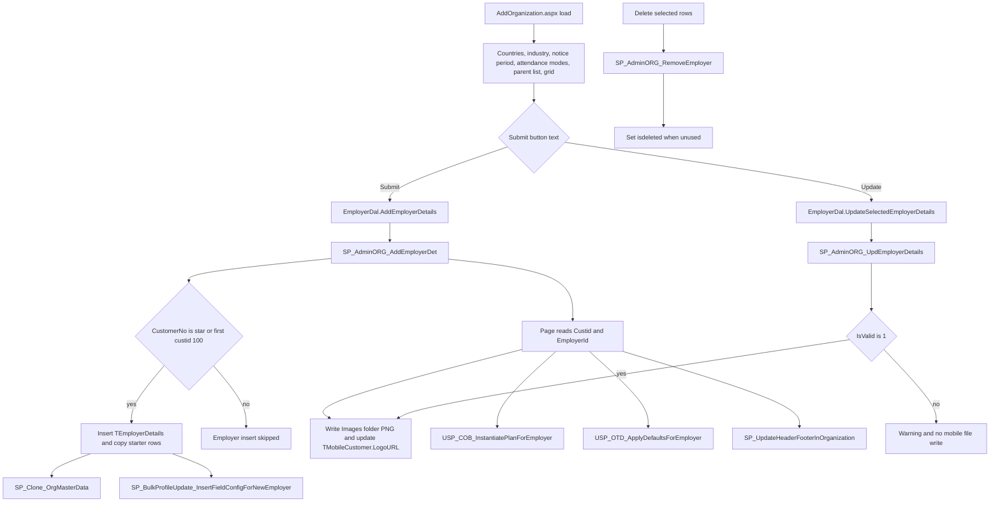
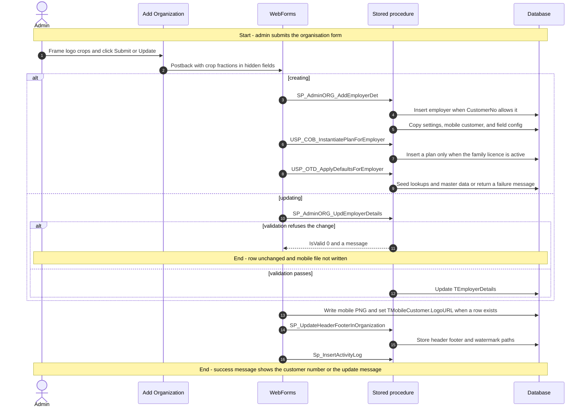
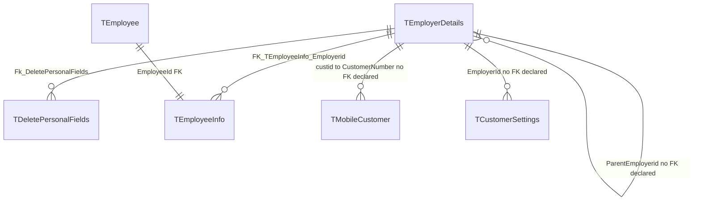

# Add Organization

## Overview

An administrator opens **Admin Configuration → Organization Setup → Add Organization** to register a company (a parent) or a company under an existing parent (a child). They enter the organisation name, addresses, contact numbers, industry, country, time zone, attendance and notice-period rules, password policy, and optional header, footer, and watermark images. Submit creates one employer row and a customer number. A parent still needs a licence and modules on the HRMS License page before default data is seeded. A child is covered by the parent's licence, so the same save tries to open a client-onboarding plan and to seed that child's licensed defaults immediately.

The same screen lists organisations the user can see. Edit loads one row back into the form and saves with Update. Delete marks a row deleted only when it has no active employees and no child organisations.

The organisation logo is framed in the page itself. The administrator draws one crop for the website and, when the organisation is set up for mobile, a second crop for the phone app. Submit stores the website image on the employer row. The mobile image is written as a PNG under `Images/{customer number}/Icons/Logo.png`, and the mobile customer row's logo address is updated when that row already exists.

There is no llm-wiki domain page for this screen. `llm-wiki/domain/concept-map.md` describes the employer tree as convention plus one self-referencing key, and `llm-wiki/domain/overview.md` names `TEmployerDetails` as the tenant row. `docs/SystemModels/SystemModel-2/experience/surfaces/surfaces.md` was not in this workspace, so the live entry is the WebForms page named below.

## Workflow

A new organisation with no uploaded file stores the TDG default image, because `TEmployerDetails.EmployerLogo` is not nullable. On update, an empty logo parameter leaves the stored image as it is (`IIF` in `SP_AdminORG_UpdEmployerDetails`).

## Request journey

## Entry points

The breadcrumb on the page is Home / Admin Configuration / Organization Setup / Add Organization. The page class is `HRMS.Web.AddOrganization`.

| Entry point | Purpose | Live? |
|---|---|---|
| `HRM/Organization/AddOrganization.aspx` | Create, edit, list, and delete organisations, including the in-page logo crop | Yes |
| `HRM/Settings/AddIndustryType.aspx` | Super-admin popup to maintain the industry list. Close rebinds the combo on this page | Yes, separate page |
| `POST /api/Payroll/PostData` | Outbound payroll sync after create, update, or delete when the user is a payroll user | Yes, outbound only |

No React screen and no `PageMethod` or `fetch` call implement this form. The crop dialog is a script block in the aspx (`logoCrop`) that writes `hdnWebCrop` and `hdnMobileCrop` before the normal submit postback.

## Code → database call chain

| Entry | Method | Stored procedure |
|---|---|---|
| Load | `DBHelper.AuditTrail` (`DBHelper.cs:218`) from `bindDataOnPageLoad` (`AddOrganization.aspx.cs:344`) | `SP_InsertAuditTrail` |
| Parent list, global access | `WebCommon.GetGlobalAccessEmployerList` (`Web.Common.cs:547`) → `DBHelper.GetGlobalAccessEmployerList` (`DBHelper.cs:3195`) | `SP_GetGlobalAccessEmployerList` |
| Parent list, otherwise | `EmployeeHelper.GetChildOrganizations` (`EmployeeHelper.cs:45`) from `AddOrganization.aspx.cs:553` | `sp_GetChildOrganisations` |
| Personal fields to purge | `ReportBLL.GetAvailableFieldsForDeletion` (`ReportBLL.cs:51`) → `ReportDAL.getAvailableFields` (`ReportDAL.cs:87`) | `SP_GetPersonalFields` |
| Country combo | `CountryBll.GetCountries` (`CountryBLL.cs:20`) → `CountryDal.GetCountries` (`CountryDal.cs:21`) | `SP_GetCountries` |
| Notice period combo | `EmployerDal.GetNoticePeriodTypes` (`EmployerDAL.cs:638`) | `SP_GetNoticePeriodTypes` |
| Attendance mode combo | `MyDetailsDal.GetAttendanceModesByEmployer` (`MyDetailsDAL.cs:434`) with source `Organization` | `USP_GET_tAttendanceCaptureMode` |
| Industry combo | `EmployerDal.GetIndustryTypes` (`EmployerDAL.cs:575`) | `USP_OTD_GetIndustryType` |
| Grid | `MyDetailsDal.SearchOrganizations` (`MyDetailsDAL.cs:1004`) | `SP_CM_GetOrganizationDet` |
| Payroll-cycle checkbox and edit | `DBHelper.GetCustomerSettings` (`DBHelper.cs:3427`) | `SP_GetCustomerSettings` |
| Edit one row | `EmployerDal.GetSelectedEmployerDetails` (`EmployerDAL.cs:497`) from `AddOrganization.aspx.cs:1075` | `SP_AdminORG_GetEmployerDet` |
| Create | `EmployerDal.AddEmployerDetails` (`EmployerDAL.cs:411`) from `AddOrganization.aspx.cs:682` | `SP_AdminORG_AddEmployerDet` |
| Create, onboarding plan | `EmployerDal.InstantiateCobPlan` (`EmployerDAL.cs:682`) | `USP_COB_InstantiatePlanForEmployer` |
| Create, default data | `EmployerDal.ApplyOtdDefaults` (`EmployerDAL.cs:715`) | `USP_OTD_ApplyDefaultsForEmployer` |
| Update | `EmployerDal.UpdateSelectedEmployerDetails` (`EmployerDAL.cs:333`) from `AddOrganization.aspx.cs:608` | `SP_AdminORG_UpdEmployerDetails` |
| Header, footer, watermark | `EmployerDal.UpdateHeaderFooterImg` (`EmployerDAL.cs:651`) from `AddOrganization.aspx.cs:857` | `SP_UpdateHeaderFooterInOrganization` |
| Activity log | `CommonUtil.LogActivity` → `ActivityHelper.LogActivity` (`ActivityHelper.cs:32`) | `Sp_InsertActivityLog` |
| Delete | `EmployerDal.RemoveSelectedEmployer` (`EmployerDAL.cs:486`) from `AddOrganization.aspx.cs:1023` | `SP_AdminORG_RemoveEmployer` |

Logo crop is a real write, and it does not have its own procedure. `buildLogos` (`AddOrganization.aspx.cs:1750`) reads the posted fractions, crops in memory, and passes the website bytes as `@EmployerLogo` on the add or update procedure. `saveMobileLogo` (`AddOrganization.aspx.cs:1865`) writes the PNG, then `EmployerDal.UpdateMobileLogoUrl` (`EmployerDAL.cs:277`) runs an inline `UPDATE dbo.TMobileCustomer SET LogoURL`. `GetCustomerNumber` (`EmployerDAL.cs:170`) and `IsMobileConfigured` (`EmployerDAL.cs:292`) are inline `SELECT`s. The DAL comment says this path deliberately does not call `usp_ins_upd_TMobileCustomer`, because that procedure overwrites every mobile column.

`SP_AdminORG_AddEmployerDet` then calls `FN_ConvertBase64ToSTR`, `dbo.Split`, `SP_Clone_OrgMasterData`, and `SP_BulkProfileUpdate_InsertFieldConfigForNewEmployer`. `SP_AdminORG_UpdEmployerDetails` calls `dbo.Split` and `SP_DigitalIdCard_DeactivateTemplatesForRemovedCriteria`. `USP_COB_InstantiatePlanForEmployer` calls `USP_COB_GetUnplannedEmployers` and `USP_COB_CreateCustomerPlanFromBaseline`. `USP_OTD_ApplyDefaultsForEmployer` calls `SP_Clone_LookupCatalogueByModule` and `USP_OTD_ProcessDefaultMasterData`. The non-superadmin branch of `sp_GetChildOrganisations` calls `FN_LocationBU_GetEmployeeDetails`.

## API endpoints

The screen is a WebForms postback. It does not expose an HTTP API for save or for the logo crop.

After a successful create, update, or a delete that the procedure accepts, the page calls `WebCommon.PostAddMasterToPayrollAPI` or `PostUpdateMasterToPayrollAPI` (`AddOrganization.aspx.cs:875` and `:1027`). Those run only when `IsValidPayrollUser()` is true. The client posts a payroll model to the payroll host.

| Verb | Route | Parameters | Purpose | Source |
|---|---|---|---|---|
| POST | `{payroll host}/api/Payroll/PostData` | Employer id, employee id `0`, logged-in employee id, event `AddMaster` or `UpdateMaster`, master `TEmployerDetails` | Tell payroll that the organisation master changed | `WebAPIClient.cs:149` and `WebAPIClient.cs:157` |

## Stored procedures & tables involved

Older names `SP_AddEmployerDetails` and `SP_UpdateSelectedEmployerDetails` still exist as separate scripts. This page's constants are `SP_AdminORG_AddEmployerDet` and `SP_AdminORG_UpdEmployerDetails` (`DBConstant.cs:445` and `:447`).

| Object | Script | Purpose |
|---|---|---|
| `SP_AdminORG_AddEmployerDet` | `HRMS-DATABASE/HRMS/STOREPROCEDURE/SP_AdminORG_AddEmployerDet.sql` | Create the employer, customer number, starter rows, and field config |
| `SP_AdminORG_UpdEmployerDetails` | `HRMS-DATABASE/HRMS/STOREPROCEDURE/SP_AdminORG_UpdEmployerDetails.sql` | Update the employer or refuse the change |
| `SP_AdminORG_GetEmployerDet` | `HRMS-DATABASE/HRMS/STOREPROCEDURE/SP_AdminORG_GetEmployerDet.sql` | Load one employer for edit and for header paths |
| `SP_AdminORG_RemoveEmployer` | `HRMS-DATABASE/HRMS/STOREPROCEDURE/SP_AdminORG_RemoveEmployer.sql` | Soft-delete when unused |
| `SP_UpdateHeaderFooterInOrganization` | `HRMS-DATABASE/HRMS/STOREPROCEDURE/SP_UpdateHeaderFooterInOrganization.sql` | Store image paths and letterhead sizes |
| `USP_COB_InstantiatePlanForEmployer` | `HRMS-DATABASE/HRMS/STOREPROCEDURE/USP_COB_InstantiatePlanForEmployer.sql` | Plan a licensed organisation |
| `USP_OTD_ApplyDefaultsForEmployer` | `HRMS-DATABASE/HRMS/STOREPROCEDURE/USP_OTD_ApplyDefaultsForEmployer.sql` | Seed licensed defaults for this organisation only |
| `SP_CM_GetOrganizationDet` | `HRMS-DATABASE/HRMS/STOREPROCEDURE/SP_CM_GetOrganizationDet.sql` | Grid of organisations |
| `USP_OTD_GetIndustryType` | `HRMS-DATABASE/HRMS/STOREPROCEDURE/159568/USP_OTD_GetIndustryType.sql` | Industry combo |
| `SP_GetNoticePeriodTypes` | `HRMS-DATABASE/HRMS/STOREPROCEDURE/SP_GetNoticePeriodTypes.sql` | Notice-period combo |
| `USP_GET_tAttendanceCaptureMode` | `HRMS-DATABASE/HRMS/STOREPROCEDURE/USP_GET_tAttendanceCaptureMode.sql` | Attendance-mode combo |
| `SP_GetCountries` | `HRMS-DATABASE/HRMS/STOREPROCEDURE/SP_GetCountries.sql` | Country combo |
| `sp_GetChildOrganisations` | `HRMS-DATABASE/HRMS/STOREPROCEDURE/sp_GetChildOrganisations.sql` | Parent combo for a non-global user |
| `SP_GetGlobalAccessEmployerList` | `HRMS-DATABASE/HRMS/STOREPROCEDURE/SP_GetGlobalAccessEmployerList.sql` | Parent combo for global access |
| `SP_GetPersonalFields` | `HRMS-DATABASE/HRMS/STOREPROCEDURE/SP_GetPersonalFields.sql` | Fields offered for personal-data purge |
| `SP_GetCustomerSettings` | `HRMS-DATABASE/HRMS/STOREPROCEDURE/SP_GetCustomerSettings.sql` | Flags such as attendance mode and payroll cycle |
| `SP_InsertAuditTrail` | `HRMS-DATABASE/HRMS/STOREPROCEDURE/SP_InsertAuditTrail.sql` | Page-open audit row |
| `Sp_InsertActivityLog` | `HRMS-DATABASE/HRMS/STOREPROCEDURE/Sp_InsertActivityLog.sql` | Create, update, and delete activity rows |

`TEmployerDetails` is summarized in `llm-wiki/reference/tables/hrms.md`. Attendance capture on that table is also described in `llm-wiki/domain/attendance-lifecycle.md`.

## Table relationships

`TEmployerDetails` declares `FK_Pref_Employerid` from `Employerid` to itself (`TEmployerDetails.sql:96`). `ParentEmployerid` and `RootEmployerId` have no foreign key in that script. `IndustryTypeId` is added later as a nullable int with no foreign key (`DDL/159568/001_DDL_IndustryTypeDefault_Schema.sql`). `TDeletePersonalFields.EmployerID` references `TEmployerDetails.Employerid`. `TEmployeeInfo.EmployerID` references `TEmployerDetails.Employerid`. `TMobileCustomer` has no foreign key. `CustomerNumber` is matched to `TEmployerDetails.custid` only in the page's inline SQL. `TCustomerSettings` declares no foreign key to the employer. `TCOB_CustomerPlan` and `TIndustryType` have no `CREATE TABLE` under `TABLES/` in this tree, so no foreign key is claimed for them here. `llm-wiki/domain/concept-map.md` draws a wider employer tree by convention. Those extra edges are not repeated as enforced keys.

## Known gaps

- The page title and breadcrumb say **Add Organization**. `HRMS-DATABASE/HRMS/DML/TDataCatalog_DML.sql` stores the navigation label **Add Organizationn** (double n), including a catalog value on `TemployeeDetail_Fields_Grouping`. This guide uses the submenu **Add Organization**.
- `docs/SystemModels/SystemModel-2/experience/surfaces/surfaces.md` is not in the SourceCode tree that was searched, so no system-model page was available to name the live entry.
- `STOREPROCEDURE/SP_AddEmployerDetails.sql` is a separate older procedure. The page does not call it.
- Licence assignment on this page (`LicenseDbHelper.UpdateEmployer` and `LicenseManager.ManageData`) is commented out in `handleInsertOrganization`, `handleUpdateOrganization`, and `updateActionAfterDelete`.
- On create, `uploadFileCommonMethod` is passed the logged-in user's employer id (`AddOrganization.aspx.cs:706` and `:717`), and `SP_UpdateHeaderFooterInOrganization` filters `WHERE Employerid = @CustId`. Header, footer, and watermark paths on a create are written to that logged-in employer, not to the new employer id returned by the insert. Update passes the edited employer id.
- `SP_AdminORG_AddEmployerDet` inserts `TEmployerDetails` only when decoded `TParameters.CustomerNo` is `*` or is `100` and no row already has `custid` `100`. The copies into `TCustomerSettings` and `tMobileCustomer`, and the final `SELECT` of `Custid` and `EmployerId`, sit after that `IF`.
- When `CustomerNo` is `100`, `EmployerDAL.GetCustomerNumber` documents that every organisation can share `custid` `100` and therefore the same mobile logo file.
- `SP_GetPersonalFields` returns every non-deleted `TPersonalfields` row. It does not use `@RequestType`, `@FormName`, `@FieldCategory`, or `@Employerid`, which the page still sends.
- `EmployeeHelper.GetChildOrganizations` does not pass `@LoginEmployeeId`. The non-superadmin branch of `sp_GetChildOrganisations` still filters with `FN_LocationBU_GetEmployeeDetails` on that parameter.
- The industry popup is `AddIndustryType.aspx`. Its save procedure is not called by `AddOrganization.aspx.cs`. Closing the popup only rebinds `USP_OTD_GetIndustryType`.
- The baseline `CREATE TABLE` for `TEmployerDetails` does not list columns the procedures now read and write, including `IndustryTypeId`, `NoticePeriodBasedOn`, `HeaderHeight`, `FooterHeight`, `Opacity`, and `DigitalIdCardBasedOn`. Those columns arrive in later DDL.

## Reference

Confidence is medium. The postback, the DAL procedure names, and the inventoried scripts agree. The gaps above are places where a second script, a commented block, or a missing knowledge-base page still leaves room to misread the screen.

### SourceCode

- `HRMS.Web/HRMS.Web/HRM/Organization/AddOrganization.aspx`
- `HRMS.Web/HRMS.Web/HRM/Organization/AddOrganization.aspx.cs`
- `HRMS.Shared/HRMS.DataAccessLayer/Employer/EmployerDAL.cs`
- `HRMS.Shared/HRMS.DataAccessLayer/DBConstant.cs`
- `HRMS.Shared/HRMS.DataAccessLayer/DBHelper.cs`
- `HRMS.Shared/HRMS.DataAccessLayer/MyDetailsDAL/MyDetailsDAL.cs`
- `HRMS.Shared/HRMS.DataAccessLayer/EmployeeHelper.cs`
- `HRMS.Shared/HRMS.DataAccessLayer/Employee/CountryDal.cs`
- `HRMS.Shared/HRMS.DataAccessLayer/Reports/ReportDAL.cs`
- `HRMS.Shared/TDG.ActivityAuditLog/DAL/ActivityHelper.cs`
- `HRMS.Web/HRMS.Web/Common/Web.Common.cs`
- `HRMS.Web/HRMS.Web/Common/WebAPIClient.cs`

### TDG HRMS DB

- `HRMS-DATABASE/HRMS/STOREPROCEDURE/SP_AdminORG_AddEmployerDet.sql`
- `HRMS-DATABASE/HRMS/STOREPROCEDURE/SP_AdminORG_UpdEmployerDetails.sql`
- `HRMS-DATABASE/HRMS/STOREPROCEDURE/SP_AdminORG_GetEmployerDet.sql`
- `HRMS-DATABASE/HRMS/STOREPROCEDURE/SP_AdminORG_RemoveEmployer.sql`
- `HRMS-DATABASE/HRMS/STOREPROCEDURE/SP_UpdateHeaderFooterInOrganization.sql`
- `HRMS-DATABASE/HRMS/STOREPROCEDURE/USP_COB_InstantiatePlanForEmployer.sql`
- `HRMS-DATABASE/HRMS/STOREPROCEDURE/USP_OTD_ApplyDefaultsForEmployer.sql`
- `HRMS-DATABASE/HRMS/STOREPROCEDURE/159568/USP_OTD_GetIndustryType.sql`
- `HRMS-DATABASE/HRMS/TABLES/TEmployerDetails.sql`
- `HRMS-DATABASE/HRMS/TABLES/TMobileCustomer.sql`
- `HRMS-DATABASE/HRMS/TABLES/TDeletePersonalFields.sql`
- `HRMS-DATABASE/HRMS/TABLES/TEmployeeInfo.sql`
- `HRMS-DATABASE/HRMS/DDL/159568/001_DDL_IndustryTypeDefault_Schema.sql`
- `HRMS-DATABASE/HRMS/DML/TDataCatalog_DML.sql` (stored label Add Organizationn)
- `llm-wiki/domain/concept-map.md`
- `llm-wiki/domain/overview.md`
- `llm-wiki/domain/attendance-lifecycle.md`
- `llm-wiki/reference/tables/hrms.md`
