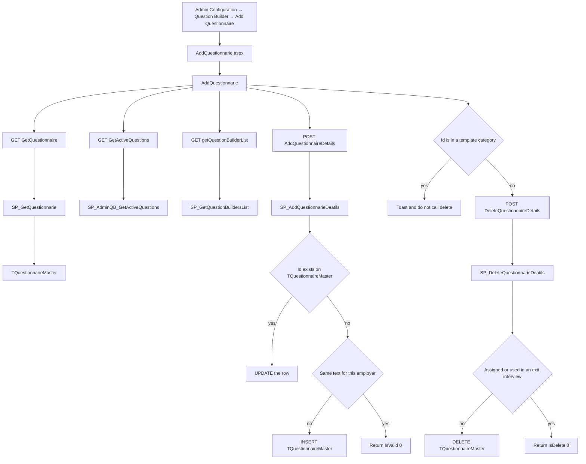
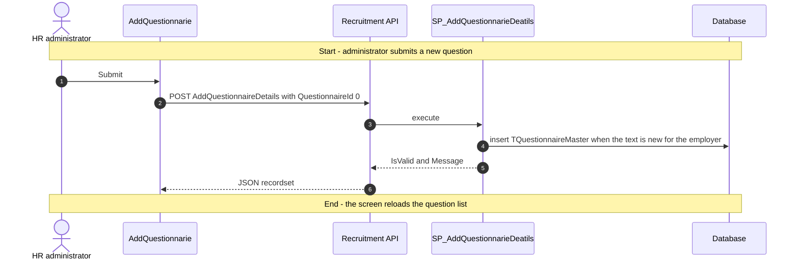
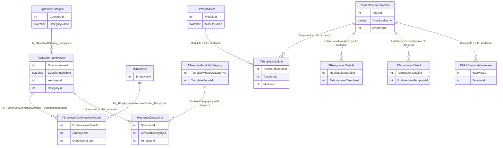

# Add Questionnaire

## Overview

An HR administrator keeps the question bank that interview templates and exit interviews later assign. They open **Admin Configuration → Question Builder → Add Questionnaire**. The left-nav URL is `~/HRM/Settings/AddQuestionnarie.aspx` (the file name spells Questionnarie). The WebForms page does not post questionnaire data back to a BLL. It copies the logged-in user into hidden fields and mounts the Question Builder React bundle in `rmRoot`. `Routes.jsx` renders `AddQuestionnarie` for that same path.

On load the screen lists every question for the employer from `SP_GetQuestionnarie`. Submit and Update both post to `AddQuestionnaireDetails`, which runs `SP_AddQuestionnarieDeatils`. A new question is sent with `QuestionnaireId` 0. A selected row is sent with that row's id, and the procedure updates `TQuestionnaireMaster` when the id exists. Otherwise it inserts, unless the same question text already exists for the employer. Delete first checks the second result set of `SP_GetQuestionBuildersList` so a question already listed on a template category is not removed. If that check passes, `SP_DeleteQuestionnarieDeatils` still refuses the delete when `TAssignedQuestions` or `TEmployeeExitInterviewDetails` references the id.

The form captures question text (500 characters), mandatory, status, and answer type: Option Button, Check Box, Free Text, Star Rating, or Range 1-5. Option Button and Check Box collect choice values joined with `~`. Those types, plus the two rating types, can add a comment box and mark that comment mandatory. Status can be set to InActive only while one row is selected. The grid search, sort, and paging stay in the browser.

SystemModel-2 has no page that names this screen. The llm-wiki catalog at `apps/backstage/content/llm-wiki/reference/tables/hrms.md` describes `TQuestionnaireMaster` (related `TQuestionCategory`), `TEmployeeExitInterviewDetails` (related `TEmployee` and `TQuestionnaireMaster`), and `TAssignedQuestions` (no related tables listed). The declared foreign keys that match those catalog rows are in the table scripts below. `TQuestionCategory` is not read or written by the five procedures this page calls.

**Who's involved:**

- **HR administrator** — adds, edits, and deletes questions for the organisation in the session.
- **Interview template and exit interview** — later screens assign these questions. This page only reads template category ids so it can block a delete. Maintaining templates is `InterviewTemplate.aspx`.

## Workflow

## Request journey

### HR administrator — submit a new question

The screen then calls `GetQuestionnaire` again, which runs `SP_GetQuestionnarie`. Update posts the same URL with the selected `QuestionnaireId`. Delete posts `DeleteQuestionnaireDetails` only after the template-category check. The host page does not post back.

## Entry points

The menu target is `HRM/Settings/AddQuestionnarie.aspx`. `Page_Load` records activity type `AddOrUpdateQuestionnaireMaster` through `CommonUtil.LogActivity` and writes session values into hidden fields (`hdnEmpId`, `hdnEmployerId`, and the other `hdn*` inputs). The React slice reads those fields into `userInfo`. List, save, and the template-category check send `employerId`. Delete sends only the question id. The component reads `employeeId` and does not send it.

| UI page | Purpose |
|---|---|
| `HRM/Settings/AddQuestionnarie.aspx` | Host, session hidden fields, React bundle |
| `HRM/QuestionBuilder_React/AddQuestionnarie.jsx` | Question form, list, save, and delete |
| `HRM/QuestionBuilder_React/Routes.jsx` | Maps `/HRM/Settings/AddQuestionnarie.aspx` to that component |

## Code → database call chain

| Entry | Method | Stored procedure |
|---|---|---|
| List on load and after save or delete | `fetchData` (`AddQuestionnarie.jsx:65`) → `GetQuestionnaire` (`recruitmentController.js:5073`) → `GetQuestionnaire` (`recruitmentDAL.js:9973`) | `SP_GetQuestionnarie` |
| Submit | `handleInsert` (`AddQuestionnarie.jsx:163`) → `AddQuestionnaireDetails` (`recruitmentController.js:5107`) → `AddQuestionnaireDetails` (`recruitmentDAL.js:10004`) | `SP_AddQuestionnarieDeatils` |
| Update | `handleUpdate` (`AddQuestionnarie.jsx:202`) → same controller and DAL methods | `SP_AddQuestionnarieDeatils` |
| Delete | `handleDeleteWithId` (`AddQuestionnarie.jsx:244`) → `DeleteQuestionnaireDetails` (`recruitmentController.js:5082`) → `DeleteQuestionnaireDetails` (`recruitmentDAL.js:10019`) | `SP_DeleteQuestionnarieDeatils` |
| Template categories used to block delete | `getQuestionBuilderList` (`AddQuestionnarie.jsx:218`) → `GetQuestionBuilderList` (`recruitmentController.js:5141`) → `GetQuestionBuilderList` (`recruitmentDAL.js:10080`) | `SP_GetQuestionBuildersList` |
| Active questions on load | `getActiveQuestions` (`AddQuestionnarie.jsx:264`) → `GetActiveQuestions` (`recruitmentController.js:5115`) → `GetActiveQuestions` (`recruitmentDAL.js:10032`) | `SP_AdminQB_GetActiveQuestions` |

Route constants are the unversioned block in `apiURLConstants.js:229` and `apiURLConstants.js:237`. `routeIndex.js:48` mounts the recruitment router, and `app.js:31` mounts that under `/api`.

## API endpoints

The questionnaire screen does not post back to `AddQuestionnarie.aspx`. `APIHelper` sends `Authorization` from `localStorage` (`apiHelper.js:12`). Each route below is registered with `Authorize`.

| Method | Path | Purpose | Caller | Handler |
|---|---|---|---|---|
| GET | `/api/recruitment/GetQuestionnaire?employerId=` | List questions for the employer | `fetchData` | `GetQuestionnaire` |
| POST | `/api/recruitment/AddQuestionnaireDetails` | Insert when `QuestionnaireId` is 0, otherwise update | `handleInsert`, `handleUpdate` | `AddQuestionnaireDetails` |
| POST | `/api/recruitment/DeleteQuestionnaireDetails?questionnaireId=` | Delete when the question is not tagged | `handleDeleteWithId` | `DeleteQuestionnaireDetails` |
| GET | `/api/recruitment/getQuestionBuilderList?employerId=` | Template rows and category question ids | `getQuestionBuilderList` | `GetQuestionBuilderList` |
| GET | `/api/recruitment/GetActiveQuestions?employerId=` | Active questions | `getActiveQuestions` | `GetActiveQuestions` |

`AddQuestionnaireDetails` forces scoring off unless `ControlType` is `Star Rating` or `Range 1-5` and `IsScoringEnabled` is set (`recruitmentController.js:5088`). This form does not send scoring fields, so the DAL passes `IsScoringEnabled` 0, `ScoringMethod` null, and `MaxScore` 0 (`recruitmentDAL.js:10001`).

The same five handlers are registered again at `RecruitmentRoutes.js:376`. Commented v2 and v3 URL blocks in `apiURLConstants.js` are not what this bundle calls.

## Stored procedures & tables involved

None of these procedures execute another procedure or function.

| Object | File | Purpose |
|---|---|---|
| `SP_GetQuestionnarie` | `HRMS-DATABASE/HRMS/STOREPROCEDURE/SP_GetQuestionnarie.sql` | List `TQuestionnaireMaster` for an employer, ordered by text |
| `SP_AddQuestionnarieDeatils` | `HRMS-DATABASE/HRMS/STOREPROCEDURE/SP_AddQuestionnarieDeatils.sql` | Update by id, or insert when the text is new for the employer |
| `SP_DeleteQuestionnarieDeatils` | `HRMS-DATABASE/HRMS/STOREPROCEDURE/SP_DeleteQuestionnarieDeatils.sql` | Delete when the id is unused, otherwise return `IsDelete` 0 |
| `SP_GetQuestionBuildersList` | `HRMS-DATABASE/HRMS/STOREPROCEDURE/SP_GetQuestionBuildersList.sql` | Three result sets of templates, categories, and interview usage |
| `SP_AdminQB_GetActiveQuestions` | `HRMS-DATABASE/HRMS/STOREPROCEDURE/SP_AdminQB_GetActiveQuestions.sql` | Active questions for an employer |

## Table relationships

Declared foreign keys on the tables this page reads or writes:

- `FK_TEmployeeExitInterviewDetails_TQuestionnaireMaster` — `TEmployeeExitInterviewDetails.QuestionnaireId` references `TQuestionnaireMaster.QuestionnaireId` (`TABLES/TEmployeeExitInterviewDetails.sql`).
- `FK_TEmployeeExitInterviewDetails_TEmployee` — `EmployeeId` references `TEmployee`. The delete procedure counts rows by `QuestionnaireId` and does not join `TEmployee`.
- `fk_TQuestionCategory_CategoryId` — `TQuestionnaireMaster.CategoryId` references `TQuestionCategory.CategoryId` (`DDL/104633/2_Alter_TQuestionnaireMaster.sql`). That matches the llm-wiki related column. These procedures do not select or set `CategoryId`.

`TAssignedQuestions` has no foreign key in its create script. `TemModCategoryId` is added in `DDL/77539_Alter Statement for TAssignedQuestions.sql` with no foreign key. `TTemplateModule`, `TExitInterviewTemplate`, and `THrmsModules` declare no foreign key to each other. `TResignationDetails.ExitInterviewTemplateId` and `TTerminationDetail.ExitInterviewTemplateId` are not foreign keys to `TExitInterviewTemplate`. `TRRSCandidateInterview.TemplateId` is not a foreign key to the template. The procedure still joins or filters on those columns.

## Known gaps

- `getActiveQuestions` runs on load and returns the rows to the caller. The component does not store them.
- Submit and Update show a success toast whenever the HTTP body is truthy. `SP_AddQuestionnarieDeatils` returns `IsValid` 0 and `Question Already exist for the given Employer` without inserting, and that recordset is still truthy.
- The controller and `SP_AddQuestionnarieDeatils` persist `IsScoringEnabled`, `ScoringMethod`, and `MaxScore`. This form never sends them, so each save from this screen stores scoring off.
- `GetQuestionnaire` in the controller accepts `questionnaireId`, and `recruitmentDAL.GetQuestionnaire` only binds `@Employerid`.
- The shared activity logger started from `Page_Load` is not traced to a procedure here.
- `SetInterviewTemplate` uses `SP_GetQuestionBuildersList` to maintain templates. That screen is a different menu URL.

## Reference

Confidence is high because the host page, the React calls, the v1 controller and DAL, and the five procedure bodies were read. SystemModel-2 does not describe this screen.

### SourceCode

- `HRMS.Web/HRMS.Web/HRM/Settings/AddQuestionnarie.aspx`
- `HRMS.Web/HRMS.Web/HRM/Settings/AddQuestionnarie.aspx.cs`
- `HRMS.Web/HRMS.Web/HRM/QuestionBuilder_React/Routes.jsx`
- `HRMS.Web/HRMS.Web/HRM/QuestionBuilder_React/AddQuestionnarie.jsx`
- `HRMS.Web/HRMS.Web/HRM/QuestionBuilder_React/Areas/QuestionBuilderSetupSlice.jsx`
- `HRMS.Web/HRMS.Web/HRM/QuestionBuilder_React/Common/apiURLConstants.js`
- `HRMS.Web/HRMS.Web/HRM/QuestionBuilder_React/Common/apiHelper.js`
- `HRMS.CoreAPI/HRMS.Core.WebAPI.Node/app.js`
- `HRMS.CoreAPI/HRMS.Core.WebAPI.Node/Routes/routeIndex.js`
- `HRMS.CoreAPI/HRMS.Core.WebAPI.Node/Routes/RecruitmentRoutes.js`
- `HRMS.CoreAPI/HRMS.Core.WebAPI.Node/Controllers/recruitmentController.js`
- `HRMS.CoreAPI/HRMS.Core.WebAPI.Node/Core/DataAccessLayer/recruitmentDAL.js`
- `apps/backstage/content/llm-wiki/reference/tables/hrms.md`

### TDG HRMS DB

- `HRMS-DATABASE/HRMS/STOREPROCEDURE/SP_GetQuestionnarie.sql`
- `HRMS-DATABASE/HRMS/STOREPROCEDURE/SP_AddQuestionnarieDeatils.sql`
- `HRMS-DATABASE/HRMS/STOREPROCEDURE/SP_DeleteQuestionnarieDeatils.sql`
- `HRMS-DATABASE/HRMS/STOREPROCEDURE/SP_GetQuestionBuildersList.sql`
- `HRMS-DATABASE/HRMS/STOREPROCEDURE/SP_AdminQB_GetActiveQuestions.sql`
- `HRMS-DATABASE/HRMS/TABLES/TQuestionnaireMaster.sql`
- `HRMS-DATABASE/HRMS/TABLES/TEmployeeExitInterviewDetails.sql`
- `HRMS-DATABASE/HRMS/TABLES/TAssignedQuestions.sql`
- `HRMS-DATABASE/HRMS/TABLES/TExitInterviewTemplate.sql`
- `HRMS-DATABASE/HRMS/TABLES/TTemplateModule.sql`
- `HRMS-DATABASE/HRMS/TABLES/TTemplateModuleCategory.sql`
- `HRMS-DATABASE/HRMS/TABLES/THrmsModules.sql`
- `HRMS-DATABASE/HRMS/DDL/104633/1_Create_TQuestionCategory.sql`
- `HRMS-DATABASE/HRMS/DDL/104633/2_Alter_TQuestionnaireMaster.sql`
- `HRMS-DATABASE/HRMS/DDL/77539_Alter Statement for TAssignedQuestions.sql`
