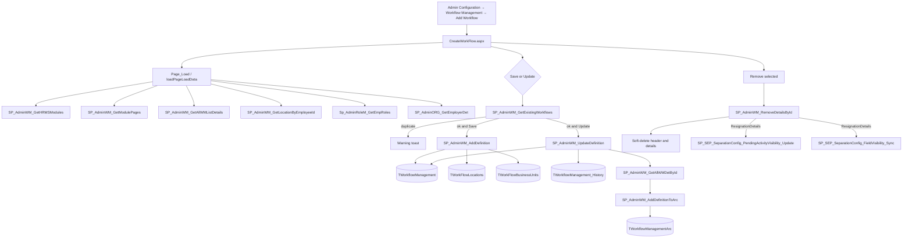
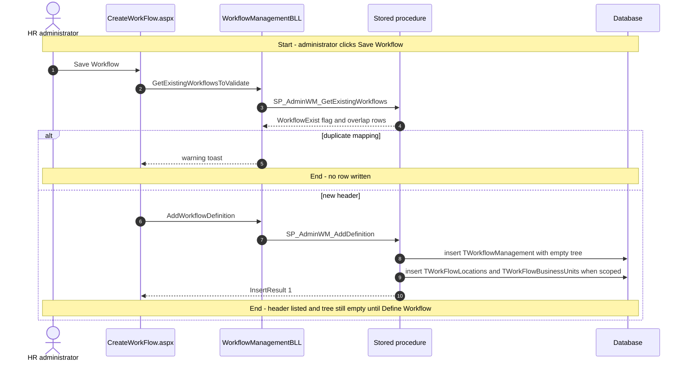
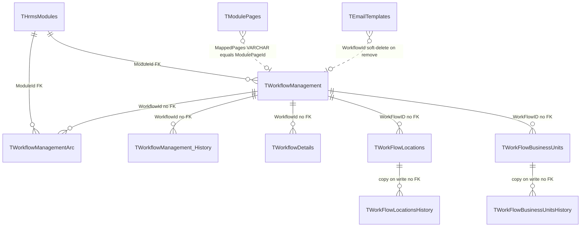

# Add Workflow

## Overview

An HR administrator opens **Admin Configuration → Workflow Management → Add Workflow** to create the **definition header** for an approval workflow: name, description, max routing levels, HRMS module, mapped page, and (when the employer flag allows) optional business-unit and location scope. The left-nav target is menu id `26` with live `NavigateURL` `~/HRM/Settings/CreateWorkFlow.aspx` (`dbo.tMenuDetails`). The page title and breadcrumb both say **Add Workflow**.

Saving a new header inserts a `TWorkflowManagement` row with an **empty** `WorkflowDefinitionTree`. The administrator does **not** draw approval nodes on this screen — that happens later on **Define Workflow**. Updating a row rewrites the header and BU/location mappings, copies the prior header into history inside the update procedure, then also writes an archive snapshot. Soft-delete marks the header and any materialised `TWorkflowDetails` deleted, clears BU/location maps, soft-deletes linked email templates, and — when the mapped page is resignation — syncs separation config visibility.

Duplicate protection runs before insert/update: same mapped page for the employer with overlapping “all BU/location” or intersecting BU and location sets is rejected in the UI after `SP_AdminWM_GetExistingWorkflows`. Default (Org `0`) workflows cannot be deleted by non-super users.

For the full designer + runtime engine (tree save, approve/reject, `TRequestWorkflows`), see the sibling guide `workflow.md` (`submenu: Workflow Management`) and `llm-wiki/domain/approval-workflow.md`. This leaf is only the **Add Workflow** WebForms header screen.

**Who's involved:**

- **Workflow admin** — creates, edits, and soft-deletes definition headers; may deep-link with `?ModuleId=` / `?WorkflowId=` from other screens.
- **Super user (`UserType` `S`)** — works Org `0` master headers (`IsDefault` true); can delete default rows.
- **Define Workflow admin** — later attaches the XML tree; not this page.

## Workflow

## Request journey

### HR administrator — save a new workflow header

Update posts the same form with button text **Update Workflow**, runs `SP_AdminWM_UpdateDefinition`, then archives via `SP_AdminWM_GetAllWMDetById` + `SP_AdminWM_AddDefinitionToArc`. Delete posts selected grid rows to `SP_AdminWM_RemoveDetailsById`. There is no Node API on this screen.

## Entry points

Live DEV `tMenuDetails` for `MenuId` 26: `MenuName` = `Add Workflow`, `NavigateURL` = `~/HRM/Settings/CreateWorkFlow.aspx`, `PageName` = `CreateWorkFlow.aspx`, `ISActive` = true. Hierarchy XML under Workflow Management uses the same value `26`.

| Entry point | Purpose |
|---|---|
| `HRM/Settings/CreateWorkFlow.aspx` | WebForms host — list, save, update, soft-delete headers |
| `CreateWorkFlow.aspx.cs` | Postbacks to `WorkflowManagementBLL` / DAL |
| Query `ModuleId` / `WorkflowId` | Pre-selects module and mapped page on first load |
| Deep links from OT / other modules via `redirectToAddWorkflow` | Opens this page with query string |

Sibling screens (not this submenu): `DefineWorkFlowReact.aspx`, `WorkflowDashboard.aspx`, `CreateRole.aspx` — covered by `workflow.md`.

## Code → database call chain

| Step | Entry | App code | Stored procedure |
|---|---|---|---|
| Modules on load | `bindHRMSModules` (`CreateWorkFlow.aspx.cs:824`) | `WorkflowManagementBLL.GetHRMSModules` → `WorkflowManagementDAL.cs:359` | `SP_AdminWM_GetHRMSModules` |
| Mapped pages | `getPagesListtoSourceListBox` (`CreateWorkFlow.aspx.cs:834`) | `GetWorkflowModulePagesList` → `WorkflowManagementDAL.cs:288` | `SP_AdminWM_GetModulePages` |
| Grid list | `getAllWorkflowDefinitions` (`CreateWorkFlow.aspx.cs:772`) | `GetWorkflowManagementList` → `WorkflowManagementDAL.cs:200` | `SP_AdminWM_GetAllWMListDetails` |
| Locations picker | `getAllLocations` (`CreateWorkFlow.aspx.cs:781`) | `CommonBLL.GetLocationsByEmployeeId` → `CommonDAL.cs:363` | `SP_AdminWM_GetLocationByEmployeeId` |
| Global-access employers for BU tree | `getBusinessUnitsDetails` (`CreateWorkFlow.aspx.cs:796`) | `RoleManagementDAL.ChangeUserRoleList` (`RoleManagementDAL.cs:145`) | `Sp_AdminRoleM_GetEmpRoles` |
| BU/location employer flag | `loadPageLoadData` (`CreateWorkFlow.aspx.cs:122`) | `EmployerDal.GetSelectedEmployerDetails` (`EmployerDAL.cs:500`) | `SP_AdminORG_GetEmployerDet` |
| BU/location already used for page | `cboWorkflowPage_SelectedIndexChanged` (`CreateWorkFlow.aspx.cs:359`) | `GetModulePageBUAndLocations` → `WorkflowManagementDAL.cs:521` | `USP_AdminWM_GetModulePagesByModule` |
| Duplicate check before save | `submitWorkflow` (`CreateWorkFlow.aspx.cs:524`) | `GetExistingWorkflowsToValidate` → `WorkflowManagementDAL.cs:532` | `SP_AdminWM_GetExistingWorkflows` |
| Insert header | `addWorkflowDetails` (`CreateWorkFlow.aspx.cs:747`) | `AddWorkflowDefinition` → `WorkflowManagementDAL.cs:210` | `SP_AdminWM_AddDefinition` |
| Update header | `submitWorkflow` (`CreateWorkFlow.aspx.cs:614`) | `UpdateWorkflowDefinition` → `WorkflowManagementDAL.cs:238` | `SP_AdminWM_UpdateDefinition` |
| Load row for edit / archive input | `getSelectedWFDetails` / update path (`CreateWorkFlow.aspx.cs:986`, `:616`) | `GetWorkflowDetailsByWorkflowId` / `…ForArc` → `WorkflowManagementDAL.cs:299` / `:266` | `SP_AdminWM_GetAllWMDetById` |
| Archive after update | `updateWorkflowDetailsToArchTable` (`CreateWorkFlow.aspx.cs:913`) | `AddWorkflowDefinitionToArcTable` → `WorkflowManagementDAL.cs:325` | `SP_AdminWM_AddDefinitionToArc` |
| Soft-delete | `btnRemoveSelectedWorkflow` (`CreateWorkFlow.aspx.cs:310`) | `RemoveSelectedWFFromWorkFlowList` → `WorkflowManagementDAL.cs:275` | `SP_AdminWM_RemoveDetailsById` |

`WebCommon.GetOrgStructureReport` builds the BU RadTree XML after the role list; it is not expanded to a single stored procedure in this guide. Activity logging uses `CommonUtil.LogActivity` (`AddWorkflowMaster` / `UpdateWorkflowMaster` / `DeleteWorkflowMaster`).

## API endpoints

This feature is classic WebForms postback only. It does **not** call `/api/workflow/*`. Tree save and clone live on Define Workflow / Workflow Dashboard (see `workflow.md`).

| Mechanism | Route | Purpose |
|---|---|---|
| ASP.NET postback | `CreateWorkFlow.aspx` event handlers | Save, update, delete, combo changes |
| Query string | `?ModuleId=` / `?WorkflowId=` | Prefill on first load |

## Stored procedures & tables involved

Designer header objects use the `SP_AdminWM_*` / `USP_AdminWM_*` prefix. Runtime approve/reject is out of scope here.

| Object | File path | Purpose | Wiki / DB doc |
|---|---|---|---|
| `TWorkflowManagement` | `HRMS-DATABASE/HRMS/TABLES/TWorkflowManagement.sql` | Definition header + XML tree (empty on add) | `llm-wiki/domain/approval-workflow.md` |
| `TWorkflowManagement_History` | `TABLES/TWorkflowManagement_History.sql` | Snapshot before update/delete | `llm-wiki/reference/tables/hrms.md` |
| `TWorkflowManagementArc` | `TABLES/TWorkflowManagementArc.sql` | Archive copy after update from this page | same |
| `TWorkFlowLocations` / `TWorkFlowBusinessUnits` | `TABLES/` | Scope maps rewritten on add/update | catalog rows in `TDataCatalog` |
| `TWorkFlowLocationsHistory` / `TWorkFlowBusinessUnitsHistory` | `TABLES/` | History of map rows | — |
| `TWorkFlowLocationsArc` / `TWorkFlowBusinessUnitsArc` | `TABLES/` | Archive maps with header arc | — |
| `TWorkflowDetails` | `TABLES/TWorkflowDetails.sql` | Soft-deleted with header remove | `llm-wiki/domain/approval-workflow.md` |
| `TModulePages` / `THrmsModules` | `TABLES/` | Mapped page and module lookup | — |
| `TEmailTemplates` | `TABLES/` | Soft-deleted when header removed | — |
| `TResignationConfigurationData` | — | Updated when deleting a resignation workflow | catalog |
| `SP_AdminWM_AddDefinition` | `STOREPROCEDURE/SP_AdminWM_AddDefinition.sql` | Insert header + maps | [page](/docs/database/hrms/SP_AdminWM_AddDefinition) |
| `SP_AdminWM_UpdateDefinition` | `STOREPROCEDURE/SP_AdminWM_UpdateDefinition.sql` | History + update header + rewrite maps | [page](/docs/database/hrms/SP_AdminWM_UpdateDefinition) |
| `SP_AdminWM_GetAllWMListDetails` | `STOREPROCEDURE/…` | Grid list | [page](/docs/database/hrms/SP_AdminWM_GetAllWMListDetails) |
| `SP_AdminWM_GetAllWMDetById` | `STOREPROCEDURE/…` | Edit load / archive source | [page](/docs/database/hrms/SP_AdminWM_GetAllWMDetById) |
| `SP_AdminWM_GetExistingWorkflows` | `STOREPROCEDURE/…` | Duplicate / overlap check | [page](/docs/database/hrms/SP_AdminWM_GetExistingWorkflows) |
| `SP_AdminWM_AddDefinitionToArc` | `STOREPROCEDURE/…` | Archive header + maps | [page](/docs/database/hrms/SP_AdminWM_AddDefinitionToArc) |
| `SP_AdminWM_RemoveDetailsById` | `STOREPROCEDURE/…` | Soft-delete header chain | [page](/docs/database/hrms/SP_AdminWM_RemoveDetailsById) |
| `USP_AdminWM_GetModulePagesByModule` | `STOREPROCEDURE/…` | BU/location already mapped for page | [page](/docs/database/hrms/USP_AdminWM_GetModulePagesByModule) |
| `SP_AdminWM_GetHRMSModules` | same | Module combo | [existing](/docs/database/hrms/SP_AdminWM_GetHRMSModules) |
| `SP_AdminWM_GetModulePages` | same | Page combo | [existing](/docs/database/hrms/SP_AdminWM_GetModulePages) |
| `SP_AdminWM_GetLocationByEmployeeId` | same | Location list | [existing](/docs/database/hrms/SP_AdminWM_GetLocationByEmployeeId) |
| `Sp_AdminRoleM_GetEmpRoles` | same | Global-access employer ids | [existing](/docs/database/hrms/Sp_AdminRoleM_GetEmpRoles) |
| `SP_AdminORG_GetEmployerDet` | same | `IsWorkflowForBUAndLocation` | [existing](/docs/database/hrms/SP_AdminORG_GetEmployerDet) |
| `SP_SEP_SeparationConfig_PendingActivityVisibility_Update` | nested from remove | Strip pending-activity role ids | [page](/docs/database/hrms/SP_SEP_SeparationConfig_PendingActivityVisibility_Update) |
| `SP_SEP_SeparationConfig_FieldVisibility_Sync` | nested from remove | Drop stale field-visibility authorities | [page](/docs/database/hrms/SP_SEP_SeparationConfig_FieldVisibility_Sync) |

## Table relationships

Declared FK from create scripts; map and detail tables use `WorkflowId` without a declared FK (same pattern as `workflow.md` / llm-wiki).

## Known gaps

- Save always stores `WorkflowDefinitionTree` as empty (`addWorkflowDetails`); tree editing is a different menu item.
- After update, archive is filled from `SP_AdminWM_GetAllWMDetById` **after** `SP_AdminWM_UpdateDefinition`, so `TWorkflowManagementArc` may hold post-update values while `TWorkflowManagement_History` holds the pre-update row from inside the update procedure.
- `USP_AdminWM_GetModulePagesByModule` results that would disable already-mapped BUs/locations are fetched, but the disable helpers in the page are commented out.
- `WebCommon.GetOrgStructureReport` and `WebCommonTab.GetTabsByMenu(26)` are not traced to a single inventoried procedure here.
- `CommonUtil.LogActivity` / `AuditTrail` paths are not expanded.
- COB/bulk publish uses unprefixed `SP_AddWorkflowDefinition_ReturnId` — not this page.

## Reference

Confidence is high because live `tMenuDetails` NavigateURL, `CreateWorkFlow.aspx(.cs)`, `WorkflowManagementBLL`/`DAL`, `DBConstant` procedure names, and the listed `STOREPROCEDURE` scripts were read. Sibling `workflow.md` covers the broader platform; this file does not replace it.

### SourceCode

- `HRMS.Web/HRMS.Web/HRM/Settings/CreateWorkFlow.aspx`
- `HRMS.Web/HRMS.Web/HRM/Settings/CreateWorkFlow.aspx.cs`
- `HRMS.Shared/HRMS.BusinessLayer/GenericWorkFlow/WorkflowManagementBLL.cs`
- `HRMS.Shared/HRMS.DataAccessLayer/GenericWorkFlowDAL/WorkflowManagementDAL.cs`
- `HRMS.Shared/HRMS.DataAccessLayer/DBConstant.cs`
- `HRMS.Shared/HRMS.DataAccessLayer/CommonDAL.cs`
- `HRMS.Shared/HRMS.DataAccessLayer/RoleManagement/RoleManagementDAL.cs`
- `HRMS.Shared/HRMS.DataAccessLayer/Employer/EmployerDAL.cs`
- `docs/SystemModels/SystemModel-2/domain/contexts/workflow-platform.md` (engine context; does not name this page)

### TDG HRMS DB

- Live `dbo.tMenuDetails` (`MenuId` 26)
- `HRMS-DATABASE/HRMS/STOREPROCEDURE/SP_AdminWM_AddDefinition.sql`
- `HRMS-DATABASE/HRMS/STOREPROCEDURE/SP_AdminWM_UpdateDefinition.sql`
- `HRMS-DATABASE/HRMS/STOREPROCEDURE/SP_AdminWM_GetAllWMListDetails.sql`
- `HRMS-DATABASE/HRMS/STOREPROCEDURE/SP_AdminWM_GetAllWMDetById.sql`
- `HRMS-DATABASE/HRMS/STOREPROCEDURE/SP_AdminWM_GetExistingWorkflows.sql`
- `HRMS-DATABASE/HRMS/STOREPROCEDURE/SP_AdminWM_AddDefinitionToArc.sql`
- `HRMS-DATABASE/HRMS/STOREPROCEDURE/SP_AdminWM_RemoveDetailsById.sql`
- `HRMS-DATABASE/HRMS/STOREPROCEDURE/USP_AdminWM_GetModulePagesByModule.sql`
- `HRMS-DATABASE/HRMS/STOREPROCEDURE/SP_SEP_SeparationConfig_PendingActivityVisibility_Update.sql`
- `HRMS-DATABASE/HRMS/STOREPROCEDURE/SP_SEP_SeparationConfig_FieldVisibility_Sync.sql`
- `HRMS-DATABASE/HRMS/TABLES/TWorkflowManagement.sql`
- `llm-wiki/domain/approval-workflow.md`
- Sibling guide `apps/backstage/content/guides/admin-configuration/workflow.md`
