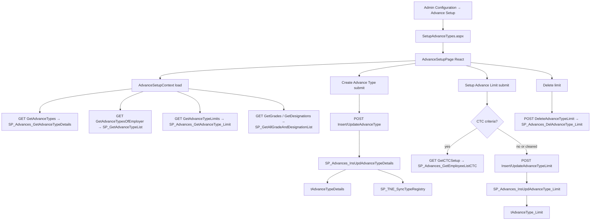
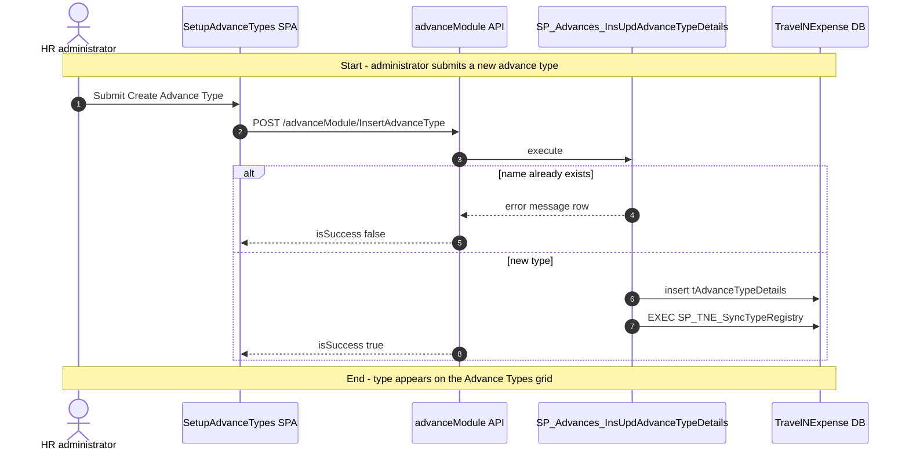
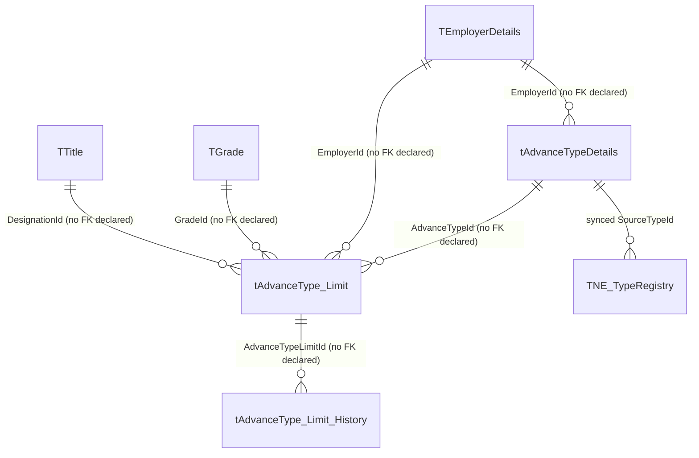

# Advance Setup

## Overview

An HR administrator defines the advance types and per-grade or per-designation limits that employees later pick when they request a cash advance. They open **Admin Configuration → Advance Setup** (`/HRM/AdvanceModule/SetupAdvanceTypes.aspx`). The WebForms host only injects session hidden fields and loads the Advance Module webpack bundle. React route `SetupAdvanceTypes` mounts `AdvanceSetupPage`, which shows two panels on the same screen: **Create Advance Type** and **Setup Advance Limit**.

Creating an advance type posts to Core API `InsertAdvanceType` / `UpdateAdvanceType`, which call `SP_Advances_InsUpdAdvanceTypeDetails` in the Travel & Expense database. That procedure writes `tAdvanceTypeDetails` and then runs `SP_TNE_SyncTypeRegistry` so the Policy Engine type registry stays aligned. Setting a limit posts to `InsertAdvanceTypeLimit` / `UpdateAdvanceTypeLimit` / `DeleteAdvanceTypeLimit`, which call `SP_Advances_InsUpdAdvanceType_Limit` or `SP_Advances_DelAdvanceType_Limit` against `tAdvanceType_Limit` (with history on update and soft-delete). Employees do not open this screen; their advance request form later reads these types and limits.

There is no SystemModel-2 workflow page for Advance Setup in this checkout, and no `llm-wiki` domain page for `tAdvanceTypeDetails` / `tAdvanceType_Limit`. Table scripts live under `HRMS-DATABASE/HRMS_TRAVELNEXPENSE/TABLES/`.

**Who's involved:**

- **HR administrator** — maintains advance types and limits for the organisation selected in the page header.
- **Employee** — does not open this screen. Later advance requests use the types and limits created here.
- **Approver / accountant** — not involved in setup; they act on advance requests that consume these masters.

## Workflow

## Request journey

### HR administrator — create an advance type

Updating a type uses the same procedure with `@AdvanceTypeId` set. Inactivating is blocked when open advance requests still use that type. Saving a limit follows the same UI → API → SP pattern through `SP_Advances_InsUpdAdvanceType_Limit`.

## Entry points

Menu DML (`HRMS-DATABASE/HRMS/DML/71258_MenuDetails_Advances.sql`) registers **Advance Setup** (menu value `1155`) with navigate URL `/HRM/AdvanceModule/SetupAdvanceTypes.aspx`. The aspx code-behind only logs `TnEAdvanceSetup`, loads the webpack manifest, and binds session fields. All business actions are React HTTP calls to Core API `/advanceModule/*` (also mounted under `/v2/advanceModule`).

| Entry point | Purpose |
|---|---|
| `HRM/AdvanceModule/SetupAdvanceTypes.aspx` | Host page and webpack shell |
| `Areas/AdvanceSetup/AdvanceSetupPage.js` | React page for create type + setup limit |
| `routes.js` path `SetupAdvanceTypes` | Client route that mounts `AdvanceSetupPage` |

## Code → database call chain

DAL uses `mssql` against the Travel & Expense connection. Currency lists come from `TravelClient.getAllCurrency` (Travel API), not from the procedures below.

| UI | API | DAL (`file:line`) | Stored procedure |
|---|---|---|---|
| Load types grid (`AdvanceSetupContext.js:20`) | `GET /advanceModule/GetAdvanceTypes` (`advanceModuleController.js:405`) | `GetAdvanceTypes` → `_getAdvanceTypes` (`advanceModuleDAL.js:777`, `800`) | `SP_Advances_GetAdvanceTypeDetails` |
| Load type dropdown (`AdvanceSetupContext.js:21`) | `GET /advanceModule/GetAdvanceTypesOfEmployer` (`advanceModuleController.js:369`) | `GetAdvanceTypesOfEmployer` (`advanceModuleDAL.js:714`) | `SP_GetAdvanceTypeList` |
| Load limits grid (`AdvanceSetupContext.js:22`) | `GET /advanceModule/GetAdvanceTypeLimits` (`advanceModuleController.js:381`) | `GetAdvanceTypeLimits` → `_getAdvanceTypeLimits` (`advanceModuleDAL.js:733`, `757`) | `SP_Advances_GetAdvanceType_Limit` |
| Load grades (`AdvanceSetupContext.js:23`) | `GET /advanceModule/GetGrades` (`advanceModuleController.js:345`) | `GetGrades` → `_getGradeOrDesignations` (`advanceModuleDAL.js:673`, `692`) | `SP_GetAllGradeAndDesignationList` (`@Type='G'`) |
| Load designations (`AdvanceSetupContext.js:24`) | `GET /advanceModule/GetDesignations` (`advanceModuleController.js:357`) | `GetDesignations` → `_getGradeOrDesignations` (`advanceModuleDAL.js:682`, `692`) | `SP_GetAllGradeAndDesignationList` (`@Type='D'`) |
| Create type (`CreateAdvanceTypeForm.js:84`) | `POST /advanceModule/InsertAdvanceType` (`advanceModuleController.js:429`) | `InsertAdvanceType` → `_upsertAdvanceType` (`advanceModuleDAL.js:847`, `895`) | `SP_Advances_InsUpdAdvanceTypeDetails` |
| Update type (`CreateAdvanceTypeForm.js:83`) | `POST /advanceModule/UpdateAdvanceType` (`advanceModuleController.js:442`) | `UpdateAdvanceType` → `_upsertAdvanceType` (`advanceModuleDAL.js:867`, `895`) | `SP_Advances_InsUpdAdvanceTypeDetails` |
| CTC check (`_helpers.js:22`) | `GET /advanceModule/GetCTCSetup` (`advanceModuleController.js:455`) | `GetCTCSetup` (`advanceModuleDAL.js:1061`) | `SP_Advances_GetEmployeeListCTC` |
| Create limit (`SetupAdvanceLimitForm.js:186`) | `POST /advanceModule/InsertAdvanceTypeLimit` (`advanceModuleController.js:468`) | `InsertAdvanceTypeLimit` → `_upsertAdvanceTypeLimit` (`advanceModuleDAL.js:938`, `1016`) | `SP_Advances_InsUpdAdvanceType_Limit` |
| Update limit (`SetupAdvanceLimitForm.js:185`) | `POST /advanceModule/UpdateAdvanceTypeLimit` (`advanceModuleController.js:491`) | `UpdateAdvanceTypeLimit` → `_upsertAdvanceTypeLimit` (`advanceModuleDAL.js:976`, `1016`) | `SP_Advances_InsUpdAdvanceType_Limit` |
| Delete limit (`DeleteAdvanceTypeLimitContext.js:32`) | `POST /advanceModule/DeleteAdvanceTypeLimit` (`advanceModuleController.js:514`) | `DeleteAdvanceTypeLimit` (`advanceModuleDAL.js:1083`) | `SP_Advances_DelAdvanceType_Limit` |

Nested from `SP_Advances_InsUpdAdvanceTypeDetails`: `SP_TNE_SyncTypeRegistry`. Nested from `SP_Advances_GetEmployeeListCTC`: synonym `Fn_GetEmployeeName` → HRMS function (existing page under `hrms`).

## API endpoints

Routes are registered in `Routes/AdvanceModuleRoutes.js` with `Authorize` and (except delete) `assertEmployerAccess('employerId')`. There is no WebForms postback for setup actions.

| Verb | Route | Parameters | Purpose | Source |
|---|---|---|---|---|
| GET | `/advanceModule/GetAdvanceTypes` | `employerId` (query, required) | List advance types for grid | `AdvanceModuleRoutes.js:30` |
| GET | `/advanceModule/GetAdvanceTypesOfEmployer` | `employerId` (query, required) | Active types for limit dropdown | `AdvanceModuleRoutes.js:27` |
| GET | `/advanceModule/GetAdvanceTypeLimits` | `employerId` (query, required) | List limits | `AdvanceModuleRoutes.js:28` |
| GET | `/advanceModule/GetGrades` | `employerId` (query, required) | Active grades | `AdvanceModuleRoutes.js:25` |
| GET | `/advanceModule/GetDesignations` | `employerId` (query, required) | Active designations | `AdvanceModuleRoutes.js:26` |
| POST | `/advanceModule/InsertAdvanceType` | body `employerId`, `advanceType`, `isActive`, optional `isAttachmentMandatory`; actor `req.EID` | Create type | `AdvanceModuleRoutes.js:34` |
| POST | `/advanceModule/UpdateAdvanceType` | body `employerId`, `advanceType`, `isActive`, `advanceTypeId`, optional `isAttachmentMandatory`; actor `req.EID` | Update type | `AdvanceModuleRoutes.js:35` |
| GET | `/advanceModule/GetCTCSetup` | `employerId`, `limitOn`, `values` (query) | Employees missing CTC for selected grades/designations | `AdvanceModuleRoutes.js:36` |
| POST | `/advanceModule/InsertAdvanceTypeLimit` | body `advanceTypeId`, `employerId`, `limitOn`, `gradeIds`, `designationIds`, `limitCriteria`, `maxLimit`, `currencyId`, `createdBy` | Create limit | `AdvanceModuleRoutes.js:37` |
| POST | `/advanceModule/UpdateAdvanceTypeLimit` | same fields plus `advanceTypeLimitId`; actor `req.EID` | Update limit | `AdvanceModuleRoutes.js:38` |
| POST | `/advanceModule/DeleteAdvanceTypeLimit` | body `advanceTypeLimitId`; actor `req.EID` | Soft-delete limit | `AdvanceModuleRoutes.js:39` |

## Stored procedures & tables involved

All procedures below are under `HRMS-DATABASE/HRMS_TRAVELNEXPENSE/STOREPROCEDURE/` unless noted. Database slug for Backstage pages: `hrms-travelnexpense`.

| Object | Path | Purpose |
|---|---|---|
| `SP_Advances_GetAdvanceTypeDetails` | `.../SP_Advances_GetAdvanceTypeDetails.sql` | List or detail advance types |
| `SP_GetAdvanceTypeList` | `.../SP_GetAdvanceTypeList.sql` | Active types for dropdown |
| `SP_Advances_GetAdvanceType_Limit` | `.../SP_Advances_GetAdvanceType_Limit.sql` | List active limits |
| `SP_GetAllGradeAndDesignationList` | `.../SP_GetAllGradeAndDesignationList.sql` | Grades (`G`) or designations (`D`) |
| `SP_Advances_InsUpdAdvanceTypeDetails` | `.../SP_Advances_InsUpdAdvanceTypeDetails.sql` | Insert/update type; sync registry |
| `SP_Advances_InsUpdAdvanceType_Limit` | `.../SP_Advances_InsUpdAdvanceType_Limit.sql` | Insert/update limit rows |
| `SP_Advances_DelAdvanceType_Limit` | `.../SP_Advances_DelAdvanceType_Limit.sql` | Soft-delete limit + history |
| `SP_Advances_GetEmployeeListCTC` | `.../SP_Advances_GetEmployeeListCTC.sql` | Employees without CTC for CTC validation |
| `SP_TNE_SyncTypeRegistry` | `.../SP_TNE_SyncTypeRegistry.sql` | Nested sync of `TNE_TypeRegistry` |
| `tAdvanceTypeDetails` | `TABLES/tAdvanceTypeDetails.sql` | Advance type master |
| `tAdvanceType_Limit` | `TABLES/tAdvanceType_Limit.sql` | Limit master |
| `tAdvanceType_Limit_History` | `TABLES/tAdvanceType_Limit_History.sql` | Limit history |
| `TNE_TypeRegistry` | Policy Engine registry (synced) | Type registry used by PE |

## Table relationships

`TEmployerDetails`, `TGrade`, `TTitle`, `TEmployee`, `TEmployeeInfo`, and `TEmpSalary` are referenced from Travel & Expense via synonyms to HRMS. No FK constraints are declared on the advance type tables in the checked-in DDL.

## Known gaps

- `GetCTCSetup` DAL binds `@Entity_Flag` / `@Entity_Value`, but `SP_Advances_GetEmployeeListCTC` declares `@GradeIds` / `@DesignationIds`. The UI CTC dialog path may fail or return empty until those names align.
- The HTTP client builds `GetCTCSetup` without a leading `/` (`advanceModule/GetCTCSetup?...`), unlike the other advanceModule URLs.
- Create Advance Type UI does not expose `isAttachmentMandatory`; the API/DAL accept it but the setup form never sends it.
- Currency pickers use Travel API (`TravelClient.getAllCurrency`), not a procedure documented here.
- No `llm-wiki` domain page or SystemModel-2 workflow for this screen; relationships were derived from DDL and procedure text.
- Policy Engine may later supersede classic `tAdvanceType_Limit` for runtime limit checks; this guide documents the classic setup path the SPA still writes.

## Reference

Confidence is high for the React → `/advanceModule` → Travel & Expense SP chain on this host page. Medium for CTC validation because of the parameter-name mismatch.

### SourceCode

- `HRMS.Web/HRMS.Web/HRM/AdvanceModule/SetupAdvanceTypes.aspx`
- `HRMS.Web/HRMS.Web/HRM/AdvanceModule/SetupAdvanceTypes.aspx.cs`
- `HRMS.Web/HRMS.Web/HRM/AdvanceModule/routes.js`
- `HRMS.Web/HRMS.Web/HRM/AdvanceModule/Areas/AdvanceSetup/*`
- `HRMS.Web/HRMS.Web/HRM/AdvanceModule/Common/HttpClients/AdvanceModuleHttpClient.js`
- `HRMS.CoreAPI/HRMS.Core.WebAPI.Node/Routes/AdvanceModuleRoutes.js`
- `HRMS.CoreAPI/HRMS.Core.WebAPI.Node/Controllers/advanceModuleController.js`
- `HRMS.CoreAPI/HRMS.Core.WebAPI.Node/Core/DataAccessLayer/advanceModuleDAL.js`

### TDG HRMS DB

- `HRMS-DATABASE/HRMS_TRAVELNEXPENSE/STOREPROCEDURE/SP_Advances_*.sql`, `SP_GetAdvanceTypeList.sql`, `SP_GetAllGradeAndDesignationList.sql`, `SP_TNE_SyncTypeRegistry.sql`
- `HRMS-DATABASE/HRMS_TRAVELNEXPENSE/TABLES/tAdvanceTypeDetails.sql`, `tAdvanceType_Limit.sql`, `tAdvanceType_Limit_History.sql`
- `HRMS-DATABASE/HRMS/DML/71258_MenuDetails_Advances.sql`
