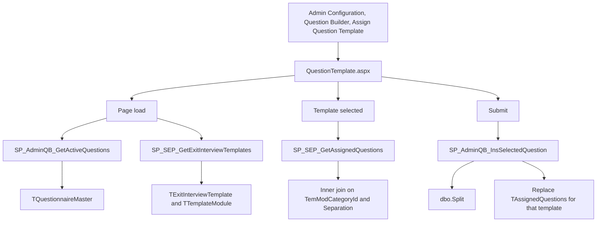
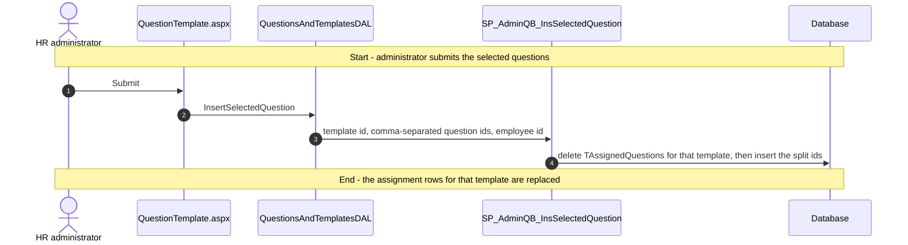
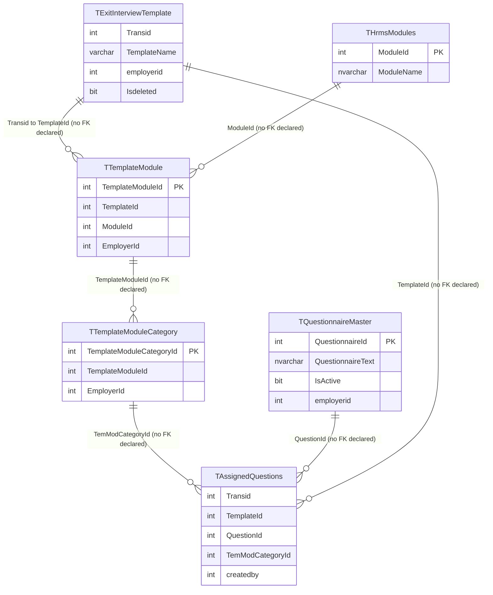

# Assign Question Template

## Overview

An HR administrator needs a named interview template to carry a chosen set of questions. They open **Admin Configuration → Question Builder → Assign Question Template** (`~/HRM/Settings/QuestionTemplate.aspx`). The page is a WebForms form. It does not host a React screen. They pick an interview template, move questions from **Available Questions** into **Selected Questions**, and submit. Submit replaces every `TAssignedQuestions` row for that template id with the ids now in the selected list.

The questions themselves are not created here. **Available Questions** is the active rows in `TQuestionnaireMaster` for the selected organisation. The template names come from active `TExitInterviewTemplate` rows that are linked to a module in `TTemplateModule`. A global-access user can switch organisation in the page header, which reloads this same URL. If the signed-in role has no editable tab for menu id 31, the Submit button is hidden. That check reads the tab list already stored in session. It does not call a question procedure.

SystemModel-2 has no workflow or context page for this screen. The llm-wiki table catalog describes `TAssignedQuestions`, `TQuestionnaireMaster`, `TExitInterviewTemplate`, and `THrmsModules` in `llm-wiki/reference/tables/hrms.md`. There is no domain `erDiagram` for this assignment.

**Who's involved:**

- **HR administrator** — chooses the template and the questions, then submits.
- **Employee** — does not open this screen. Exit-interview and other readers use the assignment rows later, through procedures that also expect a template-module category.

## Workflow

## Request journey

### HR administrator — save the selected questions for one template

The page then shows "Selected records added/updated successfully." It does not rebind the lists. The insert writes `TemplateId`, `QuestionId`, `createdate`, and `createdby` only. It does not set `TemModCategoryId`. The next time someone picks that template, `SP_SEP_GetAssignedQuestions` inner-joins `TemModCategoryId` to `TTemplateModuleCategory` and keeps only the Separation module, so those new rows do not come back.

## Entry points

`QuestionTemplate.aspx` is the live page for this left-nav item. The markup is Telerik list boxes and a Submit button. There is no React root on the page.

| UI page | Purpose |
|---|---|
| `HRM/Settings/QuestionTemplate.aspx` | Pick a template, move questions, and submit the assignment |

`QuestionnaireHelper.cs` still calls the older names `SP_GetActiveQuestions` and `SP_InsertSelectedQuestion`. Nothing in this page uses that helper. The live methods are `QuestionsAndTemplatesBLL` and the `SP_AdminQB_*` constants in `DBConstant.cs`.

## Code → database call chain

Calls use Enterprise Library `GetStoredProcCommand`. `CommonDAL.GetTemplateList` goes through `DBHelper.m_returnDbObject` and still executes a stored procedure.

| Entry | Method | Stored procedure |
|---|---|---|
| Page load, available questions | `getAvailableQuestionList` (`QuestionTemplate.aspx.cs:146`) → `GetActiveQuestion` (`QuestionsAndTemplatesBLL.cs:18`) → `GetActiveQuestion` (`QuestionsAndTemplatesDAL.cs:20`) | `SP_AdminQB_GetActiveQuestions` |
| Page load, template names | `getAvailableTemplateList` (`QuestionTemplate.aspx.cs:154`) → `GetTemplateList` (`CommonBLL.cs:644`) → `GetTemplateList` (`CommonDAL.cs:282`) | `SP_SEP_GetExitInterviewTemplates` |
| Template change, selected questions | `cboTemplateName_SelectedIndexChanged` (`QuestionTemplate.aspx.cs:97`) → `GetAssignedQuestions` (`ResignationBLL.cs:203`) → `GetAssignedQuestions` (`ResignationDAL.cs:536`) | `SP_SEP_GetAssignedQuestions` |
| Template change, available questions | same event → `GetActiveQuestion` (`QuestionsAndTemplatesBLL.cs:18`) | `SP_AdminQB_GetActiveQuestions` |
| Submit | `btnSubmit_Click` (`QuestionTemplate.aspx.cs:90`) → `insertSelectedQuestion` (`QuestionTemplate.aspx.cs:172`) → `InsertSelectedQuestion` (`QuestionsAndTemplatesBLL.cs:23`) → `InsertSelectedQuestion` (`QuestionsAndTemplatesDAL.cs:28`) | `SP_AdminQB_InsSelectedQuestion` |
| Page load and after a successful submit | `LogActivity` (`QuestionTemplate.aspx.cs:48` and `QuestionTemplate.aspx.cs:188`) → `CommonUtil.LogActivity` (`Common.cs:52`) → `ActivityHelper.LogActivity` (`ActivityHelper.cs:32`) | `Sp_InsertActivityLog` |

`DBConstant.cs:1134` maps `SP_GetActiveQuestions` to `SP_AdminQB_GetActiveQuestions`. `DBConstant.cs:1136` maps `SP_InsertSelectedQuestion` to `SP_AdminQB_InsSelectedQuestion`. The template-change call passes employee id `0`.

## API endpoints

This page is a WebForms postback. It does not call `HRMS.CoreAPI`.

| Action | Mechanism | Parameters |
|---|---|---|
| First load | `Page_Load` when `IsPostBack` is false | Organisation from the global-access employer control |
| Template change | `cboTemplateName` `AutoPostBack` | Selected template id (`transid`) |
| Submit | `btnSubmit_Click` | Template id, selected question ids joined with commas, logged-in employee id |

`GET /masterquebank/getQuestionTemplateUsage` belongs to Master Question Bank. This aspx does not call it.

## Stored procedures & tables involved

`llm-wiki/reference/tables/hrms.md` describes `TAssignedQuestions`, `TQuestionnaireMaster`, `TExitInterviewTemplate`, and `THrmsModules`. It does not describe `TTemplateModule` or `TTemplateModuleCategory`.

| Object | File | Purpose |
|---|---|---|
| `SP_AdminQB_GetActiveQuestions` | `HRMS-DATABASE/HRMS/STOREPROCEDURE/SP_AdminQB_GetActiveQuestions.sql` | Active questions for the organisation |
| `SP_SEP_GetExitInterviewTemplates` | `HRMS-DATABASE/HRMS/STOREPROCEDURE/SP_SEP_GetExitInterviewTemplates.sql` | Active template names joined to a module |
| `SP_SEP_GetAssignedQuestions` | `HRMS-DATABASE/HRMS/STOREPROCEDURE/SP_SEP_GetAssignedQuestions.sql` | Questions already assigned, for Separation when the employee id is 0 |
| `SP_AdminQB_InsSelectedQuestion` | `HRMS-DATABASE/HRMS/STOREPROCEDURE/SP_AdminQB_InsSelectedQuestion.sql` | Replace assignment rows for one template |
| `Split` | `HRMS-DATABASE/HRMS/FUNCTIONS/Split.sql` | Split the comma-separated question ids |
| `Sp_SEP_GetExitIntTempIdByEmpId` | `HRMS-DATABASE/HRMS/STOREPROCEDURE/Sp_SEP_GetExitIntTempIdByEmpId.sql` | Template id from an open resignation or termination. This page passes employee id 0, so this call does not run |
| `Sp_InsertActivityLog` | `HRMS-DATABASE/HRMS/STOREPROCEDURE/Sp_InsertActivityLog.sql` | Activity row on load and after submit. Page already exists |
| `TQuestionnaireMaster` | `HRMS-DATABASE/HRMS/TABLES/TQuestionnaireMaster.sql` | Question text and active flag |
| `TExitInterviewTemplate` | `HRMS-DATABASE/HRMS/TABLES/TExitInterviewTemplate.sql` | Template name (`Transid` is the combo value) |
| `TTemplateModule` | `HRMS-DATABASE/HRMS/TABLES/TTemplateModule.sql` | Template-to-module link |
| `TTemplateModuleCategory` | `HRMS-DATABASE/HRMS/TABLES/TTemplateModuleCategory.sql` | Category under a template module. The reload join requires it |
| `TAssignedQuestions` | `HRMS-DATABASE/HRMS/TABLES/TAssignedQuestions.sql` | Question ids stored against a template |
| `THrmsModules` | `HRMS-DATABASE/HRMS/TABLES/THrmsModules.sql` | Module name. The reload keeps `Separation` |

`TemModCategoryId` and `IsActive` on `TAssignedQuestions` are added in `HRMS-DATABASE/HRMS/DDL/77539_Alter Statement for TAssignedQuestions.sql`. `IsScoringEnabled` and `MaxScore` on `TQuestionnaireMaster` are added in `HRMS-DATABASE/HRMS/DDL/172253 _DDL_Statement.sql`. The list boxes bind `QuestionnaireId` and `QuestionnaireText` only.

## Table relationships

No foreign key is declared between the tables this page reads and writes. The edges below are the joins in `SP_SEP_GetExitInterviewTemplates` and `SP_SEP_GetAssignedQuestions`, plus the template id the insert stores. `TEmployeeExitInterviewDetails` has a declared foreign key to `TQuestionnaireMaster`. This page does not read that table.

## Known gaps

- Submit deletes every `TAssignedQuestions` row for the template, then inserts rows with no `TemModCategoryId`. The template-change read inner-joins that column and `ModuleName = 'Separation'`, so the saved rows do not reappear in **Selected Questions**. The same delete also removes category rows that Set Interview Template may have stored for that template id.
- The template dropdown passes `ModuleId` as null, so `SP_SEP_GetExitInterviewTemplates` returns every active module's templates. The selected-question read still keeps only Separation.
- Removing a question from **Available Questions** compares text after the last period (`QuestionTemplate.aspx.cs` around the `Split('.').Last()` check). A question whose text contains a period can remain in the available list.
- `QuestionnaireHelper` and `SP_InsertSelectedQuestion` / `SP_GetActiveQuestions` are an older pair. This page does not call them.
- `SP_SEP_GetAssignedQuestions` calls `Sp_SEP_GetExitIntTempIdByEmpId` only when `@Employeeid > 0`. This page always passes 0.
- The llm-wiki catalog lists `TQuestionCategory` beside `TQuestionnaireMaster`. Inventoried `baseline-ddl-0050` adds `CategoryId` and `fk_TQuestionCategory_CategoryId`, and `baseline-ddl-0051` runs `DDL/104633/RollBack.sql`, which drops that column, that foreign key, and `TQuestionCategory`. These procedures do not read `CategoryId`.
- SystemModel-2 does not document this page. Master Question Bank's usage API is a different screen.

## Reference

Confidence is high because the aspx, the BLL and DAL methods, and the four procedure bodies were read. The category-join mismatch is what those scripts do. Nothing was executed.

### SourceCode

- `HRMS.Web/HRMS.Web/HRM/Settings/QuestionTemplate.aspx`
- `HRMS.Web/HRMS.Web/HRM/Settings/QuestionTemplate.aspx.cs`
- `HRMS.Shared/HRMS.BusinessLayer/Masters/QuestionsAndTemplatesBLL.cs`
- `HRMS.Shared/HRMS.DataAccessLayer/Masters/QuestionsAndTemplatesDAL.cs`
- `HRMS.Shared/HRMS.BusinessLayer/CommonBLL.cs`
- `HRMS.Shared/HRMS.DataAccessLayer/CommonDAL.cs`
- `HRMS.Shared/HRMS.BusinessLayer/Separation/ResignationBLL.cs`
- `HRMS.Shared/HRMS.DataAccessLayer/Separation/ResignationDAL.cs`
- `HRMS.Shared/HRMS.DataAccessLayer/DBConstant.cs`
- `HRMS.Shared/HRMS.DataAccessLayer/QuestionnaireHelper.cs`
- `HRMS.Shared/HRMS.Common/Common.cs`
- `HRMS.Shared/TDG.ActivityAuditLog/DAL/ActivityHelper.cs`
- `docs/SystemModels/SystemModel-2/` (no page for this screen)

### TDG HRMS DB

- `HRMS-DATABASE/HRMS/STOREPROCEDURE/SP_AdminQB_GetActiveQuestions.sql`
- `HRMS-DATABASE/HRMS/STOREPROCEDURE/SP_AdminQB_InsSelectedQuestion.sql`
- `HRMS-DATABASE/HRMS/STOREPROCEDURE/SP_SEP_GetAssignedQuestions.sql`
- `HRMS-DATABASE/HRMS/STOREPROCEDURE/SP_SEP_GetExitInterviewTemplates.sql`
- `HRMS-DATABASE/HRMS/STOREPROCEDURE/Sp_SEP_GetExitIntTempIdByEmpId.sql`
- `HRMS-DATABASE/HRMS/FUNCTIONS/Split.sql`
- `HRMS-DATABASE/HRMS/TABLES/TAssignedQuestions.sql`
- `HRMS-DATABASE/HRMS/TABLES/TQuestionnaireMaster.sql`
- `HRMS-DATABASE/HRMS/TABLES/TExitInterviewTemplate.sql`
- `HRMS-DATABASE/HRMS/TABLES/TTemplateModule.sql`
- `HRMS-DATABASE/HRMS/TABLES/TTemplateModuleCategory.sql`
- `HRMS-DATABASE/HRMS/TABLES/THrmsModules.sql`
- `HRMS-DATABASE/HRMS/DDL/77539_Alter Statement for TAssignedQuestions.sql`
- `HRMS-DATABASE/HRMS/DDL/172253 _DDL_Statement.sql`
- `HRMS-DATABASE/HRMS/DDL/104633/2_Alter_TQuestionnaireMaster.sql`
- `HRMS-DATABASE/HRMS/DDL/104633/RollBack.sql`
- `llm-wiki/reference/tables/hrms.md`
