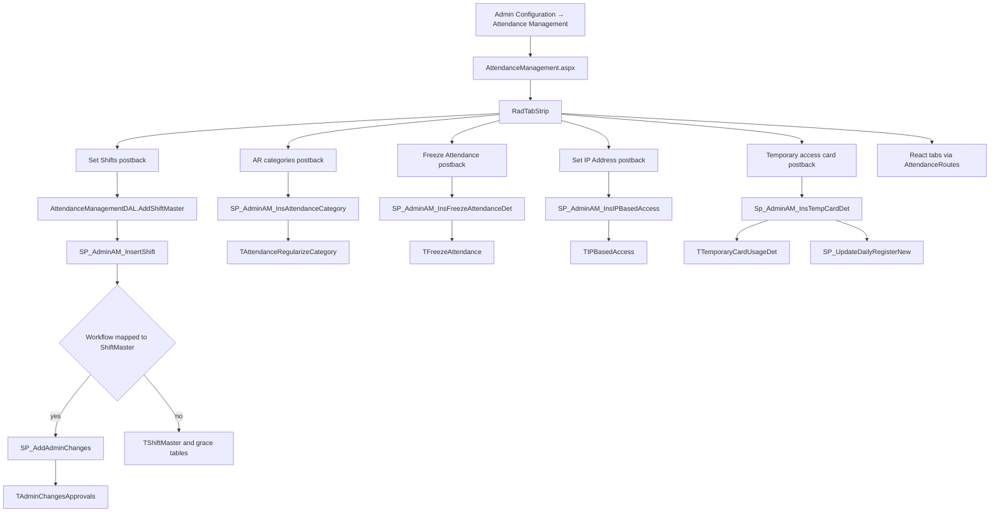
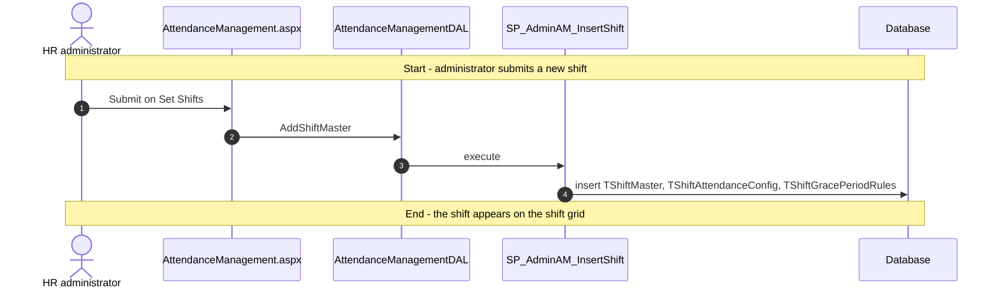
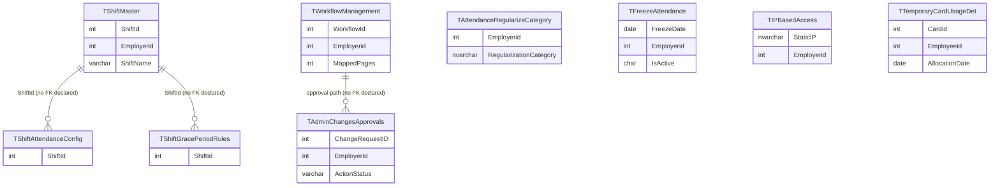

# Attendance Management

## Overview

An HR administrator needs the rules that turn punches into attendance before employees start applying leave or regularization. They open **Admin Configuration → Attendance Management** (`AttendanceManagement.aspx?q=dummy&HR=1`). The page is a tab strip: shifts, overtime, attendance-regularization categories, temporary access cards, attendance freeze, office IP addresses, and several newer tabs that mount the dashboard React bundle on the same host.

The story this guide follows is the WebForms postback path. The administrator defines a **shift** (name, effective date, start and end, full-day and half-day hours, grace rules). Submitting it calls `SP_AdminAM_InsertShift`. If a workflow is mapped to the module page `ShiftMaster`, the procedure does not write the shift yet. It files a pending row in `TAdminChangesApprovals` through `SP_AddAdminChanges`. If no workflow is mapped, it inserts `TShiftMaster`, `TShiftAttendanceConfig`, and `TShiftGracePeriodRules` immediately. The same page lets them add an **attendance regularization category**, **freeze** attendance through a date (which deactivates the previous freeze for that employer), allow **office IP** addresses, and allocate a **temporary access card**, which then recalculates that employee's daily attendance.

SystemModel-2 describes this screen as the shift-master and leave-setup surface in `domain/contexts/attendance-leave.md`. There is no `llm-wiki` domain page for these admin tables in this checkout. Leave application itself is a different left-nav item (Leave & Attendance).

**Who's involved:**

- **HR administrator** — maintains shifts, categories, freeze, IP list, and temporary cards for the selected organisation. A global-access user can switch organisation in the page header.
- **Workflow approver** — when `ShiftMaster` or the category page is mapped in Workflow Management, the change waits in admin-change approvals instead of landing on the master table.
- **Employee** — does not open this screen. Their punches later use the shift and the freeze date.

## Workflow

## Request journey

### HR administrator — create a shift when no approval workflow is mapped

When `TWorkflowManagement` has a live row for module page `ShiftMaster`, the same submit writes `TAdminChangesApprovals` through `SP_AddAdminChanges` and does not insert the shift tables.

## Entry points

The left-nav URL is `~/HRM/LeaveManagement/AttendanceManagement.aspx?q=dummy&HR=1`. `Page_Load` binds the tab registry and, for a set of tab names, calls `showAttendanceTab`, which shows the React root. Those React tab names include Assign Attendance Method, Create Group, Set Shift, Roster, Overtime rule, Configurations, Attendance Recalculation, Create Roster Pattern, and the biometric tabs (`AttendanceManagement.aspx.cs` around the `reactTabNames` set). The WebForms multi-page views remain in the markup and still post back for shift, category, freeze, IP, and temporary card.

| UI page | Purpose |
|---|---|
| `HRM/LeaveManagement/AttendanceManagement.aspx` | Host and WebForms tabs |
| `HRM/DashBoard_React/Areas/LeaveAttendance/AttendanceRoutes.js` | React tabs on the same URL, including Assign Attendance Method |

## Code → database call chain

| Entry | Method | Stored procedure |
|---|---|---|
| Set Shifts grid load | `AttendanceManagementDAL.GetShiftDetailsList` (`AttendanceManagementDAL.cs:15`) | `SP_AdminAM_GetShiftMaster` |
| Set Shifts Submit | `submitShift` (`AttendanceManagement.aspx.cs:1229`) → `AddShiftMaster` (`AttendanceManagementDAL.cs:26`) | `SP_AdminAM_InsertShift` |
| Set Shifts update | `UpdateShiftMaster` (`AttendanceManagementDAL.cs:40`) | `SP_AdminAM_UpdShift` |
| Set Shifts delete | `DeleteShiftMasterByShiftId` (`AttendanceManagementDAL.cs:133`) | `SP_AdminAM_DelShift` |
| AR category save | `AddAttendanceCategory` (`AttendanceManagementDAL.cs:180`), called from `AttendanceManagement.aspx.cs:3492` | `SP_AdminAM_InsAttendanceCategory` |
| AR category update | `UpdateAttendanceCategory` (`AttendanceManagementDAL.cs:244`) | `SP_AdminAM_UpdAttendanceCategory` |
| AR category list | `GetAttendanceCategory` (`AttendanceManagementDAL.cs:309`) | `SP_AdminAM_GetAttendanceCategory` |
| AR frequency list | `GetAttendanceCategoryFrequency` (`AttendanceManagementDAL.cs:321`) | `USP_ARCategoryFrequency_List` |
| Temporary card save | `SaveTemporaryCardDetails` (`AttendanceManagementDAL.cs:374`), called from `AttendanceManagement.aspx.cs:4793` | `Sp_AdminAM_InsTempCardDet` |
| Temporary card list | `GetTemporaryCardSummaryDetails` (`AttendanceManagementDAL.cs:360`) | `Sp_AdminAM_GetTempCardDet` |
| Freeze save | `SaveFreezeAttendanceDetails` (`AttendanceManagementDAL.cs:408`), called from `AttendanceManagement.aspx.cs:5256` | `SP_AdminAM_InsFreezeAttendanceDet` |
| Freeze list | `AttendanceRegularizationBLL.GetFreezeAttendanceDetails` (`AttendanceRegularizationBLL.cs:35`) → `AttendanceRegularizationDAL.GetFreezeAttendanceDetails` (`AttendanceRegularizationDAL.cs:37`) | `SP_LA_GetFreezeAttendanceDetails` |
| IP insert | `AddIPBasedAccess` (`AttendanceManagementDAL.cs:428`), called from `AttendanceManagement.aspx.cs:5435` | `SP_AdminAM_InsIPBasedAccess` |
| IP update | `UpdateIPBasedAccess` (`AttendanceManagementDAL.cs:442`) | `SP_AdminAM_UpdIPBasedAccess` |
| IP list | `GetIPBasedAccessDetails` (`AttendanceManagementDAL.cs:457`) | `SP_AdminAM_GetIPBasedAddressDet` |

Constants live in `HRMS.Shared/HRMS.DataAccessLayer/DBConstant.cs` (the `SP_AdminAM_*` names). Calls use Enterprise Library `GetStoredProcCommand`.

## API endpoints

The WebForms tabs above are postbacks. They do not call `HRMS.CoreAPI`.

The React tabs on the same host do. `AttendanceRoutes.js` renders `AssignAttendanceMethod`, which uses dashboard routes such as `ChangeEmployeeAttedanceMethod` and `GetAttendanceModesByEmployer` (`apiURLConstants.js`). Those React saves are not expanded in the call-chain table above.

## Stored procedures & tables involved

| Object | File | Purpose |
|---|---|---|
| `SP_AdminAM_GetShiftMaster` | `HRMS-DATABASE/HRMS/STOREPROCEDURE/SP_AdminAM_GetShiftMaster.sql` | List shifts for an employer |
| `SP_AdminAM_InsertShift` | `HRMS-DATABASE/HRMS/STOREPROCEDURE/SP_AdminAM_InsertShift.sql` | Insert a shift, or file it for approval |
| `SP_AdminAM_UpdShift` | `HRMS-DATABASE/HRMS/STOREPROCEDURE/SP_AdminAM_UpdShift.sql` | Update a shift, same approval fork |
| `SP_AdminAM_DelShift` | `HRMS-DATABASE/HRMS/STOREPROCEDURE/SP_AdminAM_DelShift.sql` | Delete a shift by id |
| `SP_AdminAM_InsAttendanceCategory` | `HRMS-DATABASE/HRMS/STOREPROCEDURE/SP_AdminAM_InsAttendanceCategory.sql` | Insert an AR category |
| `SP_AdminAM_GetAttendanceCategory` | `HRMS-DATABASE/HRMS/STOREPROCEDURE/SP_AdminAM_GetAttendanceCategory.sql` | List AR categories |
| `USP_ARCategoryFrequency_List` | `HRMS-DATABASE/HRMS/STOREPROCEDURE/USP_ARCategoryFrequency_List.sql` | Weekly / monthly / yearly / payroll frequency lookup |
| `Sp_AdminAM_InsTempCardDet` | `HRMS-DATABASE/HRMS/STOREPROCEDURE/Sp_AdminAM_InsTempCardDet.sql` | Allocate a temporary card and recalculate attendance |
| `SP_AdminAM_InsFreezeAttendanceDet` | `HRMS-DATABASE/HRMS/STOREPROCEDURE/SP_AdminAM_InsFreezeAttendanceDet.sql` | Replace the active freeze date |
| `SP_LA_GetFreezeAttendanceDetails` | `HRMS-DATABASE/HRMS/STOREPROCEDURE/SP_LA_GetFreezeAttendanceDetails.sql` | Read freeze rows |
| `SP_AdminAM_InsIPBasedAccess` | `HRMS-DATABASE/HRMS/STOREPROCEDURE/SP_AdminAM_InsIPBasedAccess.sql` | Insert an office IP |
| `SP_AddAdminChanges` | `HRMS-DATABASE/HRMS/STOREPROCEDURE/SP_AddAdminChanges.sql` | Pending admin-change request when a workflow is mapped |

## Table relationships

No foreign keys were declared in the scripts read for this page. The joins are by `Employerid`, `ShiftId`, and `WorkflowId`.

## Known gaps

- Set Shifts is both a WebForms tab and a name in `reactTabNames`. This guide traces the postback DAL. The React shift editor, overtime, roster, and biometric tabs need their own pass through `AttendanceRoutes.js`.
- `SP_AdminAM_UpdShift`, `SP_AdminAM_DelShift`, `SP_AdminAM_UpdAttendanceCategory`, `SP_AdminAM_GetAttendanceCategory`, `SP_AdminAM_UpdIPBasedAccess`, and `SP_AdminAM_GetIPBasedAddressDet` are called by this page and are not given their own database pages in this pass.
- `SP_UpdateDailyRegisterNew` only forwards to `USP_CalculateDailyAttendance`. That calculation tree is not expanded here.
- Assign Attendance Method's Node routes are named but not traced to procedures.

## Reference

Confidence is medium because the WebForms save path and the procedure bodies for insert shift, category, freeze, IP, and temporary card were read. React-tab procedure names were not.

### SourceCode

- `docs/SystemModels/SystemModel-2/domain/contexts/attendance-leave.md`
- `HRMS.Web/HRMS.Web/HRM/LeaveManagement/AttendanceManagement.aspx`
- `HRMS.Web/HRMS.Web/HRM/LeaveManagement/AttendanceManagement.aspx.cs`
- `HRMS.Shared/HRMS.DataAccessLayer/LeaveAttendanceARWFH/AttendanceManagementDAL.cs`
- `HRMS.Shared/HRMS.DataAccessLayer/LeaveAttendanceARWFH/AttendanceRegularizationDAL.cs`
- `HRMS.Shared/HRMS.BusinessLayer/LeaveAttendanceARWFH/AttendanceRegularizationBLL.cs`
- `HRMS.Shared/HRMS.DataAccessLayer/DBConstant.cs`
- `HRMS.Web/HRMS.Web/HRM/DashBoard_React/Areas/LeaveAttendance/AttendanceRoutes.js`

### TDG HRMS DB

- `HRMS-DATABASE/HRMS/STOREPROCEDURE/SP_AdminAM_InsertShift.sql`
- `HRMS-DATABASE/HRMS/STOREPROCEDURE/SP_AdminAM_GetShiftMaster.sql`
- `HRMS-DATABASE/HRMS/STOREPROCEDURE/SP_AdminAM_InsAttendanceCategory.sql`
- `HRMS-DATABASE/HRMS/STOREPROCEDURE/SP_AdminAM_InsFreezeAttendanceDet.sql`
- `HRMS-DATABASE/HRMS/STOREPROCEDURE/SP_LA_GetFreezeAttendanceDetails.sql`
- `HRMS-DATABASE/HRMS/STOREPROCEDURE/SP_AdminAM_InsIPBasedAccess.sql`
- `HRMS-DATABASE/HRMS/STOREPROCEDURE/Sp_AdminAM_InsTempCardDet.sql`
- `HRMS-DATABASE/HRMS/STOREPROCEDURE/SP_AddAdminChanges.sql`
- `HRMS-DATABASE/HRMS/STOREPROCEDURE/USP_ARCategoryFrequency_List.sql`
