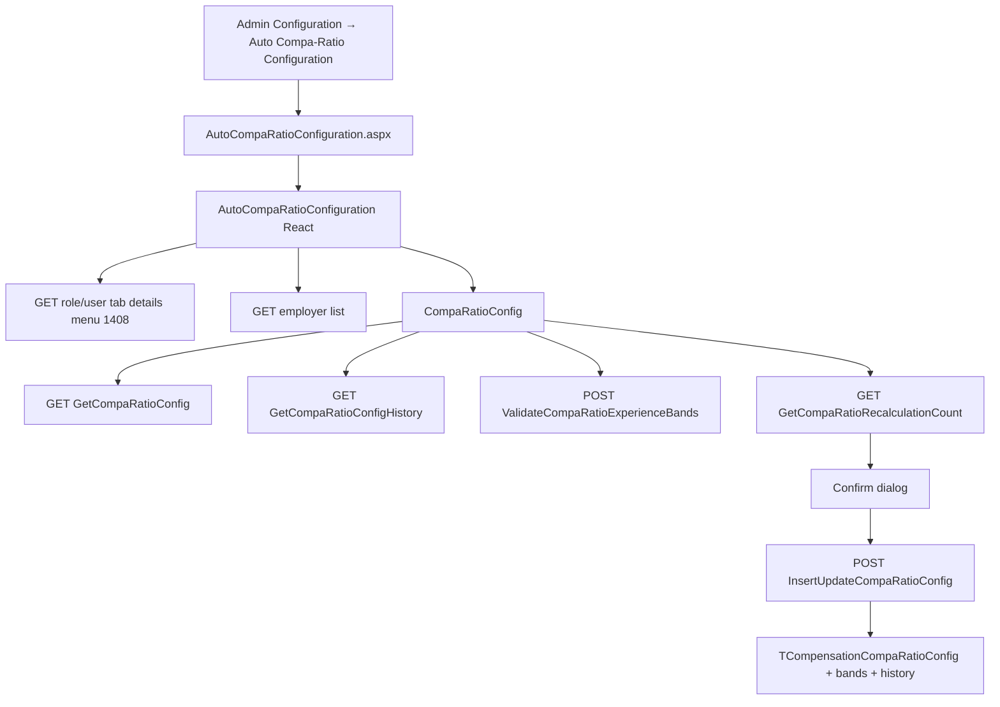
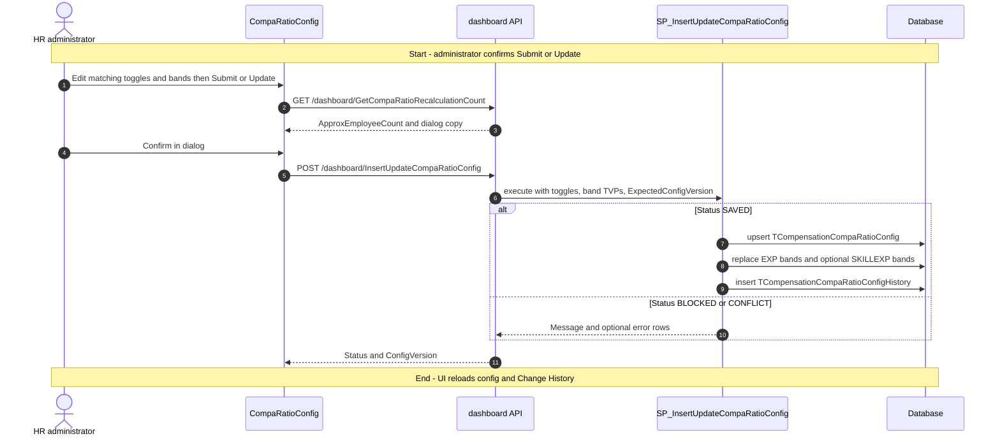
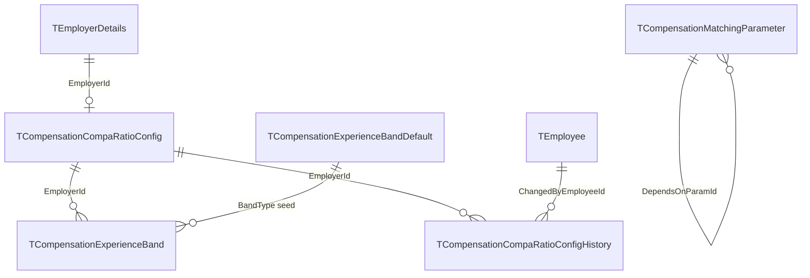

# Auto Compa-Ratio Configuration

## Overview

An HR administrator opens **Admin Configuration → Auto Compa-Ratio Configuration** (`~/HRM/DashBoard_React/AutoCompaRatioConfiguration.aspx`, MenuId **1408**, tab **621**) to define how the organisation matches peer groups for Compa-Ratio / salary benchmarking. The WebForms host only binds session hidden fields and loads the dashboard React bundle. React mounts `AutoCompaRatioConfiguration`, which checks tab permission, offers an organisation picker, and renders `CompaRatioConfig`.

On this screen the admin toggles optional matching parameters (Employment Type, Qualification, Location, Grade, Business Unit, Skills, Skill Experience), keeps Designation and Experience Band as core-always-on, edits Experience / Skill Experience band masters, and Submits or Updates the saved configuration. Band edits are validated live through `SP_ValidateCompaRatioExperienceBands`. Save is gated by a confirm dialog that shows an approximate employee recalculation count from `SP_GetCompaRatioRecalculationCount`. Each successful Submit/Update appends a Change History row and bumps `ConfigVersion` for optimistic concurrency.

Employees do not open this screen. Later Compensation Entry, the Compa-Ratio report, and salary benchmarking read this employer config. SystemModel-2 has no workflow page for this screen. Tables were added under `HRMS-DATABASE/HRMS/DDL/162291.sql`.

**Who's involved:**

- **HR administrator** — configures matching parameters and experience band masters for the selected organisation.
- **Employee / manager** — do not use this page; their Compa-Ratio values later use this config on Compensation Entry / Report.
- **Another admin** — concurrent saves surface as `CONFLICT` when `ExpectedConfigVersion` no longer matches.

## Workflow

## Request journey

## Entry points

| Entry | Purpose |
|---|---|
| `~/HRM/DashBoard_React/AutoCompaRatioConfiguration.aspx` | Host page. Binds session hidden fields, loads `dashboard_react.*.min.js`. No WebForms postback business logic. |
| `Areas/Dashboard/Components/CompaRatio/AutoCompaRatioConfiguration.js` | Org picker, tab permission (menu 1408 / tab 621), unsaved-org-switch guard. |
| `Areas/Dashboard/Components/CompaRatio/CompaRatioConfig.js` | Config form, band editors, save/confirm, Change History popover/export. |
| `ExperienceBandEditor.js` | Contiguous experience / skill-experience band grid. |
| `routeConstants.AUTO_COMPA_RATIO_CONFIGURATION` | `/HRM/DashBoard_React/AutoCompaRatioConfiguration.aspx`. |

There is no WebForms postback for configuration actions. All business calls go to Core API `/dashboard/*` (plus `/dashBoard/GetGlobalAccessEmployerList` for the org list).

## Code → database call chain

| UI | API | DAL (`file:line`) | Stored procedure |
|---|---|---|---|
| Org list (`AutoCompaRatioConfiguration.js:37`) | `GET /dashBoard/GetGlobalAccessEmployerList` | `GetGlobalAccessEmployerList` (`dashBoardDAL.js:824`) | `SP_GetGlobalAccessEmployerList` |
| Role tabs (`useTabPermission.js:26`) | `GET /dashboard/GetPermissionRoleTabDetails` | `GetPermissionRoleTabDetails` (`dashBoardDAL.js:853`) | `Sp_AdminRoleM_GetTabRoleDet` |
| User tabs (`useTabPermission.js:28`) | `GET /dashboard/GetPermissionUserTabDetailsByuserId` | `GetPermissionUserTabDetailsByuserId` (`dashBoardDAL.js:838`) | `Sp_GetTabUserDetails` |
| Load config (`CompaRatioConfig.js:137`) | `GET /dashboard/GetCompaRatioConfig` | `GetCompaRatioConfig` (`dashBoardDAL.js:6137`) | `SP_GetCompaRatioConfig` |
| Change History (`CompaRatioConfig.js:146`) | `GET /dashboard/GetCompaRatioConfigHistory` | `GetCompaRatioConfigHistory` (`dashBoardDAL.js:6249`) | `SP_GetCompaRatioConfigHistory` |
| Band validation (`CompaRatioConfig.js:157`) | `POST /dashboard/ValidateCompaRatioExperienceBands` | `ValidateCompaRatioExperienceBands` (`dashBoardDAL.js:6197`) | `SP_ValidateCompaRatioExperienceBands` |
| Confirm impact (`CompaRatioConfig.js:249`) | `GET /dashboard/GetCompaRatioRecalculationCount` | `GetCompaRatioRecalculationCount` (`dashBoardDAL.js:6152`) | `SP_GetCompaRatioRecalculationCount` |
| Save (`CompaRatioConfig.js:261`) | `POST /dashboard/InsertUpdateCompaRatioConfig` | `InsertUpdateCompaRatioConfig` (`dashBoardDAL.js:6214`) | `SP_InsertUpdateCompaRatioConfig` |

## API endpoints

No WebForms postback. Live router is `DashBoardRoutes.js` under `/api`.

| Verb | Route | Parameters | Purpose | Source |
|---|---|---|---|---|
| GET | `/dashBoard/GetGlobalAccessEmployerList` | `employeeId` query | Organisation dropdown | `DashBoardRoutes.js:59` |
| GET | `/dashboard/GetPermissionRoleTabDetails` | `EmployerId`, `RoleId` | Role tab rights for menu 1408 | `DashBoardRoutes.js:61` |
| GET | `/dashboard/GetPermissionUserTabDetailsByuserId` | `EmployerId`, `UserId` | User tab rights | `DashBoardRoutes.js:60` |
| GET | `/dashboard/GetCompaRatioConfig` | `employerId`, `loggedInEmployeeId` | Header, 9 parameters, EXP/SKILLEXP bands | `DashBoardRoutes.js:406` |
| GET | `/dashboard/GetCompaRatioConfigHistory` | `employerId` | Change History popover / export | `DashBoardRoutes.js:410` |
| POST | `/dashboard/ValidateCompaRatioExperienceBands` | body `bandType`, `bands`, `isSaveAttempt` | Inline band validation | `DashBoardRoutes.js:408` |
| GET | `/dashboard/GetCompaRatioRecalculationCount` | `employerId` | Confirm-dialog copy and count | `DashBoardRoutes.js:407` |
| POST | `/dashboard/InsertUpdateCompaRatioConfig` | body toggles, bands, `expectedConfigVersion` | Submit / Update config | `DashBoardRoutes.js:409` |

## Stored procedures & tables involved

Direct procedures this screen executes, plus one nested level. Existing database pages are linked; new pages are listed the same way.

| Object | Script | Role on this screen |
|---|---|---|
| [SP_GetGlobalAccessEmployerList](/docs/database/hrms/SP_GetGlobalAccessEmployerList) | existing page | Organisation dropdown |
| [Sp_AdminRoleM_GetTabRoleDet](/docs/database/hrms/Sp_AdminRoleM_GetTabRoleDet) | existing page | Role tab visibility |
| [Sp_GetTabUserDetails](/docs/database/hrms/Sp_GetTabUserDetails) | existing page | User tab visibility |
| [SP_GetCompaRatioConfig](/docs/database/hrms/SP_GetCompaRatioConfig) | `STOREPROCEDURE/SP_GetCompaRatioConfig.sql` | Load header, parameters, bands |
| [SP_GetCompaRatioConfigHistory](/docs/database/hrms/SP_GetCompaRatioConfigHistory) | `STOREPROCEDURE/SP_GetCompaRatioConfigHistory.sql` | Change History rows |
| [SP_ValidateCompaRatioExperienceBands](/docs/database/hrms/SP_ValidateCompaRatioExperienceBands) | `STOREPROCEDURE/SP_ValidateCompaRatioExperienceBands.sql` | Live / save-time band errors |
| [SP_GetCompaRatioRecalculationCount](/docs/database/hrms/SP_GetCompaRatioRecalculationCount) | `STOREPROCEDURE/SP_GetCompaRatioRecalculationCount.sql` | Confirm dialog employee count |
| [SP_InsertUpdateCompaRatioConfig](/docs/database/hrms/SP_InsertUpdateCompaRatioConfig) | `STOREPROCEDURE/SP_InsertUpdateCompaRatioConfig.sql` | Persist config, bands, history |
| [FN_GetCompaRatioConfig](/docs/database/hrms/FN_GetCompaRatioConfig) | nested | Defaults when no config row |
| [FN_GetCompaRatioExperienceBands](/docs/database/hrms/FN_GetCompaRatioExperienceBands) | nested | Saved bands or seed defaults |
| [FN_ValidateCompaRatioExperienceBands](/docs/database/hrms/FN_ValidateCompaRatioExperienceBands) | nested | Gap / overlap / required checks |
| [FN_GetExperienceBandLabel](/docs/database/hrms/FN_GetExperienceBandLabel) | nested | Auto band label text |
| [Fn_GetEmployeeName](/docs/database/hrms/Fn_GetEmployeeName) | existing page | Nested name on history insert |

Primary tables: `TCompensationCompaRatioConfig`, `TCompensationExperienceBand`, `TCompensationCompaRatioConfigHistory`. Masters/lookups: `TCompensationMatchingParameter`, `TCompensationExperienceBandDefault`, `TEmployee` / `TEmployeeInfo` (count and history name).

## Table relationships

Declared FKs between config tables are sparse. Edges follow columns the config procedures join or write.

## Known gaps

- Live DEV menu is under Admin Configuration → Compensation → Auto Compa-Ratio Configuration; guide submenu matches the leaf menu name only.
- Band-value-only edits are omitted from Change History unless `@IncludeBandValueDiff = 1` (SP default is 0); the UI does not expose that flag.
- Skill Experience bands are not replaced on save when Skills or Skill Experience is off; prior SKILLEXP rows remain.
- Node rejects out-of-range SMALLINT band years before calling the SP; those synthetic errors never hit SQL.
- SystemModel-2 has no workflow page for this screen.
- Recalculation count is active employees only; it does not preview which compensation rows will change.

## Reference

Confidence is medium. The call chain was read from DEV `TMenuDetails` (MenuId 1408), the ASPX host, `AutoCompaRatioConfiguration` / `CompaRatioConfig`, Core API dashboard routes and DAL, and matching `HRMS/STOREPROCEDURE` / `FUNCTIONS` scripts plus `DDL/162291.sql`. Nested walks stop at one level as requested.

### SourceCode

- `HRMS.Web/HRMS.Web/HRM/DashBoard_React/AutoCompaRatioConfiguration.aspx` and `.aspx.cs`
- `HRMS.Web/HRMS.Web/HRM/DashBoard_React/Areas/Dashboard/Components/CompaRatio/AutoCompaRatioConfiguration.js`
- `CompaRatioConfig.js`, `ExperienceBandEditor.js`, `CompaRatioConstants.js`
- `Areas/Dashboard/Hooks/useTabPermission.js`
- `Common/routeConstants.js`, `Common/apiURLConstants.js`
- `HRMS.CoreAPI/HRMS.Core.WebAPI.Node/Routes/DashBoardRoutes.js`
- `HRMS.CoreAPI/HRMS.Core.WebAPI.Node/Core/DataAccessLayer/dashBoardDAL.js`
- `docs/SystemModels/SystemModel-2/` has no page for this screen

### TDG HRMS DB

- DEV `TMenuDetails` MenuId 1408 NavigateURL `~/HRM/DashBoard_React/AutoCompaRatioConfiguration.aspx`
- `HRMS-DATABASE/HRMS/DDL/162291.sql`, `DML/162291.sql`
- `STOREPROCEDURE/SP_GetCompaRatioConfig.sql`, `SP_InsertUpdateCompaRatioConfig.sql`, `SP_ValidateCompaRatioExperienceBands.sql`, `SP_GetCompaRatioRecalculationCount.sql`, `SP_GetCompaRatioConfigHistory.sql`
- `FUNCTIONS/FN_GetCompaRatioConfig.sql`, `FN_GetCompaRatioExperienceBands.sql`, `FN_ValidateCompaRatioExperienceBands.sql`, `FN_GetExperienceBandLabel.sql`
