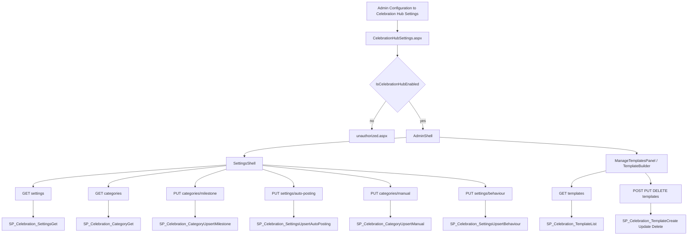
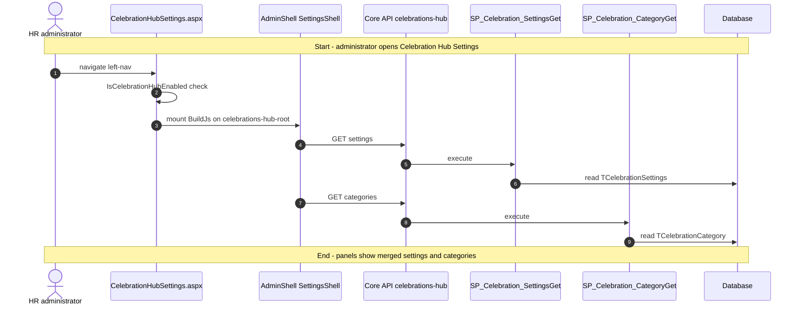
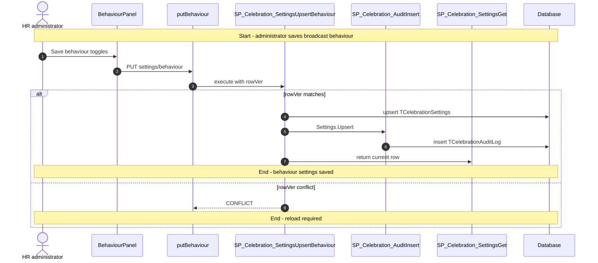
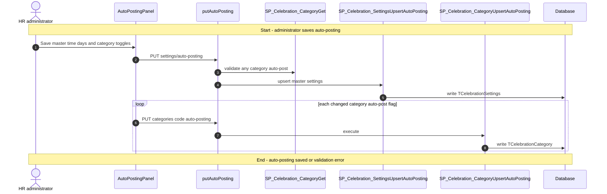
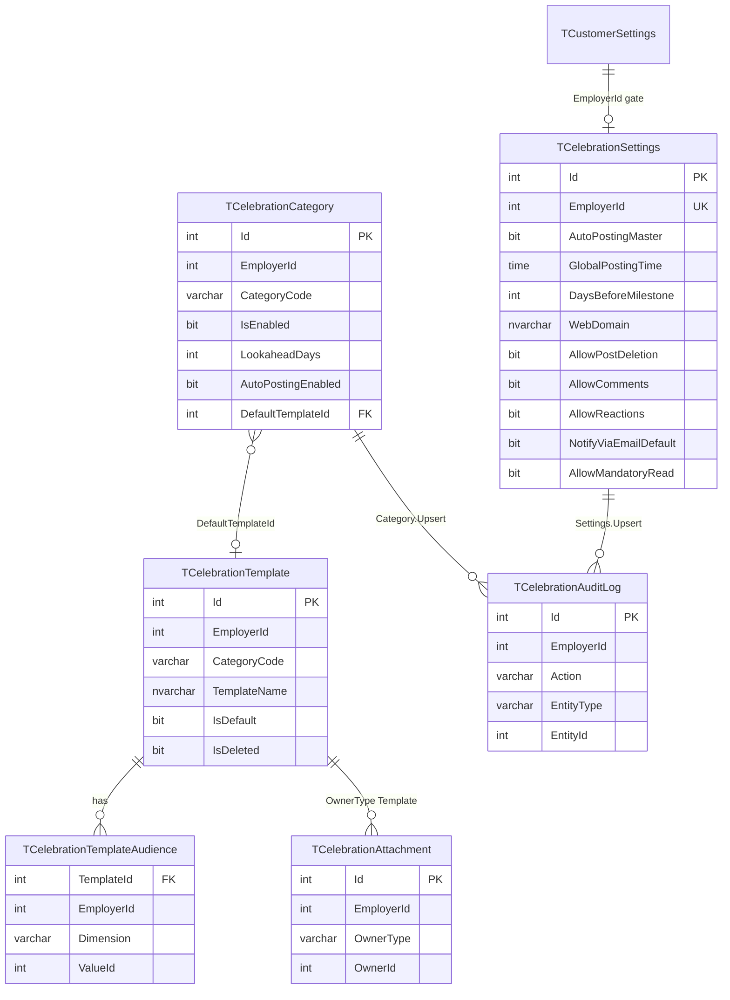

# Celebration Hub Settings

## Overview

An HR administrator configures Celebrations Hub for one organisation. They open **Admin Configuration → Celebration Hub Settings** (`~/HRM/Employee/CelebrationHubSettings.aspx`). The WebForms host only checks `TCustomerSettings.IsCelebrationHubEnabled` for the signed-in employer and mounts the EmployeeManagement React bundle on `#celebrations-hub-root`. All reads and saves go to Core API `/api/celebrations-hub`.

The React `AdminShell` has two views. The default settings view (`SettingsShell`) covers milestone categories, auto-posting, manual categories, manage templates (embedded list), and broadcast behaviour. `?view=templates` opens the full templates list or the template builder (`?view=templates&new=1` or `?id=`).

The hub feature flag itself is not toggled on this screen. Customer Setting / Master Setup writes `IsCelebrationHubEnabled` through `USP_UPD_TCustomerSettings_CelebrationHub`. When the flag is off, this aspx redirects to `~/unauthorized.aspx`.

SystemModel-2 has no page for this screen. Celebration tables live under `HRMS-DATABASE/HRMS/DDL/161632/`. There is no domain `erDiagram` to reuse.

**Who's involved:**

- **HR administrator** — enables categories, auto-posting, behaviour, and templates for the selected organisation.
- **Employee** — uses Celebration Hub (`CelebrationHub.aspx`). They do not open this settings page.

## Workflow

Category catalog codes (`BIRTHDAY`, `WORK_ANNIVERSARY`, `NEWS`, `ANNOUNCEMENT`) are a front-end constant. Missing `TCelebrationCategory` rows mean toggles stay off until the first upsert. Missing `TCelebrationSettings` rows use front-end defaults (comments, reactions, and email on; mandatory read off). Org timezone for labels comes from `TEmployerDetails` in the API, not from `TCelebrationSettings`.

## Request journey

### HR administrator — open settings

### HR administrator — save behaviour settings

### HR administrator — save auto-posting

## Entry points

| UI page | Purpose |
|---|---|
| `HRM/Employee/CelebrationHubSettings.aspx` | Celebration Hub Settings host. URL `~/HRM/Employee/CelebrationHubSettings.aspx` |
| React `AdminShell` at path `celebrationsPaths.admin` | Same aspx URL. `?view=templates` for templates list/builder |
| Customer Setting celebration hub toggle | Enables the feature via `USP_UPD_TCustomerSettings_CelebrationHub`. Not this aspx |

The host has no `WebMethod` and no postback save. The React app posts to Core API with the auth header from `@hrms/sdk`.

## Code → database call chain

| Entry | Method | Stored procedure |
|---|---|---|
| Gate on open | `Page_Load` (`CelebrationHubSettings.aspx.cs:11`) → `DBHelper.IsCelebrationHubEnabled` (`DBHelper.cs:3439`) | Raw `SELECT` on `TCustomerSettings` (no SP) |
| Load settings | `useCelebSettings` → `fetchSettings` (`settings.ts:23`) → `getSettings` (`settings/handlers.js:53`) | `SP_Celebration_SettingsGet` |
| Org timezone overlay | `getSettings` → `resolveOrgTimezone` (`resolveOrgTimezone.js:18`) | Raw `SELECT` on `TEmployerDetails` (no SP) |
| Load categories | `useCelebCategories` → `fetchCategories` (`settings.ts:59`) → `getCategories` (`categories/handlers.js:7`) | `SP_Celebration_CategoryGet` |
| Save milestone | `handleSaveMilestone` (`SettingsShell.tsx:147`) → `saveMilestoneCategories` (`settings.ts:67`) → `putMilestone` (`categories/handlers.js:23`) | `SP_Celebration_CategoryUpsertMilestone` |
| Persist web domain after category save | `saveWebDomain` (`settings.ts:51`) → `putWebDomain` (`settings/handlers.js:178`) | `SP_Celebration_SettingsWebDomainUpsert` |
| Save auto-posting master | `handleSaveAuto` (`SettingsShell.tsx:212`) → `saveAutoPostingSettings` (`settings.ts:41`) → `putAutoPosting` (`settings/handlers.js:109`) | `SP_Celebration_CategoryGet` then `SP_Celebration_SettingsUpsertAutoPosting` |
| Save per-category auto-post | `saveCategoryAutoPosting` (`settings.ts:105`) → `putCategoryAutoPosting` (`categories/handlers.js:91`) | `SP_Celebration_CategoryUpsertAutoPosting` |
| Save manual categories | `handleSaveManual` (`SettingsShell.tsx:180`) → `saveManualCategories` (`settings.ts:86`) → `putManual` (`categories/handlers.js:59`) | `SP_Celebration_CategoryUpsertManual` |
| Save behaviour | `handleSaveBehaviour` (`SettingsShell.tsx:270`) → `saveBehaviourSettings` (`settings.ts:31`) → `putBehaviour` (`settings/handlers.js:70`) | `SP_Celebration_SettingsUpsertBehaviour` |
| List templates | `fetchTemplates` (`templates.ts:36`) → `listTemplates` (`templates/handlers.js:136`) | `SP_Celebration_TemplateList` |
| Get / create / update / delete template | `templates.ts` → `templates/handlers.js` | `SP_Celebration_TemplateGet` / `Create` / `Update` / `Delete` |
| Upload / preview template background | `uploadTemplateBackground` / `fetchTemplateBackgroundPreviewUrl` (`templates.ts:89`, `:113`) → `files/handlers.js` | `SP_Celebration_FileInsert` / `SP_Celebration_FileGet` / `SP_Celebration_FileList` |

Upsert procedures that mutate settings or categories call `SP_Celebration_AuditInsert` in the same transaction, then re-read with `SP_Celebration_SettingsGet` or `SP_Celebration_CategoryGet`. Template list/get/create/update also call `Fn_GetEmployeeName` for creator display names.

## API endpoints

This aspx does not post back. The React shell calls Core API under `/api/celebrations-hub` (mounted in `Features/CelebrationsHub/router.js`, behind `guards` and `requireActor`).

| Verb | Route | Parameters | Purpose | Source |
|---|---|---|---|---|
| `GET` | `/api/celebrations-hub/settings` | query `employerId` | Load settings; API overlays org timezone | `router.js:37`, `settings/handlers.js:53` |
| `PUT` | `/api/celebrations-hub/settings/behaviour` | body behaviour flags, `webDomain`, `rowVer` | Upsert behaviour bits | `router.js:38`, `settings/handlers.js:70` |
| `PUT` | `/api/celebrations-hub/settings/auto-posting` | body master, time, days, `webDomain`, `rowVer` | Upsert auto-posting master | `router.js:39`, `settings/handlers.js:109` |
| `PUT` | `/api/celebrations-hub/settings/web-domain` | body `webDomain`, `rowVer` | Upsert origin used in emails/links | `router.js:40`, `settings/handlers.js:178` |
| `GET` | `/api/celebrations-hub/categories` | query `employerId` | List persisted category overrides | `router.js:42`, `categories/handlers.js:7` |
| `PUT` | `/api/celebrations-hub/categories/milestone` | body `categories[]` | Bulk upsert milestone enable/lookahead | `router.js:43`, `categories/handlers.js:23` |
| `PUT` | `/api/celebrations-hub/categories/manual` | body `categories[]` | Bulk upsert News/Announcement enable | `router.js:44`, `categories/handlers.js:59` |
| `PUT` | `/api/celebrations-hub/categories/:code/auto-posting` | body `autoPostingEnabled`, `rowVer` | Per-category auto-post toggle | `router.js:45`, `categories/handlers.js:91` |
| `GET` | `/api/celebrations-hub/templates` | query `employerId` | Manage Templates grid | `router.js:47`, `templates/handlers.js:136` |
| `GET` | `/api/celebrations-hub/templates/:id` | query `employerId` | Edit/preview one template | `router.js:48`, `templates/handlers.js:149` |
| `POST` | `/api/celebrations-hub/templates` | body template fields | Create template | `router.js:49`, `templates/handlers.js:172` |
| `PUT` | `/api/celebrations-hub/templates/:id` | body template fields, `rowVer` | Update template | `router.js:50`, `templates/handlers.js:208` |
| `DELETE` | `/api/celebrations-hub/templates/:id` | query `employerId` | Soft-delete non-default template | `router.js:51`, `templates/handlers.js:262` |
| `POST` | `/api/celebrations-hub/files` | multipart file + kind/owner | Stage template background | `router.js:53`, `files/handlers.js:70` |
| `GET` | `/api/celebrations-hub/files` | query owner filters | List files for a template | `router.js:64`, `files/handlers.js` |
| `GET` | `/api/celebrations-hub/files/:id` | query `employerId` | Stream file bytes (also public route) | `router.js:29`, `files/handlers.js` |

`execCelebrationSp` maps SP `ResultCode` values `CONFLICT` / `VALIDATION` / `NOT_FOUND` to HTTP 409 / 422 / 404.

## Stored procedures & tables involved

| Object | File | Purpose | Wiki |
|---|---|---|---|
| [SP_Celebration_SettingsGet](/docs/database/hrms/SP_Celebration_SettingsGet) | `HRMS-DATABASE/HRMS/STOREPROCEDURE/161632/SP_Celebration_SettingsGet.sql` | Read one employer settings row | — |
| [SP_Celebration_SettingsUpsertBehaviour](/docs/database/hrms/SP_Celebration_SettingsUpsertBehaviour) | `…/SP_Celebration_SettingsUpsertBehaviour.sql` | Upsert behaviour flags | — |
| [SP_Celebration_SettingsUpsertAutoPosting](/docs/database/hrms/SP_Celebration_SettingsUpsertAutoPosting) | `…/SP_Celebration_SettingsUpsertAutoPosting.sql` | Upsert auto-posting master | — |
| [SP_Celebration_SettingsWebDomainUpsert](/docs/database/hrms/SP_Celebration_SettingsWebDomainUpsert) | `…/SP_Celebration_SettingsWebDomainUpsert.sql` | Upsert web domain only | — |
| [SP_Celebration_CategoryGet](/docs/database/hrms/SP_Celebration_CategoryGet) | `…/SP_Celebration_CategoryGet.sql` | List category overrides | — |
| [SP_Celebration_CategoryUpsertMilestone](/docs/database/hrms/SP_Celebration_CategoryUpsertMilestone) | `…/SP_Celebration_CategoryUpsertMilestone.sql` | Bulk milestone upsert | — |
| [SP_Celebration_CategoryUpsertManual](/docs/database/hrms/SP_Celebration_CategoryUpsertManual) | `…/SP_Celebration_CategoryUpsertManual.sql` | Bulk manual upsert | — |
| [SP_Celebration_CategoryUpsertAutoPosting](/docs/database/hrms/SP_Celebration_CategoryUpsertAutoPosting) | `…/SP_Celebration_CategoryUpsertAutoPosting.sql` | Per-category auto-post | — |
| [SP_Celebration_TemplateList](/docs/database/hrms/SP_Celebration_TemplateList) | `…/SP_Celebration_TemplateList.sql` | Template grid | — |
| [SP_Celebration_TemplateGet](/docs/database/hrms/SP_Celebration_TemplateGet) | `…/SP_Celebration_TemplateGet.sql` | One template + audience JSON | — |
| [SP_Celebration_TemplateCreate](/docs/database/hrms/SP_Celebration_TemplateCreate) | `…/SP_Celebration_TemplateCreate.sql` | Insert template | — |
| [SP_Celebration_TemplateUpdate](/docs/database/hrms/SP_Celebration_TemplateUpdate) | `…/SP_Celebration_TemplateUpdate.sql` | Update template | — |
| [SP_Celebration_TemplateDelete](/docs/database/hrms/SP_Celebration_TemplateDelete) | `…/SP_Celebration_TemplateDelete.sql` | Soft-delete template | — |
| [SP_Celebration_FileInsert](/docs/database/hrms/SP_Celebration_FileInsert) | `…/SP_Celebration_FileInsert.sql` | Stage uploaded file metadata | — |
| [SP_Celebration_FileGet](/docs/database/hrms/SP_Celebration_FileGet) | `…/SP_Celebration_FileGet.sql` | Read file metadata for stream | — |
| [SP_Celebration_FileList](/docs/database/hrms/SP_Celebration_FileList) | `…/SP_Celebration_FileList.sql` | List files by owner | — |
| [SP_Celebration_AuditInsert](/docs/database/hrms/SP_Celebration_AuditInsert) | `…/SP_Celebration_AuditInsert.sql` | Nested audit row | — |
| [Fn_GetEmployeeName](/docs/database/hrms/Fn_GetEmployeeName) | `HRMS-DATABASE/HRMS/FUNCTIONS/Fn_GetEmployeeName.sql` | Nested display name on templates | — |

Primary tables: `TCelebrationSettings`, `TCelebrationCategory`, `TCelebrationTemplate`, `TCelebrationTemplateAudience`, `TCelebrationAttachment`, `TCelebrationAuditLog`. Feature gate reads `TCustomerSettings`. Timezone overlay reads `TEmployerDetails`.

## Table relationships

`FK_TCelebrationCategory_DefaultTemplate` is added in the template DDL script after both tables exist. Settings and category upserts write audit rows; they do not declare FKs to `TCelebrationAuditLog`.

## Known gaps

- SystemModel-2 does not name `CelebrationHubSettings.aspx` or the Celebrations Hub admin settings flow.
- `llm-wiki` has no dedicated Celebration Hub table pages for `TCelebrationSettings` / `TCelebrationCategory` / `TCelebrationTemplate`.
- Host `Page_Load` does not call `SP_InsertAuditTrail` or `Sp_InsertActivityLog` (unlike many other Admin Configuration aspx hosts).
- Feature enablement is owned by Customer Setting (`USP_UPD_TCustomerSettings_CelebrationHub`), not by this guide's save panels.
- `SP_Celebration_SettingsWebDomainUpsert` does not call `SP_Celebration_AuditInsert`; behaviour and auto-posting upserts do.
- Enabling category auto-posting requires a default template for that category; the SP returns `VALIDATION` when none exists.
- Default templates cannot be deleted until another template is set as default (`SP_Celebration_TemplateDelete` returns `CONFLICT`).
- Existing [SP_Celebration_SettingsGet](/docs/database/hrms/SP_Celebration_SettingsGet) and [Fn_GetEmployeeName](/docs/database/hrms/Fn_GetEmployeeName) pages were left unchanged.

## Reference

Confidence is high for the React → Core API → `SP_Celebration_*` path from `CelebrationHubSettings.aspx` through `AdminShell` / `SettingsShell` and the CelebrationsHub feature routers. SystemModel-2 and llm-wiki do not document this feature.

### SourceCode

- `docs/SystemModels/SystemModel-2/` was searched. No page covers Celebration Hub Settings.
- `HRMS.Web/HRMS.Web/HRM/Employee/CelebrationHubSettings.aspx`
- `HRMS.Web/HRMS.Web/HRM/Employee/CelebrationHubSettings.aspx.cs`
- `HRMS.Web/HRMS.Web/HRM/EmployeeManagement/src/App.tsx`
- `HRMS.Web/HRMS.Web/HRM/EmployeeManagement/src/routes/celebrationsPaths.ts`
- `HRMS.Web/HRMS.Web/HRM/EmployeeManagement/src/features/celebrations-hub/settings/AdminShell.tsx`
- `HRMS.Web/HRMS.Web/HRM/EmployeeManagement/src/features/celebrations-hub/settings/SettingsShell.tsx`
- `HRMS.Web/HRMS.Web/HRM/EmployeeManagement/src/features/celebrations-hub/api/settings.ts`
- `HRMS.Web/HRMS.Web/HRM/EmployeeManagement/src/features/celebrations-hub/api/templates.ts`
- `HRMS.Web/HRMS.Web/HRM/EmployeeManagement/src/features/celebrations-hub/api/client.ts`
- `HRMS.Web/HRMS.Web/HRM/EmployeeManagement/src/features/celebrations-hub/constants.ts`
- `HRMS.Shared/HRMS.DataAccessLayer/DBHelper.cs`
- `HRMS.CoreAPI/HRMS.Core.WebAPI.Node/Features/CelebrationsHub/router.js`
- `HRMS.CoreAPI/HRMS.Core.WebAPI.Node/Features/CelebrationsHub/settings/handlers.js`
- `HRMS.CoreAPI/HRMS.Core.WebAPI.Node/Features/CelebrationsHub/categories/handlers.js`
- `HRMS.CoreAPI/HRMS.Core.WebAPI.Node/Features/CelebrationsHub/templates/handlers.js`
- `HRMS.CoreAPI/HRMS.Core.WebAPI.Node/Features/CelebrationsHub/files/handlers.js`
- `HRMS.CoreAPI/HRMS.Core.WebAPI.Node/Features/CelebrationsHub/resolveOrgTimezone.js`
- `HRMS.CoreAPI/HRMS.Core.WebAPI.Node/Features/CelebrationsHub/execSp.js`
- `HRMS.CoreAPI/HRMS.Core.WebAPI.Node/Features/Employer/Settings/Handlers/UpdateSetupCustomerSetting.js`

### TDG HRMS DB

- `HRMS-DATABASE/HRMS/DDL/161632/TCelebrationSettings.sql`
- `HRMS-DATABASE/HRMS/DDL/161632/TCelebrationCategory.sql`
- `HRMS-DATABASE/HRMS/DDL/161632/TCelebrationTemplate.sql`
- `HRMS-DATABASE/HRMS/DDL/161632/TCelebrationTemplateAudience.sql`
- `HRMS-DATABASE/HRMS/DDL/161632/TCelebrationAttachment.sql`
- `HRMS-DATABASE/HRMS/DDL/161632/TCelebrationAuditLog.sql`
- `HRMS-DATABASE/HRMS/STOREPROCEDURE/161632/SP_Celebration_SettingsGet.sql`
- `HRMS-DATABASE/HRMS/STOREPROCEDURE/161632/SP_Celebration_SettingsUpsertBehaviour.sql`
- `HRMS-DATABASE/HRMS/STOREPROCEDURE/161632/SP_Celebration_SettingsUpsertAutoPosting.sql`
- `HRMS-DATABASE/HRMS/STOREPROCEDURE/161632/SP_Celebration_SettingsWebDomainUpsert.sql`
- `HRMS-DATABASE/HRMS/STOREPROCEDURE/161632/SP_Celebration_CategoryGet.sql`
- `HRMS-DATABASE/HRMS/STOREPROCEDURE/161632/SP_Celebration_CategoryUpsertMilestone.sql`
- `HRMS-DATABASE/HRMS/STOREPROCEDURE/161632/SP_Celebration_CategoryUpsertManual.sql`
- `HRMS-DATABASE/HRMS/STOREPROCEDURE/161632/SP_Celebration_CategoryUpsertAutoPosting.sql`
- `HRMS-DATABASE/HRMS/STOREPROCEDURE/161632/SP_Celebration_TemplateList.sql`
- `HRMS-DATABASE/HRMS/STOREPROCEDURE/161632/SP_Celebration_TemplateGet.sql`
- `HRMS-DATABASE/HRMS/STOREPROCEDURE/161632/SP_Celebration_TemplateCreate.sql`
- `HRMS-DATABASE/HRMS/STOREPROCEDURE/161632/SP_Celebration_TemplateUpdate.sql`
- `HRMS-DATABASE/HRMS/STOREPROCEDURE/161632/SP_Celebration_TemplateDelete.sql`
- `HRMS-DATABASE/HRMS/STOREPROCEDURE/161632/SP_Celebration_FileInsert.sql`
- `HRMS-DATABASE/HRMS/STOREPROCEDURE/161632/SP_Celebration_FileGet.sql`
- `HRMS-DATABASE/HRMS/STOREPROCEDURE/161632/SP_Celebration_FileList.sql`
- `HRMS-DATABASE/HRMS/STOREPROCEDURE/161632/SP_Celebration_AuditInsert.sql`
