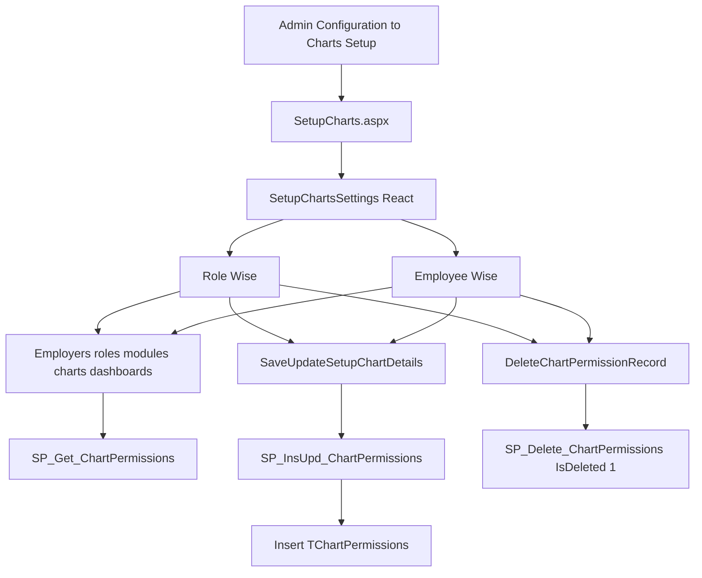
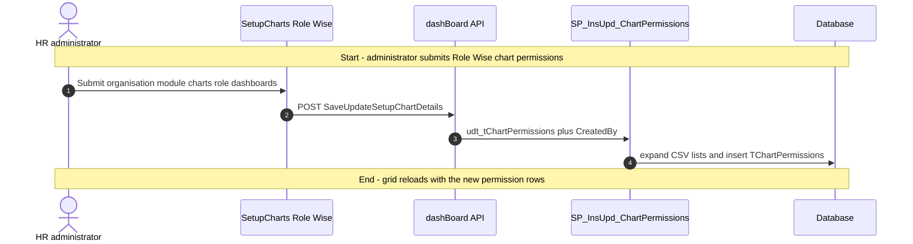
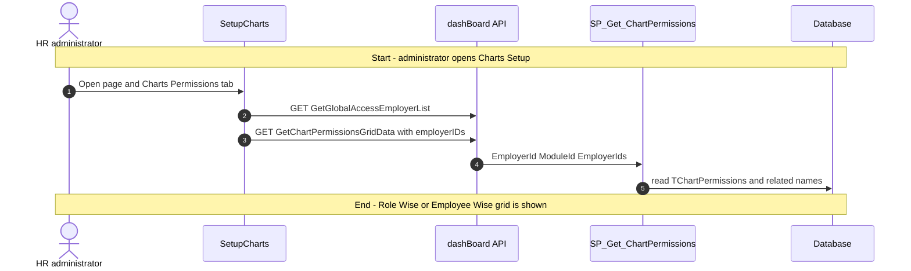
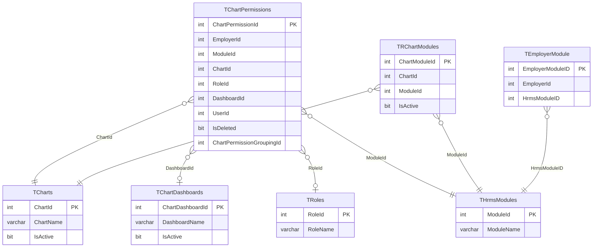

# Charts Setup

## Overview

An HR administrator decides which dashboard charts a role or an employee may see. They open **Admin Configuration → Charts Setup** (`~/HRM/DashBoard_React/SetupCharts.aspx`). The aspx hosts a React build. The shell title is **Charts Setup**, with a **Charts Permissions** tab that splits into **Role Wise** and **Employee Wise**.

On Role Wise they pick organisation, module, one or more charts, a role, and one or more dashboards (“Show Chart on”), then Submit. On Employee Wise they pick organisation, module, an employee, charts, and dashboards. The grid lists existing permissions for every employer the signed-in user can reach through global access. Edit reloads the form. Delete soft-deletes the selected permission ids. The dashboard shell later reads the same `TChartPermissions` rows when it decides which charts to render; this screen only maintains those rows.

SystemModel-2 has no workflow page for this screen. Table catalog entries are in `llm-wiki/reference/tables/hrms.md` (`TChartPermissions`, `TCharts`, `TChartDashboards`, `TRChartModules`). There is no domain `erDiagram` to reuse.

**Who's involved:**

- **HR administrator** — creates, updates, and soft-deletes chart permissions for organisations they can access.
- **Employee / role holder** — does not open this screen. They see charts elsewhere when their role or user id matches a non-deleted permission row.

## Workflow

Role Wise filters the grid to rows with `RoleIds`. Employee Wise filters to rows with `UserIds`. Client-side checks reject blank mandatory fields, duplicate combinations in the draft rows, and combinations that already exist in the grid. Save posts a TVP of chart, role or user, and dashboard id lists. The procedure expands those CSV lists and inserts every combination that is not already present.

## Request journey

### HR administrator — save Role Wise permissions

Employee Wise follows the same POST. The body carries `UserId` for the selected employee instead of a role-focused grid filter. Delete is a separate POST to `DeleteChartPermissionRecord` that sets `IsDeleted = 1`.

### HR administrator — load the permission grid

## Entry points

| UI page | Purpose |
|---|---|
| `HRM/DashBoard_React/SetupCharts.aspx` | Charts Setup host. Title in the page directive is Setup Charts. URL `~/HRM/DashBoard_React/SetupCharts.aspx` |
| `Areas/SetupCharts/SetupChartsSettings.js` | React shell. Breadcrumb Admin Configuration → Charts Setup. Tab Charts Permissions |
| `Areas/SetupCharts/SetupCharts.js` | Role Wise / Employee Wise tabs |
| `Areas/routes.js` | React Router path `RouteConstants.SETUP_CHARTS` → `SetupChartsSettings` |

The aspx has no `WebMethod`. All save, delete, and lookup traffic is Core API under `/dashBoard`. First load logs activity type `SetupCharts` (344) through `CommonUtil.LogActivity`.

## Code → database call chain

| Entry | Method | Stored procedure |
|---|---|---|
| Page open | `Page_Load` (`SetupCharts.aspx.cs:29`) → `CommonUtil.LogActivity` (`Common.cs:52`) → `ActivityHelper.LogActivity` (`ActivityHelper.cs:36`) | `Sp_InsertActivityLog` |
| Organisation list / employer id CSV | `populateOrganization` / `getChartPermissionsGridDataEmployerIds` (`SetupChartsRoleBased.js:149`, `:163`; same pattern in `SetupChartsEmployee.js`) → `GET_ALL_EMPLOYER_LIST` → `dashBoardDAL.GetGlobalAccessEmployerList` (`dashBoardDAL.js:824`) | `SP_GetGlobalAccessEmployerList` |
| Role dropdown | `populateRoles` (`SetupChartsRoleBased.js:182`) → `GetAllRoles` (`dashBoardDAL.js:3192`) | `Sp_TR_GetAllRoles` (HRMS synonym → Training) |
| Module dropdown | `getModuleList` (`SetupChartsRoleBased.js:246`) → `GetChartModuleList` (`dashBoardDAL.js:3205`) | `uspGetEmployerModule` |
| Chart name dropdown | `populateChartNames` (`SetupChartsRoleBased.js:226`) → `GetChartNameList` (`dashBoardDAL.js:3219`) | `uspGetCharts` |
| Show Chart on | `getChartOnDropdownList` (`SetupChartsRoleBased.js:265`) → `GetDashboardList` (`dashBoardDAL.js:3232`) | `uspGetChartDashboards` |
| Employee dropdown | `getEmployeeList` (`SetupChartsRoleBased.js:200`; Employee Wise `:218`) → `GetEmployeeListByOrgSetupCharts` (`dashBoardDAL.js:4025`) | `Sp_employeeListByEmployerId` |
| Employee role (Employee Wise only) | `getEmpRoles` (`SetupChartsEmployee.js:408`) → `GetRoleDetails` (`dashBoardDAL.js:4806`) | `SP_GetRoleByEmployeeId` |
| Permission grid | `getChartPermissionsGridData` (`SetupChartsRoleBased.js:280`; Employee Wise `:298`) → `GetChartPermissionsGridData` (`dashBoardDAL.js:3291`) | `SP_Get_ChartPermissions` |
| Submit / Update | `saveUpdateSetupChartDetails` (`SetupChartsRoleBased.js:386`; Employee Wise `:515`) → `SaveUpdateSetupChartDetails` (`dashBoardDAL.js:3243`) | `SP_InsUpd_ChartPermissions` |
| Delete | `deleteChartPermissionRecord` (`SetupChartsRoleBased.js:530`; Employee Wise `:665`) → `DeleteChartPermissionRecord` (`dashBoardDAL.js:3305`) | `SP_Delete_ChartPermissions` |

Live mount is `routeIndex.js` → `DashBoardRoutes.js` at `/dashBoard`. `DashBoardRoutes_V3.js` declares the same chart routes with `Authorize`; that file is not the mount used by `routeIndex.js`.

## API endpoints

This page does not post back form fields to WebForms. Lookups and mutations are Core API calls from the React bundle.

| Verb | Route | Parameters | Purpose | Source |
|---|---|---|---|---|
| `GET` | `/dashBoard/GetGlobalAccessEmployerList` | query `employeeId` | Employers the user may administer | Constant uses this casing (`apiURLConstants.js:93`). Route file registers `getGlobalAccessEmployerList` (`DashBoardRoutes.js:59`). Controller `dashboardController.js:806` → `SP_GetGlobalAccessEmployerList` |
| `GET` | `/dashBoard/GetAllRoles` | query `employerId` | Role dropdown | `DashBoardRoutes.js:162`, `dashboardController.js:2150` |
| `GET` | `/dashBoard/GetChartModuleList` | query `employerId` | Module dropdown for chart-enabled modules | `DashBoardRoutes.js:163`, `dashboardController.js:2159` |
| `GET` | `/dashBoard/GetChartNameList` | query `employerId`, `moduleId` | Chart names for the module | `DashBoardRoutes.js:164`, `dashboardController.js:2169` |
| `GET` | `/dashBoard/GetDashboardList` | none | Show Chart on values | `DashBoardRoutes.js:165`, `dashboardController.js:2179` |
| `GET` | `/dashBoard/GetChartPermissionsGridData` | query `employerId`, `moduleId`, `employerIDs` | Permission grid. Route uses `guards` | `DashBoardRoutes.js:167`, `dashboardController.js:2198` |
| `POST` | `/dashBoard/SaveUpdateSetupChartDetails` | body `setupDetails[]`, `createdBy` | Insert or replace permission combinations | `DashBoardRoutes.js:166`, `dashboardController.js:2189` |
| `POST` | `/dashBoard/DeleteChartPermissionRecord` | body `EmployerId`, `ModuleId`, `UpdatedBy`, `ChartPermissionsIds` | Soft-delete selected ids | `DashBoardRoutes.js:168`, `dashboardController.js:2208` |
| `GET` | `/dashBoard/GetEmployeeListByOrgSetupCharts` | query `EmployerId` | Employee dropdown. `Authorize` | `DashBoardRoutes.js:234`, `dashboardController.js:2649` |
| `GET` | `/dashBoard/GetRoleDetails` | query `employeeId` | Role id for the selected employee (Employee Wise chart filtering). `Authorize` | `DashBoardRoutes.js:303`, `dashboardController.js:3580` |

`GetChartTypeList`, `GetChartConfigData`, and related chart-configuration routes exist on the same router. The Charts Permissions UI does not call them. The Charts Configuration tab in `SetupChartsSettings.js` is commented out.

## Stored procedures & tables involved

| Object | File | Purpose | Wiki |
|---|---|---|---|
| [Sp_InsertActivityLog](/docs/database/hrms/Sp_InsertActivityLog) | `HRMS-DATABASE/HRMS/STOREPROCEDURE/Sp_InsertActivityLog.sql` | Page-open activity log (type 344) | — |
| [SP_GetGlobalAccessEmployerList](/docs/database/hrms/SP_GetGlobalAccessEmployerList) | `HRMS-DATABASE/HRMS/STOREPROCEDURE/SP_GetGlobalAccessEmployerList.sql` | Organisation list and employer id CSV for the grid | `llm-wiki/reference/tables/hrms.md` |
| [Sp_TR_GetAllRoles](/docs/database/hrms-training/Sp_TR_GetAllRoles) | `HRMS-DATABASE/HRMS-TRAINING/STOREPROCEDURE/Sp_TR_GetAllRoles.sql` (HRMS synonym) | Role dropdown | — |
| [uspGetEmployerModule](/docs/database/hrms/uspGetEmployerModule) | `HRMS-DATABASE/HRMS/STOREPROCEDURE/uspGetEmployerModule.sql` | Chart-enabled modules for the root employer | `llm-wiki/reference/tables/hrms.md` |
| [uspGetCharts](/docs/database/hrms/uspGetCharts) | `HRMS-DATABASE/HRMS/STOREPROCEDURE/uspGetCharts.sql` | Charts for a module | `llm-wiki/reference/tables/hrms.md` |
| [uspGetChartDashboards](/docs/database/hrms/uspGetChartDashboards) | `HRMS-DATABASE/HRMS/STOREPROCEDURE/uspGetChartDashboards.sql` | Active dashboard targets | `llm-wiki/reference/tables/hrms.md` |
| [Sp_employeeListByEmployerId](/docs/database/hrms/Sp_employeeListByEmployerId) | `HRMS-DATABASE/HRMS/STOREPROCEDURE/Sp_employeeListByEmployerId.sql` | Active employees for an employer | — |
| [SP_GetRoleByEmployeeId](/docs/database/hrms/SP_GetRoleByEmployeeId) | `HRMS-DATABASE/HRMS/STOREPROCEDURE/SP_GetRoleByEmployeeId.sql` | Role for the selected employee | — |
| [SP_Get_ChartPermissions](/docs/database/hrms/SP_Get_ChartPermissions) | `HRMS-DATABASE/HRMS/STOREPROCEDURE/SP_Get_ChartPermissions.sql` | Permission grid | `llm-wiki/reference/tables/hrms.md` |
| [SP_InsUpd_ChartPermissions](/docs/database/hrms/SP_InsUpd_ChartPermissions) | `HRMS-DATABASE/HRMS/STOREPROCEDURE/SP_InsUpd_ChartPermissions.sql` | Expand TVP CSV lists and insert rows | `llm-wiki/reference/tables/hrms.md` |
| [SP_Delete_ChartPermissions](/docs/database/hrms/SP_Delete_ChartPermissions) | `HRMS-DATABASE/HRMS/STOREPROCEDURE/SP_Delete_ChartPermissions.sql` | Soft-delete by id list | `llm-wiki/reference/tables/hrms.md` |
| [Sp_OpenEncryptionKeys](/docs/database/hrms/Sp_OpenEncryptionKeys) | `HRMS-DATABASE/HRMS/STOREPROCEDURE/Sp_OpenEncryptionKeys.sql` | Nested from dashboard and employee list reads | — |
| [SP_CloseEncryptionKey](/docs/database/hrms/SP_CloseEncryptionKey) | `HRMS-DATABASE/HRMS/STOREPROCEDURE/SP_CloseEncryptionKey.sql` | Nested close after those reads | — |
| [Fn_GetEmployeeName](/docs/database/hrms/Fn_GetEmployeeName) | `HRMS-DATABASE/HRMS/FUNCTIONS/Fn_GetEmployeeName.sql` | Nested employee display name | — |

Primary tables: `TChartPermissions`, `TCharts`, `TChartDashboards`, `TRChartModules`, `THrmsModules` / `TEmployerModule`, `TEmployerDetails`, `TRoles`, `TEmployee` / `TEmployeeInfo` / `TORGChart`, `TUsers` / `TUserEmployee`. TVP `udt_tChartPermissions` carries the save payload.

## Table relationships

`TABLES/TChartPermissions.sql` declares a clustered primary key on `ChartPermissionId` and no foreign keys. `UserId` is added later by `DDL/72267_Alter_statement_for_TChartPermissions.sql`. `TCharts`, `TChartDashboards`, and `TRChartModules` also declare no foreign keys to each other. Catalog text in `llm-wiki/reference/tables/hrms.md` lists no related tables for these objects. Relationships below are join keys used by the procedures, not declared FK constraints.

## Known gaps

- `apiURLConstants.js` calls `/dashBoard/GetGlobalAccessEmployerList` while `DashBoardRoutes.js` registers `getGlobalAccessEmployerList`. Behaviour depends on host path casing.
- `uspGetCharts` accepts `@pEmployerId` but does not filter on employer; only `ModuleId` and active flags matter.
- `uspGetEmployerModule.sql` begins with `USE [HRM-CL-Prod]`. Deploy scripts normally avoid hardcoding the environment database name.
- `SP_InsUpd_ChartPermissions` builds inserts as the inner join of ChartId × RoleId × DashboardId × UserId CSV expansions. Role Wise does not collect employees on the form, so `UserId` is often an empty CSV; an empty `STRING_SPLIT` yields no UserId rows and the insert selects nothing. Employee Wise may send an empty `RoleId` CSV for the same reason.
- Update deletes existing ids for the employer/module when `ChartPermissionId` is non-empty, then inserts again. There is no SQL transaction around delete-plus-insert.
- `TABLES/TChartPermissions.sql` omits `UserId`; the live column comes from `DDL/72267_Alter_statement_for_TChartPermissions.sql`.
- Charts Configuration UI and `GetChartTypeList` / `GetChartConfigData` are present in the codebase but not wired on this screen.
- SystemModel-2 does not name `SetupCharts.aspx`.

## Reference

Confidence is high for the React → `DashBoardRoutes` → `dashBoardDAL` → chart permission procedures path on the live `/dashBoard` mount. Role/User CSV empty-list insert behaviour is inferred from the SQL join shape and the Role Wise / Employee Wise form fields.

### SourceCode

- `docs/SystemModels/SystemModel-2/` was searched. No page covers Charts Setup or `TChartPermissions` maintenance.
- `HRMS.Web/HRMS.Web/HRM/DashBoard_React/SetupCharts.aspx`
- `HRMS.Web/HRMS.Web/HRM/DashBoard_React/SetupCharts.aspx.cs`
- `HRMS.Web/HRMS.Web/HRM/DashBoard_React/Areas/routes.js`
- `HRMS.Web/HRMS.Web/HRM/DashBoard_React/Areas/SetupCharts/SetupChartsSettings.js`
- `HRMS.Web/HRMS.Web/HRM/DashBoard_React/Areas/SetupCharts/SetupCharts.js`
- `HRMS.Web/HRMS.Web/HRM/DashBoard_React/Areas/SetupCharts/SetupChartsRoleBased.js`
- `HRMS.Web/HRMS.Web/HRM/DashBoard_React/Areas/SetupCharts/SetupChartsEmployee.js`
- `HRMS.Web/HRMS.Web/HRM/DashBoard_React/Common/apiURLConstants.js`
- `HRMS.Web/HRMS.Web/HRM/DashBoard_React/Common/routeConstants.js`
- `HRMS.Shared/HRMS.Common/Common.cs`
- `HRMS.Shared/HRMS.DataContract/Common/Enums.cs`
- `HRMS.Shared/TDG.ActivityAuditLog/DAL/ActivityHelper.cs`
- `HRMS.CoreAPI/HRMS.Core.WebAPI.Node/Routes/routeIndex.js`
- `HRMS.CoreAPI/HRMS.Core.WebAPI.Node/Routes/DashBoardRoutes.js`
- `HRMS.CoreAPI/HRMS.Core.WebAPI.Node/Controllers/dashboardController.js`
- `HRMS.CoreAPI/HRMS.Core.WebAPI.Node/Core/DataAccessLayer/dashBoardDAL.js`

### TDG HRMS DB

- `llm-wiki/reference/tables/hrms.md` (`TChartPermissions`, `TCharts`, `TChartDashboards`, `TRChartModules`)
- `HRMS-DATABASE/HRMS/TABLES/TChartPermissions.sql`
- `HRMS-DATABASE/HRMS/TABLES/TCharts.sql`
- `HRMS-DATABASE/HRMS/TABLES/TChartDashboards.sql`
- `HRMS-DATABASE/HRMS/TABLES/TRChartModules.sql`
- `HRMS-DATABASE/HRMS/DDL/72267_Alter_statement_for_TChartPermissions.sql`
- `HRMS-DATABASE/HRMS/UDT/udt_tChartPermissions.sql`
- `HRMS-DATABASE/HRMS/SYNONYMS/Sp_TR_GetAllRoles.sql`
- `HRMS-DATABASE/HRMS/STOREPROCEDURE/SP_InsUpd_ChartPermissions.sql`
- `HRMS-DATABASE/HRMS/STOREPROCEDURE/SP_Delete_ChartPermissions.sql`
- `HRMS-DATABASE/HRMS/STOREPROCEDURE/SP_Get_ChartPermissions.sql`
- `HRMS-DATABASE/HRMS/STOREPROCEDURE/uspGetCharts.sql`
- `HRMS-DATABASE/HRMS/STOREPROCEDURE/uspGetChartDashboards.sql`
- `HRMS-DATABASE/HRMS/STOREPROCEDURE/uspGetEmployerModule.sql`
- `HRMS-DATABASE/HRMS/STOREPROCEDURE/Sp_employeeListByEmployerId.sql`
- `HRMS-DATABASE/HRMS/STOREPROCEDURE/SP_GetRoleByEmployeeId.sql`
- `HRMS-DATABASE/HRMS-TRAINING/STOREPROCEDURE/Sp_TR_GetAllRoles.sql`
