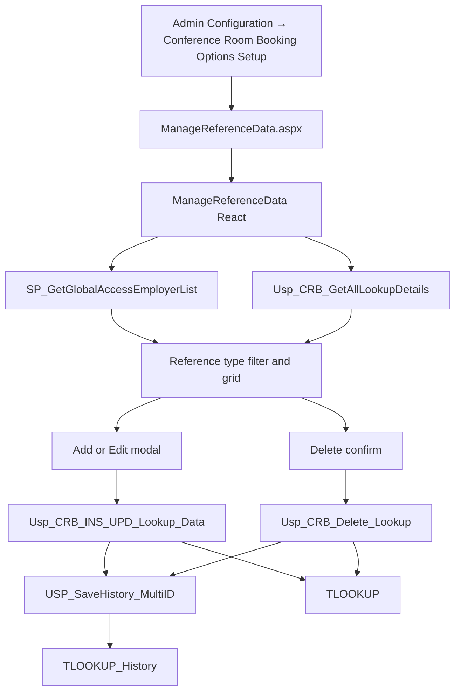
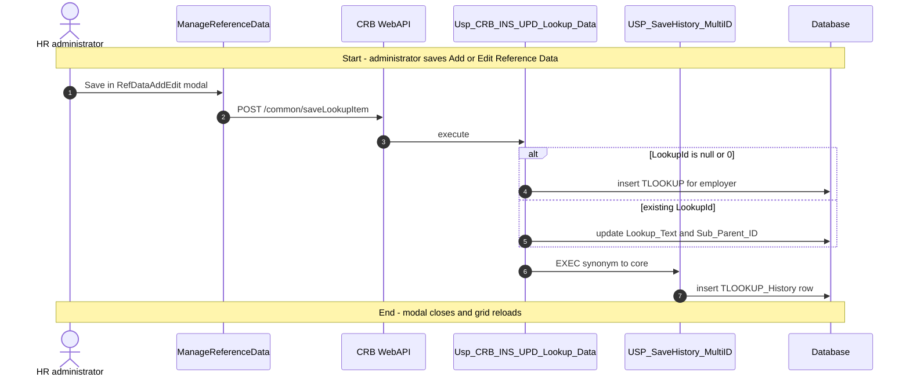
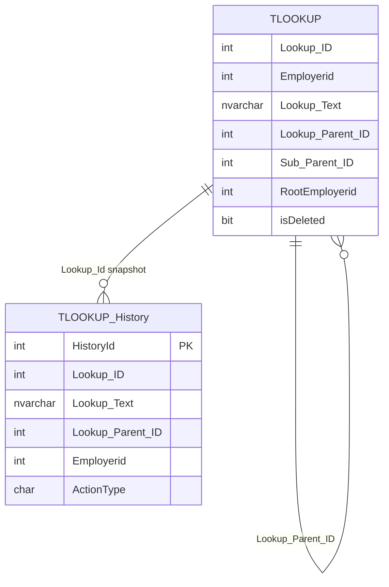

# Conference Room Booking Options Setup

## Overview

An HR administrator maintains Conference Room Booking reference lists (floors, rooms, and other lookup parents) before rooms are configured or booked. They open **Admin Configuration → Conference Room Booking Options Setup** (`~/HRM/ConferenceRoomBooking/ManageReferenceData.aspx`). The WebForms host stamps session employee context into hidden fields, logs activity `ConferenceRoomBookingOptionSetup`, and loads the `conferenceRoomBooking.min.js` React bundle.

On load the screen calls `Usp_CRB_GetAllLookupDetails` for the session employer and `SP_GetGlobalAccessEmployerList` (core) so a global-access user can switch organisation. Parents (`LookupParentId = 0`) fill the **Reference Type** filter; children fill the grid. Adding or editing posts `Usp_CRB_INS_UPD_Lookup_Data`. When the parent is `200` (room), the modal also requires a floor (`SubParentId` from parent `100` floors). Delete soft-deletes through `Usp_CRB_Delete_Lookup`. Insert, update, and delete then call nested `USP_SaveHistory_MultiID` into `TLOOKUP_History`.

Employees do not open this screen. Master Data, bookings, and related CRB screens later read the same employer-scoped `TLOOKUP` values.

Table catalogue notes live in `content/llm-wiki/reference/tables/crbbooking.md` (`TLOOKUP`). There is no SystemModel-2 or llm-wiki domain page dedicated to this Options Setup screen.

**Who's involved:**

- **HR administrator** — maintains CRB reference data for the selected organisation. Needs claim `CRB001` (`CNST_MANAGE_REFERENCE_DATA`). Global-access users can switch organisation via the org dropdown.
- **Employee** — does not open this screen. Later booking and master-data flows consume the floors, rooms, and other lookups created here.

## Workflow

## Request journey

### HR administrator — save a reference row

## Entry points

`~/HRM/ConferenceRoomBooking/ManageReferenceData.aspx` is the live host. `Page_Load` logs `ActivityDescription.ConferenceRoomBookingOptionSetup` and copies `LoggedInEmployee` into hidden fields (`hdnEmpId`, `hdnEmployerId`, and related). The React bundle mounts at `#root` via `BuildJS/conferenceRoomBooking.min.js`. Client route `RouteConstants.MANAGE_REFERENCEDATA` wraps the component with claim `CRB001`.

Breadcrumb text on the page matches the left-nav name **Conference Room Booking Options Setup → Manage Reference data**.

| UI page | Purpose |
|---|---|
| `HRM/ConferenceRoomBooking/ManageReferenceData.aspx` | WebForms host and session stamp |
| `Areas/ManageReferenceData/manageReferenceData.js` | Org picker, type filter, grid, delete |
| `Areas/ManageReferenceData/refDataAddEdit.js` | Add/edit modal and save |

## Code → database call chain

Active `apiURLConstants.js` exports unversioned `/common/...` paths (V1). Controllers below are the V1 files mounted from `routeIndex.js` as `/common`.

| Entry | Method | Stored procedure |
|---|---|---|
| Page load (org list) | `getGlobalAccessEmployers` (`manageReferenceData.js:48`) → `GetGlobalAccessEmployerList` (`commonController.js:40`) → `GetGlobalAccessEmployerList` (`commonDAL.js:66`) | `SP_GetGlobalAccessEmployerList` (core connection) |
| Page load / org change / after save or delete | `fetchLookupData` (`manageReferenceData.js:56`) → `GetAllLookupDetails` (`commonController.js:6`) → `GetAllLookupDetails` (`commonDAL.js:14`) | `Usp_CRB_GetAllLookupDetails` |
| Add/Edit Save | `saveFormData` (`refDataAddEdit.js:160`) → `SaveLookupItem` (`commonController.js:30`) → `SaveLookupItem` (`commonDAL.js:46`) | `Usp_CRB_INS_UPD_Lookup_Data` (then nested `USP_SaveHistory_MultiID`) |
| Delete | `handleDataDelete` (`manageReferenceData.js:154`) → `DeleteLookupItem` (`commonController.js:19`) → `DeleteLookupItem` (`commonDAL.js:29`) | `Usp_CRB_Delete_Lookup` (then nested `USP_SaveHistory_MultiID`) |

Modal remount also reloads lookups through the same `GET_ALL_LOOKUPITEMS` path (`refDataAddEdit.js:44`).

## API endpoints

Not WebForms postback. The React host calls the Conference Room Booking Node API (`API_URL` + paths below). Authorize middleware applies on these routes.

| Verb | Route | Parameters | Purpose | Source |
|---|---|---|---|---|
| GET | `/common/getGlobalAccessEmployerList` | query `employerId` (UI passes employee id into this query name) | Organisation dropdown | `commonRoutes.js:10`, `commonController.js:40` |
| GET | `/common/getAllLookupDetails` | query `employerId` (required) | Load parents and children for the grid / modal | `commonRoutes.js:7`, `commonController.js:6` |
| POST | `/common/saveLookupItem` | body `LookupId`, `LookupText`, `LookupParentId`, `SubParentId`, `EmployerId` | Insert or update reference row | `commonRoutes.js:9`, `commonController.js:30` |
| DELETE | `/common/DeleteLookupItem` (route file registers `/deleteLookupItem`) | query `lookupId`, `employerId` | Soft-delete reference row | `commonRoutes.js:8`, `commonController.js:19` |

## Stored procedures & tables involved

| Object | File path | Purpose | llm-wiki |
|---|---|---|---|
| [`Usp_CRB_GetAllLookupDetails`](/docs/database/hrms-crbbooking/Usp_CRB_GetAllLookupDetails) | `HRMS-DATABASE/HRMS-CRBBOOKING/STOREPROCEDURE/Usp_CRB_GetAllLookupDetails.sql` | List non-deleted lookups for one employer | `content/llm-wiki/reference/tables/crbbooking.md` |
| [`Usp_CRB_INS_UPD_Lookup_Data`](/docs/database/hrms-crbbooking/Usp_CRB_INS_UPD_Lookup_Data) | `HRMS-DATABASE/HRMS-CRBBOOKING/STOREPROCEDURE/Usp_CRB_INS_UPD_Lookup_Data.sql` | Insert or update `TLOOKUP`, then history | same |
| [`Usp_CRB_Delete_Lookup`](/docs/database/hrms-crbbooking/Usp_CRB_Delete_Lookup) | `HRMS-DATABASE/HRMS-CRBBOOKING/STOREPROCEDURE/Usp_CRB_Delete_Lookup.sql` | Soft-delete `TLOOKUP`, then history | same |
| [`USP_SaveHistory_MultiID`](/docs/database/hrms/USP_SaveHistory_MultiID) | `HRMS-DATABASE/HRMS/STOREPROCEDURE/USP_SaveHistory_MultiID.sql` (CRB synonym) | Copy current row into `TLOOKUP_History` | — |
| [`SP_GetGlobalAccessEmployerList`](/docs/database/hrms/SP_GetGlobalAccessEmployerList) | `HRMS-DATABASE/HRMS/STOREPROCEDURE/SP_GetGlobalAccessEmployerList.sql` | Employers for global-access picker | existing DB page |

Primary tables: `TLOOKUP`, `TLOOKUP_History`. Global access also reads core `TUsers` / `TUserEmployee` / `TEmployerDetails`.

## Table relationships

`TLOOKUP` has a composite business key of `(Lookup_ID, Employerid)` in practice; the base table script has no declared foreign keys. Parent/child is by `Lookup_Parent_ID` / `Sub_Parent_ID` within the same employer (rooms under parent `200` take floor as `Sub_Parent_ID` from parent `100`). History is written by `USP_SaveHistory_MultiID`, not by an FK.

Declared FKs are absent; the diagram follows the joins and write targets in the procedures above.

## Known gaps

- Active UI constants use unversioned `/common/...` (V1). Commented V2/V3 blocks exist in `apiURLConstants.js`, and `routeIndex.js` also mounts `/V2/common` and `/V3/common`. This guide documents the live V1 export.
- Delete URL uses PascalCase `DeleteLookupItem` while Express registers `deleteLookupItem`. Production likely depends on a case-insensitive host.
- Org-list helper is named `GET_GLOBAL_ACESS_EMPLOYERLIST` and builds query `employerId`, but the UI passes **employee** id and the SP parameter is `@EmployeeId`. Works only because the controller forwards that query value as the employee id.
- `Usp_CRB_GetAllLookupDetails` selects `@RootEmployerID` from `temployerdetails` and never uses it.
- `TLOOKUP_History` lives in `TABLES/CRB_History.sql` and is not listed in the llm-wiki CRB table catalogue row set used for navigation.
- SystemModel-2 has no workflow page for this screen. No llm-wiki domain ER page covers CRB Options Setup end-to-end.
- Nested history procedure is documented one level deep; deeper dynamic SQL inside `USP_SaveHistory_MultiID` was not expanded further.

## Reference

Confidence is medium: the React → V1 CRB WebAPI → procedure chain is clear in source, with a core connection for global employers and a CRB synonym for history. V2/V3 trees, delete-route casing, and the employerId/employeeId query naming leave some runtime ambiguity.

### SourceCode

- `HRMS.Web/HRMS.Web/HRM/ConferenceRoomBooking/ManageReferenceData.aspx`
- `HRMS.Web/HRMS.Web/HRM/ConferenceRoomBooking/ManageReferenceData.aspx.cs`
- `HRMS.Web/HRMS.Web/HRM/ConferenceRoomBooking/Areas/ManageReferenceData/manageReferenceData.js`
- `HRMS.Web/HRMS.Web/HRM/ConferenceRoomBooking/Areas/ManageReferenceData/refDataAddEdit.js`
- `HRMS.Web/HRMS.Web/HRM/ConferenceRoomBooking/Common/apiURLConstants.js`
- `HRMS.Web/HRMS.Web/HRM/ConferenceRoomBooking/Common/claimConstants.js`
- `HRMS.Web/HRMS.Web/HRM/ConferenceRoomBooking/Areas/routes.js`
- `HRMS.ConferenceRoomBooking/HRMS.ConferenceRoomBooking.WebAPI.Node/Routes/routeIndex.js`
- `HRMS.ConferenceRoomBooking/HRMS.ConferenceRoomBooking.WebAPI.Node/Routes/commonRoutes.js`
- `HRMS.ConferenceRoomBooking/HRMS.ConferenceRoomBooking.WebAPI.Node/Controllers/commonController.js`
- `HRMS.ConferenceRoomBooking/HRMS.ConferenceRoomBooking.WebAPI.Node/Core/DataAccessLayer/commonDAL.js`

### TDG HRMS DB

- `HRMS-DATABASE/HRMS-CRBBOOKING/STOREPROCEDURE/Usp_CRB_GetAllLookupDetails.sql`
- `HRMS-DATABASE/HRMS-CRBBOOKING/STOREPROCEDURE/Usp_CRB_INS_UPD_Lookup_Data.sql`
- `HRMS-DATABASE/HRMS-CRBBOOKING/STOREPROCEDURE/Usp_CRB_Delete_Lookup.sql`
- `HRMS-DATABASE/HRMS-CRBBOOKING/SYNONYMS/USP_SaveHistory_MultiID.sql`
- `HRMS-DATABASE/HRMS/STOREPROCEDURE/USP_SaveHistory_MultiID.sql`
- `HRMS-DATABASE/HRMS/STOREPROCEDURE/SP_GetGlobalAccessEmployerList.sql`
- `HRMS-DATABASE/HRMS-CRBBOOKING/TABLES/TLOOKUP.sql`
- `HRMS-DATABASE/HRMS-CRBBOOKING/TABLES/CRB_History.sql`
- `content/llm-wiki/reference/tables/crbbooking.md`
