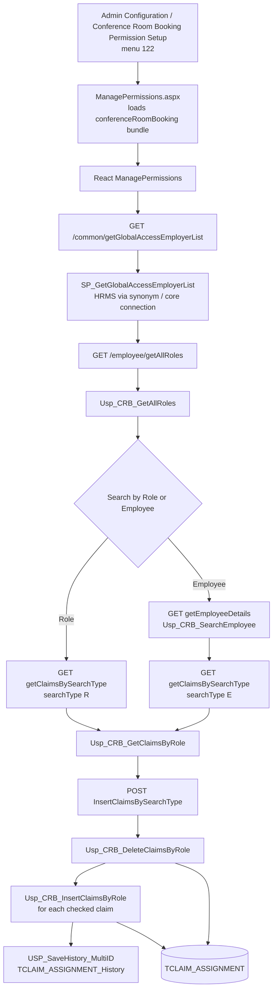
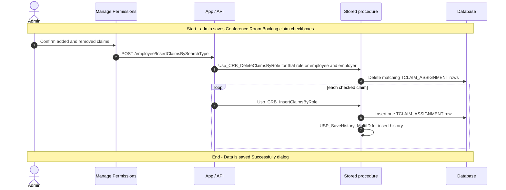
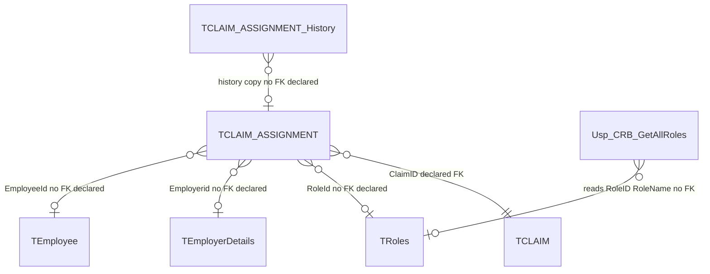

# Conference Room Booking Permission Setup

## Overview

An administrator needs Conference Room Booking (CRB) permission claims granted by **role** or by **one employee**. On **Admin Configuration → Conference Room Booking Permission Setup** (menu node **122**) they open `ManagePermissions.aspx`, which seeds hidden session fields, logs activity **337**, and loads the webpack Conference Room Booking React app. The React host mounts **ManagePermissions**, which shows an organisation dropdown, **Role** / **Employee** search, and two claim panels filtered by `ModuleID` (`0` = Manage Conference Room Booking Permissions, `1` = Manage Access Permissions).

On save the UI posts the full claim list; the CRB Web API deletes that role’s or employee’s rows in `TCLAIM_ASSIGNMENT` then inserts each checked claim in the Conference Room Booking database (`HRM_CRBooking_Prod` / `HRMS-CRBBOOKING`). This is **not** HRMS left-nav Access Right Management (`TRoles` / `TRolePagesMapping`); it is the CRB claim catalog on `TCLAIM` / `TCLAIM_ASSIGNMENT`.

**Who's involved:**

- **Administrator** with the Conference Room Booking Permission Setup menu — grants or revokes CRB claims for a role or one employee.
- **Employee** — never uses this screen; their effective CRB claims are read elsewhere (for example `Usp_CRB_GetUserSetupDetails`, not called from this page).

There is no SystemModel-2 domain page for CRB permission setup. Table blurbs for `TCLAIM` and `TCLAIM_ASSIGNMENT` are in `llm-wiki/reference/tables/crbbooking.md`.

## Workflow

## Request journey

### Save role or employee claims

## Entry points

> The live screen is the WebForms host `HRM/ConferenceRoomBooking/ManagePermissions.aspx`. It does not post back for claim saves. Claim work goes through the Conference Room Booking Web API (`process.env.API_URL`) against the CRB database. There is no separate React route constant for this page in source `routeConstants.js` (see Known gaps). SourceCode SystemModel-2 has no CRB permission page.

| Entry point | Purpose | Live? |
|---|---|---|
| `~/HRM/ConferenceRoomBooking/ManagePermissions.aspx` (menu **122**) | Host page; seeds employee/employer hidden fields; loads React | Yes |
| Manage Permissions UI (`managePermissions.js`) | Role or employee claim grant UI | Yes |
| `CommonUtil.LogActivity(ConferenceRoomBookingPermissionSetup)` on `Page_Load` | Activity type **337** | Yes |
| V2 / V3 `/V2/employee/...` and `/V3/employee/...` routes | Parallel API versions still mounted | Not used by the active Version-1 `apiURLConstants.js` export |

## Code → database call chain

The React UI calls `APIHelper` → Conference Room Booking Node Web API. Reads go Controller → DAL. Save goes Controller → BLL (transaction) → DAL delete then insert per claim.

| Step | Entry point | App code | Stored procedure |
|---|---|---|---|
| Activity on open | `ManagePermissions.aspx.cs:20` | `CommonUtil.LogActivity` (`Common.cs:52`) → `ActivityHelper.LogActivity` | `Sp_InsertActivityLog` (HRMS; activity **337**) |
| Organisation list | `managePermissions.js:179` | `commonController.GetGlobalAccessEmployerList` (`commonController.js:40`) → `commonDAL.GetGlobalAccessEmployerList` (`commonDAL.js:66`) | `SP_GetGlobalAccessEmployerList` (HRMS object; CRB synonym / `core` connection) |
| Role dropdown | `managePermissions.js:60` | `employeeController.GetAllRoles` (`employeeController.js:28`) → `employeeDAL.GetAllRoles` (`employeeDAL.js:53`) | `Usp_CRB_GetAllRoles` |
| Load role or employee claim checkboxes | `managePermissions.js:113` | `employeeController.GetClaimsBySearchType` (`employeeController.js:38`) → `employeeDAL.GetClaimsBySearchType` (`employeeDAL.js:69`) | `Usp_CRB_GetClaimsByRole` |
| Employee search / select | `employeeSearch.js:61` | `employeeController.GetEmployeeDetails` (`employeeController.js:18`) → `employeeDAL.GetEmployeeDetails` (`employeeDAL.js:33`) | `Usp_CRB_SearchEmployee` |
| Save claims | `managePermissions.js:124` | `employeeController.InsertClaimsBySearchType` (`employeeController.js:48`) → `employeeBLL.InsertClaimsBySearchType` (`employeeBLL.js:17`) → `DeleteClaimsBySearchType` (`employeeDAL.js:87`) then `InsertClaimsBySearchType` (`employeeDAL.js:104`) | `Usp_CRB_DeleteClaimsByRole` then `Usp_CRB_InsertClaimsByRole` per checked claim (nested `USP_SaveHistory_MultiID`) |

## API endpoints

This screen is not a WebForms postback for claim data. The ASPX only loads the React shell. Claim traffic is HTTP to the CRB Web API (`process.env.API_URL`). Active front-end constants use the unversioned paths mounted at `/employee` and `/common` in `routeIndex.js` (V2/V3 mirrors exist but are commented out in `apiURLConstants.js`).

| Method | Path | Purpose | Caller | Handler |
|---|---|---|---|---|
| GET | `/common/getGlobalAccessEmployerList?employerId=` | Organisation dropdown. Query name is `employerId`; UI passes the logged-in **employee** id | `managePermissions.js` `getGlobalAccessEmployers` | `commonController.GetGlobalAccessEmployerList` |
| GET | `/employee/getAllRoles?employerId=` | Role dropdown | `managePermissions.js` `populateRoles` | `employeeController.GetAllRoles` |
| GET | `/employee/getClaimsBySearchType?roleId=&employerId=&searchType=&employeeId=` | Claim checkbox state. `searchType` `R` or `E` | `managePermissions.js` `loadClaims` | `employeeController.GetClaimsBySearchType` |
| GET | `/employee/getEmployeeDetails?...` | Employee picker rows | `employeeSearch.js` `findData` | `employeeController.GetEmployeeDetails` |
| POST | `/employee/InsertClaimsBySearchType` | Replace role or employee assignments | `managePermissions.js` `SaveFormData` | `employeeController.InsertClaimsBySearchType` |

## Stored procedures & tables involved

Inventory paths are under `HRMS-DATABASE/HRMS-CRBBOOKING/` unless noted. Procedure pages for CRB objects are under `/docs/database/hrms-crbbooking/`. Shared HRMS objects keep the `hrms` slug.

| Object | File | Purpose | Database page |
|---|---|---|---|
| `Usp_CRB_GetAllRoles` | `STOREPROCEDURE/USp_CRB_GetAllRoles.sql` | Default and active roles for the employer | [Usp_CRB_GetAllRoles](/docs/database/hrms-crbbooking/Usp_CRB_GetAllRoles) |
| `Usp_CRB_GetClaimsByRole` | `STOREPROCEDURE/Usp_CRB_GetClaimsByRole.sql` | Claim catalog plus existence flag for role or employee | [Usp_CRB_GetClaimsByRole](/docs/database/hrms-crbbooking/Usp_CRB_GetClaimsByRole) |
| `Usp_CRB_InsertClaimsByRole` | `STOREPROCEDURE/Usp_CRB_InsertClaimsByRole.sql` | Insert one `TCLAIM_ASSIGNMENT` row and history | [Usp_CRB_InsertClaimsByRole](/docs/database/hrms-crbbooking/Usp_CRB_InsertClaimsByRole) |
| `Usp_CRB_DeleteClaimsByRole` | `STOREPROCEDURE/Usp_CRB_DeleteClaimsByRole.sql` | Delete role- or employee-scoped assignments for an employer | [Usp_CRB_DeleteClaimsByRole](/docs/database/hrms-crbbooking/Usp_CRB_DeleteClaimsByRole) |
| `Usp_CRB_SearchEmployee` | `STOREPROCEDURE/USp_CRB_SearchEmployee.sql` | Employee search for Employee mode | [Usp_CRB_SearchEmployee](/docs/database/hrms-crbbooking/Usp_CRB_SearchEmployee) |
| `SP_GetGlobalAccessEmployerList` | `HRMS/STOREPROCEDURE/SP_GetGlobalAccessEmployerList.sql` (synonym in CRB) | Organisation list | [SP_GetGlobalAccessEmployerList](/docs/database/hrms/SP_GetGlobalAccessEmployerList) |
| `USP_SaveHistory_MultiID` | `HRMS/STOREPROCEDURE/USP_SaveHistory_MultiID.sql` (synonym in CRB) | Nested history write after insert | [USP_SaveHistory_MultiID](/docs/database/hrms/USP_SaveHistory_MultiID) |
| `Sp_InsertActivityLog` | `HRMS/STOREPROCEDURE/Sp_InsertActivityLog.sql` | Page-open activity **337** | [Sp_InsertActivityLog](/docs/database/hrms/Sp_InsertActivityLog) |

Tables these procedures read or write in CRB: `TCLAIM`, `TCLAIM_ASSIGNMENT`, `TCLAIM_ASSIGNMENT_History`. Synonym / cross-db reads include `TRoles`, `TEmployee`, `TEmployeeInfo`, `TORGChart`, `TEmployerDetails`, `TUsers` / `TUserEmployee` (via `SP_GetGlobalAccessEmployerList`), plus name/decrypt helpers. `llm-wiki/reference/tables/crbbooking.md` catalogs `TCLAIM` and `TCLAIM_ASSIGNMENT` and records the declared FK `TCLAIM_ASSIGNMENT` → `TCLAIM`.

Direct nested callees (one level) with existing HRMS pages: `SP_CloseEncryptionKey`, `Fn_GetEmployeeName`, `Fn_DecryptData`, `FN_LocationBU_GetEmployeeDetails`, `SP_GetGlobalAccessEmployerList`, `Sp_InsertActivityLog`. Nested history page written in this pass: `USP_SaveHistory_MultiID`.

## Table relationships

Declared foreign keys are labeled as such. Columns the procedures join without a foreign key are labeled **no FK declared**. Do not invent FKs for `RoleId`, `Employerid`, or `EmployeeId` on `TCLAIM_ASSIGNMENT` — the table script only declares `FK_ClaimAssm_Claim_Id`.

`TCLAIM.ModuleID` is an integer used by the UI as Manage Conference Room Booking Permissions `0` and Manage Access Permissions `1`. There is no foreign key from `ModuleID` to a module table in the CRB `TCLAIM` script.

## Known gaps

- SourceCode `docs/SystemModels/SystemModel-2` has no Conference Room Booking Permission Setup domain page.
- `routeConstants.js` does not define `MANAGE_PERMISSIONS`, but `routes.js` registers `RouteConstants.MANAGE_PERMISSIONS`. The ASPX URL is still the live host; the React route path is undefined in source.
- Active `apiURLConstants.js` exports Version-1 unversioned paths. V2/V3 constant blocks are commented; V2/V3 routes remain mounted on the API.
- `getGlobalAccessEmployerList` query parameter is named `employerId` while the UI passes the logged-in employee id; the DAL parameter is `EmployeeId`.
- Organisation dropdown is always loaded; unlike Travel & Expense Permission Setup there is no claim gate such as `TE032`.
- `managePermissions.js` references `toggleExpenseHandler`, `openTravelSection`, and `openExpenseSection` while state/methods use `openRASection` / `openRPSection` / `toggleRAHandler` / `toggleRPHandler`.
- `Usp_CRB_DeleteClaimsByRole` does not write `TCLAIM_ASSIGNMENT_History`; only inserts call `USP_SaveHistory_MultiID`.
- `Usp_CRB_SearchEmployee` builds dynamic SQL (`Sp_executesql`). `Sp_OpenEncryptionKeys` is commented out while `SP_CloseEncryptionKey` still runs. Nested helpers are documented one level only.
- `Usp_CRB_GetUserSetupDetails` and claim constants such as `CRB001` / `CRB002` / `CRB003` are used elsewhere in CRB; this page does not call the user-setup procedure.
- Several CRB scripts begin with `USE [HRM_CRBooking_Prod]`.
- Page-open `Sp_InsertActivityLog` for activity **337** runs through shared HRMS logging.

## Reference

High confidence on the React → CRB API → DAL → CRB procedure chain. Nested history and encryption helpers resolve through CRB synonyms into HRMS.

### SourceCode

- `HRMS.Web/HRMS.Web/HRM/ConferenceRoomBooking/ManagePermissions.aspx` and `ManagePermissions.aspx.cs`
- `HRMS.Web/HRMS.Web/HRM/ConferenceRoomBooking/Areas/ManagePermissions/managePermissions.js`
- `HRMS.Web/HRMS.Web/HRM/ConferenceRoomBooking/SharedComponent/UI/EmployeeSearch/employeeSearch.js`
- `HRMS.Web/HRMS.Web/HRM/ConferenceRoomBooking/Common/apiURLConstants.js`, `apiHelper.js`, `routeConstants.js`, `ClaimConstants.js`
- `HRMS.Web/HRMS.Web/HRM/ConferenceRoomBooking/Areas/routes.js`
- `HRMS.ConferenceRoomBooking/HRMS.ConferenceRoomBooking.WebAPI.Node/Routes/routeIndex.js`, `employeeRoutes.js`, `commonRoutes.js`
- `HRMS.ConferenceRoomBooking/HRMS.ConferenceRoomBooking.WebAPI.Node/Controllers/employeeController.js`, `commonController.js`
- `HRMS.ConferenceRoomBooking/HRMS.ConferenceRoomBooking.WebAPI.Node/Core/BusinessLogicLayer/employeeBLL.js`
- `HRMS.ConferenceRoomBooking/HRMS.ConferenceRoomBooking.WebAPI.Node/Core/DataAccessLayer/employeeDAL.js`, `commonDAL.js`
- `HRMS.Shared/HRMS.DataContract/Common/Enums.cs` (`ConferenceRoomBookingPermissionSetup = 337`)
- `HRMS.Shared/HRMS.Common/Common.cs`, `TDG.ActivityAuditLog/DAL/ActivityHelper.cs`

### TDG HRMS DB

- `llm-wiki/reference/tables/crbbooking.md`
- `HRMS-DATABASE/HRMS-CRBBOOKING/TABLES/TCLAIM.sql`, `TCLAIM_ASSIGNMENT.sql`
- `HRMS-DATABASE/HRMS-CRBBOOKING/SYNONYMS/SP_GetGlobalAccessEmployerList.sql`, `USP_SaveHistory_MultiID.sql`, `Sp_OpenEncryptionKeys.sql`, `SP_CloseEncryptionKey.sql`, `Fn_GetEmployeeName.sql`, `Fn_DecryptData.sql`, `FN_LocationBU_GetEmployeeDetails.sql`
- Procedure scripts listed in the table above
- `HRMS-DATABASE/HRMS/DML/Tmenudetails DML.sql` (Conference Room Booking Permission Setup node **122**)
