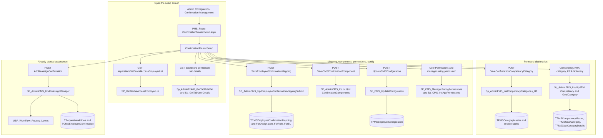
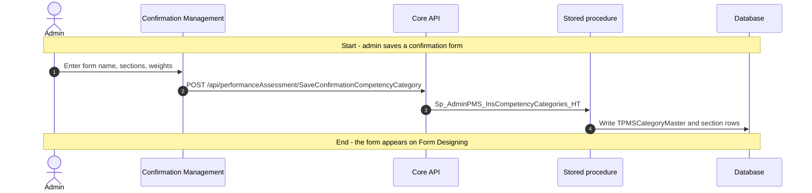
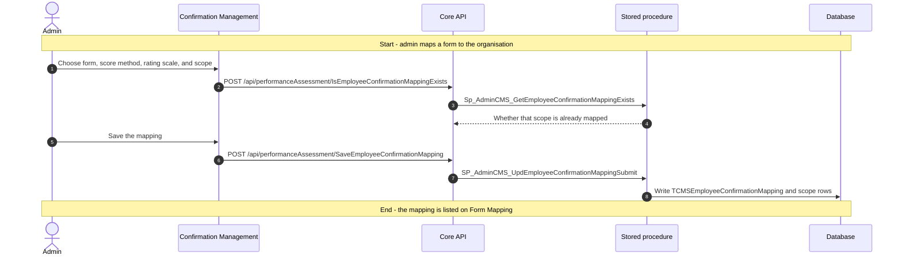

# Confirmation Management

## Overview

An HR administrator opens **Confirmation Management** to decide how probation confirmation works for an organisation, before any employee fills in an assessment. They pick the organisation, then work through tabs. They design the confirmation form (competencies, KRAs, weights), keep competency and KRA dictionaries, add extra questions, and map each form to designations, roles, or business units with a score method and rating scale. They set how many days a probation extension lasts, which managers may rate, and which review levels must comment or see earlier ratings. They can reassign an assessment that is already in flight, rename the labels employees see, and turn employer switches on or off (self-assessment required, automatic confirmation, decimal ratings, revising the form when the last approver extends probation, and others).

Tab visibility follows menu **61**. If the role and user tab lookups fail, every tab stays visible.

This page is the setup screen. The employee **Confirmation Assessment** menu, where someone fills and approves a probation form, is a different feature. SourceCode `docs/SystemModels/SystemModel-2/domain/contexts/performance.md` names menu 61 as Confirmation Master Setup and records the October 2026 configuration flag for revising the form on extension. `docs/SystemModels/SystemModel-2/behavior/workflows/performance-appraisal.md` describes the appraisal cycle, and only mentions confirmation as the parallel probation outcome. Table catalog rows for the CMS tables are in `llm-wiki/reference/tables/hrms.md`. Reassignment also touches the shared routing row described in `llm-wiki/domain/approval-workflow.md`.

## Workflow

Saving a KRA category or a KRA dictionary row can also run an inline `UPDATE` on `TPMSGoalCategory` that clears `IsDeleted` before the procedure. That statement is not a stored procedure. It lives in `performanceAssessmentDAL.js`.

`Sp_AdminPMS_GetConfigurationValues`, used when the Configurations tab loads, inserts a default `TPMSEmployerConfiguration` row when the employer has none.

## Request journey

Two admin requests are the core of setup. Designing the form stores the questionnaire. Mapping that form decides who it applies to. Configuration flags, dictionaries, and reassignment are on the same screen and are drawn in the workflow above.

### Save a confirmation form

### Map the form

## Entry points

> The left-nav item is retargeted by `HRMS-DATABASE/HRMS/DML/PMSRelease-React/MenuDetails.sql`, which sets `tmenudetails.NavigateURL` from `~/HRM/PMS/ConfirmationMasterSetup.aspx` to `~/HRM/PMS_React/ConfirmationMasterSetup.aspx`. The React host mounts `ConfirmationMasterSetup`. The WebForms page `HRM/PMS/ConfirmationMasterSetup.aspx` is still in the project and still posts back to its own code-behind. It is not the URL that DML writes onto the menu. Catalog text in `TDataCatalog` records the path **Admin Configuration > Confirmation Management**.

| Entry point | Purpose | Live? |
|---|---|---|
| `HRM/PMS_React/ConfirmationMasterSetup.aspx` | Host page. Puts employer, employee, and business-unit label into hidden fields | Yes. Menu target |
| `Areas/ConfirmationMasterSetup/Containers/ConfirmationMasterSetup.js` | Tab shell for menu 61 | Yes |
| `HRM/PMS/ConfirmationMasterSetup.aspx` | Legacy WebForms setup page | Compiled, not the menu URL after the DML |
| `GET /api/employees/:employeeId/profile` | Resolves `TUsers.UserID` when the page has no `hdnUserId`, so tab grants can be loaded | Yes, only for that lookup. Repository query, not a stored procedure |

## Code → database call chain

Every `/api/performanceAssessment` route below is registered in `Routes/performanceAssessmentRoutes.js` with `Authorize`. The React facade is `confirmationMasterApi.js` unless the line is the container or `menuTabPermissions.js`.

| UI | API | DAL or repository (`file:line`) | Procedure |
|---|---|---|---|
| Organisation dropdown `ConfirmationMasterSetup.js:591` | `GET /api/separation/GetGlobalAccessEmployerList` | `separationDAL.js:989` via `separationController.js:958` | `SP_GetGlobalAccessEmployerList` |
| Tab grants `menuTabPermissions.js:83` | `GET /api/dashBoard/GetPermissionRoleTabDetails` | `dashBoardDAL.js:853` via `dashboardController.js:832` | `Sp_AdminRoleM_GetTabRoleDet` |
| Tab grants `menuTabPermissions.js:98` | `GET /api/dashBoard/GetPermissionUserTabDetailsByuserId` | `dashBoardDAL.js:838` via `dashboardController.js:820` | `Sp_GetTabUserDetails` |
| User id lookup `menuTabPermissions.js:64` | `GET /api/employees/:employeeId/profile` | `ProfileQueryHandler.js:18` | None. `EmployeeRepository.getEmployeeInfoWithTabAccess` |
| Form list `ConfirmationMasterSetup.js:158` | `GET .../GetPMSCompetencyCategories_New` | `performanceAssessmentDAL.js:488` | `SP_AdminPMS_GetCompetencyCategory_New` |
| Form sections `confirmationMasterApi.js:65` | `GET .../GetPMSCompetencySections` | `performanceAssessmentDAL.js:503` | `SP_AdminPMS_GetCompetencySections` |
| Save form `confirmationMasterApi.js:63` | `POST .../SaveConfirmationCompetencyCategory` | `performanceAssessmentDAL.js:7391` | `Sp_AdminPMS_InsCompetencyCategories_HT` |
| Delete form `confirmationMasterApi.js:62` | `POST .../DeleteCompetencyCategory` | `performanceAssessmentDAL.js:7250` | `SP_AdminPMS_DelCompetencyCategory` |
| Competency list `ConfirmationMasterSetup.js:197` | `GET .../GetAllAvailableCompetencies` | `performanceAssessmentDAL.js:6392` | `Sp_AdminPMS_GetAllCompetency` |
| Save competency `confirmationMasterApi.js:35` | `POST .../SaveCompetencies` | `performanceAssessmentDAL.js:6460` | `Sp_AdminPMS_InsCompetency` |
| Update competency `confirmationMasterApi.js:36` | `POST .../UpdateCompetencies` | `performanceAssessmentDAL.js:6477` | `Sp_AdminPMS_UpdCompetency` |
| Delete competency `confirmationMasterApi.js:37` | `POST .../DeleteCompetencyById` | `performanceAssessmentDAL.js:6495` | `Sp_AdminPMS_DelCompetency` |
| KRA categories `ConfirmationMasterSetup.js:223` | `GET .../GetAllGoalCategories` | `performanceAssessmentDAL.js:3165` | `SP_AdminPMS_GetAllGoalCategory` |
| Save KRA category `confirmationMasterApi.js:39` | `POST .../SaveGoalCategory` | `performanceAssessmentDAL.js:6512` | `Sp_AdminPMS_InsGoalCategory` |
| Update KRA category `confirmationMasterApi.js:40` | `POST .../UpdateGoalCategory` | `performanceAssessmentDAL.js:6536`, then inline `UPDATE` at `8304` when reactivated | `Sp_AdminPMS_UpdGoalCategory` |
| Delete KRA category `confirmationMasterApi.js:41` | `POST .../DeletePMSGoalCategory` | `performanceAssessmentDAL.js:6569` | `Sp_AdminPMS_DelGoalCategory` |
| Dictionary rows `ConfirmationMasterSetup.js:257` | `GET .../GetAllGoalCategoriesDetails` | `performanceAssessmentDAL.js:3179` | `SP_AdminPMS_GetAllGoalCategoryDetails` |
| Save KRA dictionary `confirmationMasterApi.js:43` | `POST .../SaveGoalCategoryDetails` | `performanceAssessmentDAL.js:6641`, inline `UPDATE` at `8324` | `Sp_AdminPMS_InsKRADictionaryDetails` or `Sp_AdminPMS_InsGoalCategoryDetails` when the body is a goal-dictionary row |
| Update dictionary `confirmationMasterApi.js:44` | `POST .../UpdateGoalCategoryDetails` | `performanceAssessmentDAL.js:6758` | `Sp_AdminPMS_UPDKRADictionaryDetails` or `Sp_AdminPMS_UPDGoalCategoryDetails` |
| Delete dictionary `confirmationMasterApi.js:45` | `POST .../DeletePMSGoalCategoryDetails` | `performanceAssessmentDAL.js:6885` | `Sp_AdminPMS_DelGoalCategoryDetails` |
| Components `ConfirmationMasterSetup.js:311` | `GET .../GetConfirmationComponentList` | `performanceAssessmentDAL.js:6348` | `Sp_AdminCMS_GetConfirmationComponents` |
| Save component `confirmationMasterApi.js:60` | `POST .../SaveCMSConfirmationComponent` | `performanceAssessmentDAL.js:7184` | `SP_AdminCMS_InsConfirmationComponents` or `SP_AdminCMS_UpdConfirmationComponents` when `componentId` is set |
| Delete component `confirmationMasterApi.js:61` | `POST .../DeleteCMSConfirmationComponent` | `performanceAssessmentDAL.js:7234` | `SP_AdminCMS_DelConfirmationComponent` |
| Mappings `ConfirmationMasterSetup.js:336` | `GET .../GetAllEmployeeConfirmationMappings` | `performanceAssessmentDAL.js:6359` | `Sp_AdminCMS_GetAllEmployeeConfirmationMapping` |
| Designations `ConfirmationMasterTabsB.js:93` | `GET .../GetDesignationsForFormMapping` | `performanceAssessmentDAL.js:5766` | `Sp_AdminPMS_GetAllDesignationsForMapping` |
| Roles `ConfirmationMasterTabsB.js:106` | `GET .../GetAssignedEmpRoles` | `performanceAssessmentDAL.js:5778` | `SP_GetAssignedEmployeeRoles` |
| Business units `ConfirmationMasterTabsB.js:132` | `GET .../GetBusinessUnitByOrgEmployeeId` | `performanceAssessmentDAL.js:1774` | `SP_PMS_GetBusinessUnitByOrg_EmployeeId` |
| Rating scales `confirmationMasterApi.js:77` | `GET .../GetRatingScale` | `performanceAssessmentDAL.js:141` | `Sp_PMS_GetRatingDetails` |
| Employment types `confirmationMasterApi.js:68` | `GET .../GetEmploymentTypeListCMS` | `performanceAssessmentDAL.js:6999` | `SP_CMS_GetEmploymentTypeList` |
| Review levels `confirmationMasterApi.js:69` | `GET .../GetConfirmationReviewLevel` | `performanceAssessmentDAL.js:6989` | `Sp_AdminCMS_GetConfirmationReviewLevel` |
| Employees picker `confirmationMasterApi.js:67` | `GET .../GetEmployeeListByOrganization` | `performanceAssessmentDAL.js:4048` | `SP_AdminEMP_GetEmpListByOrg` |
| Mapping exists `confirmationMasterApi.js:57` | `POST .../IsEmployeeConfirmationMappingExists` | `performanceAssessmentDAL.js:7055` | `Sp_AdminCMS_GetEmployeeConfirmationMappingExists` |
| Save mapping `confirmationMasterApi.js:55` | `POST .../SaveEmployeeConfirmationMapping` | `performanceAssessmentDAL.js:7016` | `SP_AdminCMS_UpdEmployeeConfirmationMappingSubmit` |
| Delete mapping `confirmationMasterApi.js:56` | `POST .../DeleteEmployeeConfirmationMapping` | `performanceAssessmentDAL.js:7038` | `Sp_AdminPMS_DelEmployeeConfirmationMapping` |
| Mapping scope `confirmationMasterApi.js:70` | `GET .../GetCMSCategoryDesignationMappings` | `performanceAssessmentDAL.js:7072` | `Sp_AdminCMS_GetEmployeeConfirmationDesMapping` |
| Mapping scope `confirmationMasterApi.js:72` | `GET .../GetCMSCategoryRoleMappings` | `performanceAssessmentDAL.js:7083` | `Sp_AdminCMS_GetEmployeeConfirmationRoleMapping` |
| Mapping scope `confirmationMasterApi.js:74` | `GET .../GetCMSCategoryBUMappings` | `performanceAssessmentDAL.js:7094` | `Sp_AdminCMS_GetEmployeeConfirmationBUMapping` |
| Notice periods `ConfirmationMasterSetup.js:358` | `GET .../GetNoticePeriodMaster` | `performanceAssessmentDAL.js:1040` | `Sp_GetCMSNOticePeriodDays` |
| Save notice period `confirmationMasterApi.js:31` | `POST .../SaveNoticePeriodMaster` | `performanceAssessmentDAL.js:6417` | `Sp_AdminCMS_InsNoticePeriodDays` |
| Update notice period `confirmationMasterApi.js:32` | `POST .../UpdateNoticePeriodMaster` | `performanceAssessmentDAL.js:6432` | `Sp_AdminCMS_UpdNoticePeriodDays` |
| Delete notice period `confirmationMasterApi.js:33` | `POST .../DeleteNoticePeriodMaster` | `performanceAssessmentDAL.js:6448` | `Sp_AdminCMS_DelNoticePeriodDays` |
| Manager rating list `ConfirmationMasterSetup.js:372` | `GET .../GetManagerRatingPermissions` | `performanceAssessmentDAL.js:6370` | `SP_CMS_GetManagerRatingPermissions` |
| Save manager rating `confirmationMasterApi.js:50` | `POST .../ManagerRatingPermissions` | `performanceAssessmentDAL.js:6950` | `SP_CMS_ManagerRatingPermissions` |
| Permission list `ConfirmationMasterSetup.js:391` | `GET .../GetConfAppPermissions` | `performanceAssessmentDAL.js:6381` | `Sp_CMS_GetAppPermissions` |
| Permission detail `confirmationMasterApi.js:53` | `GET .../DisplayConfPermissions` | `performanceAssessmentDAL.js:6979` | `Sp_CMS_GetAppPermissionsByID` |
| Save permissions `confirmationMasterApi.js:51` | `POST .../InsertConfAppPermissions` | `performanceAssessmentDAL.js:7480` | `Sp_CMS_InsAppPermissions` |
| Delete permissions `confirmationMasterApi.js:52` | `POST .../DeleteConfAppPermissions` | `performanceAssessmentDAL.js:6966` | `Sp_CMS_DelAppPermissions` |
| Reassign search `ConfirmationMasterSetup.js:413` | `GET .../GetEmployeeToReassignConfirmation` | `performanceAssessmentDAL.js:6404` | `SP_AdminCMS_SrchEmpForConfReAssign` |
| Reassign `confirmationMasterApi.js:48` | `POST .../AddReassignConfirmation` | `performanceAssessmentDAL.js:6930` | `SP_AdminCMS_UpdReassignManager` |
| Custom labels `ConfirmationMasterSetup.js:433` | `GET .../GetCustomLabelsData` | `performanceAssessmentDAL.js:3615` | `SP_AdminPMS_GetEmployerPMSCustomFields` |
| Save labels `confirmationMasterApi.js:47` | `POST .../InsertCustomLabelsData` | `performanceAssessmentDAL.js:6902` | `Sp_AdminPMS_InsEmployerPMSCustomFields` |
| Configuration `ConfirmationMasterSetup.js:451` | `GET .../GetConfigurationValues` | `performanceAssessmentDAL.js:1461` | `Sp_AdminPMS_GetConfigurationValues` |
| Save configuration `confirmationMasterApi.js:59` | `POST .../UpdateCMSConfiguration` | `performanceAssessmentDAL.js:7137` | `Sp_CMS_UpdateConfiguration` |

`SP_AdminCMS_UpdReassignManager` then calls `Sp_InsHomePageNotificationCnts`, `USP_WorkFlow_Routing_Levels`, `Fn_GetHomePageNotificationIdByRequestType`, and `Split`. Search and the employee picker call `Sp_OpenEncryptionKeys` and `SP_CloseEncryptionKey`. Those nested objects are one level down and are listed on the procedure pages.

## API endpoints

Routes are under `/api`. Query and body fields below are what the controller reads. Most handlers do not reject a missing field before calling the procedure. `Authorize` is on each performance-assessment, separation, and dashboard route in this table.

| Verb | Route | Parameters | Purpose | Source |
|---|---|---|---|---|
| GET | `/api/separation/GetGlobalAccessEmployerList` | query `employeeId` | Organisations the employee can administer | `separationRoutes.js:57` |
| GET | `/api/dashBoard/GetPermissionRoleTabDetails` | query `EmployerId`, `RoleId` | Role tab grants for menu 61 | `DashBoardRoutes.js:61` |
| GET | `/api/dashBoard/GetPermissionUserTabDetailsByuserId` | query `EmployerId`, `UserId` | User tab grants | `DashBoardRoutes.js:60` |
| GET | `/api/employees/:employeeId/profile` | route `employeeId` | User id for the tab lookup | `Features/Employee/Profile/routes.js:34` |
| GET | `/api/performanceAssessment/GetPMSCompetencyCategories_New` | query `employerId`, optional `activeType` (page sends `B` or `A`) | Form list | `performanceAssessmentController.js:421` |
| GET | `/api/performanceAssessment/GetPMSCompetencySections` | query `categoryId` | One form's sections | `performanceAssessmentController.js:434` |
| POST | `/api/performanceAssessment/SaveConfirmationCompetencyCategory` | body form payload (`categoryName`, `employerId`, `appraisalType`, section arrays, and the other fields the DAL binds) | Insert or update a form | `performanceAssessmentController.js:912` |
| POST | `/api/performanceAssessment/DeleteCompetencyCategory` | body `categoryId`, `employerId`, `modifiedBy` | Delete a form | `performanceAssessmentController.js:908` |
| GET | `/api/performanceAssessment/GetAllAvailableCompetencies` | query `employerId`, optional `activeType` | Competency dictionary | `performanceAssessmentController.js:784` |
| POST | `/api/performanceAssessment/SaveCompetencies` | body `competencyName`, `competencyDescription`, `employerId`, `isActive`, `createdBy`, `isCameFrom` | Insert competency | `performanceAssessmentController.js:814` |
| POST | `/api/performanceAssessment/UpdateCompetencies` | body as save, plus `competencyId`, `modifiedBy` | Update competency | `performanceAssessmentController.js:815` |
| POST | `/api/performanceAssessment/DeleteCompetencyById` | body `competencyId`, `employerId` | Delete competency | `performanceAssessmentController.js:816` |
| GET | `/api/performanceAssessment/GetAllGoalCategories` | query `employerId` | KRA categories | `performanceAssessmentController.js:2098` |
| POST | `/api/performanceAssessment/SaveGoalCategory` | body `employerId`, `categoryName`, `isActive`, `createdBy`, measure fields, `categoryType`, `isCameFrom` | Insert category | `performanceAssessmentController.js:820` |
| POST | `/api/performanceAssessment/UpdateGoalCategory` | body as save, plus `categoryId` | Update category | `performanceAssessmentController.js:821` |
| POST | `/api/performanceAssessment/DeletePMSGoalCategory` | body `categoryId`, `employerId` | Delete category | `performanceAssessmentController.js:822` |
| GET | `/api/performanceAssessment/GetAllGoalCategoriesDetails` | query `employerId` | Dictionary rows | `performanceAssessmentController.js:2107` |
| POST | `/api/performanceAssessment/SaveGoalCategoryDetails` | body category id plus either goal-dictionary fields or `rows` for the KRA table type | Insert dictionary rows | `performanceAssessmentController.js:826` |
| POST | `/api/performanceAssessment/UpdateGoalCategoryDetails` | body as save, plus `categoryDetailsId` | Update dictionary rows | `performanceAssessmentController.js:827` |
| POST | `/api/performanceAssessment/DeletePMSGoalCategoryDetails` | body `categoryDetailsId`, `employerId` | Delete a dictionary row | `performanceAssessmentController.js:828` |
| GET | `/api/performanceAssessment/GetConfirmationComponentList` | query `employerId` | Additional components | `performanceAssessmentController.js:760` |
| POST | `/api/performanceAssessment/SaveCMSConfirmationComponent` | body component name, type, choices, sequence, evidence flags, level tables, `categoryIds`, optional `componentId` | Insert or update a component | `performanceAssessmentController.js:903` |
| POST | `/api/performanceAssessment/DeleteCMSConfirmationComponent` | body `componentId`, `employerId`, `modifiedBy` | Delete a component | `performanceAssessmentController.js:904` |
| GET | `/api/performanceAssessment/GetAllEmployeeConfirmationMappings` | query `employerId` | Form mappings | `performanceAssessmentController.js:766` |
| GET | `/api/performanceAssessment/GetDesignationsForFormMapping` | query `employerId` | Designation picker | `performanceAssessmentController.js:2819` |
| GET | `/api/performanceAssessment/GetAssignedEmpRoles` | query `employerId` | Role picker | `performanceAssessmentController.js:2828` |
| GET | `/api/performanceAssessment/GetBusinessUnitByOrgEmployeeId` | query `employeeId`, `employerId` | Business-unit picker | `performanceAssessmentController.js:1510` |
| GET | `/api/performanceAssessment/GetRatingScale` | query `employerId`, `activeFlag` | Rating scales | `performanceAssessmentController.js:195` |
| GET | `/api/performanceAssessment/GetEmploymentTypeListCMS` | query `employerId` | Non-confirmed and confirmed employment types | `performanceAssessmentController.js:892` |
| GET | `/api/performanceAssessment/GetConfirmationReviewLevel` | query `employerId` | Review levels for configuration | `performanceAssessmentController.js:891` |
| GET | `/api/performanceAssessment/GetEmployeeListByOrganization` | query `employerId`, `employeeId` | Employee picker | `performanceAssessmentController.js:2570` |
| POST | `/api/performanceAssessment/IsEmployeeConfirmationMappingExists` | body `categoryId`, `employerId`, `designationIds`, `roleIds`, `businessUnitIds` | Duplicate-scope check | `performanceAssessmentController.js:898` |
| POST | `/api/performanceAssessment/SaveEmployeeConfirmationMapping` | body mapping id, category, rating scale, score method, designation, role, and business-unit id lists, selection flags, `employerId`, `createdBy` | Save a mapping | `performanceAssessmentController.js:893` |
| POST | `/api/performanceAssessment/DeleteEmployeeConfirmationMapping` | body `employerId`, `confirmationMappingId` | Delete a mapping | `performanceAssessmentController.js:894` |
| GET | `/api/performanceAssessment/GetCMSCategoryDesignationMappings` | query `employerId`, `confirmationMappingId` | Designations on a mapping | `performanceAssessmentController.js:899` |
| GET | `/api/performanceAssessment/GetCMSCategoryRoleMappings` | query `employerId`, `confirmationMappingId` | Roles on a mapping | `performanceAssessmentController.js:900` |
| GET | `/api/performanceAssessment/GetCMSCategoryBUMappings` | query `employerId`, `confirmationMappingId` | Business units on a mapping | `performanceAssessmentController.js:901` |
| GET | `/api/performanceAssessment/GetNoticePeriodMaster` | query `employerId`, optional `activeType` (page sends `B`) | Extension day counts | `performanceAssessmentController.js:740` |
| POST | `/api/performanceAssessment/SaveNoticePeriodMaster` | body `numberOfDays`, `employerId`, `createdBy`, `status` | Insert a day count | `performanceAssessmentController.js:802` |
| POST | `/api/performanceAssessment/UpdateNoticePeriodMaster` | body `transId`, `numberOfDays`, `updatedBy` or `createdBy`, `status`, `employerId` | Update a day count | `performanceAssessmentController.js:806` |
| POST | `/api/performanceAssessment/DeleteNoticePeriodMaster` | body `transId` | Delete a day count | `performanceAssessmentController.js:810` |
| GET | `/api/performanceAssessment/GetManagerRatingPermissions` | query `employerId` | Who may enter manager ratings | `performanceAssessmentController.js:772` |
| POST | `/api/performanceAssessment/ManagerRatingPermissions` | body `employeeIds`, `employerId`, `createdBy`, `mngrCommentsMandatory`, `isDeleted`, `action` | Grant or remove that permission | `performanceAssessmentController.js:885` |
| GET | `/api/performanceAssessment/GetConfAppPermissions` | query `employerId` | Confirmation appraisal permissions | `performanceAssessmentController.js:778` |
| GET | `/api/performanceAssessment/DisplayConfPermissions` | query `permissionId` or `appraisalPermissionsId` | One permission row | `performanceAssessmentController.js:890` |
| POST | `/api/performanceAssessment/InsertConfAppPermissions` | body employee ids, types, designation, organisation units, level tables, view flags, optional `appraisalPermissionsId` | Insert or update permissions | `performanceAssessmentController.js:913` |
| POST | `/api/performanceAssessment/DeleteConfAppPermissions` | body `appraisalPermissionIds`, `modifiedBy` | Delete permissions | `performanceAssessmentController.js:886` |
| GET | `/api/performanceAssessment/GetEmployeeToReassignConfirmation` | query `employerId`, `employeeName` | Search assessments to reassign | `performanceAssessmentController.js:791` |
| POST | `/api/performanceAssessment/AddReassignConfirmation` | body `mappingDetailsDetails` or `reassignedEmployee`, `newManagerId` or `routeTo`, `createdBy` | Reassign the approver | `performanceAssessmentController.js:881` |
| GET | `/api/performanceAssessment/GetCustomLabelsData` | query `employerId` | Custom field labels | `performanceAssessmentController.js:2279` |
| POST | `/api/performanceAssessment/InsertCustomLabelsData` | body employer id, competency and KRA label fields, `createdBy`, `isCameFrom`, and goal label fields | Save labels | `performanceAssessmentController.js:832` |
| GET | `/api/performanceAssessment/GetConfigurationValues` | query `employerId` | Load configuration. May insert a default row | `performanceAssessmentController.js:1299` |
| POST | `/api/performanceAssessment/UpdateCMSConfiguration` | body employer id, due-day counts, boolean flags including `isRevisionConfFormByLastLevelOnExtension`, and the review-level and employment-type tables | Save configuration | `performanceAssessmentController.js:902` |

## Stored procedures & tables involved

> Four procedures the Conf Permissions tab executes are not in `HRMS-DATABASE`. `Sp_CMS_GetAppPermissions`, `Sp_CMS_GetAppPermissionsByID`, `Sp_CMS_InsAppPermissions`, and `Sp_CMS_DelAppPermissions` are the names in `performanceAssessmentDAL.js` and in `ConfirmationDAL.cs`. The scripts on disk are `Sp_AdminPMS_GetAppPermissions`, `Sp_AdminPMS_GetAppPermissionsByID`, `Sp_AdminPMS_InsAppPermissions`, and `Sp_AdminPMS_DelAppPermissions`. `Sp_AdminPMS_GetAppPermissions` reads `TPMSAppraisalPermissions` joined to `TPMSAppraisalCycles`, which is the performance-appraisal permission list, not a stand-in that was verified as the CMS procedure. No database page was written for a procedure that has no script.

`SP_AdminPMS_GetConfigurationValues` is shared with Performance Management. `llm-wiki/reference/tables/hrms.md` describes the CMS and goal-category tables. There is no llm-wiki domain page for this setup screen.

| Object | File | Purpose | Wiki |
|---|---|---|---|
| `Sp_AdminPMS_InsCompetencyCategories_HT` | `STOREPROCEDURE/Sp_AdminPMS_InsCompetencyCategories_HT.sql` | Insert or update the form | — |
| `SP_AdminPMS_GetCompetencyCategory_New` / `SP_AdminPMS_GetCompetencySections` / `SP_AdminPMS_DelCompetencyCategory` | `STOREPROCEDURE/` | List, redraw, and delete forms | — |
| `Sp_AdminPMS_InsCompetency` / `Upd` / `Del` / `GetAllCompetency` | `STOREPROCEDURE/` | Competency dictionary | — |
| `Sp_AdminPMS_InsGoalCategory` / `SP_AdminPMS_UpdGoalCategory` / `Del` / `GetAllGoalCategory` | `STOREPROCEDURE/` | KRA or goal categories | `llm-wiki/reference/tables/hrms.md` (`TPMSGoalCategory`) |
| `Sp_AdminPMS_InsKRADictionaryDetails` / `UPDKRADictionaryDetails` / `InsGoalCategoryDetails` / `UPDGoalCategoryDetails` / `DelGoalCategoryDetails` / `GetAllGoalCategoryDetails` | `STOREPROCEDURE/` | Dictionary rows. Node calls `Sp_AdminPMS_INSKRADictionaryDetails` and `SP_AdminPMS_DelGoalCategoryDetails`. The script files use the casing in this row | `llm-wiki/reference/tables/hrms.md` (`TPMSGoalCategoryDetails`) |
| `SP_AdminCMS_InsConfirmationComponents` / `Upd` / `Del` / `Sp_AdminCMS_GetConfirmationComponents` | `STOREPROCEDURE/` | Additional questions | `llm-wiki/reference/tables/hrms.md` (`TCMSConfirmationComponents`) |
| `SP_AdminCMS_UpdEmployeeConfirmationMappingSubmit` and the Get/Exists/Del mapping procedures | `STOREPROCEDURE/` | Form mapping and its designation, role, and business-unit rows | `llm-wiki/reference/tables/hrms.md` (`TCMSEmployeeConfirmationMapping`) |
| `Sp_GetCMSNOticePeriodDays` and `Sp_AdminCMS_Ins/Upd/DelNoticePeriodDays` | `STOREPROCEDURE/` | Probation extension day counts | `llm-wiki/reference/tables/hrms.md` (`TCMSNOticePeriodDays`) |
| `SP_CMS_GetManagerRatingPermissions` / `SP_CMS_ManagerRatingPermissions` | `STOREPROCEDURE/` | Who may rate | `llm-wiki/reference/tables/hrms.md` (`TCMSManagerRatingPermissions`) |
| `Sp_CMS_UpdateConfiguration` / `Sp_AdminPMS_GetConfigurationValues` / `Sp_AdminCMS_GetConfirmationReviewLevel` | `STOREPROCEDURE/` | Employer confirmation switches | `llm-wiki/reference/tables/hrms.md` (`TCMSConfirmationViewManagerPermissions`) |
| `SP_AdminCMS_SrchEmpForConfReAssign` / `SP_AdminCMS_UpdReassignManager` | `STOREPROCEDURE/` | Find and move an in-flight approver | `llm-wiki/domain/approval-workflow.md` for `TRequestWorkflows` |
| `USP_WorkFlow_Routing_Levels` | `STOREPROCEDURE/USP_WorkFlow_Routing_Levels.sql` | Rebuild routing levels after reassignment | `llm-wiki/domain/approval-workflow.md` |
| `Sp_AdminPMS_InsEmployerPMSCustomFields` / `SP_AdminPMS_GetEmployerPMSCustomFields` | `STOREPROCEDURE/` | On-screen labels | — |
| `Sp_PMS_GetRatingDetails` | `STOREPROCEDURE/Sp_PMS_GetRatingDetails.sql` | Rating scale picker | — |
| `SP_CMS_GetEmploymentTypeList` | `STOREPROCEDURE/SP_CMS_GetEmploymentTypeList.sql` | Employment types for auto-confirm mapping | — |
| `SP_GetGlobalAccessEmployerList` | `STOREPROCEDURE/SP_GetGlobalAccessEmployerList.sql` | Organisation dropdown | — |
| `Sp_GetTabUserDetails` / `Sp_AdminRoleM_GetTabRoleDet` | `STOREPROCEDURE/` | Menu 61 tab grants | — |
| `TPMSCategoryMaster` and section tables | `TABLES/` | Form header, sections, competencies, KRAs | — |
| `TCMSEmployeeConfirmation` | `TABLES/TCMSEmployeeConfirmation.sql` | Assessment header updated on reassignment, not created on this screen | `llm-wiki/reference/tables/hrms.md` |

Procedure pages are under `/docs/database/hrms/<ObjectName>`. Pages that already existed and were left unchanged are `SP_GetGlobalAccessEmployerList`, `Sp_GetTabUserDetails`, `Sp_AdminRoleM_GetTabRoleDet`, `Sp_AdminPMS_GetAllDesignationsForMapping`, and the nested encryption, name, split, and notification objects.

## Table relationships

No `FOREIGN KEY` was found in the `CREATE TABLE` scripts under `HRMS-DATABASE/HRMS/TABLES/` for these objects, and `DDL/PMSRelease-React/TPMSEmployerConfiguration.sql` declares none either. `TCMS_ConfirmationComponentPermissions`, `TCMS_ViewConfirmationComponentPermissions`, `TCMSConfirmationComponentCategorys`, and `TCMSMappingEmploymentTypes` have no `CREATE TABLE` file in `TABLES/`. Edges below are columns the setup procedures insert or join. Each one is labeled because no FK is declared.

```mermaid
erDiagram
  TCMSEmployeeConfirmationMapping ||--o{ TCMSEmployeeConfirmationForDesignation : "ConfirmationMappingId (no FK declared)"
  TCMSEmployeeConfirmationMapping ||--o{ TCMSEmployeeConfirmationForRole : "ConfirmationMappingId (no FK declared)"
  TCMSEmployeeConfirmationMapping ||--o{ TCMSEmployeeConfirmationForBU : "ConfirmationMappingId (no FK declared)"
  TCMSEmployeeConfirmationForDesignation }o--o| TTitle : "DesignationId = TTitle.ID (no FK declared)"
  TCMSEmployeeConfirmationForRole }o--o| TEmployeeRoleMaster : "RoleId = EmployeeRoleId (no FK declared)"
  TCMSEmployeeConfirmationForBU }o--o| TOrgHierarchyDetails : "BusinessUnitId = UnitID (no FK declared)"
  TCMSConfirmationComponents ||--o{ TCMS_ConfirmationComponentPermissions : "ComponentId (no FK declared)"
  TCMSConfirmationComponents ||--o{ TCMS_ViewConfirmationComponentPermissions : "ComponentId (no FK declared)"
  TCMSConfirmationComponents ||--o{ TCMSConfirmationComponentCategorys : "ComponentId (no FK declared)"
  TPMSCategoryMaster ||--o{ TPMSCategorySections : "CategoryId (no FK declared)"
  TPMSCategorySections ||--o{ TPMSCategoryCompetencies : "SectionId (no FK declared)"
  TPMSCategorySections ||--o{ TPMSCategoryGoalKRAs : "SectionId (no FK declared)"
  TPMSGoalCategory ||--o{ TPMSGoalCategoryDetails : "Categoryid (no FK declared)"
  TCMSManagerRatingPermissions }o--|| TEmployeeInfo : "EmployeeID (no FK declared)"
  TPMSEmployerConfiguration ||--o{ TCMSConfirmationViewManagerPermissions : "EmployerID (no FK declared)"
  TPMSEmployerConfiguration ||--o{ TCMSMappingEmploymentTypes : "EmployerID (no FK declared)"
```

## Known gaps

- **Conf Permissions procedures are missing from the database repo.** The React tab calls `Sp_CMS_GetAppPermissions`, `Sp_CMS_GetAppPermissionsByID`, `Sp_CMS_InsAppPermissions`, and `Sp_CMS_DelAppPermissions`. Those four names are not in `STOREPROCEDURE/`, `Stored Procedures/`, `FUNCTIONS/`, or `SYNONYMS/`. The `Sp_AdminPMS_*AppPermissions` scripts are a different list joined to appraisal cycles.
- **Extra parameters on dictionary and label saves.** `SaveCompetencies`, `UpdateCompetencies`, `SaveGoalCategory`, and `UpdateGoalCategory` bind `IsCameFrom`. `InsertCustomLabelsData` also binds `GoalCategoryName`, `GoalName`, `GoalDescription`, and `IsCameFrom`. The matching scripts (`Sp_AdminPMS_InsCompetency`, `Sp_AdminPMS_UpdCompetency`, `Sp_AdminPMS_InsGoalCategory`, `SP_AdminPMS_UpdGoalCategory`, `Sp_AdminPMS_InsEmployerPMSCustomFields`) do not declare those parameters.
- **Inline `UPDATE` of `TPMSGoalCategory.IsDeleted`.** `UpdateGoalCategory` and KRA dictionary save clear a soft-delete in Node (`performanceAssessmentDAL.js:8304` and `:8324`) instead of through a procedure. A failed dictionary save can still have cleared `IsDeleted`.
- **Loading configuration can insert.** `GET GetConfigurationValues` calls `Sp_AdminPMS_GetConfigurationValues`, which inserts `TPMSEmployerConfiguration` when the employer has no row.
- **`SP_CMS_GetManagerRatingPermissions` defaults `@Employerid` to 10** in the script. The page passes the selected employer.
- **Legacy WebForms page** `HRM/PMS/ConfirmationMasterSetup.aspx` still contains its own postbacks and page methods. This guide follows the React host the menu DML points at.
- **Profile lookup is not a procedure.** Tab grants call `GET /api/employees/:employeeId/profile` when `hdnUserId` is absent.
- **No llm-wiki domain page** covers this setup screen. `performance-appraisal.md` does not trace these admin procedures.
- **Create scripts missing** for `TCMS_ConfirmationComponentPermissions`, `TCMS_ViewConfirmationComponentPermissions`, `TCMSConfirmationComponentCategorys`, and `TCMSMappingEmploymentTypes`, so their keys are taken from the procedure `INSERT` lists only.
- **Confirmation Assessment** (initiate, self-assessment, approve, letter PDF) is not this menu item and is not expanded here. Reassignment is included because the setup screen has that tab.

## Reference

Confidence is high for the React host, the Core API methods, and the procedures whose scripts were read. It is not high for the four Conf Permissions names that have no script.

### SourceCode

- `docs/SystemModels/SystemModel-2/domain/contexts/performance.md`
- `docs/SystemModels/SystemModel-2/behavior/workflows/performance-appraisal.md`
- `HRMS.Web/HRMS.Web/HRM/PMS_React/ConfirmationMasterSetup.aspx`
- `HRMS.Web/HRMS.Web/HRM/PMS_React/ConfirmationMasterSetup.aspx.cs`
- `HRMS.Web/HRMS.Web/HRM/PMS_React/Areas/routes.js`
- `HRMS.Web/HRMS.Web/HRM/PMS_React/Areas/ConfirmationMasterSetup/`
- `HRMS.Web/HRMS.Web/HRM/PMS_React/Common/menuTabPermissions.js`
- `HRMS.Web/HRMS.Web/HRM/PMS/ConfirmationMasterSetup.aspx` (legacy)
- `HRMS.CoreAPI/HRMS.Core.WebAPI.Node/Routes/performanceAssessmentRoutes.js`
- `HRMS.CoreAPI/HRMS.Core.WebAPI.Node/Controllers/performanceAssessmentController.js`
- `HRMS.CoreAPI/HRMS.Core.WebAPI.Node/Core/DataAccessLayer/performanceAssessmentDAL.js`
- `HRMS.CoreAPI/HRMS.Core.WebAPI.Node/Routes/separationRoutes.js`
- `HRMS.CoreAPI/HRMS.Core.WebAPI.Node/Routes/DashBoardRoutes.js`
- `HRMS.Shared/HRMS.DataAccessLayer/ConfirmationAndPerformance/ConfirmationDAL.cs`

### TDG HRMS DB

- `HRMS-DATABASE/HRMS/DML/PMSRelease-React/MenuDetails.sql`
- `HRMS-DATABASE/HRMS/STOREPROCEDURE/` scripts named in the procedure table
- `llm-wiki/reference/tables/hrms.md`
- `llm-wiki/domain/approval-workflow.md`
- `llm-wiki/glossary/acronyms.md` (CMS is Confirmation Management System)
