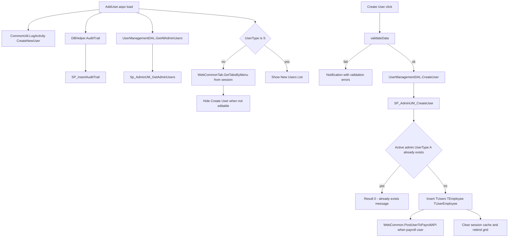
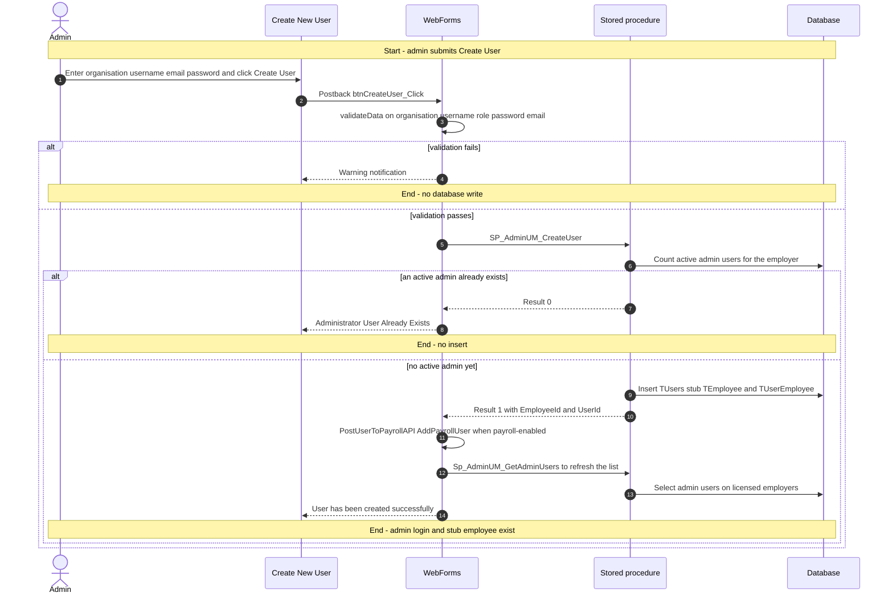
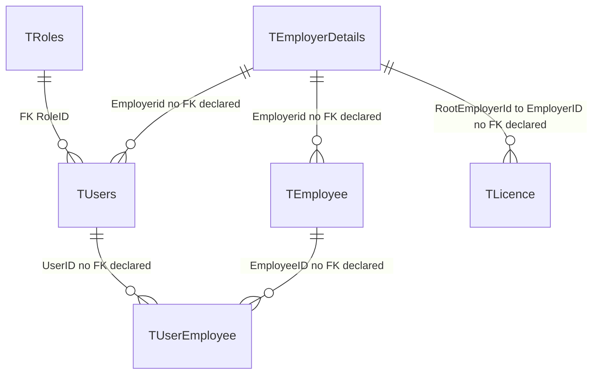

# Create New User

## Overview

An administrator opens **Admin Configuration → User Management → Create New User** when an organisation still has no active administrator login. They pick the organisation (when they have global access), enter a user name, keep the hard-coded **Administrator** role, set email and password, and click **Create User**. On success the database inserts one `TUsers` row with `UserType` `A`, a stub `TEmployee` row whose first name is the decoded user name, and a `TUserEmployee` link. If that organisation already has an active admin user, the save is refused and the page shows that an administrator already exists.

Super admins also see a **New Users List** grid of admin accounts on licensed organisations. Non-super-admin users only keep the Create User button when their tab grant for this menu is editable.

There is no SystemModel-2 page for this screen in the SourceCode tree that was searched. Identity vs person is summarized in `llm-wiki/domain/overview.md` and `llm-wiki/domain/concept-map.md` (`TUsers`, `TRoles`, `TUserEmployee`, `TEmployee`). Password handling stays in the app tier per `llm-wiki/domain/external-logic.md`.

## Workflow

## Request journey

## Entry points

The breadcrumb on the page is Home / Admin Configuration / UserManagement / Create New User. The page class is `HRMS.Web.AddUser`.

| Entry point | Purpose | Live? |
|---|---|---|
| `HRM/UserManagement/AddUser.aspx` (`~/HRM/UserManagement/AddUser.aspx`) | Create the first admin user for an organisation and list admin users for super admins | Yes |

No React screen and no `PageMethod` or `fetch` call implement this form. The User Role combo is a single hard-coded item **Administrator** with value `1` in the aspx markup.

## Code → database call chain

| Entry | Method | Stored procedure |
|---|---|---|
| Load | `CommonUtil.LogActivity` from `AddUser.aspx.cs:36` → `ActivityHelper.LogActivity` (`ActivityHelper.cs:32`) | `Sp_InsertActivityLog` |
| Load | `DBHelper.AuditTrail` (`DBHelper.cs:218`) from `AddUser.aspx.cs:41` | `SP_InsertAuditTrail` |
| Load / org change / after create / grid need-data | `UserManagementDAL.GetAllAdminUsers` (`UserManagementDAL.cs:30`) from `AddUser.aspx.cs:175` | `Sp_AdminUM_GetAdminUsers` |
| Org combo (global access control) | `WebCommon.GetGlobalAccessEmployerList` (`Web.Common.cs:547`) → `DBHelper.GetGlobalAccessEmployerList` (`DBHelper.cs:3195`) from `ucGlobalAccessEmployer.ascx.cs:251` | `SP_GetGlobalAccessEmployerList` |
| Non-super-admin Create button visibility | `WebCommonTab.GetTabsByMenu` (`Web.Common.Tab.cs:59`) from `AddUser.aspx.cs:121` | Session only (`TAB_BY_ROLE` / `TAB_BY_USER`) — no procedure on this postback |
| Create | `UserManagementDAL.CreateUser` (`UserManagementDAL.cs:12`) from `AddUser.aspx.cs:152` | `SP_AdminUM_CreateUser` |

`SP_AdminUM_CreateUser` then calls `Sp_OpenEncryptionKeys`, `Fn_EncryptData`, `FN_ConvertBase64ToSTR`, and `SP_CloseEncryptionKey`. `Sp_AdminUM_GetAdminUsers` calls `FN_ConvertBase64ToSTR`.

## API endpoints

The screen is a WebForms postback. It does not expose an HTTP API for create or for the admin list.

After a successful create, `WebCommon.PostUserToPayrollAPI` (`Web.Common.cs:483`) runs only when `IsValidPayrollUser()` is true. That path builds a payroll model and posts to the payroll host.

| Verb | Route | Parameters | Purpose | Source |
|---|---|---|---|---|
| POST | `{payroll host}/api/Payroll/PostData` | User id, employer id, new employee id, logged-in employee id, event `AddPayrollUser` | Tell payroll that an admin user was added | `WebAPIClient.cs:133` and `WebAPIClient.cs:192` |

## Stored procedures & tables involved

The page constant for create is `SP_AdminUM_CreateUser` (`DBConstant.cs:691`). The list constant is `Sp_AdminUM_GetAdminUsers` (`DBConstant.cs:693`). An older `SP_CreateUser.sql` still exists; this page does not call it.

| Object | Script | Purpose |
|---|---|---|
| `SP_AdminUM_CreateUser` | `HRMS-DATABASE/HRMS/STOREPROCEDURE/SP_AdminUM_CreateUser.sql` | Insert the first active admin user, stub employee, and user-employee link |
| `Sp_AdminUM_GetAdminUsers` | `HRMS-DATABASE/HRMS/STOREPROCEDURE/Sp_AdminUM_GetAdminUsers.sql` | List admin users on organisations under an active licence |
| `SP_InsertAuditTrail` | `HRMS-DATABASE/HRMS/STOREPROCEDURE/SP_InsertAuditTrail.sql` | Page-open audit row |
| `Sp_InsertActivityLog` | `HRMS-DATABASE/HRMS/STOREPROCEDURE/Sp_InsertActivityLog.sql` | Activity row for opening Create New User |
| `SP_GetGlobalAccessEmployerList` | `HRMS-DATABASE/HRMS/STOREPROCEDURE/SP_GetGlobalAccessEmployerList.sql` | Organisation combo for global-access users |

`TUsers`, `TUserEmployee`, and related identity tables are summarized in `llm-wiki/reference/tables/hrms.md`. Declared role FK and user↔employee convention edges are in `llm-wiki/domain/concept-map.md` and `llm-wiki/domain/invariants.md`.

## Table relationships

`TUsers.RoleID` references `TRoles.RoleID` (`TUsers.sql:24`). `TUserEmployee` declares no foreign keys. `TEmployee.Employerid` and `TUsers.Employerid` have no FK to `TEmployerDetails` in those table scripts. `TLicence` is created in a work-item DDL script with no foreign key to `TEmployerDetails`. `llm-wiki/domain/concept-map.md` draws wider identity edges by convention; those extra edges are not repeated as enforced keys here.

## Known gaps

- `docs/SystemModels/SystemModel-2/` has no page naming this screen in the SourceCode tree that was searched.
- The User Role combo is hard-coded to **Administrator** / value `1` in `AddUser.aspx`. Create does not load `TRoles` for the selected employer.
- Page code treats the first result column as `Isduplicate`, but `SP_AdminUM_CreateUser` returns `1` on insert success and `0` when an admin already exists, so the variable name is inverted relative to the procedure result.
- Create inserts a stub `TEmployee` (decoded user name as `FName`, blank last name, placeholder DOB and address fields). It does not run the normal employee-creation procedures.
- `Sp_AdminUM_GetAdminUsers.sql` begins with `USE [HRM-CL-Prod]`. Liquibase deploy context should not rely on that database name.
- `TLicence` has no inventoried `TABLES/TLicence.sql`; the create script lives under `DML/95707/` and declares no FK.
- Older `SP_CreateUser.sql` remains in the database tree. The live DAL constant is `SP_AdminUM_CreateUser`.
- Tab permission for non-super-admins reads session caches only on this page; those caches are loaded elsewhere at login, not by a procedure invoked from `AddUser.aspx.cs`.

## Reference

Confidence is medium. The postback, DAL procedure names, and inventoried scripts agree. Gaps above are hard-coded role value, inverted success flag naming, stub employee shape, and missing SystemModel-2 / `TLicence` table inventory.

### SourceCode

- `HRMS.Web/HRMS.Web/HRM/UserManagement/AddUser.aspx`
- `HRMS.Web/HRMS.Web/HRM/UserManagement/AddUser.aspx.cs`
- `HRMS.Shared/HRMS.DataAccessLayer/UserManagement/UserManagementDAL.cs`
- `HRMS.Shared/HRMS.DataAccessLayer/DBConstant.cs`
- `HRMS.Shared/HRMS.DataAccessLayer/DBHelper.cs`
- `HRMS.Shared/TDG.ActivityAuditLog/DAL/ActivityHelper.cs`
- `HRMS.Web/HRMS.Web/Common/Web.Common.cs`
- `HRMS.Web/HRMS.Web/Common/Web.Common.Tab.cs`
- `HRMS.Web/HRMS.Web/Common/WebAPIClient.cs`
- `HRMS.Web/HRMS.Web/HRM/CustomControls/ucGlobalAccessEmployer.ascx.cs`

### TDG HRMS DB

- `HRMS-DATABASE/HRMS/STOREPROCEDURE/SP_AdminUM_CreateUser.sql`
- `HRMS-DATABASE/HRMS/STOREPROCEDURE/Sp_AdminUM_GetAdminUsers.sql`
- `HRMS-DATABASE/HRMS/STOREPROCEDURE/SP_InsertAuditTrail.sql`
- `HRMS-DATABASE/HRMS/STOREPROCEDURE/Sp_InsertActivityLog.sql`
- `HRMS-DATABASE/HRMS/STOREPROCEDURE/SP_GetGlobalAccessEmployerList.sql`
- `HRMS-DATABASE/HRMS/STOREPROCEDURE/SP_CreateUser.sql` (legacy; not called by this page)
- `HRMS-DATABASE/HRMS/TABLES/TUsers.sql`
- `HRMS-DATABASE/HRMS/TABLES/TUserEmployee.sql`
- `HRMS-DATABASE/HRMS/TABLES/TEmployee.sql`
- `HRMS-DATABASE/HRMS/TABLES/TRoles.sql`
- `HRMS-DATABASE/HRMS/TABLES/TEmployerDetails.sql`
- `HRMS-DATABASE/HRMS/DML/95707/2.DDL  - TLicence, TLicenceHistory, TEmployerModule,TEmployerModuleHistory.sql`
- `llm-wiki/domain/overview.md`
- `llm-wiki/domain/concept-map.md`
- `llm-wiki/domain/invariants.md`
- `llm-wiki/domain/external-logic.md`
- `llm-wiki/reference/tables/hrms.md`
