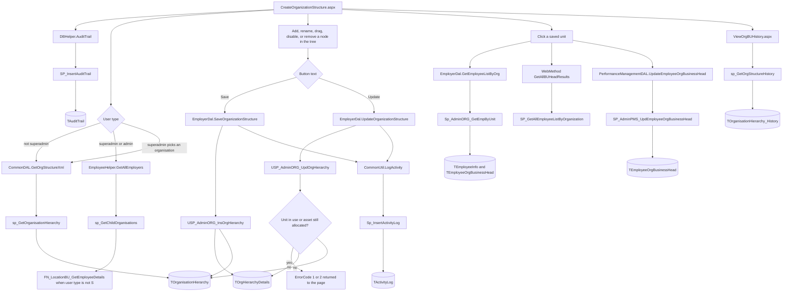
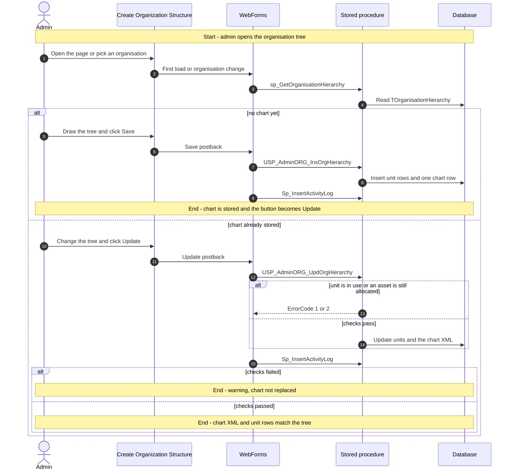
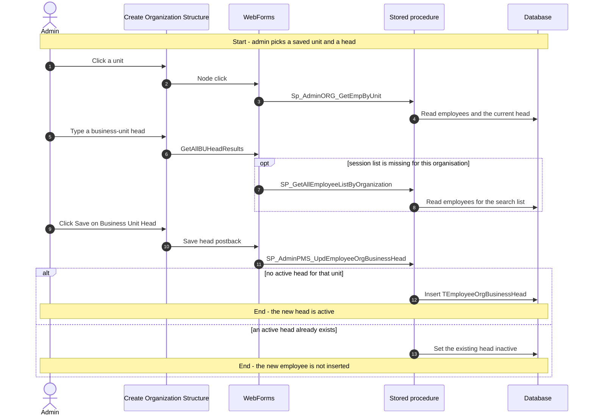
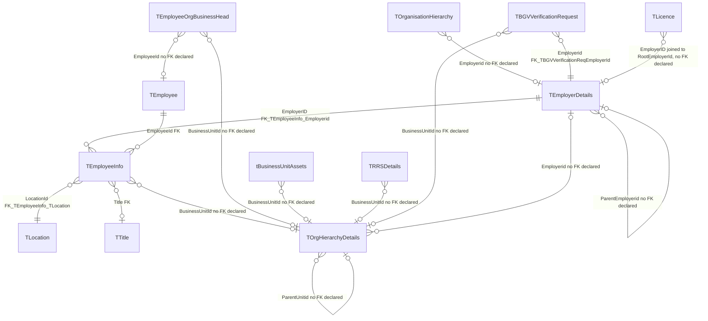

# Create Organization Structure

## Overview

An organisation administrator needs the company drawn as a tree of business units so later screens can put an employee, a recruitment request, or a background check on one unit. They open **Create Organization Structure**, add and rename nodes, drag them under a new parent, and save. The first save stores the Telerik tree as XML and creates one unit row per new node. Later saves update that same chart. Clicking a saved unit lists the people on it and lets the administrator name a business-unit head. **View History** opens a popup of earlier chart XML.

A superadmin picks which organisation to edit. An organisation admin is locked to the organisation already selected in the global employer bar. Someone whose role is not allowed to edit the menu still sees the tree, and the Save button is hidden. Removing the root node is blocked on the page. Removing any other saved unit is only stored when they click Update, and the database refuses the delete when that unit is already used.

`docs/SystemModels/SystemModel-2` has no workflow or context page for this screen. The table catalog in `llm-wiki/reference/tables/hrms.md` describes `TOrganisationHierarchy` and `TOrgHierarchyDetails`. The glossary's `TBusinessUnit` is a different master. This page writes the hierarchy tables, not `TBusinessUnit`.

## Workflow

New nodes stay as `<UnitN>` tokens in the browser until Save or Update. The insert and update procedures replace those tokens with `TOrgHierarchyDetails` identity values inside the XML. Disable and remove change the tree immediately, and they are written only when Update runs. A duplicate unit name is rejected in the page's in-memory list before the database is called.

## Request journey

### Save or update the tree

### Assign a business-unit head

## Entry points

The live screen is the WebForms page named in `HRMSConstants.URLs.URL_ORGANIZATION_CREATE_STRUCTURE`. Breadcrumb text on the page is Home / Admin Configuration / Organization Setup / Create Organization Structure. No React page posts to this screen. `HRMS.CoreAPI` has dashboard routes named `getBusinessUnitHeadDetails`. This page does not call them.

| Entry | Purpose |
|---|---|
| `~/HRM/Organization/CreateOrganizationStructure.aspx` | Draw, save, and update the tree. List employees on a unit and set its head |
| `CreateOrganizationStructure.aspx/GetAllBUHeadResults` | Telerik search-box web method for the head typeahead |
| `~/HRM/Organization/ViewOrgBUHistory.aspx` | Popup opened by View History. Reads history XML and the current chart. Drag handlers on that popup do not post a save |

## Code → database call chain

Editability uses `WebCommonTab.GetTabsByMenu` (`Web.Common.Tab.cs:59`), which filters tab lists already in session. That call does not execute a procedure.

| Step | Entry point | App code | Stored procedure |
|---|---|---|---|
| Record the page open | `CreateOrganizationStructure.aspx.cs:61` | `DBHelper.AuditTrail` (`DBHelper.cs:218`) | `SP_InsertAuditTrail` |
| Load the tree for a non-superadmin | `CreateOrganizationStructure.aspx.cs:284` → `bindOrgnizationTree` (`:530`) | `CommonDAL.GetOrgStructureXml` (`CommonDAL.cs:504`) | `sp_GetOrganisationHierarchy` |
| Load the tree after a superadmin picks an organisation | `CreateOrganizationStructure.aspx.cs:198` → `setOrganization` (`:351`) | `CommonDAL.GetOrgStructureXml` (`CommonDAL.cs:504`) | `sp_GetOrganisationHierarchy` |
| Fill Select Organization | `CreateOrganizationStructure.aspx.cs:332` and `:340` | `EmployeeHelper.GetAllEmployers` (`EmployeeHelper.cs:24` or `:34`) | `sp_GetChildOrganisations` |
| First save | `CreateOrganizationStructure.aspx.cs:404` | `EmployerDal.SaveOrganizationStructure` (`EmployerDAL.cs:523`). The constant `sp_InsertOrganisationHierarchy` is `USP_AdminORG_InsOrgHierarchy` (`DBConstant.cs:455`) | `USP_AdminORG_InsOrgHierarchy` |
| Later update | `CreateOrganizationStructure.aspx.cs:432` | `EmployerDal.UpdateOrganizationStructure` (`EmployerDAL.cs:536`). The constant `sp_UpdateOrganisationHierarchy` is `USP_AdminORG_UpdOrgHierarchy` (`DBConstant.cs:456`) | `USP_AdminORG_UpdOrgHierarchy` |
| Activity row after save or update | `CreateOrganizationStructure.aspx.cs:405` and `:435` | `CommonUtil.LogActivity` (`Common.cs:52`) → `ActivityHelper.LogActivity` (`ActivityHelper.cs:32`). Activity types 59 and 60 (`Enums.cs:119`) | `Sp_InsertActivityLog` |
| Employees and current head for a node | `CreateOrganizationStructure.aspx.cs:183` and `:591`, also the postback reload at `:78` | `EmployerDal.GetEmployeeListByOrg` (`EmployerDAL.cs:554`). Constant `sp_GetEmployeeByUnit` (`DBConstant.cs:457`) | `Sp_AdminORG_GetEmpByUnit` |
| Head typeahead | `CreateOrganizationStructure.aspx:98` → `GetAllBUHeadResults` (`CreateOrganizationStructure.aspx.cs:710`) | `CommonDAL.GetAllEmployeeListForEmployeeCreation` (`CommonDAL.cs:556`), skipped when the session list is already for this organisation | `SP_GetAllEmployeeListByOrganization` |
| Save the head | `CreateOrganizationStructure.aspx.cs:800` | `PerformanceManagementDAL.UpdateEmployeeOrgBusinessHead` (`PerformanceManagementDAL.cs:2366`). `IsActive` is passed as 1 | `SP_AdminPMS_UpdEmployeeOrgBusinessHead` |
| History popup | `CreateOrganizationStructure.aspx:210` → `ViewOrgBUHistory.aspx.cs:123` | `CommonDAL.GetOrgStructureHistory` (`CommonDAL.cs:530`) | `sp_GetOrgStructureHistory` |
| Current chart inside the history popup | `ViewOrgBUHistory.aspx.cs:131` | `CommonDAL.GetOrgStructureXml` (`CommonDAL.cs:504`) | `sp_GetOrganisationHierarchy` |

`CommonDAL.GetCreateRoleOrgStructureXml` (`CommonDAL.cs:478`) calls the different name `usp_GetOrganisationHierarchy`. Create Organization Structure does not use that method.

## API endpoints

This screen does not call `HRMS.CoreAPI`. Save, update, organisation change, node click, remove, and business-unit head save are WebForms postbacks inside `RadAjaxPanel` on `CreateOrganizationStructure.aspx`. The only page method is the Telerik search web service.

| Verb | Route | Parameters | Purpose | Source |
|---|---|---|---|---|
| POST | `CreateOrganizationStructure.aspx/GetAllBUHeadResults` | `context` (`SearchBoxContext`, required). The method keeps items whose text contains `context.Text` | Business-unit head typeahead | `CreateOrganizationStructure.aspx:98`, `CreateOrganizationStructure.aspx.cs:710` |

View History is a browser popup to `ViewOrgBUHistory.aspx` with query `EmployerId` (encrypted on `CreateOrganizationStructure.aspx.cs:826`) plus `q=CreateNew` and `IsPopup=1`. That popup posts back only to rebind its grid and tree.

## Stored procedures & tables involved

Pages linked below are the Backstage database write-ups. `llm-wiki/reference/tables/hrms.md` is the catalog for the tables. It records no foreign key on `TOrganisationHierarchy`, `TOrgHierarchyDetails`, `TEmployeeOrgBusinessHead`, `tBusinessUnitAssets`, or `TRRSDetails`. `TLicence` is not in that catalog.

| Object | File | Purpose | Wiki |
|---|---|---|---|
| `sp_GetOrganisationHierarchy` | `HRMS-DATABASE/HRMS/STOREPROCEDURE/sp_GetOrganisationHierarchy.sql` | Chart XML, transaction id, and highest unit id | [page](/docs/database/hrms/sp_GetOrganisationHierarchy). Tables in `llm-wiki/reference/tables/hrms.md` |
| `sp_GetChildOrganisations` | `HRMS-DATABASE/HRMS/STOREPROCEDURE/sp_GetChildOrganisations.sql` | Organisations for the parent combo | [page](/docs/database/hrms/sp_GetChildOrganisations) |
| `FN_LocationBU_GetEmployeeDetails` | `HRMS-DATABASE/HRMS/FUNCTIONS/FN_LocationBU_GetEmployeeDetails.sql` | Employer scope for a non-superadmin combo | [page](/docs/database/hrms/FN_LocationBU_GetEmployeeDetails) |
| `USP_AdminORG_InsOrgHierarchy` | `HRMS-DATABASE/HRMS/STOREPROCEDURE/USP_AdminORG_InsOrgHierarchy.sql` | First insert of units and chart XML | [page](/docs/database/hrms/USP_AdminORG_InsOrgHierarchy) |
| `USP_AdminORG_UpdOrgHierarchy` | `HRMS-DATABASE/HRMS/STOREPROCEDURE/USP_AdminORG_UpdOrgHierarchy.sql` | Update, with in-use checks | [page](/docs/database/hrms/USP_AdminORG_UpdOrgHierarchy) |
| `Sp_AdminORG_GetEmpByUnit` | `HRMS-DATABASE/HRMS/STOREPROCEDURE/Sp_AdminORG_GetEmpByUnit.sql` | Employees and the current head for one unit | [page](/docs/database/hrms/Sp_AdminORG_GetEmpByUnit) |
| `SP_GetAllEmployeeListByOrganization` | `HRMS-DATABASE/HRMS/STOREPROCEDURE/SP_GetAllEmployeeListByOrganization.sql` | Head search list | [page](/docs/database/hrms/SP_GetAllEmployeeListByOrganization) |
| `SP_AdminPMS_UpdEmployeeOrgBusinessHead` | `HRMS-DATABASE/HRMS/STOREPROCEDURE/SP_AdminPMS_UpdEmployeeOrgBusinessHead.sql` | Insert a head, or deactivate the current one | [page](/docs/database/hrms/SP_AdminPMS_UpdEmployeeOrgBusinessHead) |
| `sp_GetOrgStructureHistory` | `HRMS-DATABASE/HRMS/STOREPROCEDURE/sp_GetOrgStructureHistory.sql` | History rows for the popup | [page](/docs/database/hrms/sp_GetOrgStructureHistory) |
| `SP_InsertAuditTrail` | `HRMS-DATABASE/HRMS/STOREPROCEDURE/SP_InsertAuditTrail.sql` | Page-open audit row | [page](/docs/database/hrms/SP_InsertAuditTrail) |
| `Sp_InsertActivityLog` | `HRMS-DATABASE/HRMS/STOREPROCEDURE/Sp_InsertActivityLog.sql` | Save and update activity row | [page](/docs/database/hrms/Sp_InsertActivityLog) |

Nested objects that already had pages, and were not rewritten, are `Sp_OpenEncryptionKeys`, `SP_CloseEncryptionKey`, `Fn_GetEmployeeName`, and `Fn_DecryptData`.

## Table relationships

Declared foreign keys are taken from the table scripts. Joins the procedures use without a foreign key are labelled that way. `llm-wiki/reference/tables/hrms.md` omits self-referential foreign keys, so the self-key on `TEmployerDetails.Employerid` is cited from the script rather than from the wiki. `ParentEmployerid` and `RootEmployerId` have no foreign key in that script. No script under `HRMS-DATABASE/HRMS` was found that references `TOrgHierarchyDetails` or `TOrganisationHierarchy`.

`TOrganisationHierarchy_History` is what `sp_GetOrgStructureHistory` reads. No `CREATE TABLE` for it was found under `TABLES/`, and the live update procedure does not insert into it. `TBusinessUnit` in `llm-wiki/glossary/ubiquitous-language.md` is not a table this page writes.

## Known gaps

- **History is not written by the procedure this page calls.** `EmployerDal.UpdateOrganizationStructure` executes `USP_AdminORG_UpdOrgHierarchy`, which updates `TOrganisationHierarchy` and does not insert `TOrganisationHierarchy_History`. The older scripts `Sp_AdminORG_UpdOrgHierarchy.sql` and `sp_UpdateOrganisationHierarchy.sql` do insert history. View History reads only the history table, so a change made on this page is not what that popup selects.
- **Replacing a business-unit head does not insert the new person.** `SP_AdminPMS_UpdEmployeeOrgBusinessHead` deactivates the current active row when one exists, and inserts only in the other branch. Both branches select `ErrorCode` 1. The page treats `ErrorCode` 2 as "head not found" (`CreateOrganizationStructure.aspx.cs:801`). This procedure never selects 2, so the page shows "Business Unit Head is Updated" for both outcomes.
- **`TOrgHierarchyDetails.sql` does not declare the audit columns the procedures write.** `CreatedBy`, `CreatedWhen`, `UpadtedBy`, and `UpdatedWhen` are added in `DML/73302/DML - TOrgHierarchyDetails - CreatedBy,CreatedWhen,UpadtedBy,UpdatedWhen.sql`. The column name `UpadtedBy` is spelled that way in the DML and in both USP scripts. The create script also has no primary key.
- **New-unit order is a string sort.** Insert numbers `#NewBUs` by `TextVersionUnitId`. Update numbers them by `UnitName`. A child token can be inserted before its parent token has an identity, so `ParentUnitid` is saved null.
- **`sp_GetOrganisationHierarchy` has no `ORDER BY`.** The page uses the first row. A second Save inserts another chart row for the same employer. The procedure does not stop that.
- **`LastNodeValue` is the highest numeric `UnitID`.** After a load, `getNewNodeValue` (`CreateOrganizationStructure.aspx.cs:648`) only increments a `<UnitN>` token. A numeric last id makes the next new node `<Unit1>` again.
- **Unsaved nodes and the employee list.** A non-superadmin node whose value contains "unit" is queried as unit `0` (`CreateOrganizationStructure.aspx.cs:603`). A superadmin click passes the raw node value into `Sp_AdminORG_GetEmpByUnit`, whose `@UnitId` is `INT`. Saving a head on a token that still contains a letter is blocked on the page before the procedure (`:789`).
- **Name uniqueness is only on the page.** `BusinessUnits` is a static list (`CreateOrganizationStructure.aspx.cs:27`). The unit table script has no unique key on `UnitName`.
- **Sibling procedure names.** `STOREPROCEDURE/Sp_AdminORG_InsOrgHierarchy.sql` and `Sp_AdminORG_UpdOrgHierarchy.sql` are not the strings in `DBConstant.cs`. The page runs the `USP_AdminORG_*` scripts.
- **`sp_GetChildOrganisations.sql` begins with `USE [HRM-CL-Prod]`.** The non-superadmin branch calls `FN_LocationBU_GetEmployeeDetails`. The superadmin branch has that call commented out.
- **`@active` on `SP_GetAllEmployeeListByOrganization` is unused.** The page passes only `organizationId`, so `@departmentID` stays 0.
- **Insert and update run at `READ UNCOMMITTED` with no transaction** around the unit loop and the chart write.
- **`usp_GetOrganisationHierarchy`** is a separate string used by role setup (`CommonDAL.GetCreateRoleOrgStructureXml`). It is not this page's load.

## Reference

Confidence is **medium**. The page, the DAL methods, and the procedure bodies were read. The history popup and the head-update procedure do not do what the button labels suggest, and several unit links have no foreign key. `docs/SystemModels/SystemModel-2` has no page that names this screen. Nothing was committed.

### SourceCode

- `HRMS.Web/HRMS.Web/HRM/Organization/CreateOrganizationStructure.aspx`
- `HRMS.Web/HRMS.Web/HRM/Organization/CreateOrganizationStructure.aspx.cs`
- `HRMS.Web/HRMS.Web/HRM/Organization/ViewOrgBUHistory.aspx.cs`
- `HRMS.Shared/HRMS.DataAccessLayer/Employer/EmployerDAL.cs`
- `HRMS.Shared/HRMS.DataAccessLayer/CommonDAL.cs`
- `HRMS.Shared/HRMS.DataAccessLayer/DBConstant.cs`
- `HRMS.Shared/HRMS.DataAccessLayer/EmployeeHelper.cs`
- `HRMS.Shared/HRMS.DataAccessLayer/ConfirmationAndPerformance/PerformanceManagementDAL.cs`
- `HRMS.Shared/HRMS.DataAccessLayer/DBHelper.cs`
- `HRMS.Shared/HRMS.Common/Common.cs`
- `HRMS.Shared/TDG.ActivityAuditLog/DAL/ActivityHelper.cs`
- `HRMS.Shared/HRMS.DataContract/Common/Constants.cs`
- `HRMS.Shared/HRMS.DataContract/Common/Enums.cs`
- `HRMS.Web/HRMS.Web/Common/Web.Common.Tab.cs`

### TDG HRMS DB

- `llm-wiki/reference/tables/hrms.md` (`TOrganisationHierarchy`, `TOrgHierarchyDetails`, `TEmployeeOrgBusinessHead`, `tBusinessUnitAssets`, `TEmployerDetails`, `TBusinessUnit`)
- `llm-wiki/glossary/ubiquitous-language.md`
- `HRMS-DATABASE/HRMS/STOREPROCEDURE/USP_AdminORG_InsOrgHierarchy.sql`
- `HRMS-DATABASE/HRMS/STOREPROCEDURE/USP_AdminORG_UpdOrgHierarchy.sql`
- `HRMS-DATABASE/HRMS/STOREPROCEDURE/Sp_AdminORG_GetEmpByUnit.sql`
- `HRMS-DATABASE/HRMS/STOREPROCEDURE/sp_GetOrganisationHierarchy.sql`
- `HRMS-DATABASE/HRMS/STOREPROCEDURE/SP_GetAllEmployeeListByOrganization.sql`
- `HRMS-DATABASE/HRMS/STOREPROCEDURE/SP_AdminPMS_UpdEmployeeOrgBusinessHead.sql`
- `HRMS-DATABASE/HRMS/STOREPROCEDURE/sp_GetChildOrganisations.sql`
- `HRMS-DATABASE/HRMS/STOREPROCEDURE/sp_GetOrgStructureHistory.sql`
- `HRMS-DATABASE/HRMS/STOREPROCEDURE/SP_InsertAuditTrail.sql`
- `HRMS-DATABASE/HRMS/STOREPROCEDURE/Sp_InsertActivityLog.sql`
- `HRMS-DATABASE/HRMS/FUNCTIONS/FN_LocationBU_GetEmployeeDetails.sql`
- `HRMS-DATABASE/HRMS/TABLES/TOrganisationHierarchy.sql`
- `HRMS-DATABASE/HRMS/TABLES/TOrgHierarchyDetails.sql`
- `HRMS-DATABASE/HRMS/TABLES/TEmployeeOrgBusinessHead.sql`
- `HRMS-DATABASE/HRMS/TABLES/TEmployeeInfo.sql`
- `HRMS-DATABASE/HRMS/TABLES/TEmployerDetails.sql`
- `HRMS-DATABASE/HRMS/TABLES/TBGVVerificationRequest.sql`
- `HRMS-DATABASE/HRMS/DML/73302/DML - TOrgHierarchyDetails - CreatedBy,CreatedWhen,UpadtedBy,UpdatedWhen.sql`
- `HRMS-DATABASE/HRMS/DML/95707/2.DDL  - TLicence, TLicenceHistory, TEmployerModule,TEmployerModuleHistory.sql`
