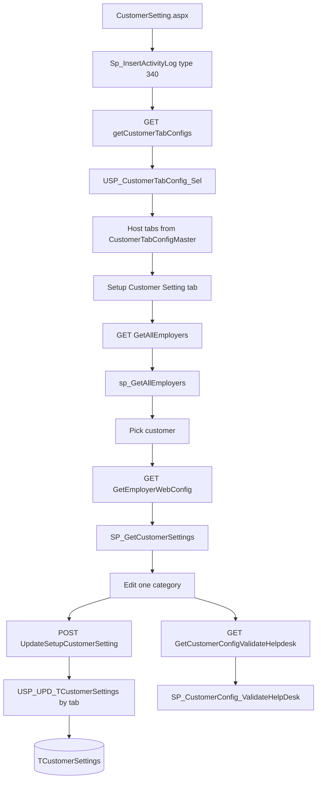
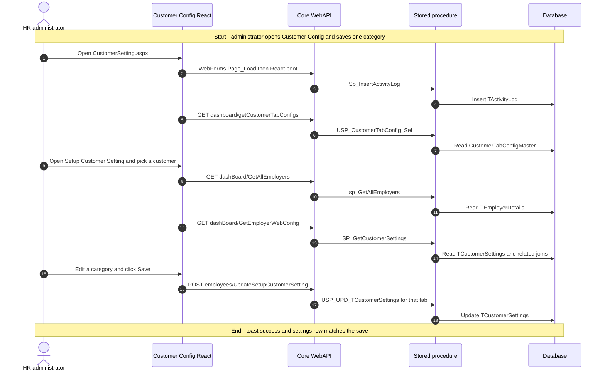
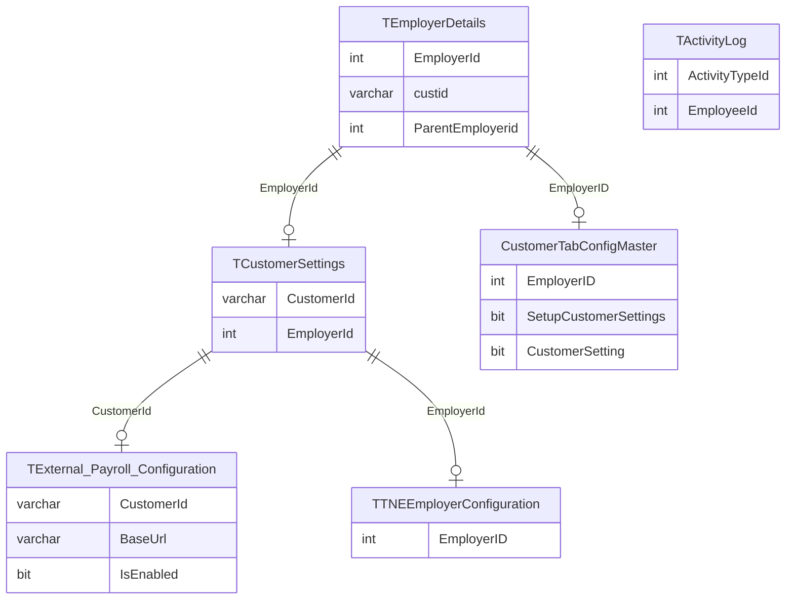

# Customer Config

## Overview

An HR administrator opens **Admin Configuration → Customer Config** (`~/HRM/DashBoard_React/CustomerSetting.aspx`) to turn product features on or off for one customer. The WebForms host only logs activity `CustomerConfig` (type 340), injects session hidden fields, and loads the `dashboard_react` bundle. React mounts the Customer Config shell. On load it reads which host tabs are enabled for the signed-in employer (`USP_CustomerTabConfig_Sel`) and stores the Business Unit label (`USP_TR_GetCustomizeLabel` via synonym).

The story this guide follows is the **Setup Customer Setting** host tab. That tab mounts `CustomerSettingCategory`: the administrator picks a customer from `sp_GetAllEmployers`, loads the full settings row with `SP_GetCustomerSettings` (`GetEmployerWebConfig`), edits one vertical category (Auth, Employee Management, Master / Retirement, External Payroll, Feature, LMS, Recruitment, L&A, ESS, T&E, Pre-Onboarding, Mobile, Third Party, Meeting Integrations, Advance, Celebration Hub), and saves. Save posts to `POST /api/employees/UpdateSetupCustomerSetting` with a `tab` key. The handler runs the matching `USP_UPD_TCustomerSettings_*` procedure. LMS may also call `Sp_MQB_ApplyGlobalRatingScaleToEvaluationQuestions` after a fixed rating-scale change. ESS help-desk options call `SP_CustomerConfig_ValidateHelpDesk` before the save is allowed when open tickets would conflict.

Other host tabs (Show and Hide Tabs, Hive / Customer Setting payroll, Mobile Customer, copy utilities, unlock account, and the rest) share this page and are listed under Known gaps.

**Who's involved:**

- **HR administrator** — chooses a customer and saves per-category feature flags.
- **Employee** — does not open this screen. Runtime features later read `TCustomerSettings`.

## Workflow

## Request journey

## Entry points

| Entry | Purpose |
|---|---|
| `~/HRM/DashBoard_React/CustomerSetting.aspx` | Left-nav Customer Config host. React route `RouteConstants.CUSTOMER_CONFIG`. |
| `Areas/CustomerSetting/Container/CustomerSetting.js` | Host tab strip driven by `USP_CustomerTabConfig_Sel`. |
| `Areas/CustomerSetting/Components/CustomerSettingCategories/*` | Setup Customer Setting UI (customer picker + vertical categories). |

## Code → database call chain

| Entry | Method | Database |
|---|---|---|
| Every page load, `CustomerSetting.aspx.cs:23` | `CommonUtil.LogActivity` (`Common.cs:52`) → `LogUserActivity.LogActivity` (`LogUserActivity.cs:36`) → `ActivityHelper.LogActivity` (`ActivityHelper.cs:32`) | `Sp_InsertActivityLog`. Activity type `CustomerConfig` = 340 (`Enums.cs:283`). |
| Host boot, `CustomerSetting.js:78` | `DashBoardController.GetCustomerTabConfigs` (`dashboardController.js:1865`) → `GetCustomerTabConfigs` (`dashBoardDAL.js:3051`) | `USP_CustomerTabConfig_Sel` |
| Host boot, `CustomerSetting.js:132` | `DashBoardController.GetLabelDetails` (`dashboardController.js:4048`) → `GetLabelDetails` (`dashBoardDAL.js:6122`) | `USP_TR_GetCustomizeLabel` (synonym only in this checkout) |
| Customer list, `CustomerSettingsContext.js:89` | `DashBoardController.GetAllEmployers` (`dashboardController.js:844`) → `GetAllEmployers` (`dashBoardDAL.js:882`) | `sp_GetAllEmployers` |
| Load settings, `CustomerList.js:27` | `DashBoardController.GetEmployerWebConfig` (`dashboardController.js:1096`) → `GetEmployerWebConfig` (`dashBoardDAL.js:1075`) | `SP_GetCustomerSettings` |
| Save category, `CustomerSettingsContext.js:175` / `SettingTab.js:439` | `UpdateSetupCustomerSetting` (`Handlers/UpdateSetupCustomerSetting.js:84`) → `PROCEDURE_BY_TAB` | `USP_UPD_TCustomerSettings_Auth`, `_EmployeeManagement`, `_Master` (also retirement), `_ExternalPayroll`, `_Feature`, `_LMS`, `_Recruitment`, `_LNA`, `_ESS`, `_TNE`, `_PreOnboarding`, `_Mobile`, `_ThirdPartyApps`, `_MeetingIntegrations`, `_Advance`, `_CelebrationHub` |
| LMS Teams gate, `UpdateSetupCustomerSetting.js:445` | status check before LMS save when Teams is on | `USP_GET_TCustomerSettings_MeetingIntegrationsStatus` |
| LMS rating apply, `CustomerSettingsContext.js:124` | `ApplyGlobalRatingScale` (`Handlers/ApplyGlobalRatingScale.js:47`) | `Sp_MQB_ApplyGlobalRatingScaleToEvaluationQuestions` |
| ESS help-desk check, custom ESS fields | `DashBoardController.GetCustomerConfigValidateHelpdesk` (`dashboardController.js:3202`) → `GetCustomerConfigValidateHelpdesk` (`dashBoardDAL.js:4521`) | `SP_CustomerConfig_ValidateHelpDesk` |

T&E save also updates `TTNEEmployerConfiguration` inside `USP_UPD_TCustomerSettings_TNE` and attempts `USP_SaveHistory` (script not present under `HRMS/STOREPROCEDURE` in this checkout).

## API endpoints

No WebForms postback for settings. The host is WebForms; the Setup Customer Setting tab calls Core Node API.

| Verb | Route | Parameters | Purpose | Source |
|---|---|---|---|---|
| GET | `api/dashboard/getCustomerTabConfigs` | `employerId` int | Which host tabs are visible | `DashBoardRoutes.js:148` |
| GET | `api/dashboard/GetLabelDetails` | `employerId` int | Business Unit label text | `dashboardController.js:4048` |
| GET | `api/dashBoard/GetAllEmployers` | `superId` optional | Customer / employer picker | `dashboardController.js:844` |
| GET | `api/dashBoard/GetEmployerWebConfig` | `CustomerId` string | Full settings row | `dashboardController.js:1096` |
| POST | `api/employees/UpdateSetupCustomerSetting` | body `tab`, `customerId`, `employeeId`, `customerSettingObject` | Save one category | `Features/Employer/Settings/routes.js:50` |
| GET | `api/dashBoard/GetCustomerConfigValidateHelpdesk` | `EmployerId`, `HelpDeskRequestAssign`, `MapHelpdeskActivityOwner` | Block ESS help-desk change when open tickets exist | `DashBoardRoutes.js:281` |
| POST | `api/employees` Apply Global Rating Scale route | `customerId`, `ratingValue`, `employeeId` | Propagate fixed LMS rating scale | `ApplyGlobalRatingScale.js` |

Related but not used by this React page: `GET /api/customerSetting/restrictMultiUsers` and `getDeviceIds`.

## Stored procedures & tables involved

| Object | File | Purpose |
|---|---|---|
| [`Sp_InsertActivityLog`](/docs/database/hrms/Sp_InsertActivityLog) | `HRMS-DATABASE/HRMS/STOREPROCEDURE/Sp_InsertActivityLog.sql` | Page-load activity |
| [`USP_CustomerTabConfig_Sel`](/docs/database/hrms/USP_CustomerTabConfig_Sel) | `HRMS-DATABASE/HRMS/STOREPROCEDURE/USP_CustomerTabConfig_Sel.sql` | Host tab visibility |
| [`sp_GetAllEmployers`](/docs/database/hrms/sp_GetAllEmployers) | `HRMS-DATABASE/HRMS/STOREPROCEDURE/sp_GetAllEmployers.sql` | Customer picker |
| [`SP_GetCustomerSettings`](/docs/database/hrms/SP_GetCustomerSettings) | `HRMS-DATABASE/HRMS/STOREPROCEDURE/SP_GetCustomerSettings.sql` | Load settings |
| [`USP_UPD_TCustomerSettings_Auth`](/docs/database/hrms/USP_UPD_TCustomerSettings_Auth) | `…/USP_UPD_TCustomerSettings_Auth.sql` | Auth flags |
| [`USP_UPD_TCustomerSettings_EmployeeManagement`](/docs/database/hrms/USP_UPD_TCustomerSettings_EmployeeManagement) | `…/USP_UPD_TCustomerSettings_EmployeeManagement.sql` | Employee-management flags |
| [`USP_UPD_TCustomerSettings_Master`](/docs/database/hrms/USP_UPD_TCustomerSettings_Master) | `…/USP_UPD_TCustomerSettings_Master.sql` | Master + retirement reminder |
| [`USP_UPD_TCustomerSettings_ExternalPayroll`](/docs/database/hrms/USP_UPD_TCustomerSettings_ExternalPayroll) | `…/USP_UPD_TCustomerSettings_ExternalPayroll.sql` | Payroll flags + `TExternal_Payroll_Configuration` |
| [`USP_UPD_TCustomerSettings_Feature`](/docs/database/hrms/USP_UPD_TCustomerSettings_Feature) | `…/USP_UPD_TCustomerSettings_Feature.sql` | Feature toggles |
| [`USP_UPD_TCustomerSettings_LMS`](/docs/database/hrms/USP_UPD_TCustomerSettings_LMS) | `…/USP_UPD_TCustomerSettings_LMS.sql` | LMS + rating scale |
| [`USP_UPD_TCustomerSettings_Recruitment`](/docs/database/hrms/USP_UPD_TCustomerSettings_Recruitment) | `…/USP_UPD_TCustomerSettings_Recruitment.sql` | Recruitment flags |
| [`USP_UPD_TCustomerSettings_LNA`](/docs/database/hrms/USP_UPD_TCustomerSettings_LNA) | `…/USP_UPD_TCustomerSettings_LNA.sql` | Leave and attendance flags |
| [`USP_UPD_TCustomerSettings_ESS`](/docs/database/hrms/USP_UPD_TCustomerSettings_ESS) | `…/USP_UPD_TCustomerSettings_ESS.sql` | Help-desk assign options |
| [`USP_UPD_TCustomerSettings_TNE`](/docs/database/hrms/USP_UPD_TCustomerSettings_TNE) | `…/USP_UPD_TCustomerSettings_TNE.sql` | Travel and expense JSON + employer config |
| [`USP_UPD_TCustomerSettings_PreOnboarding`](/docs/database/hrms/USP_UPD_TCustomerSettings_PreOnboarding) | `…/USP_UPD_TCustomerSettings_PreOnboarding.sql` | Pre-onboarding JSON |
| [`USP_UPD_TCustomerSettings_Mobile`](/docs/database/hrms/USP_UPD_TCustomerSettings_Mobile) | `…/USP_UPD_TCustomerSettings_Mobile.sql` | Mobile user configuration |
| [`USP_UPD_TCustomerSettings_ThirdPartyApps`](/docs/database/hrms/USP_UPD_TCustomerSettings_ThirdPartyApps) | `…/USP_UPD_TCustomerSettings_ThirdPartyApps.sql` | Meeting tokens / MMT |
| [`USP_UPD_TCustomerSettings_MeetingIntegrations`](/docs/database/hrms/USP_UPD_TCustomerSettings_MeetingIntegrations) | `…/USP_UPD_TCustomerSettings_MeetingIntegrations.sql` | Teams / Zoom / Google credentials |
| [`USP_UPD_TCustomerSettings_Advance`](/docs/database/hrms/USP_UPD_TCustomerSettings_Advance) | `…/USP_UPD_TCustomerSettings_Advance.sql` | Advance comment / reapply flags |
| [`USP_UPD_TCustomerSettings_CelebrationHub`](/docs/database/hrms/USP_UPD_TCustomerSettings_CelebrationHub) | `…/USP_UPD_TCustomerSettings_CelebrationHub.sql` | Celebration Hub enable |
| [`USP_GET_TCustomerSettings_MeetingIntegrationsStatus`](/docs/database/hrms/USP_GET_TCustomerSettings_MeetingIntegrationsStatus) | `…/USP_GET_TCustomerSettings_MeetingIntegrationsStatus.sql` | LMS Teams save gate / UI status |
| [`SP_CustomerConfig_ValidateHelpDesk`](/docs/database/hrms/SP_CustomerConfig_ValidateHelpDesk) | `…/SP_CustomerConfig_ValidateHelpDesk.sql` | ESS help-desk change guard |
| [`Sp_MQB_ApplyGlobalRatingScaleToEvaluationQuestions`](/docs/database/hrms/Sp_MQB_ApplyGlobalRatingScaleToEvaluationQuestions) | `…/Sp_MQB_ApplyGlobalRatingScaleToEvaluationQuestions.sql` | Propagate fixed rating scale |

Primary tables: `TCustomerSettings`, `TEmployerDetails`, `CustomerTabConfigMaster`, `TExternal_Payroll_Configuration`, `TTNEEmployerConfiguration`, `TActivityLog`, `TCelebrationBroadcast` / `TCelebrationAuditLog` (Celebration Hub off).

## Table relationships

`TCustomerSettings` is keyed by `CustomerId` and linked to `TEmployerDetails` by `EmployerId`. Tab visibility is per employer in `CustomerTabConfigMaster`. Payroll and T&E employer config are application-linked, not always FK-declared in the table scripts reviewed for this guide.

## Known gaps

- Other host tabs (Show and Hide Tabs, Hive Customer Setting, Setup Mobile Customer, Send Official Email, Copy Lookup Data, Search Email Notifications, Clone Dashboard Preferences, Set Country Wise Fields, Bulk Import Employee, Set Mobile App Access, Lock/Unlock User Account, Organization settings, Email Template Validation, Pre-Onboarding Settings host tab, Employment Number Update, Copy Config / Wish / Employer Module / Attendance Capture) are not fully traced here.
- Legacy `SetupCustomerSetting.js` (`USP_INS_UPD_TCustomerSettings`) is still in the tree but the Setup Customer Setting tab mounts `CustomerSettingCategory` instead.
- `USP_TR_GetCustomizeLabel` is only a synonym under `HRMS/SYNONYMS` in this checkout; no procedure body to page.
- `USP_SaveHistory` is called from `USP_UPD_TCustomerSettings_TNE` and from `Sp_MQB_ApplyGlobalRatingScaleToEvaluationQuestions`, but no `USP_SaveHistory.sql` exists under `HRMS/STOREPROCEDURE` (only MultiID / MultiFilter variants and cross-DB synonyms).
- `USP_UPD_TCustomerSettings_Master.sql` still opens with `USE [HRM-CL-Prod]`; deploy should rely on connection database context.
- SystemModel-2 has no Customer Config workflow page.
- `/api/customerSetting/restrictMultiUsers` and `getDeviceIds` are mounted but not called from this React page.

## Reference

Confidence is medium because the Setup Customer Setting load/save path was read end-to-end in SourceCode and HRMS scripts. Other host tabs were not fully traced.

### SourceCode

- `HRMS.Web/HRMS.Web/HRM/DashBoard_React/CustomerSetting.aspx`
- `HRMS.Web/HRMS.Web/HRM/DashBoard_React/CustomerSetting.aspx.cs`
- `HRMS.Web/HRMS.Web/HRM/DashBoard_React/Areas/routes.js`
- `HRMS.Web/HRMS.Web/HRM/DashBoard_React/Areas/CustomerSetting/Container/CustomerSetting.js`
- `HRMS.Web/HRMS.Web/HRM/DashBoard_React/Areas/CustomerSetting/Components/CustomerSettingCategories/`
- `HRMS.CoreAPI/HRMS.Core.WebAPI.Node/Features/Employer/Settings/Handlers/UpdateSetupCustomerSetting.js`
- `HRMS.CoreAPI/HRMS.Core.WebAPI.Node/Features/Employer/Settings/Handlers/ApplyGlobalRatingScale.js`
- `HRMS.CoreAPI/HRMS.Core.WebAPI.Node/Core/DataAccessLayer/dashBoardDAL.js`
- `HRMS.CoreAPI/HRMS.Core.WebAPI.Node/Controllers/dashboardController.js`
- `HRMS.Shared/HRMS.DataContract/Common/Enums.cs`
- `HRMS.Shared/HRMS.Common/Common.cs`
- `HRMS.Shared/TDG.ActivityAuditLog/DAL/ActivityHelper.cs`

### Database

- `HRMS-DATABASE/HRMS/STOREPROCEDURE/USP_CustomerTabConfig_Sel.sql`
- `HRMS-DATABASE/HRMS/STOREPROCEDURE/sp_GetAllEmployers.sql`
- `HRMS-DATABASE/HRMS/STOREPROCEDURE/SP_GetCustomerSettings.sql`
- `HRMS-DATABASE/HRMS/STOREPROCEDURE/USP_UPD_TCustomerSettings_*.sql`
- `HRMS-DATABASE/HRMS/STOREPROCEDURE/SP_CustomerConfig_ValidateHelpDesk.sql`
- `HRMS-DATABASE/HRMS/STOREPROCEDURE/USP_GET_TCustomerSettings_MeetingIntegrationsStatus.sql`
- `HRMS-DATABASE/HRMS/STOREPROCEDURE/Sp_MQB_ApplyGlobalRatingScaleToEvaluationQuestions.sql`
- `HRMS-DATABASE/HRMS/STOREPROCEDURE/Sp_InsertActivityLog.sql`
