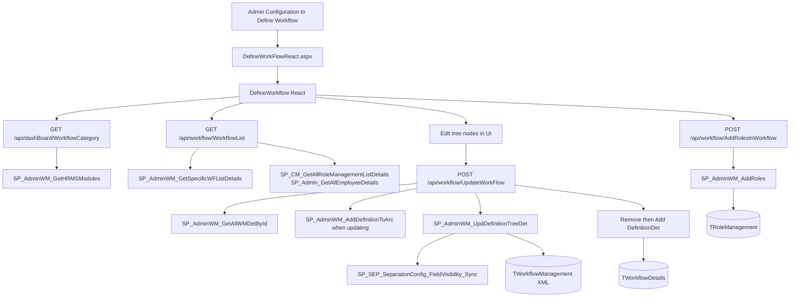
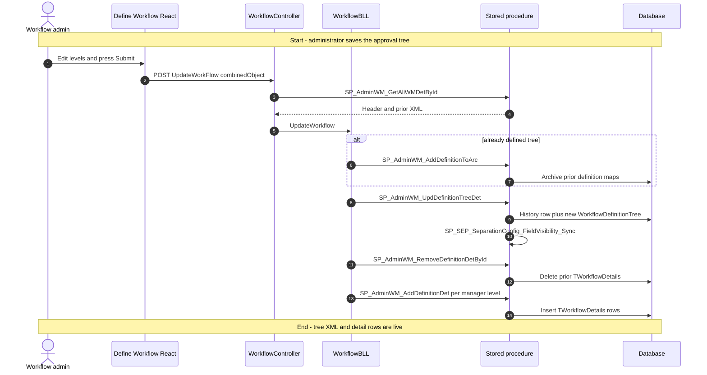
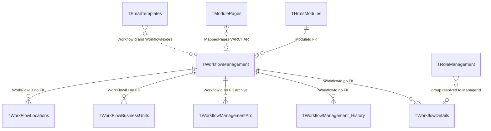

# Define Workflow

## Overview

An HR administrator opens **Admin Configuration → Workflow Management → Define Workflow** to draw the approval tree for workflows that already have a header (name, module, mapped page). Live menu `TMenuDetails` MenuId **27** points at `~/HRM/Settings/DefineWorkFlowReact.aspx`. That host only stamps session fields and logs activity type `DefineWorkFlowReact` (300); the React app under `DashBoard_React/Areas/DefineWorkflow` does the real work against Core API `/api/workflow/*`.

On this screen they pick an organisation and one or more modules, load the matching workflow headers, expand a workflow, and edit Level / Approvers / Notifications / Notify Approval / Notify Rejection / Notify Pullback nodes. Submit posts the changed trees to `POST /api/workflow/UpdateWorkFlow`, which rewrites `TWorkflowManagement.WorkflowDefinitionTree` XML and rebuilds `TWorkflowDetails` (one row per resolved manager at each level). A popup on the same page can create a **workflow group** (`TRoleManagement`) when a named group is needed as a tree node.

This leaf is the **tree designer only**. Header create/update lives on Add Workflow (`CreateWorkFlow.aspx`); group setup also has its own menu (`CreateRole.aspx`); clone and catalog live on Workflow Dashboard. Runtime approve/reject is covered on the sibling [Workflow](/docs/guides/admin-configuration/workflow) guide and `llm-wiki/domain/approval-workflow.md`.

**Who's involved:**

- **Workflow admin** — designs and saves the XML tree (and optionally creates a group from the popup).
- **Initiators and approvers** — never open this screen; they hit the saved definition later when submitting or approving a mapped-page request.

## Workflow

## Request journey

## Entry points

Live nav is MenuId **27** → `~/HRM/Settings/DefineWorkFlowReact.aspx` (parent MenuId **18** Workflow Management under Admin Configuration). Deep-links from Workflow Dashboard pass `organizationId`, `WorkflowId`, `ModuleId`, and optional `SearchCriteria` query string.

| UI page | Purpose |
|---|---|
| `HRM/Settings/DefineWorkFlowReact.aspx` | Host. Page title Define Workflow. Loads `dashboard_react.*.min.js` |
| React `DashBoard_React/Areas/DefineWorkflow/` | Module search, tree editor, group popup, submit |
| `HRM/Settings/DefineWorkFlow.aspx` | Legacy Telerik tree editor — still compiled, not the live NavigateURL |

There is no WebForms postback for tree edits. Session context is passed through hidden fields on the aspx host.

## Code → database call chain

| Entry | Method | Stored procedure or SQL |
|---|---|---|
| Page open | `Page_Load` (`DefineWorkFlowReact.aspx.cs:22`) → `CommonUtil.LogActivity` | `Sp_InsertActivityLog` |
| Load modules | `getModuleList` (`Containers/index.js:192`) → `GET /dashBoard/WorkflowCategory` → `dashBoardDAL.WorkflowCategory` (`dashBoardDAL.js:920`) | `SP_AdminWM_GetHRMSModules` |
| Load employees | `getEmployeesList` (`Containers/index.js:179`) → `GET /workflow/GetAllEmployeeDetails` → `WorkflowDAL.GetAllEmployeeDetails` (`WorkflowDAL.js:41`) | `SP_Admin_GetAllEmployeeDetails` |
| Load workflows | `getWorkflowList` (`Containers/index.js:242`) → `GET /workflow/WorkflowList` (`WorkflowController.js:562`) → `dashBoardDAL.WorkflowList` (`dashBoardDAL.js:933`) | `SP_AdminWM_GetSpecificWFListDetails` |
| Enrich groups on list | same `WorkflowList` → `recruitmentDAL.GetRoleManagementList` (`recruitmentDAL.js:4489`) | `SP_CM_GetAllRoleManagementListDetails` |
| Group member ids | `getWorkflowGroupslist` (`Containers/index.js:324`) → `GET /recruitment/getRoleDetailsByRoleId` | `SP_CM_GetRoleDetailsByRoleId` |
| BU tree for group popup | `CreateWorkflowPopup.js:152` → `GET /workflow/GetOrganisationHierarchy` | `USP_GetOrganisationHierarchy` |
| Create group | `CreateWorkflowPopup.js:113` → `POST /workflow/AddRolesInWorkflow` (`WorkflowController.js:100`) → dup check `GetAllRolesCreated` (`WorkflowDAL.js:487`) then `WorkflowBLL.AddRolesInWorkflow` | `SP_AdminWM_GetAllRoleMgmtListDet`, then `SP_AdminWM_AddRoles` |
| Save tree | `handleSubmitWorkflow` (`Layout/Page.js:199`) → `POST /workflow/UpdateWorkFlow` (`WorkflowController.js:212`) → `GetWorkflowDetailsById` → `WorkflowBLL.UpdateWorkflow` (`WorkflowBLL.js:178`) → `ProcessWorkFlowXml` (`Utils/workflow.js:94`) | `SP_AdminWM_GetAllWMDetById` → optional `SP_AdminWM_AddDefinitionToArc` → `SP_AdminWM_UpdDefinitionTreeDet` (nested `SP_SEP_SeparationConfig_FieldVisibility_Sync`) → `SP_AdminWM_RemoveDefinitionDetById` → `SP_AdminWM_AddDefinitionDet`; role-name resolve `SP_AdminWM_GetRoleIdRoleName`; email nodes `SP_AdminETB_GetEmailTemplateWorkflowNode` / `SP_AdminETB_UpdateEmailTemplateWorkflowNodes` |

## API endpoints

Routes mount under `/api/workflow` and `/api/V2/workflow` (same V1 router). Define Workflow also calls dashboard and recruitment helpers listed below. No aspx postback for tree save.

| Verb | Route | Parameters | Purpose | Source |
|---|---|---|---|---|
| `GET` | `/api/dashBoard/WorkflowCategory` | query `employerid` | Module list | `dashBoardDAL.js:920` |
| `GET` | `/api/workflow/WorkflowList` | query `employerid`, `userType`, `ModID`; optional `buId`, `locationId` | Workflow headers + parsed tree for editor | `WorkflowRoutes.js:17`, `WorkflowController.js:562` |
| `GET` | `/api/workflow/GetAllEmployeeDetails` | query `EmployerId`; employee from token | People picker | `WorkflowRoutes.js:10`, `WorkflowController.js:58` |
| `GET` | `/api/workflow/GetOrganisationHierarchy` | query `Employerid` | BU tree for group popup | `WorkflowRoutes.js:9`, `WorkflowController.js:25` |
| `POST` | `/api/workflow/AddRolesInWorkflow` | body `RoleName`, `RoleDescription`, `EffectiveDate`, `EmployeeID`, `LocationId`, `BusinessUnitId`, `Employerid`, `IsAuthSign`, `IsActive`; `CreatedBy` from token | Create workflow group | `WorkflowRoutes.js:12`, `WorkflowController.js:100` |
| `POST` | `/api/workflow/UpdateWorkFlow` | body `combinedObject[]` each `{ WorkflowId, id, EmployerId, addedNodes }` | Persist XML + materialise details | `WorkflowRoutes.js:16`, `WorkflowController.js:212` |
| `GET` | `/api/recruitment/getRoleManagementList` | query `employerId` | Groups for tree nodes | `recruitmentDAL.js:4489` |
| `GET` | `/api/recruitment/getRoleDetailsByRoleId` | query `roleId` | Employees in a group | `recruitmentDAL.js:4502` |

## Stored procedures & tables involved

Designer objects use the `SP_AdminWM_*` / `SP_AdminETB_*` prefix. Runtime routing tables are cited only where this screen writes them; approve/reject is out of scope here.

| Object | File | Purpose | Wiki / page |
|---|---|---|---|
| [SP_AdminWM_GetHRMSModules](/docs/database/hrms/SP_AdminWM_GetHRMSModules) | `STOREPROCEDURE/SP_AdminWM_GetHRMSModules.sql` | Module dropdown | existing page |
| [SP_AdminWM_GetSpecificWFListDetails](/docs/database/hrms/SP_AdminWM_GetSpecificWFListDetails) | `STOREPROCEDURE/SP_AdminWM_GetSpecificWFListDetails.sql` | List workflows for selected modules | existing page |
| [SP_AdminWM_GetAllWMDetById](/docs/database/hrms/SP_AdminWM_GetAllWMDetById) | `STOREPROCEDURE/SP_AdminWM_GetAllWMDetById.sql` | Load one definition before save | this run |
| [SP_AdminWM_AddDefinitionToArc](/docs/database/hrms/SP_AdminWM_AddDefinitionToArc) | `STOREPROCEDURE/SP_AdminWM_AddDefinitionToArc.sql` | Archive prior tree + BU/location maps | this run |
| [SP_AdminWM_UpdDefinitionTreeDet](/docs/database/hrms/SP_AdminWM_UpdDefinitionTreeDet) | `STOREPROCEDURE/SP_AdminWM_UpdDefinitionTreeDet.sql` | History + update XML / partial flag | this run |
| [SP_SEP_SeparationConfig_FieldVisibility_Sync](/docs/database/hrms/SP_SEP_SeparationConfig_FieldVisibility_Sync) | `STOREPROCEDURE/SP_SEP_SeparationConfig_FieldVisibility_Sync.sql` | Nested from tree update for Resignation mapped pages | this run |
| [SP_AdminWM_RemoveDefinitionDetById](/docs/database/hrms/SP_AdminWM_RemoveDefinitionDetById) | `STOREPROCEDURE/SP_AdminWM_RemoveDefinitionDetById.sql` | Clear prior detail rows | this run |
| [SP_AdminWM_AddDefinitionDet](/docs/database/hrms/SP_AdminWM_AddDefinitionDet) | `STOREPROCEDURE/SP_AdminWM_AddDefinitionDet.sql` | Insert one level/manager detail row | this run |
| [SP_AdminWM_GetRoleIdRoleName](/docs/database/hrms/SP_AdminWM_GetRoleIdRoleName) | `STOREPROCEDURE/SP_AdminWM_GetRoleIdRoleName.sql` | Resolve group name to RoleId while materialising | this run |
| [SP_AdminETB_GetEmailTemplateWorkflowNode](/docs/database/hrms/SP_AdminETB_GetEmailTemplateWorkflowNode) | `STOREPROCEDURE/SP_AdminETB_GetEmailTemplateWorkflowNode.sql` | Read email template node strings | this run |
| [SP_AdminETB_UpdateEmailTemplateWorkflowNodes](/docs/database/hrms/SP_AdminETB_UpdateEmailTemplateWorkflowNodes) | `STOREPROCEDURE/SP_AdminETB_UpdateEmailTemplateWorkflowNodes.sql` | Write email template node strings | this run |
| [SP_AdminWM_AddRoles](/docs/database/hrms/SP_AdminWM_AddRoles) | `STOREPROCEDURE/SP_AdminWM_AddRoles.sql` | Create workflow group (or queue admin-change approval) | this run |
| [SP_AdminWM_GetAllRoleMgmtListDet](/docs/database/hrms/SP_AdminWM_GetAllRoleMgmtListDet) | `STOREPROCEDURE/SP_AdminWM_GetAllRoleMgmtListDet.sql` | Dup-check groups before add | this run |
| [SP_Admin_GetAllEmployeeDetails](/docs/database/hrms/SP_Admin_GetAllEmployeeDetails) | `STOREPROCEDURE/SP_Admin_GetAllEmployeeDetails.sql` | Employee picker | this run |
| [USP_GetOrganisationHierarchy](/docs/database/hrms/USP_GetOrganisationHierarchy) | `STOREPROCEDURE/USP_GetOrganisationHierarchy.sql` | BU tree for group popup | this run |
| [SP_CM_GetAllRoleManagementListDetails](/docs/database/hrms/SP_CM_GetAllRoleManagementListDetails) | `STOREPROCEDURE/SP_CM_GetAllRoleManagementListDetails.sql` | Enrich WorkflowList with groups | this run |
| [SP_CM_GetRoleDetailsByRoleId](/docs/database/hrms/SP_CM_GetRoleDetailsByRoleId) | `STOREPROCEDURE/SP_CM_GetRoleDetailsByRoleId.sql` | Employees in one group | this run |
| [Sp_InsertActivityLog](/docs/database/hrms/Sp_InsertActivityLog) | `STOREPROCEDURE/Sp_InsertActivityLog.sql` | Page-open activity | existing page |
| [SP_AddAdminChanges](/docs/database/hrms/SP_AddAdminChanges) | nested from `SP_AdminWM_AddRoles` when a WorkflowGroup workflow exists | existing page |
| `TWorkflowManagement` | `TABLES/TWorkflowManagement.sql` | Definition header + XML | `llm-wiki/domain/approval-workflow.md` |
| `TWorkflowDetails` | `TABLES/TWorkflowDetails.sql` | Materialised levels | `llm-wiki/reference/tables/hrms.md` |
| `TWorkflowManagementArc` / `TWorkFlowLocationsArc` / `TWorkFlowBusinessUnitsArc` | archive tables | Snapshot before tree update | — |
| `TWorkflowManagement_History` | history of definition updates | Written by `SP_AdminWM_UpdDefinitionTreeDet` | — |
| `TRoleManagement` (+ employee/location/BU maps) | workflow groups | Group popup / tree nodes | — |
| `TEmailTemplates` | email node linkage after tree save | — | — |

## Table relationships

Definition-side edges from table scripts / this screen's write path. Declared FK only where the CREATE script has one.

## Known gaps

- **Sibling vs leaf.** Broader Workflow Management (groups, Add Workflow header, dashboard clone, runtime approve) is documented in [workflow.md](/docs/guides/admin-configuration/workflow) (`submenu: Workflow Management`). This page intentionally stops at the React tree designer.
- **Legacy aspx.** `DefineWorkFlow.aspx` remains compiled; live `NavigateURL` is the React host only.
- **Two role-list procedures.** Dup-check uses `SP_AdminWM_GetAllRoleMgmtListDet`; WorkflowList enrichment uses `SP_CM_GetAllRoleManagementListDetails`.
- **`SP_AdminWM_AddRoles` approval branch.** When a WorkflowGroup-mapped workflow exists for the employer, insert goes through `SP_AddAdminChanges` instead of writing `TRoleManagement` immediately.
- **Separation sync side effect.** Every tree save runs `SP_SEP_SeparationConfig_FieldVisibility_Sync`, which returns immediately unless the workflow maps to ResignationDetails.
- **V2/V3 workflow route files** exist but are unmounted; `/api/V2/workflow` serves the V1 handlers.

## Reference

Confidence **high** — live NavigateURL verified in DEV `TMenuDetails` / `TMenuHierarchy`, and the React → Node → `SP_AdminWM_*` save chain verified with file:line citations. DB behaviour for archive / detail materialisation taken from the SQL scripts; runtime request routing is deferred to `llm-wiki/domain/approval-workflow.md`.

### SourceCode

- `HRMS.Web/HRMS.Web/HRM/Settings/DefineWorkFlowReact.aspx(.cs)`
- `HRMS.Web/HRMS.Web/HRM/DashBoard_React/Areas/DefineWorkflow/`
- `HRMS.Web/HRMS.Web/HRM/DashBoard_React/Common/apiURLConstants.js` (Define Workflow API block)
- `HRMS.Web/HRMS.Web/HRM/DashBoard_React/Common/routeConstants.js` (`DEFINE_WORKFLOW`)
- `HRMS.CoreAPI/HRMS.Core.WebAPI.Node/Routes/WorkflowRoutes.js`
- `HRMS.CoreAPI/HRMS.Core.WebAPI.Node/Controllers/WorkflowController.js`
- `HRMS.CoreAPI/HRMS.Core.WebAPI.Node/Core/BusinessLogicLayer/WorkflowBLL.js`
- `HRMS.CoreAPI/HRMS.Core.WebAPI.Node/Core/DataAccessLayer/WorkflowDAL.js`
- `HRMS.CoreAPI/HRMS.Core.WebAPI.Node/Utils/workflow.js`
- `HRMS.CoreAPI/HRMS.Core.WebAPI.Node/Core/DataAccessLayer/dashBoardDAL.js`
- `HRMS.CoreAPI/HRMS.Core.WebAPI.Node/Core/DataAccessLayer/recruitmentDAL.js`

### TDG HRMS DB

- `HRMS-DATABASE/HRMS/STOREPROCEDURE/SP_AdminWM_*.sql` (tree save / groups)
- `HRMS-DATABASE/HRMS/STOREPROCEDURE/SP_AdminETB_GetEmailTemplateWorkflowNode.sql`
- `HRMS-DATABASE/HRMS/STOREPROCEDURE/SP_AdminETB_UpdateEmailTemplateWorkflowNodes.sql`
- `HRMS-DATABASE/HRMS/STOREPROCEDURE/SP_SEP_SeparationConfig_FieldVisibility_Sync.sql`
- `HRMS-DATABASE/HRMS/TABLES/TWorkflowManagement.sql`, `TWorkflowDetails.sql`
- `llm-wiki/domain/approval-workflow.md` (runtime / polymorphic routing — cited, not re-derived)
