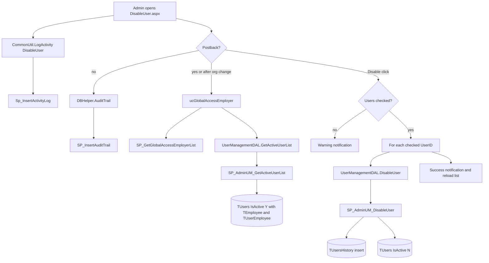
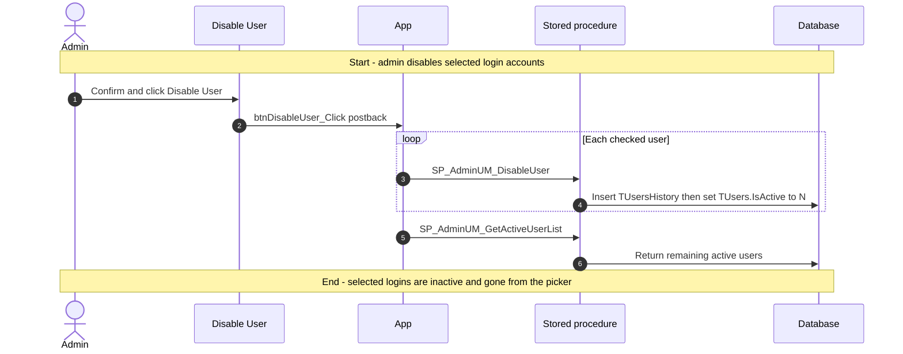
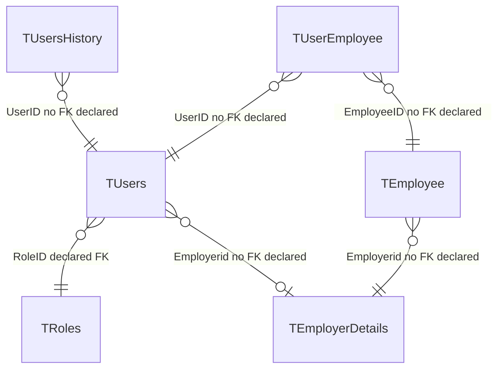

# Disable User

## Overview

An administrator needs to stop someone signing in without running a full employee exit. On **Admin Configuration → User Management → Disable User** they pick an organization (when they have global access), tick one or more active users, confirm, and click **Disable User**. Each selected account is soft-disabled: `TUsers.IsActive` becomes `N` after a history snapshot, so that login no longer appears in the active-user picker. The employee HR record is left alone.

**Who's involved:**

- **Administrator** (`UserType` `A`) or an employee with this menu — picks users and disables them. Non–super-admin users lose the Disable button when their tab grant for menu id `39` is view-only.
- **Super Admin** (`UserType` `S`) — skips the tab show/hide check and can disable admin users (the active list filters by caller type).

This is login disable only. Separation deactivate (`SP_SEP_DeActivateEmployeeWithAssets` and its `DISABLE` branch) is a different path that can also flip login flags during exit; see `llm-wiki/domain/employee-lifecycle.md`. Identity tables are catalogued in `llm-wiki/reference/tables/hrms.md` (`TUsers`, `TUsersHistory`, `TUserEmployee`). `docs/SystemModels/SystemModel-2` has no workflow page for this screen.

## Workflow

Caller `UserType` shapes the picker: admin sees non-admin/non-super users, super admin sees admins, employee sees employees (`SP_AdminUM_GetActiveUserList`).

## Request journey

## Entry points

> The live screen is the WebForms page `HRM/UserManagement/DisableUser.aspx`. There is no React route and no Core API controller for this action. SystemModel-2 does not name a competing entry point.

| Entry point | Purpose | Live? |
|---|---|---|
| `~/HRM/UserManagement/DisableUser.aspx` (menu id `USER_MGMT_DISABLE_USER = 39`) | Pick organization and active users, disable login | Yes |
| `btnDisableUser_Click` | Disable each checked `UserID` | Yes. Hidden when non–super-admin tab grant is not editable |
| `ucGlobalAccessEmployer` selection change | Reload the active-user list for the selected employer | Yes |
| `cboDisableOrgUser_SelectedIndexChanged` | Would reload users | Markup does not wire this handler; dead code in the code-behind |

## Code → database call chain

The page calls `UserManagementDAL` directly. There is no `UserManagementBLL` on this path.

| Step | Entry point | App code | Stored procedure |
|---|---|---|---|
| Activity log on every load | `DisableUser.aspx.cs:42` | `CommonUtil.LogActivity` → `ActivityHelper.LogActivity` (`ActivityHelper.cs:32`) | `Sp_InsertActivityLog` |
| Audit the first open | `DisableUser.aspx.cs:47` | `DBHelper.AuditTrail` (`DBHelper.cs:218`) | `SP_InsertAuditTrail` |
| Organization dropdown | `ucGlobalAccessEmployer.ascx.cs:251` | `WebCommon.GetGlobalAccessEmployerList` → `DBHelper.GetGlobalAccessEmployerList` (`DBHelper.cs:3195`) | `SP_GetGlobalAccessEmployerList` |
| Active user picker | `DisableUser.aspx.cs:126` (also `:61`, `:89`) | `UserManagementDAL.GetActiveUserList` (`UserManagementDAL.cs:41`) | `SP_AdminUM_GetActiveUserList` |
| Disable selected users | `DisableUser.aspx.cs:79` | `UserManagementDAL.DisableUser` (`UserManagementDAL.cs:54`) | `SP_AdminUM_DisableUser` |
| Tab editability for non–super-admin | `DisableUser.aspx.cs:108` | `WebCommonTab.GetTabsByMenu` (`Web.Common.Tab.cs:59`) | Session lists only. No stored procedure on this call |

`SP_AdminUM_GetActiveUserList` opens encryption keys and calls `Fn_GetEmployeeName` and `FN_ConvertBase64ToSTR` before closing keys. `SP_AdminUM_DisableUser` has no nested procedure or function calls.

## API endpoints

This screen is a WebForms postback. `btnDisableUser_Click` runs after the client confirm. There is no `[WebMethod]`, no PageMethod, and no Core API controller on `DisableUser.aspx`.

## Stored procedures & tables involved

Inventory paths are the `sqlFile` on `HRMS-DATABASE/HRMS/changelog/baseline-inventory-storeprocedure.xml`. Each procedure page is under `/docs/database/hrms/`.

| Object | File | Purpose | Database page |
|---|---|---|---|
| `SP_AdminUM_DisableUser` | `STOREPROCEDURE/SP_AdminUM_DisableUser.sql` | History snapshot then set `TUsers.IsActive` to `N` | [SP_AdminUM_DisableUser](/docs/database/hrms/SP_AdminUM_DisableUser) |
| `SP_AdminUM_GetActiveUserList` | `STOREPROCEDURE/SP_AdminUM_GetActiveUserList.sql` | Active users the picker may select | [SP_AdminUM_GetActiveUserList](/docs/database/hrms/SP_AdminUM_GetActiveUserList) |
| `SP_GetGlobalAccessEmployerList` | `STOREPROCEDURE/SP_GetGlobalAccessEmployerList.sql` | Employers for the global-access organization control | [SP_GetGlobalAccessEmployerList](/docs/database/hrms/SP_GetGlobalAccessEmployerList) |
| `SP_InsertAuditTrail` | `STOREPROCEDURE/SP_InsertAuditTrail.sql` | Page-open audit row | [SP_InsertAuditTrail](/docs/database/hrms/SP_InsertAuditTrail) |
| `Sp_InsertActivityLog` | `STOREPROCEDURE/Sp_InsertActivityLog.sql` | Activity log for activity type Disable User (`327`) | [Sp_InsertActivityLog](/docs/database/hrms/Sp_InsertActivityLog) |

Nested one level from `SP_AdminUM_GetActiveUserList` (already documented): `Sp_OpenEncryptionKeys`, `Fn_GetEmployeeName`, `FN_ConvertBase64ToSTR`, `SP_CloseEncryptionKey`.

Tables these procedures read or write: `TUsers`, `TUsersHistory`, `TEmployee`, `TUserEmployee`, plus audit/activity targets of the shared loggers. `llm-wiki/reference/tables/hrms.md` catalogs `TUsers`, `TUsersHistory`, and `TUserEmployee`. `llm-wiki/domain/concept-map.md` draws `TUsers.RoleID` → `TRoles` as a declared FK and user↔employee via `TUserEmployee` by convention.

## Table relationships

Declared foreign keys are labeled as such. Columns joined without a foreign key are labeled **no FK declared**. Do not treat soft-disable as an employee exit FK graph; that lives under separation in `llm-wiki/domain/employee-lifecycle.md`.

`TUsersHistory.sql` and `TUserEmployee.sql` declare no foreign keys. `TUsers.sql` declares only `RoleID` → `TRoles.RoleID`.

## Known gaps

- SystemModel-2 has no workflow or context page for Disable User; live path is taken from the WebForms page and DAL only.
- `SP_AdminUM_DisableUser` does not deactivate `TEmployee`, clear devices, or update `TRecruiter`. That is intentional relative to separation disable, but easy to confuse with the `DISABLE` branch documented in `llm-wiki/domain/employee-lifecycle.md`.
- The history insert omits `TUsersHistory.Employerid` even though the table has that column and the update filters by employer.
- Declared error variables in `SP_AdminUM_DisableUser` are unused; there is no in-procedure transaction or `TRY`/`CATCH`.
- `cboDisableOrgUser_SelectedIndexChanged` is unused dead code.
- Tab show/hide for non–super-admin reads session-cached tab lists only; this page does not call `Sp_AdminRoleM_GetTabRoleDet` or `Sp_GetTabUserDetails` itself.
- Constant `URL_USER_MGMT_DISABLE_USER` (or similar) is not present next to `URL_USER_WIN_LOGIN_SETUP` in `Constants.cs`; the aspx path is the entry URL.

## Reference

High confidence on the postbacks and the procedures they execute. Nested encryption helpers were already documented; disable itself has no callees.

### SourceCode

- `HRMS.Web/HRMS.Web/HRM/UserManagement/DisableUser.aspx` and `DisableUser.aspx.cs`
- `HRMS.Web/HRMS.Web/HRM/CustomControls/ucGlobalAccessEmployer.ascx.cs`
- `HRMS.Web/HRMS.Web/Common/Web.Common.Tab.cs`
- `HRMS.Shared/HRMS.DataAccessLayer/UserManagement/UserManagementDAL.cs`
- `HRMS.Shared/HRMS.DataAccessLayer/DBHelper.cs` (`AuditTrail`, `GetGlobalAccessEmployerList`)
- `HRMS.Shared/HRMS.DataAccessLayer/DBConstant.cs` (`SP_GetActiveUserList` → `SP_AdminUM_GetActiveUserList`, `SP_DisableUser` → `SP_AdminUM_DisableUser`)
- `HRMS.Shared/HRMS.DataContract/Common/Enums.cs` (`DisableUser = 327`, `USER_MGMT_DISABLE_USER = 39`)
- `HRMS.Shared/TDG.ActivityAuditLog/DAL/ActivityHelper.cs`

### TDG HRMS DB

- `llm-wiki/domain/employee-lifecycle.md` (disable vs deactivate)
- `llm-wiki/domain/concept-map.md`
- `llm-wiki/reference/tables/hrms.md`
- `HRMS-DATABASE/HRMS/TABLES/TUsers.sql`, `TUsersHistory.sql`, `TUserEmployee.sql`, `TEmployee.sql`
- `HRMS-DATABASE/HRMS/STOREPROCEDURE/SP_AdminUM_DisableUser.sql`, `SP_AdminUM_GetActiveUserList.sql`, `SP_GetGlobalAccessEmployerList.sql`, `SP_InsertAuditTrail.sql`, `Sp_InsertActivityLog.sql`
