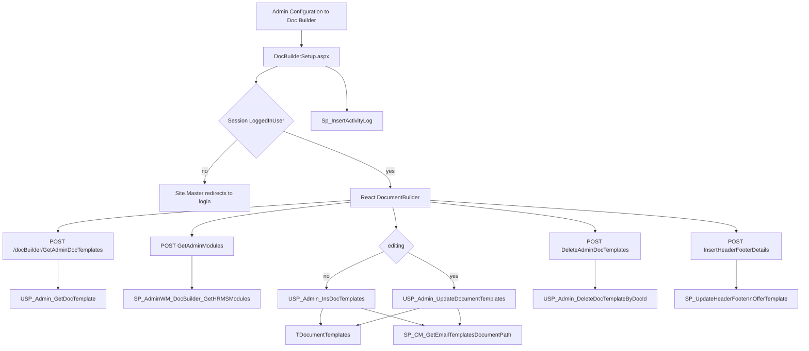
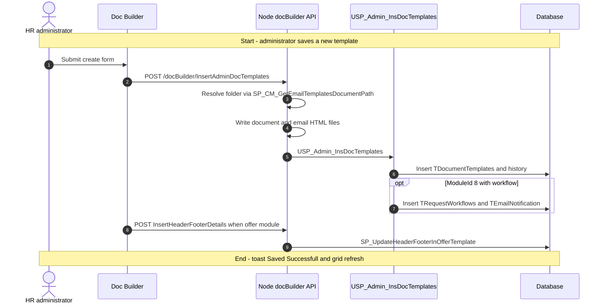
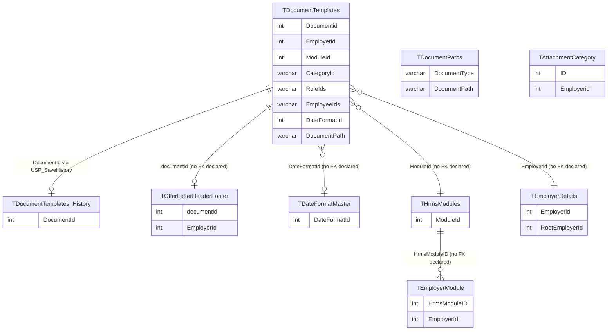

# Doc Builder

## Overview

An HR administrator needs reusable HTML document templates (employee letters, offer letters, confirmation, and related modules) with placeholders, email body, role or employee access, categories, and optional header/footer images. They open **Admin Configuration → Doc Builder** (`~/HRM/DocBuilder/DocBuilderSetup.aspx`). The WebForms host logs the visit, copies session identity into hidden fields, and mounts the Vite React app in `#rmRoot`.

In that app they pick an organization (when global access is on), list templates, create or edit one in the TipTap editors, choose module and categories, set ESS acceptance options, assign generate-access by role or employee, and save. Save writes HTML files under the customer folder from `TDocumentPaths`, then inserts or updates `TDocumentTemplates`. Delete soft-deletes the row (`Isdeleted = 1`). Offer-module inserts with a workflow also seed request-workflow and notification rows.

There is no SystemModel-2 domain page dedicated to Doc Builder. `llm-wiki` lists `TAttachmentCategory`, `TDocumentPaths`, and `TOfferLetterHeaderFooter`; `TDocumentTemplates` is not in that catalog.

**Who's involved:**

- **HR administrator** — maintains document templates for an employer. Access is via the left-nav item for this URL; `Site.Master` requires a logged-in session.
- **Workflow approver** — for recruitment offer templates (`ModuleId` 8 with a workflow), may receive homepage and email notifications after insert or pullback delete. They do not open this screen for that work.
- **Employee** — does not open this screen. Later ESS or recruitment flows generate letters from the saved HTML.

## Workflow

## Request journey

### HR administrator — save a new document template

List, module, category, placeholder, and access-permission calls are separate reads. They are in the call-chain table and are not drawn here.

## Entry points

`DocBuilderSetup.aspx` is the left-nav page. `Page_Load` always calls `CommonUtil.LogActivity` for `ActivityDescription.DocumentBuilder` (347) and fills hidden fields from `Session["LoggedInUser"]`. It does not itself redirect when the session is empty; `Site.Master` clears the session and sends the user to login when `LOGGED_IN_USER` is missing. The markup loads `BuildJS/DocBuilder.min.js`, which mounts React on `#rmRoot`. Client routing matches `/HRM/DocBuilder/DocBuilderSetup.aspx` to `BuilderData.jsx`.

| UI page | Purpose |
|---|---|
| `HRM/DocBuilder/DocBuilderSetup.aspx` | Host, activity log, session hidden fields, React mount |
| `HRM/DocBuilder/Common/BuilderData.jsx` | Grid, create/edit/delete, save payload |
| `HRM/DocBuilder/Common/index.jsx` | Document HTML editor and placeholders |
| `HRM/DocBuilder/Common/indexemail.jsx` | Email HTML editor and placeholders |
| `HRM/DocBuilder/Common/DocumentAccessCell.jsx` | Role/employee names for the access column |
| `HRM/DocBuilder/SharedComponent/OrganizationMultiSelectDropDown.jsx` | Global-access employer picker |

## Code → database call chain

Page load uses Enterprise Library from WebForms. The React editor calls Core Node `/docBuilder/*` (and a few dashboard/recruitment routes). `docBuilderDAL.js` executes procedures with `mssql`. There is no BLL or classic DAL on the template CRUD path.

| Entry | Method | Stored procedure |
|---|---|---|
| Page visit | `Page_Load` (`DocBuilderSetup.aspx.cs:27`) → `CommonUtil.LogActivity` (`Common.cs:52`) → `ActivityHelper.LogActivity` (`ActivityHelper.cs:32`) | `Sp_InsertActivityLog` |
| Template list | `BuilderData.jsx:170` → `POST /docBuilder/GetAdminDocTemplates` (`docBuilderDAL.js:50`) | `USP_Admin_GetDocTemplate` |
| Modules | `BuilderData.jsx:287` → `POST /docBuilder/GetAdminModules` (`docBuilderDAL.js:462`) | `SP_AdminWM_DocBuilder_GetHRMSModules` |
| Categories | `BuilderData.jsx:199` → `POST /docBuilder/GetAdminDocumentsCategory` (`docBuilderDAL.js:489`) | `SP_GetAttachmentCategory` |
| Date formats | `BuilderData.jsx:302` → `POST /docBuilder/GetDateDisplay` (`docBuilderDAL.js:567`) | `SP_GetDateDisplayFormats` |
| Access roles | `BuilderData.jsx:182` → `POST /docBuilder/GetAccessPermissionRole` (`docBuilderDAL.js:527`) | `SP_Get_Document_RolesList` |
| Access employees | `BuilderData.jsx:268` → `POST /docBuilder/GetAccessPermissionEmployee` (`docBuilderDAL.js:540`) | `SP_Get_Document_EmployeesList` |
| Access tooltip names | `DocumentAccessCell.jsx:66` → `POST /docBuilder/GetDocumentTemplateRoleEmployees` (`docBuilderDAL.js:553`) | `SP_Get_DocumentTemplate_Role_Employees` |
| Placeholders | `index.jsx:820` / `indexemail.jsx:631` → `POST /docBuilder/GetAdminPlaceholders` (`docBuilderDAL.js:474`) | `SP_GetTemplateFields` |
| CC roles | `BuilderData.jsx:355` → `GET /docBuilder/GetWorkflowGroup` (`docBuilderDAL.js:513`) | `SP_AdminRoleM_GetRoles` |
| ESS workflow id | `BuilderData.jsx:154` → `GET /recruitment/getWorkFlowDetails` (`recruitmentDAL.js:155`) | `SP_CM_GetWorkflowTreeXmlDetailsByPageTitle` |
| Global employers | `OrganizationMultiSelectDropDown.jsx:32` → `GET /dashBoard/GetGlobalAccessEmployerList` (`dashBoardDAL.js:824`) | `SP_GetGlobalAccessEmployerList` |
| Save new | `BuilderData.jsx:641` → `POST /docBuilder/InsertAdminDocTemplates` (`docBuilderDAL.js:76`) | `SP_CM_GetEmailTemplatesDocumentPath` then `USP_Admin_InsDocTemplates` |
| Save existing | `BuilderData.jsx:594` → `POST /docBuilder/UpdateAdminDocTemplates` (`docBuilderDAL.js:384`) | `SP_CM_GetEmailTemplatesDocumentPath` then `USP_Admin_UpdateDocumentTemplates` |
| Delete | `BuilderData.jsx:696` → `POST /docBuilder/DeleteAdminDocTemplates` (`docBuilderDAL.js:448`) | `USP_Admin_DeleteDocTemplateByDocId` |
| Load HTML | `BuilderData.jsx:806` → `POST /docBuilder/GetDocumentTemplateHtmlAndEmailHtml` (`docBuilderDAL.js:146`) | None. Reads files from disk |
| Header/footer get | `BuilderData.jsx:811` → `POST /docBuilder/GetHeaderFooterDetails` (`docBuilderDAL.js:37`) | `SP_GetHeaderFooterForOfferLetter` |
| Header/footer save | `BuilderData.jsx:403` → `POST /docBuilder/InsertHeaderFooterDetails` (`docBuilderDAL.js:291`) | `SP_AdminORG_GetEmployerDet` (employer folder context) then `SP_UpdateHeaderFooterInOfferTemplate` |
| Org images | `index.jsx` / `indexemail.jsx` upload/list/delete | None. Filesystem under configured sign-image folders |

`USP_Admin_InsDocTemplates` and `USP_Admin_DeleteDocTemplateByDocId` nest `USP_SaveHistory`, and for offer-module workflow paths also `SP_CM_GetDataforRequestWorkFlows`, `Sp_InsHomePageNotificationCnts`, `SP_CM_GetDataForEmailNotification`, plus `FN_CM_GetMgrFromRequestWorkflows` / `FN_CM_GetApproverList` / `Fn_GetHomePageNotificationIdByRequestType`. `SP_Get_Document_EmployeesList` and `SP_Get_DocumentTemplate_Role_Employees` call `Fn_GetEmployeeName`.

## API endpoints

The editor does not post back the WebForms form for template data. It calls Core Node under `/docBuilder` (plus recruitment/dashboard helpers). The client base URL is `process.env.API_URL`.

| Verb | Route | Parameters | Purpose | Source |
|---|---|---|---|---|
| POST | `/docBuilder/GetAdminDocTemplates` | Body `employerId` | Template grid | `DocBuilderRoute.js:13` |
| POST | `/docBuilder/InsertAdminDocTemplates` | Body name, description, module, HTML, email, access, ESS flags, `workflowId`, `dateFormatId`, … | Create template + files | `DocBuilderRoute.js:14` |
| POST | `/docBuilder/UpdateAdminDocTemplates` | Body includes `documentId` and same fields as insert (no workflow) | Update template + files | `DocBuilderRoute.js:15` |
| POST | `/docBuilder/DeleteAdminDocTemplates` | Body `documentId`, `EmployerId`, `EmployeeId` | Soft delete | `DocBuilderRoute.js:16` |
| POST | `/docBuilder/GetAdminModules` | Body `employerId` | Module dropdown (ids 8, 12, 18, 26) | `DocBuilderRoute.js:18` |
| POST | `/docBuilder/GetAdminPlaceholders` | Body `employerId`, `requestType`, `formName`, `fieldCategory` | Editor placeholders | `DocBuilderRoute.js:19` |
| POST | `/docBuilder/GetAdminDocumentsCategory` | Body `employerId` | Category multi-select | `DocBuilderRoute.js:20` |
| GET | `/docBuilder/GetWorkflowGroup` | Query `employerId` | Role list for email CC | `DocBuilderRoute.js:21` |
| POST | `/docBuilder/GetDocumentTemplateHtmlAndEmailHtml` | Body `templatePath`, `emailtemplatePath` | Read HTML from disk | `DocBuilderRoute.js:22` |
| POST | `/docBuilder/InsertHeaderFooterDetails` | Body images, margins, `documentid`, `EmployerId`, … | Upsert header/footer | `DocBuilderRoute.js:7` |
| POST | `/docBuilder/GetHeaderFooterDetails` | Body `documentid`, `EmployerId` | Load header/footer | `DocBuilderRoute.js:9` |
| POST | `/docBuilder/GetAccessPermissionRole` | Body `employerId` (DAL fixes `TabId` 114) | Roles for generate access | `DocBuilderRoute.js:27` |
| POST | `/docBuilder/GetAccessPermissionEmployee` | Body `employerId` (DAL fixes `TabId` 114) | Employees for generate access | `DocBuilderRoute.js:28` |
| POST | `/docBuilder/GetDocumentTemplateRoleEmployees` | Body `documentid`, `roleIds`, `employeeIds` | Tooltip names | `DocBuilderRoute.js:29` |
| POST | `/docBuilder/GetDateDisplay` | Body `employerId` (ignored by SP) | Date format list | `DocBuilderRoute.js:31` |
| GET | `/recruitment/getWorkFlowDetails` | Query `employerId`, `employeeId`, `pageTitle` (`DocumentBuilderESS`) | Default workflow id | `RecruitmentRoutes.js` |
| GET | `/dashBoard/GetGlobalAccessEmployerList` | Query `employeeId` | Employer multi-select | `DashBoardRoutes.js` |

Organization image routes under `/docBuilder` read and write the filesystem only.

## Stored procedures & tables involved

| Object | File | Purpose |
|---|---|---|
| `Sp_InsertActivityLog` | `HRMS-DATABASE/HRMS/STOREPROCEDURE/Sp_InsertActivityLog.sql` | Visit log. Page already at [/docs/database/hrms/Sp_InsertActivityLog](/docs/database/hrms/Sp_InsertActivityLog) |
| `USP_Admin_GetDocTemplate` | `HRMS-DATABASE/HRMS/STOREPROCEDURE/USP_Admin_GetDocTemplate.sql` | List templates for an employer |
| `USP_Admin_InsDocTemplates` | `HRMS-DATABASE/HRMS/STOREPROCEDURE/USP_Admin_InsDocTemplates.sql` | Insert template; offer+workflow path also notifies |
| `USP_Admin_UpdateDocumentTemplates` | `HRMS-DATABASE/HRMS/STOREPROCEDURE/USP_Admin_UpdateDocumentTemplates.sql` | Update template row after history snapshot |
| `USP_Admin_DeleteDocTemplateByDocId` | `HRMS-DATABASE/HRMS/STOREPROCEDURE/USP_Admin_DeleteDocTemplateByDocId.sql` | Soft delete; offer path pullback notifications |
| `SP_AdminWM_DocBuilder_GetHRMSModules` | `HRMS-DATABASE/HRMS/STOREPROCEDURE/SP_AdminWM_DocBuilder_GetHRMSModules.sql` | Licensed modules for the builder |
| `SP_GetAttachmentCategory` | `HRMS-DATABASE/HRMS/STOREPROCEDURE/SP_GetAttachmentCategory.sql` | Categories. Page already at [/docs/database/hrms/SP_GetAttachmentCategory](/docs/database/hrms/SP_GetAttachmentCategory) |
| `SP_GetTemplateFields` | `HRMS-DATABASE/HRMS/STOREPROCEDURE/SP_GetTemplateFields.sql` | Placeholders. Page already at [/docs/database/hrms/SP_GetTemplateFields](/docs/database/hrms/SP_GetTemplateFields) |
| `SP_GetDateDisplayFormats` | `HRMS-DATABASE/HRMS/STOREPROCEDURE/SP_GetDateDisplayFormats.sql` | Date format master |
| `SP_Get_Document_RolesList` | `HRMS-DATABASE/HRMS/STOREPROCEDURE/SP_Get_Document_RolesList.sql` | Roles for tab 114 |
| `SP_Get_Document_EmployeesList` | `HRMS-DATABASE/HRMS/STOREPROCEDURE/SP_Get_Document_EmployeesList.sql` | Employees for tab 114 |
| `SP_Get_DocumentTemplate_Role_Employees` | `HRMS-DATABASE/HRMS/STOREPROCEDURE/SP_Get_DocumentTemplate_Role_Employees.sql` | Aggregate role or employee names |
| `SP_AdminRoleM_GetRoles` | `HRMS-DATABASE/HRMS/STOREPROCEDURE/SP_AdminRoleM_GetRoles.sql` | CC role list. Page already at [/docs/database/hrms/SP_AdminRoleM_GetRoles](/docs/database/hrms/SP_AdminRoleM_GetRoles) |
| `SP_CM_GetWorkflowTreeXmlDetailsByPageTitle` | `HRMS-DATABASE/HRMS/STOREPROCEDURE/SP_CM_GetWorkflowTreeXmlDetailsByPageTitle.sql` | ESS workflow. Page already at [/docs/database/hrms/SP_CM_GetWorkflowTreeXmlDetailsByPageTitle](/docs/database/hrms/SP_CM_GetWorkflowTreeXmlDetailsByPageTitle) |
| `SP_GetGlobalAccessEmployerList` | `HRMS-DATABASE/HRMS/STOREPROCEDURE/SP_GetGlobalAccessEmployerList.sql` | Employer picker. Page already at [/docs/database/hrms/SP_GetGlobalAccessEmployerList](/docs/database/hrms/SP_GetGlobalAccessEmployerList) |
| `SP_CM_GetEmailTemplatesDocumentPath` | `HRMS-DATABASE/HRMS/STOREPROCEDURE/SP_CM_GetEmailTemplatesDocumentPath.sql` | HTML root folder from `TDocumentPaths` |
| `SP_GetHeaderFooterForOfferLetter` | `HRMS-DATABASE/HRMS/STOREPROCEDURE/SP_GetHeaderFooterForOfferLetter.sql` | Header/footer for a document |
| `SP_UpdateHeaderFooterInOfferTemplate` | `HRMS-DATABASE/HRMS/STOREPROCEDURE/SP_UpdateHeaderFooterInOfferTemplate.sql` | Upsert `TOfferLetterHeaderFooter` |
| `SP_AdminORG_GetEmployerDet` | `HRMS-DATABASE/HRMS/STOREPROCEDURE/SP_AdminORG_GetEmployerDet.sql` | Employer details for header/footer image path. Page already at [/docs/database/hrms/SP_AdminORG_GetEmployerDet](/docs/database/hrms/SP_AdminORG_GetEmployerDet) |
| `Fn_GetEmployeeName` | `HRMS-DATABASE/HRMS/FUNCTIONS/Fn_GetEmployeeName.sql` | Nested display names. Page already at [/docs/database/hrms/Fn_GetEmployeeName](/docs/database/hrms/Fn_GetEmployeeName) |

Primary tables: `TDocumentTemplates`, `TDocumentTemplates_History` (via `USP_SaveHistory`), `TOfferLetterHeaderFooter`, `TDocumentPaths`, `TAttachmentCategory`, `TDateFormatMaster`, `THrmsModules`, `TEmployerModule`, `TEmployerDetails`, `TRequestWorkflows`, `TEmailNotification`, `TWorkflowManagement`, role/tab tables for access.

## Table relationships

No foreign key from `TDocumentTemplates` to modules or categories was found in the create scripts reviewed for this guide. Joins use `Employerid`, `ModuleId`, comma-separated `CategoryId` / `RoleIds` / `EmployeeIds`, and `DateFormatId`. `TOfferLetterHeaderFooter` is keyed by `documentid` and `EmployerId`.

## Known gaps

- `DocBuilderSetup.aspx.cs` does not check dynamic menu membership the way Email Template Builder does; access depends on left-nav configuration and `Site.Master` session.
- `useFetchCustomerSettings` and `GET_MODULES_ACCESS` are defined under Doc Builder but are not imported by the mounted UI path traced here.
- Category load calls `SP_GetAttachmentCategory` with only `employerId`. The procedure's document-builder filter (`@IsForDocumentBuilder`) is not set by `docBuilderDAL`, so non-builder categories may appear.
- After insert, header/footer save passes a document id only for modules 8 and 18; ESS creates pass an empty id into `saveHeaderAndFooterToServer`.
- UI insert always sends `requestType: "EMPLOYEELETTERS"`. Offer delete/notify paths inside `USP_Admin_DeleteDocTemplateByDocId` use `DocumentBuilderRecruitment`. Whether those paths align for module 8 depends on workflow and module values at runtime; this guide did not execute them.
- `USP_SaveHistory` is nested from insert/update/delete, but no `CREATE PROCEDURE USP_SaveHistory` script was found under `HRMS-DATABASE/HRMS/STOREPROCEDURE/` (only `USP_SaveHistory_MultiID` / `MultiFilter`). No Backstage database page was written for it.
- `TDocumentTemplates` is missing from `llm-wiki/reference/tables/hrms.md`.
- Organization image and HTML template load routes use the filesystem only; failures there never touch SQL.

## Reference

Confidence is medium. The aspx host, React call sites, Node DAL `execute` names, and procedure bodies were read. Save/delete notification branches and `USP_SaveHistory` were not executed, and the history procedure source was not located in the HRMS inventory.

### SourceCode

- `HRMS.Web/HRMS.Web/HRM/DocBuilder/DocBuilderSetup.aspx`
- `HRMS.Web/HRMS.Web/HRM/DocBuilder/DocBuilderSetup.aspx.cs`
- `HRMS.Web/HRMS.Web/HRM/DocBuilder/Common/BuilderData.jsx`
- `HRMS.Web/HRMS.Web/HRM/DocBuilder/Common/index.jsx`
- `HRMS.Web/HRMS.Web/HRM/DocBuilder/Common/indexemail.jsx`
- `HRMS.Web/HRMS.Web/HRM/DocBuilder/Common/DocumentAccessCell.jsx`
- `HRMS.Web/HRMS.Web/HRM/DocBuilder/Common/apiURLConstants.js`
- `HRMS.Web/HRMS.Web/HRM/DocBuilder/SharedComponent/OrganizationMultiSelectDropDown.jsx`
- `HRMS.Web/HRMS.Web/HRM/DocBuilder/routes.jsx`
- `HRMS.CoreAPI/HRMS.Core.WebAPI.Node/Routes/DocBuilderRoute.js`
- `HRMS.CoreAPI/HRMS.Core.WebAPI.Node/Controllers/DocBuilderRouteController.js`
- `HRMS.CoreAPI/HRMS.Core.WebAPI.Node/Core/DataAccessLayer/docBuilderDAL.js`
- `HRMS.CoreAPI/HRMS.Core.WebAPI.Node/Core/DataAccessLayer/recruitmentDAL.js`
- `HRMS.CoreAPI/HRMS.Core.WebAPI.Node/Core/DataAccessLayer/dashBoardDAL.js`
- `HRMS.Shared/HRMS.Common/Common.cs`
- `HRMS.Shared/TDG.ActivityAuditLog/DAL/ActivityHelper.cs`
- `HRMS.Shared/HRMS.DataContract/Common/Enums.cs`
- `HRMS.Web/HRMS.Web/Site.Master.cs`

### TDG HRMS DB

- `llm-wiki/reference/tables/hrms.md` (`TAttachmentCategory`, `TDocumentPaths`, `TOfferLetterHeaderFooter`)
- `HRMS-DATABASE/HRMS/STOREPROCEDURE/USP_Admin_GetDocTemplate.sql`
- `HRMS-DATABASE/HRMS/STOREPROCEDURE/USP_Admin_InsDocTemplates.sql`
- `HRMS-DATABASE/HRMS/STOREPROCEDURE/USP_Admin_UpdateDocumentTemplates.sql`
- `HRMS-DATABASE/HRMS/STOREPROCEDURE/USP_Admin_DeleteDocTemplateByDocId.sql`
- `HRMS-DATABASE/HRMS/STOREPROCEDURE/SP_AdminWM_DocBuilder_GetHRMSModules.sql`
- `HRMS-DATABASE/HRMS/STOREPROCEDURE/SP_Get_Document_RolesList.sql`
- `HRMS-DATABASE/HRMS/STOREPROCEDURE/SP_Get_Document_EmployeesList.sql`
- `HRMS-DATABASE/HRMS/STOREPROCEDURE/SP_Get_DocumentTemplate_Role_Employees.sql`
- `HRMS-DATABASE/HRMS/STOREPROCEDURE/SP_GetDateDisplayFormats.sql`
- `HRMS-DATABASE/HRMS/STOREPROCEDURE/SP_GetHeaderFooterForOfferLetter.sql`
- `HRMS-DATABASE/HRMS/STOREPROCEDURE/SP_UpdateHeaderFooterInOfferTemplate.sql`
- `HRMS-DATABASE/HRMS/STOREPROCEDURE/SP_CM_GetEmailTemplatesDocumentPath.sql`
- `HRMS-DATABASE/HRMS/STOREPROCEDURE/SP_GetAttachmentCategory.sql`
- `HRMS-DATABASE/HRMS/STOREPROCEDURE/SP_GetTemplateFields.sql`
- `HRMS-DATABASE/HRMS/STOREPROCEDURE/Sp_InsertActivityLog.sql`
