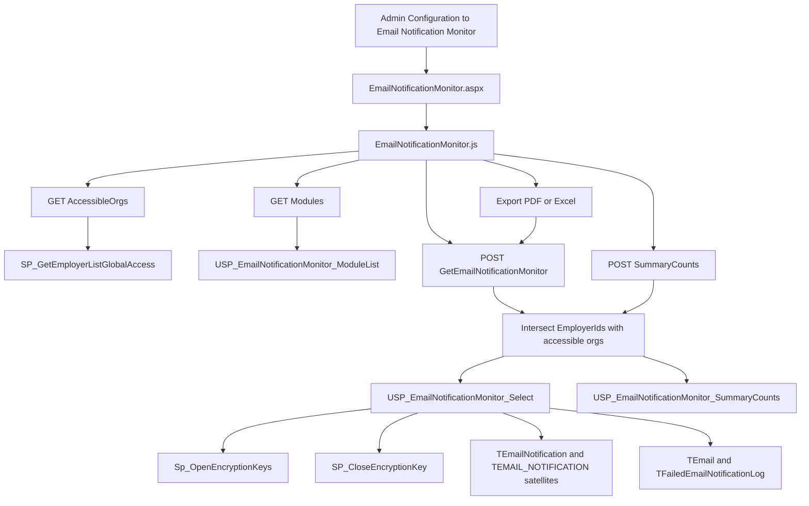
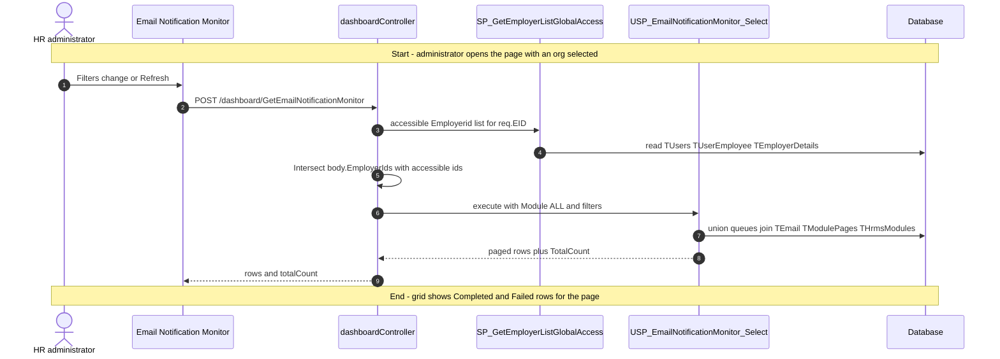
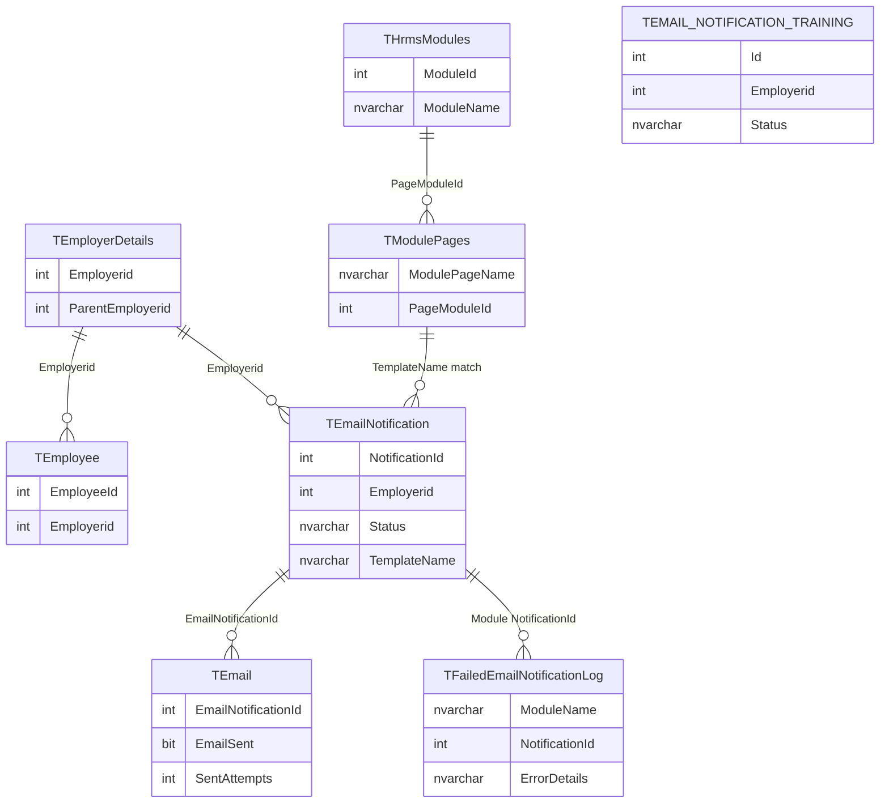

# Email Notification Monitor

## Overview

An HR administrator needs to see whether workflow and module emails completed or failed for one organisation, so they open **Admin Configuration → Email Notification Monitor** (`~/HRM/DashBoard_React/EmailNotificationMonitor.aspx`). The WebForms host only puts session fields into hidden inputs and loads the Dashboard React bundle. The React screen filters by organisation, business module, Completed/Failed status, created date-time range, and an optional “email actually sent” flag, then pages a grid of notification rows.

Each list and summary call goes through `HRMS.Core.WebAPI.Node` under `/dashboard`. The controller intersects the requested organisation ids with the caller’s accessible org list from `SP_GetEmployerListGlobalAccess`, then runs `USP_EmailNotificationMonitor_Select` or `USP_EmailNotificationMonitor_SummaryCounts`. Those procedures union core `TEmailNotification` with the four satellite `TEMAIL_NOTIFICATION_*` synonym tables, map statuses, attach `TEmail` delivery fields, and resolve page/module display through `TModulePages` / `THrmsModules`. There is no SystemModel-2 page for this screen. Table blurbs for `TEmailNotification` and `THrmsModules` are in `content/llm-wiki/reference/tables/hrms.md`.

**Who's involved:**

- **HR administrator** — opens the left-nav page, picks filters, pages the grid, and exports PDF/Excel. The page does not change notification status.
- **Email / notification schedulers** — do not open this screen. They write the queue rows and `TEmail` / failure-log rows that the monitor reads.
- **Employee** — does not open this screen. They may appear as Requested By, Created By, Actioned By, or as an address on Email To / CC / BCC.

## Workflow

## Request journey

### HR administrator — load the grid

The summary chip bar is a sibling POST to `USP_EmailNotificationMonitor_SummaryCounts` with the same org intersection and without `@Status` or paging. Module and accessible-org loads are separate GETs.

## Entry points

The left-nav URL is `~/HRM/DashBoard_React/EmailNotificationMonitor.aspx` (`RouteConstants.EMAIL_NOTIFICATION_MONITOR`). `Page_Load` only copies `LoggedInUser` into hidden fields and picks `dashboard_react.*.min.js`. The React route mounts `Areas/EmailNotificationMonitor/EmailNotificationMonitor.js`.

| UI page | Purpose |
|---|---|
| `HRM/DashBoard_React/EmailNotificationMonitor.aspx` | Host, session hidden fields, React bundle |
| `HRM/DashBoard_React/Areas/EmailNotificationMonitor/EmailNotificationMonitor.js` | Filters, grid, summary chips, export |

## Code → database call chain

There is no WebForms postback for data. The React client calls Node dashboard routes. List and summary controllers always call `GetEmailNotificationMonitorAccessibleOrgs` first, then the select/summary DAL methods.

| Entry | Method | Stored procedure |
|---|---|---|
| Organisation dropdown | `loadOrgs` (`EmailNotificationMonitor.js:318`) → `GetEmailNotificationMonitorAccessibleOrgs` (`dashboardController.js:1357`) → `GetEmailNotificationMonitorAccessibleOrgs` (`dashBoardDAL.js:2014`) | `SP_GetEmployerListGlobalAccess` |
| Module multi-select | `loadModules` (`EmailNotificationMonitor.js:325`) → `GetEmailNotificationMonitorModules` (`dashboardController.js:1366`) → `GetEmailNotificationMonitorModules` (`dashBoardDAL.js:1994`) | `USP_EmailNotificationMonitor_ModuleList` |
| Grid page / refresh | `loadData` (`EmailNotificationMonitor.js:403`) → `GetEmailNotificationMonitor` (`dashboardController.js:1311`) → `GetEmailNotificationMonitor` (`dashBoardDAL.js:1944`) | `USP_EmailNotificationMonitor_Select` (after accessible-org intersection via `SP_GetEmployerListGlobalAccess`) |
| Status summary chips | `loadSummaryCounts` (`EmailNotificationMonitor.js:427`) → `GetEmailNotificationMonitorSummaryCounts` (`dashboardController.js:1334`) → `GetEmailNotificationMonitorSummaryCounts` (`dashBoardDAL.js:1974`) | `USP_EmailNotificationMonitor_SummaryCounts` (same org intersection) |
| Export all matching rows | `getRowsForExport` (`EmailNotificationMonitor.js:485`) → same POST as the grid in 500-row chunks | `USP_EmailNotificationMonitor_Select` |

`USP_EmailNotificationMonitor_Select` executes `Sp_OpenEncryptionKeys` before the paged select and `SP_CloseEncryptionKey` after the TotalCount select. The UI always sends `@Module` as `ALL` and uses `@ResolvedModuleId` for the business-module filter.

## API endpoints

This screen does not post back the WebForms form for notification data. It calls Core Node routes mounted from `Routes/routeIndex.js` as `/dashBoard` (client paths use `/dashboard`). All four routes require `Authorize`. List and summary also use `assertEmployerAccess()`.

| Verb | Route | Parameters | Purpose | Source |
|---|---|---|---|---|
| GET | `/dashboard/GetEmailNotificationMonitorAccessibleOrgs` | JWT `EID` | Org hierarchy for the dropdown | `DashBoardRoutes.js:96` |
| GET | `/dashboard/GetEmailNotificationMonitorModules` | none | `THrmsModules` for the Module filter | `DashBoardRoutes.js:97` |
| POST | `/dashboard/GetEmailNotificationMonitor` | `Module`, `ResolvedModuleId`, `CreatedDateFrom`, `CreatedDateTo`, `Status`, `EmailSentOnly`, `EmployerIds`, `PageNumber`, `PageSize` | Paged rows plus `totalCount` | `DashBoardRoutes.js:94` |
| POST | `/dashboard/GetEmailNotificationMonitorSummaryCounts` | `Module`, `ResolvedModuleId`, `CreatedDateFrom`, `CreatedDateTo`, `EmployerIds` | One summary row for chips | `DashBoardRoutes.js:95` |

`ChangeTEmailNotificationStatus` exists on the same controller/DAL. This React page does not call it.

## Stored procedures & tables involved

Direct procedures this page executes, plus one nested level from the select procedure. Pages are under `/docs/database/hrms/`.

| Object | File | Purpose |
|---|---|---|
| `SP_GetEmployerListGlobalAccess` | `HRMS-DATABASE/HRMS/STOREPROCEDURE/SP_GetEmployerListGlobalAccess.sql` | Accessible org list for the dropdown and for server-side EmployerIds intersection. [SP_GetEmployerListGlobalAccess](/docs/database/hrms/SP_GetEmployerListGlobalAccess) |
| `USP_EmailNotificationMonitor_ModuleList` | `HRMS-DATABASE/HRMS/STOREPROCEDURE/USP_EmailNotificationMonitor_ModuleList.sql` | Business modules for `@ResolvedModuleId`. [USP_EmailNotificationMonitor_ModuleList](/docs/database/hrms/USP_EmailNotificationMonitor_ModuleList) |
| `USP_EmailNotificationMonitor_Select` | `HRMS-DATABASE/HRMS/STOREPROCEDURE/USP_EmailNotificationMonitor_Select.sql` | Paged Completed/Failed rows and TotalCount across core and satellite queues. [USP_EmailNotificationMonitor_Select](/docs/database/hrms/USP_EmailNotificationMonitor_Select) |
| `USP_EmailNotificationMonitor_SummaryCounts` | `HRMS-DATABASE/HRMS/STOREPROCEDURE/USP_EmailNotificationMonitor_SummaryCounts.sql` | Total and per-status counts for the chip bar. [USP_EmailNotificationMonitor_SummaryCounts](/docs/database/hrms/USP_EmailNotificationMonitor_SummaryCounts) |
| `Sp_OpenEncryptionKeys` | `HRMS-DATABASE/HRMS/STOREPROCEDURE/Sp_OpenEncryptionKeys.sql` | Nested open-key step at the start of the select body. [Sp_OpenEncryptionKeys](/docs/database/hrms/Sp_OpenEncryptionKeys) |
| `SP_CloseEncryptionKey` | `HRMS-DATABASE/HRMS/STOREPROCEDURE/SP_CloseEncryptionKey.sql` | Nested close-key step after TotalCount. [SP_CloseEncryptionKey](/docs/database/hrms/SP_CloseEncryptionKey) |

Tables those scripts touch: `TEmailNotification`, `TEMAIL_NOTIFICATION_TRAINING`, `TEMAIL_NOTIFICATION_RESOURCEALLOCATION`, `TEMAIL_NOTIFICATION_SURVEY`, `TEMAIL_NOTIFICATION_TRAVELNEXPENSE`, `TEmail`, `TFailedEmailNotificationLog`, `TModulePages`, `THrmsModules`, `TEmployerDetails`, `TEmployee`, `TUsers`, `TUserEmployee`, `TRRS_GRID_CONFIG`. Catalog blurbs for `TEmailNotification` and `THrmsModules` are in `content/llm-wiki/reference/tables/hrms.md`.

`USP_EmailNotificationMonitor_AccessibleOrgs.sql` exists in the database repo. The live DAL for this screen does not execute it.

## Table relationships

Declared parents for `TEmailNotification` point at `TEmployee` in the llm-wiki catalog. Satellite notification tables are synonyms into module databases. `TEmail.EmailNotificationId` links to a notification id without a module column. Module/page display joins `TemplateName` / `ModulePageName` to `TModulePages.ModulePageName`, then `PageModuleId` to `THrmsModules`.

## Known gaps

- `dashBoardDAL.GetEmailNotificationMonitorAccessibleOrgs` executes `SP_GetEmployerListGlobalAccess`, not `USP_EmailNotificationMonitor_AccessibleOrgs`. The dedicated AccessibleOrgs script still exists and is unused by this path.
- `SP_GetEmployerListGlobalAccess` gates full-org visibility on `UserType = 'S'`, role ids `467`/`332`, or employee id `-1`. The React UI hint still talks about `IsGlobalAccess`, which is a different flag.
- `USP_EmailNotificationMonitor_Select` opens and closes encryption keys but the returned employee names are plain `FName` / `LName` concatenations with no decrypt call.
- The UI filter and chips only expose Completed and Failed. The select procedure also maps Pending, New, and Other internally, then hard-filters to Completed/Failed for both result sets.
- Summary still returns `UnderReviewCount`, but core `Review` now maps to Failed, so that bucket stays zero.
- `@EmailSentOnly` is applied to the paged row set only, not to `TotalCount`, so page totals can disagree with the visible “email sent only” grid.
- Export refuses when `totalCount` is over 1000; the procedure caps `@PageSize` at 500.
- `USP_TEmailNotification_ChangeStatus` / `ChangeTEmailNotificationStatus` is not used by this monitor. The screen is read-only.
- No SystemModel-2 document names this left-nav item or the `USP_EmailNotificationMonitor_*` procedures.

## Reference

Confidence is medium because the React screen, dashboard routes/controller/DAL, and the four procedure bodies used on the live path were read. Satellite insert/send pipelines and status-change APIs were not expanded.

### SourceCode

- `HRMS.Web/HRMS.Web/HRM/DashBoard_React/EmailNotificationMonitor.aspx`
- `HRMS.Web/HRMS.Web/HRM/DashBoard_React/EmailNotificationMonitor.aspx.cs`
- `HRMS.Web/HRMS.Web/HRM/DashBoard_React/Areas/EmailNotificationMonitor/EmailNotificationMonitor.js`
- `HRMS.Web/HRMS.Web/HRM/DashBoard_React/Common/apiURLConstants.js`
- `HRMS.Web/HRMS.Web/HRM/DashBoard_React/Common/routeConstants.js`
- `HRMS.CoreAPI/HRMS.Core.WebAPI.Node/Routes/DashBoardRoutes.js`
- `HRMS.CoreAPI/HRMS.Core.WebAPI.Node/Controllers/dashboardController.js`
- `HRMS.CoreAPI/HRMS.Core.WebAPI.Node/Core/DataAccessLayer/dashBoardDAL.js`

### TDG HRMS DB

- `content/llm-wiki/reference/tables/hrms.md`
- `HRMS-DATABASE/HRMS/STOREPROCEDURE/USP_EmailNotificationMonitor_Select.sql`
- `HRMS-DATABASE/HRMS/STOREPROCEDURE/USP_EmailNotificationMonitor_SummaryCounts.sql`
- `HRMS-DATABASE/HRMS/STOREPROCEDURE/USP_EmailNotificationMonitor_ModuleList.sql`
- `HRMS-DATABASE/HRMS/STOREPROCEDURE/USP_EmailNotificationMonitor_AccessibleOrgs.sql`
- `HRMS-DATABASE/HRMS/STOREPROCEDURE/SP_GetEmployerListGlobalAccess.sql`
- `HRMS-DATABASE/HRMS/STOREPROCEDURE/Sp_OpenEncryptionKeys.sql`
- `HRMS-DATABASE/HRMS/STOREPROCEDURE/SP_CloseEncryptionKey.sql`
