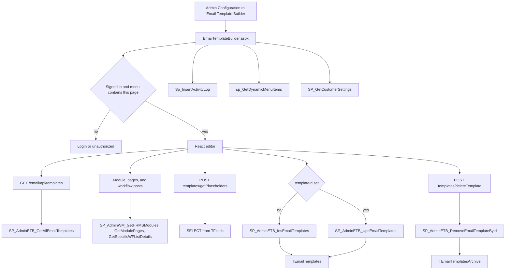
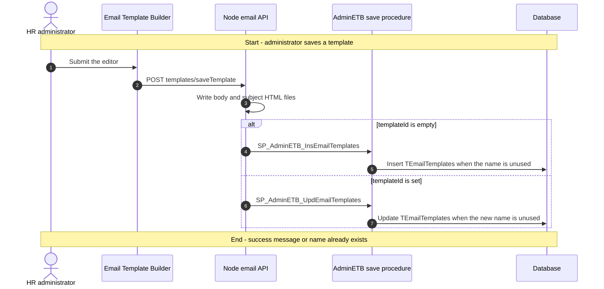
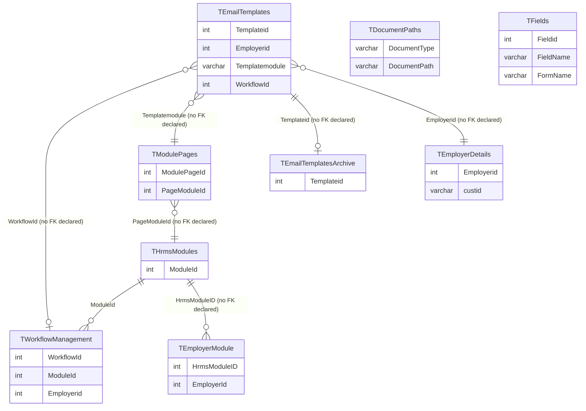

# Email Template Builder

## Overview

An HR administrator needs the wording of the emails HRMS sends when someone applies leave, gets approved, or is rejected. They open **Admin Configuration → Email Template Builder** (`/HRM/EmailTemplateManage/EmailTemplateBuilder.aspx`). The WebForms page checks that they are signed in and that their menu includes this URL, records the visit, and reads whether Celebrations Hub is on for the customer. It then mounts a React editor in `#root`.

In that editor they pick a module and a page, choose a message type (notification, approver notification, pullback, approve, or reject), and attach the template to a workflow. They insert placeholders such as employee name, then save. A new name inserts a row in `TEmailTemplates`. The same name for that employer comes back as "Template Name already exist." Saving an existing template updates that row. Deleting a template copies it into `TEmailTemplatesArchive` and removes it from `TEmailTemplates`. The Node route also writes an HTML file and a subject file under the customer folder before it calls the procedure.

SystemModel-2 describes the template types `N` / `NA` / `A` / `R` / `B` and placeholder replacement in `experience/notifications/notifications.md`, and the same types in `domain/contexts/workflow-platform.md`. The `llm-wiki` table catalog lists `TEmailTemplates` and `TFields`. There is no domain page for this builder.

**Who's involved:**

- **HR administrator** — creates and edits the templates for an organisation. The page only opens when `sp_GetDynamicMenuItems` returns a row whose URL contains `EmailTemplateBuilder.aspx`.
- **Workflow approver** — does not open this screen. Later notification jobs use the saved subject and body.
- **Employee** — does not open this screen. They receive the mail the template describes.

## Workflow

## Request journey

### HR administrator — save a template

The list, module, and placeholder calls are separate reads. They are in the call-chain table and are not drawn here.

## Entry points

`EmailTemplateBuilder.aspx` is the left-nav page. `Page_Load` redirects to `Login.aspx` when the session has no `LoggedInUser`, and to `unauthorized.aspx` when the dynamic menu does not contain this page. The markup loads `Build/assets/index.js`, which is the Vite build of `email-template-builder-app`. That app routes `/HRM/EmailTemplateManage/EmailTemplateBuilder.aspx` to the editor page. The same aspx also renders a Telerik `RadEditor` and assigns `window.RadEditorAPI`. The checked-in React source does not call `RadEditorAPI`.

Workflow Management links here with `?moduleId=` (`WorkflowManagement.js`).

| UI page | Purpose |
|---|---|
| `HRM/EmailTemplateManage/EmailTemplateBuilder.aspx` | Host, session gate, RadEditor, React mount |
| `email-template-builder-app/frontend/src/app/editor/page.tsx` | List, edit, save, and delete |
| `email-template-builder-app/frontend/src/app/form/templatedetails.tsx` | Module, page, workflow, and placeholders |

`HRM/Settings/EmailHTMLEditor.aspx` is a separate WebForms editor. It is not this left-nav item.

## Code → database call chain

Page load uses Enterprise Library from the WebForms code-behind. The editor uses the Node routes in `email-template-builder-app/node_server`, which call `mssql` `.execute` directly. There is no BLL or DAL on that path.

| Entry | Method | Stored procedure |
|---|---|---|
| Page visit | `Page_Load` (`EmailTemplateBuilder.aspx.cs:36`) → `CommonUtil.LogActivity` (`Common.cs:52`) → `ActivityHelper.LogActivity` (`ActivityHelper.cs:32`) | `Sp_InsertActivityLog` |
| Menu gate | `DashboardBLL.GetMenuItems` (`DashboardBLL.cs:23`) → `DashboardDAL.GetMenuItems` (`DashboardDAL.cs:241`) | `sp_GetDynamicMenuItems` |
| Celebrations Hub flag | `DBHelper.GetCustomerSettings` (`DBHelper.cs:3427`), called from `EmailTemplateBuilder.aspx.cs:68` | `SP_GetCustomerSettings` |
| Template list | `email-templates.tsx:43` → `GET /email/api/templates` (`templates.js:24`) | `SP_AdminETB_GetAllEmailTemplates` |
| Open one template | `page.tsx:209` and `page.tsx:236` → `POST /email/api/templates/getTemplateDetails` (`templates.js:130`) | `SP_AdminETB_GetEmailTemplates` |
| Save new | `page.tsx:170` → `POST /email/api/templates/saveTemplate` when `templateId` is empty (`templates.js:97`) | `SP_AdminETB_InsEmailTemplates` |
| Save existing | same route when `templateId` is set (`templates.js:76`) | `SP_AdminETB_UpdEmailTemplates` |
| Delete | `page.tsx:115` → `POST /email/api/templates/deleteTemplate` (`templates.js:218`) | `SP_AdminETB_RemoveEmailTemplateById` |
| Module list | `templatedetails.tsx:82` → `GET /email/api/module` (`modules.js:8`) | `SP_AdminWM_GetHRMSModules` |
| Module pages | `templatedetails.tsx:132` → `POST /email/api/module/modulePages` (`modules.js:62`) | `SP_AdminWM_GetModulePages` |
| Workflow list | `templatedetails.tsx:187` → `POST /email/api/module/workflow` (`modules.js:36`) | `SP_AdminWM_GetSpecificWFListDetails` |
| Placeholders | `templatedetails.tsx:108` and `templatedetails.tsx:235` → `POST /email/api/templates/getPlaceholders` (`templates.js:38`) | None. The route runs a `SELECT` against `TFields` |

`SP_AdminWM_GetSpecificWFListDetails` calls `dbo.Fn_GetEmployeeName` for the workflow's updated-by name.

## API endpoints

The editor does not post back the WebForms form for template data. It calls the Node app mounted at `/email/api`. The client base URL is `VITE_NEXT_PUBLIC_API_URL`.

| Verb | Route | Parameters | Purpose | Source |
|---|---|---|---|---|
| GET | `/email/api/templates` | None. The route sends `Employerid` 10 | List templates | `templates.js:24` |
| POST | `/email/api/templates/getPlaceholders` | Body `formName`, `category` (both required by the query string it builds) | Placeholder names from `TFields` | `templates.js:38` |
| POST | `/email/api/templates/saveTemplate` | Body `name`, `description`, `pageModuleId`, `subject`, `subjectFields`, `type`, `fields`, `createdBy`, `employer`, `active`, `wfNodes`, `wfId`, `templateHtml`. `templateId` switches update vs insert. Header `X-Cust-Id` optional | Insert or update, and write HTML files | `templates.js:68` |
| POST | `/email/api/templates/getTemplateDetails` | Body `templateId`, `templateType`, `employerid`, `tempModule`, `workflowId`. Header `X-Cust-Id` optional | One template plus HTML read from disk | `templates.js:130` |
| POST | `/email/api/templates/deleteTemplate` | Body `templateIds` (required array) | Archive and delete each id | `templates.js:218` |
| GET | `/email/api/module` | None. The route sends `Employerid` 10 | Active HRMS modules | `modules.js:8` |
| POST | `/email/api/module/modulePages` | Body `allModuleIds` (required array) | Pages for those modules | `modules.js:62` |
| POST | `/email/api/module/workflow` | Body `allModuleIds` (required array). The route fixes employer 10 and user type `A` | Workflows for those modules | `modules.js:36` |

`EmailTemplateBuilderController` exposes `GET api/EmailTemplateBuilder/GetDefaultFields/{employerId}` (`EmailTemplateBuilderController.cs:137`) and `GET api/EmailTemplateBuilder/GetFields/{formName}/{messageType}/{messageTypeDescription}/{emailTemplateFormName}/{employerId}` (`EmailTemplateBuilderController.cs:189`). Both call `EmailBll.GetEmailDefaultTemplatePageFields`, which executes `SP_GetTemplateFields`. The checked-in React client does not call those routes. Placeholder lookup on this page is the Node `SELECT` above. The controller is marked `[AllowAnonymous]`.

## Stored procedures & tables involved

| Object | File | Purpose |
|---|---|---|
| `Sp_InsertActivityLog` | `HRMS-DATABASE/HRMS/STOREPROCEDURE/Sp_InsertActivityLog.sql` | Visit log. Page already at [/docs/database/hrms/Sp_InsertActivityLog](/docs/database/hrms/Sp_InsertActivityLog) |
| `sp_GetDynamicMenuItems` | `HRMS-DATABASE/HRMS/STOREPROCEDURE/sp_GetDynamicMenuItems.sql` | Menu rows used for the access check |
| `SP_GetCustomerSettings` | `HRMS-DATABASE/HRMS/STOREPROCEDURE/SP_GetCustomerSettings.sql` | Customer flags, including `IsCelebrationHubEnabled` |
| `SP_AdminETB_GetAllEmailTemplates` | `HRMS-DATABASE/HRMS/STOREPROCEDURE/SP_AdminETB_GetAllEmailTemplates.sql` | Template grid for one employer |
| `SP_AdminETB_GetEmailTemplates` | `HRMS-DATABASE/HRMS/STOREPROCEDURE/SP_AdminETB_GetEmailTemplates.sql` | One template, or the set for a type, module, and workflow |
| `SP_AdminETB_InsEmailTemplates` | `HRMS-DATABASE/HRMS/STOREPROCEDURE/SP_AdminETB_InsEmailTemplates.sql` | Insert when the name is unused |
| `SP_AdminETB_UpdEmailTemplates` | `HRMS-DATABASE/HRMS/STOREPROCEDURE/SP_AdminETB_UpdEmailTemplates.sql` | Update when the new name is unused |
| `SP_AdminETB_RemoveEmailTemplateById` | `HRMS-DATABASE/HRMS/STOREPROCEDURE/SP_AdminETB_RemoveEmailTemplateById.sql` | Copy to `TEmailTemplatesArchive`, then delete |
| `SP_AdminWM_GetHRMSModules` | `HRMS-DATABASE/HRMS/STOREPROCEDURE/SP_AdminWM_GetHRMSModules.sql` | Active modules |
| `SP_AdminWM_GetModulePages` | `HRMS-DATABASE/HRMS/STOREPROCEDURE/SP_AdminWM_GetModulePages.sql` | Pages in the selected modules |
| `SP_AdminWM_GetSpecificWFListDetails` | `HRMS-DATABASE/HRMS/STOREPROCEDURE/SP_AdminWM_GetSpecificWFListDetails.sql` | Workflows, including template types already saved |
| `Fn_GetEmployeeName` | `HRMS-DATABASE/HRMS/FUNCTIONS/Fn_GetEmployeeName.sql` | Nested from the workflow list. Page already at [/docs/database/hrms/Fn_GetEmployeeName](/docs/database/hrms/Fn_GetEmployeeName) |

`llm-wiki/reference/tables/hrms.md` describes `TEmailTemplates`, `TFields`, `TWorkflowManagement` (foreign key to `THrmsModules`), `THrmsModules`, `TModulePages`, `TEmployerModule`, `TDocumentPaths`, `TCustomerSettings`, and `TActivityLog`. `TEmailTemplatesArchive` is not in that catalog.

## Table relationships

The only foreign key declared among these tables is `TWorkflowManagement.ModuleId` → `THrmsModules.ModuleId` (`TABLES/TWorkflowManagement.sql`). `TEmployerDetails` also declares `FK_Pref_Employerid` from `Employerid` to itself. `TEmailTemplates` has no foreign key in its create script or in the later column alters. The builder joins by `Employerid`, `Templatemodule` = `ModulePageId`, `WorkflowId`, and `PageModuleId` = `ModuleId`.

## Known gaps

- List, module, page, and workflow routes send employer `10`. The editor's default `createdBy` is `1430` and default `employer` is `10` (`TemplateConstants.ts`). The aspx hidden fields hold the signed-in employer and customer. Save sends `X-Cust-Id` from `hdnCustomerId` for the HTML folder only. `getTemplateDetails` still posts `employerid` 10.
- `SP_AdminETB_InsEmailTemplates` requires `@TemplateBodyHTML` and `@TemplateSubjectHTML`, and optional `@RecipientMap`. It builds `TemplatePath` itself and does not take a path parameter. The Node insert call sends `TemplatePath` and does not send the HTML or recipient parameters. The update procedure does take `@TemplatePath` and the HTML parameters. The Node update call sends the path and omits the HTML parameters. HTML is written to disk beside that call. This guide did not execute the route.
- `getPlaceholders` concatenates `formName` and `category` into a SQL string. It does not call `SP_GetTemplateFields`.
- `EmailTemplateBuilderController` adds a synthetic `SIGNATURE` placeholder. SystemModel-2 records that in `experience/notifications/notifications.md`. This page's React client does not call the controller, so that placeholder is not on the path traced here.
- `Page_Load` sets `CelebrationHubEnabled` from `IsCelebrationHubEnabled`. `AppConfigContext` does not read `hdnCelebrationHubEnabled`.
- `GET /email/api/module/:id`, `/email/api/employees`, and `/email/api/copilot` are on the same Node app. The editor page does not call them. Copilot helpers in the editor are commented out.
- `EmailHTMLEditor.aspx` calls the same `SP_AdminETB_*` names through `EmailDAL`. That page is outside this left-nav item. Its insert call also omits the HTML parameters the current procedure declares.
- Several scripts open with `USE [HRM-CL-Prod]`. The procedures themselves are not schema-qualified to that database.

## Reference

Confidence is medium. The aspx gate, the React routes, the Node `execute` calls, and the procedure bodies were read. The save-parameter mismatch was not executed, and the React build under `EmailTemplateManage/Build` is not in this checkout.

### SourceCode

- `docs/SystemModels/SystemModel-2/experience/notifications/notifications.md`
- `docs/SystemModels/SystemModel-2/domain/contexts/workflow-platform.md`
- `HRMS.Web/HRMS.Web/HRM/EmailTemplateManage/EmailTemplateBuilder.aspx`
- `HRMS.Web/HRMS.Web/HRM/EmailTemplateManage/EmailTemplateBuilder.aspx.cs`
- `HRMS.EmailTemplateModification/email-template-builder-app/frontend/src/App.tsx`
- `HRMS.EmailTemplateModification/email-template-builder-app/frontend/src/app/editor/page.tsx`
- `HRMS.EmailTemplateModification/email-template-builder-app/frontend/src/app/form/templatedetails.tsx`
- `HRMS.EmailTemplateModification/email-template-builder-app/frontend/src/app/templates/email-templates.tsx`
- `HRMS.EmailTemplateModification/email-template-builder-app/frontend/src/constants/TemplateConstants.ts`
- `HRMS.EmailTemplateModification/email-template-builder-app/node_server/app.js`
- `HRMS.EmailTemplateModification/email-template-builder-app/node_server/routes/templates.js`
- `HRMS.EmailTemplateModification/email-template-builder-app/node_server/routes/modules.js`
- `HRMS.Shared/HRMS.WebAPI/Controllers/EmailTemplateBuilderController.cs`
- `HRMS.Shared/HRMS.BusinessLayer/Email/EmailBLL.cs`
- `HRMS.Shared/HRMS.DataAccessLayer/Email/EmailDAL.cs`
- `HRMS.Shared/HRMS.BusinessLayer/DashboardBLL.cs`
- `HRMS.Shared/HRMS.DataAccessLayer/DashboardDAL.cs`
- `HRMS.Shared/HRMS.DataAccessLayer/DBHelper.cs`
- `HRMS.Shared/HRMS.Common/Common.cs`
- `HRMS.Shared/TDG.ActivityAuditLog/DAL/ActivityHelper.cs`

### TDG HRMS DB

- `llm-wiki/reference/tables/hrms.md` (`TEmailTemplates`, `TFields`, `TWorkflowManagement`, `THrmsModules`, `TModulePages`, `TEmployerModule`, `TDocumentPaths`, `TCustomerSettings`, `TActivityLog`)
- `HRMS-DATABASE/HRMS/STOREPROCEDURE/SP_AdminETB_GetAllEmailTemplates.sql`
- `HRMS-DATABASE/HRMS/STOREPROCEDURE/SP_AdminETB_GetEmailTemplates.sql`
- `HRMS-DATABASE/HRMS/STOREPROCEDURE/SP_AdminETB_InsEmailTemplates.sql`
- `HRMS-DATABASE/HRMS/STOREPROCEDURE/SP_AdminETB_UpdEmailTemplates.sql`
- `HRMS-DATABASE/HRMS/STOREPROCEDURE/SP_AdminETB_RemoveEmailTemplateById.sql`
- `HRMS-DATABASE/HRMS/STOREPROCEDURE/SP_AdminWM_GetHRMSModules.sql`
- `HRMS-DATABASE/HRMS/STOREPROCEDURE/SP_AdminWM_GetModulePages.sql`
- `HRMS-DATABASE/HRMS/STOREPROCEDURE/SP_AdminWM_GetSpecificWFListDetails.sql`
- `HRMS-DATABASE/HRMS/STOREPROCEDURE/SP_GetCustomerSettings.sql`
- `HRMS-DATABASE/HRMS/STOREPROCEDURE/sp_GetDynamicMenuItems.sql`
- `HRMS-DATABASE/HRMS/STOREPROCEDURE/Sp_InsertActivityLog.sql`
- `HRMS-DATABASE/HRMS/FUNCTIONS/Fn_GetEmployeeName.sql`
- `HRMS-DATABASE/HRMS/TABLES/TEmailTemplates.sql`
- `HRMS-DATABASE/HRMS/TABLES/TWorkflowManagement.sql`
- `HRMS-DATABASE/HRMS/TABLES/146475/TEmailTemplatesArchive_Create.sql`
