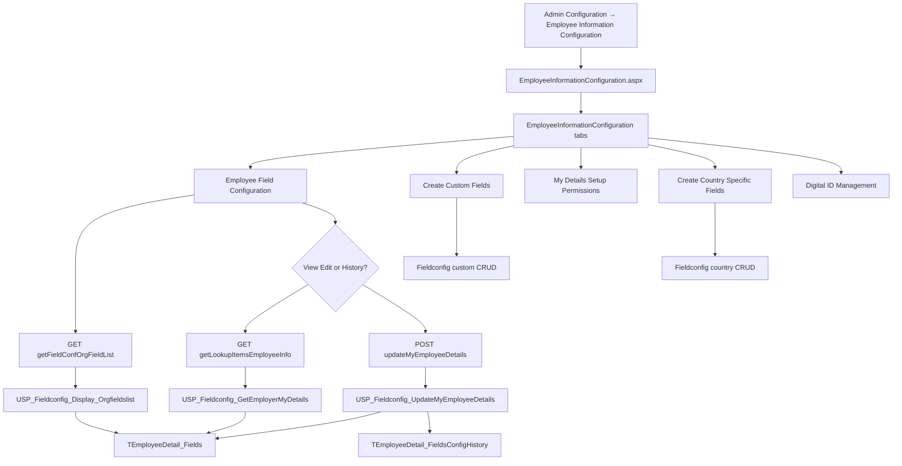
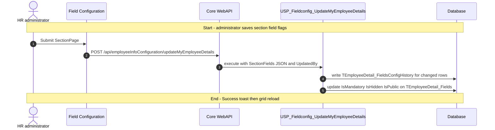
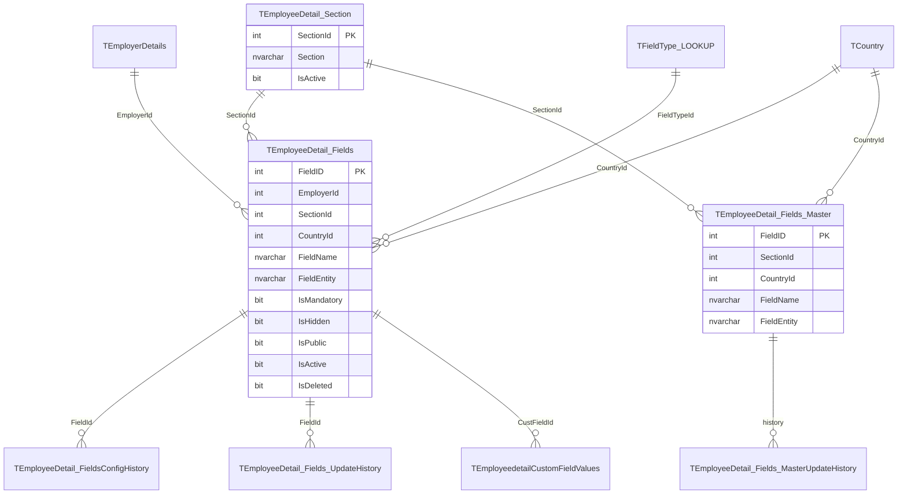

# Employee Information Configuration

## Overview

An HR administrator configures which employee-profile fields appear in My Details (and related capture flows), how mandatory/hidden/public they are, and which custom or country-specific fields exist for the organisation. They open **Admin Configuration → Employee Information Configuration** (`~/HRM/Employee_React/EmployeeInformationConfiguration.aspx`). The WebForms host stamps session employee context into hidden fields and loads the Employee_React webpack bundle. Client routing mounts `EmployeeInformationConfigurationLayout` / `EmployeeInformationConfigurationPage` when the caller has the Employee_React access gate (`hasAccess`).

The shell has up to five tabs, gated by profile `AccessTabs` and user type:

1. **Employee's Field Configuration** — section grid from `USP_Fieldconfig_Display_Orgfieldslist`; view/edit field flags (mandatory, hidden, public) via `USP_Fieldconfig_GetEmployerMyDetails` / `USP_Fieldconfig_UpdateMyEmployeeDetails`; history via `USP_Fieldconfig_GetFieldsChange_History`. Role tab `348` controls edit vs view-only.
2. **Create Custom Field(s)** — employer custom fields (`FieldEntity = 'Custom'`) CRUD through `SP_FieldConfig_GetCustomFields` and related Fieldconfig procedures. Role tab `349` controls edit.
3. **My Details Setup Permissions** — role/employee access-control tree (`/api/employees/access-control/...`). Separate from the Fieldconfig API; not expanded in the call chain below.
4. **Create Country Specific Field(s)** — super-admin (`userType === "S"`) only; country master fields via `SP_FieldConfig_GetCoutrywiseFields` and related Fieldconfig procedures.
5. **Digital ID Management** — template designer under `/api/digital-id-card/...`. Separate SP family; not expanded in the call chain below.

Employees do not open this screen. My Details and bulk profile flows later honour the field metadata maintained here.

**Who's involved:**

- **HR administrator** — maintains field configuration and custom fields for their organisation. Needs the matching AccessTabs / role-tab rows.
- **Super admin** — also sees Create Country Specific Field(s).
- **Employee** — does not open this screen; consumes the resulting field rules in My Details.

## Workflow

## Request journey

### HR administrator — save Employee Field Configuration

## Entry points

`~/HRM/Employee_React/EmployeeInformationConfiguration.aspx` is the live host. `Page_Load` copies `LoggedInEmployee` into hidden fields (`hdnEmpId`, `hdnEmployerId`, and related). The React bundle mounts at `#root`. `routes.js` registers `ROUTES.EmployeeInformationConfiguration` under `EmployeeInformationConfigurationLayout`, which wraps `EmployeePage` with menu **Admin Configuration** / page **Employee Information Configuration**.

| UI page | Purpose |
|---|---|
| `HRM/Employee_React/EmployeeInformationConfiguration.aspx` | WebForms host and session stamp |
| `Areas/EmployeeInformationConfiguration/EmployeeInformationConfigurationLayout.js` | Provider + EmployeePage chrome |
| `Areas/EmployeeInformationConfiguration/EmployeeInformationConfigurationPage.js` | Passes selected organisation into the tab host |
| `Areas/EmployeeInformationConfiguration/EmployeeInformationConfiguration.js` | Tab host and Field Configuration grid |
| `Areas/EmployeeInformationConfiguration/components/SectionSelectPage.js` / `SectionPage.js` | Section picker and field edit form |
| `Areas/EmployeeInformationConfiguration/components/CreateCustomFields.js` | Custom field grid and modal |
| `Areas/EmployeeInformationConfiguration/components/CreateCountrySpecificFields.js` | Country-specific field grid and modal |
| `Areas/EmployeeInformationConfiguration/components/MyDetailsPermissionSetup.js` | Access-control permissions UI |
| `Areas/EmployeeInformationConfiguration/components/DigitalIdManagement/` | Digital ID template management |

## Code → database call chain

Not WebForms postback for these actions. Init and Field Configuration / Custom / Country tabs call Core WebAPI (`/api/preonboarding/...`, `/api/employeeInfoConfiguration/...`, `/api/employees/:id/profile`). My Details Setup Permissions and Digital ID Management use other mounts and are listed under Known gaps.

| Entry | Method | Stored procedure |
|---|---|---|
| Provider init | `getOrganizations` (`EmployeeHttpClient.js:206`) → `GetEmployerList` (`preOnBoardingController.js:429`) → `GetEmployerList` (`preOnBoardingDAL.js:717`) | `SP_GetEmployerList` |
| Provider init | `getMyDetailsConfiguration` (`EmployeeHttpClient.js:210`) → `GetMyDetailsConfiguration` (`preOnBoardingController.js:516`) → DAL (`preOnBoardingDAL.js:974`) | `USP_GetMyDetailsFieldsConfig` |
| Provider init | `getLookupItemsForMyDetails` (`EmployeeHttpClient.js:214`) → `GetLookUpItemsForMyDetails` (`preOnBoardingController.js:535`) → DAL (`preOnBoardingDAL.js:1015`) | `SP_GetLookUpItems_MyDetails` |
| Provider init | `getLookupMaster` (`EmployeeHttpClient.js:218`) → `GetLookUpMaster` (`preOnBoardingController.js:507`) → DAL (`preOnBoardingDAL.js:943`) | inline SQL on `POBLookupMaster` / `POBLookupEmployerMapping` (no SP) |
| Provider init | `getSectionsEmployeeInfo` (`EmployeeHttpClient.js:222`) → `sectionList` (`EmployeeInfoConfiguratioHandler.js:42`) | `USP_Fieldconfig_SectionDropDown` |
| Provider init / after save | `getFieldConfOrgFieldList` (`EmployeeHttpClient.js:226`) → `getFieldConfOrgFieldList` (`EmployeeInfoConfiguratioHandler.js:258`) | `USP_Fieldconfig_Display_Orgfieldslist` |
| Provider init | `getProfile` (`EmployeeHttpClient.js:86`) → `ProfileQueryHandler` → `getEmployeeInfoWithTabAccess` (`EmployeeRepository.js:41`) | `Sp_BulkProfileAdminRoleM_GetTabRoleDet` (+ nested `SP_GetActiveInactiveFlagForRole`) |
| Provider init | `getTabRoleDetails` (`EmployeeHttpClient.js:230`) → `GetPermissionRoleTabDetails` (`preOnBoardingController.js:1412`) → DAL (`preOnBoardingDAL.js:1928`) | `Sp_AdminRoleM_GetTabRoleDet` |
| Provider init | `countryWiseFieldList` (`EmployeeHttpClient.js:252`) → `getCountryWiseFieldList` (`EmployeeInfoConfiguratioHandler.js:286`) | `SP_FieldConfig_GetCoutrywiseFields` |
| Provider init | `customFieldList` (`EmployeeHttpClient.js:256`) → `getCustomFieldList` (`EmployeeInfoConfiguratioHandler.js:306`) | `SP_FieldConfig_GetCustomFields` |
| View / Edit section | `getLookupItemsEmployeeInfo` (`EmployeeHttpClient.js:236`) → `lookupItemsEmployeesInfo` (`EmployeeInfoConfiguratioHandler.js:70`) | `USP_Fieldconfig_GetEmployerMyDetails` |
| Save field flags | `postUpdateMyEmployeeDetails` (`EmployeeHttpClient.js:246`) → `updateMyEmployeeDetails` (`EmployeeInfoConfiguratioHandler.js:99`) | `USP_Fieldconfig_UpdateMyEmployeeDetails` |
| History modal | `getEmployeeFieldConfHistory` (`EmployeeHttpClient.js:240`) → `getEmployeeFieldConfHistory` (`EmployeeInfoConfiguratioHandler.js:402`) | `USP_Fieldconfig_GetFieldsChange_History` |
| Custom save | `submitCustomData` (`EmployeeHttpClient.js:320`) → `submitCustomData` (`EmployeeInfoConfiguratioHandler.js:224`) | `USP_Fieldconfig_InsertUpdateMyEmployeeDetails_Customfields` |
| Custom delete | `deleteCustomFields` (`EmployeeHttpClient.js:312`) → `deleteCustomFields` (`EmployeeInfoConfiguratioHandler.js:161`) | `USP_Fieldconfig_DeleteMyEmployeeDetails_Customfields` |
| Custom history | `getCustomHistory` (`EmployeeHttpClient.js:276`) → `getCustomHistory` (`EmployeeInfoConfiguratioHandler.js:334`) | `USP_Fieldconfig_CustomFields_History` |
| Country save | `submitCountryWiseFieldData` (`EmployeeHttpClient.js:316`) → `submitCountryWiseFieldData` (`EmployeeInfoConfiguratioHandler.js:192`) | `USP_Fieldconfig_UpdateMyEmployeeDetails_Countryfields` |
| Country delete | `deleteCountryWiseFields` (`EmployeeHttpClient.js:308`) → `deleteCountryWiseFields` (`EmployeeInfoConfiguratioHandler.js:130`) | `USP_Fieldconfig_DeleteMyEmployeeDetails_Countryfields` |
| Country history | `getCountrySpecificHistory` (`EmployeeHttpClient.js:272`) → `getCountrySpecificHistory` (`EmployeeInfoConfiguratioHandler.js:368`) | `USP_Fieldconfig_CountryFields_History` |
| Country in-use | `checkCountrySpecificFieldsInUse` (`EmployeeHttpClient.js:300`) → `checkCountrySpecificFieldInUse` (`EmployeeInfoConfiguratioHandler.js:463`) | `USP_Fieldconfig_CountryUsageCheck` |
| Country field name list | `getExistingFieldName` (`EmployeeHttpClient.js:304`) → `getExistingFieldName` (`EmployeeInfoConfiguratioHandler.js:584`) | `SP_Fieldconfig_CountryFieldValidation` |

`checkCustomFieldInUse` and several dropdown helpers (`getCountryList`, `getSectionList`, `getControlTypeList`, `getOptionsList`, `getCustomerList`, `getMyDetailSection`) are dynamic SQL in the same handler, not stored procedures.

## API endpoints

Not WebForms postback. Authorize middleware applies on these mounts.

| Verb | Route | Parameters | Purpose | Source |
|---|---|---|---|---|
| GET | `/api/preonboarding/GetEmployerList` | `employeeId` | Organisation list for the signed-in employee | `preOnBoardingRoutes.js:8` |
| GET | `/api/preonboarding/GetMyDetailsConfiguration` | `employerId` | Legacy POB My Details section summary (init) | `preOnBoardingRoutes.js:10` |
| GET | `/api/preonboarding/GetLookUpItemsForMyDetails` | `employerId` | POB lookup items (init) | `preOnBoardingRoutes.js:13` |
| GET | `/api/preonboarding/GetLookUpMaster` | `employerid` | POB lookup sections (init, inline SQL) | `preOnBoardingRoutes.js:9` |
| GET | `/api/preonboarding/GetPermissionRoleTabDetails` | `EmployerId`, `RoleId` | Role tab editability (tabs 348/349) | `preOnBoardingRoutes.js:97` |
| GET | `/api/employees/:employeeId/profile` | route `employeeId` | AccessTabs for tab visibility | `Profile/routes.js:34` |
| GET | `/api/employeeInfoConfiguration/GetSectionsEmployeeInfo` | `employerId` | Section dropdown | `FieldConfiguration/router.js:28` |
| GET | `/api/employeeInfoConfiguration/getFieldConfOrgFieldList` | `employerId` | Field Configuration grid | `FieldConfiguration/router.js:31` |
| GET | `/api/employeeInfoConfiguration/getLookupItemsEmployeeInfo` | `employerId`, `sectionIds` | Fields for selected section(s) | `FieldConfiguration/router.js:29` |
| POST | `/api/employeeInfoConfiguration/updateMyEmployeeDetails` | query `UpdatedBy`; body field rows | Save mandatory/hidden/public | `FieldConfiguration/router.js:30` |
| GET | `/api/employeeInfoConfiguration/getEmployeeFieldConfHistory` | `employerId`, `sectionId` | Section change history | `FieldConfiguration/router.js:53` |
| GET | `/api/employeeInfoConfiguration/getCustomFieldList` | `employerId` | Custom field grid | `FieldConfiguration/router.js:44` |
| POST | `/api/employeeInfoConfiguration/submitCustomData` | query `UpdatedBy`; body | Insert/update custom field | `FieldConfiguration/router.js:48` |
| POST | `/api/employeeInfoConfiguration/deleteCustomFields` | query `UpdatedBy`; body | Delete custom field(s) | `FieldConfiguration/router.js:46` |
| GET | `/api/employeeInfoConfiguration/getCustomHistory` | `employerId`, `sectionId`, `fieldId` | Custom field history | `FieldConfiguration/router.js:51` |
| GET | `/api/employeeInfoConfiguration/getCountryWiseFieldList` | optional country filter | Country field grid | `FieldConfiguration/router.js:43` |
| POST | `/api/employeeInfoConfiguration/submitCountryWiseFieldData` | query `UpdatedBy`, `Action`; body | Add/edit country field | `FieldConfiguration/router.js:47` |
| POST | `/api/employeeInfoConfiguration/deleteCountryWiseFields` | query `UpdatedBy`; body | Delete country field | `FieldConfiguration/router.js:45` |
| GET | `/api/employeeInfoConfiguration/getCountrySpecificHistory` | `countryId`, `sectionId`, `ExistingFieldName` | Country field history | `FieldConfiguration/router.js:52` |
| GET | `/api/employeeInfoConfiguration/checkCountrySpecificFieldInUse` | `existingFieldName`, `countryId` | Block delete when data exists | `FieldConfiguration/router.js:50` |
| GET | `/api/employeeInfoConfiguration/getExistingFieldName` | `sectionId`, `countryId` | Allowed country field names | `FieldConfiguration/router.js:42` |

## Stored procedures & tables involved

| Object | File path | Purpose | llm-wiki |
|---|---|---|---|
| `SP_GetEmployerList` | `HRMS-DATABASE/HRMS/STOREPROCEDURE/SP_GetEmployerList.sql` | Employers under the employee's root | employer |
| `USP_GetMyDetailsFieldsConfig` | `HRMS-DATABASE/HRMS/STOREPROCEDURE/USP_GetMyDetailsFieldsConfig.sql` | POB My Details section counts (init) | POB lookup |
| `SP_GetLookUpItems_MyDetails` | `HRMS-DATABASE/HRMS/STOREPROCEDURE/SP_GetLookUpItems_MyDetails.sql` | POB lookup items (init) | POB lookup |
| `Sp_AdminRoleM_GetTabRoleDet` | `HRMS-DATABASE/HRMS/STOREPROCEDURE/Sp_AdminRoleM_GetTabRoleDet.sql` | Role tab permissions | roles |
| `Sp_BulkProfileAdminRoleM_GetTabRoleDet` | `HRMS-DATABASE/HRMS/STOREPROCEDURE/Sp_BulkProfileAdminRoleM_GetTabRoleDet.sql` | Profile AccessTabs | roles |
| `SP_GetActiveInactiveFlagForRole` | nested from profile repository | Active/Inactive status flags | roles |
| `USP_Fieldconfig_SectionDropDown` | `HRMS-DATABASE/HRMS/STOREPROCEDURE/USP_Fieldconfig_SectionDropDown.sql` | Sections with fields for employer | field config |
| `USP_Fieldconfig_Display_Orgfieldslist` | `HRMS-DATABASE/HRMS/STOREPROCEDURE/USP_Fieldconfig_Display_Orgfieldslist.sql` | Section summary grid | field config |
| `USP_Fieldconfig_GetEmployerMyDetails` | `HRMS-DATABASE/HRMS/STOREPROCEDURE/USP_Fieldconfig_GetEmployerMyDetails.sql` | Field rows for section edit | field config |
| `USP_Fieldconfig_UpdateMyEmployeeDetails` | `HRMS-DATABASE/HRMS/STOREPROCEDURE/USP_Fieldconfig_UpdateMyEmployeeDetails.sql` | Update field flags + history | field config |
| `USP_Fieldconfig_GetFieldsChange_History` | `HRMS-DATABASE/HRMS/STOREPROCEDURE/USP_Fieldconfig_GetFieldsChange_History.sql` | Field flag history | field config |
| `SP_FieldConfig_GetCustomFields` | `HRMS-DATABASE/HRMS/STOREPROCEDURE/SP_FieldConfig_GetCustomFields.sql` | Custom field list | field config |
| `USP_Fieldconfig_InsertUpdateMyEmployeeDetails_Customfields` | `HRMS-DATABASE/HRMS/STOREPROCEDURE/USP_Fieldconfig_InsertUpdateMyEmployeeDetails_Customfields.sql` | Custom insert/update | field config |
| `USP_Fieldconfig_DeleteMyEmployeeDetails_Customfields` | `HRMS-DATABASE/HRMS/STOREPROCEDURE/USP_Fieldconfig_DeleteMyEmployeeDetails_Customfields.sql` | Custom delete | field config |
| `USP_Fieldconfig_CustomFields_History` | `HRMS-DATABASE/HRMS/STOREPROCEDURE/USP_Fieldconfig_CustomFields_History.sql` | Custom history | field config |
| `SP_FieldConfig_GetCoutrywiseFields` | `HRMS-DATABASE/HRMS/STOREPROCEDURE/SP_FieldConfig_GetCoutrywiseFields.sql` | Country field list | field config |
| `USP_Fieldconfig_UpdateMyEmployeeDetails_Countryfields` | `HRMS-DATABASE/HRMS/STOREPROCEDURE/USP_Fieldconfig_UpdateMyEmployeeDetails_Countryfields.sql` | Country add/edit | field config |
| `USP_Fieldconfig_DeleteMyEmployeeDetails_Countryfields` | `HRMS-DATABASE/HRMS/STOREPROCEDURE/USP_Fieldconfig_DeleteMyEmployeeDetails_Countryfields.sql` | Country delete | field config |
| `USP_Fieldconfig_CountryFields_History` | `HRMS-DATABASE/HRMS/STOREPROCEDURE/USP_Fieldconfig_CountryFields_History.sql` | Country history | field config |
| `USP_Fieldconfig_CountryUsageCheck` | `HRMS-DATABASE/HRMS/STOREPROCEDURE/USP_Fieldconfig_CountryUsageCheck.sql` | Dynamic in-use probe | field config |
| `SP_Fieldconfig_CountryFieldValidation` | `HRMS-DATABASE/HRMS/STOREPROCEDURE/SP_Fieldconfig_CountryFieldValidation.sql` | Remaining country field names | field config |

Primary tables: `TEmployeeDetail_Fields`, `TEmployeeDetail_Fields_Master`, `TEmployeeDetail_Section`, `TEmployeeDetail_FieldsConfigHistory`, `TEmployeeDetail_Fields_UpdateHistory`, `TEmployeeDetail_Fields_MasterUpdateHistory`, `TEmployeedetailCustomFieldValues`, `TEmployerDetails`, `TCountry`, `TFieldType_LOOKUP`.

None of the Fieldconfig procedures call other HRMS procedures. `USP_Fieldconfig_CountryUsageCheck` uses `sp_executesql` against the field's `db_table` / `db_column`.

## Table relationships

Declared FKs are sparse; the diagram follows joins and write targets in the Fieldconfig procedures above.

## Known gaps

- **My Details Setup Permissions** tab uses `/api/employees/access-control/modules` and `/api/employees/access-control/permissions` (`Sp_Mydetails_Tabs_Modules`, `SP_GetRoleOrEmployeePermissions`, `Sp_MydetailsRolebasedPermission`). Not expanded in the call chain or database pages of this pass.
- **Digital ID Management** uses `/api/digital-id-card/...` (`SP_DigitalIdCardTemplate_*`, `SP_DigitalIdCard_*`). Not expanded here; one related page already exists for `SP_DigitalIdCard_DeactivateTemplatesForRemovedCriteria`.
- Provider still loads `USP_GetMyDetailsFieldsConfig` / `SP_GetLookUpItems_MyDetails` / POB `GetLookUpMaster`, but the Field Configuration UI grid is driven by `USP_Fieldconfig_Display_Orgfieldslist`. Those POB init results look unused by the live Field Configuration tab.
- `checkCustomFieldInUse` concatenates `fieldId` into dynamic SQL (injection risk; not a stored procedure).
- Create Country Specific Field(s) is limited to `userType === "S"`.
- SystemModel-2 has no dedicated workflow page for this screen in this analysis pass.

## Reference

Confidence is medium: the React → Core WebAPI FieldConfiguration / preonboarding → procedure chain is clear in source. Permission Setup and Digital ID shares of the host page were not fully traced into database pages.

### SourceCode

- `HRMS.Web/HRMS.Web/HRM/Employee_React/EmployeeInformationConfiguration.aspx`
- `HRMS.Web/HRMS.Web/HRM/Employee_React/EmployeeInformationConfiguration.aspx.cs`
- `HRMS.Web/HRMS.Web/HRM/Employee_React/routes.js`
- `HRMS.Web/HRMS.Web/HRM/Employee_React/Areas/EmployeeInformationConfiguration/EmployeeInformationConfigurationLayout.js`
- `HRMS.Web/HRMS.Web/HRM/Employee_React/Areas/EmployeeInformationConfiguration/EmployeeInformationConfigurationPage.js`
- `HRMS.Web/HRMS.Web/HRM/Employee_React/Areas/EmployeeInformationConfiguration/EmployeeInformationConfiguration.js`
- `HRMS.Web/HRMS.Web/HRM/Employee_React/Areas/EmployeeInformationConfiguration/EmployeeInformationConfigurationProvider.js`
- `HRMS.Web/HRMS.Web/HRM/Employee_React/Areas/EmployeeInformationConfiguration/components/CreateCustomFields.js`
- `HRMS.Web/HRMS.Web/HRM/Employee_React/Areas/EmployeeInformationConfiguration/components/CreateCountrySpecificFields.js`
- `HRMS.Web/HRMS.Web/HRM/Employee_React/Common/HttpClients/EmployeeHttpClient.js`
- `HRMS.CoreAPI/HRMS.Core.WebAPI.Node/Features/FieldConfiguration/router.js`
- `HRMS.CoreAPI/HRMS.Core.WebAPI.Node/Features/FieldConfiguration/EmployeeInfoConfiguratioHandler.js`
- `HRMS.CoreAPI/HRMS.Core.WebAPI.Node/Routes/preOnBoardingRoutes.js`
- `HRMS.CoreAPI/HRMS.Core.WebAPI.Node/Controllers/preOnBoardingController.js`
- `HRMS.CoreAPI/HRMS.Core.WebAPI.Node/Core/DataAccessLayer/preOnBoardingDAL.js`
- `HRMS.CoreAPI/HRMS.Core.WebAPI.Node/Features/Employee/Profile/ProfileQueryHandler.js`
- `HRMS.CoreAPI/HRMS.Core.WebAPI.Node/ORM/Repositories/EmployeeRepository.js`

### TDG HRMS DB

- `HRMS-DATABASE/HRMS/STOREPROCEDURE/USP_Fieldconfig_*.sql`
- `HRMS-DATABASE/HRMS/STOREPROCEDURE/SP_FieldConfig_*.sql`
- `HRMS-DATABASE/HRMS/STOREPROCEDURE/SP_Fieldconfig_CountryFieldValidation.sql`
- `HRMS-DATABASE/HRMS/STOREPROCEDURE/SP_GetEmployerList.sql`
- `HRMS-DATABASE/HRMS/STOREPROCEDURE/USP_GetMyDetailsFieldsConfig.sql`
- `HRMS-DATABASE/HRMS/STOREPROCEDURE/SP_GetLookUpItems_MyDetails.sql`
- `HRMS-DATABASE/HRMS/STOREPROCEDURE/Sp_AdminRoleM_GetTabRoleDet.sql`
- `HRMS-DATABASE/HRMS/STOREPROCEDURE/Sp_BulkProfileAdminRoleM_GetTabRoleDet.sql`
