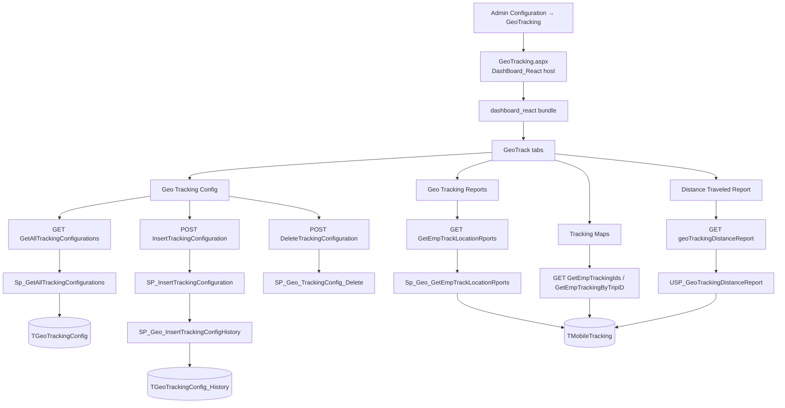
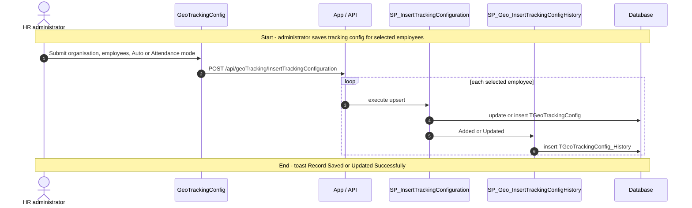
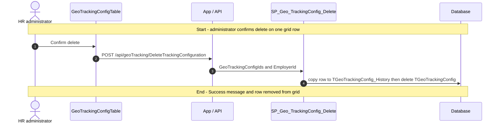
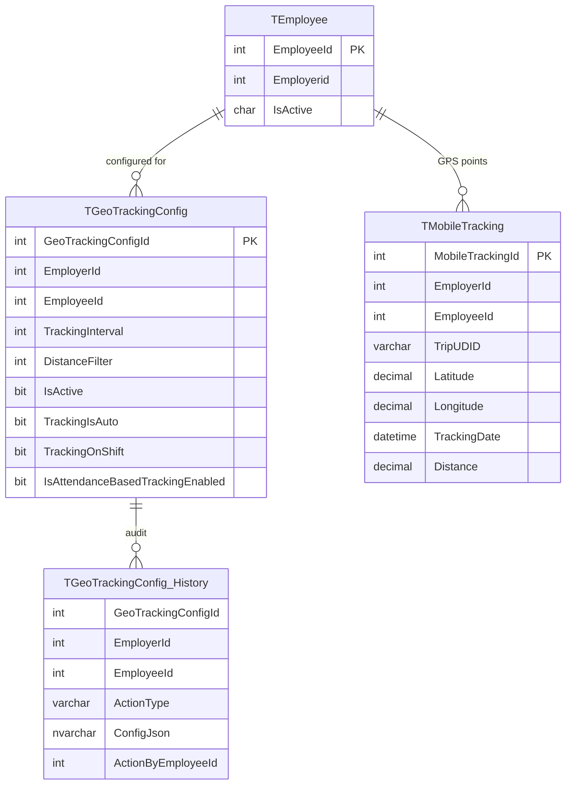

# GeoTracking

## Overview

An HR administrator configures per-employee mobile GPS tracking and reviews trip and distance reports. They open **Admin Configuration → GeoTracking** at `~/HRM/Dashboard_React/GeoTracking.aspx` (folder on disk is `DashBoard_React`; React routes and the aspx script tag use `Dashboard_React`). The WebForms host only seeds hidden session fields, logs activity type `GeoTracking` (349), and loads the webpack `dashboard_react.*.min.js` bundle. React route `GEO_TRACKING` mounts `GeoTrack` with four tabs: **Geo Tracking Config**, **Geo Tracking Reports**, **Tracking Maps**, and **Distance Traveled Report**.

On Config they pick an organisation, load active employees and existing rows from `TGeoTrackingConfig`, then save Auto / Manual / As Per Attendance settings (interval, shift or custom window, enable flag). Save upserts through `SP_InsertTrackingConfiguration` and writes `TGeoTrackingConfig_History` via `SP_Geo_InsertTrackingConfigHistory`. Delete removes selected config ids through `SP_Geo_TrackingConfig_Delete`. Reports and maps read `TMobileTracking` points; distance report aggregates trip distance by report type.

**Who's involved:**

- **HR / Administrator** — maintains tracking config and opens employer-scoped reports.
- **Manager** — role-scoped employee lists via `USP_GeoTracking_EmployeeList` and location-BU helpers.
- **Employee** — does not open this admin screen; the mobile app posts GPS elsewhere (`TrackLocation` / `TrackLocationBulk` on the same `/api/geoTracking` router).

SystemModel-2 attendance notes name `TGeoTrackingConfig` and `TMobileTracking` in `llm-wiki/domain/attendance-lifecycle.md`. Table blurbs are in `llm-wiki/reference/tables/hrms.md`.

## Workflow

## Request journey

### HR administrator — save geo tracking configuration

### HR administrator — delete one configuration row

## Entry points

| UI page | Purpose |
|---|---|
| `HRM/DashBoard_React/GeoTracking.aspx` | Host. Title GeoTracking Config. Left-nav URL `~/HRM/Dashboard_React/GeoTracking.aspx` |
| `HRM/DashBoard_React/Areas/GeoTRacking/Containers/GeoTrack.js` | Four-tab React container on route `GEO_TRACKING` |
| `HRM/DashBoard_React/Areas/routes.js` | Lazy-loads `GeoTrack` for `RouteConstants.GEO_TRACKING` |

There is a legacy `HRM/GeoTracking/GeoTracking.aspx` and a newer Mobile Management GeoTracking area. This guide covers the Admin Configuration left-nav host under `DashBoard_React` only.

## Code → database call chain

| Entry | Method | Stored procedure |
|---|---|---|
| Page open activity | `Page_Load` (`GeoTracking.aspx.cs:29`) → `CommonUtil.LogActivity` | `Sp_InsertActivityLog` |
| Org dropdown | `populateOrganization` (`GeoTrackingConfig.js:185`) → `preOnBoardingDAL.GetEmployerList` (`preOnBoardingDAL.js:722`) | `SP_GetEmployerList` |
| Attendance-based flag | `fetchAttendanceBasedTrackingFlag` (`GeoTrackingConfig.js:111`) → `GetEmployerWebConfigBasedOnEmployerId` → `GetEmployerDetails` (`dashBoardDAL.js:5096`) then `GetEmployerWebConfig` (`dashBoardDAL.js:1081`) | `SP_GetSelectedEmployerDetails`, `SP_GetCustomerSettings` |
| Active employees for config | `getEmployeeList` (`GeoTrackingConfig.js:214`) → `GetAllActiveEmployee` (`GeoTrackingDAL.js:519`) | `SP_BGV_GetAllActiveEmployee` |
| Config grid load | `GetTrackingConfig` (`GeoTrackingConfig.js:228`) → `GetAllTrackingConfigurations` (`GeoTrackingDAL.js:532`) | `Sp_GetAllTrackingConfigurations` |
| Config save | `insertTrackingConfig` (`GeoTrackingConfig.js:343`) → `InsertTrackingConfiguration` (`GeoTrackingDAL.js:559`) | `SP_InsertTrackingConfiguration` (nests `SP_Geo_InsertTrackingConfigHistory`) |
| Config delete | `confirmDelete` (`GeoTrackingConfigTable.js:194`) → `DeleteTrackingConfiguration` (`GeoTrackingDAL.js:573`) | `SP_Geo_TrackingConfig_Delete` |
| Config / reports grid column prefs | `GET_GRID_CONFIG` / `SET_GRID_CONFIG` (`GeoTrackingConfigTable.js:87`, `:111`; `TrackingLoction.js:86`, `:107`) → `leaveDAL` | `SP_GetGridConfig`, `SP_InsertGridConfig` |
| BU filter | `GET_BUSINESS_UNITS_BY_EMPLOYEEID` (`TrackingLocationSearch.js:142`, `GeoTrackingDistanceReports.js:104`) → `recruitmentDAL.GetBusinessUnitsByEmployeeId` (`recruitmentDAL.js:148`) | `SP_AdminWM_GetBusinessUnitByOrg_EmployeeId` |
| Employees by org/BU | `GET_Employee_LIST_BYORGBU` (`TrackingLocationSearch.js:127`, `GeoTrackingMapSearch.js:108`, `GeoTrackingDistanceReports.js:125`) → `GetEmployeeListByOrgAndBU` (`GeoTrackingDAL.js:506`) | `SP_GetEmployeeListByOrgAndBU` |
| Location reports | `GET_TRACK_LOCATION_REPORTS` (`TrackingLocationSearch.js:152`) → `GetEmpTrackLocationRports` (`GeoTrackingDAL.js:491`) | `Sp_Geo_GetEmpTrackLocationRports` |
| Trip id dropdown | `GET_EMP_TRACKING_IDS` (`GeoTrackingMapSearch.js:252`) → `GetEmpTrackingIds` (`GeoTrackingDAL.js:588`) | `Sp_Geo_GetEmpTrackingIDs` |
| Map points by trip | `GET_TRACK_LOCATION_BYTRIPID` (`GeoTrackingMapSearch.js:130`) → `GetEmpTrackingByTripID` (`GeoTrackingDAL.js:604`) | `Sp_Geo_GetEmpTrackingByTripID` (see Known gaps) |
| Distance report | `GET_DISTANCE_TRACKING_REPORTS` (`GeoTrackingDistanceReports.js:183`) → `GeoTrackingDistanceReport` (`GeoTrackingDAL.js:651`) | `USP_GeoTrackingDistanceReport` |

Routes mount at `/api/geoTracking` from `routeIndex.js:69` → `GeoTrackingRoutes.js`.

## API endpoints

This aspx does not post back. All feature data goes through Core API (Authorize).

| Verb | Route | Parameters | Purpose | Source |
|---|---|---|---|---|
| `GET` | `/api/geoTracking/GetAllTrackingConfigurations` | query `EmployerId`, `EmployeeId` | List config rows for the employer scoped to the login user | `GeoTrackingRoutes.js:28`, `GeoTrackingController.js:214`, `GeoTrackingDAL.js:532` |
| `POST` | `/api/geoTracking/InsertTrackingConfiguration` | body employer, employee ids, interval, Auto/shift/attendance flags; `req.EID` as action-by | Upsert one config per employee | `GeoTrackingRoutes.js:29`, `GeoTrackingController.js:223`, `GeoTrackingDAL.js:559` |
| `POST` | `/api/geoTracking/DeleteTrackingConfiguration` | body `EmployerId`, `GeoTrackingConfigIds` | Delete config rows for that employer | `GeoTrackingRoutes.js:30`, `GeoTrackingController.js:232`, `GeoTrackingDAL.js:573` |
| `GET` | `/api/geoTracking/GetAllActiveEmployee` | query `EmployerId`, `EmployeeId` | Active employees for the config picker | `GeoTrackingRoutes.js:27`, `GeoTrackingDAL.js:519` |
| `GET` | `/api/geoTracking/GetEmployeeListByOrgAndBU` | query `EmployerId`, `BusinessUnitIds`, `EmployeeId` | Employees for report/map/distance filters | `GeoTrackingRoutes.js:26`, `GeoTrackingDAL.js:506` |
| `GET` | `/api/geoTracking/GetEmpTrackLocationRports` | query employer, date range, BU ids, employee ids, login employee | Tabular location report | `GeoTrackingRoutes.js:25`, `GeoTrackingDAL.js:491` |
| `GET` | `/api/geoTracking/GetEmpTrackingIds` | query employer, tracking date, employee, timezone offset | Trip UDID list for maps | `GeoTrackingRoutes.js:31`, `GeoTrackingDAL.js:588` |
| `GET` | `/api/geoTracking/GetEmpTrackingByTripID` | query employer, from date, employee ids, tracking ids, login employee | Map polyline points | `GeoTrackingRoutes.js:32`, `GeoTrackingDAL.js:604` |
| `GET` | `/api/geoTracking/geoTrackingDistanceReport` | query start/end, employer, login employee, BU ids, employee ids, report type | Distance traveled grid | `GeoTrackingRoutes.js:35`, `GeoTrackingDAL.js:651` |
| `GET` | `/api/preonboarding/GetEmployerList` | query `employeeId` | Organisation dropdown | `apiURLConstants.js:63` → `SP_GetEmployerList` |
| `GET` | `/api/dashBoard/GetEmployerWebConfigBasedOnEmployerId` | query `employerId` | Customer mobile geo settings JSON | `DashBoardRoutes.js:70` → `SP_GetCustomerSettings` |
| `GET` | `/api/recruitment/GetBusinessUnitsByEmployeeId` | query `employerid`, `employeeId` | BU multi-select | → `SP_AdminWM_GetBusinessUnitByOrg_EmployeeId` |
| `GET` / `POST` | `/api/leave/getGridConfig`, `/api/leave/setGridConfig` | employee + page name / column payload | Column chooser for config and reports grids | → `SP_GetGridConfig`, `SP_InsertGridConfig` |

`GeoTrackingRoutes_V2.js` / `_V3.js` declare the same geo paths. `routeIndex.js` mounts the unversioned `GeoTrackingRoutes.js`.

## Stored procedures & tables involved

| Object | File | Purpose | Wiki |
|---|---|---|---|
| [Sp_GetAllTrackingConfigurations](/docs/database/hrms/Sp_GetAllTrackingConfigurations) | `HRMS-DATABASE/HRMS/STOREPROCEDURE/Sp_GetAllTrackingConfigurations.sql` | List tracking configs for an employer | `llm-wiki/reference/tables/hrms.md` |
| [SP_InsertTrackingConfiguration](/docs/database/hrms/SP_InsertTrackingConfiguration) | `HRMS-DATABASE/HRMS/STOREPROCEDURE/SP_InsertTrackingConfiguration.sql` | Upsert one employee config | same |
| [SP_Geo_InsertTrackingConfigHistory](/docs/database/hrms/SP_Geo_InsertTrackingConfigHistory) | `HRMS-DATABASE/HRMS/STOREPROCEDURE/SP_Geo_InsertTrackingConfigHistory.sql` | History row on add/update | same |
| [SP_Geo_TrackingConfig_Delete](/docs/database/hrms/SP_Geo_TrackingConfig_Delete) | `HRMS-DATABASE/HRMS/STOREPROCEDURE/SP_Geo_TrackingConfig_Delete.sql` | History then delete configs | same |
| [SP_BGV_GetAllActiveEmployee](/docs/database/hrms/SP_BGV_GetAllActiveEmployee) | `HRMS-DATABASE/HRMS/STOREPROCEDURE/SP_BGV_GetAllActiveEmployee.sql` | Active employee picker | same |
| [SP_GetEmployeeListByOrgAndBU](/docs/database/hrms/SP_GetEmployeeListByOrgAndBU) | `HRMS-DATABASE/HRMS/STOREPROCEDURE/SP_GetEmployeeListByOrgAndBU.sql` | Employees by org and optional BUs | same |
| [Sp_Geo_GetEmpTrackLocationRports](/docs/database/hrms/Sp_Geo_GetEmpTrackLocationRports) | `HRMS-DATABASE/HRMS/STOREPROCEDURE/Sp_Geo_GetEmpTrackLocationRports.sql` | Location report rows | same |
| [Sp_Geo_GetEmpTrackingIDs](/docs/database/hrms/Sp_Geo_GetEmpTrackingIDs) | `HRMS-DATABASE/HRMS/STOREPROCEDURE/Sp_Geo_GetEmpTrackingIDs.sql` | Trip UDIDs for a local date | same |
| [Sp_Geo_GetEmpTrackingByTripID_Opt](/docs/database/hrms/Sp_Geo_GetEmpTrackingByTripID_Opt) | `HRMS-DATABASE/HRMS/STOREPROCEDURE/Sp_Geo_GetEmpTrackingByTripID.sql` | Inventoried script currently creates `_Opt` (DAL still executes `Sp_Geo_GetEmpTrackingByTripID`) | same |
| [USP_GeoTrackingDistanceReport](/docs/database/hrms/USP_GeoTrackingDistanceReport) | `HRMS-DATABASE/HRMS/STOREPROCEDURE/USP_GeoTrackingDistanceReport.sql` | Distance aggregation | same |
| [USP_GeoTracking_EmployeeList](/docs/database/hrms/USP_GeoTracking_EmployeeList) | `HRMS-DATABASE/HRMS/STOREPROCEDURE/USP_GeoTracking_EmployeeList.sql` | Role-scoped employee id set | same |
| [Sp_InsertActivityLog](/docs/database/hrms/Sp_InsertActivityLog) | existing page | Page-open activity | — |
| [SP_GetCustomerSettings](/docs/database/hrms/SP_GetCustomerSettings) | existing page | Web/mobile customer JSON | — |
| [SP_AdminWM_GetBusinessUnitByOrg_EmployeeId](/docs/database/hrms/SP_AdminWM_GetBusinessUnitByOrg_EmployeeId) | existing page | BU list | — |
| `SP_GetEmployerList` | `STOREPROCEDURE/SP_GetEmployerList.sql` | Org list | No page yet |
| `SP_GetGridConfig` / `SP_InsertGridConfig` | leave DAL | Grid column prefs | No page yet |
| [Fn_GetEmployeeName](/docs/database/hrms/Fn_GetEmployeeName) | existing | Display name | — |
| [FN_LocationBU_GetEmployeeDetails](/docs/database/hrms/FN_LocationBU_GetEmployeeDetails) | existing | Location-BU scope | — |
| [USP_TFN_TUserEmployeeRole](/docs/database/hrms/USP_TFN_TUserEmployeeRole) | existing | Role type for scope | — |

Primary tables: `TGeoTrackingConfig`, `TGeoTrackingConfig_History`, `TMobileTracking`, plus `TEmployee` / `TEmployeeInfo` / `TEmployerDetails` / `TOrgHierarchyDetails` for joins.

## Table relationships

`TABLES/TGeoTrackingConfig.sql` declares a clustered PK on `GeoTrackingConfigId` and no foreign keys. History and mobile tracking tables are separate scripts without declared FKs to the config table in this checkout.

## Known gaps

- Inventoried `STOREPROCEDURE/Sp_Geo_GetEmpTrackingByTripID.sql` runs `CREATE OR ALTER PROCEDURE … Sp_Geo_GetEmpTrackingByTripID_Opt` (and may create an index). `GeoTrackingDAL.GetEmpTrackingByTripID` still `.execute("Sp_Geo_GetEmpTrackingByTripID")`. No `CREATE` for the exact name `Sp_Geo_GetEmpTrackingByTripID` remains under `STOREPROCEDURE/`. Separate `_Opt.sql` / `_OptV2.sql` files exist; `_Opt` inventory changeset is commented out.
- `TFN_DateRangeByReportType` used by `USP_GeoTrackingDistanceReport` is only a synonym script under `DML/72154/` pointing at `HRM_CL_TIMEPORT`. No HRMS function body in this repo; no database page written.
- `SP_GetEmployerList`, `SP_GetGridConfig`, and `SP_InsertGridConfig` are called from this UI; no Backstage database pages were written for them in this pass.
- Path casing: on-disk folder is `DashBoard_React`; `routeConstants.js` and the aspx `ResolveUrl` use `Dashboard_React`. Area folder is `GeoTRacking`.
- Mobile Management GeoTracking (`HRM/MobileManagement/Areas/GeoTracking`) and legacy `HRM/GeoTracking` are out of scope for this left-nav item.
- SystemModel-2 has no dedicated Admin Configuration GeoTracking workflow page.

## Reference

Confidence is medium: the React → `/api/geoTracking` → `GeoTrackingDAL` → procedure names are verified in SourceCode. The trip-by-id procedure name mismatch between DAL and the inventoried SQL file lowers confidence for that path. Nested encryption and name helpers already have database pages and were left unchanged.

### SourceCode

- `HRMS.Web/HRMS.Web/HRM/DashBoard_React/GeoTracking.aspx`
- `HRMS.Web/HRMS.Web/HRM/DashBoard_React/GeoTracking.aspx.cs`
- `HRMS.Web/HRMS.Web/HRM/DashBoard_React/Areas/GeoTRacking/Containers/GeoTrack.js`
- `HRMS.Web/HRMS.Web/HRM/DashBoard_React/Areas/GeoTRacking/Components/GeoTrackingConfig.js`
- `HRMS.Web/HRMS.Web/HRM/DashBoard_React/Areas/GeoTRacking/Components/GeoTrackingConfigTable.js`
- `HRMS.Web/HRMS.Web/HRM/DashBoard_React/Areas/GeoTRacking/Components/TrackingLoction.js`
- `HRMS.Web/HRMS.Web/HRM/DashBoard_React/Areas/GeoTRacking/Components/TrackingLocationSearch.js`
- `HRMS.Web/HRMS.Web/HRM/DashBoard_React/Areas/GeoTRacking/Components/GeoTrackingMapSearch.js`
- `HRMS.Web/HRMS.Web/HRM/DashBoard_React/Areas/GeoTRacking/Components/GeoTrackingDistanceReports.js`
- `HRMS.Web/HRMS.Web/HRM/DashBoard_React/Common/apiURLConstants.js`
- `HRMS.Web/HRMS.Web/HRM/DashBoard_React/Common/routeConstants.js`
- `HRMS.Web/HRMS.Web/HRM/DashBoard_React/Areas/routes.js`
- `HRMS.CoreAPI/HRMS.Core.WebAPI.Node/Routes/GeoTrackingRoutes.js`
- `HRMS.CoreAPI/HRMS.Core.WebAPI.Node/Controllers/GeoTrackingController.js`
- `HRMS.CoreAPI/HRMS.Core.WebAPI.Node/Core/DataAccessLayer/GeoTrackingDAL.js`
- `HRMS.Shared/HRMS.DataContract/Common/Enums.cs` (`GeoTracking = 349`)

### TDG HRMS DB

- `llm-wiki/reference/tables/hrms.md` (`TGeoTrackingConfig`, `TGeoTrackingConfig_History`, `TMobileTracking`)
- `llm-wiki/domain/attendance-lifecycle.md`
- `HRMS-DATABASE/HRMS/STOREPROCEDURE/Sp_GetAllTrackingConfigurations.sql`
- `HRMS-DATABASE/HRMS/STOREPROCEDURE/SP_InsertTrackingConfiguration.sql`
- `HRMS-DATABASE/HRMS/STOREPROCEDURE/SP_Geo_InsertTrackingConfigHistory.sql`
- `HRMS-DATABASE/HRMS/STOREPROCEDURE/SP_Geo_TrackingConfig_Delete.sql`
- `HRMS-DATABASE/HRMS/STOREPROCEDURE/SP_BGV_GetAllActiveEmployee.sql`
- `HRMS-DATABASE/HRMS/STOREPROCEDURE/SP_GetEmployeeListByOrgAndBU.sql`
- `HRMS-DATABASE/HRMS/STOREPROCEDURE/Sp_Geo_GetEmpTrackLocationRports.sql`
- `HRMS-DATABASE/HRMS/STOREPROCEDURE/Sp_Geo_GetEmpTrackingIDs.sql`
- `HRMS-DATABASE/HRMS/STOREPROCEDURE/Sp_Geo_GetEmpTrackingByTripID.sql`
- `HRMS-DATABASE/HRMS/STOREPROCEDURE/USP_GeoTrackingDistanceReport.sql`
- `HRMS-DATABASE/HRMS/STOREPROCEDURE/USP_GeoTracking_EmployeeList.sql`
- `HRMS-DATABASE/HRMS/TABLES/TGeoTrackingConfig.sql`
