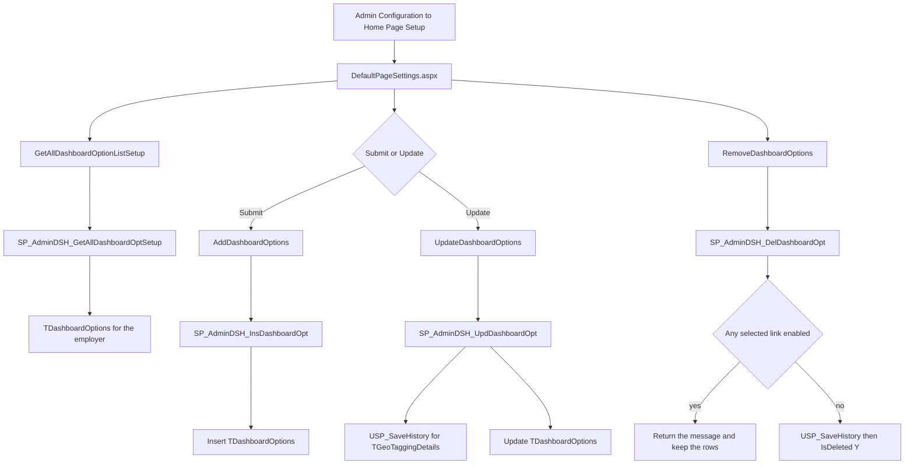
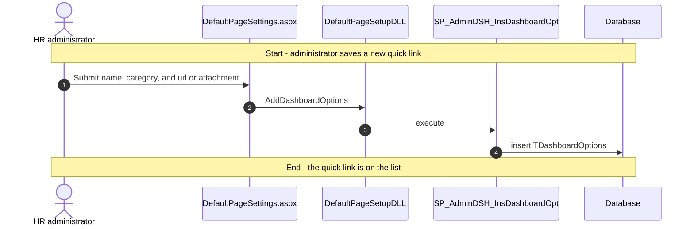
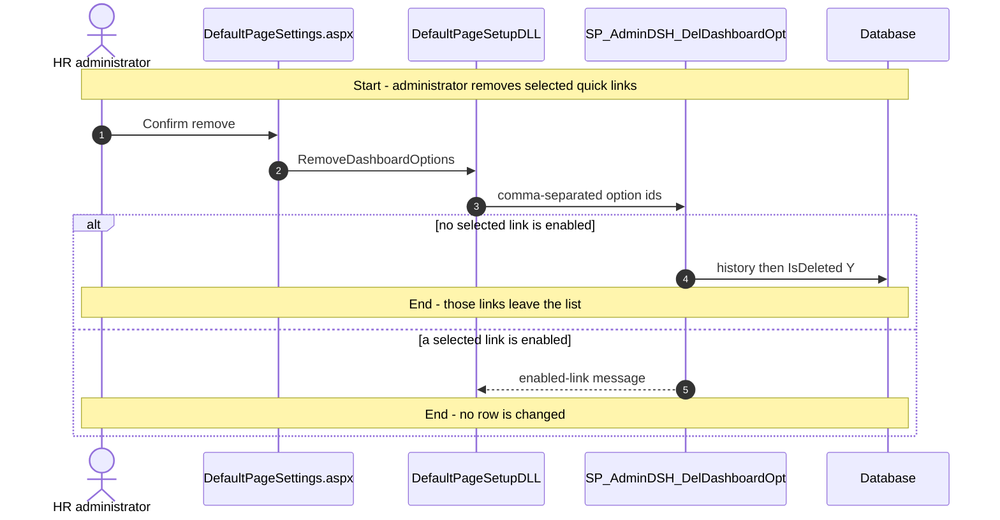
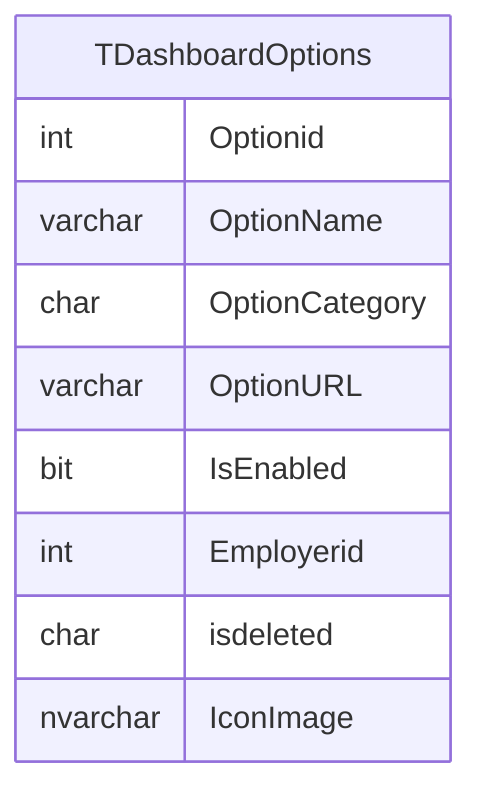

# Home Page Setup

## Overview

An HR administrator decides which quick-link cards employees see on the Home dashboard. They open **Admin Configuration → Home Page Setup** (`~/HRM/Settings/DefaultPageSettings.aspx`) and add a named link for the selected organisation. Each link is either an **Attachment** (category `A`, a document stored under the Dashboard Options folder) or a **Url** (category `U`, a web address). They can also attach a card image and an icon, and mark the link enabled. Saving inserts a row in `TDashboardOptions`. Editing updates that row. Removing a link does not delete the row while any selected link is still enabled. When every selected link is disabled, the procedure marks `IsDeleted` as `Y`.

The employee does not open this screen. The Home dashboard later reads the enabled, non-deleted rows through `GET /api/dashBoard/GetDynamicLinksDetail` and [SP_GetAllDashboardOptions](/docs/database/hrms/SP_GetAllDashboardOptions).

A user whose menu 23 tab is not editable still sees the list. Submit, Reset, and Remove stay hidden. Switching the global-access organisation reloads this same page.

SystemModel-2 has no workflow or context page for this screen. The table catalog entry is `llm-wiki/reference/tables/hrms.md` (`TDashboardOptions`). There is no domain `erDiagram` to reuse.

**Who's involved:**

- **HR administrator** — creates, edits, and removes quick links for one employer.
- **Employee** — sees enabled links on Home. They do not maintain them here.

## Workflow

Category `A` stores the file on disk and sets `OptionURL` to `OpenFile.aspx?doc=` plus the option name and an encrypted employer id. Category `U` stores the text from the Url box. The page rejects a blank name, a name that contains `&`, a missing category, a new attachment with no file, and a new Url with an empty address. Duplicate names are rejected against the list already loaded in session, before the insert procedure runs.

## Request journey

### HR administrator — save a new quick link

Update follows the same screen. The button text is Update, and the call is `UpdateDashboardOptions` then `SP_AdminDSH_UpdDashboardOpt`. That procedure writes history under the geo-tagging table names, then updates `TDashboardOptions`.

### HR administrator — remove selected quick links

## Entry points

| UI page | Purpose |
|---|---|
| `HRM/Settings/DefaultPageSettings.aspx` | Home Page Setup. Title in the page directive is Home Page Setup. URL `~/HRM/Settings/DefaultPageSettings.aspx` |
| `GET /api/dashBoard/GetDynamicLinksDetail` | Employee Home reads the cards this page stored. This aspx does not call it |

The page is WebForms. It has no `WebMethod` and no script that posts to Core API. Edit and view open the same form from the grid. View disables the fields and hides Submit.

## Code → database call chain

| Entry | Method | Stored procedure |
|---|---|---|
| First load, audit | `Page_Load` (`DefaultPageSettings.aspx.cs:96`) → `DBHelper.AuditTrail` (`DBHelper.cs:218`) | `SP_InsertAuditTrail` |
| Open, save, update, delete activity | `Page_Load` (`DefaultPageSettings.aspx.cs:91`), add (`:487`), update (`:498`), delete (`:324`) → `CommonUtil.LogActivity` (`Common.cs:52`) → `ActivityHelper.LogActivity` (`ActivityHelper.cs:36`) | `Sp_InsertActivityLog` |
| List quick links | `getAllOptionList` (`DefaultPageSettings.aspx.cs:539`) → `DefaultPageSetupBLL.GetAllDashboardOptionListSetup` (`DefaultPageSetupBLL.cs:26`) → `DefaultPageSetupDLL.GetAllDashboardOptionListSetup` (`DefaultPageSetupDLL.cs:68`) | `SP_AdminDSH_GetAllDashboardOptSetup` |
| Edit or view one link | `getSelectedOptionDetails` (`DefaultPageSettings.aspx.cs:680`) → `DefaultPageSetupBLL.GetOptionDetailsByOptionId` (`DefaultPageSetupBLL.cs:31`) → `DefaultPageSetupDLL.GetOptionDetailsByOptionId` (`DefaultPageSetupDLL.cs:77`) | `SP_AdminDSH_GetDashboardOpt` |
| Submit | `insertUpdateOptionDetails` (`DefaultPageSettings.aspx.cs:486`) → `DefaultPageSetupBLL.AddDashboardOptions` (`DefaultPageSetupBLL.cs:16`) → `DefaultPageSetupDLL.AddDashboardOptions` (`DefaultPageSetupDLL.cs:18`) | `SP_AdminDSH_InsDashboardOpt` |
| Update | `insertUpdateOptionDetails` (`DefaultPageSettings.aspx.cs:497`) → `DefaultPageSetupBLL.UpdateDashboardOptions` (`DefaultPageSetupBLL.cs:21`) → `DefaultPageSetupDLL.UpdateDashboardOptions` (`DefaultPageSetupDLL.cs:43`) | `SP_AdminDSH_UpdDashboardOpt` |
| Remove | `btnRemoveSelectedOption` (`DefaultPageSettings.aspx.cs:297`) → `DefaultPageSetupBLL.RemoveDashboardOptions` (`DefaultPageSetupBLL.cs:36`) → `DefaultPageSetupDLL.RemoveDashboardOptions` (`DefaultPageSetupDLL.cs:88`) | `SP_AdminDSH_DelDashboardOpt` |

The four setup names are constants in `DBConstant.cs` (`ConstantStoredProcedure`, lines 700–705). Remove is the literal `SP_AdminDSH_DelDashboardOpt` in `DefaultPageSetupDLL.cs:92`. All five use Enterprise Library `GetStoredProcCommand`. Insert, update, and remove wrap that call in `TransactionScope`. The procedure scripts themselves do not open a SQL transaction.

Activity type ids are `QuickLinkHomePageSetup` 319, `AddHomePageSetupMaster` 129, `UpdateHomePageSetupMaster` 130, and `DeleteHomePageSetupMaster` 165 (`Enums.cs`).

## API endpoints

This page does not call an API. Save, update, remove, and grid load are postbacks.

The Home dashboard that consumes the same table does.

| Verb | Route | Parameters | Purpose | Source |
|---|---|---|---|---|
| `GET` | `/api/dashBoard/GetDynamicLinksDetail` | query `employerId`, query `module`. The controller does not reject a missing value. `Authorize` and `assertEmployerAccess('employerId')` run first | Return quick-link rows for Home | `DashBoardRoutes.js:33`, `dashboardController.js:421`, `dashBoardDAL.js:397` executes `SP_GetAllDashboardOptions` |

`DashBoardRoutes_V2.js` and `DashBoardRoutes_V3.js` declare the same path. `routeIndex.js` does not mount those files. `/api/v2/dashBoard` is `LicenseReadRoutes_V2.js`.

## Stored procedures & tables involved

| Object | File | Purpose | Wiki |
|---|---|---|---|
| [SP_AdminDSH_GetAllDashboardOptSetup](/docs/database/hrms/SP_AdminDSH_GetAllDashboardOptSetup) | `HRMS-DATABASE/HRMS/STOREPROCEDURE/SP_AdminDSH_GetAllDashboardOptSetup.sql` | List non-deleted quick links for one employer | `llm-wiki/reference/tables/hrms.md` |
| [SP_AdminDSH_GetDashboardOpt](/docs/database/hrms/SP_AdminDSH_GetDashboardOpt) | `HRMS-DATABASE/HRMS/STOREPROCEDURE/SP_AdminDSH_GetDashboardOpt.sql` | Read one quick link by id and employer | `llm-wiki/reference/tables/hrms.md` |
| [SP_AdminDSH_InsDashboardOpt](/docs/database/hrms/SP_AdminDSH_InsDashboardOpt) | `HRMS-DATABASE/HRMS/STOREPROCEDURE/SP_AdminDSH_InsDashboardOpt.sql` | Insert one quick link | `llm-wiki/reference/tables/hrms.md` |
| [SP_AdminDSH_UpdDashboardOpt](/docs/database/hrms/SP_AdminDSH_UpdDashboardOpt) | `HRMS-DATABASE/HRMS/STOREPROCEDURE/SP_AdminDSH_UpdDashboardOpt.sql` | Update one quick link | `llm-wiki/reference/tables/hrms.md` |
| [SP_AdminDSH_DelDashboardOpt](/docs/database/hrms/SP_AdminDSH_DelDashboardOpt) | `HRMS-DATABASE/HRMS/STOREPROCEDURE/SP_AdminDSH_DelDashboardOpt.sql` | Soft-delete disabled links, or refuse when one is enabled | `llm-wiki/reference/tables/hrms.md` |
| [Split](/docs/database/hrms/Split) | `HRMS-DATABASE/HRMS/FUNCTIONS/Split.sql` | Split the comma-separated option ids on delete | — |
| [SP_GetAllDashboardOptions](/docs/database/hrms/SP_GetAllDashboardOptions) | `HRMS-DATABASE/HRMS/STOREPROCEDURE/SP_GetAllDashboardOptions.sql` | Home dashboard read. Not called by this aspx | `llm-wiki/reference/tables/hrms.md` |
| [SP_InsertAuditTrail](/docs/database/hrms/SP_InsertAuditTrail) | `HRMS-DATABASE/HRMS/STOREPROCEDURE/SP_InsertAuditTrail.sql` | Page-open audit row | — |
| [Sp_InsertActivityLog](/docs/database/hrms/Sp_InsertActivityLog) | `HRMS-DATABASE/HRMS/STOREPROCEDURE/Sp_InsertActivityLog.sql` | Activity log for open, add, update, and delete | — |

`USP_SaveHistory` is executed by the update and delete procedures. Its `CREATE PROCEDURE` script is not in `HRMS-DATABASE/HRMS`. No database page was written for it.

## Table relationships

`TABLES/TDashboardOptions.sql` declares columns and defaults. It declares no primary key and no foreign key. No other script in this database adds a foreign key on `TDashboardOptions`.

Delete passes `@HistoryTableName = 'TDashboardOptions_History'` into `USP_SaveHistory`. That history table is named in the data catalog and is not created under `TABLES/`. Update passes `TGeoTaggingDetails` and `TGeoTaggingDetails_History` instead. Those names are not a declared relationship of `TDashboardOptions`.

## Known gaps

- `SP_AdminDSH_UpdDashboardOpt` calls `USP_SaveHistory` with `@MainTableName = 'TGeoTaggingDetails'` and `@HistoryTableName = 'TGeoTaggingDetails_History'`. The older unprefixed `SP_UpdateDashboardOptions` passes `TDashboardOptions` and `TDashboardOptions_History`. This page calls the `SP_AdminDSH_UpdDashboardOpt` constant.
- `USP_SaveHistory` is not scripted under `HRMS-DATABASE/HRMS/STOREPROCEDURE` or `Stored Procedures`. Survey and other databases only synonym it to `[HRM-CL-Prod].[DBO].[USP_SaveHistory]`. Its body was not read.
- `DBHelper.AddDashboardOptions` (`DBHelper.cs:2470`) and `DBHelper.UpdateDashboardOptions` (`DBHelper.cs:2493`) still call the unprefixed names `SP_InsertDashboardOptions` and `SP_UpdateDashboardOptions`. `DefaultPageSettings.aspx` uses `DefaultPageSetupBLL`, not those helpers.
- The matching unprefixed scripts remain in `STOREPROCEDURE/` (`SP_InsertDashboardOptions`, `SP_UpdateDashboardOptions`, `SP_GetDashboardOptions`, `SP_GetAllDashboardOptionsSetup`). They are not the procedures this page executes.
- Delete refuses the whole selection when any chosen row has `isenabled = 1`. The administrator must disable a link before it can be removed.
- Attachment, image, and icon files are written to disk before the procedure runs. A failed procedure does not remove those files.
- [Split](/docs/database/hrms/Split) already lists `SP_AdminDSH_DelDashboardOpt` as "No page yet". That existing page was left unchanged.
- SystemModel-2 does not name `DefaultPageSettings.aspx`.

## Reference

Confidence is high for the postback path from `DefaultPageSettings.aspx.cs` through `DefaultPageSetupBLL` and `DefaultPageSetupDLL` into the five `SP_AdminDSH_*` scripts. The history procedure those scripts execute has no body in this database folder.

### SourceCode

- `docs/SystemModels/SystemModel-2/` was searched. No page covers Home Page Setup or `TDashboardOptions`.
- `HRMS.Web/HRMS.Web/HRM/Settings/DefaultPageSettings.aspx`
- `HRMS.Web/HRMS.Web/HRM/Settings/DefaultPageSettings.aspx.cs`
- `HRMS.Shared/HRMS.BusinessLayer/Masters/DefaultPageSetupBLL.cs`
- `HRMS.Shared/HRMS.DataAccessLayer/Masters/DefaultPageSetupDLL.cs`
- `HRMS.Shared/HRMS.DataAccessLayer/DBConstant.cs`
- `HRMS.Shared/HRMS.DataAccessLayer/DBHelper.cs`
- `HRMS.Shared/HRMS.Common/Common.cs`
- `HRMS.Shared/HRMS.DataContract/Common/Enums.cs`
- `HRMS.Shared/TDG.ActivityAuditLog/DAL/ActivityHelper.cs`
- `HRMS.CoreAPI/HRMS.Core.WebAPI.Node/Routes/DashBoardRoutes.js`
- `HRMS.CoreAPI/HRMS.Core.WebAPI.Node/Controllers/dashboardController.js`
- `HRMS.CoreAPI/HRMS.Core.WebAPI.Node/Core/DataAccessLayer/dashBoardDAL.js`
- `HRMS.CoreAPI/HRMS.Core.WebAPI.Node/Routes/routeIndex.js`
- `HRMS.CoreAPI/HRMS.Core.WebAPI.Node/app.js`

### TDG HRMS DB

- `llm-wiki/reference/tables/hrms.md` (`TDashboardOptions`)
- `HRMS-DATABASE/HRMS/TABLES/TDashboardOptions.sql`
- `HRMS-DATABASE/HRMS/STOREPROCEDURE/SP_AdminDSH_InsDashboardOpt.sql`
- `HRMS-DATABASE/HRMS/STOREPROCEDURE/SP_AdminDSH_UpdDashboardOpt.sql`
- `HRMS-DATABASE/HRMS/STOREPROCEDURE/SP_AdminDSH_GetAllDashboardOptSetup.sql`
- `HRMS-DATABASE/HRMS/STOREPROCEDURE/SP_AdminDSH_GetDashboardOpt.sql`
- `HRMS-DATABASE/HRMS/STOREPROCEDURE/SP_AdminDSH_DelDashboardOpt.sql`
- `HRMS-DATABASE/HRMS/FUNCTIONS/Split.sql`
- `HRMS-DATABASE/HRMS/STOREPROCEDURE/SP_GetAllDashboardOptions.sql`
