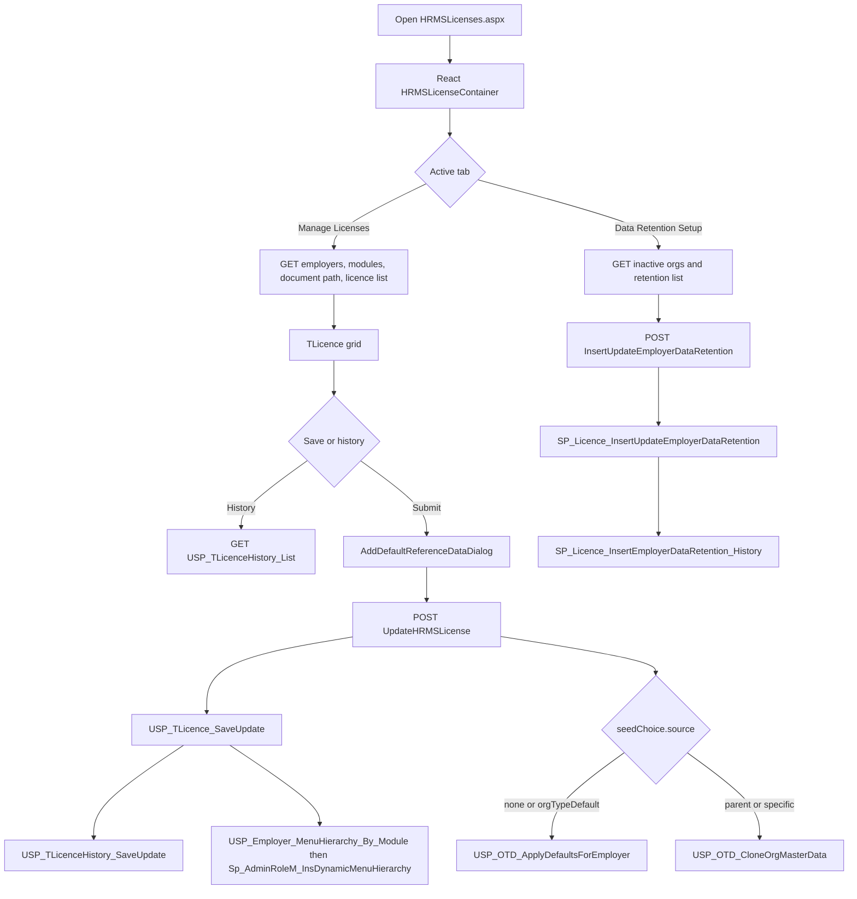
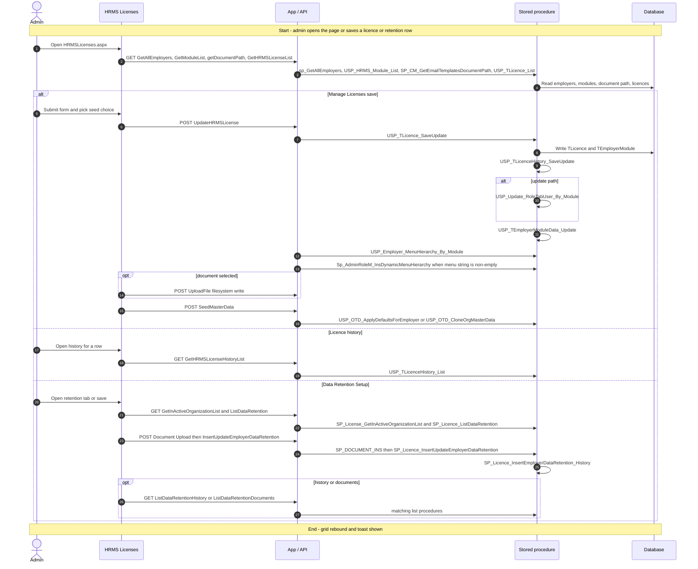
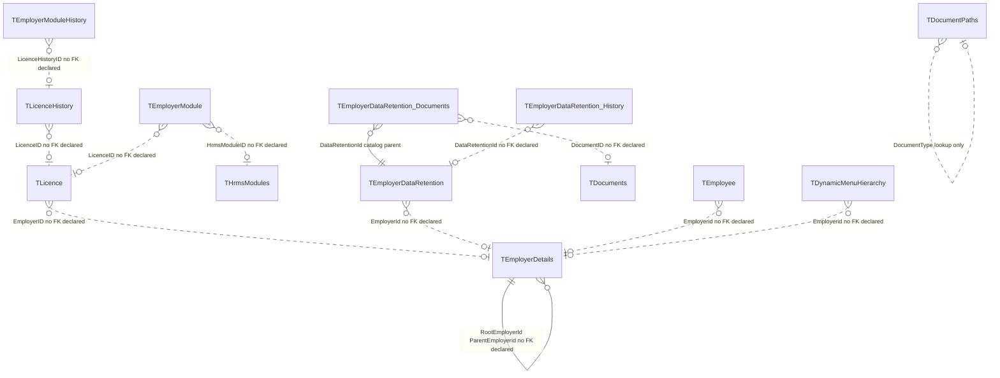

# HRMSLicense

## Overview

A super-admin opens **Admin Configuration → HRMS Licenses** (`~/HRM/Dashboard_React/HRMSLicenses.aspx`) to manage which parent organisations are licensed, which HRMS modules they bought, contact and AM details, purchased/buffer counts, go-live and expiry dates, and an optional supporting document. The React shell has two tabs. **Manage Licenses** lists every `TLicence` row, edits or creates a licence (then optionally seeds org-type defaults or clones master data), and shows licence history. **Data Retention Setup** configures how long inactive-licence organisation data is kept, reminder email timing, supporting documents, and history.

The WebForms host only injects the logged-in employee hidden fields and loads the Dashboard React bundle. All reads and writes go through Core API `dashBoard` routes (Authorize). There is no WebForms postback for licence or retention data. After a successful licence save the API also rebuilds that employer's dynamic menu from opted modules and fires a client-onboarding planner hook asynchronously.

Menu node text in `tMenuDetails` / `TDynamicMenuHierarchy` is **HRMS Licenses** (menu id 1174). This guide's submenu key is **HRMSLicense** as requested. Physical folder casing is `DashBoard_React`; the NavigateURL and React route use `Dashboard_React`.

`docs/SystemModels/SystemModel-2` has no dedicated surface page for this screen. Table blurbs live in `llm-wiki/reference/tables/hrms.md`. Licence-insight / customer-license report objects are a different left-nav feature.

## Workflow

Product location options fall back to hardcoded Cloud / On Premise values because `getProductLocationList` is commented out. Licence document upload writes a file via `UploadFile` (no stored procedure). Retention documents use `Document/Upload` → `SP_DOCUMENT_INS`.

## Request journey

## Entry points

Live menu node **HRMS Licenses** under **Admin Configuration** (`tMenuDetails` menu id 1174, NavigateURL `~/HRM/Dashboard_React/HRMSLicenses.aspx`). React route constant `RouteConstants.HRMS_LICENSE` matches that path.

| Entry | Purpose |
|---|---|
| `~/HRM/Dashboard_React/HRMSLicenses.aspx` | WebForms host. Sets employee/employer hidden fields and loads `dashboard_react.*.min.js`. |
| React `HRMSLicenseContainer` | Tabs Manage Licenses and Data Retention Setup. |
| React `HRMSLicense` | Licence form, grid, history, seed dialog, file upload/download. |
| React `DataRetentionSetup` | Retention form, grid, history, document list. |

Customer License Report and License Insight screens are separate menu items and are not this page.

## Code → database call chain

| Entry | Method | Database |
|---|---|---|
| Page load host, `HRMSLicenses.aspx.cs:24` | Session `LoggedInUser` only. No SP. | None |
| Manage load, `HRMSLicense.js:490` | `APIHelper.get(GET_ALL_CUSTOMER_LIST(1))` → `dashboardController.GetAllEmployers` (`dashboardController.js:844`) → `dashBoardDAL.GetAllEmployers` (`dashBoardDAL.js:882`) | `sp_GetAllEmployers` with `@IsRootEmployerIDOnly` = 1 |
| Manage load, `HRMSLicense.js:503` | `GET_HRMS_MODULE_LIST` → `GetModuleList` (`dashboardController.js:3490`) → `dashBoardDAL.GetModuleList` (`dashBoardDAL.js:4696`) | `USP_HRMS_Module_List` |
| Manage load, `HRMSLicense.js:620` | `GET_DOCUMENT_PATH("HRMSLicense")` → `GetDocumentPath` (`dashboardController.js:3572`) → `dashBoardDAL.GetDocumentPath` (`dashBoardDAL.js:4793`) | `SP_CM_GetEmailTemplatesDocumentPath` |
| Manage load / refresh, `HRMSLicense.js:576` | `GET_HRMS_LICENSE_LIST()` (no employerId) → `GetHRMSLicenseList` (`dashboardController.js:3366`) → `dashBoardDAL.GetHRMSLicenseList` (`dashBoardDAL.js:4578`) | `USP_TLicence_List` with null `@EmployerID` |
| History, `HRMSLicense.js:591` | `GET_HRMS_LICENSE_HISTORY_LIST` → `GetHRMSLicenseHistoryList` (`dashboardController.js:3375`) → `dashBoardDAL.GetHRMSLicenseHistoryList` (`dashBoardDAL.js:4591`) | `USP_TLicenceHistory_List` |
| Save, `HRMSLicense.js:847` | `UPDATE_HRMS_LICENSE` → `UpdateHRMSLicense` (`dashboardController.js:3212`) → `dashBoardDAL.UpdateHRMSLicense` (`dashBoardDAL.js:4537`) | `USP_TLicence_SaveUpdate` → nested `USP_TLicenceHistory_SaveUpdate`; on update also `USP_Update_RoleTabUser_By_Module`; then `USP_TEmployerModuleData_Update` |
| Save after SP, `dashboardController.js:3219` | `LicenseDetailsDAL.GenerateDynamicMenuBasedOnOptedModules` (`LicenseDetailsDAL.js:45`) | `USP_Employer_MenuHierarchy_By_Module` |
| Save after menu filter, `dashboardController.js:3301` | `LicenseDetailsBLL.InsertDynamicMenuHierarchy` → `LicenseDetailsDAL.InsertDynamicMenuHierarchy` (`LicenseDetailsDAL.js:61`) | `Sp_AdminRoleM_InsDynamicMenuHierarchy` when hierarchy string is non-empty |
| Save document, `HRMSLicense.js:1149` | `UPLOAD_FILE` → `UploadFile` (`dashboardController.js:3509`) | No SP. Filesystem write only |
| Seed after save, `HRMSLicense.js:540` | `SEED_MASTER_DATA` → `SeedMasterData` (`dashboardController.js:4039`) → `dashBoardDAL.SeedMasterData` (`dashBoardDAL.js:4729`) | `USP_OTD_ApplyDefaultsForEmployer` (`none` / `orgTypeDefault`) or `USP_OTD_CloneOrgMasterData` (`parent` / `specific`) |
| Retention load orgs, `DataRetentionSetup.js:312` | `GET_INACTIVE_ORGANIZATION_LIST_FOR_RETENTION` → `GetInActiveOrganizationList` (`dashboardController.js:3384`) → `dashBoardDAL.GetInActiveOrganizationList` (`dashBoardDAL.js:4604`) | `SP_License_GetInActiveOrganizationList` |
| Retention load list, `DataRetentionSetup.js:324` | `GET_EMPLOYER_DATA_RETENTION_LIST` → `ListDataRetention` (`dashboardController.js:3444`) → `dashBoardDAL.ListDataRetention` (`dashBoardDAL.js:4656`) | `SP_Licence_ListDataRetention` |
| Retention save docs, `DataRetentionSetup.js:544` | `UPLOAD_DOCUMENT` → Document controller → `documentDAL` | `SP_DOCUMENT_INS` |
| Retention save, `DataRetentionSetup.js:573` | `INSERT_UPDATE_EMPLOYER_DATA_RETENTION` → `InsertUpdateEmployerDataRetention` (`dashboardController.js:3394`) → `dashBoardDAL.InsertUpdateEmployerDataRetention` (`dashBoardDAL.js:4617`) | `SP_Licence_InsertUpdateEmployerDataRetention` → nested `SP_Licence_InsertEmployerDataRetention_History` |
| Retention history, `DataRetentionSetup.js:669` | `GET_EMPLOYER_DATA_RETENTION_HISTORY_LIST` → `ListDataRetentionHistory` (`dashboardController.js:3454`) | `SP_Licence_ListDataRetentionHistory` |
| Retention documents, `DataRetentionSetup.js:596` / `:689` | `GET_EMPLOYER_DATA_RETENTION_DOCUMENTS` → `ListDataRetentionDocuments` (`dashboardController.js:3467`) | `SP_Licence_ListDataRetention_Documents` |

`getProductLocationList` in `HRMSLicense.js:632` is fully commented out, so `USP_HRMS_Product_Location` is not called. `firePlannerHook("onLicenseSaved")` after the HTTP response (`dashboardController.js:3319`) is outside the licence SP path.

## API endpoints

The host page is WebForms but the feature data path is Core API JSON (Authorize). Routes below are under the dashboard router (`DashBoardRoutes.js`). Casing in `apiURLConstants.js` mixes `/dashBoard/` and `/dashboard/`.

| Verb | Route | Parameters | Purpose | Source |
|---|---|---|---|---|
| GET | `/dashBoard/GetAllEmployers` | `superId` bit (page passes `1`), employee from token | Root employer dropdown | `apiURLConstants.js:68`, `DashBoardRoutes.js:62` |
| GET | `/dashboard/GetModuleList` | none | Active `THrmsModules` for multi-select | `apiURLConstants.js:504` |
| GET | `/dashBoard/getDocumentPath` | `documentType` = `HRMSLicense` | Upload base path from `TDocumentPaths` | `apiURLConstants.js:536` |
| GET | `/dashboard/GetHRMSLicenseList` | optional `employerId` (page omits) | Licence grid | `apiURLConstants.js:509` |
| GET | `/dashboard/GetHRMSLicenseHistoryList` | `licenseId` required | History modal | `apiURLConstants.js:510` |
| POST | `/dashBoard/UpdateHRMSLicense` | body licence fields (`ParentOrganization`, modules CSV, contacts, AM, dates, document path, …) | Insert/update licence, rebuild menu | `apiURLConstants.js:503` |
| POST | `/dashBoard/UploadFile` | multipart file + path | Write licence attachment to disk | `apiURLConstants.js:537` |
| POST | `/dashBoard/SeedMasterData` | `source`, `employerId`, optional `sourceEmployerId`, `moduleIds` | Seed or clone master data after save | `apiURLConstants.js:507` |
| GET | `/dashboard/GetInActiveOrganizationList` | optional `EmployerID` | Retention org dropdown | `apiURLConstants.js:511` |
| GET | `/dashboard/ListDataRetention` | optional `EmployerID` | Retention grid | `apiURLConstants.js:514` |
| POST | `/dashboard/InsertUpdateEmployerDataRetention` | retention body + document ids | Insert/update retention | `apiURLConstants.js:513` |
| GET | `/dashboard/ListDataRetentionHistory` | `DataRetentionId` | Retention history | `apiURLConstants.js:516` |
| GET | `/dashboard/ListDataRetentionDocuments` | `DataRetentionId`, optional `DataRetentionHistoryId` | Retention documents | `apiURLConstants.js:518` |
| POST | `/Document/Upload` | multipart + `createdBy`, `documentURI` | Retention document row | `apiURLConstants.js:538` |
| GET | `/Document/Download` | `documentId`, inline/download | Retention document open/download | `apiURLConstants.js:630` |

There is no WebForms postback for these actions. Download of Manage Licenses attachments uses `DOWNLOAD_FILE` against the stored path string.

## Stored procedures & tables involved

| Object | File | Purpose | Wiki |
|---|---|---|---|
| `USP_TLicence_SaveUpdate` | `HRMS-DATABASE/HRMS/STOREPROCEDURE/USP_TLicence_SaveUpdate.sql` | Insert/update `TLicence`, replace `TEmployerModule`, soft-delete/restore on Inactive/Active, history, role/tab sync, module pivot refresh | [USP_TLicence_SaveUpdate](/docs/database/hrms/USP_TLicence_SaveUpdate) |
| `USP_TLicence_List` | `…/USP_TLicence_List.sql` | Licence grid with modules and active-user count | [USP_TLicence_List](/docs/database/hrms/USP_TLicence_List) |
| `USP_TLicenceHistory_List` | `…/USP_TLicenceHistory_List.sql` | History rows for one licence | [USP_TLicenceHistory_List](/docs/database/hrms/USP_TLicenceHistory_List) |
| `USP_TLicenceHistory_SaveUpdate` | `…/USP_TLicenceHistory_SaveUpdate.sql` | Nested history snapshot | [USP_TLicenceHistory_SaveUpdate](/docs/database/hrms/USP_TLicenceHistory_SaveUpdate) |
| `USP_HRMS_Module_List` | `…/USP_HRMS_Module_List.sql` | Active modules for the picker | [USP_HRMS_Module_List](/docs/database/hrms/USP_HRMS_Module_List) |
| `sp_GetAllEmployers` | `…/sp_GetAllEmployers.sql` | Parent org dropdown | [sp_GetAllEmployers](/docs/database/hrms/sp_GetAllEmployers) |
| `SP_CM_GetEmailTemplatesDocumentPath` | `…/SP_CM_GetEmailTemplatesDocumentPath.sql` | `TDocumentPaths` for type `HRMSLicense` | [SP_CM_GetEmailTemplatesDocumentPath](/docs/database/hrms/SP_CM_GetEmailTemplatesDocumentPath) |
| `USP_OTD_ApplyDefaultsForEmployer` | `…/USP_OTD_ApplyDefaultsForEmployer.sql` | Seed org-type defaults / record do-not-seed | [USP_OTD_ApplyDefaultsForEmployer](/docs/database/hrms/USP_OTD_ApplyDefaultsForEmployer) |
| `USP_OTD_CloneOrgMasterData` | `…/159568/USP_OTD_CloneOrgMasterData.sql` | Clone master data from another employer | [USP_OTD_CloneOrgMasterData](/docs/database/hrms/USP_OTD_CloneOrgMasterData) |
| `USP_Employer_MenuHierarchy_By_Module` | `…/USP_Employer_MenuHierarchy_By_Module.sql` | Base menu XML + menus for licensed modules | [USP_Employer_MenuHierarchy_By_Module](/docs/database/hrms/USP_Employer_MenuHierarchy_By_Module) |
| `Sp_AdminRoleM_InsDynamicMenuHierarchy` | `…/Sp_AdminRoleM_InsDynamicMenuHierarchy.sql` | Persist filtered menu for the employer | [Sp_AdminRoleM_InsDynamicMenuHierarchy](/docs/database/hrms/Sp_AdminRoleM_InsDynamicMenuHierarchy) |
| `USP_Update_RoleTabUser_By_Module` | `…/USP_Update_RoleTabUser_By_Module.sql` | Nested on licence update when modules change | [USP_Update_RoleTabUser_By_Module](/docs/database/hrms/USP_Update_RoleTabUser_By_Module) |
| `USP_TEmployerModuleData_Update` | `…/USP_TEmployerModuleData_Update.sql` | Rebuild pivot table `TEmployerModuleData` | [USP_TEmployerModuleData_Update](/docs/database/hrms/USP_TEmployerModuleData_Update) |
| `SP_License_GetInActiveOrganizationList` | `…/SP_License_GetInActiveOrganizationList.sql` | Inactive licences for retention | [SP_License_GetInActiveOrganizationList](/docs/database/hrms/SP_License_GetInActiveOrganizationList) |
| `SP_Licence_InsertUpdateEmployerDataRetention` | `…/SP_Licence_InsertUpdateEmployerDataRetention.sql` | Insert/update retention + documents | [SP_Licence_InsertUpdateEmployerDataRetention](/docs/database/hrms/SP_Licence_InsertUpdateEmployerDataRetention) |
| `SP_Licence_InsertEmployerDataRetention_History` | `…/SP_Licence_InsertEmployerDataRetention_History.sql` | Nested retention history | [SP_Licence_InsertEmployerDataRetention_History](/docs/database/hrms/SP_Licence_InsertEmployerDataRetention_History) |
| `SP_Licence_ListDataRetention` | `…/SP_Licence_ListDataRetention.sql` | Retention grid | [SP_Licence_ListDataRetention](/docs/database/hrms/SP_Licence_ListDataRetention) |
| `SP_Licence_ListDataRetentionHistory` | `…/SP_Licence_ListDataRetentionHistory.sql` | Retention history grid | [SP_Licence_ListDataRetentionHistory](/docs/database/hrms/SP_Licence_ListDataRetentionHistory) |
| `SP_Licence_ListDataRetention_Documents` | `…/SP_Licence_ListDataRetention_Documents.sql` | Retention document list | [SP_Licence_ListDataRetention_Documents](/docs/database/hrms/SP_Licence_ListDataRetention_Documents) |
| `SP_DOCUMENT_INS` | `…/SP_DOCUMENT_INS.sql` | Retention document insert | [SP_DOCUMENT_INS](/docs/database/hrms/SP_DOCUMENT_INS) |
| `TLicence`, `TLicenceHistory` | `DDL/TLicence_119819.sql`, DML/95707 DDL script | Licence and history | `llm-wiki/reference/tables/hrms.md` |
| `TEmployerModule`, `TEmployerModuleHistory`, `THrmsModules` | TABLES / DML scripts | Licensed modules | `llm-wiki/reference/tables/hrms.md` |
| `TEmployerDataRetention*` | `TABLES/tEmployerDataRetention.sql` and related | Retention and documents | `llm-wiki/reference/tables/hrms.md` |
| `TEmployerDetails`, `TEmployee`, `TDocuments`, `TDocumentPaths`, `TDynamicMenuHierarchy`, `tMenuDetails` | TABLES | Orgs, counts, files, menu | `llm-wiki/reference/tables/hrms.md` |

## Table relationships

`llm-wiki/reference/tables/hrms.md` describes these objects. Declared foreign keys are sparse on the licence DDL scripts. The diagram uses declared FKs where present and labels other joins the page uses as not declared.

## Known gaps

- **No SystemModel-2 page** for HRMS Licenses / `HRMSLicenses.aspx`.
- **Submenu label vs menu text.** Left-nav text is **HRMS Licenses**; this guide's `submenu` is **HRMSLicense**. Folder/URL casing mixes `DashBoard_React` and `Dashboard_React`.
- **`GetHRMSLicenseList` has no employer filter from the UI.** The page calls the route with no query string, so the SP lists all licences.
- **Product location API is dead.** `getProductLocationList` is commented out; the select uses hardcoded On-Cloud / In-Premise. Edit mapping looks for display strings `Cloud` / `On Premise` from the list SP.
- **Licence attachment is not a document table row.** Manage Licenses stores a path string on `TLicence.DocumentName` and uploads via filesystem `UploadFile`. Retention uses `TDocuments` + `SP_DOCUMENT_INS`.
- **Inactive soft-delete is broad.** Setting status Inactive soft-deletes users, employees, and employer details under the root employer tree, then marks the licence soft-deleted.
- **Menu rebuild can skip persist.** Empty `menuHierarchyString` skips `Sp_AdminRoleM_InsDynamicMenuHierarchy` (new org with no `tMenuDetails` rows).
- **COB planner hook is fire-and-forget** after the HTTP response (`onLicenseSaved`). Failures do not roll back the licence.
- **Retention requires an Inactive licence** with a recent `UpdatedWhen`; insert fails if one already exists for the employer.
- **Several SP scripts contain `USE [HRM-CL-Prod]`** (`USP_HRMS_Module_List`, `USP_Employer_MenuHierarchy_By_Module`, nested role/module update scripts). Deploy tooling must not rely on that database name.
- **No `TABLES/TLicence.sql` baseline file**; licence DDL lives under `DDL/TLicence_119819.sql` and DML/95707.
- **License Insight / Customer License Report / `USP_LicenseInsight_*`** are not used by this page.
- **Data Retention Setup polls every 60 seconds** (`DataRetentionSetup.js`), which is UI-only noise for operators.

## Reference

Confidence is **high** for the React → Core API → DAL → SP path traced on 2026-11-09. `docs/SystemModels/SystemModel-2` does not cover this screen. Foreign keys in the diagram are only those clearly catalogued or script-declared; most licence joins are application convention.

### SourceCode

- `HRMS.Web/HRMS.Web/HRM/DashBoard_React/HRMSLicenses.aspx`
- `HRMS.Web/HRMS.Web/HRM/DashBoard_React/HRMSLicenses.aspx.cs`
- `HRMS.Web/HRMS.Web/HRM/DashBoard_React/Areas/HRMSLicense/Containers/HRMSLicenseContainer.js`
- `HRMS.Web/HRMS.Web/HRM/DashBoard_React/Areas/HRMSLicense/Components/HRMSLicense.js`
- `HRMS.Web/HRMS.Web/HRM/DashBoard_React/Areas/HRMSLicense/Components/DataRetentionSetup.js`
- `HRMS.Web/HRMS.Web/HRM/DashBoard_React/Areas/HRMSLicense/Components/AddDefaultReferenceDataDialog.js`
- `HRMS.Web/HRMS.Web/HRM/DashBoard_React/Common/apiURLConstants.js`
- `HRMS.Web/HRMS.Web/HRM/DashBoard_React/Common/routeConstants.js`
- `HRMS.CoreAPI/HRMS.Core.WebAPI.Node/Controllers/dashboardController.js`
- `HRMS.CoreAPI/HRMS.Core.WebAPI.Node/Core/DataAccessLayer/dashBoardDAL.js`
- `HRMS.CoreAPI/HRMS.Core.WebAPI.Node/Core/DataAccessLayer/LicenseDetailsDAL.js`
- `HRMS.CoreAPI/HRMS.Core.WebAPI.Node/Core/BusinessLogicLayer/LicenseDetailsBLL.js`
- `HRMS.CoreAPI/HRMS.Core.WebAPI.Node/Routes/DashBoardRoutes.js`
- `HRMS.CoreAPI/HRMS.Core.WebAPI.Node/Core/DataAccessLayer/documentDAL.js`

### TDG HRMS DB

- `llm-wiki/reference/tables/hrms.md`
- `HRMS-DATABASE/HRMS/STOREPROCEDURE/USP_TLicence_SaveUpdate.sql`
- `HRMS-DATABASE/HRMS/STOREPROCEDURE/USP_TLicence_List.sql`
- `HRMS-DATABASE/HRMS/STOREPROCEDURE/USP_TLicenceHistory_List.sql`
- `HRMS-DATABASE/HRMS/STOREPROCEDURE/USP_TLicenceHistory_SaveUpdate.sql`
- `HRMS-DATABASE/HRMS/STOREPROCEDURE/USP_HRMS_Module_List.sql`
- `HRMS-DATABASE/HRMS/STOREPROCEDURE/sp_GetAllEmployers.sql`
- `HRMS-DATABASE/HRMS/STOREPROCEDURE/SP_CM_GetEmailTemplatesDocumentPath.sql`
- `HRMS-DATABASE/HRMS/STOREPROCEDURE/USP_OTD_ApplyDefaultsForEmployer.sql`
- `HRMS-DATABASE/HRMS/STOREPROCEDURE/159568/USP_OTD_CloneOrgMasterData.sql`
- `HRMS-DATABASE/HRMS/STOREPROCEDURE/USP_Employer_MenuHierarchy_By_Module.sql`
- `HRMS-DATABASE/HRMS/STOREPROCEDURE/Sp_AdminRoleM_InsDynamicMenuHierarchy.sql`
- `HRMS-DATABASE/HRMS/STOREPROCEDURE/USP_Update_RoleTabUser_By_Module.sql`
- `HRMS-DATABASE/HRMS/STOREPROCEDURE/USP_TEmployerModuleData_Update.sql`
- `HRMS-DATABASE/HRMS/STOREPROCEDURE/SP_License_GetInActiveOrganizationList.sql`
- `HRMS-DATABASE/HRMS/STOREPROCEDURE/SP_Licence_InsertUpdateEmployerDataRetention.sql`
- `HRMS-DATABASE/HRMS/STOREPROCEDURE/SP_Licence_InsertEmployerDataRetention_History.sql`
- `HRMS-DATABASE/HRMS/STOREPROCEDURE/SP_Licence_ListDataRetention.sql`
- `HRMS-DATABASE/HRMS/STOREPROCEDURE/SP_Licence_ListDataRetentionHistory.sql`
- `HRMS-DATABASE/HRMS/STOREPROCEDURE/SP_Licence_ListDataRetention_Documents.sql`
- `HRMS-DATABASE/HRMS/DML/95707/1.DML - TMenuDetails - HRMS Licenses.sql`
