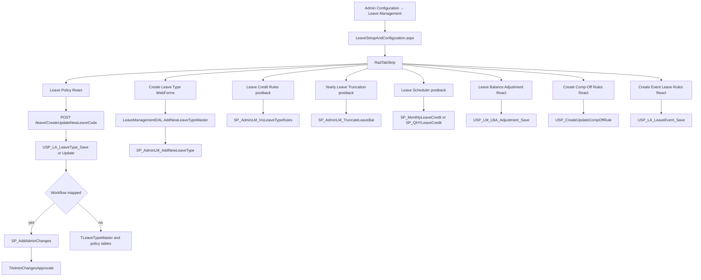
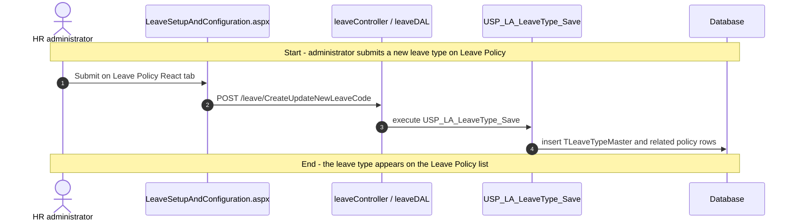
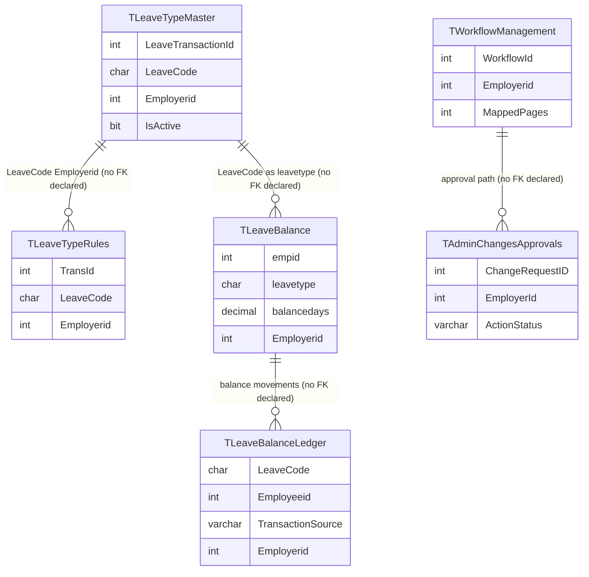

# Leave Management

## Overview

An HR administrator opens **Admin Configuration → Leave Management** (`LeaveSetupAndConfiguration.aspx`) to define how leave works for an organisation before employees apply. The host is a RadTabStrip. Some tabs still post back through WebForms and `LeaveManagementDAL`. Others mount the dashboard React bundle on the same page (`#root` / `showAttendanceTab`) and call Node `/leave` and `/compOff` APIs.

The leave-type story this guide follows has two live surfaces on this host. **Leave Policy** (tab id 522) is the React `CreateLeave` editor. Saving a new code posts `POST /leave/CreateUpdateNewLeaveCode`, which runs `USP_LA_LeaveType_Save` (update uses `USP_LA_LeaveType_Update`). SystemModel-2 treats that React path as the current leave-type definition surface. The older **Create Leave Type** WebForms tab still posts to `SP_AdminLM_AddNewLeaveType` / `SP_AdminLM_UpdNewLeaveType`. Both paths can file a pending admin-change row when a workflow is mapped, instead of writing the live leave-type master immediately.

Other WebForms tabs maintain **Leave Credit Rules** (`SP_AdminLM_InsLeaveTypeRules` and siblings), **Yearly Leave Truncation** (`SP_AdminLM_TruncateLeaveBal`), and a **Leave Scheduler** QA runner (`SP_MonthlyLeaveCredit` / `SP_QHYLeaveCredit`). React tabs cover **Leave Balance Adjustment**, **Create Comp-Off Rules**, and **Create Event Leave Rules**.

This screen is not the employee **Leave & Attendance** apply/approve module.

**Who's involved:**

- **HR administrator** — creates leave types and policies, credit rules, truncation, scheduler tests, balance adjustments, comp-off rules, and event-leave rules for the selected organisation.
- **Workflow approver** — when Create Leave Type / Leave Policy (or credit-rule) pages are mapped in Workflow Management, the change waits in admin-change approvals.
- **Employee** — does not open this screen. Their later leave requests use the types, balances, and rules configured here.

## Workflow

## Request journey

### HR administrator — create a leave type on Leave Policy when no approval workflow is mapped

When a live workflow is mapped for the leave-type page, the same submit files `TAdminChangesApprovals` through `SP_AddAdminChanges` and does not write the live master yet. The legacy Create Leave Type tab follows the same approval fork inside `SP_AdminLM_AddNewLeaveType`.

## Entry points

The left-nav URL is `~/HRM/LeaveManagement/LeaveSetupAndConfiguration.aspx`. `showAttendanceTab` maps React tab ids: 522 → `LeavePolicy`, 534 → `LeaveBalanceAdjustment`, 444 → `createCompoffRules`, 586 → `createEventLeaveRules`. Other tabs fall through as `"DotNet tab"` and use WebForms multi-page views.

| UI page | Purpose |
|---|---|
| `HRM/LeaveManagement/LeaveSetupAndConfiguration.aspx` | Host and WebForms tabs |
| `HRM/DashBoard_React/Areas/LeaveAttendance/AttendanceRoutes.js` | React tabs on the same URL |
| `HRM/DashBoard_React/Areas/CreateLeaveType/` | Leave Policy React editor |

## Code → database call chain

| Entry | Method | Stored procedure |
|---|---|---|
| Leave Policy list | `leaveDAL.GetAllLeaveCodesCreated` (`leaveDAL.js:289`) via `GET /leave/GetAllLeaveCodesCreated` | `USP_LA_LeaveType_GetList` |
| Leave Policy load | `leaveDAL.GetLeaveCodeDetails` (`leaveDAL.js:1418`) via `GET /leave/GetLeaveCodeDetails` | `USP_LA_LeaveType_GetById` |
| Leave Policy save (add) | `CreateUpdateNewLeaveCode` (`leaveController.js:249`) → `leaveDAL.CreateNewLeaveCode` (`leaveDAL.js:1065`) | `USP_LA_LeaveType_Save` |
| Leave Policy save (update) | same controller → `leaveDAL.UpdateLeaveCode` (`leaveDAL.js:1394`) | `USP_LA_LeaveType_Update` |
| Create Leave Type grid | `LeaveManagementDAL.GetAllLeaveTypeMaster` (`LeaveManagementDAL.cs:224`) from `bindLeaveTypeMasterGrid` (`LeaveSetupAndConfiguration.aspx.cs:1456`) | `SP_AdminLM_GetAllLeaveTypeDet` |
| Create Leave Type Submit | `addLeaveType` (`LeaveSetupAndConfiguration.aspx.cs:1304`) → `AddNewLeaveTypeMaster` (`LeaveManagementDAL.cs:18`) | `SP_AdminLM_AddNewLeaveType` |
| Create Leave Type Update | `addLeaveType` (`LeaveSetupAndConfiguration.aspx.cs:1313`) → `UpdateLeaveTypeMaster` (`LeaveManagementDAL.cs:35`) | `SP_AdminLM_UpdNewLeaveType` |
| Create Leave Type edit load | `GetLeaveTypeMasterDetailsByTransactionId` (`LeaveManagementDAL.cs:248`) | `SP_AdminLM_GetLeaveTypeDetById` |
| Grades list | `GetAllGrades` (`LeaveManagementDAL.cs:236`) | `SP_AdminLM_GetAllGradeDet` |
| Credit rules grid | `GetLeaveTypeRules` (`LeaveManagementDAL.cs:328`) | `SP_GetLeaveTypeRules` |
| Credit rules by leave code | `GetLeaveTypeRules` (`LeaveManagementDAL.cs:315`) | `SP_AdminLM_GetLeaveTypeRules` |
| Credit rules insert | `AddLeaveAdjustment` (`LeaveManagementDAL.cs:486`) | `SP_AdminLM_InsLeaveTypeRules` |
| Credit rules update | `UpdateLeaveAdjustment` (`LeaveManagementDAL.cs:500`) | `SP_AdminLM_UpdLeaveTypeRules` |
| Credit rules delete | `DeleteLeaveTypeRules` (`LeaveManagementDAL.cs:561`) | `SP_AdminLM_DeleteLeaveTypeRules` |
| Credit next-run date | `GetLeaveTypeRulesNextRunDate` (`LeaveManagementDAL.cs:573`) | `SP_AdminLM_GetLeaveTypeRules_NextRunDate` |
| Leave balance adjustment (legacy WebForms paths still call DAL) | `AddLeaveAdjustment` (`LeaveManagementDAL.cs:385`) | `SP_AdminLM_LeaveAdjustment` |
| Leave Balance Adjustment React submit | `POST /leave/SubmitLeaveBalanceAdjustment` → `USP_LM_LBA_Adjustment_Save` | `USP_LM_LBA_Adjustment_Save` (nests `SP_AdminLM_LeaveAdjustment`) |
| Yearly truncation | `InvokeLeaveTruncation` (`LeaveManagementDAL.cs:607`) from `LeaveSetupAndConfiguration.aspx.cs:9468` | `SP_AdminLM_TruncateLeaveBal` |
| Scheduler monthly run | `RunSchedular` (`LeaveManagementDAL.cs:678`) | `SP_MonthlyLeaveCredit` |
| Scheduler Q/H/Y run | `RunQuarterHalfYearAndYearlySchedular` (`LeaveManagementDAL.cs:690`) | `SP_QHYLeaveCredit` |
| Comp-Off Rules save | `POST /compOff/SaveUpdateCompOffSetting` → `CompOffDAL.SaveUpdateCompOffSetting` (`CompOffDAL.js:54`) | `USP_CreateUpdateCompOffRule` |
| Event Leave Rules save | `POST /leave/SaveUpdateLeaveEventRule` → `leaveDAL` (`leaveDAL.js:2486`) | `USP_LA_LeaveEvent_Save` |

Constants for the WebForms path live in `HRMS.Shared/HRMS.DataAccessLayer/DBConstant.cs` (`SP_AdminLM_*`). WebForms calls use Enterprise Library `GetStoredProcCommand` / `DBHelper.m_returnDbObject`. React tabs use mssql `.execute` from Node.

## API endpoints

React tabs on this host call Core API. WebForms Create Leave Type, Leave Credit Rules, Yearly Leave Truncation, and Leave Scheduler are postbacks and do not call `HRMS.CoreAPI`.

| Verb | Route | Parameters | Purpose | Source |
|---|---|---|---|---|
| GET | `/leave/GetAllLeaveCodesCreated` | `employerId` (query, required) | List leave types for Leave Policy | `LeaveRoutes.js:20`, `leaveController.js:221` |
| GET | `/leave/GetLeaveCodeDetails` | `leaveTransactionId`, optional `policyId`, `GetDataFrom` | Load one leave type for edit | `LeaveRoutes.js:22`, `leaveController.js:300` |
| POST | `/leave/CreateUpdateNewLeaveCode` | body includes `action` (`add`/`update`), `employerId`, leave-type fields; `createdBy`/`updatedBy` from JWT | Save Leave Policy leave type | `LeaveRoutes.js:21`, `leaveController.js:249` |
| POST | `/leave/SubmitLeaveBalanceAdjustment` | body employer/employee adjustment payload | Submit React leave balance adjustment | `LeaveRoutes.js:47` |
| POST | `/leave/SaveUpdateLeaveEventRule` | body event-rule payload; `employerId` access-checked | Save event leave rule | `LeaveRoutes.js:74` |
| POST | `/compOff/SaveUpdateCompOffSetting` | body rule payload; `employerId` access-checked | Save comp-off credit rule | `CompOffRoutes.js:10` |

## Stored procedures & tables involved

| Object | File | Purpose |
|---|---|---|
| `USP_LA_LeaveType_Save` | `HRMS-DATABASE/HRMS/STOREPROCEDURE/USP_LA_LeaveType_Save.sql` | Insert leave type via Leave Policy, or file for approval |
| `USP_LA_LeaveType_Update` | `HRMS-DATABASE/HRMS/STOREPROCEDURE/USP_LA_LeaveType_Update.sql` | Update leave type via Leave Policy |
| `USP_LA_LeaveType_GetList` | `HRMS-DATABASE/HRMS/STOREPROCEDURE/USP_LA_LeaveType_GetList.sql` | List leave types for Leave Policy |
| `USP_LA_LeaveType_GetById` | `HRMS-DATABASE/HRMS/STOREPROCEDURE/USP_LA_LeaveType_GetById.sql` | Load leave type detail sets |
| `USP_LA_LeaveType_Policy_Save` | `HRMS-DATABASE/HRMS/STOREPROCEDURE/USP_LA_LeaveType_Policy_Save.sql` | Nested policy save from leave-type save |
| `SP_AdminLM_AddNewLeaveType` | `HRMS-DATABASE/HRMS/STOREPROCEDURE/SP_AdminLM_AddNewLeaveType.sql` | Legacy WebForms insert leave type |
| `SP_AdminLM_UpdNewLeaveType` | `HRMS-DATABASE/HRMS/STOREPROCEDURE/SP_AdminLM_UpdNewLeaveType.sql` | Legacy WebForms update leave type |
| `SP_AdminLM_GetAllLeaveTypeDet` | `HRMS-DATABASE/HRMS/STOREPROCEDURE/SP_AdminLM_GetAllLeaveTypeDet.sql` | WebForms leave-type grid |
| `SP_AdminLM_GetAllGradeDet` | `HRMS-DATABASE/HRMS/STOREPROCEDURE/SP_AdminLM_GetAllGradeDet.sql` | Grade multi-select |
| `SP_AdminLM_InsLeaveTypeRules` | `HRMS-DATABASE/HRMS/STOREPROCEDURE/SP_AdminLM_InsLeaveTypeRules.sql` | Insert credit rule |
| `SP_AdminLM_UpdLeaveTypeRules` | `HRMS-DATABASE/HRMS/STOREPROCEDURE/SP_AdminLM_UpdLeaveTypeRules.sql` | Update credit rule |
| `SP_AdminLM_DeleteLeaveTypeRules` | `HRMS-DATABASE/HRMS/STOREPROCEDURE/SP_AdminLM_DeleteLeaveTypeRules.sql` | Delete credit rule |
| `SP_GetLeaveTypeRules` | `HRMS-DATABASE/HRMS/STOREPROCEDURE/SP_GetLeaveTypeRules.sql` | Credit-rules grid for employer |
| `SP_AdminLM_GetLeaveTypeRules` | `HRMS-DATABASE/HRMS/STOREPROCEDURE/SP_AdminLM_GetLeaveTypeRules.sql` | Credit rules for one leave code |
| `SP_AdminLM_LeaveAdjustment` | `HRMS-DATABASE/HRMS/STOREPROCEDURE/SP_AdminLM_LeaveAdjustment.sql` | Apply a balance adjustment |
| `USP_LM_LBA_Adjustment_Save` | `HRMS-DATABASE/HRMS/STOREPROCEDURE/USP_LM_LBA_Adjustment_Save.sql` | React LBA save; calls leave adjustment |
| `SP_AdminLM_TruncateLeaveBal` | `HRMS-DATABASE/HRMS/STOREPROCEDURE/SP_AdminLM_TruncateLeaveBal.sql` | Cap balances for truncating leave types |
| `SP_MonthlyLeaveCredit` | `HRMS-DATABASE/HRMS/STOREPROCEDURE/SP_MonthlyLeaveCredit.sql` | Monthly credit scheduler |
| `SP_QHYLeaveCredit` | `HRMS-DATABASE/HRMS/STOREPROCEDURE/SP_QHYLeaveCredit.sql` | Quarter / half-year / yearly credit |
| `USP_CreateUpdateCompOffRule` | `HRMS-DATABASE/HRMS/STOREPROCEDURE/USP_CreateUpdateCompOffRule.sql` | Comp-off rule save |
| `USP_LA_LeaveEvent_Save` | `HRMS-DATABASE/HRMS/STOREPROCEDURE/USP_LA_LeaveEvent_Save.sql` | Event leave rule save |
| `SP_AddAdminChanges` | `HRMS-DATABASE/HRMS/STOREPROCEDURE/SP_AddAdminChanges.sql` | Pending admin-change request when a workflow is mapped |

Primary tables: `TLeaveTypeMaster`, leave-type history / allot-avail / club / policy / LLCF tables, `TLeaveTypeRules`, `TLeaveBalance`, `TLeaveBalanceLedger`, `TAdminChangesApprovals`, `TWorkflowManagement`.

## Table relationships

No foreign keys were confirmed for the leave-type master joins used by these procedures. Relationships below are by `Employerid`, `LeaveTransactionId` / `LeaveCode`, and workflow / change-request ids.

## Known gaps

- Comp-Off Rules, Event Leave Rules, and Leave Balance Adjustment React UIs are named in the call chain for their primary save procedures only. List/validate/delete and upload-template procedures for those tabs are not expanded here.
- WebForms Create Leave Type still posts `SP_AdminLM_*` while Leave Policy uses `USP_LA_*`. SystemModel-2 documents the React/`USP_LA_*` path as current; both remain wired on this host.
- Scheduler QA helpers (`SP_AdminLM_GetLeaveBal`, `SP_AdminLM_GetLeaveRuleConfig`, `SP_AdminLM_SchedularUpdateDate`, `SP_AdminLM_UpdateLeaveTypeRule`, `SP_AdminLM_GetLeaveTypeRule`) are called from the Leave Scheduler tab and are not given their own database pages in this pass.
- Legacy WebForms Leave Balance Adjustment helpers (`SP_List_LeaveBalanceAdjustment`, `USP_CompOff_Leave_Adjustment`, `SP_AdminLM_ValidateCompOffLeaveReq`) remain in the DAL; the React LBA tab is the path mounted by tab id 534.
- `SP_MonthlyLeaveCredit` / `SP_QHYLeaveCredit` call trees (`SP_GetPayableDaysAndLOP_Employerwise_DateWise`, weekly-off TVFs, `SP_SemiMonthlyLeaveCredit`) are documented only one nested level deep.

## Reference

Confidence is medium because the Leave Policy React save path, WebForms leave-type and credit-rule DAL methods, and the primary procedure bodies were read. Comp-off / event-leave / LBA React side panels were traced only to their primary save procedures.

### SourceCode

- `docs/SystemModels/SystemModel-2/domain/contexts/attendance-leave.md`
- `HRMS.Web/HRMS.Web/HRM/LeaveManagement/LeaveSetupAndConfiguration.aspx`
- `HRMS.Web/HRMS.Web/HRM/LeaveManagement/LeaveSetupAndConfiguration.aspx.cs`
- `HRMS.Shared/HRMS.DataAccessLayer/LeaveAttendanceARWFH/LeaveManagementDAL.cs`
- `HRMS.Shared/HRMS.DataAccessLayer/DBConstant.cs`
- `HRMS.Web/HRMS.Web/HRM/DashBoard_React/Areas/LeaveAttendance/AttendanceRoutes.js`
- `HRMS.Web/HRMS.Web/HRM/DashBoard_React/Common/apiURLConstants.js`
- `HRMS.CoreAPI/HRMS.Core.WebAPI.Node/Controllers/leaveController.js`
- `HRMS.CoreAPI/HRMS.Core.WebAPI.Node/Core/DataAccessLayer/leaveDAL.js`
- `HRMS.CoreAPI/HRMS.Core.WebAPI.Node/Routes/LeaveRoutes.js`
- `HRMS.CoreAPI/HRMS.Core.WebAPI.Node/Core/DataAccessLayer/CompOffDAL.js`

### TDG HRMS DB

- `HRMS-DATABASE/HRMS/STOREPROCEDURE/USP_LA_LeaveType_Save.sql`
- `HRMS-DATABASE/HRMS/STOREPROCEDURE/USP_LA_LeaveType_Update.sql`
- `HRMS-DATABASE/HRMS/STOREPROCEDURE/USP_LA_LeaveType_GetList.sql`
- `HRMS-DATABASE/HRMS/STOREPROCEDURE/USP_LA_LeaveType_GetById.sql`
- `HRMS-DATABASE/HRMS/STOREPROCEDURE/SP_AdminLM_AddNewLeaveType.sql`
- `HRMS-DATABASE/HRMS/STOREPROCEDURE/SP_AdminLM_UpdNewLeaveType.sql`
- `HRMS-DATABASE/HRMS/STOREPROCEDURE/SP_AdminLM_GetAllLeaveTypeDet.sql`
- `HRMS-DATABASE/HRMS/STOREPROCEDURE/SP_AdminLM_InsLeaveTypeRules.sql`
- `HRMS-DATABASE/HRMS/STOREPROCEDURE/SP_AdminLM_UpdLeaveTypeRules.sql`
- `HRMS-DATABASE/HRMS/STOREPROCEDURE/SP_AdminLM_TruncateLeaveBal.sql`
- `HRMS-DATABASE/HRMS/STOREPROCEDURE/SP_MonthlyLeaveCredit.sql`
- `HRMS-DATABASE/HRMS/STOREPROCEDURE/SP_QHYLeaveCredit.sql`
- `HRMS-DATABASE/HRMS/STOREPROCEDURE/USP_LM_LBA_Adjustment_Save.sql`
- `HRMS-DATABASE/HRMS/STOREPROCEDURE/USP_CreateUpdateCompOffRule.sql`
- `HRMS-DATABASE/HRMS/STOREPROCEDURE/USP_LA_LeaveEvent_Save.sql`
- `HRMS-DATABASE/HRMS/STOREPROCEDURE/SP_AddAdminChanges.sql`
