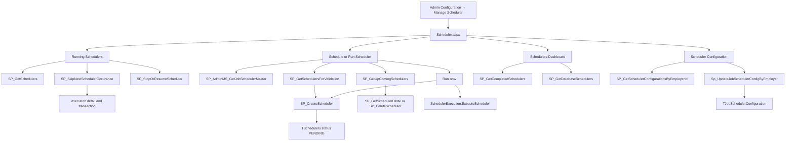
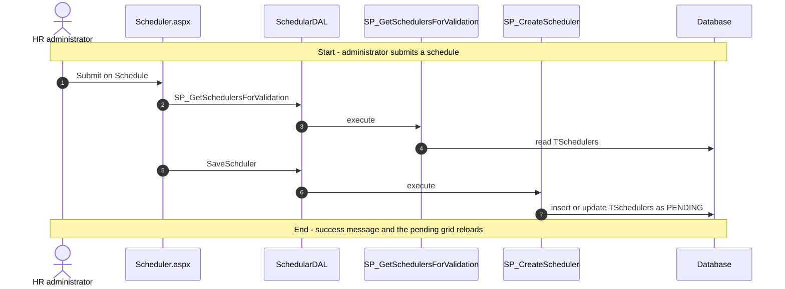
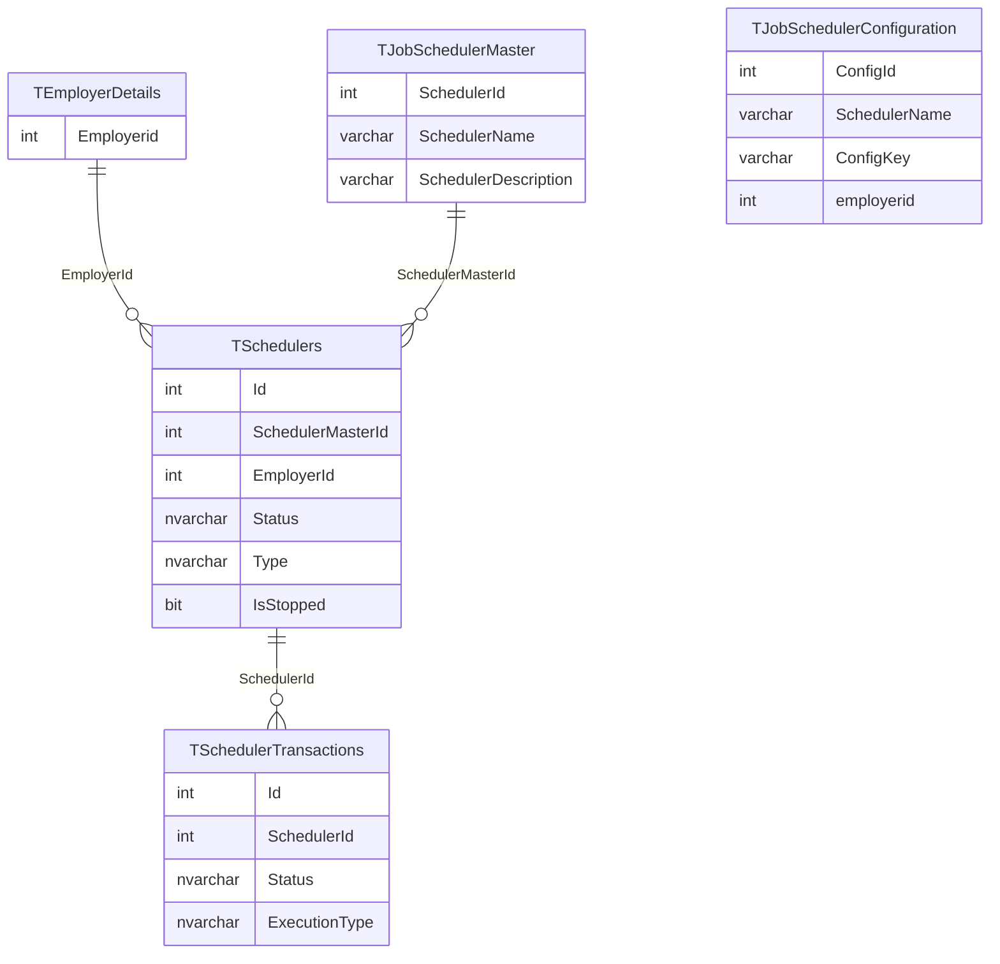

# Manage Scheduler

## Overview

An HR administrator needs background jobs to run on a timetable for one organisation, so they open **Admin Configuration → Manage Scheduler** (`~/HRM/Settings/Scheduler.aspx`). The page is a tab strip. **Running Schedulers** lists jobs that are already under way. **Schedule\Run Scheduler** picks a job from the master catalogue, sets dates, times, a time zone, and a frequency, then submits a pending row. The same tab lists pending rows so they can be edited or deleted, and it can run a job immediately in the web process. **Schedulers Dashboard** shows finished application runs and database runs. **Scheduler Configuration** edits the key-value settings those jobs read.

Submitting a schedule does not run the job. It writes `TSchedulers` with status `PENDING` through `SP_CreateScheduler`. The resident scheduler service later selects due rows. SystemModel-2 describes that engine, the five-minute poll, and the separate Windows Task Scheduler executables in `operations/processes/scheduled-jobs.md`. Table descriptions for `TSchedulers`, `TJobSchedulerMaster`, `TJobSchedulerConfiguration`, and `TSchedulerTransactions` are in `content/llm-wiki/reference/tables/hrms.md`. There is no llm-wiki domain page for this screen.

**Who's involved:**

- **HR administrator** — creates, edits, deletes, stops, resumes, and skips schedules for the organisation selected in the page header. A global-access user can switch organisation, which reloads this URL with the selected tab.
- **Scheduler service** — does not open this screen. `HRMS.Scheduler` later polls due `TSchedulers` rows. Some jobs are separate executables and never appear here.
- **Employee** — does not open this screen. They see the effects of the jobs (leave credit, reminders, and similar), not the schedule row.

## Workflow

## Request journey

### HR administrator — save a schedule

When the hidden schedule id is already set, the same procedure updates that row only while its status is `PENDING`. A new submit inserts the row, leaves last-executed and next-execution empty, and returns the new id. After a successful insert or update the page sends a schedule email. That mail reads `TJobSchedulerConfiguration` through `SP_GetJobSchedulerConfigurations` and does not change the schedule row.

Run now uses the same save procedure with type `IMMEDIATE`, then marks the row `EXECUTING`, calls `SchedulerExecution.ExecuteScheduler` in the web process, and writes a manual execution transaction. That job switch is not this journey.

## Entry points

The left-nav URL is `~/HRM/Settings/Scheduler.aspx`. `Page_Load` wires the organisation picker and, on the first load, fills the job dropdown and the configuration dropdown. Grids load through RadGrid `NeedDataSource`. Changing the organisation redirects to the same page with `selectedTab`. A row click on the running, completed, or database grid opens `SchedulerLogs.aspx` in a popup. That logs page is a separate screen.

| UI page | Purpose |
|---|---|
| `HRM/Settings/Scheduler.aspx` | Manage Scheduler tabs for one organisation |
| `HRM/Settings/SchedulerLogs.aspx` | Popup of one schedule's log, opened from a grid row click |

## Code → database call chain

List and save do not go through a BLL class. The page calls the static `SchedularDAL` methods, which execute the procedure names in `DBConstant.cs`. Reads use Enterprise Library `DBHelper.m_returnDbObject`. Writes use a raw `SqlCommand` on `HrmsConnectionString`. Run now is the exception: after the save it calls `SchedulerExecution.ExecuteScheduler` in `HRMS.BusinessLayer.Scheduler`.

| Entry | Method | Stored procedure |
|---|---|---|
| Running grid | `bindGridSchedulers` (`Scheduler.aspx.cs:202`) → `GetRunningSchedulers` (`SchedulerDAL.cs:242`) | `SP_GetSchedulers` |
| Job dropdown | `bindSchedulers` (`Scheduler.aspx.cs:191`) → `GetJobScheduler` (`SchedulerDAL.cs:91`) | `SP_AdminMS_GetJobSchedulerMaster` |
| Submit duplicate check | `validateNewSchedulerInstance` (`Scheduler.aspx.cs:370`) → `SP_GetSchedulersForValidation` (`SchedulerDAL.cs:695`) | `SP_GetSchedulersForValidation` |
| Submit and pending edit save | `SaveScheduler` (`Scheduler.aspx.cs:438`) → `SaveSchduler` (`SchedulerDAL.cs:186`) | `SP_CreateScheduler` |
| Schedule email after save | `SendSchedulerScheduleEmailAlert` (`FormatEmails.cs:4649`) → `GetJobSchedulerConfiguration` (`DBHelper.cs:3094`) | `SP_GetJobSchedulerConfigurations` |
| Pending grid | `getPendingSchedulers` (`Scheduler.aspx.cs:1060`) → `GetUpcomingSchedulers` (`SchedulerDAL.cs:294`) | `SP_GetUpComingSchedulers` |
| Edit pending row | `getSchedulerDetail` (`Scheduler.aspx.cs:1171`) → `GetSchedulerDetail` (`SchedulerDAL.cs:530`) | `SP_GetSchedulerDetail` |
| Delete pending rows | `deleteScheduler` (`Scheduler.aspx.cs:1109`) → `Delete` (`SchedulerDAL.cs:650`) | `SP_DeleteScheduler` |
| Skip next | `grdSchedulers_ItemCommand` (`Scheduler.aspx.cs:105`) → `SkipNextOccurance` (`SchedulerDAL.cs:484`) | `SP_SkipNextSchedulerOccurance` |
| Skip execution row | same command (`Scheduler.aspx.cs:109`) → `AddSchedulerExecutionTransaction` (`SchedulerDAL.cs:400`) | `SP_UpdateSchedulerExecutionDetails`, then `SP_AddSchedulerExecutionTransaction` |
| Stop | `stopScheduler` (`Scheduler.aspx.cs:719`) → `Stop` (`SchedulerDAL.cs:546`) | `SP_StopOrResumeScheduler` with `STOP` |
| Resume | `resumeScheduler` (`Scheduler.aspx.cs:712`) → `Resume` (`SchedulerDAL.cs:574`) | `SP_StopOrResumeScheduler` with `RESUME` |
| Run now save | `RunSchedulerNow` (`Scheduler.aspx.cs:601`) → `SaveSchduler` (`SchedulerDAL.cs:186`) | `SP_CreateScheduler` |
| Run now status | `RunSchedulerNow` (`Scheduler.aspx.cs:648` and `:657`) → `UpdateSchedulerExecutionStatus` (`SchedulerDAL.cs:326`) | `SP_UpdateSchedulerExecutionStatus` |
| Run now body | `ExecuteScheduler` (`SchedulerExecution.cs:186`) | Job-specific procedures inside the switch. Not listed here. |
| Run now log | `RunSchedulerNow` (`Scheduler.aspx.cs:683`) → `AddSchedulerExecutionTransaction` (`SchedulerDAL.cs:400`) | `SP_UpdateSchedulerExecutionDetails`, then `SP_AddSchedulerExecutionTransaction` |
| Dashboard application runs | `bindGridCompletedSchedulers` (`Scheduler.aspx.cs:219`) → `GetCompletedSchedulers` (`SchedulerDAL.cs:260`) | `SP_GetCompletedSchedulers` |
| Dashboard database runs | `bindGridDatabaseSchedulers` (`Scheduler.aspx.cs:212`) → `GetDatabaseSchedulers` (`SchedulerDAL.cs:277`) | `SP_GetDatabaseSchedulers` |
| Configuration job list | `bindSchedulerByEmployerId` (`Scheduler.aspx.cs:760`) → `GetJobSchedulerForConfiguration` (`SchedulerDAL.cs:103`) | `Sp_Admin_GetJobSchedulerMstr` |
| Configuration keys | `bindConfigurationKeysBySchedulerName` (`Scheduler.aspx.cs:768`) → `GetSchedulerConfigurationByEmployerId` (`SchedulerDAL.cs:604`) | `SP_GetSchedulerConfigurationsByEmployerId` |
| Configuration save | `btnSaveConfiguration_Click` (`Scheduler.aspx.cs:902`) → `UpdateSchedulerConfigurationByEmployer` (`SchedulerDAL.cs:621`) | `Sp_UpdateJobSchedulerConfigByEmployer` |
| Configuration history | `getSchedulerHistoryForConfiguration` (`Scheduler.aspx.cs:932`) → `getSchedulerHistoryForConfiguration` (`SchedulerDAL.cs:139`) | `Sp_Admin_GetJobSchedulerDet` |

`DBConstant.SP_GetJobSchedulerMaster` is the string `SP_AdminMS_GetJobSchedulerMaster`. `DBConstant.SP_SaveSchedulerDetails` is the string `SP_CreateScheduler`. `DBConstant.SP_GetUpcomingSchedulers` is the string `SP_GetUpComingSchedulers`.

## API endpoints

This screen is WebForms postback. It does not call `HRMS.CoreAPI`.

The actions that reach the database are `btnSubmit_Click`, `btnRunNow_Click`, `btnSaveConfiguration_Click`, `deleteScheduler`, the running-grid commands `SKIP_SCHEDULER`, `STOP`, and `RESUME`, and the RadGrid `NeedDataSource` handlers named in the call-chain table. A row click only opens the logs popup. It does not execute a procedure on this page.

`HRM/DashBoard_React/Common/apiURLConstants.js` defines dashboard routes such as `InsertUpdateJobSchedulerConfiguration` and `ListJobSchedulerConfiguration`. Those routes are not called by `Scheduler.aspx`.

## Stored procedures & tables involved

Every procedure below is one this page executes. None of them call another procedure or function, so there is no second nested level to expand. Pages are under `/docs/database/hrms/`.

| Object | File | Purpose |
|---|---|---|
| `SP_GetSchedulers` | `HRMS-DATABASE/HRMS/STOREPROCEDURE/SP_GetSchedulers.sql` | Running grid. [SP_GetSchedulers](/docs/database/hrms/SP_GetSchedulers) |
| `SP_AdminMS_GetJobSchedulerMaster` | `HRMS-DATABASE/HRMS/STOREPROCEDURE/SP_AdminMS_GetJobSchedulerMaster.sql` | Job dropdown, scheduler id under 100. [SP_AdminMS_GetJobSchedulerMaster](/docs/database/hrms/SP_AdminMS_GetJobSchedulerMaster) |
| `SP_GetSchedulersForValidation` | `HRMS-DATABASE/HRMS/STOREPROCEDURE/SP_GetSchedulersForValidation.sql` | Rows the submit path compares before save. [SP_GetSchedulersForValidation](/docs/database/hrms/SP_GetSchedulersForValidation) |
| `SP_CreateScheduler` | `HRMS-DATABASE/HRMS/STOREPROCEDURE/SP_CreateScheduler.sql` | Insert a schedule, or update one that is still `PENDING`. [SP_CreateScheduler](/docs/database/hrms/SP_CreateScheduler) |
| `SP_GetJobSchedulerConfigurations` | `HRMS-DATABASE/HRMS/STOREPROCEDURE/SP_GetJobSchedulerConfigurations.sql` | Email addresses after a successful schedule save. [SP_GetJobSchedulerConfigurations](/docs/database/hrms/SP_GetJobSchedulerConfigurations) |
| `SP_GetUpComingSchedulers` | `HRMS-DATABASE/HRMS/STOREPROCEDURE/SP_GetUpComingSchedulers.sql` | Pending grid. [SP_GetUpComingSchedulers](/docs/database/hrms/SP_GetUpComingSchedulers) |
| `SP_GetSchedulerDetail` | `HRMS-DATABASE/HRMS/STOREPROCEDURE/SP_GetSchedulerDetail.sql` | One row for the pending edit form. [SP_GetSchedulerDetail](/docs/database/hrms/SP_GetSchedulerDetail) |
| `SP_DeleteScheduler` | `HRMS-DATABASE/HRMS/STOREPROCEDURE/SP_DeleteScheduler.sql` | Delete selected pending rows by id. [SP_DeleteScheduler](/docs/database/hrms/SP_DeleteScheduler) |
| `SP_SkipNextSchedulerOccurance` | `HRMS-DATABASE/HRMS/STOREPROCEDURE/SP_SkipNextSchedulerOccurance.sql` | Move `NextExecutionDate` forward one occurrence. [SP_SkipNextSchedulerOccurance](/docs/database/hrms/SP_SkipNextSchedulerOccurance) |
| `SP_StopOrResumeScheduler` | `HRMS-DATABASE/HRMS/STOREPROCEDURE/SP_StopOrResumeScheduler.sql` | Set `IsStopped`. [SP_StopOrResumeScheduler](/docs/database/hrms/SP_StopOrResumeScheduler) |
| `SP_UpdateSchedulerExecutionStatus` | `HRMS-DATABASE/HRMS/STOREPROCEDURE/SP_UpdateSchedulerExecutionStatus.sql` | Run now sets `EXECUTING`, then `COMPLETED`. [SP_UpdateSchedulerExecutionStatus](/docs/database/hrms/SP_UpdateSchedulerExecutionStatus) |
| `SP_UpdateSchedulerExecutionDetails` | `HRMS-DATABASE/HRMS/STOREPROCEDURE/SP_UpdateSchedulerExecutionDetails.sql` | Write status, count, error, and who ran it. [SP_UpdateSchedulerExecutionDetails](/docs/database/hrms/SP_UpdateSchedulerExecutionDetails) |
| `SP_AddSchedulerExecutionTransaction` | `HRMS-DATABASE/HRMS/STOREPROCEDURE/SP_AddSchedulerExecutionTransaction.sql` | Insert `TSchedulerTransactions` and bump attempts. [SP_AddSchedulerExecutionTransaction](/docs/database/hrms/SP_AddSchedulerExecutionTransaction) |
| `SP_GetCompletedSchedulers` | `HRMS-DATABASE/HRMS/STOREPROCEDURE/SP_GetCompletedSchedulers.sql` | Dashboard application runs. [SP_GetCompletedSchedulers](/docs/database/hrms/SP_GetCompletedSchedulers) |
| `SP_GetDatabaseSchedulers` | `HRMS-DATABASE/HRMS/STOREPROCEDURE/SP_GetDatabaseSchedulers.sql` | Dashboard rows with execution type `DB`. [SP_GetDatabaseSchedulers](/docs/database/hrms/SP_GetDatabaseSchedulers) |
| `Sp_Admin_GetJobSchedulerMstr` | `HRMS-DATABASE/HRMS/STOREPROCEDURE/Sp_Admin_GetJobSchedulerMstr.sql` | Configuration tab job names that have keys. [Sp_Admin_GetJobSchedulerMstr](/docs/database/hrms/Sp_Admin_GetJobSchedulerMstr) |
| `SP_GetSchedulerConfigurationsByEmployerId` | `HRMS-DATABASE/HRMS/STOREPROCEDURE/SP_GetSchedulerConfigurationsByEmployerId.sql` | Keys for the selected job and employer. [SP_GetSchedulerConfigurationsByEmployerId](/docs/database/hrms/SP_GetSchedulerConfigurationsByEmployerId) |
| `Sp_UpdateJobSchedulerConfigByEmployer` | `HRMS-DATABASE/HRMS/STOREPROCEDURE/Sp_UpdateJobSchedulerConfigByEmployer.sql` | Update one configuration value. [Sp_UpdateJobSchedulerConfigByEmployer](/docs/database/hrms/Sp_UpdateJobSchedulerConfigByEmployer) |
| `Sp_Admin_GetJobSchedulerDet` | `HRMS-DATABASE/HRMS/STOREPROCEDURE/Sp_Admin_GetJobSchedulerDet.sql` | Configuration history grid. [Sp_Admin_GetJobSchedulerDet](/docs/database/hrms/Sp_Admin_GetJobSchedulerDet) |

Tables those scripts touch: `TSchedulers`, `TJobSchedulerMaster`, `TSchedulerTransactions`, `TJobSchedulerConfiguration`. `TEmployerDetails` appears only as the declared parent of `TSchedulers.EmployerId`. Catalog blurbs for the scheduler tables are in `content/llm-wiki/reference/tables/hrms.md`.

## Table relationships

Declared foreign keys were read from the table scripts. `TJobSchedulerConfiguration` declares none. The configuration procedures match `SchedulerName` and `employerid` without a foreign key. `content/llm-wiki/reference/tables/hrms.md` lists the same parents for `TSchedulers` and `TSchedulerTransactions`, and an em dash for `TJobSchedulerConfiguration`.

## Known gaps

- `SchedulerExecution.ExecuteScheduler` switches on `SchedulerName` and calls job helpers. Those procedures are the catalogue in `operations/processes/scheduled-jobs.md`. They are not expanded here. Run now on this page invokes that switch inside the web process.
- `SchedulerLogs.aspx` is opened from a row click. `SchedularDAL.GetSchedulerLogs` (`SP_GetSchedulerLogs`) is not called by `Scheduler.aspx`.
- `SP_GetSchedulersForValidation` returns rows only when the current time is already at or past `EndDate`, and the page rejects a submit only when the new start date is on or before that `EndDate` and the start times match. A future pending row is outside that result, so this check does not see it.
- `SaveScheduler` never assigns `CreatedBy`. The DAL sends the default `0` into a non-null `TSchedulers.CreatedBy`.
- The pending grid and the completed grid bind `StartTimeCharValue` and `EndTimeCharValue`. `SP_GetUpComingSchedulers` and `SP_GetCompletedSchedulers` do not return those columns. The running and database procedures do.
- Skip calls `SP_SkipNextSchedulerOccurance`, which moves `NextExecutionDate`. It does not set the `SkipNext` bit. The follow-up transaction is written with execution type `System` because the skip command does not pass `Manual`.
- `SP_DeleteScheduler` deletes by id with no status predicate. The button is on the pending grid only.
- `SP_UpdateSchedulerExecutionDetails` assigns `Passed`, `Failed`, and `Skipped` to `@SchedulerStatus` and never writes that variable. The update stores the incoming status string.
- The schedule email calls `GetJobSchedulerConfiguration` without the employer id, so `SP_GetJobSchedulerConfigurations` takes the branch that does not filter `employerid`.
- Same DAL file, not called by this page: `InsertJobScheduler`, `UpdateJobScheduler`, `getSchedulerHistory`, `GetJobSchedulerForManageScheduler`, `GetConfigKeyForSchedulerConfiguration`, `UpdateJobSchedulerConfiguration`, `GetSchedulersToExecute`, `AddSchedulerExecutionDetails`, `TurnOffSkipnextSchedulerFlag`.
- React routes in `apiURLConstants.js` for job-scheduler configuration are a different screen.
- `TSCHEDULERCONFIGURATION` and `TJobSchedulerDetails` are not read or written by the procedures this page executes.

## Reference

Confidence is medium because the WebForms list, save, pending edit, configuration save, and the procedure bodies for those calls were read. The Run now job switch and `SchedulerLogs.aspx` were not.

### SourceCode

- `docs/SystemModels/SystemModel-2/operations/processes/scheduled-jobs.md`
- `HRMS.Web/HRMS.Web/HRM/Settings/Scheduler.aspx`
- `HRMS.Web/HRMS.Web/HRM/Settings/Scheduler.aspx.cs`
- `HRMS.Shared/HRMS.DataAccessLayer/SchedulerDAL.cs`
- `HRMS.Shared/HRMS.DataAccessLayer/DBConstant.cs`
- `HRMS.Shared/HRMS.DataAccessLayer/DBHelper.cs`
- `HRMS.Shared/HRMS.Common/FormatEmails.cs`
- `HRMS.Scheduler/HRMS.BusinessLayer.Scheduler/Service/SchedulerExecution.cs`

### TDG HRMS DB

- `content/llm-wiki/reference/tables/hrms.md`
- `HRMS-DATABASE/HRMS/TABLES/TSchedulers.sql`
- `HRMS-DATABASE/HRMS/TABLES/TSchedulerTransactions.sql`
- `HRMS-DATABASE/HRMS/TABLES/TJobSchedulerMaster.sql`
- `HRMS-DATABASE/HRMS/TABLES/TJobSchedulerConfiguration.sql`
- `HRMS-DATABASE/HRMS/STOREPROCEDURE/SP_CreateScheduler.sql`
- `HRMS-DATABASE/HRMS/STOREPROCEDURE/SP_GetSchedulers.sql`
- `HRMS-DATABASE/HRMS/STOREPROCEDURE/SP_GetSchedulersForValidation.sql`
- `HRMS-DATABASE/HRMS/STOREPROCEDURE/SP_AdminMS_GetJobSchedulerMaster.sql`
- `HRMS-DATABASE/HRMS/STOREPROCEDURE/SP_GetUpComingSchedulers.sql`
- `HRMS-DATABASE/HRMS/STOREPROCEDURE/SP_GetSchedulerDetail.sql`
- `HRMS-DATABASE/HRMS/STOREPROCEDURE/SP_DeleteScheduler.sql`
- `HRMS-DATABASE/HRMS/STOREPROCEDURE/SP_SkipNextSchedulerOccurance.sql`
- `HRMS-DATABASE/HRMS/STOREPROCEDURE/SP_StopOrResumeScheduler.sql`
- `HRMS-DATABASE/HRMS/STOREPROCEDURE/SP_UpdateSchedulerExecutionStatus.sql`
- `HRMS-DATABASE/HRMS/STOREPROCEDURE/SP_UpdateSchedulerExecutionDetails.sql`
- `HRMS-DATABASE/HRMS/STOREPROCEDURE/SP_AddSchedulerExecutionTransaction.sql`
- `HRMS-DATABASE/HRMS/STOREPROCEDURE/SP_GetCompletedSchedulers.sql`
- `HRMS-DATABASE/HRMS/STOREPROCEDURE/SP_GetDatabaseSchedulers.sql`
- `HRMS-DATABASE/HRMS/STOREPROCEDURE/SP_GetJobSchedulerConfigurations.sql`
- `HRMS-DATABASE/HRMS/STOREPROCEDURE/Sp_Admin_GetJobSchedulerMstr.sql`
- `HRMS-DATABASE/HRMS/STOREPROCEDURE/SP_GetSchedulerConfigurationsByEmployerId.sql`
- `HRMS-DATABASE/HRMS/STOREPROCEDURE/Sp_UpdateJobSchedulerConfigByEmployer.sql`
- `HRMS-DATABASE/HRMS/STOREPROCEDURE/Sp_Admin_GetJobSchedulerDet.sql`
