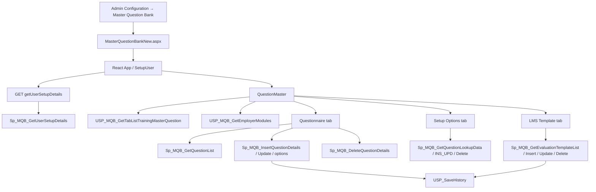
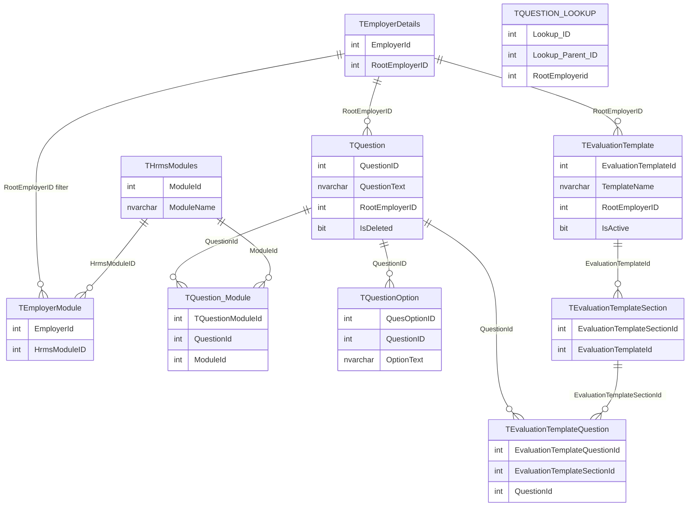

# Master Question Bank

## Overview

An HR administrator maintains the shared question bank used by LMS (module 5) and Survey (module 17), plus LMS evaluation templates. They open **Admin Configuration → Master Question Bank** at `~/HRM/MasterQuestionBank/MasterQuestionBankNew.aspx`. The WebForms host only copies the signed-in user into hidden fields and loads the React bundle `masterquestionbank.*.min.js`. The React app reads those fields into Redux, calls `getUserSetupDetails`, then renders `QuestionMaster` with three permission-gated tabs: **Questionnaire**, **Setup Options**, and **LMS Template** (LMS Template appears when the selected module is LMS or when the URL deep-links with `tab=lmstemplate`).

On Questionnaire the admin filters and lists questions for the selected module, adds or edits question text and answer options (including emoji rating defaults), bulk-imports from Excel, and deletes only when the question is not on an active evaluation template. Setup Options maintains `TQUESTION_LOOKUP` reference rows. LMS Template lists evaluation templates, builds sections and mapped questions, and soft-deletes templates that are not in use by trainings.

SystemModel-2 has no page that names this screen. Question and evaluation tables live behind Training synonyms (`TQuestion`, `TEvaluationTemplate`, …); the live `Sp_MQB_*` / `USP_MQB_*` scripts are inventoried under `HRMS-DATABASE/HRMS/STOREPROCEDURE/`.

**Who's involved:**

- **HR administrator** — creates and maintains questions, lookup values, and LMS evaluation templates for the organisation in session.
- **Training / Survey consumers** — later screens assign these questions to trainings, quizzes, feedback, and surveys. This page does not call the assessment or quiz assignment procedures; those routes exist on the same `/masterquebank` router for Training screens.

## Workflow



## Request journey

### HR administrator — save a new question

```mermaid
sequenceDiagram
  autonumber
  actor Admin as HR administrator
  participant UI as QuestionnaireTab
  participant App as masterquebank API
  participant BLL as masterQuestionBankBLL
  participant SP as Sp_MQB_InsertQuestionDetails
  participant Opt as Sp_MQB_InsertQOptionDetails
  participant DB as Database

  Note over Admin,DB: Start - administrator submits a new question
  Admin->>UI: Submit question form
  UI->>App: POST InsertQuestionDetails
  App->>BLL: InsertQuestionDetails in a transaction
  BLL->>SP: insert TQuestion and TQuestion_Module
  SP->>DB: write question rows and history
  loop each answer option
    BLL->>Opt: InsertQOptionDetails
    Opt->>DB: write TQuestionOption and history
  end
  Note over Admin,DB: End - question id returned and the grid reloads
```

Delete first calls `getQuestionTemplateUsage`. Soft-delete runs only when no active template still maps the question. LMS Template create posts `insertEvaluationTemplate`, which inserts the template header then sections and questions in the same BLL transaction. The aspx host does not post back.

## Entry points

The left-nav target is `HRM/MasterQuestionBank/MasterQuestionBankNew.aspx`. `Page_Load` writes session values into `hdnEmpId`, `hdnEmployerId`, and the other `hdn*` fields. `authReducer.js` seeds Redux from those fields before `SetupUser` loads claims. An older host `HRM/Training/MasterQuestionBank.aspx` still exists; this menu URL uses the New page. Deep link `?tab=lmstemplate&mode=edit&templateId=` opens the LMS Template tab when the role can edit it.

| UI page | Purpose |
|---|---|
| `HRM/MasterQuestionBank/MasterQuestionBankNew.aspx` | Host, session hidden fields, React bundle |
| `HRM/MasterQuestionBank/index.jsx` / `App.jsx` | Redux persist, theme, mounts `SetupUser` |
| `HRM/MasterQuestionBank/setupUser.jsx` | Loads user setup, then `Areas/routes.jsx` |
| `HRM/MasterQuestionBank/Areas/QuestionMaster/Containers/questionMaster.jsx` | Module dropdown and three tabs |
| `HRM/MasterQuestionBank/Areas/routes.jsx` | Maps `TRAINING_QUESTIONMASTER` to `QuestionMaster` |

## Code → database call chain

Calls go `APIHelper` → `/api/masterquebank/...` (`routeIndex.js:255`) → `masterQuestionBankController` → DAL or BLL → `mssql` `.execute`. Insert and update question and template flows use BLL transactions that call more than one procedure.

| Entry | Method | Stored procedure |
|---|---|---|
| App boot | `fetchAndSetupUser` (`setupUser.jsx:48`) → `GetUserSetupDetails` (`masterQuestionBankController.js:275`) → `GetUserSetupDetails` (`masterQuestionBankDAL.js:378`) | `Sp_MQB_GetUserSetupDetails` |
| Tab permissions | `GetTabListTrainingMasterQuestion` (`questionMaster.jsx:108`) → controller `17` → DAL `19` | `USP_MQB_GetTabListTrainingMasterQuestion` |
| Module dropdown | `fetchModules` (`questionMaster.jsx:77`) → controller `30` → DAL `36` | `USP_MQB_GetEmployerModules` |
| Question grid | list load (`questionnaireTab.jsx:1251`) → controller `43` → DAL `50` | `Sp_MQB_GetQuestionList` |
| Open / edit question | (`questionnaireTab.jsx:1409`, `1434`) → BLL `GetQuestionDetails` → DAL `178` | `Sp_MQB_GetQuestionDetails` |
| Mapped trainings | (`questionnaireTab.jsx:780`) → BLL → DAL `194` | `Sp_MQB_GetQuestionTrainingsList` |
| Insert question | (`questionnaireTab.jsx:881`, bulk `bulkUploadHelper.js:1173`) → BLL `InsertQuestionDetails` (`17`) → DAL `76` then options DAL `102` | `Sp_MQB_InsertQuestionDetails`, `Sp_MQB_InsertQOptionDetails` |
| Update question | (`questionnaireTab.jsx:881`) → BLL `UpdateQuestionDetails` (`94`) → DAL `208` then options DAL `102` | `Sp_MQB_UpdateQuestionDetails`, `Sp_MQB_InsertQOptionDetails` |
| Delete option rows | `answerSelector.jsx:305` → BLL `DeleteQuestionOptionDetails` → DAL `165` | `Sp_MQB_DeleteQuestionOptionDetails` |
| Delete question | (`questionnaireTab.jsx:1290`) after usage check (`1367`) → DAL `150` | `Sp_MQB_DeleteQuestionDetails` (usage via `Sp_MQB_GetQuestionTemplateUsage`) |
| Emoji defaults | get (`329`) / post (`422`) → DAL `121` / BLL → DAL `136` | `USP_MQB_GetEmployerEmojiRating`, `USP_MQB_SaveEmployerEmojis` |
| Lookup lists | Questionnaire / Setup Options / criteria → controller `213` → DAL `290` | `Sp_MQB_GetQuestionLookupData` |
| Bulk template columns | `getTemplateStructureData` (`bulkUploadHelper.js:9`) → DAL `311` | `USP_MQB_GetImportTemplateFields` |
| Save lookup | `refDataAddEdit.jsx:179` → DAL `325` | `Sp_MQB_INS_UPD_QUESTION_LOOKUP_DATA` |
| Delete lookup | `manageQuestionRefData.jsx:294` after is-in-use (`247`) → DAL `347` / `364` | `Sp_MQB_Delete_QuestionLookup`, `SP_MQB_GetMasterDataIsInUse` |
| Custom labels | LMS / Setup (`LmsTemplate.jsx:118`, `refDataAddEdit.jsx:26`) → DAL `395` | `USP_MQB_GetCustomizeLabel` |
| Rating config | `TemplateBuilder.jsx:270` → DAL `410` | `Sp_MQB_GetCustomerRatingConfig` |
| Template list / details | `LmsTemplate.jsx:126`, `149` → DAL `427` / BLL `349` → DAL `440` | `Sp_MQB_GetEvaluationTemplateList`, `Sp_MQB_GetEvaluationTemplateDetails` |
| Insert template | `TemplateBuilder.jsx:213` → BLL `215` → DAL insert template / section / question | `Sp_MQB_InsertEvaluationTemplate`, `Sp_MQB_InsertEvaluationTemplateSection`, `Sp_MQB_InsertEvaluationTemplateQuestion` |
| Update template | `TemplateBuilder.jsx:212` → BLL `280` → update, delete sections, re-insert | `Sp_MQB_UpdateEvaluationTemplate`, `Sp_MQB_DeleteEvaluationTemplateSections`, then insert section/question |
| Delete template | `LmsTemplate.jsx:242` after in-use (`225`) → DAL `541` / `596` | `Sp_MQB_DeleteEvaluationTemplate`, `Sp_MQB_GetTemplateInUse` |
| Template history / mapped trainings | `LmsTemplate.jsx:263`, `277` → DAL `583`, `570` | `Sp_MQB_GetTemplateChangeHistory`, `Sp_MQB_GetTemplateMappedTrainings` |

`GET_ALL_EMPLOYER_LIST` on Setup Options (`manageQuestionRefData.jsx:93`) is `/Employee/GetGlobalAccessEmployerList`, not a masterquebank procedure. `setEvaluationTemplateStatus` is registered on the router and in `apiURLConstants.js` but no Master Question Bank JSX calls it.

## API endpoints

The host page does not post back. `APIHelper` sends `Authorization` from storage. Routes below are under `/api` with `Authorize` on `masterquestionbankRoutes.js`.

| Method | Path | Purpose | Caller | Handler |
|---|---|---|---|---|
| GET | `/api/masterquebank/getUserSetupDetails` | Claims, lookups, root employer, flags | `setupUser.jsx` | `GetUserSetupDetails` |
| GET | `/api/masterquebank/GetTabListTrainingMasterQuestion` | Editable tabs for menu 113 | `questionMaster.jsx` | `GetTabListTrainingMasterQuestion` |
| GET | `/api/masterquebank/getModuleList` | LMS and Survey modules for employer | `questionMaster.jsx` | `Getmoduleslist` |
| GET | `/api/masterquebank/GetQuestionList` | Question grid | `questionnaireTab.jsx`, `TemplateBuilder.jsx` | `GetQuestionList` |
| GET | `/api/masterquebank/GetQuestionDetails` | Question + options | `questionnaireTab.jsx`, `questionAnswer.jsx` | `GetQuestionDetails` |
| GET | `/api/masterquebank/getMappedTrainingsByQuestion` | Trainings using question text | `questionnaireTab.jsx` | `GetMappedTrainingsByQuestion` |
| POST | `/api/masterquebank/InsertQuestionDetails` | Insert question and options | `questionnaireTab.jsx`, bulk helper | `InsertQuestionDetails` |
| POST | `/api/masterquebank/UpdateQuestionDetails` | Update question and options | `questionnaireTab.jsx` | `UpdateQuestionDetails` |
| DELETE | `/api/masterquebank/deleteQuestionDetails` | Soft-delete question | `questionnaireTab.jsx` | `DeleteQuestionDetails` |
| DELETE | `/api/masterquebank/deleteQuestionOptionDetails` | Remove option ids | `answerSelector.jsx` | `DeleteQuestionOptionDetails` |
| GET/POST | `/api/masterquebank/getDefaultEmployerEmojis`, `insertDefaultEmployerEmojis` | Emoji rating defaults | `questionnaireTab.jsx` | emoji handlers |
| GET | `/api/masterquebank/GetQuestionLookupData` | Question lookup rows | Questionnaire / Setup Options | `GetQuestionLookupData` |
| GET | `/api/masterquebank/GetTemplateStructure` | Bulk import columns | `bulkUploadHelper.js` | `GetTemplateStructure` |
| POST | `/api/masterquebank/SaveQuestionLookupData` | Insert/update lookup | `refDataAddEdit.jsx` | `SaveQuestionLookupData` |
| DELETE | `/api/masterquebank/DeleteQuestionLookupItem` | Delete lookup | `manageQuestionRefData.jsx` | `DeleteQuestionLookupItem` |
| GET | `/api/masterquebank/getMasterDataIsInUse` | Block delete when in use | `manageQuestionRefData.jsx` | `GetMasterDataIsInUse` |
| GET | `/api/masterquebank/getLabelDetails` | Custom labels | LMS / Setup | `GetLabelDetails` |
| GET | `/api/masterquebank/getRatingTypeAndValue` | Customer rating config | `TemplateBuilder.jsx` | `GetRatingTypeAndValue` |
| GET/POST/DELETE | `/api/masterquebank/getEvaluationTemplateList`, `getEvaluationTemplateDetails`, `insertEvaluationTemplate`, `updateEvaluationTemplate`, `deleteEvaluationTemplate` | LMS templates | LMS Template UI | matching handlers |
| GET | `/api/masterquebank/getTemplateMappedTrainings`, `getTemplateChangeHistory`, `getTemplateInUse`, `getQuestionTemplateUsage` | Template usage and history | LMS / Questionnaire | matching handlers |

Route name casing is mixed (`GetQuestionList` vs `getUserSetupDetails`); the constants match what Express registers. Assessment and quiz assignment routes on the same router are not called from this page's Areas tree.

## Stored procedures & tables involved

Direct procedures this page's React UI reaches (plus nested history / encryption helpers those scripts call):

| Object | File | Purpose |
|---|---|---|
| `Sp_MQB_GetUserSetupDetails` | `HRMS-DATABASE/HRMS/STOREPROCEDURE/Sp_MQB_GetUserSetupDetails.sql` | Multi-result setup for the React shell |
| `USP_MQB_GetTabListTrainingMasterQuestion` | `…/USP_MQB_GetTabListTrainingMasterQuestion.sql` | Role/user tabs for menu id 113 |
| `USP_MQB_GetEmployerModules` | `…/USP_MQB_GetEmployerModules.sql` | Active LMS (5) and Survey (17) modules |
| `Sp_MQB_GetQuestionList` | `…/Sp_MQB_GetQuestionList.sql` | Question grid; opens encryption keys; uses `Fn_GetEmployeeName` |
| `Sp_MQB_GetQuestionDetails` | `…/Sp_MQB_GetQuestionDetails.sql` | Question header and options |
| `Sp_MQB_GetQuestionTrainingsList` | `…/Sp_MQB_GetQuestionTrainingsList.sql` | Trainings mapped by question text |
| `Sp_MQB_InsertQuestionDetails` | `…/Sp_MQB_InsertQuestionDetails.sql` | Insert `TQuestion` + `TQuestion_Module` + history |
| `Sp_MQB_InsertQOptionDetails` | `…/Sp_MQB_InsertQOptionDetails.sql` | Insert/update option rows + history |
| `Sp_MQB_UpdateQuestionDetails` | `…/Sp_MQB_UpdateQuestionDetails.sql` | Update question + history |
| `Sp_MQB_DeleteQuestionDetails` | `…/Sp_MQB_DeleteQuestionDetails.sql` | Soft-delete; blocks active template use |
| `Sp_MQB_DeleteQuestionOptionDetails` | `…/Sp_MQB_DeleteQuestionOptionDetails.sql` | Delete options; `USP_SaveHistory_MultiID` |
| `USP_MQB_GetEmployerEmojiRating` / `USP_MQB_SaveEmployerEmojis` | matching USP files | Employer emoji defaults |
| `Sp_MQB_GetQuestionLookupData` | `…/Sp_MQB_GetQuestionLookupData.sql` | Lookup rows for a module |
| `USP_MQB_GetImportTemplateFields` | `…/USP_MQB_GetImportTemplateFields.sql` | Bulk import column metadata |
| `Sp_MQB_INS_UPD_QUESTION_LOOKUP_DATA` | `…/Sp_MQB_INS_UPD_QUESTION_LOOKUP_DATA.sql` | Insert/update lookup + history |
| `Sp_MQB_Delete_QuestionLookup` | `…/Sp_MQB_Delete_QuestionLookup.sql` | Soft-delete lookup |
| `SP_MQB_GetMasterDataIsInUse` | `…/SP_MQB_GetMasterDataIsInUse.sql` | Lookup in-use check |
| `USP_MQB_GetCustomizeLabel` | `…/USP_MQB_GetCustomizeLabel.sql` | Custom label text |
| `Sp_MQB_GetCustomerRatingConfig` | `…/Sp_MQB_GetCustomerRatingConfig.sql` | Rating type/value from customer settings |
| `Sp_MQB_GetEvaluationTemplateList` / `Details` / insert / section / question / update / delete sections / delete / mapped / history / in-use / question usage | matching `Sp_MQB_*` files | LMS evaluation template lifecycle |
| `USP_SaveHistory` | no inventoried CREATE under `HRMS-DATABASE/HRMS` | Nested history writer (synonym / cross-DB) |
| `USP_SaveHistory_MultiID` / `USP_SaveHistory_MultiFilter` | `…/USP_SaveHistory_MultiID.sql`, `…/USP_SaveHistory_MultiFilter.sql` | Nested multi-row history |
| `Sp_OpenEncryptionKeys` / `SP_CloseEncryptionKey` | existing Backstage pages | Nested around encrypted name reads |
| `Fn_GetEmployeeName` | existing Backstage page | Nested in question list AddedBy |

Core tables (often via Training synonyms from HRMS): `TQuestion`, `TQuestionOption`, `TQuestion_Module`, `TQUESTION_LOOKUP`, `TEvaluationTemplate`, `TEvaluationTemplateSection`, `TEvaluationTemplateQuestion`, and supporting `TEmployerDetails`, `THrmsModules`, `TEmployerModule`, `TRoleTabDetails`, `TUserTabDetails`, `TTabDetails`, `TCustomerSettings`, `Tcustomizelabel`, history tables, and claim/lookup tables used by setup.

## Table relationships

No foreign keys were verified between all synonym-backed Training tables from this page's procedure set alone. Edges below follow the joins and insert targets in the `Sp_MQB_*` scripts this UI calls.



## Known gaps

- `setEvaluationTemplateStatus` is on the API and in `apiURLConstants.js` but no Master Question Bank component calls it.
- Assessment and quiz assignment endpoints on `/masterquebank` are used by Training screens, not by this page's Areas tree.
- `USP_SaveHistory` is executed by many mutating `Sp_MQB_*` scripts, but no `CREATE PROCEDURE` body for `USP_SaveHistory` is inventoried under `HRMS-DATABASE/HRMS` (only `USP_SaveHistory_MultiID` and `USP_SaveHistory_MultiFilter`). History target databases are resolved from synonym metadata at runtime.
- Question and evaluation tables are referenced through synonyms; table scripts may live under `HRMS-TRAINING` while procedures are deployed from `HRMS`.
- SystemModel-2 does not document this screen.
- Setup Options also calls `GetGlobalAccessEmployerList` outside the masterquebank DAL.

## Reference

Confidence is high because the aspx host, React entry and tab containers, v1 controller/DAL/BLL, routes, and the procedure scripts listed above were read. Nothing was executed.

### SourceCode

- `HRMS.Web/HRMS.Web/HRM/MasterQuestionBank/MasterQuestionBankNew.aspx`
- `HRMS.Web/HRMS.Web/HRM/MasterQuestionBank/MasterQuestionBankNew.aspx.cs`
- `HRMS.Web/HRMS.Web/HRM/MasterQuestionBank/App.jsx`
- `HRMS.Web/HRMS.Web/HRM/MasterQuestionBank/setupUser.jsx`
- `HRMS.Web/HRMS.Web/HRM/MasterQuestionBank/Areas/routes.jsx`
- `HRMS.Web/HRMS.Web/HRM/MasterQuestionBank/Areas/QuestionMaster/Containers/questionMaster.jsx`
- `HRMS.Web/HRMS.Web/HRM/MasterQuestionBank/Areas/QuestionMaster/Containers/questionnaireTab.jsx`
- `HRMS.Web/HRMS.Web/HRM/MasterQuestionBank/Areas/ManageQuestionRefData/manageQuestionRefData.jsx`
- `HRMS.Web/HRMS.Web/HRM/MasterQuestionBank/Areas/LMSTemplate/Containers/LmsTemplate.jsx`
- `HRMS.Web/HRMS.Web/HRM/MasterQuestionBank/Areas/LMSTemplate/Components/TemplateBuilder.jsx`
- `HRMS.Web/HRMS.Web/HRM/MasterQuestionBank/Common/apiURLConstants.js`
- `HRMS.CoreAPI/HRMS.Core.WebAPI.Node/Routes/routeIndex.js`
- `HRMS.CoreAPI/HRMS.Core.WebAPI.Node/Routes/masterquestionbankRoutes.js`
- `HRMS.CoreAPI/HRMS.Core.WebAPI.Node/Controllers/masterQuestionBankController.js`
- `HRMS.CoreAPI/HRMS.Core.WebAPI.Node/Core/BusinessLogicLayer/masterQuestionBankBLL.js`
- `HRMS.CoreAPI/HRMS.Core.WebAPI.Node/Core/DataAccessLayer/masterQuestionBankDAL.js`

### TDG HRMS DB

- `HRMS-DATABASE/HRMS/STOREPROCEDURE/Sp_MQB_*.sql` and `USP_MQB_*.sql` listed above
- `HRMS-DATABASE/HRMS/STOREPROCEDURE/USP_SaveHistory_MultiID.sql`
- `HRMS-DATABASE/HRMS/STOREPROCEDURE/USP_SaveHistory_MultiFilter.sql`
- `HRMS-DATABASE/HRMS-TRAINING/TABLES/TQuestion.sql`
- `HRMS-DATABASE/HRMS/TABLES/tquestion_lookup.sql`
