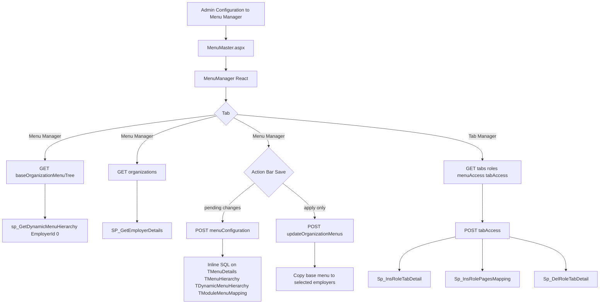
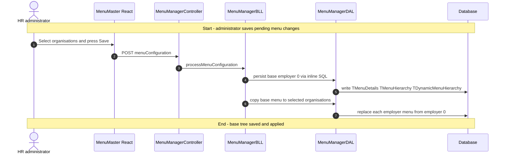
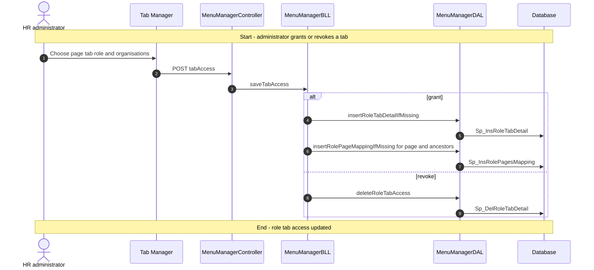
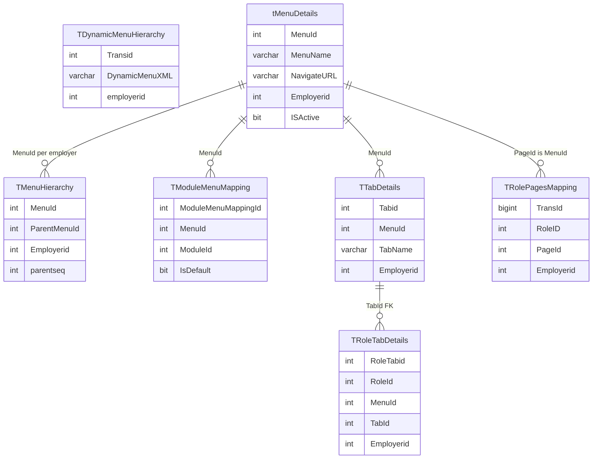

# Menu Manager

## Overview

An HR administrator maintains the left-nav tree that every organisation inherits. They open **Admin Configuration → Menu Manager** (`~/HRM/MenuManager_React/MenuMaster.aspx`). The WebForms host only stamps hidden session fields and logs activity type `MenuManager` (348). The React app in `BuildJS/MenuManager.js` does the real work against Core API `/api/menuManagement/*`.

On the **Menu Manager** tab they edit the **base organisation** tree (`EmployerId` 0) in memory: add, edit, move, and delete menu nodes, and optionally map a node to an HRMS module. Nothing reaches the database until they select one or more organisations and press Save on the sticky Action Bar. Save posts the full tree plus pending changes to `POST /api/menuManagement/menuConfiguration`, which writes `TMenuDetails`, `TMenuHierarchy`, `TDynamicMenuHierarchy`, and `TModuleMenuMapping` for employer 0 (with history copies), syncs the default access-rights template, then copies the base menu into each selected organisation. Ticking **Apply existing menu only** skips pending edits and calls `POST /api/menuManagement/updateOrganizationMenus` instead.

On the **Tab Manager** tab they pick a base-org page, tab, and default role, then grant or revoke that tab for organisations that already have the page licensed. Save posts to `POST /api/menuManagement/tabAccess`, which runs `Sp_InsRoleTabDetail`, `Sp_InsRolePagesMapping` (page plus ancestors), and `Sp_DelRoleTabDetail`.

Most Menu Manager reads and writes are **inline SQL** in `MenuManagerDAL.js`, not stored procedures. The procedures this screen reaches are listed below.

**Who's involved:**

- **HR administrator / Super Admin** — edits the base menu tree, applies it to organisations, and grants tab access by role.
- **End users** — never open this screen. Their left nav comes from the copied `TDynamicMenuHierarchy` / `TMenuDetails` rows for their employer, filtered by role page and tab grants.

SystemModel-2 has no workflow or context page for Menu Manager. Table catalog entries live in `llm-wiki/reference/tables/hrms.md`.

## Workflow

Module labels on the Add/Edit form come from `GET /api/dashBoard/WorkflowCategory`, which executes [SP_AdminWM_GetHRMSModules](/docs/database/hrms/SP_AdminWM_GetHRMSModules).

## Request journey

### HR administrator — save menu configuration

### HR administrator — save tab access

## Entry points

| UI page | Purpose |
|---|---|
| `HRM/MenuManager_React/MenuMaster.aspx` | Host page. Title in the page directive is MenuManager. URL `~/HRM/MenuManager_React/MenuMaster.aspx` |
| React bundle `BuildJS/MenuManager.js` | Menu Manager and Tab Manager tabs mounted on `#root` |

There is no WebForms postback for menu edits. Session context is passed through hidden inputs (`hdnEmpId`, `hdnEmployerId`, and related fields).

## Code → database call chain

| Entry | Method | Stored procedure or SQL |
|---|---|---|
| Page open | `Page_Load` (`MenuMaster.aspx.cs:28`) → `CommonUtil.LogActivity` → `ActivityHelper.LogActivity` (`ActivityHelper.cs:36`) | `Sp_InsertActivityLog` |
| Load base tree | `fetchTreeData` (`treeSlice.js:13`) → `GET baseOrganizationMenuTree` (`MenuManagerController.js:16`) → `getBaseOrganizationMenuTree` (`MenuManagerBLL.js:27`) → `fetchOrganizationMenuTree` (`MenuManagerDAL.js:34`) | `sp_GetDynamicMenuHierarchy` |
| Load organisations | `fetchOrganizations` (`organizationSlice.js:10`) → `GET organizations` (`MenuManagerController.js:7`) → `getOrganizations` (`MenuManagerBLL.js:53`) → `getAllOrganizations` (`MenuManagerDAL.js:15`) | `SP_GetEmployerDetails` |
| Menu details | `fetchMenuDetails` (`menuDetailsSlice.js:42`) → `GET menuDetails` (`MenuManagerController.js:25`) → `getMenuItemDetails` (`MenuManagerBLL.js:40`) → `getMenuItemDetails` (`MenuManagerDAL.js:48`) | Inline `SELECT` on `TMenuDetails` |
| Modules dropdown | `fetchModules` (`modulesSlice.js:12`) → `GET /dashBoard/WorkflowCategory` → `dashBoardDAL.WorkflowCategory` (`dashBoardDAL.js:920`) | `SP_AdminWM_GetHRMSModules` |
| Module mappings | `fetchModuleMenuMappings` (`modulesSlice.js:32`) → `GET moduleMenuMappings` (`MenuManagerController.js:642`) → `getAllModuleMenuMappings` (`MenuManagerBLL.js:278`) → `getAllModuleMenuMappings` (`MenuManagerDAL.js:520`) | Inline `SELECT` on `TModuleMenuMapping` |
| Save configuration | `submitMenuConfiguration` (`assignTreeSlice.js:69`) → `POST menuConfiguration` (`MenuManagerController.js:475`) → `processMenuConfiguration` (`MenuManagerBLL.js:289`) → DAL insert/update/delete helpers | Inline SQL (no SP) |
| Apply only | `applyToOrganizations` (`assignTreeSlice.js:104`) → `POST updateOrganizationMenus` (`MenuManagerController.js:559`) → `updateOrganizationMenus` (`MenuManagerBLL.js:373`) → `fetchOrganizationMenuTree` then copy helpers | `sp_GetDynamicMenuHierarchy` then inline SQL |
| Tab list | `fetchBaseTabs` (`tabManagerSlice.js:13`) → `GET tabs` (`MenuManagerController.js:167`) → `getTabs` (`MenuManagerBLL.js:89`) → `getTabs` (`MenuManagerDAL.js:418`) | Inline `SELECT` on `TTabDetails` / `TMenuDetails` |
| Roles | `fetchRoles` (`tabManagerSlice.js:26`) → `GET roles` (`MenuManagerController.js:209`) → `getDefaultRoles` (`MenuManagerBLL.js:109`) → `getDefaultRoles` (`MenuManagerDAL.js:799`) | Inline `SELECT` on `TRoles` |
| Menu access orgs | `fetchMenuAccess` (`tabManagerSlice.js:39`) → `GET menuAccess` (`MenuManagerController.js:218`) → `getMenuAccess` (`MenuManagerBLL.js:123`) → `getMenuOrgs` (`MenuManagerDAL.js:822`) | Inline SQL |
| Tab access orgs | `fetchTabAccess` (`tabManagerSlice.js:52`) → `GET tabAccess` (`MenuManagerController.js:286`) → `getTabAccess` (`MenuManagerBLL.js:143`) → `getRoleTabAccessOrgs` (`MenuManagerDAL.js:866`) | Inline SQL |
| Save tab access | `saveTabAccess` (`tabManagerSlice.js:65`) → `POST tabAccess` (`MenuManagerController.js:389`) → `saveTabAccess` (`MenuManagerBLL.js:205`) → `insertRoleTabDetailIfMissing` / `insertRolePageMappingIfMissing` / `deleteRoleTabAccess` (`MenuManagerDAL.js:941`, `968`, `996`) | `Sp_InsRoleTabDetail`, `Sp_InsRolePagesMapping`, `Sp_DelRoleTabDetail` |

`UPDATE_MENU_ITEM` and `ASSIGN_MENU_TREE` exist in `apiURLConstants.js` and matching slices, but `MenuManagerRoutes.js` does not register those paths. The live save path is `menuConfiguration` / `updateOrganizationMenus`.

## API endpoints

All Menu Manager routes mount under `/api/menuManagement` (`routeIndex.js:157`) and require `Authorize`.

| Verb | Route | Parameters | Purpose | Source |
|---|---|---|---|---|
| `GET` | `/api/menuManagement/baseOrganizationMenuTree` | none. Always reads employer 0 | Base nav XML | `MenuManagerRoutes.js:7`, `MenuManagerController.js:16` |
| `GET` | `/api/menuManagement/menuDetails` | query `MenuId` | One active base menu row (`EmployerId` 0) | `MenuManagerRoutes.js:8`, `MenuManagerController.js:25` |
| `GET` | `/api/menuManagement/menuItems` | query `employerId` | Menu items with parent | `MenuManagerRoutes.js:9`, `MenuManagerController.js:100` |
| `GET` | `/api/menuManagement/moduleMenuMappings` | none | All `TModuleMenuMapping` rows | `MenuManagerRoutes.js:10`, `MenuManagerController.js:642` |
| `GET` | `/api/menuManagement/organizations` | none | Active employers | `MenuManagerRoutes.js:11`, `MenuManagerController.js:7` |
| `GET` | `/api/menuManagement/tabs` | query `employerId` | Active tabs for an employer | `MenuManagerRoutes.js:12`, `MenuManagerController.js:167` |
| `GET` | `/api/menuManagement/roles` | none | Default active roles | `MenuManagerRoutes.js:13`, `MenuManagerController.js:209` |
| `GET` | `/api/menuManagement/menuAccess` | query `menuId` | Employers licensed for that menu | `MenuManagerRoutes.js:14`, `MenuManagerController.js:218` |
| `GET` | `/api/menuManagement/tabAccess` | query `menuId`, `tabId`, `roleId` | Employers with that role-tab grant | `MenuManagerRoutes.js:15`, `MenuManagerController.js:286` |
| `POST` | `/api/menuManagement/tabAccess` | body `menuId`, `tabId`, `roleId`, `userId`, `grantEmployerIds`, `revokeEmployerIds` | Grant and revoke tab access | `MenuManagerRoutes.js:16`, `MenuManagerController.js:389` |
| `POST` | `/api/menuManagement/menuConfiguration` | body `menuTree`, `pendingChanges`, `organizationIds` | Save base tree and copy to orgs | `MenuManagerRoutes.js:17`, `MenuManagerController.js:475` |
| `POST` | `/api/menuManagement/updateOrganizationMenus` | body `organizationIds` | Copy existing base menu only | `MenuManagerRoutes.js:18`, `MenuManagerController.js:559` |
| `GET` | `/api/dashBoard/WorkflowCategory` | query `employerid`, `employeeId` | Module list for Add/Edit | `DashBoardRoutes.js:63`, `dashBoardDAL.js:920` |

The host aspx has no `WebMethod` and no form postback for menu edits.

## Stored procedures & tables involved

| Object | File | Purpose | Wiki |
|---|---|---|---|
| [sp_GetDynamicMenuHierarchy](/docs/database/hrms/sp_GetDynamicMenuHierarchy) | `HRMS-DATABASE/HRMS/STOREPROCEDURE/sp_GetDynamicMenuHierarchy.sql` | Read `DynamicMenuXML` for an employer, falling back to employer 0 | `llm-wiki/reference/tables/hrms.md` (`TDynamicMenuHierarchy`) |
| [SP_GetEmployerDetails](/docs/database/hrms/SP_GetEmployerDetails) | `HRMS-DATABASE/HRMS/STOREPROCEDURE/SP_GetEmployerDetails.sql` | List active employers for the organisation picker | `llm-wiki/reference/tables/hrms.md` |
| [Sp_InsRoleTabDetail](/docs/database/hrms/Sp_InsRoleTabDetail) | `HRMS-DATABASE/HRMS/STOREPROCEDURE/Sp_InsRoleTabDetail.sql` | Idempotent insert into `TRoleTabDetails` plus history | `llm-wiki/reference/tables/hrms.md` |
| [Sp_InsRolePagesMapping](/docs/database/hrms/Sp_InsRolePagesMapping) | `HRMS-DATABASE/HRMS/STOREPROCEDURE/Sp_InsRolePagesMapping.sql` | Idempotent insert into `TRolePagesMapping` plus history | `llm-wiki/reference/tables/hrms.md` |
| [Sp_DelRoleTabDetail](/docs/database/hrms/Sp_DelRoleTabDetail) | `HRMS-DATABASE/HRMS/STOREPROCEDURE/Sp_DelRoleTabDetail.sql` | History then delete `TRoleTabDetails` | `llm-wiki/reference/tables/hrms.md` |
| [SP_AdminWM_GetHRMSModules](/docs/database/hrms/SP_AdminWM_GetHRMSModules) | `HRMS-DATABASE/HRMS/STOREPROCEDURE/SP_AdminWM_GetHRMSModules.sql` | Module dropdown via WorkflowCategory | `llm-wiki/reference/tables/hrms.md` |
| [Sp_InsertActivityLog](/docs/database/hrms/Sp_InsertActivityLog) | `HRMS-DATABASE/HRMS/STOREPROCEDURE/Sp_InsertActivityLog.sql` | Page-open activity | — |

Primary tables touched by inline SQL on this screen: `TMenuDetails` / `tMenuDetails`, `TMenuHierarchy`, `TDynamicMenuHierarchy`, `TModuleMenuMapping`, `TTabDetails`, `TRoles`, `TEmployerModule`, plus the matching `*History` tables. Default access-rights template rows use `TAccessRightsTemplateDefault` through `AccessRightsManagementDAL` inline SQL during configuration save.

## Table relationships

`TABLES/` scripts declare columns. `TRoleTabDetails` has an FK to `TTabDetails`. The menu master tables declare no foreign keys in their create scripts.

## Known gaps

- Most persist and read paths are inline SQL in `MenuManagerDAL.js`, not stored procedures. Database pages exist only for the procedures above.
- `TModuleMenuMapping` is used heavily in code but has no `CREATE TABLE` script under `HRMS-DATABASE/HRMS/TABLES/` and no catalog row in `llm-wiki/reference/tables/hrms.md`.
- `UPDATE_MENU_ITEM` and `ASSIGN_MENU_TREE` constants and slices have no matching routes in `MenuManagerRoutes.js`.
- `getMenuItemDetails` hard-codes `EmployerId = 0`, so the details panel always reads the base organisation row.
- On revoke, `Sp_DelRoleTabDetail` removes the tab grant only. `TRolePagesMapping` is left in place by design.
- After `saveTabAccess`, `syncAllTabsToDefaultTemplate` runs best-effort; a sync failure is logged and the HTTP response still succeeds.
- Organisation copy continues after a per-employer failure; the response lists `failedOrganizations` for a retry with apply-only.
- SystemModel-2 does not name `MenuMaster.aspx` or Menu Manager.

## Reference

Confidence is high for the React → Core API → `MenuManagerDAL` path and for the five procedures listed. Inline SQL bodies were read in the DAL; they are not separate database pages.

### SourceCode

- `docs/SystemModels/SystemModel-2/` was searched. No page covers Menu Manager.
- `HRMS.Web/HRMS.Web/HRM/MenuManager_React/MenuMaster.aspx`
- `HRMS.Web/HRMS.Web/HRM/MenuManager_React/MenuMaster.aspx.cs`
- `HRMS.Web/HRMS.Web/HRM/MenuManager_React/src/Common/apiURLConstants.js`
- `HRMS.Web/HRMS.Web/HRM/MenuManager_React/src/Containers/MenuManager/Index.jsx`
- `HRMS.Web/HRMS.Web/HRM/MenuManager_React/src/Containers/TabManager/Index.jsx`
- `HRMS.Web/HRMS.Web/HRM/MenuManager_React/src/Components/ActionBar/ActionBar.jsx`
- `HRMS.Web/HRMS.Web/HRM/MenuManager_React/src/store/slices/treeSlice.js`
- `HRMS.Web/HRMS.Web/HRM/MenuManager_React/src/store/slices/assignTreeSlice.js`
- `HRMS.Web/HRMS.Web/HRM/MenuManager_React/src/store/slices/tabManagerSlice.js`
- `HRMS.Web/HRMS.Web/HRM/MenuManager_React/src/store/slices/organizationSlice.js`
- `HRMS.Web/HRMS.Web/HRM/MenuManager_React/src/store/slices/modulesSlice.js`
- `HRMS.CoreAPI/HRMS.Core.WebAPI.Node/Routes/MenuManagerRoutes.js`
- `HRMS.CoreAPI/HRMS.Core.WebAPI.Node/Routes/routeIndex.js`
- `HRMS.CoreAPI/HRMS.Core.WebAPI.Node/Controllers/MenuManagerController.js`
- `HRMS.CoreAPI/HRMS.Core.WebAPI.Node/Core/BusinessLogicLayer/MenuManagerBLL.js`
- `HRMS.CoreAPI/HRMS.Core.WebAPI.Node/Core/DataAccessLayer/MenuManagerDAL.js`
- `HRMS.CoreAPI/HRMS.Core.WebAPI.Node/Core/DataAccessLayer/dashBoardDAL.js`
- `HRMS.CoreAPI/HRMS.Core.WebAPI.Node/Core/DataAccessLayer/AccessRightsManagementDAL.js`
- `HRMS.Shared/HRMS.DataContract/Common/Enums.cs`
- `HRMS.Shared/TDG.ActivityAuditLog/DAL/ActivityHelper.cs`

### TDG HRMS DB

- `llm-wiki/reference/tables/hrms.md`
- `HRMS-DATABASE/HRMS/TABLES/TDynamicMenuHierarchy.sql`
- `HRMS-DATABASE/HRMS/TABLES/tMenuDetails.sql`
- `HRMS-DATABASE/HRMS/TABLES/TMenuHierarchy.sql`
- `HRMS-DATABASE/HRMS/TABLES/TRoleTabDetails.sql`
- `HRMS-DATABASE/HRMS/TABLES/TRolePagesMapping.sql`
- `HRMS-DATABASE/HRMS/STOREPROCEDURE/sp_GetDynamicMenuHierarchy.sql`
- `HRMS-DATABASE/HRMS/STOREPROCEDURE/SP_GetEmployerDetails.sql`
- `HRMS-DATABASE/HRMS/STOREPROCEDURE/Sp_InsRoleTabDetail.sql`
- `HRMS-DATABASE/HRMS/STOREPROCEDURE/Sp_InsRolePagesMapping.sql`
- `HRMS-DATABASE/HRMS/STOREPROCEDURE/Sp_DelRoleTabDetail.sql`
- `HRMS-DATABASE/HRMS/STOREPROCEDURE/SP_AdminWM_GetHRMSModules.sql`
