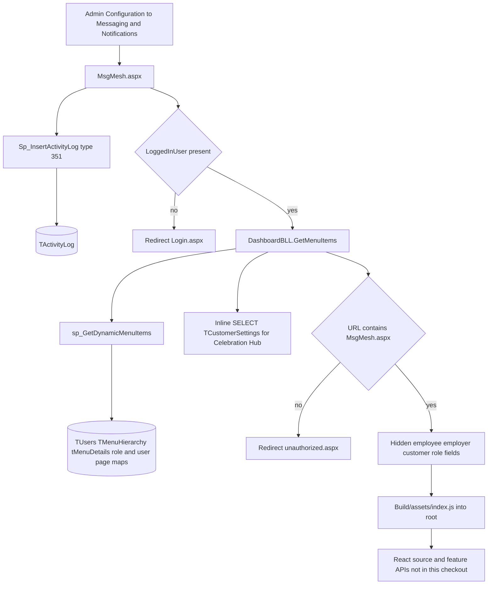
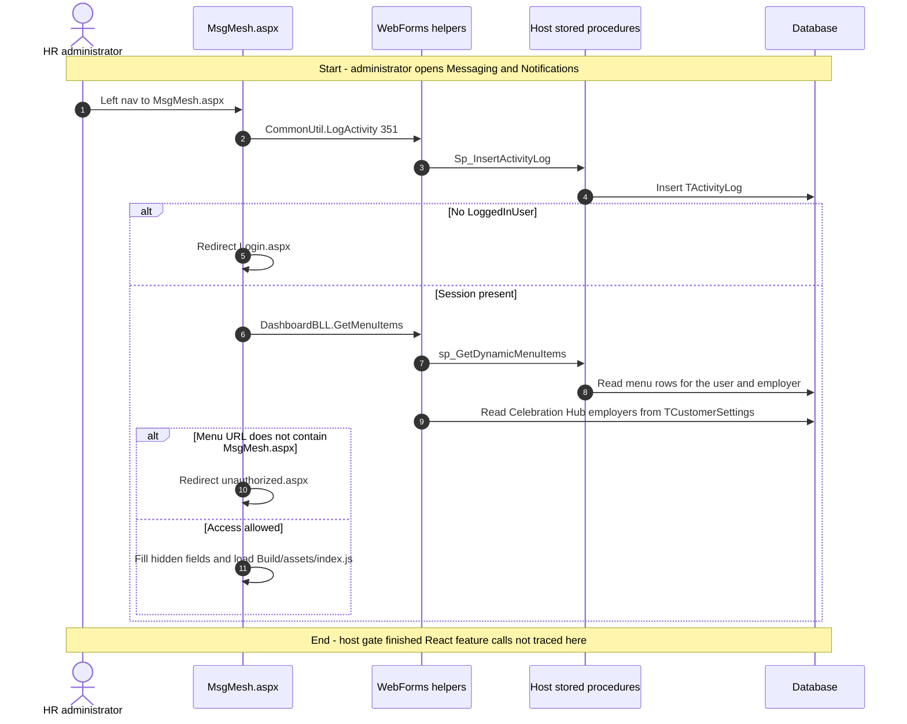
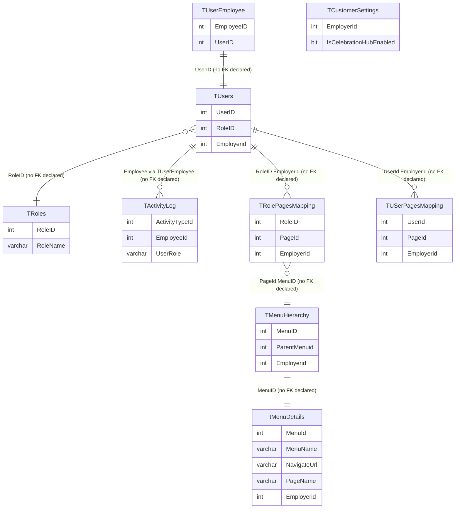

# Messaging & Notifications

## Overview

An HR administrator opens **Admin Configuration → Messaging & Notifications** (`~/HRM/MSGMesh/MsgMesh.aspx`) to reach the MSGMesh admin UI. The live employer-0 menu row is menu id **1183**. DML once named it `MSGMesh Admin Config`; `DML/20261022_Delete_MSGMesh_Admin_Config_Employer_Menus.sql` renames the employer-0 row to **Messaging & Notifications**.

`MsgMesh.aspx` is a thin WebForms host. On load it writes an activity-log row with type `MSGMeshAdminConfig` (351), redirects to login when the session has no `LoggedInUser`, and redirects to `unauthorized.aspx` when `sp_GetDynamicMenuItems` does not return a URL that contains `MsgMesh.aspx`. When access is allowed it stamps employee, employer, customer, role, and user values into hidden inputs and loads `Build/assets/index.js` into `#root`.

That `Build/` tree is not in this SourceCode checkout. There is no React source, Node route, or Core API controller under `HRM/MSGMesh` that this analysis can follow into feature procedures. Rewards and Recognition notification tables store a `MsgMeshReference` column, and Azure PBI 176265 describes a MSGMesh notification API, but neither path is invoked by this aspx host.

SystemModel-2 has no context page for this screen. `llm-wiki/reference/tables/hrms.md` describes the activity and menu tables used on page load.

**Who's involved:**

- **HR administrator** — opens the left-nav item when their menu includes `MsgMesh.aspx`. The host only proves session and menu access; the React admin screens are not in this checkout.
- **Employee** — does not open this screen. Downstream MSGMesh sends (where wired elsewhere) are outside this host path.

## Workflow

## Request journey

### HR administrator — open the page

No save, list, or delete journey can be drawn for the MSGMesh admin UI. The aspx does not post form data to a BLL or DAL for messaging configuration.

## Entry points

The left-nav URL is `~/HRM/MSGMesh/MsgMesh.aspx` (`PageName` `MsgMesh.aspx`, menu id 1183). `Page_Load` is the only server entry. There is no sibling aspx under `HRM/MSGMesh`.

| UI page | Purpose |
|---|---|
| `HRM/MSGMesh/MsgMesh.aspx` | Session gate, menu gate, activity log, hidden identity fields, React mount point |
| `HRM/MSGMesh/Build/assets/index.js` | Script the host loads. Not present in this checkout |

## Code → database call chain

The host does not use a MSGMesh BLL or DAL. Activity logging goes through `CommonUtil` into `TDG.ActivityAuditLog`. The menu gate uses `DashboardBLL` / `DashboardDAL`. Celebration Hub filtering inside `GetMenuItems` is an inline `SELECT` on `TCustomerSettings`, not a stored procedure.

| Entry | Method | Stored procedure |
|---|---|---|
| Page visit | `Page_Load` (`MsgMesh.aspx.cs:28`) → `CommonUtil.LogActivity` (`Common.cs:52`) → `LogUserActivity.LogActivity` (`LogUserActivity.cs:36`) → `ActivityLog.LogActivityAsync` (`ActivityLog.cs:22`) → `ActivityHelper.LogActivity` (`ActivityHelper.cs:32`) | `Sp_InsertActivityLog` with `@ActivityTypeId` 351 |
| Menu gate | `Page_Load` (`MsgMesh.aspx.cs:38`) → `DashboardBLL.GetMenuItems` (`DashboardBLL.cs:23`) → `DashboardDAL.GetMenuItems` (`DashboardDAL.cs:241`) | `sp_GetDynamicMenuItems` |
| Celebration Hub filter | `GetMenuItems` (`DashboardBLL.cs:39`) → `DBHelper.IsCelebrationHubEnabled` (`DBHelper.cs:3439`) → `GetCelebrationHubEmployerIds` (`DBHelper.cs:3444`) | None. Inline `SELECT` against `TCustomerSettings` |

`ActivityDescription.MSGMeshAdminConfig` is defined in `Enums.cs:294` as value `351`.

## API endpoints

This screen is WebForms page load only. It does not post back messaging configuration, and it does not call `HRMS.CoreAPI` from the aspx or code-behind.

The intended client is the module script `Build/assets/index.js`. That build and its HTTP routes are not in this checkout, so no feature API table can be listed from source.

## Stored procedures & tables involved

Every procedure below is one this host executes. Neither calls another procedure or function, so there is no nested level to expand. Pages are under `/docs/database/hrms/`.

| Object | File | Purpose |
|---|---|---|
| `Sp_InsertActivityLog` | `HRMS-DATABASE/HRMS/STOREPROCEDURE/Sp_InsertActivityLog.sql` | Visit log for activity type 351. Page already at [Sp_InsertActivityLog](/docs/database/hrms/Sp_InsertActivityLog) |
| `sp_GetDynamicMenuItems` | `HRMS-DATABASE/HRMS/STOREPROCEDURE/sp_GetDynamicMenuItems.sql` | Menu rows used for the access check. Page already at [sp_GetDynamicMenuItems](/docs/database/hrms/sp_GetDynamicMenuItems) |

Tables those scripts touch: `TActivityLog`, `TRoles`, `TUsers`, `TUserEmployee`, `TMenuHierarchy`, `tMenuDetails`, `TRolePagesMapping`, `TUSerPagesMapping`. The Celebration Hub filter also reads `TCustomerSettings` without a procedure.

## Table relationships

Declared parents were taken from the llm-wiki blurbs and the procedure joins. The create scripts for these tables do not add foreign keys among the activity and menu sets used here. `Sp_InsertActivityLog` joins employee → user → role by id columns. `sp_GetDynamicMenuItems` joins users, role/user page maps, hierarchy, and menu details on employer and menu/page ids.

## Known gaps

- `HRM/MSGMesh/Build/` and any MSGMesh React or Node source are missing from this SourceCode checkout. Feature list/save/delete procedures and HTTP routes cannot be traced from the left-nav page alone.
- No `HRMS.CoreAPI` controller or route in this workspace references `MsgMesh` / `MSGMesh`.
- `SystemModels/SystemModel-2` has no Messaging & Notifications or MSGMesh admin page.
- RnR tables `TRnRPointExpiryNotification`, `TRnRPointResetNotificationDispatch`, and `TRnRBudgetNotificationDispatch` store `MsgMeshReference`. Their procedures are not called by `MsgMesh.aspx`.
- Azure PBI 176265 describes a MSGMesh notification core API. It is not implemented or referenced by this aspx host.
- `DashboardBLL.GetMenuItems` names its second parameter `employeeId` but callers including this page pass `EmployerId`. The DAL and Celebration Hub filter treat it as employer id.
- Employer-specific menu rows named `MSGMesh Admin Config` may still exist where the 20261022 delete DML could not remove them because of foreign keys. The host matches URL text, not menu name.

## Reference

Confidence is low because only the WebForms host, its two procedures, and the menu rename DML were read. The React admin UI and any MSGMesh feature APIs are not in this checkout.

### SourceCode

- `HRMS.Web/HRMS.Web/HRM/MSGMesh/MsgMesh.aspx`
- `HRMS.Web/HRMS.Web/HRM/MSGMesh/MsgMesh.aspx.cs`
- `HRMS.Shared/HRMS.DataContract/Common/Enums.cs`
- `HRMS.Shared/HRMS.Common/Common.cs`
- `HRMS.Shared/TDG.ActivityAuditLog/Activity/LogUserActivity.cs`
- `HRMS.Shared/TDG.ActivityAuditLog/ActivityLog/ActivityLog.cs`
- `HRMS.Shared/TDG.ActivityAuditLog/DAL/ActivityHelper.cs`
- `HRMS.Shared/HRMS.BusinessLayer/DashboardBLL.cs`
- `HRMS.Shared/HRMS.DataAccessLayer/DashboardDAL.cs`
- `HRMS.Shared/HRMS.DataAccessLayer/DBHelper.cs`
- `HRMS.Shared/HRMS.DataAccessLayer/DBConstant.cs`

### TDG HRMS DB

- `llm-wiki/reference/tables/hrms.md` (`TActivityLog`, `tMenuDetails`, `TMenuHierarchy`, `TRolePagesMapping`, `TUSerPagesMapping`, `TUserEmployee`, `TCustomerSettings`)
- `HRMS-DATABASE/HRMS/DML/20261022_Delete_MSGMesh_Admin_Config_Employer_Menus.sql`
- `HRMS-DATABASE/HRMS/DML/109351/TMenuDetails.sql`
- `HRMS-DATABASE/HRMS/STOREPROCEDURE/Sp_InsertActivityLog.sql`
- `HRMS-DATABASE/HRMS/STOREPROCEDURE/sp_GetDynamicMenuItems.sql`
