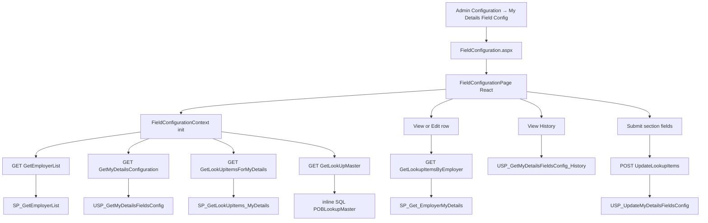
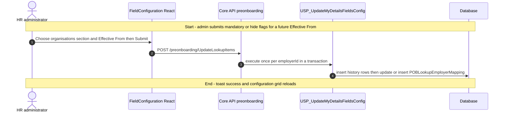
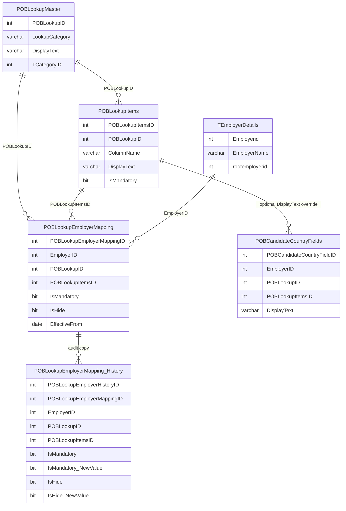

# My Details Field Config

## Overview

An HR administrator opens **Admin Configuration → My Details Field Config** to decide which My Details fields are mandatory or hidden for each organisation, and when that setting becomes effective. The live host is `~/HRM/PreOnBoarding/FieldConfiguration.aspx` (folder casing `PreOnBoarding`, not `PreOnboarding`). The WebForms page only logs activity `MyDetailsFieldConfig`, writes session values into hidden inputs, and loads the Pre-Onboarding React bundle. Client routing mounts `FieldConfigurationPage` for `/HRM/PreOnBoarding/FieldConfiguration.aspx`.

On load the React provider fetches organisations for the signed-in employee, the employer’s existing My Details configuration grid, the full My Details lookup catalogue, and section masters (`TCategoryID = 3`). The administrator picks organisation(s), a section, and a future Effective From date, toggles mandatory/hide flags on fields, and submits. View and Edit on the grid reload employer-scoped field rows for that section; View History opens a modal of mapping changes.

Employees never open this screen. Their My Details forms later read the employer mapping rows configured here. SystemModel-2 has no workflow page for this screen. Catalogue notes for the mapping tables live in `TDataCatalog_DML.sql` / mirrored wiki table lists.

**Who's involved:**

- **HR administrator** — configures My Details field mandatory/hide flags per organisation and section.
- **Employee** — does not open this screen; later My Details UI consumes the mapping.

## Workflow

`GetLookUpMaster` is not a stored procedure. The DAL runs a CTE over `POBLookupMaster` joined to `POBLookupEmployerMapping` for `TCategoryID = 3`.

## Request journey

A failed employer loop rolls back the whole API transaction. Success returns `true` and the UI reloads via `USP_GetMyDetailsFieldsConfig`.

## Entry points

| Entry | Purpose |
|---|---|
| `~/HRM/PreOnBoarding/FieldConfiguration.aspx` | Left-nav host. `Page_Load` logs `MyDetailsFieldConfig` and injects employee/employer hidden fields. |
| `Areas/routes.js` → `FieldConfigurationPage` | React route for `RouteConstants.FieldConfiguration` (`/HRM/PreOnBoarding/FieldConfiguration.aspx`). |
| `Areas/FieldConfiguration/Container/FieldConfiguration.js` | Organisation/section/date form, field sections, configuration grid, history modal. |

There is no WebForms postback for save or load. All data goes through Core API `/preonboarding/*`.

## Code → database call chain

Core API mounts `PreOnBoardingRoutes` at `/preonboarding` (`Routes/routeIndex.js`). Active UI constants are Version-1 paths (not `/V2/preonboarding`).

| Entry | Method | Stored procedure / SQL |
|---|---|---|
| Page load organisations | `getOrganizations` (`PreOnboardingHttpClient.js:13`) → `GetEmployerList` (`preOnBoardingController.js:429`) → `GetEmployerList` (`preOnBoardingDAL.js:717`) | `SP_GetEmployerList` |
| Page load configuration grid | `getMyDetailsConfiguration` (`PreOnboardingHttpClient.js:24`) → `GetMyDetailsConfiguration` (`preOnBoardingController.js:516`) → `GetMyDetailsConfiguration` (`preOnBoardingDAL.js:974`) | `USP_GetMyDetailsFieldsConfig` |
| Page load default lookup items | `getLookupItemsForMyDetails` (`PreOnboardingHttpClient.js:35`) → `GetLookUpItemsForMyDetails` (`preOnBoardingController.js:535`) → `GetLookupItemsForMyDetails` (`preOnBoardingDAL.js:1015`) | `SP_GetLookUpItems_MyDetails` |
| Page load sections | `getLookupMaster` (`PreOnboardingHttpClient.js:46`) → `GetLookUpMaster` (`preOnBoardingController.js:507`) → `GetLookUpMaster` (`preOnBoardingDAL.js:943`) | Inline SQL on `POBLookupMaster` / `POBLookupEmployerMapping` |
| View / Edit row | `getLookupItemsByEmployer` (`PreOnboardingHttpClient.js:58`) → `GetLookupItemsByEmployer` (`preOnBoardingController.js:546`) → `GetLookupItemsByEmployer` (`preOnBoardingDAL.js:1036`) | `SP_Get_EmployerMyDetails` |
| View History | `sendRequest(GET_MY_DETAILS_CONFIGURATION_HISTORY)` (`FieldConfiguration.js:145`) → `GetMyDetailsConfigurationHistory` (`preOnBoardingController.js:525`) → `GetMyDetailsConfigurationHistory` (`preOnBoardingDAL.js:994`) | `USP_GetMyDetailsFieldsConfig_History` (calls `Fn_GetEmployeeName`) |
| Submit | `handleSubmit` (`FieldConfiguration.js:62`) → `UpdateLookupItems` (`preOnBoardingController.js:557`) → `UpdateLookupItems` / `_UpdateLookupItems` (`preOnBoardingDAL.js:1059`, `:1086`) | `USP_UpdateMyDetailsFieldsConfig` via UDT `UDT_POBLookUp_FieldItems` |

Init orchestration is `getFieldConfigurationData` in `FieldConfigurationContext.js:28`.

## API endpoints

No WebForms postback for field configuration. The React page calls Core API.

| Verb | Route | Parameters | Purpose | Source |
|---|---|---|---|---|
| GET | `/preonboarding/GetEmployerList` | query `employeeId` (client); controller uses `req.EID` | Organisations for the signed-in employee | `preOnBoardingController.js:429` |
| GET | `/preonboarding/GetMyDetailsConfiguration` | `employerId` (query) | Configuration grid rows | `preOnBoardingController.js:516` |
| GET | `/preonboarding/GetLookUpItemsForMyDetails` | `employerId` (query) | Default My Details lookup items | `preOnBoardingController.js:535` |
| GET | `/preonboarding/GetLookUpMaster` | `employerid` (query) | Section list (`TCategoryID = 3`) | `preOnBoardingController.js:507` |
| GET | `/preonboarding/GetLookupItemsByEmployer` | `employerId`, `pobLookupId` (query) | Employer-scoped fields for View/Edit | `preOnBoardingController.js:546` |
| GET | `/preonboarding/GetMyDetailsConfigurationHistory` | `employerId`, `pobLookupID` (query) | History modal rows | `preOnBoardingController.js:525` |
| POST | `/preonboarding/UpdateLookupItems` | body `employeeId`, `employerIds[]`, `effectiveFrom`, `lookupItems[]` | Save mandatory/hide flags | `preOnBoardingController.js:557` |

## Stored procedures & tables involved

| Object | File | Purpose |
|---|---|---|
| [`SP_GetEmployerList`](/docs/database/hrms/SP_GetEmployerList) | `HRMS-DATABASE/HRMS/STOREPROCEDURE/SP_GetEmployerList.sql` | Organisations under the employee’s root employer |
| [`USP_GetMyDetailsFieldsConfig`](/docs/database/hrms/USP_GetMyDetailsFieldsConfig) | `HRMS-DATABASE/HRMS/STOREPROCEDURE/USP_GetMyDetailsFieldsConfig.sql` | Aggregated configuration grid |
| [`SP_GetLookUpItems_MyDetails`](/docs/database/hrms/SP_GetLookUpItems_MyDetails) | `HRMS-DATABASE/HRMS/STOREPROCEDURE/SP_GetLookUpItems_MyDetails.sql` | Catalogue lookup items for new configuration |
| [`SP_Get_EmployerMyDetails`](/docs/database/hrms/SP_Get_EmployerMyDetails) | `HRMS-DATABASE/HRMS/STOREPROCEDURE/SP_Get_EmployerMyDetails.sql` | Employer mapping rows for one section |
| [`USP_GetMyDetailsFieldsConfig_History`](/docs/database/hrms/USP_GetMyDetailsFieldsConfig_History) | `HRMS-DATABASE/HRMS/STOREPROCEDURE/USP_GetMyDetailsFieldsConfig_History.sql` | History of mandatory/hide changes |
| [`Fn_GetEmployeeName`](/docs/database/hrms/Fn_GetEmployeeName) | `HRMS-DATABASE/HRMS/FUNCTIONS/Fn_GetEmployeeName.sql` | Display name on history rows |
| [`USP_UpdateMyDetailsFieldsConfig`](/docs/database/hrms/USP_UpdateMyDetailsFieldsConfig) | `HRMS-DATABASE/HRMS/STOREPROCEDURE/USP_UpdateMyDetailsFieldsConfig.sql` | History insert plus update/insert mapping |

Primary tables: `POBLookupMaster`, `POBLookupItems`, `POBLookupEmployerMapping`, `POBLookupEmployerMapping_History`, `POBCandidateCountryFields`, `TEmployerDetails`, `TEmployee`, `TRRS_GRID_CONFIG` (employer dropdown selection only). UDT: `UDT_POBLookUp_FieldItems`.

## Table relationships

Baseline `TABLES/` scripts for the POB lookup objects are thinner than the columns the procedures use (`TCategoryID`, `EffectiveFrom`, `IsHide`, and related). Relationships below follow the live procedure joins and the history DDL under `DDL/68542/`.

## Known gaps

- Folder and route use `PreOnBoarding`; some docs or bookmarks may use `PreOnboarding`. The live URL is `/HRM/PreOnBoarding/FieldConfiguration.aspx`.
- `GetLookUpMaster` is inline SQL in the DAL, not a stored procedure.
- `GetEmployerList` client passes `employeeId` in the query string, but the controller executes with `req.EID` from auth.
- `Section` submit posts the full section field list, not only edited rows.
- Baseline `TABLES/POBLookup*.sql` scripts omit columns the SPs read/write (`TCategoryID`, `EffectiveFrom`, `IsHide`, …). History DDL lives under `DDL/68542/`.
- Submit requires a future Effective From (`Helper.isFuture`); past or empty dates disable Submit.
- Success toast text misspells “successfully”.
- SystemModel-2 has no My Details Field Config workflow page.
- Employee-facing My Details screens that consume these mappings are out of this guide’s call chain.

## Reference

Confidence is medium because the React page, Core API controller/DAL, and HRMS procedure scripts were read end-to-end. Employee My Details consumers were not traced.

### SourceCode

- `HRMS.Web/HRMS.Web/HRM/PreOnBoarding/FieldConfiguration.aspx`
- `HRMS.Web/HRMS.Web/HRM/PreOnBoarding/FieldConfiguration.aspx.cs`
- `HRMS.Web/HRMS.Web/HRM/PreOnBoarding/Common/routeConstants.js`
- `HRMS.Web/HRMS.Web/HRM/PreOnBoarding/Areas/routes.js`
- `HRMS.Web/HRMS.Web/HRM/PreOnBoarding/Areas/FieldConfiguration/FieldConfigurationPage.js`
- `HRMS.Web/HRMS.Web/HRM/PreOnBoarding/Areas/FieldConfiguration/FieldConfigurationContext.js`
- `HRMS.Web/HRMS.Web/HRM/PreOnBoarding/Areas/FieldConfiguration/Container/FieldConfiguration.js`
- `HRMS.Web/HRMS.Web/HRM/PreOnBoarding/Areas/FieldConfiguration/Components/Section.js`
- `HRMS.Web/HRMS.Web/HRM/PreOnBoarding/Common/HttpClients/PreOnboardingHttpClient.js`
- `HRMS.Web/HRMS.Web/HRM/PreOnBoarding/Common/apiURLConstants.js`
- `HRMS.CoreAPI/HRMS.Core.WebAPI.Node/Routes/routeIndex.js`
- `HRMS.CoreAPI/HRMS.Core.WebAPI.Node/Routes/PreOnBoardingRoutes.js`
- `HRMS.CoreAPI/HRMS.Core.WebAPI.Node/Controllers/preOnBoardingController.js`
- `HRMS.CoreAPI/HRMS.Core.WebAPI.Node/Core/DataAccessLayer/preOnBoardingDAL.js`

### TDG HRMS DB

- `HRMS-DATABASE/HRMS/STOREPROCEDURE/SP_GetEmployerList.sql`
- `HRMS-DATABASE/HRMS/STOREPROCEDURE/USP_GetMyDetailsFieldsConfig.sql`
- `HRMS-DATABASE/HRMS/STOREPROCEDURE/SP_GetLookUpItems_MyDetails.sql`
- `HRMS-DATABASE/HRMS/STOREPROCEDURE/SP_Get_EmployerMyDetails.sql`
- `HRMS-DATABASE/HRMS/STOREPROCEDURE/USP_GetMyDetailsFieldsConfig_History.sql`
- `HRMS-DATABASE/HRMS/STOREPROCEDURE/USP_UpdateMyDetailsFieldsConfig.sql`
- `HRMS-DATABASE/HRMS/FUNCTIONS/Fn_GetEmployeeName.sql`
- `HRMS-DATABASE/HRMS/UDT/UDT_POBLookUp_FieldItems.sql`
- `HRMS-DATABASE/HRMS/TABLES/POBLookupMaster.sql`
- `HRMS-DATABASE/HRMS/TABLES/POBLookupItems.sql`
- `HRMS-DATABASE/HRMS/TABLES/POBLookupEmployerMapping.sql`
- `HRMS-DATABASE/HRMS/DDL/68542/POBLookupEmployerMapping_HistoryTable.sql`
