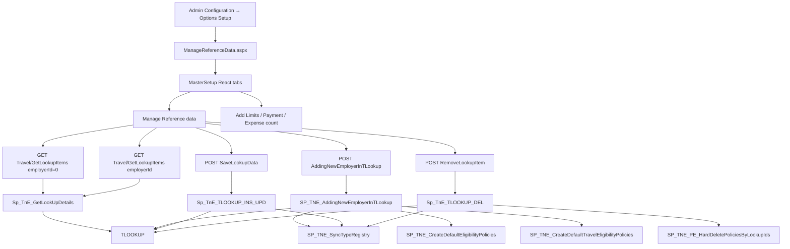
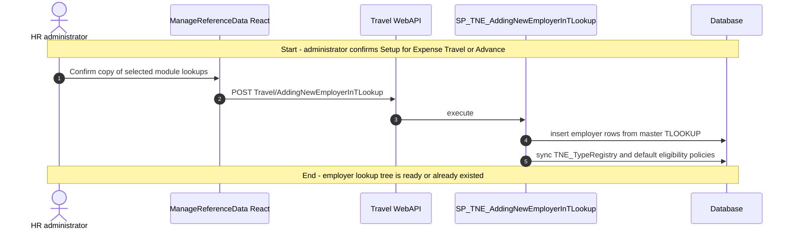
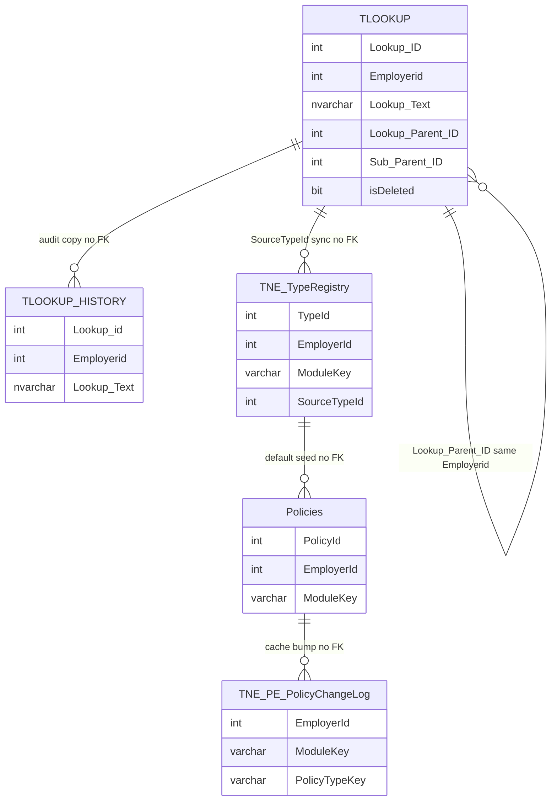

# Options Setup

## Overview

An HR administrator prepares the Travel and Expense pick-lists before anyone raises a trip or claim. They open **Admin Configuration → Travel and Expense → Options Setup** (`~/HRM/TravelAndExpense/ManageReferenceData.aspx`). The WebForms host only loads the React `travelandexpenses` bundle and logs activity `TnEOptionsSetup`. The React shell title is "Travel and Expense Options Setup". The first tab is **Manage Reference data**.

On that tab the administrator picks an organisation (when they have TnE global access), then ticks Expense, Travel, and/or Advance. The UI loads master lookup rows for `Employerid = 0` and the selected employer's rows, builds trees (expense types, travel modes, currencies, advance request status, and related children), and lets them copy missing master branches onto the employer, add or edit a leaf, reset text to the master value, soft-delete, or restore. Copying a module calls `SP_TNE_AddingNewEmployerInTLookup`, which clones from master `TLOOKUP`, syncs `TNE_TypeRegistry`, and seeds default eligibility policies when the employer has none.

The same host has three other tabs — Add Limits, Organization Payment Setup, and Set Expense Count Limit — that are out of the call chain below. Employees never open this screen; their travel and expense forms later read the employer-scoped `TLOOKUP` values configured here.

SystemModel-2 does not document this screen. Table notes live in `llm-wiki/reference/tables/travelnexpense.md` (`TLOOKUP`, `TPaymentSetup`, `TLevelWiseExpenseDetails`). There is no domain ER page for Options Setup.

**Who's involved:**

- **HR administrator** — maintains T&E reference lists for the selected organisation. Global-access users can switch employer on the page.
- **Employee** — does not open this screen. Later requests use the lookup values set here.

## Workflow

Reset and restore also post to Travel API and write `TLOOKUP` / `TLOOKUP_HISTORY`. After several mutations the DAL also calls `SP_TNE_SyncTypeRegistry` for the employer.

## Request journey

### HR administrator — copy module reference data to an employer

The UI shows the procedure `STATUS` toast. A success path reloads employer lookups through `Sp_TnE_GetLookUpDetails`.

## Entry points

`~/HRM/TravelAndExpense/ManageReferenceData.aspx` is the left-nav Options Setup host. `Page_Load` logs activity and injects employee/employer hidden fields plus webpack bundles. Client routing in `Areas/routes.js` mounts authorized `MasterSetup` for claim `CNST_MANAGE_REFERENCE_DATA`.

| UI page | Purpose |
|---|---|
| `HRM/TravelAndExpense/ManageReferenceData.aspx` | WebForms shell for Options Setup |
| `Areas/RefData/MasterSetup.js` | Tab host (Manage Reference data, Add Limits, Organization Payment Setup, Set Expense Count Limit) |
| `Areas/RefData/refDataList.js` + `TnEMasterSetup.js` | Employer picker and lookup trees |

## Code → database call chain

Travel and Expense API uses Dapper against `DBSource.TravelAndExpense`. Conventional route prefix is `api/Travel/{action}`.

| Entry | Method | Stored procedure |
|---|---|---|
| Load master / employer trees | `fetchLookupMasterData` / `fetchLookupEmployerData` (`TnEMasterSetup.js:34`, `:47`) → `TravelController.GetLookupItems` (`TravelController.cs:99`) → `TravelBLL.GetLookupItems` (`TravelBLL.cs:52`) → `TravelDAL.GetLookupItems` (`TravelDAL.cs:405`) | `Sp_TnE_GetLookUpDetails` |
| Setup / copy module lookups | `handleAddLookupItems` (`TnECheckboxSelection.js:70`) → `TravelController.AddingNewEmployerInTLookup` (`TravelController.cs:144`) → `TravelBLL.AddingNewEmployerInTLookup` (`TravelBLL.cs:82`) → `TravelDAL.AddingNewEmployerInTLookup` (`TravelDAL.cs:433`) | `SP_TNE_AddingNewEmployerInTLookup` (then nested sync / default policies; DAL also calls `SP_TNE_SyncTypeRegistry` at `TravelDAL.cs:50`) |
| Add / update lookup leaf | `saveFormData` (`refDataAddEdit.js:170`) → `TravelController.SaveLookupData` (`TravelController.cs:113`) → `TravelBLL.SaveLookupData` (`TravelBLL.cs:47`) → `TravelDAL.SaveLookupData` (`TravelDAL.cs:293`) | `Sp_TnE_TLOOKUP_INS_UPD` |
| Soft-delete lookup | `handleDataDelete` (`TnEFormDialouge.js:56`) → `TravelController.RemoveLookupItem` (`TravelController.cs:129`) → `TravelBLL.DeleteLookupItem` (`TravelBLL.cs:77`) → `TravelDAL.DeleteLookupItem` (`TravelDAL.cs:181`) | `Sp_TnE_TLOOKUP_DEL` |
| Reset text to master | `handleResetLookup` (`TnEFormDialouge.js:31`) → `TravelController.ResetLookupText` (`TravelController.cs:155`) → `TravelBLL.ResetLookupText` (`TravelBLL.cs:87`) → `TravelDAL.ResetLookupText` (`TravelDAL.cs:465`) | `SP_TNE_ResetLookupText` |
| Restore deleted / missing master row | restore handler (`TnEStyledTreeItem.js:368`) → `TravelController.RestoreLookupItemByLookupId` (`TravelController.cs:166`) → `TravelBLL.RestoreLookupItemByLookupId` (`TravelBLL.cs:92`) → `TravelDAL.RestoreLookupItemByLookupId` (`TravelDAL.cs:497`) | `Sp_TnE_RestoreLookupItemByLookupId` (DAL string `SP_TNE_RestoreLookupItemByLookupId`) |

Global employer list uses `Employee/GetGlobalAccessEmployerList` (not a TravelNExpense lookup SP). Add Limits, Organization Payment Setup, and Set Expense Count Limit call other Travel/Expense/PaymentSetup endpoints and are not expanded here.

## API endpoints

No WebForms postback for reference data. The React tab calls Travel WebAPI.

| Verb | Route | Parameters | Purpose | Source |
|---|---|---|---|---|
| GET | `api/Travel/GetLookupItems` | `employerId` (int, required) | List non-deleted lookups for an employer (`0` = master) | `TravelController.cs:99` |
| POST | `api/Travel/SaveLookupData` | body `LookUpItems` (`LookupId`, `LookupText`, `LookupParentId`, `EmployerId`, …); `CreatedBy` set from JWT actor | Insert or update a lookup row | `TravelController.cs:113` |
| POST | `api/Travel/RemoveLookupItem` | body `DeleteLookupPayload` (`lookupId` list, `employerId`, …); `UpdatedBy` from actor | Soft-delete lookup ids | `TravelController.cs:129` |
| POST | `api/Travel/AddingNewEmployerInTLookup` | body `AddNewEmployerInTLookupPayload` (`Employerid`, `LookupId` list, `CreatedBy`, `CreatedOn`) | Copy master branches to employer | `TravelController.cs:144` |
| POST | `api/Travel/ResetLookupText` | body `ModifyLookupItemPayload` | Reset employer lookup text from master | `TravelController.cs:155` |
| POST | `api/Travel/RestoreLookupItemByLookupId` | body `ModifyLookupItemPayload` | Restore or re-insert a master row for the employer | `TravelController.cs:166` |

## Stored procedures & tables involved

| Object | File | Purpose |
|---|---|---|
| [`Sp_TnE_GetLookUpDetails`](/docs/database/hrms-travelnexpense/Sp_TnE_GetLookUpDetails) | `HRMS-DATABASE/HRMS_TRAVELNEXPENSE/STOREPROCEDURE/Sp_TnE_GetLookUpDetails.sql` | List active employer lookups |
| [`Sp_TnE_TLOOKUP_INS_UPD`](/docs/database/hrms-travelnexpense/Sp_TnE_TLOOKUP_INS_UPD) | `HRMS-DATABASE/HRMS_TRAVELNEXPENSE/STOREPROCEDURE/Sp_TnE_TLOOKUP_INS_UPD.sql` | Insert or update `TLOOKUP` and history, then sync type registry |
| [`Sp_TnE_TLOOKUP_DEL`](/docs/database/hrms-travelnexpense/Sp_TnE_TLOOKUP_DEL) | `HRMS-DATABASE/HRMS_TRAVELNEXPENSE/STOREPROCEDURE/Sp_TnE_TLOOKUP_DEL.sql` | Soft-delete lookups, hard-delete related policies, sync registry |
| [`SP_TNE_AddingNewEmployerInTLookup`](/docs/database/hrms-travelnexpense/SP_TNE_AddingNewEmployerInTLookup) | `HRMS-DATABASE/HRMS_TRAVELNEXPENSE/STOREPROCEDURE/SP_TNE_AddingNewEmployerInTLookup.sql` | Clone master lookups to employer and seed defaults |
| [`SP_TNE_ResetLookupText`](/docs/database/hrms-travelnexpense/SP_TNE_ResetLookupText) | `HRMS-DATABASE/HRMS_TRAVELNEXPENSE/STOREPROCEDURE/SP_TNE_ResetLookupText.sql` | Reset employer text from master `Employerid = 0` |
| [`Sp_TnE_RestoreLookupItemByLookupId`](/docs/database/hrms-travelnexpense/Sp_TnE_RestoreLookupItemByLookupId) | `HRMS-DATABASE/HRMS_TRAVELNEXPENSE/STOREPROCEDURE/Sp_TnE_RestoreLookupItemByLookupId.sql` | Restore or re-copy one master lookup |
| [`SP_TNE_SyncTypeRegistry`](/docs/database/hrms-travelnexpense/SP_TNE_SyncTypeRegistry) | `HRMS-DATABASE/HRMS_TRAVELNEXPENSE/STOREPROCEDURE/SP_TNE_SyncTypeRegistry.sql` | Rebuild `TNE_TypeRegistry` from lookup/advance sources |
| [`SP_TNE_CreateDefaultEligibilityPolicies`](/docs/database/hrms-travelnexpense/SP_TNE_CreateDefaultEligibilityPolicies) | `HRMS-DATABASE/HRMS_TRAVELNEXPENSE/STOREPROCEDURE/SP_TNE_CreateDefaultEligibilityPolicies.sql` | Seed expense eligibility when employer has no policies |
| [`SP_TNE_CreateDefaultTravelEligibilityPolicies`](/docs/database/hrms-travelnexpense/SP_TNE_CreateDefaultTravelEligibilityPolicies) | `HRMS-DATABASE/HRMS_TRAVELNEXPENSE/STOREPROCEDURE/SP_TNE_CreateDefaultTravelEligibilityPolicies.sql` | Seed travel schedule/accommodation eligibility defaults |
| [`SP_TNE_PE_BumpPolicyChangeLog`](/docs/database/hrms-travelnexpense/SP_TNE_PE_BumpPolicyChangeLog) | `HRMS-DATABASE/HRMS_TRAVELNEXPENSE/STOREPROCEDURE/SP_TNE_PE_BumpPolicyChangeLog.sql` | Invalidate policy-eval cache after registry sync |

`SP_TNE_PE_HardDeletePoliciesByLookupIds` is executed from `Sp_TnE_TLOOKUP_DEL` but has no matching script under `HRMS_TRAVELNEXPENSE/STOREPROCEDURE` in this checkout.

Primary tables: `TLOOKUP`, `TLOOKUP_HISTORY`, `TNE_TypeRegistry`, `Policies` / policy payload tables (via default-policy SPs), `TNE_PE_PolicyChangeLog`.

## Table relationships

`TLOOKUP` declares a composite primary key `(Lookup_ID, Employerid)` and no foreign keys. Parent/child is by `Lookup_Parent_ID` / `Sub_Parent_ID` within the same employer. History and type registry are application-linked, not FK-declared in the `TLOOKUP` table script.

## Known gaps

- Add Limits (`usp_GetTLevelWiseExpenseDetails` / level-wise expense SPs), Organization Payment Setup (`SP_GetPaymentSetup`, `SP_InsertUpdateTPaymentSetup`, …), and Set Expense Count Limit (`SP_TNE_*RequestLimit*`) share this host and are not in the call chain above.
- `SP_TNE_PE_HardDeletePoliciesByLookupIds` is called from delete but has no `STOREPROCEDURE` script in this repo snapshot.
- Several T&E scripts still open with `USE [TravelNExpense_Prod]`; deploy should rely on connection database context.
- `Employee/GetGlobalAccessEmployerList` and role lookups are outside `HRMS_TRAVELNEXPENSE`.
- DAL calls `SP_TNE_SyncTypeRegistry` after mutations even when the procedure already syncs; behaviour is redundant, not contradictory.
- `TLOOKUP_HISTORY` exists as DDL (`DDL/TLOOKUP_HISTORYddlstatement.sql`) rather than under `TABLES/`.
- SystemModel-2 has no Options Setup workflow page.

## Reference

Confidence is medium because the Manage Reference data load/copy/save/delete/reset/restore path was read end-to-end in SourceCode and `HRMS_TRAVELNEXPENSE` scripts. Other Options Setup tabs were not fully traced.

### SourceCode

- `HRMS.Web/HRMS.Web/HRM/TravelAndExpense/ManageReferenceData.aspx`
- `HRMS.Web/HRMS.Web/HRM/TravelAndExpense/ManageReferenceData.aspx.cs`
- `HRMS.Web/HRMS.Web/HRM/TravelAndExpense/Areas/routes.js`
- `HRMS.Web/HRMS.Web/HRM/TravelAndExpense/Areas/RefData/MasterSetup.js`
- `HRMS.Web/HRMS.Web/HRM/TravelAndExpense/Areas/RefData/refDataList.js`
- `HRMS.Web/HRMS.Web/HRM/TravelAndExpense/Areas/RefData/_Components/TnEMasterSetup.js`
- `HRMS.Web/HRMS.Web/HRM/TravelAndExpense/Areas/RefData/_Components/TnECheckboxSelection.js`
- `HRMS.Web/HRMS.Web/HRM/TravelAndExpense/Areas/RefData/_Components/TnEFormDialouge.js`
- `HRMS.Web/HRMS.Web/HRM/TravelAndExpense/Areas/RefData/refDataAddEdit.js`
- `HRMS.TravelAndExpense/HRMS.TravelAndExpense.WebAPI/Controllers/TravelController.cs`
- `HRMS.TravelAndExpense/HRMS.TravelAndExpense.BLL/Travel/TravelBLL.cs`
- `HRMS.TravelAndExpense/HRMS.TravelAndExpense.DAL/Travel/TravelDAL.cs`

### TDG HRMS DB

- `content/llm-wiki/reference/tables/travelnexpense.md` (mirrored)
- `HRMS-DATABASE/HRMS_TRAVELNEXPENSE/STOREPROCEDURE/Sp_TnE_GetLookUpDetails.sql`
- `HRMS-DATABASE/HRMS_TRAVELNEXPENSE/STOREPROCEDURE/Sp_TnE_TLOOKUP_INS_UPD.sql`
- `HRMS-DATABASE/HRMS_TRAVELNEXPENSE/STOREPROCEDURE/Sp_TnE_TLOOKUP_DEL.sql`
- `HRMS-DATABASE/HRMS_TRAVELNEXPENSE/STOREPROCEDURE/SP_TNE_AddingNewEmployerInTLookup.sql`
- `HRMS-DATABASE/HRMS_TRAVELNEXPENSE/STOREPROCEDURE/SP_TNE_ResetLookupText.sql`
- `HRMS-DATABASE/HRMS_TRAVELNEXPENSE/STOREPROCEDURE/Sp_TnE_RestoreLookupItemByLookupId.sql`
- `HRMS-DATABASE/HRMS_TRAVELNEXPENSE/STOREPROCEDURE/SP_TNE_SyncTypeRegistry.sql`
- `HRMS-DATABASE/HRMS_TRAVELNEXPENSE/STOREPROCEDURE/SP_TNE_CreateDefaultEligibilityPolicies.sql`
- `HRMS-DATABASE/HRMS_TRAVELNEXPENSE/STOREPROCEDURE/SP_TNE_CreateDefaultTravelEligibilityPolicies.sql`
- `HRMS-DATABASE/HRMS_TRAVELNEXPENSE/STOREPROCEDURE/SP_TNE_PE_BumpPolicyChangeLog.sql`
- `HRMS-DATABASE/HRMS_TRAVELNEXPENSE/TABLES/TLOOKUP.sql`
