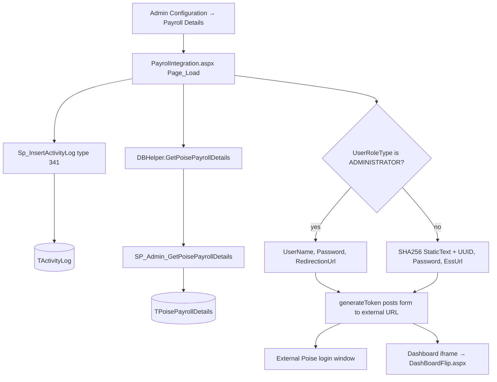
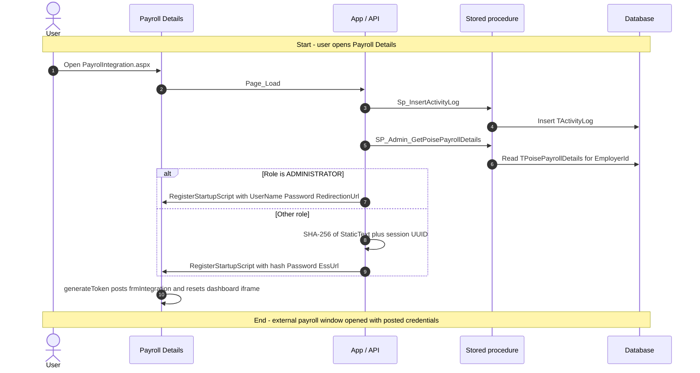
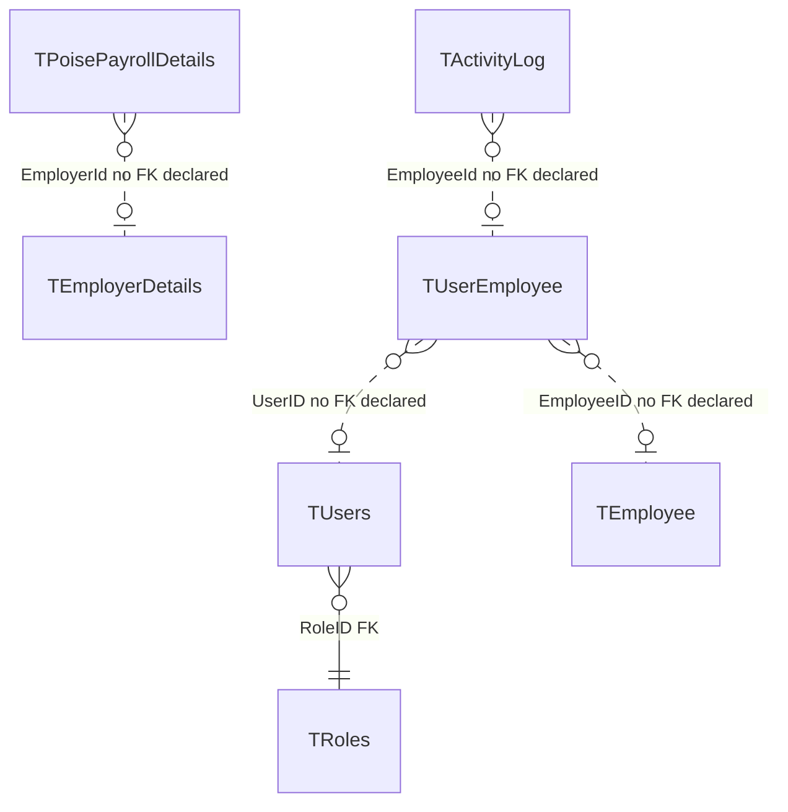

# Payroll Details

## Overview

An administrator or employee needs a one-click jump from HRMS into the Poise payroll product for their employer. They open **Admin Configuration → Payroll Details** (`~/HRM/Integration/PayrolIntegration.aspx`, menu value 413). The page has no editable grid. On every load it logs activity type 341, reads one `TPoisePayrollDetails` row for the session employer, builds a user name and password, and posts those credentials to an external payroll URL in a new browser window while the dashboard iframe returns to `DashBoardFlip.aspx`.

Who gets which credentials depends on the session role:

- **Administrator** (`UserRoleType` equals `ADMINISTRATOR`) — posts the stored `UserName`, `Password`, and `RedirectionUrl` from `TPoisePayrollDetails`.
- **Everyone else** — builds the user name as the SHA-256 hex of `StaticText` plus the uppercase session `UUID` (set at login), posts the stored `Password`, and uses `EssUrl` as the target.

There is no Business Layer class on this path. The WebForms page calls `DBHelper.GetPoisePayrollDetails` and `CommonUtil.LogActivity` directly. The page does not write payroll configuration; `TPoisePayrollDetails` is customer-specific config with no writer found in the data catalog for this screen.

`docs/SystemModels/SystemModel-2` has no workflow or context page for this menu item. `llm-wiki/reference/tables/hrms.md` describes `TPoisePayrollDetails` as Poise connection/authentication config.

## Workflow

## Request journey

## Entry points

The live menu node is **Payroll Details** under **Admin Configuration** (`TDynamicMenuHierarchy` value 413; `TMenuDetails.NavigateURL` is `~/HRM/Integration/PayrolIntegration.aspx`).

| Entry | Purpose |
|---|---|
| `~/HRM/Integration/PayrolIntegration.aspx` | Hidden form + `Page_Load` redirect into Poise. Filename spelling is `Payrol` (one `l`). |
| Session `UUID` | Set in `Login.aspx.cs` from the login user-details row. Used only on the non-administrator path. |

The Poise sync scheduler (`HRMS.PoisePayroll`) calls `SP_Get_PoisePayRollDetails` and other Poise employee SPs. That is not this menu item.

## Code → database call chain

No BLL type is on this path. `DBHelper` and `ActivityHelper` use Enterprise Library `GetStoredProcCommand`.

| Entry | Method | Database |
|---|---|---|
| Every load, `PayrolIntegration.aspx.cs:20` | `CommonUtil.LogActivity` (`Common.cs:52`) → `LogUserActivity.LogActivity` (`LogUserActivity.cs:36`) → `ActivityHelper.LogActivity` (`ActivityHelper.cs:32`) | `Sp_InsertActivityLog`. Inserts `TActivityLog`. Reads `TUserEmployee`, `TUsers`, `TRoles`. Activity type id is `ActivityDescription.PayrollDetails` = 341 (`Enums.cs:284`). |
| Every load, `PayrolIntegration.aspx.cs:23` | `DBHelper.GetPoisePayrollDetails` (`DBHelper.cs:3720`) | `SP_Admin_GetPoisePayrollDetails`. Reads `UserName`, `Password`, `RedirectionUrl`, `StaticText`, `EssUrl` from `TPoisePayrollDetails` for `@EmployerId`. |
| Admin branch, `PayrolIntegration.aspx.cs:24-29` | `UserRoles.GetUserRole` (`Common.cs:790`) equals `Constants.Administrator` | No stored procedure. Uses row `UserName`, `Password`, `RedirectionUrl`. |
| Non-admin branch, `PayrolIntegration.aspx.cs:33-38` | `ComputeSha256Hash` (`PayrolIntegration.aspx.cs:42`) on `StaticText` + uppercase session `UUID` | No stored procedure. Uses row `Password` and `EssUrl`. |
| Browser, `PayrolIntegration.aspx:4-14` | `generateToken` posts `#frmIntegration` to the chosen URL and sets the parent dashboard iframe to `DashBoardFlip.aspx` | No stored procedure. External Poise login receives `UserNameOrUPN` and `Password`. |

## API endpoints

This screen is a WebForms page load plus a client-side form POST to the URL from `TPoisePayrollDetails`. It does not call `HRMS.CoreAPI` and does not use a WebForms postback button.

| Verb | Route | Parameters | Purpose | Source |
|---|---|---|---|---|
| GET (page) | `~/HRM/Integration/PayrolIntegration.aspx` | Session employer and role | Load credentials and emit `generateToken` | `PayrolIntegration.aspx.cs:18` |
| POST (browser) | Value of `RedirectionUrl` or `EssUrl` | Form fields `UserNameOrUPN`, `Password` | Open Poise in a new window/tab (`formtarget="_blank"`) | `PayrolIntegration.aspx:20-24`, `generateToken` |

## Stored procedures & tables involved

| Object | File | Purpose | Wiki |
|---|---|---|---|
| `Sp_InsertActivityLog` | `HRMS-DATABASE/HRMS/STOREPROCEDURE/Sp_InsertActivityLog.sql` | Writes one `TActivityLog` row and looks up the employee's role name. | `llm-wiki/reference/tables/hrms.md` (`TActivityLog`) |
| `SP_Admin_GetPoisePayrollDetails` | Missing from Liquibase inventory; body read from DEV `OBJECT_DEFINITION` | Selects payroll redirect credentials for one employer. | — |
| `TPoisePayrollDetails` | `HRMS-DATABASE/HRMS/TABLES/TPoisePayrollDetails.sql` | Per-employer Poise user name, password, admin redirect URL, ESS static text / URL, and related API fields. | `llm-wiki/reference/tables/hrms.md` |
| `TActivityLog` | `HRMS-DATABASE/HRMS/TABLES/TActivityLog.sql` | Page-access row for activity type 341. | `llm-wiki/reference/tables/hrms.md` |
| `TUserEmployee`, `TUsers`, `TRoles` | matching `TABLES/` scripts | Role-name lookup inside `Sp_InsertActivityLog`. | `llm-wiki/reference/tables/hrms.md` |

`SP_Get_PoisePayRollDetails` also reads `TPoisePayrollDetails` (active rows, optional employer filter) for the Poise scheduler. This page does not call it.

## Table relationships

`llm-wiki/reference/tables/hrms.md` lists `TPoisePayrollDetails` with no referenced parents. The `CREATE TABLE` script and DEV foreign-key catalog declare no FKs on this table. Joins below are labeled as not declared.

`TActivityLog` has no primary key and no foreign key. `TActivityLog.ActivityTypeId` is not declared against `TActivityLogTypes`.

## Known gaps

- **No SystemModel-2 page.** Nothing under `docs/SystemModels/SystemModel-2` names `PayrolIntegration` or Payroll Details.
- **`SP_Admin_GetPoisePayrollDetails` is not in the Liquibase inventory.** There is no matching `.sql` under `HRMS-DATABASE/HRMS/STOREPROCEDURE/`. The procedure body used for this guide was read from DEV via `OBJECT_DEFINITION`.
- **`EssUrl` is live but not in the checked-in CREATE script.** DEV `TPoisePayrollDetails` has `EssUrl` and `ApplicationInstanceId`. `TABLES/TPoisePayrollDetails.sql` omits `EssUrl`; `DML/Add_Column_TPoisePayrollDetails.sql` only adds `ApplicationInstanceId`.
- **No empty-row guard.** `Page_Load` always uses `dtPayrollDetails.Rows[0]`. A missing employer row throws before the redirect script runs.
- **No `IsActive` filter on the page SP.** `SP_Admin_GetPoisePayrollDetails` selects by `employerid` only. The scheduler SP `SP_Get_PoisePayRollDetails` filters `ISNULL(IsActive,1) = 1`.
- **Credentials are posted to the external URL in clear form fields.** The page also embeds them inside a `RegisterStartupScript` string.
- **Non-admin path needs session `UUID`.** Login sets it from the user-details query. A missing `UUID` still hashes `StaticText` with an empty string.
- **Activity insert is fire-and-forget.** Same pattern as other Admin Configuration screens that call `CommonUtil.LogActivity`. Activity type 341 is an application enum; the procedure does not read `TActivityLogTypes`.
- **No writer on this screen.** Catalog notes “No writer found” for `TPoisePayrollDetails` on Admin Configuration → Payroll Details. How rows are maintained is outside this page.
- **Related Poise sync SPs are out of scope.** `SP_GETPoisePayroll*` / `SP_InsertPoisePayroll*` and `HRMS.PoisePayroll` are a different integration path.

## Reference

Confidence is **high** for the WebForms page, `DBHelper` call, activity log path, and the DEV definition of `SP_Admin_GetPoisePayrollDetails`. Confidence is lower for cross-environment SP parity because the Liquibase script is missing. Foreign keys are only those declared on the table scripts.

### SourceCode

- `HRMS.Web/HRMS.Web/HRM/Integration/PayrolIntegration.aspx`
- `HRMS.Web/HRMS.Web/HRM/Integration/PayrolIntegration.aspx.cs`
- `HRMS.Shared/HRMS.DataAccessLayer/DBHelper.cs`
- `HRMS.Shared/HRMS.DataContract/Common/Enums.cs`
- `HRMS.Shared/HRMS.Common/Common.cs`
- `HRMS.Shared/HRMS.Common/Constants.cs`
- `HRMS.Shared/TDG.ActivityAuditLog/DAL/ActivityHelper.cs`
- `HRMS.Web/HRMS.Web/Login.aspx.cs` (session `UUID`)
- `HRMS.PoisePayroll/HRMS.PoisePayroll/HRMSDBContext.cs` (scheduler path only)

### TDG HRMS DB

- `llm-wiki/reference/tables/hrms.md`
- `HRMS-DATABASE/HRMS/STOREPROCEDURE/Sp_InsertActivityLog.sql`
- `HRMS-DATABASE/HRMS/TABLES/TPoisePayrollDetails.sql`
- `HRMS-DATABASE/HRMS/DML/Add_Column_TPoisePayrollDetails.sql`
- `HRMS-DATABASE/HRMS/DML/Tmenudetails DML.sql` (menu node text Payroll Details, value 413)
- `HRMS-DATABASE/HRMS/DML/TDataCatalog_DML.sql` (`TPoisePayrollDetails` catalog row)
