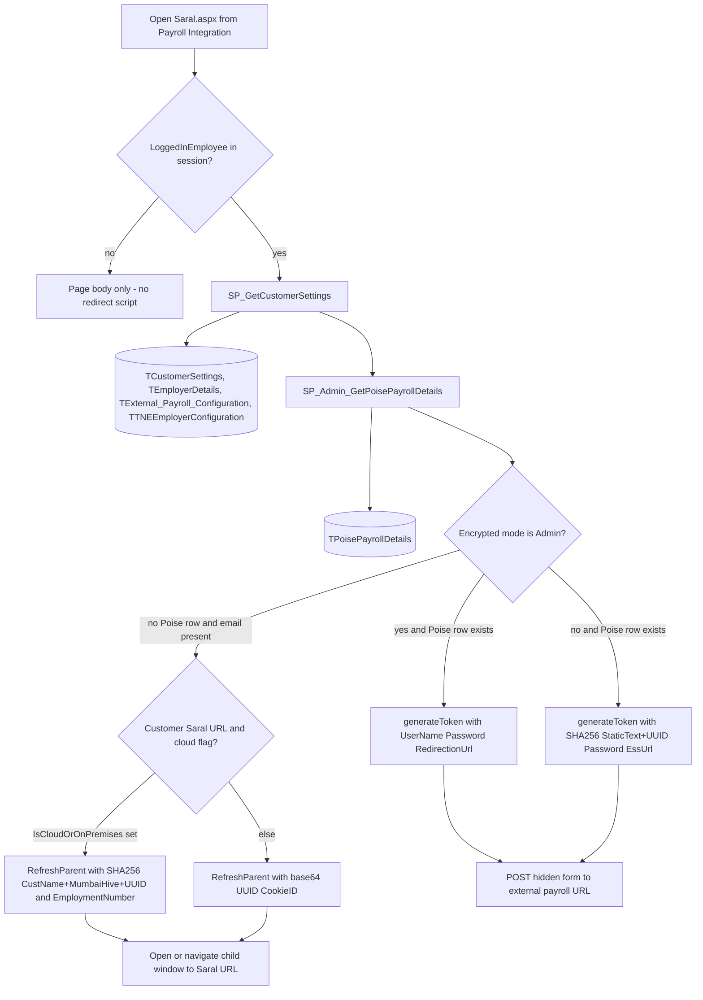
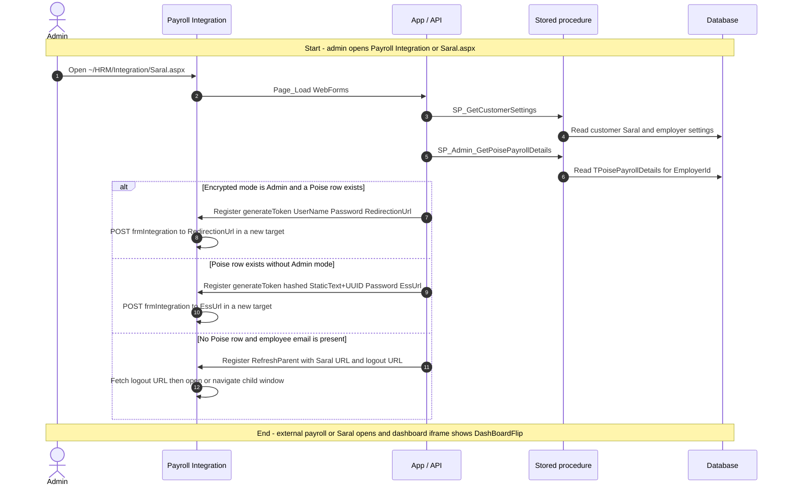
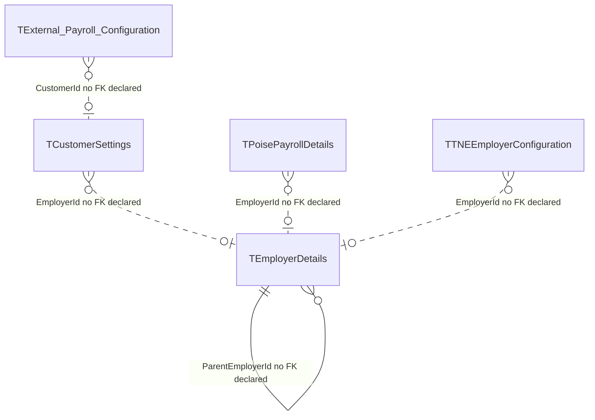

# Payroll Integration

## Overview

An administrator (or any signed-in user who can open the menu) launches the external payroll product from **Admin Configuration → Payroll Integration**. The live menu node (`TMenuDetails` menu id 1152) opens `~/HRM/Integration/Saral.aspx` with an encrypted `mode` query string that decrypts to `Admin`. On that path the page loads Poise/payroll SSO credentials for the session employer and immediately posts `UserName` / `Password` to the configured `RedirectionUrl` in a new browser target, then flips the parent dashboard iframe back to `DashBoardFlip.aspx`.

When `mode` is missing or does not decrypt to `Admin`, the same page still tries Poise credentials first. If a row exists it builds an ESS login (SHA-256 of `StaticText` plus the session `UUID`, plus `Password` and `EssUrl`) and posts that form the same way. If no Poise row exists and the employee has an email, it opens the Saral/SPP cloud (or on-premises) sign-in URL in a child window, optionally signing out the previous Saral session, using customer settings for URL overrides and token shape.

There is no Business Layer class and no HRMS Core API call on this screen. `Saral.aspx.cs` calls `DBHelper` only. `docs/SystemModels/SystemModel-2` has no workflow page for Payroll Integration or `Saral.aspx`. Table blurbs for `TPoisePayrollDetails` and `TCustomerSettings` are in `llm-wiki/reference/tables/hrms.md`.

## Workflow

## Request journey

## Entry points

The live menu node is **Payroll Integration** under **Admin Configuration** (`TDynamicMenuHierarchy` / `TMenuDetails` value 1152). The seeded URL is `~/HRM/Integration/Saral.aspx?mode=…` with encrypted `Admin` (`DML/64841/DML_PayrollIntegration.sql`).

| Entry | Purpose |
|---|---|
| `~/HRM/Integration/Saral.aspx` | Payroll Integration launcher. Optional encrypted `mode` query string. |
| `~/HRM/Integration/PayrolIntegration.aspx` | Older sibling that always posts Poise admin or ESS credentials and logs activity type 341. Not the left-nav node for this submenu. |

`docs/SystemModels/SystemModel-2` does not name a second live page for this item.

## Code → database call chain

No HRMS.Shared BLL type is on this path. Both database calls use Enterprise Library `GetStoredProcCommand` through `DBHelper.m_returnDbObject`.

| Entry | Method | Database |
|---|---|---|
| Every load with a session user, `Saral.aspx.cs:20` | `DBHelper.GetCustomerSettings` (`DBHelper.cs:3427`) | `SP_GetCustomerSettings`. Reads `TCustomerSettings`, `TEmployerDetails`, `TExternal_Payroll_Configuration`, `TTNEEmployerConfiguration`. This page uses `SaralIntegrationURL`, `SaralIntegrationLogoutURL`, `IsCloudOrOnPremises`, and `CustName`. |
| Every load with a session user, `Saral.aspx.cs:25` | `DBHelper.GetPoisePayrollDetails` (`DBHelper.cs:3720`) | `SP_Admin_GetPoisePayrollDetails`. Reads `UserName`, `Password`, `RedirectionUrl`, `StaticText`, `EssUrl` from `TPoisePayrollDetails` for `@EmployerId`. |
| Admin branch, `Saral.aspx.cs:26-39` | Decrypt `Request.QueryString["mode"]`; when it equals `Admin` and Poise rows exist, register `generateToken` | No further stored procedure. Client posts to `RedirectionUrl`. |
| ESS branch, `Saral.aspx.cs:52-59` | `ComputeSha256Hash(StaticText + UUID)` and register `generateToken` | No further stored procedure. Client posts to `EssUrl`. |
| Saral fallback, `Saral.aspx.cs:61-86` | Build URL from `Web.config` `SaralIntegration` and optional customer overrides; register `RefreshParent` | No further stored procedure. Client opens the external URL. |

`Saral.aspx.cs` does not call `CommonUtil.LogActivity`. Nested procedures under either SP are none.

## API endpoints

This feature has no HRMS Core API, PageMethod, or Web API layer. The screen is a WebForms `Page_Load` that emits JavaScript. The browser then either POSTs the hidden `frmIntegration` form to an external payroll URL or opens a Saral/SPP URL in a child window (`Saral.aspx` script `generateToken` / `RefreshParent`). Default Saral base URL comes from `Web.config` key `SaralIntegration`.

## Stored procedures & tables involved

| Object | File | Purpose | Wiki |
|---|---|---|---|
| `SP_GetCustomerSettings` | `HRMS-DATABASE/HRMS/STOREPROCEDURE/SP_GetCustomerSettings.sql` | Customer settings including Saral URL columns for the fallback path. | `llm-wiki/reference/tables/hrms.md` (`TCustomerSettings`) |
| `SP_Admin_GetPoisePayrollDetails` | Not present under `HRMS-DATABASE/HRMS/STOREPROCEDURE/` (live DEV definition only) | Returns Poise/payroll SSO fields for one employer. | `llm-wiki/reference/tables/hrms.md` (`TPoisePayrollDetails`) |
| `TPoisePayrollDetails` | `HRMS-DATABASE/HRMS/TABLES/TPoisePayrollDetails.sql` | Employer payroll SSO user name, password, redirect and ESS URLs, static text. | `llm-wiki/reference/tables/hrms.md` |
| `TCustomerSettings` | `HRMS-DATABASE/HRMS/TABLES/TCustomerSettings.sql` | Saral integration flags and URLs, customer display name. | `llm-wiki/reference/tables/hrms.md` |
| `TEmployerDetails` | `HRMS-DATABASE/HRMS/TABLES/TEmployerDetails.sql` | Joined by `SP_GetCustomerSettings` for employer flags and parent overrides. | `llm-wiki/reference/tables/hrms.md` |
| `TExternal_Payroll_Configuration` | (joined by `SP_GetCustomerSettings`; catalogued in wiki) | External payroll API key/base URL columns returned by the settings SP; unused by `Saral.aspx.cs` branches. | `llm-wiki/reference/tables/hrms.md` |
| `TTNEEmployerConfiguration` | (joined by `SP_GetCustomerSettings`) | Travel and expense employer flags returned by the settings SP; unused by this page. | — |

## Table relationships

`llm-wiki/reference/tables/hrms.md` lists these tables and does not declare foreign keys among them. The diagram below uses the `CREATE TABLE` scripts and the joins the procedures perform. A join the page or procedure uses is shown only as a declared FK when the script has one; otherwise it is labeled as not declared.

`TPoisePayrollDetails` has no primary-key or foreign-key script in `TABLES/TPoisePayrollDetails.sql`. Live DEV also has `EssUrl` and `ApplicationInstanceId` columns that are not on that baseline `CREATE TABLE` script.

## Known gaps

- **No SystemModel-2 page.** Nothing under `docs/SystemModels/SystemModel-2` names Payroll Integration or `Saral.aspx`.
- **`SP_Admin_GetPoisePayrollDetails` is not in Liquibase inventory.** `DBHelper` and `TDataCatalog_DML` name it, and DEV has the object, but there is no `STOREPROCEDURE/SP_Admin_GetPoisePayrollDetails.sql` under `HRMS-DATABASE/HRMS`.
- **`EssUrl` is used by the page but missing from the baseline table script.** Live DEV `TPoisePayrollDetails` includes `EssUrl`; `TABLES/TPoisePayrollDetails.sql` and `DDL/67752_Createtable_TPoisePayrollDetails.sql` do not.
- **No activity log on this menu page.** Sibling `PayrolIntegration.aspx.cs` calls `CommonUtil.LogActivity` with `ActivityDescription.PayrollDetails` (341). `Saral.aspx.cs` does not.
- **Empty Poise result on Admin mode is a no-op.** When encrypted `mode` is `Admin` and `GetPoisePayrollDetails` returns no rows, the page registers no redirect script.
- **Null session employee.** `GetCustomerSettings` runs before the `employee != null` guard (`Saral.aspx.cs:19-21`), so a missing session can throw before the empty body path.
- **Credentials in client script.** Admin and ESS branches embed user name and password into `ScriptManager.RegisterStartupScript` and post them from the browser.
- **Scheduler SP is out of scope.** `SP_Get_PoisePayRollDetails` is used by `HRMS.PoisePayroll` and is not called by this page or by `SP_Admin_GetPoisePayrollDetails`.

## Reference

Confidence is **high** for the WebForms page and `DBHelper` path traced here. The Poise procedure body was confirmed from DEV because it is absent from the Liquibase SQL tree. `docs/SystemModels/SystemModel-2` does not cover this screen. Foreign keys are only those declared on table scripts; none of the joins above are declared.

### SourceCode

- `HRMS.Web/HRMS.Web/HRM/Integration/Saral.aspx`
- `HRMS.Web/HRMS.Web/HRM/Integration/Saral.aspx.cs`
- `HRMS.Web/HRMS.Web/HRM/Integration/PayrolIntegration.aspx.cs` (sibling launcher only)
- `HRMS.Shared/HRMS.DataAccessLayer/DBHelper.cs`
- `HRMS.Shared/HRMS.DataContract/Common/Enums.cs` (`PayrollDetails` = 341, used by the sibling page)
- `HRMS.Web/HRMS.Web/Web.config` (`SaralIntegration`)

### TDG HRMS DB

- `llm-wiki/reference/tables/hrms.md`
- `HRMS-DATABASE/HRMS/STOREPROCEDURE/SP_GetCustomerSettings.sql`
- `HRMS-DATABASE/HRMS/TABLES/TPoisePayrollDetails.sql`
- `HRMS-DATABASE/HRMS/TABLES/TCustomerSettings.sql`
- `HRMS-DATABASE/HRMS/DML/64841/DML_PayrollIntegration.sql`
- `HRMS-DATABASE/HRMS/DML/Add_Column_TPoisePayrollDetails.sql`
- Live DEV `dbo.SP_Admin_GetPoisePayrollDetails` (not inventoried as a SQL file)
