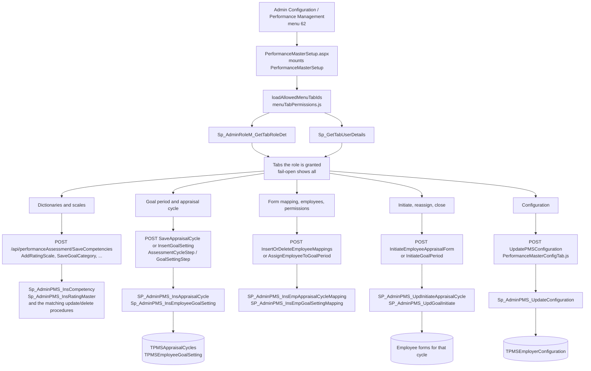
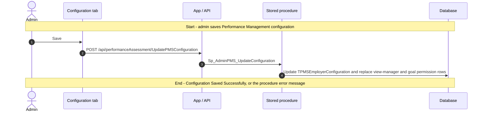
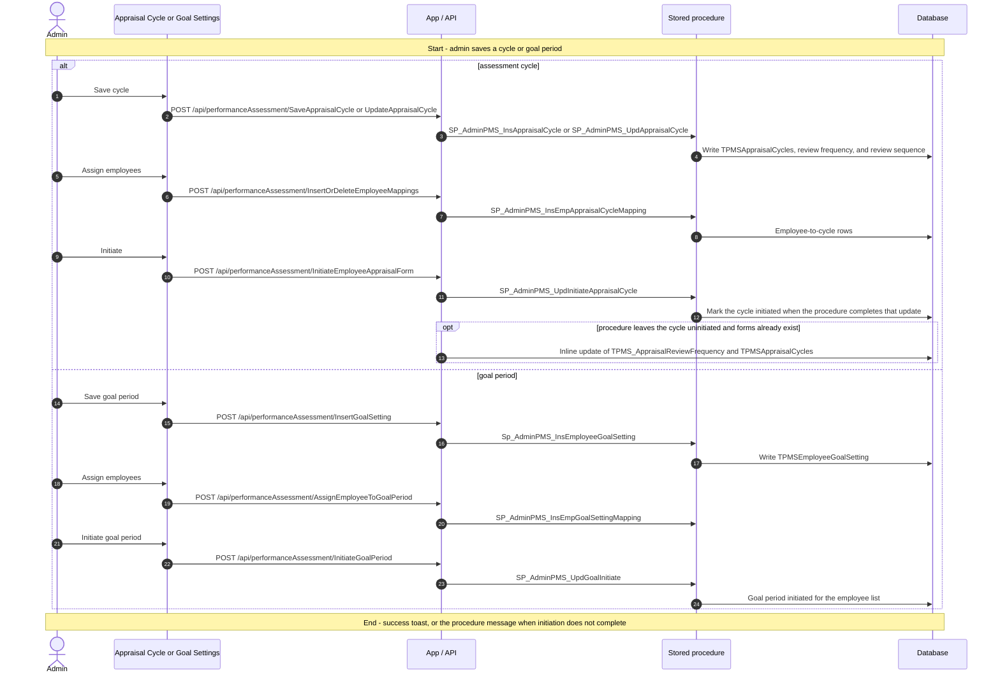
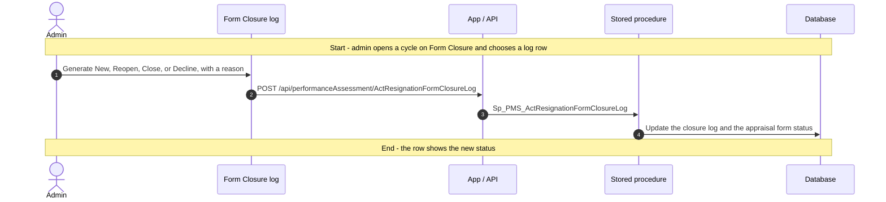

# Performance Management

## Overview

An HR administrator has to decide, before anyone fills an appraisal form, how this organisation rates people, which competencies and KRAs exist, which form each designation uses, who is in the cycle, and what happens when someone resigns mid-cycle. They do that on **Admin Configuration → Performance Management** (menu 62). The screen is the React host `HRM/PMS_React/PerformanceMasterSetup.aspx`. It mounts `PerformanceMasterSetup`, not the employee **Performance Assessment** menu (self-appraisal, manager rating, normalisation, and salary recommendations for a person already in a cycle).

The administrator picks an organisation they can access, then works through the tabs their role is granted: rating and weightage scales, competency and goal dictionaries, form design, goal periods, appraisal cycles, form mapping, extra questions, employee mapping, appraisal permissions, initiation, 9-box grid setup, reassignment, form closure, custom labels, salary-recommendation percentages, and employer configuration. Goal Settings and Appraisal Cycle on this page embed the same step components as the separate Create Goal Period and Create Assessment screens, but they stay inside this master setup. When configuration says to hide assessment-cycle tabs, the cycle workflow tabs disappear. When the tab-permission lookup fails, every tab stays visible.

Saving configuration writes the employer flags (including resignation auto-close and pullback recovery) onto `TPMSEmployerConfiguration`. Creating a cycle writes `TPMSAppraisalCycles` and its review-frequency rows. Mapping employees and initiating the cycle is what makes forms exist. Form Closure, including the resignation auto-close log, is where HR later closes or reopens those forms. The scheduler that enqueues resignation auto-close rows is outside this page.

The live behaviour of those flags and of the closure log is described in SourceCode `docs/SystemModels/SystemModel-2/domain/contexts/performance.md`. There is no llm-wiki domain page for this lifecycle. Table blurbs for the `TPMS*` masters are in `llm-wiki/reference/tables/hrms.md`.

## Workflow

## Request journey

Three requests start on this screen. Lookups that only fill a grid are in the call-chain table.

### Save employer configuration

### Create a cycle, map people, and initiate

### Act on a resignation form-closure log

## Entry points

The breadcrumb on the React host is Home / Admin Configuration / Performance Management. Menu DML `HRMS-DATABASE/HRMS/DML/PMSRelease-React/MenuDetails.sql` sets `tMenuDetails.NavigateURL` to `~/HRM/PMS_React/PerformanceMasterSetup.aspx` where it previously pointed at `~/HRM/PMS/PerformanceMasterSetup.aspx`. `PMS_React/index.js` renders into `#root`. `Areas/routes.js` mounts `PerformanceMasterSetup` for that path and for `PerformanceMasterSetup_new.aspx`.

SourceCode `docs/SystemModels/SystemModel-2/domain/contexts/performance.md` names `HRM/PMS_React/Areas/PerformanceMasterSetup/` as the admin UI and menu 62 as this setup. It treats the employee assessment screens as a separate flow.

| Entry point | Purpose | Live? |
|---|---|---|
| `HRM/PMS_React/PerformanceMasterSetup.aspx` | Admin Configuration menu host. Hidden fields supply employee, employer, and role. | Yes |
| `Areas/PerformanceMasterSetup/Containers/PerformanceMasterSetup.js` | Tab shell, organisation picker, permission filter | Yes |
| `HRM/PMS_React/PerformanceMasterSetup_new.aspx` | Same React component via the route fallback | Compiled alias, not the menu URL |
| `HRM/PMS/PerformanceMasterSetup.aspx` | Legacy WebForms master setup (code-behind still posts back to itself) | Superseded by the menu DML |
| `POST /api/performanceAssessment/*` on this screen | Core API used by the React tabs | Yes |
| `GET /api/dashBoard/GetPermissionRoleTabDetails` and `GetPermissionUserTabDetailsByuserId` | Tab grants for menu 62 | Yes |
| `GET /api/employees/:employeeId/profile` | Resolves `TUsers.UserID` when the page has no `hdnUserId` | Yes |
| Employee Performance Assessment, Nine-Box results, Salary Recommendations menus | People filling or reviewing a form | Separate menu. Not this setup |

## Code → database call chain

The React screen calls Core API routes under `/api`. The DAL column is the method that executes the procedure. Inline SQL is called out on the same row when that method also runs `.query`.

| Entry | HTTP | Controller | DAL | Stored procedure |
|---|---|---|---|---|
| Page load, tab grants when `hdnUserId` is missing (`menuTabPermissions.js`) | `GET /api/employees/:employeeId/profile` | `ProfileQueryHandler` (`Features/Employee/Profile/ProfileQueryHandler.js:18`) | `EmployeeRepository.getEmployeeInfo` (`EmployeeRepository.js:24`) plus `getEmployeeInfoWithTabAccess` (`EmployeeRepository.js:41`) | Sequelize `TEmployee` / `TUsers`. Also executes `Sp_BulkProfileAdminRoleM_GetTabRoleDet` and `SP_GetActiveInactiveFlagForRole` |
| Act Resignation Form Closure Log `Areas/PerformanceMasterSetup/performanceMasterApi.js:58` | `POST /api/performanceAssessment/ActResignationFormClosureLog` (`performanceAssessmentRoutes.js:181`) | `ActResignationFormClosureLog` (`performanceAssessmentController.js:1676`) | `ActResignationFormClosureLog` (`performanceAssessmentDAL.js:2130`, execute `performanceAssessmentDAL.js:2150`) | `Sp_PMS_ActResignationFormClosureLog` |
| Add Measure Outcome Values `Areas/PerformanceMasterSetup/performanceMasterApi.js:51` | `POST /api/performanceAssessment/AddMeasureOutcomeValues` (`performanceAssessmentRoutes.js:31`) | `AddMeasureOutcomeValues` (`performanceAssessmentController.js:336`) | `AddMeasureOutcomeValues` (`performanceAssessmentDAL.js:7586`, execute `performanceAssessmentDAL.js:7593`) | `Sp_AdminPMS_InsGoalCategoryOutcomeDetails` |
| Add Rating Scale `Areas/PerformanceMasterSetup/performanceMasterApi.js:37` | `POST /api/performanceAssessment/AddRatingScale` (`performanceAssessmentRoutes.js:20`) | `AddRatingScale` (`performanceAssessmentController.js:215`) | `AddRatingScale` (`performanceAssessmentDAL.js:337`, execute `performanceAssessmentDAL.js:350`) | `Sp_AdminPMS_InsRatingMaster` |
| Add Reassign Appraisal `Areas/PerformanceMasterSetup/performanceMasterApi.js:114` | `POST /api/performanceAssessment/AddReassignAppraisal` (`performanceAssessmentRoutes.js:271`) | `AddReassignAppraisal` (`performanceAssessmentController.js:2603`) | `AddReassignAppraisal` (`performanceAssessmentDAL.js:4092`, execute `performanceAssessmentDAL.js:4099`) | `SP_AdminPMS_UpdReassignManager` |
| Add Reassign Goal `Areas/PerformanceMasterSetup/performanceMasterApi.js:115` | `POST /api/performanceAssessment/AddReassignGoal` (`performanceAssessmentRoutes.js:273`) | `AddReassignGoal` (`performanceAssessmentController.js:2626`) | `AddReassignGoal` (`performanceAssessmentDAL.js:4125`, execute `performanceAssessmentDAL.js:4132`) | `SP_AdminPMS_UpdReassignGoalManager` |
| Add Weightage Scale `Areas/PerformanceMasterSetup/performanceMasterApi.js:43` | `POST /api/performanceAssessment/AddWeightageScale` (`performanceAssessmentRoutes.js:26`) | `AddWeightageScale` (`performanceAssessmentController.js:283`) | `AddWeightageScale` (`performanceAssessmentDAL.js:7508`, execute `performanceAssessmentDAL.js:7519`) | `Sp_AdminPMS_InsWeightageMaster` |
| Assign Employee To Goal Period `Areas/PerformanceMasterSetup/Components/PerformanceMasterAdminTabs.js:532` | `POST /api/performanceAssessment/AssignEmployeeToGoalPeriod` (`performanceAssessmentRoutes.js:251`) | `AssignEmployeeToGoalPeriod` (`performanceAssessmentController.js:2359`) | `AssignEmployeeToGoalPeriod` (`performanceAssessmentDAL.js:3710`, execute `performanceAssessmentDAL.js:3718`) | `SP_AdminPMS_InsEmpGoalSettingMapping` |
| Close Employee Cycle Form `Areas/PerformanceMasterSetup/performanceMasterApi.js:119` | `POST /api/performanceAssessment/CloseEmployeeCycleForm` (`performanceAssessmentRoutes.js:276`) | `CloseEmployeeCycleForm` (`performanceAssessmentController.js:2667`) | `CloseEmployeeCycleForm` (`performanceAssessmentDAL.js:4177`, execute `performanceAssessmentDAL.js:4185`) | `SP_AdminPMS_CloseAppraisalCycle` |
| Delete Appraisal Cycle `Areas/PerformanceMasterSetup/performanceMasterApi.js:81` | `POST /api/performanceAssessment/DeleteAppraisalCycle` (`performanceAssessmentRoutes.js:262`) | `DeleteAppraisalCycle` (`performanceAssessmentController.js:2506`) | `DeleteAppraisalCycle` (`performanceAssessmentDAL.js:3792`, execute `performanceAssessmentDAL.js:3799`) | `SP_AdminPMS_DelAppraisalCycle` |
| Delete Appraisal Form Component `Areas/PerformanceMasterSetup/performanceMasterApi.js:101` | `POST /api/performanceAssessment/DeleteAppraisalFormComponent` (`performanceAssessmentRoutes.js:306`) | `DeleteAppraisalFormComponent` (`performanceAssessmentController.js:2956`) | `DeleteAppraisalFormComponent` (`performanceAssessmentDAL.js:6021`, execute `performanceAssessmentDAL.js:6029`) | `SP_AdminPMS_DelAppraisalFormComp` |
| Delete Appraisal Permission `Areas/PerformanceMasterSetup/Components/PerformanceMasterAdminTabs.js:1537` | `POST /api/performanceAssessment/DeleteAppraisalPermission` (`performanceAssessmentRoutes.js:318`) | `DeleteAppraisalPermission` (`performanceAssessmentController.js:3056`) | `DeleteAppraisalPermission` (`performanceAssessmentDAL.js:6190`, execute `performanceAssessmentDAL.js:6196`) | `Sp_AdminPMS_DelAppPermissions` |
| Delete Category Desg Mapping `Areas/PerformanceMasterSetup/Components/PerformanceMasterTabsB.js:1229` | `POST /api/performanceAssessment/DeleteCategoryDesignationMapping` (`performanceAssessmentRoutes.js:297`) | `DeleteCategoryDesignationMapping` (`performanceAssessmentController.js:2890`) | `DeleteCategoryDesignationMapping` (`performanceAssessmentDAL.js:5887`, execute `performanceAssessmentDAL.js:5895`) | `Sp_AdminPMS_DelCategoryDesMapping` |
| Delete Competency By Id `Areas/PerformanceMasterSetup/performanceMasterApi.js:65` | `POST /api/performanceAssessment/DeleteCompetencyById` (`performanceAssessmentRoutes.js:82`) | `DeleteCompetencyById` (`performanceAssessmentController.js:816`) | `DeleteCompetencyById` (`performanceAssessmentDAL.js:6495`, execute `performanceAssessmentDAL.js:6501`) | `Sp_AdminPMS_DelCompetency` |
| Delete Competency Category `Areas/PerformanceMasterSetup/performanceMasterApi.js:75` | `POST /api/performanceAssessment/DeleteCompetencyCategory` (`performanceAssessmentRoutes.js:121`) | `DeleteCompetencyCategory` (`performanceAssessmentController.js:908`) | `DeleteCompetencyCategory` (`performanceAssessmentDAL.js:7250`, execute `performanceAssessmentDAL.js:7257`) | `SP_AdminPMS_DelCompetencyCategory` |
| Delete Employee From Goal Setting `Areas/PerformanceMasterSetup/Components/PerformanceMasterAdminTabs.js:681` | `POST /api/performanceAssessment/DeleteEmployeeFromGoalSetting` (`performanceAssessmentRoutes.js:252`) | `DeleteEmployeeFromGoalSetting` (`performanceAssessmentController.js:2375`) | `DeleteEmployeeFromGoalSetting` (`performanceAssessmentDAL.js:3727`, execute `performanceAssessmentDAL.js:3738`) | `Sp_AdminPMS_DelEmployeeGoalMapping` |
| Delete Goal Setting `Areas/PerformanceMasterSetup/performanceMasterApi.js:87` | `POST /api/performanceAssessment/DeleteGoalSetting` (`performanceAssessmentRoutes.js:249`) | `DeleteGoalSetting` (`performanceAssessmentController.js:2338`) | `DeleteGoalSetting` (`performanceAssessmentDAL.js:3680`, execute `performanceAssessmentDAL.js:3685`) | `Sp_AdminPMS_DelGoalSettingDetails` |
| Delete Goal Setting Component `Areas/PerformanceMasterSetup/Components/PerformanceMasterTabsB.js:1900` | `POST /api/performanceAssessment/DeleteGoalSettingComponent` (`performanceAssessmentRoutes.js:240`) | `DeleteGoalSettingComponent` (`performanceAssessmentController.js:2447`) | `DeleteGoalSettingComponent` (`performanceAssessmentDAL.js:4442`, execute `performanceAssessmentDAL.js:4450`) | `SP_AdminPMS_DelEmployeeGoalFormComponents` |
| Delete Pms Goal Category `Areas/PerformanceMasterSetup/performanceMasterApi.js:68` | `POST /api/performanceAssessment/DeletePMSGoalCategory` (`performanceAssessmentRoutes.js:85`) | `DeletePMSGoalCategory` (`performanceAssessmentController.js:822`) | `DeletePMSGoalCategory` (`performanceAssessmentDAL.js:6569`, execute `performanceAssessmentDAL.js:6575`) | `Sp_AdminPMS_DelGoalCategory` |
| Delete Pms Goal Category Details `Areas/PerformanceMasterSetup/performanceMasterApi.js:71` | `POST /api/performanceAssessment/DeletePMSGoalCategoryDetails` (`performanceAssessmentRoutes.js:88`) | `DeletePMSGoalCategoryDetails` (`performanceAssessmentController.js:828`) | `DeletePMSGoalCategoryDetails` (`performanceAssessmentDAL.js:6885`, execute `performanceAssessmentDAL.js:6891`) | `SP_AdminPMS_DelGoalCategoryDetails` |
| Delete Rating Scale `Areas/PerformanceMasterSetup/performanceMasterApi.js:41` | `POST /api/performanceAssessment/DeleteRatingScale` (`performanceAssessmentRoutes.js:22`) | `DeleteRatingScale` (`performanceAssessmentController.js:233`) | `DeleteRatingScale` (`performanceAssessmentDAL.js:387`, execute `performanceAssessmentDAL.js:394`) | `SP_AdminPMS_DelRatingScale` |
| Delete Weightage Scale `Areas/PerformanceMasterSetup/performanceMasterApi.js:45` | `POST /api/performanceAssessment/DeleteWeightageScale` (`performanceAssessmentRoutes.js:28`) | `DeleteWeightageScale` (`performanceAssessmentController.js:301`) | `DeleteWeightageScale` (`performanceAssessmentDAL.js:7545`, execute `performanceAssessmentDAL.js:7552`) | `SP_AdminPMS_DelWeightageScale` |
| Del Salary Rec Percentage For Mapping `Areas/PerformanceMasterSetup/performanceMasterApi.js:148` | `POST /api/performanceAssessment/DELSalaryRecPercentageForMapping` (`performanceAssessmentRoutes.js:105`) | `DELSalaryRecPercentageForMapping` (`performanceAssessmentController.js:876`) | `DELSalaryRecPercentageForMapping` (`performanceAssessmentDAL.js:7976`, execute `performanceAssessmentDAL.js:7984`) | `Sp_AdminPMS_DELSalaryRecPercentageForMapping` |
| Display Rating Scale Info `Areas/PerformanceMasterSetup/performanceMasterApi.js:36` | `GET /api/performanceAssessment/DisplayRatingScaleInfo` (`performanceAssessmentRoutes.js:35`) | `DisplayRatingScaleInfo` (`performanceAssessmentController.js:378`) | `DisplayRatingScaleInfo` (`performanceAssessmentDAL.js:200`, execute `performanceAssessmentDAL.js:207`) | `Sp_AdminPMS_GetRatingScaleDetById` |
| Employee Search With Filters `Areas/PerformanceMasterSetup/Components/PerformanceMasterAdminTabs.js:430` | `GET /api/performanceAssessment/EmployeeSearch` (`performanceAssessmentRoutes.js:282`) | `EmployeeSearch` (`performanceAssessmentController.js:2747`) | `EmployeeSearch` (`performanceAssessmentDAL.js:5415`, execute `performanceAssessmentDAL.js:5438`) | `SP_AdminPMS_EmployeeSearch` |
| Enable Disable Ratingscale `Areas/PerformanceMasterSetup/performanceMasterApi.js:39` | `POST /api/performanceAssessment/EnableDisableRatingScale` (`performanceAssessmentRoutes.js:23`) | `EnableDisableRatingScale` (`performanceAssessmentController.js:248`) | `EnableDisableRatingScale` (`performanceAssessmentDAL.js:404`, execute `performanceAssessmentDAL.js:412`) | `SP_AdminPMS_EnableDisableRatingScale` |
| Force Close Employee Cycle List `Areas/PerformanceMasterSetup/performanceMasterApi.js:120` | `POST /api/performanceAssessment/ForceCloseEmployeeCycleList` (`performanceAssessmentRoutes.js:277`) | `ForceCloseEmployeeCycleList` (`performanceAssessmentController.js:2701`) | `ForceCloseEmployeeCycleList` (`performanceAssessmentDAL.js:4193`, execute `performanceAssessmentDAL.js:4204`) | `SP_AdminPMS_ForceClosedAppStatus` |
| Get All Active Appraisal Cycles `Areas/PerformanceMasterSetup/performanceMasterApi.js:135` | `GET /api/performanceAssessment/GetAllActiveAppraisalCycles` (`performanceAssessmentRoutes.js:96`) | `GetAllActiveAppraisalCycles` (`performanceAssessmentController.js:851`) | `GetAllActiveAppraisalCycles` (`performanceAssessmentDAL.js:7813`, execute `performanceAssessmentDAL.js:7818`) | `Sp_PMS_GetAllActiveAppraisalCycles` |
| Get All Available Competencies `Areas/PerformanceMasterSetup/Containers/PerformanceMasterSetup.js:418` | `GET /api/performanceAssessment/GetAllAvailableCompetencies` (`performanceAssessmentRoutes.js:74`) | `GetAllAvailableCompetencies` (`performanceAssessmentController.js:784`) | `GetAllAvailableCompetencies` (`performanceAssessmentDAL.js:6392`, execute `performanceAssessmentDAL.js:6398`) | `Sp_AdminPMS_GetAllCompetency` |
| Get All Category Desg Mappings `Areas/PerformanceMasterSetup/Containers/PerformanceMasterSetup.js:649` | `GET /api/performanceAssessment/GetAllCategoryDesgMappings` (`performanceAssessmentRoutes.js:289`) | `GetAllCategoryDesgMappings` (`performanceAssessmentController.js:2810`) | `GetAllCategoryDesgMappings` (`performanceAssessmentDAL.js:5754`, execute `performanceAssessmentDAL.js:5759`) | `Sp_AdminPMS_GetAllCategoryDesMapping` |
| Get All Designations For Mapping `Areas/PerformanceMasterSetup/Components/PerformanceMasterAdminTabs.js:350` | `GET /api/performanceAssessment/GetAllDesignationsForMapping` (`performanceAssessmentRoutes.js:256`) | `GetAllDesignationsForMapping` (`performanceAssessmentController.js:2402`) | `GetAllDesignationsForMapping` (`performanceAssessmentDAL.js:4327`, execute `performanceAssessmentDAL.js:4332`) | `Sp_AdminPMS_GetAllDesignationsForMapping` |
| Get All Goal Categories `Areas/PerformanceMasterSetup/Components/FormDesigningTab.js:552` | `GET /api/performanceAssessment/GetAllGoalCategories` (`performanceAssessmentRoutes.js:219`) | `GetAllGoalCategories` (`performanceAssessmentController.js:2098`) | `GetAllGoalCategories` (`performanceAssessmentDAL.js:3165`, execute `performanceAssessmentDAL.js:3171`) | `SP_AdminPMS_GetAllGoalCategory` |
| Get All Goal Categories Details `Areas/PerformanceMasterSetup/Components/FormDesigningTab.js:563` | `GET /api/performanceAssessment/GetAllGoalCategoriesDetails` (`performanceAssessmentRoutes.js:220`) | `GetAllGoalCategoriesDetails` (`performanceAssessmentController.js:2107`) | `GetAllGoalCategoriesDetails` (`performanceAssessmentDAL.js:3179`, execute `performanceAssessmentDAL.js:3185`) | `SP_AdminPMS_GetAllGoalCategoryDetails` |
| Get All Salary Rec Percentage Mapping `Areas/PerformanceMasterSetup/performanceMasterApi.js:136` | `GET /api/performanceAssessment/GetAllSalaryRecPercentageMapping` (`performanceAssessmentRoutes.js:97`) | `GetAllSalaryRecPercentageMapping` (`performanceAssessmentController.js:853`) | `GetAllSalaryRecPercentageMapping` (`performanceAssessmentDAL.js:7847`, execute `performanceAssessmentDAL.js:7852`) | `Sp_AdminPMS_GetAllSalaryRecPercentageMapping` |
| Get Appraisal Cycles For Copy Form Mapping `Areas/PerformanceMasterSetup/Components/PerformanceMasterTabsB.js:1185` | `GET /api/performanceAssessment/GetAppraisalCyclesForCopyFormMapping` (`performanceAssessmentRoutes.js:261`) | `GetAppraisalCyclesForCopyFormMapping` (`performanceAssessmentController.js:2493`) | `GetAppraisalCyclesForCopyFormMapping` (`performanceAssessmentDAL.js:3778`, execute `performanceAssessmentDAL.js:3784`) | `Sp_AdminPMS_GetAppraisalCyclesForCopyEmpMapping` |
| Get Appraisal Cycle List `Areas/PerformanceMasterSetup/Components/PerformanceMasterFormClosureTab.js:128` | `GET /api/performanceAssessment/GetAppraisalCycleList` (`performanceAssessmentRoutes.js:259`) | `GetAppraisalCycleList` (`performanceAssessmentController.js:2483`) | `GetAppraisalCycleList` (`performanceAssessmentDAL.js:3765`, execute `performanceAssessmentDAL.js:3770`) | `Sp_AdminPMS_GetAppraisalCycles` |
| Get Appraisal Cycle List For Mapping `Areas/PerformanceMasterSetup/Components/PerformanceMasterAdminTabs.js:362` | `GET /api/performanceAssessment/GetAppraisalCycleListForMapping` (`performanceAssessmentRoutes.js:260`) | `GetAppraisalCycleListForMapping` (`performanceAssessmentController.js:2474`) | `GetAppraisalCycleListForMapping` (`performanceAssessmentDAL.js:3751`, execute `performanceAssessmentDAL.js:3757`) | `Sp_AdminPMS_GetAppraisalCyclesForEmpMapping` |
| Get Appraisal Cycle Mapped Employees `Areas/PerformanceMasterSetup/Components/PerformanceMasterAdminTabs.js:548` | `GET /api/performanceAssessment/GetAppraisalCycleMappedEmployees` (`performanceAssessmentRoutes.js:263`) | `GetAppraisalCycleMappedEmployees` (`performanceAssessmentController.js:2536`) | `GetAppraisalCycleMappedEmployees` (`performanceAssessmentDAL.js:3896`, execute `performanceAssessmentDAL.js:3904`) | `SP_AdminPMS_GetEmpByAppraisalCycle` |
| Get Appraisal Form Components `Areas/PerformanceMasterSetup/Components/PerformanceMasterTabsB.js:1649` | `GET /api/performanceAssessment/GetAppraisalFormComponents` (`performanceAssessmentRoutes.js:303`) | `GetAppraisalFormComponents` (`performanceAssessmentController.js:2924`) | `GetAppraisalFormComponents` (`performanceAssessmentDAL.js:5950`, execute `performanceAssessmentDAL.js:5957`) | `SP_AdminPMS_GetAppraisalFormComp` |
| Get Appraisal Permissions `Areas/PerformanceMasterSetup/Components/PerformanceMasterAdminTabs.js:1292` | `GET /api/performanceAssessment/GetAppraisalPermissions` (`performanceAssessmentRoutes.js:309`) | `GetAppraisalPermissions` (`performanceAssessmentController.js:2969`) | `GetAppraisalPermissions` (`performanceAssessmentDAL.js:6038`, execute `performanceAssessmentDAL.js:6043`) | `Sp_AdminPMS_GetAppPermissions` |
| Get Appraisal Permission By Id `Areas/PerformanceMasterSetup/Components/PerformanceMasterAdminTabs.js:1331` | `GET /api/performanceAssessment/GetAppraisalPermissionById` (`performanceAssessmentRoutes.js:310`) | `GetAppraisalPermissionById` (`performanceAssessmentController.js:2978`) | `GetAppraisalPermissionById` (`performanceAssessmentDAL.js:6050`, execute `performanceAssessmentDAL.js:6055`) | `Sp_AdminPMS_GetAppPermissionsByID` |
| Get Assessment Kra Mapping Exists `Areas/PerformanceMasterSetup/Components/PerformanceMasterTabsB.js:994` | `GET /api/performanceAssessment/GetAssessmentKRAMappingExists` (`performanceAssessmentRoutes.js:300`) | `GetAssessmentKRAMappingExists` (`performanceAssessmentController.js:2912`) | `GetAssessmentKRAMappingExists` (`performanceAssessmentDAL.js:5930`, execute `performanceAssessmentDAL.js:5937`) | `Sp_AdminPMS_GetAssessmentKRAMappingExists` |
| Get Assigned Emp Roles `Areas/PerformanceMasterSetup/Components/PerformanceMasterAdminTabs.js:361` | `GET /api/performanceAssessment/GetAssignedEmpRoles` (`performanceAssessmentRoutes.js:291`) | `GetAssignedEmpRoles` (`performanceAssessmentController.js:2828`) | `GetAssignedEmpRoles` (`performanceAssessmentDAL.js:5778`, execute `performanceAssessmentDAL.js:5783`) | `SP_GetAssignedEmployeeRoles` |
| Get Assigned Goal Mappings `Areas/PerformanceMasterSetup/performanceMasterApi.js:118` | `GET /api/performanceAssessment/GetAssignedGoalMappings` (`performanceAssessmentRoutes.js:242`) | `GetAssignedGoalMappings` (`performanceAssessmentController.js:2455`) | `GetAssignedGoalMappings` (`performanceAssessmentDAL.js:4457`, execute `performanceAssessmentDAL.js:4462`) | `Sp_AdminPMS_GetEmpAssignedGoalMapping` |
| Get Business Unit By Org Employee Id `Areas/PerformanceMasterSetup/Components/PerformanceMasterAdminTabs.js:324` | `GET /api/performanceAssessment/GetBusinessUnitByOrgEmployeeId` (`performanceAssessmentRoutes.js:163`) | `GetBusinessUnitByOrgEmployeeId` (`performanceAssessmentController.js:1510`) | `GetBusinessUnitByOrgEmployeeId` (`performanceAssessmentDAL.js:1774`, execute `performanceAssessmentDAL.js:1781`) | `SP_PMS_GetBusinessUnitByOrg_EmployeeId` |
| Get Bu List By App Permission `Areas/PerformanceMasterSetup/Components/PerformanceMasterAdminTabs.js:1278` | `GET /api/performanceAssessment/GetBUListByAppPermission` (`performanceAssessmentRoutes.js:315`) | `GetBUListByAppPermission` (`performanceAssessmentController.js:3027`) | `GetBUListByAppPermission` (`performanceAssessmentDAL.js:6115`, execute `performanceAssessmentDAL.js:6122`) | `SP_PMS_GetBUListByAppPermission` |
| Get Category Bu Mappings `Areas/PerformanceMasterSetup/Components/PerformanceMasterTabsB.js:1083` | `GET /api/performanceAssessment/GetCategoryBUMappings` (`performanceAssessmentRoutes.js:294`) | `GetCategoryBUMappings` (`performanceAssessmentController.js:2859`) | `GetCategoryBUMappings` (`performanceAssessmentDAL.js:5820`, execute `performanceAssessmentDAL.js:5828`) | `Sp_AdminPMS_GetCategoryBUMapping` |
| Get Category Designation Mappings `Areas/PerformanceMasterSetup/Components/PerformanceMasterTabsB.js:1081` | `GET /api/performanceAssessment/GetCategoryDesignationMappings` (`performanceAssessmentRoutes.js:292`) | `GetCategoryDesignationMappings` (`performanceAssessmentController.js:2837`) | `GetCategoryDesignationMappings` (`performanceAssessmentDAL.js:5790`, execute `performanceAssessmentDAL.js:5798`) | `Sp_AdminPMS_GetCategoryDesMapping` |
| Get Category Role Mappings `Areas/PerformanceMasterSetup/Components/PerformanceMasterTabsB.js:1082` | `GET /api/performanceAssessment/GetCategoryRoleMappings` (`performanceAssessmentRoutes.js:293`) | `GetCategoryRoleMappings` (`performanceAssessmentController.js:2848`) | `GetCategoryRoleMappings` (`performanceAssessmentDAL.js:5805`, execute `performanceAssessmentDAL.js:5813`) | `Sp_AdminPMS_GetCategoryRoleMapping` |
| Get Competency Categories For Form Mapping `Areas/PerformanceMasterSetup/Components/PerformanceMasterTabsB.js:850` | `GET /api/performanceAssessment/GetCompetencyCategoriesForFormMapping` (`performanceAssessmentRoutes.js:288`) | `GetCompetencyCategoriesForFormMapping` (`performanceAssessmentController.js:2799`) | `GetCompetencyCategoriesForFormMapping` (`performanceAssessmentDAL.js:5691`, execute `performanceAssessmentDAL.js:5709`) | `SP_AdminPMS_GetCompetencyCategory` |
| Get Config Values `Areas/PerformanceMasterSetup/performanceMasterApi.js:128` | `GET /api/performanceAssessment/GetConfigurationValues` (`performanceAssessmentRoutes.js:143`) | `GetConfigurationValues` (`performanceAssessmentController.js:1299`) | `GetConfigurationValues` (`performanceAssessmentDAL.js:1461`, execute `performanceAssessmentDAL.js:1467`) | `Sp_AdminPMS_GetConfigurationValues` |
| Get Confirmation Review Level `Areas/PerformanceMasterSetup/Components/PerformanceMasterConfigTab.js:253` | `GET /api/performanceAssessment/GetConfirmationReviewLevel` (`performanceAssessmentRoutes.js:110`) | `GetConfirmationReviewLevel` (`performanceAssessmentController.js:891`) | `GetConfirmationReviewLevel` (`performanceAssessmentDAL.js:6989`, execute `performanceAssessmentDAL.js:6994`) | `Sp_AdminCMS_GetConfirmationReviewLevel` |
| Get Custom Labels Data `Areas/PerformanceMasterSetup/Containers/PerformanceMasterSetup.js:748` | `GET /api/performanceAssessment/GetCustomLabelsData` (`performanceAssessmentRoutes.js:245`) | `GetCustomLabelsData` (`performanceAssessmentController.js:2279`) | `GetCustomLabelsData` (`performanceAssessmentDAL.js:3615`, execute `performanceAssessmentDAL.js:3621`) | `SP_AdminPMS_GetEmployerPMSCustomFields` |
| Get Dashboard Employment Type List `Areas/PerformanceMasterSetup/Components/PerformanceMasterAdminTabs.js:343` | `GET /api/dashboard/GetEmploymentTypeList` (`DashBoardRoutes.js:111`) | `GetEmploymentTypeList` (`dashboardController.js:1519`) | `GetEmploymentTypeList` (`dashBoardDAL.js:2246`, execute `dashBoardDAL.js:2252`) | `SP_CM_GetEmploymentTypeList` |
| Get Dashboard Locations `Areas/PerformanceMasterSetup/Components/PerformanceMasterAdminTabs.js:355` | `GET /api/dashboard/GetLocations` (`DashBoardRoutes.js:104`) | `GetLocations` (`dashboardController.js:1453`) | `GetLocations` (`dashBoardDAL.js:2146`, execute `dashBoardDAL.js:2153`) | `SP_AdminWM_GetLocation` |
| Get Dashboard Locations By Org `Areas/PerformanceMasterSetup/Components/PerformanceMasterAdminTabs.js:354` | `GET /api/dashboard/GetLocationsByOrg` (`DashBoardRoutes.js:105`) | `GetLocationsByOrg` (`dashboardController.js:1461`) | `GetLocationsByOrg` (`dashBoardDAL.js:2161`, execute `dashBoardDAL.js:2168`) | `SP_AdminWM_GetLocationByOrg_EmployeeId` |
| Get Designations For Form Mapping `Areas/PerformanceMasterSetup/Components/PerformanceMasterTabsB.js:672` | `GET /api/performanceAssessment/GetDesignationsForFormMapping` (`performanceAssessmentRoutes.js:290`) | `GetDesignationsForFormMapping` (`performanceAssessmentController.js:2819`) | `GetDesignationsForFormMapping` (`performanceAssessmentDAL.js:5766`, execute `performanceAssessmentDAL.js:5771`) | `Sp_AdminPMS_GetAllDesignationsForMapping` |
| Get Employee List By Organization `Areas/PerformanceMasterSetup/Components/PerformanceMasterAdminTabs.js:309` | `GET /api/performanceAssessment/GetEmployeeListByOrganization` (`performanceAssessmentRoutes.js:268`) | `GetEmployeeListByOrganization` (`performanceAssessmentController.js:2570`) | `GetEmployeeListByOrganization` (`performanceAssessmentDAL.js:4048`, execute `performanceAssessmentDAL.js:4054`) | `SP_AdminEMP_GetEmpListByOrg` |
| Get Employee To Reassign Appraisal `Areas/PerformanceMasterSetup/performanceMasterApi.js:113` | `GET /api/performanceAssessment/GetEmployeeToReassignAppraisal` (`performanceAssessmentRoutes.js:270`) | `GetEmployeeToReassignAppraisal` (`performanceAssessmentController.js:2592`) | `GetEmployeeToReassignAppraisal` (`performanceAssessmentDAL.js:4077`, execute `performanceAssessmentDAL.js:4084`) | `SP_AdminPMS_SrchEmpByAppraisalCycle` |
| Get Employment Type List Cms `Areas/PerformanceMasterSetup/Components/PerformanceMasterAdminTabs.js:344` | `GET /api/performanceAssessment/GetEmploymentTypeListCMS` (`performanceAssessmentRoutes.js:111`) | `GetEmploymentTypeListCMS` (`performanceAssessmentController.js:892`) | `GetEmploymentTypeListCMS` (`performanceAssessmentDAL.js:6999`, execute `performanceAssessmentDAL.js:7004`) | `SP_CMS_GetEmploymentTypeList` |
| Get Employment Type List For Mapping `Areas/PerformanceMasterSetup/Components/PerformanceMasterAdminTabs.js:342` | `GET /api/performanceAssessment/GetEmploymentTypeListForMapping` (`performanceAssessmentRoutes.js:280`) | `GetEmploymentTypeListForMapping` (`performanceAssessmentController.js:2731`) | `GetEmploymentTypeListForMapping` (`performanceAssessmentDAL.js:4304`, execute `performanceAssessmentDAL.js:4309`) | `SP_CM_GetEmploymentTypeList` |
| Get Emp Appraisal Review Sequence `Areas/PerformanceMasterSetup/Components/PerformanceMasterAdminTabs.js:1281` | `GET /api/performanceAssessment/GetEmpAppraisalReviewSequence` (`performanceAssessmentRoutes.js:311`) | `GetEmpAppraisalReviewSequence` (`performanceAssessmentController.js:2987`) | `GetEmpAppraisalReviewSequence` (`performanceAssessmentDAL.js:6062`, execute `performanceAssessmentDAL.js:6068`) | `Sp_AdminPMS_GetEmpAppraisalReviewSequence` |
| Get Emp Assigned Goal Mapping Init `Areas/PerformanceMasterSetup/Components/PerformanceMasterAdminTabs.js:1732` | `GET /api/performanceAssessment/GetEmpAssignedGoalMappingInit` (`performanceAssessmentRoutes.js:241`) | `GetEmpAssignedGoalMappingInit` (`performanceAssessmentController.js:2452`) | `GetEmpAssignedGoalMappingInit` (`performanceAssessmentDAL.js:4468`, execute `performanceAssessmentDAL.js:4473`) | `Sp_AdminPMS_GetEmpAssignedGoalMappingInit` |
| Get Emp By Appraisal Cycle Permission `Areas/PerformanceMasterSetup/Components/PerformanceMasterAdminTabs.js:1264` | `GET /api/performanceAssessment/GetEmpByAppraisalCyclePermission` (`performanceAssessmentRoutes.js:312`) | `GetEmpByAppraisalCyclePermission` (`performanceAssessmentController.js:2997`) | `GetEmpByAppraisalCyclePermission` (`performanceAssessmentDAL.js:6075`, execute `performanceAssessmentDAL.js:6082`) | `SP_AdminPMS_GetEmpByAppraisalCyclePermission` |
| Get Emp Type List By App Permission `Areas/PerformanceMasterSetup/Components/PerformanceMasterAdminTabs.js:1272` | `GET /api/performanceAssessment/GetEmpTypeListByAppPermission` (`performanceAssessmentRoutes.js:313`) | `GetEmpTypeListByAppPermission` (`performanceAssessmentController.js:3007`) | `GetEmpTypeListByAppPermission` (`performanceAssessmentDAL.js:6089`, execute `performanceAssessmentDAL.js:6095`) | `SP_PMS_GetEmpTypeListByAppPermission` |
| Get Global Access Employer List `Areas/PerformanceMasterSetup/Containers/PerformanceMasterSetup.js:938` | `GET /api/separation/GetGlobalAccessEmployerList` (`separationRoutes.js:57`) | `GetGlobalAccessEmployerList` (`separationController.js:958`) | `GetGlobalAccessEmployerList` (`separationDAL.js:989`, execute `separationDAL.js:994`) | `SP_GetGlobalAccessEmployerList` |
| Get Goal Form Setting Details `Areas/PerformanceMasterSetup/performanceMasterApi.js:77` | `GET /api/performanceAssessment/GetGoalFormSettingDetailsData` (`performanceAssessmentRoutes.js:42`) | `GetGoalFormSettingDetailsData` (`performanceAssessmentController.js:443`) | `GetGoalFormSettingDetailsData` (`performanceAssessmentDAL.js:7379`, execute `performanceAssessmentDAL.js:7384`) | `Sp_PMS_GetGoalFormSettingDetailsData` |
| Get Goal Form Templates `Areas/PerformanceMasterSetup/Components/PerformanceMasterTabsB.js:888` | `GET /api/performanceAssessment/GetGoalFormTemplates` (`performanceAssessmentRoutes.js:255`) | `GetGoalFormTemplates` (`performanceAssessmentController.js:2399`) | `GetGoalFormTemplates` (`performanceAssessmentDAL.js:4291`, execute `performanceAssessmentDAL.js:4298`) | `SP_PMS_GetGoalFormTemplates` |
| Get Goal Freezed Setting Details `Areas/CreateAssessment/Components/AssessmentCycleStep.js:416` | `GET /api/performanceAssessment/GetGoalFreezedSettingDetails` (`performanceAssessmentRoutes.js:248`) | `GetGoalFreezedSettingDetails` (`performanceAssessmentController.js:2328`) | `GetGoalFreezedSettingDetails` (`performanceAssessmentDAL.js:3665`, execute `performanceAssessmentDAL.js:3671`) | `SP_AdminPMS_GetGoalFreezedSettingDetails` |
| Get Goal Period Assigned Employees `Areas/PerformanceMasterSetup/Components/PerformanceMasterAdminTabs.js:1918` | `GET /api/performanceAssessment/GetGoalPeriodAssignedEmployees` (`performanceAssessmentRoutes.js:244`) | `GetGoalPeriodAssignedEmployees` (`performanceAssessmentController.js:2466`) | `GetGoalPeriodAssignedEmployees` (`performanceAssessmentDAL.js:4479`, execute `performanceAssessmentDAL.js:4484`) | `Sp_AdminPMS_GetEmployeeGoalMapping` |
| Get Goal Period List For Mapping `Areas/PerformanceMasterSetup/Components/PerformanceMasterTabsB.js:819` | `GET /api/performanceAssessment/GetGoalPeriodListForMapping` (`performanceAssessmentRoutes.js:254`) | `GetGoalPeriodListForMapping` (`performanceAssessmentController.js:2396`) | `GetGoalPeriodListForMapping` (`performanceAssessmentDAL.js:4280`, execute `performanceAssessmentDAL.js:4285`) | `Sp_AdminPMS_GetEmployeeGoals` |
| Get Goal Period Mapped Employees `Areas/PerformanceMasterSetup/Components/PerformanceMasterAdminTabs.js:547` | `GET /api/performanceAssessment/GetGoalPeriodMappedEmployees` (`performanceAssessmentRoutes.js:250`) | `GetGoalPeriodMappedEmployees` (`performanceAssessmentController.js:2348`) | `GetGoalPeriodMappedEmployees` (`performanceAssessmentDAL.js:3694`, execute `performanceAssessmentDAL.js:3701`) | `Sp_ADMINPMS_GetEmployeeDetailsByGoalID` |
| Get Goal Setting Components `Areas/PerformanceMasterSetup/Components/PerformanceMasterTabsB.js:1648` | `GET /api/performanceAssessment/GetGoalSettingComponents` (`performanceAssessmentRoutes.js:239`) | `GetGoalSettingComponents` (`performanceAssessmentController.js:2419`) | `GetGoalSettingComponents` (`performanceAssessmentDAL.js:4399`, execute `performanceAssessmentDAL.js:4405`) | `SP_AdminPMS_GetEmployeeGoalFormComponents` |
| Get Goal Setting List `Areas/PerformanceMasterSetup/Containers/PerformanceMasterSetup.js:619` | `GET /api/performanceAssessment/GetGoalSettingList` (`performanceAssessmentRoutes.js:247`) | `GetGoalSettingList` (`performanceAssessmentController.js:2318`) | `GetGoalSettingList` (`performanceAssessmentDAL.js:3649`, execute `performanceAssessmentDAL.js:3655`) | `SP_AdminPMS_GetAllGoalSettingDetails` |
| Get Initiate Appraisal Cycle Details `Areas/PerformanceMasterSetup/Components/PerformanceMasterAdminTabs.js:1777` | `GET /api/performanceAssessment/GetInitiateAppraisalCycleDetails` (`performanceAssessmentRoutes.js:274`) | `GetInitiateAppraisalCycleDetails` (`performanceAssessmentController.js:2638`) | `GetInitiateAppraisalCycleDetails` (`performanceAssessmentDAL.js:4144`, execute `performanceAssessmentDAL.js:4152`) | `Sp_AdminPMS_GetAppraisalCycleDet` |
| Get Location List By Employee `Areas/PerformanceMasterSetup/Components/PerformanceMasterAdminTabs.js:353` | `GET /api/performanceAssessment/GetLocationListByEmployee` (`performanceAssessmentRoutes.js:281`) | `GetLocationListByEmployee` (`performanceAssessmentController.js:2739`) | `GetLocationListByEmployee` (`performanceAssessmentDAL.js:4315`, execute `performanceAssessmentDAL.js:4321`) | `SP_AdminWM_GetLocationByOrg_EmployeeId` |
| Get Measure Data For Curve `Areas/PerformanceMasterSetup/performanceMasterApi.js:48` | `GET /api/performanceAssessment/GetMeasureDataforCurve` (`performanceAssessmentRoutes.js:29`) | `GetMeasureDataforCurve` (`performanceAssessmentController.js:316`) | `GetMeasureDataforCurve` (`performanceAssessmentDAL.js:7562`, execute `performanceAssessmentDAL.js:7567`) | `Sp_AdminPMS_GetMesureValueForCurve` |
| Get Measure Data For Curve Grid `Areas/PerformanceMasterSetup/performanceMasterApi.js:50` | `GET /api/performanceAssessment/GetMeasureDataforCurveGrid` (`performanceAssessmentRoutes.js:30`) | `GetMeasureDataforCurveGrid` (`performanceAssessmentController.js:325`) | `GetMeasureDataforCurveGrid` (`performanceAssessmentDAL.js:7574`, execute `performanceAssessmentDAL.js:7579`) | `SP_AdminPMS_GetAllGoalCategoryDetailsForCurve` |
| Get Measure Val Available For Kra `Areas/PerformanceMasterSetup/performanceMasterApi.js:47` | `GET /api/performanceAssessment/GetMeasureValAvailableForKRA` (`performanceAssessmentRoutes.js:33`) | `GetMeasureValAvailableForKRA` (`performanceAssessmentController.js:360`) | `GetMeasureValAvailableForKRA` (`performanceAssessmentDAL.js:170`, execute `performanceAssessmentDAL.js:175`) | `SP_AdminPMS_GetMeasureValAvailableForKRA` |
| Get Nine Box Grid Details `Areas/PerformanceMasterSetup/performanceMasterApi.js:130` | `GET /api/performanceAssessment/GetNineBoxGridDetails` (`performanceAssessmentRoutes.js:92`) | `GetNineBoxGridDetails` (`performanceAssessmentController.js:835`) | `GetNineBoxGridDetails` (`performanceAssessmentDAL.js:7713`, execute `performanceAssessmentDAL.js:7718`) | `Sp_AdminPMS_GetNineBoxGridDetails` |
| Get Nine Box Questionnaire `Areas/PerformanceMasterSetup/performanceMasterApi.js:132` | `GET /api/performanceAssessment/GetNineBoxQuestionnaire` (`performanceAssessmentRoutes.js:94`) | `GetNineBoxQuestionnaire` (`performanceAssessmentController.js:842`) | `GetNineBoxQuestionnaire` (`performanceAssessmentDAL.js:7758`, execute `performanceAssessmentDAL.js:7763`) | `Sp_AdminPMS_GetNineBoxQuestionnaire` |
| Get Pending Cycle Emp Details `Areas/PerformanceMasterSetup/performanceMasterApi.js:123` | `GET /api/performanceAssessment/GetPendingCycleEmpDetails` (`performanceAssessmentRoutes.js:275`) | `GetPendingCycleEmpDetails` (`performanceAssessmentController.js:2649`) | `GetPendingCycleEmpDetails` (`performanceAssessmentDAL.js:4160`, execute `performanceAssessmentDAL.js:4169`) | `Sp_AdminPMS_GetPendingAppList` |
| Get Pending Employees Active Review Frequency `Areas/PerformanceMasterSetup/Components/ExtendSubmissionDatesDialog.js:165` | `GET /api/performanceAssessment/GetPendingEmployeesActiveReviewFrequency` (`performanceAssessmentRoutes.js:264`) | `GetPendingEmployeesActiveReviewFrequency` (`performanceAssessmentController.js:2517`) | `GetPendingEmployeesActiveReviewFrequency` (`performanceAssessmentDAL.js:3808`, execute `performanceAssessmentDAL.js:3814`) | `Sp_AdminPMS_GetPendingEmployeesActiveReviewFrequency` |
| Get Permission Role Tab Details `Common/menuTabPermissions.js:93` | `GET /api/dashboard/GetPermissionRoleTabDetails` (`DashBoardRoutes.js:61`) | `GetPermissionRoleTabDetails` (`dashboardController.js:832`) | `GetPermissionRoleTabDetails` (`dashBoardDAL.js:853`, execute `dashBoardDAL.js:861`) | `Sp_AdminRoleM_GetTabRoleDet` |
| Get Permission User Tab Details `Common/menuTabPermissions.js:98` | `GET /api/dashboard/GetPermissionUserTabDetailsByuserId` (`DashBoardRoutes.js:60`) | `GetPermissionUserTabDetailsByuserId` (`dashboardController.js:820`) | `GetPermissionUserTabDetailsByuserId` (`dashBoardDAL.js:838`, execute `dashBoardDAL.js:846`) | `Sp_GetTabUserDetails` |
| Get Pms Competency Categories New `Areas/PerformanceMasterSetup/Containers/PerformanceMasterSetup.js:589` | `GET /api/performanceAssessment/GetPMSCompetencyCategories_New` (`performanceAssessmentRoutes.js:40`) | `GetPMSCompetencyCategories_New` (`performanceAssessmentController.js:421`) | `GetPMSCompetencyCategories_New` (`performanceAssessmentDAL.js:488`, execute `performanceAssessmentDAL.js:494`) | `SP_AdminPMS_GetCompetencyCategory_New` |
| Get Pms Competency Sections `Areas/PerformanceMasterSetup/performanceMasterApi.js:76` | `GET /api/performanceAssessment/GetPMSCompetencySections` (`performanceAssessmentRoutes.js:41`) | `GetPMSCompetencySections` (`performanceAssessmentController.js:434`) | `GetPMSCompetencySections` (`performanceAssessmentDAL.js:503`, execute `performanceAssessmentDAL.js:514`); `GetPMSCompetencySections` (`performanceAssessmentDAL.js:503`, execute `performanceAssessmentDAL.js:519`) | `SP_AdminPMS_GetCompetencySections` |
| Get Pms Configuration `Areas/PerformanceMasterSetup/Components/PerformanceMasterTabsB.js:1692` | `GET /api/performanceAssessment/GetPMSConfiguration` (`performanceAssessmentRoutes.js:179`) | `GetPMSConfiguration` (`performanceAssessmentController.js:1654`) | `GetPMSConfiguration` (`performanceAssessmentDAL.js:2045`, execute `performanceAssessmentDAL.js:2051`) | `Sp_AdminPMS_GetConfigurationValues` |
| Get Rating Ids For Outcome Scale `Areas/CreateAssessment/Components/AssessmentCycleStep.js:940` | `GET /api/performanceAssessment/GetRatingIdsForOutcomeScale` (`performanceAssessmentRoutes.js:34`) | `GetRatingIdsForOutcomeScale` (`performanceAssessmentController.js:369`) | `GetRatingIdsForOutcomeScale` (`performanceAssessmentDAL.js:183`, execute `performanceAssessmentDAL.js:186`) | `Sp_PMS_GetRatingIdsForOutcomeScale` |
| Get Rating Scale `Areas/PerformanceMasterSetup/performanceMasterApi.js:34` | `GET /api/performanceAssessment/GetRatingScale` (`performanceAssessmentRoutes.js:18`) | `GetRatingScale` (`performanceAssessmentController.js:195`) | `GetRatingScale` (`performanceAssessmentDAL.js:141`, execute `performanceAssessmentDAL.js:149`) | `Sp_PMS_GetRatingDetails` |
| Get Rating Scallist `Areas/PerformanceMasterSetup/Containers/PerformanceMasterSetup.js:297` | `GET /api/performanceAssessment/GetRatingScaleList` (`performanceAssessmentRoutes.js:19`) | `GetRatingScaleList` (`performanceAssessmentController.js:204`) | `GetRatingScale` (`performanceAssessmentDAL.js:141`, execute `performanceAssessmentDAL.js:149`) | `Sp_PMS_GetRatingDetails` |
| Get Resignation Form Closure Logs `Areas/PerformanceMasterSetup/performanceMasterApi.js:55` | `GET /api/performanceAssessment/GetResignationFormClosureLogs` (`performanceAssessmentRoutes.js:180`) | `GetResignationFormClosureLogs` (`performanceAssessmentController.js:1663`) | `GetResignationFormClosureLogs` (`performanceAssessmentDAL.js:2061`, execute `performanceAssessmentDAL.js:2074`) | `SP_AdminPMS_EmployeeAutoClosure` |
| Get Reviewer Types For Goal `Areas/PerformanceMasterSetup/Components/PerformanceMasterTabsB.js:1672` | `GET /api/performanceAssessment/GetReviewerTypesForGoal` (`performanceAssessmentRoutes.js:191`) | `GetReviewerTypesForGoal` (`performanceAssessmentController.js:1787`) | `GetReviewerTypesForGoal` (`performanceAssessmentDAL.js:2335`, execute `performanceAssessmentDAL.js:2342`) | `Sp_AdminPMS_GetGoalSettingReviewLevel` |
| Get Review Frequencies `Areas/PerformanceMasterSetup/Components/PerformanceMasterFormClosureTab.js:191` | `GET /api/performanceAssessment/GetReviewFrequencies` (`performanceAssessmentRoutes.js:194`) | `GetReviewFrequencies` (`performanceAssessmentController.js:1814`) | `GetReviewFrequencies` (`performanceAssessmentDAL.js:2379`, execute `performanceAssessmentDAL.js:2387`) | `Sp_AdminPMS_GetReviewFrequencies` |
| Get Review Frequencies Per Cycle Id `Areas/CreateGoalPeriod/Components/GoalSettingStep.js:303` | `GET /api/performanceAssessment/GetReviewFrequenciesPerCycleId` (`performanceAssessmentRoutes.js:279`) | `GetReviewFrequenciesPerCycleId` (`performanceAssessmentController.js:2720`) | `GetReviewFrequenciesPerCycleId` (`performanceAssessmentDAL.js:5397`, execute `performanceAssessmentDAL.js:5403`) | `SP_AdminPMS_GetReviewFrequenciesPerCycleId` |
| Get Salary Rec Percentage Bu Mapping `Areas/PerformanceMasterSetup/performanceMasterApi.js:145` | `GET /api/performanceAssessment/GetSalaryRecPercentageBUMapping` (`performanceAssessmentRoutes.js:102`) | `GetSalaryRecPercentageBUMapping` (`performanceAssessmentController.js:869`) | `GetSalaryRecPercentageBUMapping` (`performanceAssessmentDAL.js:7912`, execute `performanceAssessmentDAL.js:7920`) | `Sp_AdminPMS_GetSalaryRecPercentageBUMapping` |
| Get Salary Rec Percentage Des Mapping `Areas/PerformanceMasterSetup/performanceMasterApi.js:143` | `GET /api/performanceAssessment/GetSalaryRecPercentageDesMapping` (`performanceAssessmentRoutes.js:101`) | `GetSalaryRecPercentageDesMapping` (`performanceAssessmentController.js:866`) | `GetSalaryRecPercentageDesMapping` (`performanceAssessmentDAL.js:7899`, execute `performanceAssessmentDAL.js:7907`) | `Sp_AdminPMS_GetSalaryRecPercentageDesMapping` |
| Get Salary Rec Percentage Mapping Exists `Areas/PerformanceMasterSetup/performanceMasterApi.js:137` | `POST /api/performanceAssessment/GetSalaryRecPercentageMappingExists` (`performanceAssessmentRoutes.js:98`) | `GetSalaryRecPercentageMappingExists` (`performanceAssessmentController.js:855`) | `GetSalaryRecPercentageMappingExists` (`performanceAssessmentDAL.js:7857`, execute `performanceAssessmentDAL.js:7867`) | `Sp_AdminPMS_GetSalaryRecPercentageMappingExists` |
| Get Salary Rec Percentage Role Mapping `Areas/PerformanceMasterSetup/performanceMasterApi.js:141` | `GET /api/performanceAssessment/GetSalaryRecPercentageRoleMapping` (`performanceAssessmentRoutes.js:100`) | `GetSalaryRecPercentageRoleMapping` (`performanceAssessmentController.js:863`) | `GetSalaryRecPercentageRoleMapping` (`performanceAssessmentDAL.js:7886`, execute `performanceAssessmentDAL.js:7894`) | `Sp_AdminPMS_GetSalaryRecPercentageRoleMapping` |
| Get Title By App Permission `Areas/PerformanceMasterSetup/Components/PerformanceMasterAdminTabs.js:1275` | `GET /api/performanceAssessment/GetTitleByAppPermission` (`performanceAssessmentRoutes.js:314`) | `GetTitleByAppPermission` (`performanceAssessmentController.js:3017`) | `GetTitleByAppPermission` (`performanceAssessmentDAL.js:6102`, execute `performanceAssessmentDAL.js:6108`) | `SP_PMS_GetTitleByAppPermission` |
| Get Weightage Scale `Areas/PerformanceMasterSetup/Containers/PerformanceMasterSetup.js:222` | `GET /api/performanceAssessment/GetWeightageScale` (`performanceAssessmentRoutes.js:25`) | `GetWeightageScale` (`performanceAssessmentController.js:273`) | `GetWeightageScale` (`performanceAssessmentDAL.js:157`, execute `performanceAssessmentDAL.js:162`) | `Sp_AdminPMS_GetWeightageDetails` |
| Initiate Employee Appraisal Form `Areas/PerformanceMasterSetup/Components/PerformanceMasterAdminTabs.js:1905` | `POST /api/performanceAssessment/InitiateEmployeeAppraisalForm` (`performanceAssessmentRoutes.js:283`) | `InitiateEmployeeAppraisalForm` (`performanceAssessmentController.js:2764`) | `InitiateEmployeeAppraisalForm` (`performanceAssessmentDAL.js:5448`, execute `performanceAssessmentDAL.js:5480`) | `SP_AdminPMS_UpdInitiateAppraisalCycle` plus inline SQL at `performanceAssessmentDAL.js:5456,5491,5502,5508,5517` |
| Initiate Goal Period `Areas/PerformanceMasterSetup/Components/PerformanceMasterAdminTabs.js:1927` | `POST /api/performanceAssessment/InitiateGoalPeriod` (`performanceAssessmentRoutes.js:243`) | `InitiateGoalPeriod` (`performanceAssessmentController.js:2458`) | `InitiateGoalPeriod` (`performanceAssessmentDAL.js:4495`, execute `performanceAssessmentDAL.js:4501`) | `SP_AdminPMS_UpdGoalInitiate` |
| Insert Custom Labels Data `Areas/PerformanceMasterSetup/performanceMasterApi.js:126` | `POST /api/performanceAssessment/InsertCustomLabelsData` (`performanceAssessmentRoutes.js:89`) | `InsertCustomLabelsData` (`performanceAssessmentController.js:832`) | `InsertCustomLabelsData` (`performanceAssessmentDAL.js:6902`, execute `performanceAssessmentDAL.js:6925`) | `Sp_AdminPMS_InsEmployerPMSCustomFields` |
| Insert Goal Setting `Areas/CreateGoalPeriod/Components/GoalSettingStep.js:795` | `POST /api/performanceAssessment/InsertGoalSetting` (`performanceAssessmentRoutes.js:253`) | `InsertGoalSetting` (`performanceAssessmentController.js:2386`) | `InsertGoalSetting` (`performanceAssessmentDAL.js:4230`, execute `performanceAssessmentDAL.js:4271`) | `Sp_AdminPMS_InsEmployeeGoalSetting` |
| Insert Or Delete Employee Mappings `Areas/PerformanceMasterSetup/Components/PerformanceMasterAdminTabs.js:538` | `POST /api/performanceAssessment/InsertOrDeleteEmployeeMappings` (`performanceAssessmentRoutes.js:266`) | `InsertOrDeleteEmployeeMappings` (`performanceAssessmentController.js:2547`) | `InsertOrDeleteEmployeeMappings` (`performanceAssessmentDAL.js:3915`, execute `performanceAssessmentDAL.js:3924`) | `SP_AdminPMS_InsEmpAppraisalCycleMapping` |
| Ins Employee Appraisal Review Frequency `Areas/PerformanceMasterSetup/Components/ExtendSubmissionDatesDialog.js:302` | `POST /api/performanceAssessment/InsEmployeeAppraisalReviewFrequency` (`performanceAssessmentRoutes.js:265`) | `InsEmployeeAppraisalReviewFrequency` (`performanceAssessmentController.js:2526`) | `InsEmployeeAppraisalReviewFrequency` (`performanceAssessmentDAL.js:3829`, execute `performanceAssessmentDAL.js:3887`) | `SP_AdminPMS_InsEmployeeAppraisalReviewFrequency` |
| Ins Nine Box Grid Details `Areas/PerformanceMasterSetup/performanceMasterApi.js:131` | `POST /api/performanceAssessment/INSNineBoxGridDetails` (`performanceAssessmentRoutes.js:93`) | `INSNineBoxGridDetails` (`performanceAssessmentController.js:837`) | `INSNineBoxGridDetails` (`performanceAssessmentDAL.js:7723`, execute `performanceAssessmentDAL.js:7751`) | `Sp_AdminPMS_INSNineBoxGridDetails` |
| Ins Nine Box Questionnaire `Areas/PerformanceMasterSetup/performanceMasterApi.js:133` | `POST /api/performanceAssessment/INSNineBoxQuestionnaire` (`performanceAssessmentRoutes.js:95`) | `INSNineBoxQuestionnaire` (`performanceAssessmentController.js:844`) | `INSNineBoxQuestionnaire` (`performanceAssessmentDAL.js:7779`, execute `performanceAssessmentDAL.js:7800`) | `Sp_AdminPMS_INSNineBoxQuestionnaire` |
| Ins Salary Rec Percentage For Mapping `Areas/PerformanceMasterSetup/performanceMasterApi.js:146` | `POST /api/performanceAssessment/InsSalaryRecPercentageForMapping` (`performanceAssessmentRoutes.js:103`) | `InsSalaryRecPercentageForMapping` (`performanceAssessmentController.js:872`) | `InsSalaryRecPercentageForMapping` (`performanceAssessmentDAL.js:7925`, execute `performanceAssessmentDAL.js:7945`) | `Sp_AdminPMS_InsSalaryRecPercentageForMapping` |
| Is Designation Mapping Exists `Areas/PerformanceMasterSetup/Components/PerformanceMasterTabsB.js:971` | `POST /api/performanceAssessment/IsDesignationMappingExists` (`performanceAssessmentRoutes.js:299`) | `IsDesignationMappingExists` (`performanceAssessmentController.js:2901`) | `IsDesignationMappingExists` (`performanceAssessmentDAL.js:5903`, execute `performanceAssessmentDAL.js:5903`) | `Sp_AdminPMS_GetDesignationMappingExists`; `Sp_PMS_GetGoalFormMappingExists` |
| Salary Rec Percentage Scale Det By Id `Areas/PerformanceMasterSetup/performanceMasterApi.js:139` | `GET /api/performanceAssessment/SalaryRecPercentageScaleDetById` (`performanceAssessmentRoutes.js:99`) | `SalaryRecPercentageScaleDetById` (`performanceAssessmentController.js:860`) | `SalaryRecPercentageScaleDetById` (`performanceAssessmentDAL.js:7873`, execute `performanceAssessmentDAL.js:7881`) | `SP_PMS_GetSalaryRecPercentageScaleDetById` |
| Save Appraisal Cycle `Areas/PerformanceMasterSetup/performanceMasterApi.js:82` | `POST /api/performanceAssessment/SaveAppraisalCycle` (`performanceAssessmentRoutes.js:284`) | `SaveAppraisalCycle` (`performanceAssessmentController.js:2776`) | `__upsertAppraisalCycle` (`performanceAssessmentDAL.js:5554`, execute `performanceAssessmentDAL.js:5658`); `GetAppraisalCycleList` (`performanceAssessmentDAL.js:3765`, execute `performanceAssessmentDAL.js:3770`) | `SP_AdminPMS_UpdAppraisalCycle`; `SP_AdminPMS_InsAppraisalCycle`; `Sp_AdminPMS_GetAppraisalCycles` |
| Save Appraisal Form Component `Areas/PerformanceMasterSetup/performanceMasterApi.js:99` | `POST /api/performanceAssessment/SaveAppraisalFormComponent` (`performanceAssessmentRoutes.js:304`) | `SaveAppraisalFormComponent` (`performanceAssessmentController.js:2934`) | `SaveAppraisalFormComponent` (`performanceAssessmentDAL.js:5964`, execute `performanceAssessmentDAL.js:5984`) | `SP_AdminPMS_InsAppraisalFormComp` |
| Save Appraisal Permission `Areas/PerformanceMasterSetup/Components/PerformanceMasterAdminTabs.js:1448` | `POST /api/performanceAssessment/SaveAppraisalPermission` (`performanceAssessmentRoutes.js:316`) | `SaveAppraisalPermission` (`performanceAssessmentController.js:3037`) | `SaveAppraisalPermission` (`performanceAssessmentDAL.js:6129`, execute `performanceAssessmentDAL.js:6152`) | `Sp_AdminPMS_InsAppPermissions` |
| Save Category Desg Mapping `Areas/PerformanceMasterSetup/Components/PerformanceMasterTabsB.js:1015` | `POST /api/performanceAssessment/SaveCategoryDesgMapping` (`performanceAssessmentRoutes.js:295`) | `SaveCategoryDesgMapping` (`performanceAssessmentController.js:2870`) | `SaveCategoryDesgMapping` (`performanceAssessmentDAL.js:5835`, execute `performanceAssessmentDAL.js:5853`) | `Sp_AdminPMS_InsCategoryDesMapping` |
| Save Competencies `Areas/PerformanceMasterSetup/performanceMasterApi.js:63` | `POST /api/performanceAssessment/SaveCompetencies` (`performanceAssessmentRoutes.js:80`) | `SaveCompetencies` (`performanceAssessmentController.js:814`) | `SaveCompetencies` (`performanceAssessmentDAL.js:6460`, execute `performanceAssessmentDAL.js:6471`) | `Sp_AdminPMS_InsCompetency` |
| Save Confirmation Competency Category `Areas/PerformanceMasterSetup/performanceMasterApi.js:74` | `POST /api/performanceAssessment/SaveConfirmationCompetencyCategory` (`performanceAssessmentRoutes.js:122`) | `SaveConfirmationCompetencyCategory` (`performanceAssessmentController.js:912`) | `SaveConfirmationCompetencyCategory` (`performanceAssessmentDAL.js:7391`, execute `performanceAssessmentDAL.js:7463`) | `Sp_AdminPMS_InsCompetencyCategories_HT` |
| Save Goal Category `Areas/PerformanceMasterSetup/performanceMasterApi.js:66` | `POST /api/performanceAssessment/SaveGoalCategory` (`performanceAssessmentRoutes.js:83`) | `SaveGoalCategory` (`performanceAssessmentController.js:820`) | `SaveGoalCategory` (`performanceAssessmentDAL.js:6512`, execute `performanceAssessmentDAL.js:6530`) | `Sp_AdminPMS_InsGoalCategory` |
| Save Goal Category Details `Areas/PerformanceMasterSetup/performanceMasterApi.js:69` | `POST /api/performanceAssessment/SaveGoalCategoryDetails` (`performanceAssessmentRoutes.js:86`) | `SaveGoalCategoryDetails` (`performanceAssessmentController.js:826`) | `SaveGoalCategoryDetails` (`performanceAssessmentDAL.js:6641`, execute `performanceAssessmentDAL.js:6680`); `SaveGoalCategoryDetails` (`performanceAssessmentDAL.js:6641`, execute `performanceAssessmentDAL.js:6745`) | `Sp_AdminPMS_InsGoalCategoryDetails`; `Sp_AdminPMS_INSKRADictionaryDetails` |
| Save Goal Setting Component `Areas/PerformanceMasterSetup/Components/PerformanceMasterTabsB.js:1821` | `POST /api/performanceAssessment/SaveGoalSettingComponent` (`performanceAssessmentRoutes.js:236`) | `SaveGoalSettingComponent` (`performanceAssessmentController.js:2422`) | `UpdateGoalSettingComponent` (`performanceAssessmentDAL.js:3584`, execute `performanceAssessmentDAL.js:3607`); `SaveGoalSettingComponent` (`performanceAssessmentDAL.js:4412`, execute `performanceAssessmentDAL.js:4436`) | `SP_AdminPMS_UpdEmployeeGoalFormComponents`; `SP_AdminPMS_InsEmployeeGoalFormComponents` |
| Search Emp By Goal Period `Areas/PerformanceMasterSetup/performanceMasterApi.js:117` | `GET /api/performanceAssessment/SearchEmpByGoalPeriod` (`performanceAssessmentRoutes.js:272`) | `SearchEmpByGoalPeriod` (`performanceAssessmentController.js:2615`) | `SearchEmpByGoalPeriod` (`performanceAssessmentDAL.js:4110`, execute `performanceAssessmentDAL.js:4117`) | `SP_AdminPMS_SrchEmpByGoalPeriod` |
| Update Appraisal Cycle `Areas/PerformanceMasterSetup/performanceMasterApi.js:83` | `POST /api/performanceAssessment/UpdateAppraisalCycle` (`performanceAssessmentRoutes.js:285`) | `UpdateAppraisalCycle` (`performanceAssessmentController.js:2787`) | `__upsertAppraisalCycle` (`performanceAssessmentDAL.js:5554`, execute `performanceAssessmentDAL.js:5658`); `GetAppraisalCycleList` (`performanceAssessmentDAL.js:3765`, execute `performanceAssessmentDAL.js:3770`) | `SP_AdminPMS_UpdAppraisalCycle`; `SP_AdminPMS_InsAppraisalCycle`; `Sp_AdminPMS_GetAppraisalCycles` |
| Update Appraisal Form Component `Areas/PerformanceMasterSetup/performanceMasterApi.js:100` | `POST /api/performanceAssessment/UpdateAppraisalFormComponent` (`performanceAssessmentRoutes.js:305`) | `UpdateAppraisalFormComponent` (`performanceAssessmentController.js:2945`) | `UpdateAppraisalFormComponent` (`performanceAssessmentDAL.js:5992`, execute `performanceAssessmentDAL.js:6013`) | `SP_AdminPMS_UpdAppraisalFormComp` |
| Update Appraisal Permission `Areas/PerformanceMasterSetup/Components/PerformanceMasterAdminTabs.js:1448` | `POST /api/performanceAssessment/UpdateAppraisalPermission` (`performanceAssessmentRoutes.js:317`) | `UpdateAppraisalPermission` (`performanceAssessmentController.js:3047`) | `UpdateAppraisalPermission` (`performanceAssessmentDAL.js:6159`, execute `performanceAssessmentDAL.js:6183`) | `Sp_AdminPMS_UpdAppPermissions` |
| Update Category Desg Mapping `Areas/PerformanceMasterSetup/Components/PerformanceMasterTabsB.js:1014` | `POST /api/performanceAssessment/UpdateCategoryDesgMapping` (`performanceAssessmentRoutes.js:296`) | `UpdateCategoryDesgMapping` (`performanceAssessmentController.js:2880`) | `UpdateCategoryDesgMapping` (`performanceAssessmentDAL.js:5860`, execute `performanceAssessmentDAL.js:5879`) | `Sp_AdminPMS_UpdCategoryDesMapping` |
| Update Competencies `Areas/PerformanceMasterSetup/performanceMasterApi.js:64` | `POST /api/performanceAssessment/UpdateCompetencies` (`performanceAssessmentRoutes.js:81`) | `UpdateCompetencies` (`performanceAssessmentController.js:815`) | `UpdateCompetencies` (`performanceAssessmentDAL.js:6477`, execute `performanceAssessmentDAL.js:6489`) | `Sp_AdminPMS_UpdCompetency` |
| Update Force Auto Closed App Status `Areas/PerformanceMasterSetup/performanceMasterApi.js:60` | `POST /api/performanceAssessment/UpdateForceAutoClosedAppStatus` (`performanceAssessmentRoutes.js:182`) | `UpdateForceAutoClosedAppStatus` (`performanceAssessmentController.js:1685`) | `UpdateForceAutoClosedAppStatus` (`performanceAssessmentDAL.js:2185`, execute `performanceAssessmentDAL.js:2206`) | `SP_AdminPMS_UpdateForceAutoClosedAppStatus` |
| Update Goal Category `Areas/PerformanceMasterSetup/performanceMasterApi.js:67` | `POST /api/performanceAssessment/UpdateGoalCategory` (`performanceAssessmentRoutes.js:84`) | `UpdateGoalCategory` (`performanceAssessmentController.js:821`) | `UpdateGoalCategory` (`performanceAssessmentDAL.js:6536`, execute `performanceAssessmentDAL.js:6558`) | `Sp_AdminPMS_UpdGoalCategory` |
| Update Goal Category Details `Areas/PerformanceMasterSetup/performanceMasterApi.js:70` | `POST /api/performanceAssessment/UpdateGoalCategoryDetails` (`performanceAssessmentRoutes.js:87`) | `UpdateGoalCategoryDetails` (`performanceAssessmentController.js:827`) | `UpdateGoalCategoryDetails` (`performanceAssessmentDAL.js:6758`, execute `performanceAssessmentDAL.js:6796`); `UpdateGoalCategoryDetails` (`performanceAssessmentDAL.js:6758`, execute `performanceAssessmentDAL.js:6856`) | `Sp_AdminPMS_UPDGoalCategoryDetails`; `Sp_AdminPMS_UPDKRADictionaryDetails` |
| Update Goal Setting Freeze `Areas/PerformanceMasterSetup/performanceMasterApi.js:121` | `POST /api/performanceAssessment/UpdateGoalSettingFreeze` (`performanceAssessmentRoutes.js:278`) | `UpdateGoalSettingFreeze` (`performanceAssessmentController.js:2682`) | `UpdateGoalSettingFreeze` (`performanceAssessmentDAL.js:4212`, execute `performanceAssessmentDAL.js:4218`) | `SP_AdminPMS_UpdGoalFreeze` |
| Update Pms Configuration `Areas/PerformanceMasterSetup/performanceMasterApi.js:53` | `POST /api/performanceAssessment/UpdatePMSConfiguration` (`performanceAssessmentRoutes.js:32`) | `UpdatePMSConfiguration` (`performanceAssessmentController.js:351`) | `UpdatePMSConfiguration` (`performanceAssessmentDAL.js:7601`, execute `performanceAssessmentDAL.js:7705`) | `Sp_AdminPMS_UpdateConfiguration` |
| Update Rating Scale `Areas/PerformanceMasterSetup/performanceMasterApi.js:38` | `POST /api/performanceAssessment/UpdateRatingScale` (`performanceAssessmentRoutes.js:21`) | `UpdateRatingScale` (`performanceAssessmentController.js:224`) | `UpdateRatingScale` (`performanceAssessmentDAL.js:358`, execute `performanceAssessmentDAL.js:372`) | `Sp_AdminPMS_UpdRatingMaster` |
| Update Weightage Scale `Areas/PerformanceMasterSetup/performanceMasterApi.js:44` | `POST /api/performanceAssessment/UpdateWeightageScale` (`performanceAssessmentRoutes.js:27`) | `UpdateWeightageScale` (`performanceAssessmentController.js:292`) | `UpdateWeightageScale` (`performanceAssessmentDAL.js:7526`, execute `performanceAssessmentDAL.js:7538`) | `Sp_AdminPMS_UpdWeightageMaster` |
| Upd Salary Rec Percentage For Mapping `Areas/PerformanceMasterSetup/performanceMasterApi.js:147` | `POST /api/performanceAssessment/UPDSalaryRecPercentageForMapping` (`performanceAssessmentRoutes.js:104`) | `UPDSalaryRecPercentageForMapping` (`performanceAssessmentController.js:874`) | `UPDSalaryRecPercentageForMapping` (`performanceAssessmentDAL.js:7950`, execute `performanceAssessmentDAL.js:7971`) | `Sp_AdminPMS_UPDSalaryRecPercentageForMapping` |
| Upload Bulk Employee Mapping `Areas/PerformanceMasterSetup/Components/PerformanceMasterAdminTabs.js:806` | `POST /api/performanceAssessment/UploadBulkEmployeeMapping` (`performanceAssessmentRoutes.js:267`) | `UploadBulkEmployeeMapping` (`performanceAssessmentController.js:2559`) | `UploadBulkEmployeeMapping` (`performanceAssessmentDAL.js:3971`, execute `performanceAssessmentDAL.js:4003`) | `Sp_AdminPMS_UploadBulkEmployeeMapping` |

## API endpoints

Routes are mounted from `app.js` at `/api`. Query names are the ones the React URL and the controller read. POST bodies are JSON. The procedure parameter list is on the database page linked from the next section.

| Verb | Route | Parameters | Purpose | Source |
|---|---|---|---|---|
| GET | `/api/employees/:employeeId/profile` | `employeeId` path, required | Resolve `TUsers.UserID` for menu 62 tab grants | `Features/Employee/Profile/routes.js:34` |
| POST | `/api/performanceAssessment/ActResignationFormClosureLog` | JSON body | Act Resignation Form Closure Log | `performanceAssessmentController.js:1676` |
| POST | `/api/performanceAssessment/AddMeasureOutcomeValues` | JSON body | Add Measure Outcome Values | `performanceAssessmentController.js:336` |
| POST | `/api/performanceAssessment/AddRatingScale` | JSON body | Add Rating Scale | `performanceAssessmentController.js:215` |
| POST | `/api/performanceAssessment/AddReassignAppraisal` | JSON body | Add Reassign Appraisal | `performanceAssessmentController.js:2603` |
| POST | `/api/performanceAssessment/AddReassignGoal` | JSON body | Add Reassign Goal | `performanceAssessmentController.js:2626` |
| POST | `/api/performanceAssessment/AddWeightageScale` | JSON body | Add Weightage Scale | `performanceAssessmentController.js:283` |
| POST | `/api/performanceAssessment/AssignEmployeeToGoalPeriod` | JSON body | Assign Employee To Goal Period | `performanceAssessmentController.js:2359` |
| POST | `/api/performanceAssessment/CloseEmployeeCycleForm` | JSON body | Close Employee Cycle Form | `performanceAssessmentController.js:2667` |
| POST | `/api/performanceAssessment/DeleteAppraisalCycle` | JSON body | Delete Appraisal Cycle | `performanceAssessmentController.js:2506` |
| POST | `/api/performanceAssessment/DeleteAppraisalFormComponent` | JSON body | Delete Appraisal Form Component | `performanceAssessmentController.js:2956` |
| POST | `/api/performanceAssessment/DeleteAppraisalPermission` | JSON body | Delete Appraisal Permission | `performanceAssessmentController.js:3056` |
| POST | `/api/performanceAssessment/DeleteCategoryDesignationMapping` | JSON body | Delete Category Desg Mapping | `performanceAssessmentController.js:2890` |
| POST | `/api/performanceAssessment/DeleteCompetencyById` | JSON body | Delete Competency By Id | `performanceAssessmentController.js:816` |
| POST | `/api/performanceAssessment/DeleteCompetencyCategory` | JSON body | Delete Competency Category | `performanceAssessmentController.js:908` |
| POST | `/api/performanceAssessment/DeleteEmployeeFromGoalSetting` | JSON body | Delete Employee From Goal Setting | `performanceAssessmentController.js:2375` |
| POST | `/api/performanceAssessment/DeleteGoalSetting` | JSON body | Delete Goal Setting | `performanceAssessmentController.js:2338` |
| POST | `/api/performanceAssessment/DeleteGoalSettingComponent` | JSON body | Delete Goal Setting Component | `performanceAssessmentController.js:2447` |
| POST | `/api/performanceAssessment/DeletePMSGoalCategory` | JSON body | Delete Pms Goal Category | `performanceAssessmentController.js:822` |
| POST | `/api/performanceAssessment/DeletePMSGoalCategoryDetails` | JSON body | Delete Pms Goal Category Details | `performanceAssessmentController.js:828` |
| POST | `/api/performanceAssessment/DeleteRatingScale` | `employerId` query, `ratingId` query, `modifiedBy` query; JSON body | Delete Rating Scale | `performanceAssessmentController.js:233` |
| POST | `/api/performanceAssessment/DeleteWeightageScale` | JSON body | Delete Weightage Scale | `performanceAssessmentController.js:301` |
| POST | `/api/performanceAssessment/DELSalaryRecPercentageForMapping` | JSON body | Del Salary Rec Percentage For Mapping | `performanceAssessmentController.js:876` |
| GET | `/api/performanceAssessment/DisplayRatingScaleInfo` | `ratingId` query, `employerId` query, `scoreMethod` query | Display Rating Scale Info | `performanceAssessmentController.js:378` |
| GET | `/api/performanceAssessment/EmployeeSearch` | `employerId` query, `loggedInEmployeeId` query, `businessUnitIds` query | Employee Search With Filters | `performanceAssessmentController.js:2747` |
| POST | `/api/performanceAssessment/EnableDisableRatingScale` | JSON body | Enable Disable Ratingscale | `performanceAssessmentController.js:248` |
| POST | `/api/performanceAssessment/ForceCloseEmployeeCycleList` | JSON body | Force Close Employee Cycle List | `performanceAssessmentController.js:2701` |
| GET | `/api/performanceAssessment/GetAllActiveAppraisalCycles` | `employerId` query | Get All Active Appraisal Cycles | `performanceAssessmentController.js:851` |
| GET | `/api/performanceAssessment/GetAllAvailableCompetencies` | `employerId` query, `activeType` query | Get All Available Competencies | `performanceAssessmentController.js:784` |
| GET | `/api/performanceAssessment/GetAllCategoryDesgMappings` | `employerId` query | Get All Category Desg Mappings | `performanceAssessmentController.js:2810` |
| GET | `/api/performanceAssessment/GetAllDesignationsForMapping` | `employerId` query | Get All Designations For Mapping | `performanceAssessmentController.js:2402` |
| GET | `/api/performanceAssessment/GetAllGoalCategories` | `employerId` query | Get All Goal Categories | `performanceAssessmentController.js:2098` |
| GET | `/api/performanceAssessment/GetAllGoalCategoriesDetails` | `employerId` query | Get All Goal Categories Details | `performanceAssessmentController.js:2107` |
| GET | `/api/performanceAssessment/GetAllSalaryRecPercentageMapping` | `employerId` query | Get All Salary Rec Percentage Mapping | `performanceAssessmentController.js:853` |
| GET | `/api/performanceAssessment/GetAppraisalCyclesForCopyFormMapping` | `employerId` query, `categoryId` query | Get Appraisal Cycles For Copy Form Mapping | `performanceAssessmentController.js:2493` |
| GET | `/api/performanceAssessment/GetAppraisalCycleList` | `employerId` query | Get Appraisal Cycle List | `performanceAssessmentController.js:2483` |
| GET | `/api/performanceAssessment/GetAppraisalCycleListForMapping` | `employerId` query, `appraisalCycleId` query | Get Appraisal Cycle List For Mapping | `performanceAssessmentController.js:2474` |
| GET | `/api/performanceAssessment/GetAppraisalCycleMappedEmployees` | `appraisalCycleId` query, `employerId` query, `employeeId` query | Get Appraisal Cycle Mapped Employees | `performanceAssessmentController.js:2536` |
| GET | `/api/performanceAssessment/GetAppraisalFormComponents` | `employerId` query, `reviewFrequencyId` query | Get Appraisal Form Components | `performanceAssessmentController.js:2924` |
| GET | `/api/performanceAssessment/GetAppraisalPermissions` | `employerId` query | Get Appraisal Permissions | `performanceAssessmentController.js:2969` |
| GET | `/api/performanceAssessment/GetAppraisalPermissionById` | `appraisalPermissionsId` query | Get Appraisal Permission By Id | `performanceAssessmentController.js:2978` |
| GET | `/api/performanceAssessment/GetAssessmentKRAMappingExists` | `categoryId` query, `employerId` query, `appraisalCycleId` query | Get Assessment Kra Mapping Exists | `performanceAssessmentController.js:2912` |
| GET | `/api/performanceAssessment/GetAssignedEmpRoles` | `employerId` query | Get Assigned Emp Roles | `performanceAssessmentController.js:2828` |
| GET | `/api/performanceAssessment/GetAssignedGoalMappings` | `employerId` query | Get Assigned Goal Mappings | `performanceAssessmentController.js:2455` |
| GET | `/api/performanceAssessment/GetBusinessUnitByOrgEmployeeId` | `employeeId` query, `employerId` query | Get Business Unit By Org Employee Id | `performanceAssessmentController.js:1510` |
| GET | `/api/performanceAssessment/GetBUListByAppPermission` | `employerId` query, `appraisalCycleId` query, `employeeId` query | Get Bu List By App Permission | `performanceAssessmentController.js:3027` |
| GET | `/api/performanceAssessment/GetCategoryBUMappings` | `categoryId` query, `employerId` query, `appraisalCycleId` query, `goalSettingId` query | Get Category Bu Mappings | `performanceAssessmentController.js:2859` |
| GET | `/api/performanceAssessment/GetCategoryDesignationMappings` | `categoryId` query, `employerId` query, `appraisalCycleId` query, `goalSettingId` query | Get Category Designation Mappings | `performanceAssessmentController.js:2837` |
| GET | `/api/performanceAssessment/GetCategoryRoleMappings` | `categoryId` query, `employerId` query, `appraisalCycleId` query, `goalSettingId` query | Get Category Role Mappings | `performanceAssessmentController.js:2848` |
| GET | `/api/performanceAssessment/GetCompetencyCategoriesForFormMapping` | `employerId` query, `activeType` query | Get Competency Categories For Form Mapping | `performanceAssessmentController.js:2799` |
| GET | `/api/performanceAssessment/GetConfigurationValues` | `employerId` query | Get Config Values | `performanceAssessmentController.js:1299` |
| GET | `/api/performanceAssessment/GetConfirmationReviewLevel` | `employerId` query | Get Confirmation Review Level | `performanceAssessmentController.js:891` |
| GET | `/api/performanceAssessment/GetCustomLabelsData` | `employerId` query | Get Custom Labels Data | `performanceAssessmentController.js:2279` |
| GET | `/api/dashboard/GetEmploymentTypeList` | `employerId` query | Get Dashboard Employment Type List | `dashboardController.js:1519` |
| GET | `/api/dashboard/GetLocations` | `employerId` query, `employeeId` query | Get Dashboard Locations | `dashboardController.js:1453` |
| GET | `/api/dashboard/GetLocationsByOrg` | `employerId` query, `employeeId` query | Get Dashboard Locations By Org | `dashboardController.js:1461` |
| GET | `/api/performanceAssessment/GetDesignationsForFormMapping` | `employerId` query | Get Designations For Form Mapping | `performanceAssessmentController.js:2819` |
| GET | `/api/performanceAssessment/GetEmployeeListByOrganization` | `employerId` query, `employeeId` query | Get Employee List By Organization | `performanceAssessmentController.js:2570` |
| GET | `/api/performanceAssessment/GetEmployeeToReassignAppraisal` | `appraisalCycleId` query, `employeeName` query, `reviewFrequencyId` query | Get Employee To Reassign Appraisal | `performanceAssessmentController.js:2592` |
| GET | `/api/performanceAssessment/GetEmploymentTypeListCMS` | `employerId` query | Get Employment Type List Cms | `performanceAssessmentController.js:892` |
| GET | `/api/performanceAssessment/GetEmploymentTypeListForMapping` | `employerId` query | Get Employment Type List For Mapping | `performanceAssessmentController.js:2731` |
| GET | `/api/performanceAssessment/GetEmpAppraisalReviewSequence` | `employerId` query, `appraisalCycleId` query | Get Emp Appraisal Review Sequence | `performanceAssessmentController.js:2987` |
| GET | `/api/performanceAssessment/GetEmpAssignedGoalMappingInit` | `employerId` query | Get Emp Assigned Goal Mapping Init | `performanceAssessmentController.js:2452` |
| GET | `/api/performanceAssessment/GetEmpByAppraisalCyclePermission` | `employerId` query, `appraisalCycleId` query, `employeeId` query | Get Emp By Appraisal Cycle Permission | `performanceAssessmentController.js:2997` |
| GET | `/api/performanceAssessment/GetEmpTypeListByAppPermission` | `employerId` query, `appraisalCycleId` query | Get Emp Type List By App Permission | `performanceAssessmentController.js:3007` |
| GET | `/api/separation/GetGlobalAccessEmployerList` | `employeeId` query | Get Global Access Employer List | `separationController.js:958` |
| GET | `/api/performanceAssessment/GetGoalFormSettingDetailsData` | `formId` query, `categoryId` query | Get Goal Form Setting Details | `performanceAssessmentController.js:443` |
| GET | `/api/performanceAssessment/GetGoalFormTemplates` | `employerId` query, `goalSettingId` query, `categoryId` query | Get Goal Form Templates | `performanceAssessmentController.js:2399` |
| GET | `/api/performanceAssessment/GetGoalFreezedSettingDetails` | `employerId` query, `appraisalCycleId` query | Get Goal Freezed Setting Details | `performanceAssessmentController.js:2328` |
| GET | `/api/performanceAssessment/GetGoalPeriodAssignedEmployees` | `goalSettingId` query, `GoalSettingId` query | Get Goal Period Assigned Employees | `performanceAssessmentController.js:2466` |
| GET | `/api/performanceAssessment/GetGoalPeriodListForMapping` | `employerId` query | Get Goal Period List For Mapping | `performanceAssessmentController.js:2396` |
| GET | `/api/performanceAssessment/GetGoalPeriodMappedEmployees` | `goalSettingId` query, `employerId` query, `employeeId` query | Get Goal Period Mapped Employees | `performanceAssessmentController.js:2348` |
| GET | `/api/performanceAssessment/GetGoalSettingComponents` | `goalSettingId` query, `employerId` query | Get Goal Setting Components | `performanceAssessmentController.js:2419` |
| GET | `/api/performanceAssessment/GetGoalSettingList` | `employerId` query, `goalSettingId` query | Get Goal Setting List | `performanceAssessmentController.js:2318` |
| GET | `/api/performanceAssessment/GetInitiateAppraisalCycleDetails` | `employerId` query, `appraisalCycleId` query, `goalSettingId` query, `reviewFrequencyId` query | Get Initiate Appraisal Cycle Details | `performanceAssessmentController.js:2638` |
| GET | `/api/performanceAssessment/GetLocationListByEmployee` | `employerId` query, `employeeId` query | Get Location List By Employee | `performanceAssessmentController.js:2739` |
| GET | `/api/performanceAssessment/GetMeasureDataforCurve` | `employerId` query | Get Measure Data For Curve | `performanceAssessmentController.js:316` |
| GET | `/api/performanceAssessment/GetMeasureDataforCurveGrid` | `categoryId` query, `categoryDetailId` query | Get Measure Data For Curve Grid | `performanceAssessmentController.js:325` |
| GET | `/api/performanceAssessment/GetMeasureValAvailableForKRA` | `employerId` query | Get Measure Val Available For Kra | `performanceAssessmentController.js:360` |
| GET | `/api/performanceAssessment/GetNineBoxGridDetails` | `employerId` query | Get Nine Box Grid Details | `performanceAssessmentController.js:835` |
| GET | `/api/performanceAssessment/GetNineBoxQuestionnaire` | `employerId` query | Get Nine Box Questionnaire | `performanceAssessmentController.js:842` |
| GET | `/api/performanceAssessment/GetPendingCycleEmpDetails` | `appraisalCycleId` query, `goalSettingId` query, `reviewFrequencyId` query, `employeeId` query, `employerId` query | Get Pending Cycle Emp Details | `performanceAssessmentController.js:2649` |
| GET | `/api/performanceAssessment/GetPendingEmployeesActiveReviewFrequency` | `appraisalCycleId` query, `employeeIds` query | Get Pending Employees Active Review Frequency | `performanceAssessmentController.js:2517` |
| GET | `/api/dashboard/GetPermissionRoleTabDetails` | `EmployerId` query, `RoleId` query | Get Permission Role Tab Details | `dashboardController.js:832` |
| GET | `/api/dashboard/GetPermissionUserTabDetailsByuserId` | `EmployerId` query, `UserId` query | Get Permission User Tab Details | `dashboardController.js:820` |
| GET | `/api/performanceAssessment/GetPMSCompetencyCategories_New` | `employerId` query, `activeType` query | Get Pms Competency Categories New | `performanceAssessmentController.js:421` |
| GET | `/api/performanceAssessment/GetPMSCompetencySections` | `categoryId` query | Get Pms Competency Sections | `performanceAssessmentController.js:434` |
| GET | `/api/performanceAssessment/GetPMSConfiguration` | `employerId` query | Get Pms Configuration | `performanceAssessmentController.js:1654` |
| GET | `/api/performanceAssessment/GetRatingIdsForOutcomeScale` | none | Get Rating Ids For Outcome Scale | `performanceAssessmentController.js:369` |
| GET | `/api/performanceAssessment/GetRatingScale` | `employerId` query, `activeFlag` query | Get Rating Scale | `performanceAssessmentController.js:195` |
| GET | `/api/performanceAssessment/GetRatingScaleList` | `EmployerId` query, `SearchKey` query, `employerId` query, `activeFlag` query, `activeType` query | Get Rating Scallist | `performanceAssessmentController.js:204` |
| GET | `/api/performanceAssessment/GetResignationFormClosureLogs` | `employerId` query, `appraisalCycleId` query, `reviewFrequencyId` query | Get Resignation Form Closure Logs | `performanceAssessmentController.js:1663` |
| GET | `/api/performanceAssessment/GetReviewerTypesForGoal` | `employerId` query, `formType` query | Get Reviewer Types For Goal | `performanceAssessmentController.js:1787` |
| GET | `/api/performanceAssessment/GetReviewFrequencies` | `goalSettingId` query, `appraisalCycleId` query, `cameFromAppraisal` query | Get Review Frequencies | `performanceAssessmentController.js:1814` |
| GET | `/api/performanceAssessment/GetReviewFrequenciesPerCycleId` | `appraisalCycleId` query, `goalSettingId` query | Get Review Frequencies Per Cycle Id | `performanceAssessmentController.js:2720` |
| GET | `/api/performanceAssessment/GetSalaryRecPercentageBUMapping` | `appraisalCycleId` query, `ratingId` query, `employerId` query, `recPercentageForMappingId` query | Get Salary Rec Percentage Bu Mapping | `performanceAssessmentController.js:869` |
| GET | `/api/performanceAssessment/GetSalaryRecPercentageDesMapping` | `appraisalCycleId` query, `ratingId` query, `employerId` query, `recPercentageForMappingId` query | Get Salary Rec Percentage Des Mapping | `performanceAssessmentController.js:866` |
| POST | `/api/performanceAssessment/GetSalaryRecPercentageMappingExists` | JSON body | Get Salary Rec Percentage Mapping Exists | `performanceAssessmentController.js:855` |
| GET | `/api/performanceAssessment/GetSalaryRecPercentageRoleMapping` | `appraisalCycleId` query, `ratingId` query, `employerId` query, `recPercentageForMappingId` query | Get Salary Rec Percentage Role Mapping | `performanceAssessmentController.js:863` |
| GET | `/api/performanceAssessment/GetTitleByAppPermission` | `employerId` query, `appraisalCycleId` query | Get Title By App Permission | `performanceAssessmentController.js:3017` |
| GET | `/api/performanceAssessment/GetWeightageScale` | `employerId` query | Get Weightage Scale | `performanceAssessmentController.js:273` |
| POST | `/api/performanceAssessment/InitiateEmployeeAppraisalForm` | JSON body | Initiate Employee Appraisal Form | `performanceAssessmentController.js:2764` |
| POST | `/api/performanceAssessment/InitiateGoalPeriod` | JSON body | Initiate Goal Period | `performanceAssessmentController.js:2458` |
| POST | `/api/performanceAssessment/InsertCustomLabelsData` | JSON body | Insert Custom Labels Data | `performanceAssessmentController.js:832` |
| POST | `/api/performanceAssessment/InsertGoalSetting` | JSON body | Insert Goal Setting | `performanceAssessmentController.js:2386` |
| POST | `/api/performanceAssessment/InsertOrDeleteEmployeeMappings` | JSON body | Insert Or Delete Employee Mappings | `performanceAssessmentController.js:2547` |
| POST | `/api/performanceAssessment/InsEmployeeAppraisalReviewFrequency` | JSON body | Ins Employee Appraisal Review Frequency | `performanceAssessmentController.js:2526` |
| POST | `/api/performanceAssessment/INSNineBoxGridDetails` | JSON body | Ins Nine Box Grid Details | `performanceAssessmentController.js:837` |
| POST | `/api/performanceAssessment/INSNineBoxQuestionnaire` | JSON body | Ins Nine Box Questionnaire | `performanceAssessmentController.js:844` |
| POST | `/api/performanceAssessment/InsSalaryRecPercentageForMapping` | JSON body | Ins Salary Rec Percentage For Mapping | `performanceAssessmentController.js:872` |
| POST | `/api/performanceAssessment/IsDesignationMappingExists` | JSON body | Is Designation Mapping Exists | `performanceAssessmentController.js:2901` |
| GET | `/api/performanceAssessment/SalaryRecPercentageScaleDetById` | `appraisalCycleId` query, `ratingId` query, `scoreMethod` query, `recPercentageForMappingId` query | Salary Rec Percentage Scale Det By Id | `performanceAssessmentController.js:860` |
| POST | `/api/performanceAssessment/SaveAppraisalCycle` | JSON body | Save Appraisal Cycle | `performanceAssessmentController.js:2776` |
| POST | `/api/performanceAssessment/SaveAppraisalFormComponent` | JSON body | Save Appraisal Form Component | `performanceAssessmentController.js:2934` |
| POST | `/api/performanceAssessment/SaveAppraisalPermission` | JSON body | Save Appraisal Permission | `performanceAssessmentController.js:3037` |
| POST | `/api/performanceAssessment/SaveCategoryDesgMapping` | JSON body | Save Category Desg Mapping | `performanceAssessmentController.js:2870` |
| POST | `/api/performanceAssessment/SaveCompetencies` | JSON body | Save Competencies | `performanceAssessmentController.js:814` |
| POST | `/api/performanceAssessment/SaveConfirmationCompetencyCategory` | JSON body | Save Confirmation Competency Category | `performanceAssessmentController.js:912` |
| POST | `/api/performanceAssessment/SaveGoalCategory` | JSON body | Save Goal Category | `performanceAssessmentController.js:820` |
| POST | `/api/performanceAssessment/SaveGoalCategoryDetails` | JSON body | Save Goal Category Details | `performanceAssessmentController.js:826` |
| POST | `/api/performanceAssessment/SaveGoalSettingComponent` | JSON body | Save Goal Setting Component | `performanceAssessmentController.js:2422` |
| GET | `/api/performanceAssessment/SearchEmpByGoalPeriod` | `goalSettingId` query, `employeeName` query, `reviewFrequencyId` query | Search Emp By Goal Period | `performanceAssessmentController.js:2615` |
| POST | `/api/performanceAssessment/UpdateAppraisalCycle` | JSON body | Update Appraisal Cycle | `performanceAssessmentController.js:2787` |
| POST | `/api/performanceAssessment/UpdateAppraisalFormComponent` | JSON body | Update Appraisal Form Component | `performanceAssessmentController.js:2945` |
| POST | `/api/performanceAssessment/UpdateAppraisalPermission` | JSON body | Update Appraisal Permission | `performanceAssessmentController.js:3047` |
| POST | `/api/performanceAssessment/UpdateCategoryDesgMapping` | JSON body | Update Category Desg Mapping | `performanceAssessmentController.js:2880` |
| POST | `/api/performanceAssessment/UpdateCompetencies` | JSON body | Update Competencies | `performanceAssessmentController.js:815` |
| POST | `/api/performanceAssessment/UpdateForceAutoClosedAppStatus` | JSON body | Update Force Auto Closed App Status | `performanceAssessmentController.js:1685` |
| POST | `/api/performanceAssessment/UpdateGoalCategory` | JSON body | Update Goal Category | `performanceAssessmentController.js:821` |
| POST | `/api/performanceAssessment/UpdateGoalCategoryDetails` | JSON body | Update Goal Category Details | `performanceAssessmentController.js:827` |
| POST | `/api/performanceAssessment/UpdateGoalSettingFreeze` | JSON body | Update Goal Setting Freeze | `performanceAssessmentController.js:2682` |
| POST | `/api/performanceAssessment/UpdatePMSConfiguration` | JSON body | Update Pms Configuration | `performanceAssessmentController.js:351` |
| POST | `/api/performanceAssessment/UpdateRatingScale` | JSON body | Update Rating Scale | `performanceAssessmentController.js:224` |
| POST | `/api/performanceAssessment/UpdateWeightageScale` | JSON body | Update Weightage Scale | `performanceAssessmentController.js:292` |
| POST | `/api/performanceAssessment/UPDSalaryRecPercentageForMapping` | JSON body | Upd Salary Rec Percentage For Mapping | `performanceAssessmentController.js:874` |
| POST | `/api/performanceAssessment/UploadBulkEmployeeMapping` | JSON body | Upload Bulk Employee Mapping | `performanceAssessmentController.js:2559` |

## Stored procedures & tables involved

These are the procedures this screen executes, including the two profile procedures used only to resolve the logged-in user. Nested procedures and functions are on each procedure page, one level down. Table blurbs for the `TPMS*` masters are in `llm-wiki/reference/tables/hrms.md`. There is no llm-wiki domain page for this setup.

| Object | Script | What the script does | Page |
|---|---|---|---|
| `Sp_AdminCMS_GetConfirmationReviewLevel` | `HRMS-DATABASE/HRMS/STOREPROCEDURE/Sp_AdminCMS_GetConfirmationReviewLevel.sql` | Stored procedure `Sp_AdminCMS_GetConfirmationReviewLevel`. Reads `TWorkflowManagement`, `TWorkFlowBusinessUnits`, `TWorkFlowLocations`, `TPMSEmployerConfiguration`. Calls `Sp_OpenEncryptionKeys`, `SP_CloseEncryptionKey`. | [Sp_AdminCMS_GetConfirmationReviewLevel](/docs/database/hrms/Sp_AdminCMS_GetConfirmationReviewLevel) |
| `SP_AdminEMP_GetEmpListByOrg` | `HRMS-DATABASE/HRMS/STOREPROCEDURE/SP_AdminEMP_GetEmpListByOrg.sql` | Stored procedure `SP_AdminEMP_GetEmpListByOrg`. Reads `TemployerDetails`, `TOrgHierarchyDetails`, `ttitle`, `TEmployee`, `TEmployeeInfo`. Calls `Sp_OpenEncryptionKeys`, `SP_CloseEncryptionKey`, `Fn_GetEmployeeName`, `Fn_DecryptData`, `FN_LocationBU_GetEmployeeDetails`. | [SP_AdminEMP_GetEmpListByOrg](/docs/database/hrms/SP_AdminEMP_GetEmpListByOrg) |
| `SP_AdminPMS_CloseAppraisalCycle` | `HRMS-DATABASE/HRMS/STOREPROCEDURE/SP_AdminPMS_CloseAppraisalCycle.sql` | Stored procedure `SP_AdminPMS_CloseAppraisalCycle`. Writes `tpms_appraisalreviewfrequency`, `TPMSAppraisalCycles`, `tpms_goalsettingreviewfrequency`, `TPMSEmployeeGoalSetting`. Calls no other procedure or function. | [SP_AdminPMS_CloseAppraisalCycle](/docs/database/hrms/SP_AdminPMS_CloseAppraisalCycle) |
| `Sp_AdminPMS_DelAppPermissions` | `HRMS-DATABASE/HRMS/STOREPROCEDURE/Sp_AdminPMS_DelAppPermissions.sql` | Stored procedure `Sp_AdminPMS_DelAppPermissions`. Writes `AP`, `AVP`, `VRP`, `VCP`, `EMRP`. Reads `TPMSAppraisalPermissions`, `TPMSAppraisalViewManagerPermissions`, `TPMS_ViewManagerRatingPermissions`, `TPMS_ViewManagerCommentsPermissions`, `TPMS_ViewEmpManagerRatingPermissions`. Calls no other procedure or function. | [Sp_AdminPMS_DelAppPermissions](/docs/database/hrms/Sp_AdminPMS_DelAppPermissions) |
| `SP_AdminPMS_DelAppraisalCycle` | `HRMS-DATABASE/HRMS/STOREPROCEDURE/SP_AdminPMS_DelAppraisalCycle.sql` | Stored procedure `SP_AdminPMS_DelAppraisalCycle`. Writes `TPMSAppraisalCycles`. Calls no other procedure or function. | [SP_AdminPMS_DelAppraisalCycle](/docs/database/hrms/SP_AdminPMS_DelAppraisalCycle) |
| `SP_AdminPMS_DelAppraisalFormComp` | `HRMS-DATABASE/HRMS/STOREPROCEDURE/SP_AdminPMS_DelAppraisalFormComp.sql` | Stored procedure `SP_AdminPMS_DelAppraisalFormComp`. Writes `TPMSAppraisalFormComponents`. Reads `TPMSAppraisalCycles`. Calls no other procedure or function. | [SP_AdminPMS_DelAppraisalFormComp](/docs/database/hrms/SP_AdminPMS_DelAppraisalFormComp) |
| `Sp_AdminPMS_DelCategoryDesMapping` | `HRMS-DATABASE/HRMS/STOREPROCEDURE/Sp_AdminPMS_DelCategoryDesMapping.sql` | Stored procedure `Sp_AdminPMS_DelCategoryDesMapping`. Writes `TPMSDesignationMappingForBU`, `TPMSDesignationMappingForRole`, `TPMSDesignationMappingForDesignation`, `TPMSCategoryDesignationMapping`, `TPMSEmployeeGoalSettingTemplate`, `TPMSEmployeeGoalSettingDetails`. Reads `TPMSEmployeeAppraisalCycleMapping`, `TPMSAppraisalCycles`. Calls no other procedure or function. | [Sp_AdminPMS_DelCategoryDesMapping](/docs/database/hrms/Sp_AdminPMS_DelCategoryDesMapping) |
| `Sp_AdminPMS_DelCompetency` | `HRMS-DATABASE/HRMS/STOREPROCEDURE/Sp_AdminPMS_DelCompetency.sql` | Stored procedure `Sp_AdminPMS_DelCompetency`. Writes `TPMSCompetencyMaster`. Reads `TPMSCategoryCompetencies`. Calls no other procedure or function. | [Sp_AdminPMS_DelCompetency](/docs/database/hrms/Sp_AdminPMS_DelCompetency) |
| `SP_AdminPMS_DelCompetencyCategory` | `HRMS-DATABASE/HRMS/STOREPROCEDURE/SP_AdminPMS_DelCompetencyCategory.sql` | Stored procedure `SP_AdminPMS_DelCompetencyCategory`. Writes `TPMSCategoryMaster`. Reads `TPMSEmployeeGoalsetting`, `TPMSEmployeeAppraisalCycleMapping`. Calls no other procedure or function. | [SP_AdminPMS_DelCompetencyCategory](/docs/database/hrms/SP_AdminPMS_DelCompetencyCategory) |
| `SP_AdminPMS_DelEmployeeGoalFormComponents` | `HRMS-DATABASE/HRMS/STOREPROCEDURE/SP_AdminPMS_DelEmployeeGoalFormComponents.sql` | Stored procedure `SP_AdminPMS_DelEmployeeGoalFormComponents`. Writes `TPMSEmployeeGoalFormComponents`. Reads `TPMSEmployeeGoalMapping`. Calls no other procedure or function. | [SP_AdminPMS_DelEmployeeGoalFormComponents](/docs/database/hrms/SP_AdminPMS_DelEmployeeGoalFormComponents) |
| `Sp_AdminPMS_DelEmployeeGoalMapping` | `HRMS-DATABASE/HRMS/STOREPROCEDURE/Sp_AdminPMS_DelEmployeeGoalMapping.sql` | Stored procedure `Sp_AdminPMS_DelEmployeeGoalMapping`. Writes `TPMSEmployeeGoalMapping`. Calls no other procedure or function. | [Sp_AdminPMS_DelEmployeeGoalMapping](/docs/database/hrms/Sp_AdminPMS_DelEmployeeGoalMapping) |
| `Sp_AdminPMS_DelGoalCategory` | `HRMS-DATABASE/HRMS/STOREPROCEDURE/Sp_AdminPMS_DelGoalCategory.sql` | Stored procedure `Sp_AdminPMS_DelGoalCategory`. Writes `TPMSGoalCategory`. Reads `TPMSCategoryMaster`, `TPMSCategorySections`, `TPMSCategoryGoalKRAs`, `TPMSGoalCategoryDetails`, `TPMSGOALCATEGORY`, `TPMSEmployeeAppraisalCycleMapping`, `TPMSEmployeeSelfAppraisal`, `TPMSAppraisalCycles`, and others. Calls no other procedure or function. | [Sp_AdminPMS_DelGoalCategory](/docs/database/hrms/Sp_AdminPMS_DelGoalCategory) |
| `Sp_AdminPMS_DelGoalCategoryDetails` | `HRMS-DATABASE/HRMS/STOREPROCEDURE/Sp_AdminPMS_DelGoalCategoryDetails.sql` | Stored procedure `Sp_AdminPMS_DelGoalCategoryDetails`. Writes `TPMSGoalCategorydetails`. Reads `TPMSCategoryMaster`, `TPMSCategorySections`, `TPMSCategoryGoalKRAs`. Calls no other procedure or function. | [Sp_AdminPMS_DelGoalCategoryDetails](/docs/database/hrms/Sp_AdminPMS_DelGoalCategoryDetails) |
| `Sp_AdminPMS_DelGoalSettingDetails` | `HRMS-DATABASE/HRMS/STOREPROCEDURE/Sp_AdminPMS_DelGoalSettingDetails.sql` | Stored procedure `Sp_AdminPMS_DelGoalSettingDetails`. Writes `TPMSEmployeeGoalSetting`. Calls no other procedure or function. | [Sp_AdminPMS_DelGoalSettingDetails](/docs/database/hrms/Sp_AdminPMS_DelGoalSettingDetails) |
| `SP_AdminPMS_DelRatingScale` | `HRMS-DATABASE/HRMS/STOREPROCEDURE/SP_AdminPMS_DelRatingScale.sql` | Stored procedure `SP_AdminPMS_DelRatingScale`. Writes `TPMSRatingMaster`. Reads `TPMSAppraisalCycles`. Calls no other procedure or function. | [SP_AdminPMS_DelRatingScale](/docs/database/hrms/SP_AdminPMS_DelRatingScale) |
| `Sp_AdminPMS_DELSalaryRecPercentageForMapping` | `HRMS-DATABASE/HRMS/STOREPROCEDURE/Sp_AdminPMS_DELSalaryRecPercentageForMapping.sql` | Stored procedure `Sp_AdminPMS_DELSalaryRecPercentageForMapping`. Writes `TPMSSalaryRecPercentageForDesignation`, `TPMSSalaryRecPercentageForRole`, `TPMSSalaryRecPercentageForBU`, `TPMSSalaryRecPercentageForMapping`, `TPMSSalaryRecPercentageForRatingScaleDetails`. Reads `TPMSSalaryRevForEmployeeAssessment`. Calls no other procedure or function. | [Sp_AdminPMS_DELSalaryRecPercentageForMapping](/docs/database/hrms/Sp_AdminPMS_DELSalaryRecPercentageForMapping) |
| `SP_AdminPMS_DelWeightageScale` | `HRMS-DATABASE/HRMS/STOREPROCEDURE/SP_AdminPMS_DelWeightageScale.sql` | Stored procedure `SP_AdminPMS_DelWeightageScale`. Writes `TPMSWeightageMaster`. Reads `TPMSAppraisalCycles`. Calls no other procedure or function. | [SP_AdminPMS_DelWeightageScale](/docs/database/hrms/SP_AdminPMS_DelWeightageScale) |
| `SP_AdminPMS_EmployeeAutoClosure` | `HRMS-DATABASE/HRMS/STOREPROCEDURE/SP_AdminPMS_EmployeeAutoClosure.sql` | Stored procedure `SP_AdminPMS_EmployeeAutoClosure`. Reads `TResignationDetails`, `TPMS_EmployeeAutoCloseRequest`, `tEmployeeinfo`, `TEmployee`, `TPMSEmployerConfiguration`, `TPMSConfigureAutoClosureRequestData`, `TPMSAppraisalCycles`, `TPMS_AppraisalReviewFrequency`. Calls `Sp_OpenEncryptionKeys`, `SP_CloseEncryptionKey`, `Fn_GetEmployeeName`. | [SP_AdminPMS_EmployeeAutoClosure](/docs/database/hrms/SP_AdminPMS_EmployeeAutoClosure) |
| `SP_AdminPMS_EmployeeSearch` | `HRMS-DATABASE/HRMS/STOREPROCEDURE/SP_AdminPMS_EmployeeSearch.sql` | Stored procedure `SP_AdminPMS_EmployeeSearch`. Reads `TPMSEmployerConfiguration`, `TPMSAppraisalCycles`, `TPMS_AppraisalReviewFrequency`, `TTitle`, `TMEmploymentTypes`, `TPMSEmployeeAppraisalCycleMapping`, `TLocation`, `TEmployeeRoleMaster`, and others. Calls `Sp_OpenEncryptionKeys`, `SP_CloseEncryptionKey`, `Fn_GetEmployeeName`, `FN_LocationBU_GetEmployeeDetails`. | [SP_AdminPMS_EmployeeSearch](/docs/database/hrms/SP_AdminPMS_EmployeeSearch) |
| `SP_AdminPMS_ForceClosedAppStatus` | `HRMS-DATABASE/HRMS/STOREPROCEDURE/SP_AdminPMS_ForceClosedAppStatus.sql` | Stored procedure `SP_AdminPMS_ForceClosedAppStatus`. Writes `TRequestWorkflows`, `TPMSEmployeeSelfAppraisal`, `TPMSEMPLOYEEGOALMAPPING`. Reads `Temployee`. Calls `Sp_InsHomePageNotificationCnts`, `Fn_GetHomePageNotificationIdByRequestType`, `Fn_GetEmployeeName`. | [SP_AdminPMS_ForceClosedAppStatus](/docs/database/hrms/SP_AdminPMS_ForceClosedAppStatus) |
| `Sp_AdminPMS_GetAllCategoryDesMapping` | `HRMS-DATABASE/HRMS/STOREPROCEDURE/Sp_AdminPMS_GetAllCategoryDesMapping.sql` | Stored procedure `Sp_AdminPMS_GetAllCategoryDesMapping`. Reads `TPMSCompetencyMaster`, `TPMSDesignationMappingForDesignation`, `TTitle`, `TPMSDesignationMappingForRole`, `TEmployeeRoleMaster`, `TPMSDesignationMappingForBU`, `TOrgHierarchyDetails`, `TPMSAppraisalCycles`, and others. Calls `Fn_GetEmployeeName`. | [Sp_AdminPMS_GetAllCategoryDesMapping](/docs/database/hrms/Sp_AdminPMS_GetAllCategoryDesMapping) |
| `Sp_AdminPMS_GetAllCompetency` | `HRMS-DATABASE/HRMS/STOREPROCEDURE/Sp_AdminPMS_GetAllCompetency.sql` | Stored procedure `Sp_AdminPMS_GetAllCompetency`. Reads `TPMSCompetencyMaster`. Calls no other procedure or function. | [Sp_AdminPMS_GetAllCompetency](/docs/database/hrms/Sp_AdminPMS_GetAllCompetency) |
| `Sp_AdminPMS_GetAllDesignationsForMapping` | `HRMS-DATABASE/HRMS/STOREPROCEDURE/Sp_AdminPMS_GetAllDesignationsForMapping.sql` | Stored procedure `Sp_AdminPMS_GetAllDesignationsForMapping`. Reads `TTitle`. Calls no other procedure or function. | [Sp_AdminPMS_GetAllDesignationsForMapping](/docs/database/hrms/Sp_AdminPMS_GetAllDesignationsForMapping) |
| `SP_AdminPMS_GetAllGoalCategory` | `HRMS-DATABASE/HRMS/STOREPROCEDURE/SP_AdminPMS_GetAllGoalCategory.sql` | Stored procedure `SP_AdminPMS_GetAllGoalCategory`. Reads `TPMSGoalCategory`. Calls no other procedure or function. | [SP_AdminPMS_GetAllGoalCategory](/docs/database/hrms/SP_AdminPMS_GetAllGoalCategory) |
| `SP_AdminPMS_GetAllGoalCategoryDetails` | `HRMS-DATABASE/HRMS/STOREPROCEDURE/SP_AdminPMS_GetAllGoalCategoryDetails.sql` | Stored procedure `SP_AdminPMS_GetAllGoalCategoryDetails`. Reads `TPMSGOALCATEGORY`, `TPMSGOALCATEGORYDETAILS`. Calls no other procedure or function. | [SP_AdminPMS_GetAllGoalCategoryDetails](/docs/database/hrms/SP_AdminPMS_GetAllGoalCategoryDetails) |
| `SP_AdminPMS_GetAllGoalCategoryDetailsForCurve` | `HRMS-DATABASE/HRMS/STOREPROCEDURE/SP_AdminPMS_GetAllGoalCategoryDetailsForCurve.sql` | Stored procedure `SP_AdminPMS_GetAllGoalCategoryDetailsForCurve`. Reads `TPMSGoalCategoryOutcomeDeatils`, `TPMSGoalCategoryDetails`. Calls no other procedure or function. | [SP_AdminPMS_GetAllGoalCategoryDetailsForCurve](/docs/database/hrms/SP_AdminPMS_GetAllGoalCategoryDetailsForCurve) |
| `SP_AdminPMS_GetAllGoalSettingDetails` | `HRMS-DATABASE/HRMS/STOREPROCEDURE/SP_AdminPMS_GetAllGoalSettingDetails.sql` | Stored procedure `SP_AdminPMS_GetAllGoalSettingDetails`. Reads `TPMSEmployeeGoalSettingDetails`, `TPMSEmployeeGoalSettingReviewLevel`, `TPMSEmployeeGoalSetting`, `TPMSEmployeeGoalMapping`, `TPMSCategoryMaster`, `TPMSEmployeeGoalSettingTemplate`, `tpmsemployeegoalmapping`, `TPMS_GoalSettingReviewFrequency`, and others. Calls no other procedure or function. | [SP_AdminPMS_GetAllGoalSettingDetails](/docs/database/hrms/SP_AdminPMS_GetAllGoalSettingDetails) |
| `Sp_AdminPMS_GetAllSalaryRecPercentageMapping` | `HRMS-DATABASE/HRMS/STOREPROCEDURE/Sp_AdminPMS_GetAllSalaryRecPercentageMapping.sql` | Stored procedure `Sp_AdminPMS_GetAllSalaryRecPercentageMapping`. Reads `TPMSRatingMaster`, `TpmsWeightagemaster`, `TPMSRatingscaleDetails`, `TPMSWeightageScaleDetails`, `TPMSSalaryRecPercentageForDesignation`, `TTitle`, `TPMSSalaryRecPercentageForRole`, `TEmployeeRoleMaster`, and others. Calls no other procedure or function. | [Sp_AdminPMS_GetAllSalaryRecPercentageMapping](/docs/database/hrms/Sp_AdminPMS_GetAllSalaryRecPercentageMapping) |
| `Sp_AdminPMS_GetAppPermissions` | `HRMS-DATABASE/HRMS/STOREPROCEDURE/Sp_AdminPMS_GetAppPermissions.sql` | Stored procedure `Sp_AdminPMS_GetAppPermissions`. Reads `TOrgHierarchyDetails`, `TPMSAppraisalViewManagerPermissions`, `TPMS_ViewEmpManagerRatingPermissions`, `TPMS_ViewManagerCommentsPermissions`, `TPMS_ViewManagerRatingPermissions`, `TPMSAppraisalPermissions`, `TPMSAppraisalCycles`. Calls no other procedure or function. | [Sp_AdminPMS_GetAppPermissions](/docs/database/hrms/Sp_AdminPMS_GetAppPermissions) |
| `Sp_AdminPMS_GetAppPermissionsByID` | `HRMS-DATABASE/HRMS/STOREPROCEDURE/Sp_AdminPMS_GetAppPermissionsByID.sql` | Stored procedure `Sp_AdminPMS_GetAppPermissionsByID`. Reads `TPMSAppraisalViewManagerPermissions`, `TPMS_ViewManagerRatingPermissions`, `TPMS_ViewManagerCommentsPermissions`, `TPMS_ViewEmpManagerRatingPermissions`, `TPMSAppraisalPermissions`. Calls no other procedure or function. | [Sp_AdminPMS_GetAppPermissionsByID](/docs/database/hrms/Sp_AdminPMS_GetAppPermissionsByID) |
| `Sp_AdminPMS_GetAppraisalCycleDet` | `HRMS-DATABASE/HRMS/STOREPROCEDURE/Sp_AdminPMS_GetAppraisalCycleDet.sql` | Stored procedure `Sp_AdminPMS_GetAppraisalCycleDet`. Reads `TPMSRatingMaster`, `TPMSGOALCATEGORY`, `TPMSGOALCATEGORYDETAILS`, `TPMSWeightageMaster`, `TPMSCategoryDesignationMapping`, `TPMSEmployeeAppraisalCycleMapping`, `tpmsappraisalcycles`, `TPMS_AppraisalReviewFrequency`, and others. Calls no other procedure or function. | [Sp_AdminPMS_GetAppraisalCycleDet](/docs/database/hrms/Sp_AdminPMS_GetAppraisalCycleDet) |
| `Sp_AdminPMS_GetAppraisalCycles` | `HRMS-DATABASE/HRMS/STOREPROCEDURE/Sp_AdminPMS_GetAppraisalCycles.sql` | Stored procedure `Sp_AdminPMS_GetAppraisalCycles`. Reads `TPMSRatingMaster`, `TPMSWeightageMaster`, `TPMS_AppraisalReviewSequence`, `TPMSAppraisalCyclesForBU`, `TPMSAppraisalCyclesForRole`, `TPMSAppraisalCyclesForDesignation`, `TPMS_AssesmentGoalReviewFrequencies`, `TPMS_AppraisalNineBoxGrid`, and others. Calls no other procedure or function. | [Sp_AdminPMS_GetAppraisalCycles](/docs/database/hrms/Sp_AdminPMS_GetAppraisalCycles) |
| `Sp_AdminPMS_GetAppraisalCyclesForCopyEmpMapping` | `HRMS-DATABASE/HRMS/STOREPROCEDURE/Sp_AdminPMS_GetAppraisalCyclesForCopyEmpMapping.sql` | Stored procedure `Sp_AdminPMS_GetAppraisalCyclesForCopyEmpMapping`. Reads `TPMSAppraisalCycles`, `TPMS_AppraisalReviewFrequency`. Calls no other procedure or function. | [Sp_AdminPMS_GetAppraisalCyclesForCopyEmpMapping](/docs/database/hrms/Sp_AdminPMS_GetAppraisalCyclesForCopyEmpMapping) |
| `Sp_AdminPMS_GetAppraisalCyclesForEmpMapping` | `HRMS-DATABASE/HRMS/STOREPROCEDURE/Sp_AdminPMS_GetAppraisalCyclesForEmpMapping.sql` | Stored procedure `Sp_AdminPMS_GetAppraisalCyclesForEmpMapping`. Reads `TPMSAppraisalCycles`, `TPMS_AppraisalReviewFrequency`. Calls no other procedure or function. | [Sp_AdminPMS_GetAppraisalCyclesForEmpMapping](/docs/database/hrms/Sp_AdminPMS_GetAppraisalCyclesForEmpMapping) |
| `SP_AdminPMS_GetAppraisalFormComp` | `HRMS-DATABASE/HRMS/STOREPROCEDURE/SP_AdminPMS_GetAppraisalFormComp.sql` | Stored procedure `SP_AdminPMS_GetAppraisalFormComp`. Reads `tpmsappraisalcycles`, `TPMS_AppraisalReviewFrequency`, `TPMS_AssessmentComponentPermissions`, `TPMS_ViewAssessmentComponentPermissions`, `TPMSAppraisalFormComponents`, `TPMS_AssesmentGoalReviewFrequencies`, `TPMSAppraisalCycles`, `TPMSEmployeeGoalMapping`, and others. Calls no other procedure or function. | [SP_AdminPMS_GetAppraisalFormComp](/docs/database/hrms/SP_AdminPMS_GetAppraisalFormComp) |
| `Sp_AdminPMS_GetAssessmentKRAMappingExists` | `HRMS-DATABASE/HRMS/STOREPROCEDURE/Sp_AdminPMS_GetAssessmentKRAMappingExists.sql` | Stored procedure `Sp_AdminPMS_GetAssessmentKRAMappingExists`. Reads `TPMSCategorymaster`, `TPMSRatingScaleDetails`, `tpmsappraisalcycles`. Calls no other procedure or function. | [Sp_AdminPMS_GetAssessmentKRAMappingExists](/docs/database/hrms/Sp_AdminPMS_GetAssessmentKRAMappingExists) |
| `Sp_AdminPMS_GetCategoryBUMapping` | `HRMS-DATABASE/HRMS/STOREPROCEDURE/Sp_AdminPMS_GetCategoryBUMapping.sql` | Stored procedure `Sp_AdminPMS_GetCategoryBUMapping`. Reads `TOrgHierarchyDetails`, `TPMSCategoryDesignationMapping`, `TPMSDesignationMappingForBU`. Calls no other procedure or function. | [Sp_AdminPMS_GetCategoryBUMapping](/docs/database/hrms/Sp_AdminPMS_GetCategoryBUMapping) |
| `Sp_AdminPMS_GetCategoryDesMapping` | `HRMS-DATABASE/HRMS/STOREPROCEDURE/Sp_AdminPMS_GetCategoryDesMapping.sql` | Stored procedure `Sp_AdminPMS_GetCategoryDesMapping`. Reads `TTitle`, `TPMSCategoryDesignationMapping`, `TPMSDesignationMappingForDesignation`. Calls no other procedure or function. | [Sp_AdminPMS_GetCategoryDesMapping](/docs/database/hrms/Sp_AdminPMS_GetCategoryDesMapping) |
| `Sp_AdminPMS_GetCategoryRoleMapping` | `HRMS-DATABASE/HRMS/STOREPROCEDURE/Sp_AdminPMS_GetCategoryRoleMapping.sql` | Stored procedure `Sp_AdminPMS_GetCategoryRoleMapping`. Reads `TEmployeeRoleMaster`, `TPMSCategoryDesignationMapping`, `TPMSDesignationMappingForRole`. Calls no other procedure or function. | [Sp_AdminPMS_GetCategoryRoleMapping](/docs/database/hrms/Sp_AdminPMS_GetCategoryRoleMapping) |
| `SP_AdminPMS_GetCompetencyCategory` | `HRMS-DATABASE/HRMS/STOREPROCEDURE/SP_AdminPMS_GetCompetencyCategory.sql` | Stored procedure `SP_AdminPMS_GetCompetencyCategory`. Reads `tpmscategorymaster`, `TPMSCategoryDesignationMapping`, `TPMSAppraisalCycles`. Calls no other procedure or function. | [SP_AdminPMS_GetCompetencyCategory](/docs/database/hrms/SP_AdminPMS_GetCompetencyCategory) |
| `SP_AdminPMS_GetCompetencyCategory_New` | `HRMS-DATABASE/HRMS/STOREPROCEDURE/SP_AdminPMS_GetCompetencyCategory_New.sql` | Stored procedure `SP_AdminPMS_GetCompetencyCategory_New`. Reads `tpmscategorymaster`. Calls no other procedure or function. | [SP_AdminPMS_GetCompetencyCategory_New](/docs/database/hrms/SP_AdminPMS_GetCompetencyCategory_New) |
| `SP_AdminPMS_GetCompetencySections` | `HRMS-DATABASE/HRMS/STOREPROCEDURE/SP_AdminPMS_GetCompetencySections.sql` | Stored procedure `SP_AdminPMS_GetCompetencySections`. Reads `tpmscategorymaster`, `TPMSEmployerConfiguration`, `TPMSEmployeeGoalFormSettingDetails`, `TPMSCategorySections`, `TPMS_TEmployeeGoalSections`, `TPMSCategoryMasterGoalFormData`. Calls no other procedure or function. | [SP_AdminPMS_GetCompetencySections](/docs/database/hrms/SP_AdminPMS_GetCompetencySections) |
| `Sp_AdminPMS_GetConfigurationValues` | `HRMS-DATABASE/HRMS/STOREPROCEDURE/Sp_AdminPMS_GetConfigurationValues.sql` | Stored procedure `Sp_AdminPMS_GetConfigurationValues`. Writes `TPMSEmployerConfiguration`. Reads `TEmployerDetails`, `TCMSConfirmationViewManagerPermissions`, `TPMSAssessmentViewManagerPermissions`, `TCMSMappingEmploymentTypes`, `TCMS_AssessmentCommentPermissions`, `TCMS_AssessmentRatingPermissions`, `TPMS_GoalDefinationPermissions`, `TPMS_GoalAdditionalCompPermissions`. Calls no other procedure or function. | [Sp_AdminPMS_GetConfigurationValues](/docs/database/hrms/Sp_AdminPMS_GetConfigurationValues) |
| `Sp_AdminPMS_GetDesignationMappingExists` | `HRMS-DATABASE/HRMS/STOREPROCEDURE/Sp_AdminPMS_GetDesignationMappingExists.sql` | Stored procedure `Sp_AdminPMS_GetDesignationMappingExists`. Reads `TPMSCategoryDesignationMapping`, `TPMSDesignationMappingForBU`, `TPMSDesignationMappingForRole`, `TPMSDesignationMappingForDesignation`. Calls no other procedure or function. | [Sp_AdminPMS_GetDesignationMappingExists](/docs/database/hrms/Sp_AdminPMS_GetDesignationMappingExists) |
| `Sp_AdminPMS_GetEmpAppraisalReviewSequence` | `HRMS-DATABASE/HRMS/STOREPROCEDURE/Sp_AdminPMS_GetEmpAppraisalReviewSequence.sql` | Stored procedure `Sp_AdminPMS_GetEmpAppraisalReviewSequence`. Reads `TPMSEmployerConfiguration`, `TPMSAppraisalCycles`, `TPMS_AppraisalReviewSequence`. Calls no other procedure or function. | [Sp_AdminPMS_GetEmpAppraisalReviewSequence](/docs/database/hrms/Sp_AdminPMS_GetEmpAppraisalReviewSequence) |
| `Sp_AdminPMS_GetEmpAssignedGoalMapping` | `HRMS-DATABASE/HRMS/STOREPROCEDURE/Sp_AdminPMS_GetEmpAssignedGoalMapping.sql` | Stored procedure `Sp_AdminPMS_GetEmpAssignedGoalMapping`. Reads `TPMSEmployeeGoalSetting`, `TPMSEmployeeGoalMapping`. Calls no other procedure or function. | [Sp_AdminPMS_GetEmpAssignedGoalMapping](/docs/database/hrms/Sp_AdminPMS_GetEmpAssignedGoalMapping) |
| `Sp_AdminPMS_GetEmpAssignedGoalMappingInit` | `HRMS-DATABASE/HRMS/STOREPROCEDURE/Sp_AdminPMS_GetEmpAssignedGoalMappingInit.sql` | Stored procedure `Sp_AdminPMS_GetEmpAssignedGoalMappingInit`. Reads `TPMSEmployeeGoalMapping`, `TPMSEmployeeGoalSetting`. Calls no other procedure or function. | [Sp_AdminPMS_GetEmpAssignedGoalMappingInit](/docs/database/hrms/Sp_AdminPMS_GetEmpAssignedGoalMappingInit) |
| `SP_AdminPMS_GetEmpByAppraisalCycle` | `HRMS-DATABASE/HRMS/STOREPROCEDURE/SP_AdminPMS_GetEmpByAppraisalCycle.sql` | Stored procedure `SP_AdminPMS_GetEmpByAppraisalCycle`. Reads `tpmsappraisalcycles`, `TTitle`, `TOrgHierarchyDetails`, `TMEmploymentTypes`, `TPMSEmployeeSelfAppraisal`, `TRequestWorkflows`, `TORGChart`, `TUsers`, and others. Calls `Sp_OpenEncryptionKeys`, `SP_CloseEncryptionKey`, `Fn_GetEmployeeName`, `Fn_DirectIndirectReportee`. | [SP_AdminPMS_GetEmpByAppraisalCycle](/docs/database/hrms/SP_AdminPMS_GetEmpByAppraisalCycle) |
| `SP_AdminPMS_GetEmpByAppraisalCyclePermission` | `HRMS-DATABASE/HRMS/STOREPROCEDURE/SP_AdminPMS_GetEmpByAppraisalCyclePermission.sql` | Stored procedure `SP_AdminPMS_GetEmpByAppraisalCyclePermission`. Reads `TTitle`, `TOrgHierarchyDetails`, `TMEmploymentTypes`, `TPMSAppraisalCycles`, `TPMSEmployeeAppraisalCycleMapping`, `TPMSEmployeeSelfAppraisal`, `TPMS_AppraisalReviewFrequency`, `TEmployeeinfo`, and others. Calls `Sp_OpenEncryptionKeys`, `SP_CloseEncryptionKey`, `Fn_GetEmployeeName`, `FN_LocationBU_GetEmployeeDetails`. | [SP_AdminPMS_GetEmpByAppraisalCyclePermission](/docs/database/hrms/SP_AdminPMS_GetEmpByAppraisalCyclePermission) |
| `Sp_ADMINPMS_GetEmployeeDetailsByGoalID` | `HRMS-DATABASE/HRMS/STOREPROCEDURE/Sp_ADMINPMS_GetEmployeeDetailsByGoalID.sql` | Stored procedure `Sp_ADMINPMS_GetEmployeeDetailsByGoalID`. Reads `TTitle`, `TPMSEmployerConfiguration`, `TOrgHierarchyDetails`, `TMEmploymentTypes`, `TEmployee`, `TEmployeeInfo`, `TPMSEmployeeGoalMapping`, `TPMSEmployeeGoalSetting`, and others. Calls `Sp_OpenEncryptionKeys`, `SP_CloseEncryptiOnKey`, `Fn_GetEmployeeName`. | [Sp_ADMINPMS_GetEmployeeDetailsByGoalID](/docs/database/hrms/Sp_ADMINPMS_GetEmployeeDetailsByGoalID) |
| `SP_AdminPMS_GetEmployeeGoalFormComponents` | `HRMS-DATABASE/HRMS/STOREPROCEDURE/SP_AdminPMS_GetEmployeeGoalFormComponents.sql` | Stored procedure `SP_AdminPMS_GetEmployeeGoalFormComponents`. Reads `TPMS_GoalComponentPermissions`, `TPMSEmployeeGoalMapping`, `TPMS_ViewGoalComponentPermissions`, `TPMSEmployeeGoalFormComponents`. Calls no other procedure or function. | [SP_AdminPMS_GetEmployeeGoalFormComponents](/docs/database/hrms/SP_AdminPMS_GetEmployeeGoalFormComponents) |
| `Sp_AdminPMS_GetEmployeeGoalMapping` | `HRMS-DATABASE/HRMS/STOREPROCEDURE/Sp_AdminPMS_GetEmployeeGoalMapping.sql` | Stored procedure `Sp_AdminPMS_GetEmployeeGoalMapping`. Reads `TPMSEMPLOYEEGOALMAPPING`. Calls no other procedure or function. | [Sp_AdminPMS_GetEmployeeGoalMapping](/docs/database/hrms/Sp_AdminPMS_GetEmployeeGoalMapping) |
| `Sp_AdminPMS_GetEmployeeGoals` | `HRMS-DATABASE/HRMS/STOREPROCEDURE/Sp_AdminPMS_GetEmployeeGoals.sql` | Stored procedure `Sp_AdminPMS_GetEmployeeGoals`. Reads `TPMSEmployeeGoalSetting`. Calls no other procedure or function. | [Sp_AdminPMS_GetEmployeeGoals](/docs/database/hrms/Sp_AdminPMS_GetEmployeeGoals) |
| `SP_AdminPMS_GetEmployerPMSCustomFields` | `HRMS-DATABASE/HRMS/STOREPROCEDURE/SP_AdminPMS_GetEmployerPMSCustomFields.sql` | Stored procedure `SP_AdminPMS_GetEmployerPMSCustomFields`. Reads `TEmployerPMSCustomFields`. Calls no other procedure or function. | [SP_AdminPMS_GetEmployerPMSCustomFields](/docs/database/hrms/SP_AdminPMS_GetEmployerPMSCustomFields) |
| `SP_AdminPMS_GetGoalFreezedSettingDetails` | `HRMS-DATABASE/HRMS/STOREPROCEDURE/SP_AdminPMS_GetGoalFreezedSettingDetails.sql` | Stored procedure `SP_AdminPMS_GetGoalFreezedSettingDetails`. Reads `TPMSEmployeeGoalSetting`, `TPMS_GoalSettingReviewFrequency`. Calls no other procedure or function. | [SP_AdminPMS_GetGoalFreezedSettingDetails](/docs/database/hrms/SP_AdminPMS_GetGoalFreezedSettingDetails) |
| `Sp_AdminPMS_GetGoalSettingReviewLevel` | `HRMS-DATABASE/HRMS/STOREPROCEDURE/Sp_AdminPMS_GetGoalSettingReviewLevel.sql` | Stored procedure `Sp_AdminPMS_GetGoalSettingReviewLevel`. Reads `TWorkflowManagement`, `TWorkFlowBusinessUnits`, `TWorkFlowLocations`, `TPMSEmployerConfiguration`, `TEmployeeGoalSettingReviewLevelMaster`. Calls `Sp_OpenEncryptionKeys`, `SP_CloseEncryptionKey`. | [Sp_AdminPMS_GetGoalSettingReviewLevel](/docs/database/hrms/Sp_AdminPMS_GetGoalSettingReviewLevel) |
| `SP_AdminPMS_GetMeasureValAvailableForKRA` | `HRMS-DATABASE/HRMS/STOREPROCEDURE/SP_AdminPMS_GetMeasureValAvailableForKRA.sql` | Stored procedure `SP_AdminPMS_GetMeasureValAvailableForKRA`. Reads `TPMSGoalCategory`. Calls no other procedure or function. | [SP_AdminPMS_GetMeasureValAvailableForKRA](/docs/database/hrms/SP_AdminPMS_GetMeasureValAvailableForKRA) |
| `Sp_AdminPMS_GetMesureValueForCurve` | `HRMS-DATABASE/HRMS/STOREPROCEDURE/Sp_AdminPMS_GetMesureValueForCurve.sql` | Stored procedure `Sp_AdminPMS_GetMesureValueForCurve`. Reads `TPMSGOALCATEGORY`, `TPMSGOALCATEGORYDETAILS`. Calls no other procedure or function. | [Sp_AdminPMS_GetMesureValueForCurve](/docs/database/hrms/Sp_AdminPMS_GetMesureValueForCurve) |
| `Sp_AdminPMS_GetNineBoxGridDetails` | `HRMS-DATABASE/HRMS/STOREPROCEDURE/Sp_AdminPMS_GetNineBoxGridDetails.sql` | Stored procedure `Sp_AdminPMS_GetNineBoxGridDetails`. Reads `TPMS_NineBoxGridDetails`. Calls no other procedure or function. | [Sp_AdminPMS_GetNineBoxGridDetails](/docs/database/hrms/Sp_AdminPMS_GetNineBoxGridDetails) |
| `Sp_AdminPMS_GetNineBoxQuestionnaire` | `HRMS-DATABASE/HRMS/STOREPROCEDURE/Sp_AdminPMS_GetNineBoxQuestionnaire.sql` | Stored procedure `Sp_AdminPMS_GetNineBoxQuestionnaire`. Reads `TPMS_NineBoxQuestionnaire`. Calls no other procedure or function. | [Sp_AdminPMS_GetNineBoxQuestionnaire](/docs/database/hrms/Sp_AdminPMS_GetNineBoxQuestionnaire) |
| `Sp_AdminPMS_GetPendingAppList` | `HRMS-DATABASE/HRMS/STOREPROCEDURE/Sp_AdminPMS_GetPendingAppList.sql` | Stored procedure `Sp_AdminPMS_GetPendingAppList`. Reads `TEmployerDetails`, `TPMSAppraisalCycles`, `tEmployee`, `TRequestWorkflows`, `tpmsappraisalcycles`, `tpms_appraisalreviewfrequency`, `TPMSEmployeeAppraisalCycleMapping`, `TPMSEmployerConfiguration`, and others. Calls `Sp_OpenEncryptionKeys`, `SP_CloseEncryptionKey`, `Fn_GetEmployeeName`, `FN_GetEmployeeOrgName`, `FN_LocationBU_GetEmployeeDetails`. | [Sp_AdminPMS_GetPendingAppList](/docs/database/hrms/Sp_AdminPMS_GetPendingAppList) |
| `Sp_AdminPMS_GetRatingScaleDetById` | `HRMS-DATABASE/HRMS/STOREPROCEDURE/Sp_AdminPMS_GetRatingScaleDetById.sql` | Stored procedure `Sp_AdminPMS_GetRatingScaleDetById`. Reads `TPMSRatingMaster`, `TPMSWeightageMaster`, `TPMSGOALCATEGORYOUTCOMEDEATILS`, `TPMSGOALCATEGORY`, `TPMSGOALCATEGORYDETAILS`. Calls no other procedure or function. | [Sp_AdminPMS_GetRatingScaleDetById](/docs/database/hrms/Sp_AdminPMS_GetRatingScaleDetById) |
| `Sp_AdminPMS_GetReviewFrequencies` | `HRMS-DATABASE/HRMS/STOREPROCEDURE/Sp_AdminPMS_GetReviewFrequencies.sql` | Stored procedure `Sp_AdminPMS_GetReviewFrequencies`. Reads `tpmsappraisalcycles`, `TPMS_AppraisalReviewFrequency`, `tpmsemployeegoalsetting`, `TPMS_GoalSettingReviewFrequency`. Calls no other procedure or function. | [Sp_AdminPMS_GetReviewFrequencies](/docs/database/hrms/Sp_AdminPMS_GetReviewFrequencies) |
| `SP_AdminPMS_GetReviewFrequenciesPerCycleId` | `HRMS-DATABASE/HRMS/STOREPROCEDURE/SP_AdminPMS_GetReviewFrequenciesPerCycleId.sql` | Stored procedure `SP_AdminPMS_GetReviewFrequenciesPerCycleId`. Reads `TPMS_AppraisalReviewFrequency`, `TPMS_GoalSettingReviewFrequency`. Calls no other procedure or function. | [SP_AdminPMS_GetReviewFrequenciesPerCycleId](/docs/database/hrms/SP_AdminPMS_GetReviewFrequenciesPerCycleId) |
| `Sp_AdminPMS_GetSalaryRecPercentageBUMapping` | `HRMS-DATABASE/HRMS/STOREPROCEDURE/Sp_AdminPMS_GetSalaryRecPercentageBUMapping.sql` | Stored procedure `Sp_AdminPMS_GetSalaryRecPercentageBUMapping`. Reads `TOrgHierarchyDetails`, `TPMSSalaryRecPercentageForMapping`, `TPMSSalaryRecPercentageForBU`. Calls no other procedure or function. | [Sp_AdminPMS_GetSalaryRecPercentageBUMapping](/docs/database/hrms/Sp_AdminPMS_GetSalaryRecPercentageBUMapping) |
| `Sp_AdminPMS_GetSalaryRecPercentageDesMapping` | `HRMS-DATABASE/HRMS/STOREPROCEDURE/Sp_AdminPMS_GetSalaryRecPercentageDesMapping.sql` | Stored procedure `Sp_AdminPMS_GetSalaryRecPercentageDesMapping`. Reads `TTitle`, `TPMSSalaryRecPercentageForMapping`, `TPMSSalaryRecPercentageForDesignation`. Calls no other procedure or function. | [Sp_AdminPMS_GetSalaryRecPercentageDesMapping](/docs/database/hrms/Sp_AdminPMS_GetSalaryRecPercentageDesMapping) |
| `Sp_AdminPMS_GetSalaryRecPercentageMappingExists` | `HRMS-DATABASE/HRMS/STOREPROCEDURE/Sp_AdminPMS_GetSalaryRecPercentageMappingExists.sql` | Stored procedure `Sp_AdminPMS_GetSalaryRecPercentageMappingExists`. Reads `TPMSSalaryRecPercentageForMapping`, `TPMSSalaryRecPercentageForBU`, `TPMSSalaryRecPercentageForRole`, `TPMSSalaryRecPercentageForDesignation`. Calls no other procedure or function. | [Sp_AdminPMS_GetSalaryRecPercentageMappingExists](/docs/database/hrms/Sp_AdminPMS_GetSalaryRecPercentageMappingExists) |
| `Sp_AdminPMS_GetSalaryRecPercentageRoleMapping` | `HRMS-DATABASE/HRMS/STOREPROCEDURE/Sp_AdminPMS_GetSalaryRecPercentageRoleMapping.sql` | Stored procedure `Sp_AdminPMS_GetSalaryRecPercentageRoleMapping`. Reads `TEmployeeRoleMaster`, `TPMSSalaryRecPercentageForMapping`, `TPMSSalaryRecPercentageForRole`. Calls no other procedure or function. | [Sp_AdminPMS_GetSalaryRecPercentageRoleMapping](/docs/database/hrms/Sp_AdminPMS_GetSalaryRecPercentageRoleMapping) |
| `Sp_AdminPMS_GetWeightageDetails` | `HRMS-DATABASE/HRMS/STOREPROCEDURE/Sp_AdminPMS_GetWeightageDetails.sql` | Stored procedure `Sp_AdminPMS_GetWeightageDetails`. Reads `TPMSWeightageMaster`. Calls no other procedure or function. | [Sp_AdminPMS_GetWeightageDetails](/docs/database/hrms/Sp_AdminPMS_GetWeightageDetails) |
| `Sp_AdminPMS_InsAppPermissions` | `HRMS-DATABASE/HRMS/STOREPROCEDURE/Sp_AdminPMS_InsAppPermissions.sql` | Stored procedure `Sp_AdminPMS_InsAppPermissions`. Writes `TPMSAppraisalViewManagerPermissions`, `TPMS_ViewManagerRatingPermissions`, `TPMS_ViewManagerCommentsPermissions`, `TPMS_ViewEmpManagerRatingPermissions`, `TPMSAppraisalPermissions`. Calls no other procedure or function. | [Sp_AdminPMS_InsAppPermissions](/docs/database/hrms/Sp_AdminPMS_InsAppPermissions) |
| `SP_AdminPMS_InsAppraisalCycle` | `HRMS-DATABASE/HRMS/STOREPROCEDURE/SP_AdminPMS_InsAppraisalCycle.sql` | Stored procedure `SP_AdminPMS_InsAppraisalCycle`. Writes `TPMSAppraisalCycles`, `TPMS_AppraisalReviewSequence`, `TPMS_AppraisalNineBoxGrid`, `TPMS_AppraisalReviewFrequency`, `TPMS_AssesmentGoalReviewFrequencies`, `TPMSAppraisalCyclesForDesignation`, `TPMSAppraisalCyclesForRole`, `TPMSAppraisalCyclesForBU`. Reads `TPMSEmployerConfiguration`, `tpms_appraisalreviewfrequency`, `tpmsemployeegoalsetting`. Calls no other procedure or function. | [SP_AdminPMS_InsAppraisalCycle](/docs/database/hrms/SP_AdminPMS_InsAppraisalCycle) |
| `SP_AdminPMS_InsAppraisalFormComp` | `HRMS-DATABASE/HRMS/STOREPROCEDURE/SP_AdminPMS_InsAppraisalFormComp.sql` | Stored procedure `SP_AdminPMS_InsAppraisalFormComp`. Writes `TPMSAppraisalFormComponents`, `TPMS_AssessmentComponentPermissions`, `TPMS_ViewAssessmentComponentPermissions`. Calls no other procedure or function. | [SP_AdminPMS_InsAppraisalFormComp](/docs/database/hrms/SP_AdminPMS_InsAppraisalFormComp) |
| `Sp_AdminPMS_InsCategoryDesMapping` | `HRMS-DATABASE/HRMS/STOREPROCEDURE/Sp_AdminPMS_InsCategoryDesMapping.sql` | Stored procedure `Sp_AdminPMS_InsCategoryDesMapping`. Writes `TPMSCategoryDesignationMapping`, `TPMSDesignationMappingForDesignation`, `TPMSDesignationMappingForRole`, `TPMSDesignationMappingForBU`, `TPMSEmployeeGoalSettingTemplate`, `TPMSEmployeeGoalSettingDetails`. Reads `temployeeinfo`, `TPMSEmployeeGoalFormSettingDetails`. Calls no other procedure or function. | [Sp_AdminPMS_InsCategoryDesMapping](/docs/database/hrms/Sp_AdminPMS_InsCategoryDesMapping) |
| `Sp_AdminPMS_InsCompetency` | `HRMS-DATABASE/HRMS/STOREPROCEDURE/Sp_AdminPMS_InsCompetency.sql` | Stored procedure `Sp_AdminPMS_InsCompetency`. Writes `TPMSCompetencyMaster`. Calls no other procedure or function. | [Sp_AdminPMS_InsCompetency](/docs/database/hrms/Sp_AdminPMS_InsCompetency) |
| `Sp_AdminPMS_InsCompetencyCategories_HT` | `HRMS-DATABASE/HRMS/STOREPROCEDURE/Sp_AdminPMS_InsCompetencyCategories_HT.sql` | Stored procedure `Sp_AdminPMS_InsCompetencyCategories_HT`. Writes `TPMSCategoryMaster`, `TPMSCategorySections`, `TPMS_TEmployeeGoalSections`, `TPMSCategoryCompetencies`, `TPMSEmployeeGoalFormSettingDetails`, `TPMSCategoryGoalKRAs`, `TPMSCategoryMasterGoalFormData`, `TS`, and others. Reads `TPMSEmployerConfiguration`, `TPMSGOALCATEGORY`, `TPMSGOALCATEGORYDETAILS`, `TPMSEmployeeGoalMapping`, `tpmsappraisalcycles`, `TPMSEmployeeAppraisalCycleMapping`, `TCMSEmployeeConfirmation`, `TPMSAppraisalCycles`. Calls no other procedure or function. | [Sp_AdminPMS_InsCompetencyCategories_HT](/docs/database/hrms/Sp_AdminPMS_InsCompetencyCategories_HT) |
| `SP_AdminPMS_InsEmpAppraisalCycleMapping` | `HRMS-DATABASE/HRMS/STOREPROCEDURE/SP_AdminPMS_InsEmpAppraisalCycleMapping.sql` | Stored procedure `SP_AdminPMS_InsEmpAppraisalCycleMapping`. Writes `TPMSEmployeeAppraisalCycleMapping`, `TPMSEmployeeSelfAppraisal`, `TRequestWorkflows`, `TPMSEmployeeCompetencyRatings`, `TPMSEmployeeCompetencyRatingsHistory`, `TPMS_ParkWhatsAppAssessmentMapping`, `TPMS_AssessmentEmployeeAllUpdates`, `from`, and others. Reads `TPMSAppraisalCycles`, `TPMS_AppraisalReviewFrequency`, `TEMPLOYEE`, `TEmployee`, `TEmployeeInfo`, `TPMSCategoryDesignationMapping`, `TPMSDesignationMappingForDesignation`, `TPMSDesignationMappingForRole`, and others. Calls `Sp_OpenEncryptionKeys`, `SP_CM_GetWorkflowTreeXmlDetailsByPageTitle`, `SP_CloseEncryptionKey`, `Fn_GetEmployeeName`. | [SP_AdminPMS_InsEmpAppraisalCycleMapping](/docs/database/hrms/SP_AdminPMS_InsEmpAppraisalCycleMapping) |
| `SP_AdminPMS_InsEmpGoalSettingMapping` | `HRMS-DATABASE/HRMS/STOREPROCEDURE/SP_AdminPMS_InsEmpGoalSettingMapping.sql` | Stored procedure `SP_AdminPMS_InsEmpGoalSettingMapping`. Writes `TPMSEmployeeGoalMapping`, `TPMSEmployeeGoalFormData`, `TPMSEmployeeGoalFormDataDetails`, `TRequestWorkflows`, `TPMSEMPLOYEEGOALMAPPING`, `from`. Reads `TPMSEmployeeGoalSetting`, `tpms_goalsettingreviewfrequency`, `TEmployeeInfo`, `TPMSEmployeeGoalSettingTemplate`, `TPMSCategoryDesignationMapping`, `TPMSDesignationMappingForDesignation`, `TPMSDesignationMappingForRole`, `TPMSDesignationMappingForBU`, and others. Calls `Sp_InsHomePageNotificationCnts`, `SP_CM_GetWorkflowTreeXmlDetailsByPageTitle`, `USP_WorkFlow_Routing_Levels`, `Fn_GetEmployeeName`. | [SP_AdminPMS_InsEmpGoalSettingMapping](/docs/database/hrms/SP_AdminPMS_InsEmpGoalSettingMapping) |
| `SP_AdminPMS_InsEmployeeGoalFormComponents` | `HRMS-DATABASE/HRMS/STOREPROCEDURE/SP_AdminPMS_InsEmployeeGoalFormComponents.sql` | Stored procedure `SP_AdminPMS_InsEmployeeGoalFormComponents`. Writes `TPMSEmployeeGoalFormComponents`, `TPMS_GoalComponentPermissions`, `TPMS_ViewGoalComponentPermissions`. Calls no other procedure or function. | [SP_AdminPMS_InsEmployeeGoalFormComponents](/docs/database/hrms/SP_AdminPMS_InsEmployeeGoalFormComponents) |
| `Sp_AdminPMS_InsEmployeeGoalSetting` | `HRMS-DATABASE/HRMS/STOREPROCEDURE/Sp_AdminPMS_InsEmployeeGoalSetting.sql` | Stored procedure `Sp_AdminPMS_InsEmployeeGoalSetting`. Writes `TPMSEmployeeGoalSettingReviewLevel`, `TPMSGoalSettingIncludeNewJoinees`, `TPMS_GoalSettingReviewFrequency`, `TPMSEmployeeGoalSetting`, `TPMSEmployeeGoalMapping`. Reads `temployeeinfo`, `TEmployeeOrgBusinessHead`, `TPMSEmployerConfiguration`, `TWorkflowManagement`, `tworkflowmanagement`. Calls no other procedure or function. | [Sp_AdminPMS_InsEmployeeGoalSetting](/docs/database/hrms/Sp_AdminPMS_InsEmployeeGoalSetting) |
| `Sp_AdminPMS_InsEmployerPMSCustomFields` | `HRMS-DATABASE/HRMS/STOREPROCEDURE/Sp_AdminPMS_InsEmployerPMSCustomFields.sql` | Stored procedure `Sp_AdminPMS_InsEmployerPMSCustomFields`. Writes `TEmployerPMSCustomFields`. Calls no other procedure or function. | [Sp_AdminPMS_InsEmployerPMSCustomFields](/docs/database/hrms/Sp_AdminPMS_InsEmployerPMSCustomFields) |
| `Sp_AdminPMS_InsGoalCategory` | `HRMS-DATABASE/HRMS/STOREPROCEDURE/Sp_AdminPMS_InsGoalCategory.sql` | Stored procedure `Sp_AdminPMS_InsGoalCategory`. Writes `TPMSGoalCategory`. Calls no other procedure or function. | [Sp_AdminPMS_InsGoalCategory](/docs/database/hrms/Sp_AdminPMS_InsGoalCategory) |
| `Sp_AdminPMS_InsGoalCategoryDetails` | `HRMS-DATABASE/HRMS/STOREPROCEDURE/Sp_AdminPMS_InsGoalCategoryDetails.sql` | Stored procedure `Sp_AdminPMS_InsGoalCategoryDetails`. Writes `TPMSGoalCategorydetails`. Reads `TPMSGoalCategory`. Calls no other procedure or function. | [Sp_AdminPMS_InsGoalCategoryDetails](/docs/database/hrms/Sp_AdminPMS_InsGoalCategoryDetails) |
| `Sp_AdminPMS_InsGoalCategoryOutcomeDetails` | `HRMS-DATABASE/HRMS/STOREPROCEDURE/Sp_AdminPMS_InsGoalCategoryOutcomeDetails.sql` | Stored procedure `Sp_AdminPMS_InsGoalCategoryOutcomeDetails`. Writes `TPMSGoalCategoryOutcomeDeatils`. Calls no other procedure or function. | [Sp_AdminPMS_InsGoalCategoryOutcomeDetails](/docs/database/hrms/Sp_AdminPMS_InsGoalCategoryOutcomeDetails) |
| `Sp_AdminPMS_InsKRADictionaryDetails` | `HRMS-DATABASE/HRMS/STOREPROCEDURE/Sp_AdminPMS_InsKRADictionaryDetails.sql` | Stored procedure `Sp_AdminPMS_InsKRADictionaryDetails`. Writes `TPMSGoalCategorydetails`. Reads `TPMSGoalCategory`. Calls no other procedure or function. | [Sp_AdminPMS_InsKRADictionaryDetails](/docs/database/hrms/Sp_AdminPMS_InsKRADictionaryDetails) |
| `Sp_AdminPMS_INSNineBoxGridDetails` | `HRMS-DATABASE/HRMS/STOREPROCEDURE/Sp_AdminPMS_INSNineBoxGridDetails.sql` | Stored procedure `Sp_AdminPMS_INSNineBoxGridDetails`. Writes `TPMS_NineBoxGridDetails`. Calls no other procedure or function. | [Sp_AdminPMS_INSNineBoxGridDetails](/docs/database/hrms/Sp_AdminPMS_INSNineBoxGridDetails) |
| `Sp_AdminPMS_INSNineBoxQuestionnaire` | `HRMS-DATABASE/HRMS/STOREPROCEDURE/Sp_AdminPMS_INSNineBoxQuestionnaire.sql` | Stored procedure `Sp_AdminPMS_INSNineBoxQuestionnaire`. Writes `TPMS_NineBoxQuestionnaire`. Reads `TPMSEmployeeSelfAppraisal`. Calls no other procedure or function. | [Sp_AdminPMS_INSNineBoxQuestionnaire](/docs/database/hrms/Sp_AdminPMS_INSNineBoxQuestionnaire) |
| `Sp_AdminPMS_InsRatingMaster` | `HRMS-DATABASE/HRMS/STOREPROCEDURE/Sp_AdminPMS_InsRatingMaster.sql` | Stored procedure `Sp_AdminPMS_InsRatingMaster`. Writes `TPMSRatingMaster`, `TPMSRatingScaleDetails`. Calls no other procedure or function. | [Sp_AdminPMS_InsRatingMaster](/docs/database/hrms/Sp_AdminPMS_InsRatingMaster) |
| `Sp_AdminPMS_InsSalaryRecPercentageForMapping` | `HRMS-DATABASE/HRMS/STOREPROCEDURE/Sp_AdminPMS_InsSalaryRecPercentageForMapping.sql` | Stored procedure `Sp_AdminPMS_InsSalaryRecPercentageForMapping`. Writes `TPMSSalaryRecPercentageForMapping`, `TPMSSalaryRecPercentageForDesignation`, `TPMSSalaryRecPercentageForRole`, `TPMSSalaryRecPercentageForBU`, `TPMSSalaryRecPercentageForRatingScaleDetails`. Calls no other procedure or function. | [Sp_AdminPMS_InsSalaryRecPercentageForMapping](/docs/database/hrms/Sp_AdminPMS_InsSalaryRecPercentageForMapping) |
| `Sp_AdminPMS_InsWeightageMaster` | `HRMS-DATABASE/HRMS/STOREPROCEDURE/Sp_AdminPMS_InsWeightageMaster.sql` | Stored procedure `Sp_AdminPMS_InsWeightageMaster`. Writes `TPMSWeightageMaster`, `TPMSWeightageScaleDetails`. Calls no other procedure or function. | [Sp_AdminPMS_InsWeightageMaster](/docs/database/hrms/Sp_AdminPMS_InsWeightageMaster) |
| `SP_AdminPMS_SrchEmpByAppraisalCycle` | `HRMS-DATABASE/HRMS/STOREPROCEDURE/SP_AdminPMS_SrchEmpByAppraisalCycle.sql` | Stored procedure `SP_AdminPMS_SrchEmpByAppraisalCycle`. Reads `TRequestWorkflows`, `TEmployee`, `Temployeeinfo`, `temployeeinfo`, `tpmsappraisalcycles`, `TPMSEmployeeSelfAppraisal`, `tpms_appraisalreviewfrequency`, `TEmployerDetails`, and others. Calls `Sp_OpenEncryptionKeys`, `SP_CloseEncryptionKey`, `Fn_GetEmployeeName`, `FN_GetEmployeeOrgName`. | [SP_AdminPMS_SrchEmpByAppraisalCycle](/docs/database/hrms/SP_AdminPMS_SrchEmpByAppraisalCycle) |
| `SP_AdminPMS_SrchEmpByGoalPeriod` | `HRMS-DATABASE/HRMS/STOREPROCEDURE/SP_AdminPMS_SrchEmpByGoalPeriod.sql` | Stored procedure `SP_AdminPMS_SrchEmpByGoalPeriod`. Reads `trequestworkflows`, `TRequestWorkflows`, `temployeeinfo`, `TPMSEmployeeGoalSetting`, `TPMSEmployeeGoalMapping`, `TPMS_GoalSettingReviewFrequency`, `tEmployeeinfo`, `TEmployee`, and others. Calls `Sp_OpenEncryptionKeys`, `SP_CloseEncryptionKey`, `Fn_GetEmployeeName`. | [SP_AdminPMS_SrchEmpByGoalPeriod](/docs/database/hrms/SP_AdminPMS_SrchEmpByGoalPeriod) |
| `Sp_AdminPMS_UpdAppPermissions` | `HRMS-DATABASE/HRMS/STOREPROCEDURE/Sp_AdminPMS_UpdAppPermissions.sql` | Stored procedure `Sp_AdminPMS_UpdAppPermissions`. Writes `TPMSAppraisalViewManagerPermissions`, `TPMS_ViewManagerRatingPermissions`, `TPMS_ViewManagerCommentsPermissions`, `TPMS_ViewEmpManagerRatingPermissions`, `TPMSAppraisalPermissions`. Calls no other procedure or function. | [Sp_AdminPMS_UpdAppPermissions](/docs/database/hrms/Sp_AdminPMS_UpdAppPermissions) |
| `SP_AdminPMS_UpdAppraisalCycle` | `HRMS-DATABASE/HRMS/STOREPROCEDURE/SP_AdminPMS_UpdAppraisalCycle.sql` | Stored procedure `SP_AdminPMS_UpdAppraisalCycle`. Writes `TPMS_AppraisalReviewSequence`, `TPMS_AppraisalNineBoxGrid`, `TPMS_AppraisalReviewFrequency`, `TPMS_AssesmentGoalReviewFrequencies`, `TPMSAppraisalCyclesForDesignation`, `TPMSAppraisalCyclesForRole`, `TPMSAppraisalCyclesForBU`, `TPMSAppraisalCycles`, and others. Reads `tpms_appraisalreviewfrequency`, `TPMSEmployerConfiguration`, `tpmsemployeegoalsetting`. Calls no other procedure or function. | [SP_AdminPMS_UpdAppraisalCycle](/docs/database/hrms/SP_AdminPMS_UpdAppraisalCycle) |
| `SP_AdminPMS_UpdAppraisalFormComp` | `HRMS-DATABASE/HRMS/STOREPROCEDURE/SP_AdminPMS_UpdAppraisalFormComp.sql` | Stored procedure `SP_AdminPMS_UpdAppraisalFormComp`. Writes `TPMS_AssessmentComponentPermissions`, `TPMS_ViewAssessmentComponentPermissions`, `TPMSAppraisalFormComponents`. Reads `TPMS_AppraisalReviewFrequency`. Calls no other procedure or function. | [SP_AdminPMS_UpdAppraisalFormComp](/docs/database/hrms/SP_AdminPMS_UpdAppraisalFormComp) |
| `Sp_AdminPMS_UpdateConfiguration` | `HRMS-DATABASE/HRMS/STOREPROCEDURE/Sp_AdminPMS_UpdateConfiguration.sql` | Stored procedure `Sp_AdminPMS_UpdateConfiguration`. Writes `TPMSAssessmentViewManagerPermissions`, `TPMS_GoalDefinationPermissions`, `TPMS_GoalAdditionalCompPermissions`, `TEmployeeGoalSettingReviewLevelMaster`, `TPMSEmployerConfiguration`. Reads `tpmsemployeegoalmapping`, `TPMSAppraisalCycles`, `TPMSEmployeeSelfAppraisal`, `TWorkflowManagement`, `TWorkFlowBusinessUnits`, `TWorkFlowLocations`, `temployerdetails`. Calls no other procedure or function. | [Sp_AdminPMS_UpdateConfiguration](/docs/database/hrms/Sp_AdminPMS_UpdateConfiguration) |
| `SP_AdminPMS_UpdateForceAutoClosedAppStatus` | `HRMS-DATABASE/HRMS/STOREPROCEDURE/SP_AdminPMS_UpdateForceAutoClosedAppStatus.sql` | Stored procedure `SP_AdminPMS_UpdateForceAutoClosedAppStatus`. Writes `TEmailNotification`, `TRequestWorkflows`, `TPMSEmployeeSelfAppraisal`, `TPMSConfigureAutoClosureRequestData`, `TPMS_EmployeeAutoCloseRequest`. Reads `TPMSAppraisalCycles`, `TResignationDetails`, `tworkflowmanagement`, `TPMSEmployerConfiguration`. Calls `SP_PMS_PullbackAutoCloseWFRequest`. | [SP_AdminPMS_UpdateForceAutoClosedAppStatus](/docs/database/hrms/SP_AdminPMS_UpdateForceAutoClosedAppStatus) |
| `Sp_AdminPMS_UpdCategoryDesMapping` | `HRMS-DATABASE/HRMS/STOREPROCEDURE/Sp_AdminPMS_UpdCategoryDesMapping.sql` | Stored procedure `Sp_AdminPMS_UpdCategoryDesMapping`. Writes `TPMSDesignationMappingForBU`, `TPMSDesignationMappingForRole`, `TPMSDesignationMappingForDesignation`, `TPMSCategoryDesignationMapping`. Reads `TPMSEmployeeAppraisalCycleMapping`, `TPMSAppraisalCycles`. Calls `Sp_AdminPMS_InsCategoryDesMapping`. | [Sp_AdminPMS_UpdCategoryDesMapping](/docs/database/hrms/Sp_AdminPMS_UpdCategoryDesMapping) |
| `Sp_AdminPMS_UpdCompetency` | `HRMS-DATABASE/HRMS/STOREPROCEDURE/Sp_AdminPMS_UpdCompetency.sql` | Stored procedure `Sp_AdminPMS_UpdCompetency`. Writes `TPMSCompetencyMaster`. Calls no other procedure or function. | [Sp_AdminPMS_UpdCompetency](/docs/database/hrms/Sp_AdminPMS_UpdCompetency) |
| `SP_AdminPMS_UpdEmployeeGoalFormComponents` | `HRMS-DATABASE/HRMS/STOREPROCEDURE/SP_AdminPMS_UpdEmployeeGoalFormComponents.sql` | Stored procedure `SP_AdminPMS_UpdEmployeeGoalFormComponents`. Writes `TPMS_GoalComponentPermissions`, `TPMS_ViewGoalComponentPermissions`, `TPMSEmployeeGoalFormComponents`. Reads `TPMSEmployeeGoalMapping`. Calls no other procedure or function. | [SP_AdminPMS_UpdEmployeeGoalFormComponents](/docs/database/hrms/SP_AdminPMS_UpdEmployeeGoalFormComponents) |
| `SP_AdminPMS_UpdGoalCategory` | `HRMS-DATABASE/HRMS/STOREPROCEDURE/SP_AdminPMS_UpdGoalCategory.sql` | Stored procedure `SP_AdminPMS_UpdGoalCategory`. Writes `TPMSGoalCategory`. Reads `TPMSEmployeeGoals`. Calls no other procedure or function. | [SP_AdminPMS_UpdGoalCategory](/docs/database/hrms/SP_AdminPMS_UpdGoalCategory) |
| `Sp_AdminPMS_UPDGoalCategoryDetails` | `HRMS-DATABASE/HRMS/STOREPROCEDURE/Sp_AdminPMS_UPDGoalCategoryDetails.sql` | Stored procedure `Sp_AdminPMS_UPDGoalCategoryDetails`. Writes `TPMSGoalCategorydetails`. Calls no other procedure or function. | [Sp_AdminPMS_UPDGoalCategoryDetails](/docs/database/hrms/Sp_AdminPMS_UPDGoalCategoryDetails) |
| `SP_AdminPMS_UpdGoalFreeze` | `HRMS-DATABASE/HRMS/STOREPROCEDURE/SP_AdminPMS_UpdGoalFreeze.sql` | Stored procedure `SP_AdminPMS_UpdGoalFreeze`. Writes `TPMS_GoalSettingReviewFrequency`, `TPMSEmployeeGoalSetting`. Reads `tpmsemployeegoalmapping`, `tpms_goalsettingreviewfrequency`. Calls no other procedure or function. | [SP_AdminPMS_UpdGoalFreeze](/docs/database/hrms/SP_AdminPMS_UpdGoalFreeze) |
| `SP_AdminPMS_UpdGoalInitiate` | `HRMS-DATABASE/HRMS/STOREPROCEDURE/SP_AdminPMS_UpdGoalInitiate.sql` | Stored procedure `SP_AdminPMS_UpdGoalInitiate`. Writes `TEmailNotification`, `TPMS_ParkWhatsAppAssessmentMapping`, `TRequestWorkflows`, `TPMSEMPLOYEEGOALMAPPING`, `TPMS_GoalSettingReviewFrequency`. Reads `TPMSEmployeeGoalSetting`, `TEmployee`, `TEmailTemplates`, `tpmsemployeegoalmapping`, `TPMSEmployerConfiguration`, `THomepageNotifications`, `TModulePages`, `TWorkflowManagement`, and others. Calls `Sp_InsHomePageNotificationCnts`, `USP_WorkFlow_Routing_Levels`. | [SP_AdminPMS_UpdGoalInitiate](/docs/database/hrms/SP_AdminPMS_UpdGoalInitiate) |
| `SP_AdminPMS_UpdInitiateAppraisalCycle` | `HRMS-DATABASE/HRMS/STOREPROCEDURE/SP_AdminPMS_UpdInitiateAppraisalCycle.sql` | Stored procedure `SP_AdminPMS_UpdInitiateAppraisalCycle`. Writes `TPMSEmployeeAppraisalCycleMapping`, `TPMSEmployeeSelfAppraisal`, `TPMSEmployeeCompetencyRatings`, `TRequestWorkflows`, `TPMS_AssessmentEmployeeAllUpdates`, `TPMS_ParkWhatsAppAssessmentMapping`, `TPMS_AppraisalReviewFrequency`, `TPMSAppraisalCycles`, and others. Reads `tpms_appraisalreviewsequence`, `tpmsemployeegoalmapping`, `temployeeinfo`, `TEmployee`, `TPMSEmployerConfiguration`, `TPMS_AssesmentGoalReviewFrequencies`, `tResignationDetails`, `TSeparationType`, and others. Calls `SP_CM_GetWorkflowTreeXmlDetailsByPageTitle`, `Sp_InsHomePageNotificationCnts`, `Fn_GetHomePageNotificationIdByRequestType`. | [SP_AdminPMS_UpdInitiateAppraisalCycle](/docs/database/hrms/SP_AdminPMS_UpdInitiateAppraisalCycle) |
| `Sp_AdminPMS_UPDKRADictionaryDetails` | `HRMS-DATABASE/HRMS/STOREPROCEDURE/Sp_AdminPMS_UPDKRADictionaryDetails.sql` | Stored procedure `Sp_AdminPMS_UPDKRADictionaryDetails`. Writes `TPMSGoalCategorydetails`. Reads `TPMSGoalCategory`. Calls no other procedure or function. | [Sp_AdminPMS_UPDKRADictionaryDetails](/docs/database/hrms/Sp_AdminPMS_UPDKRADictionaryDetails) |
| `Sp_AdminPMS_UpdRatingMaster` | `HRMS-DATABASE/HRMS/STOREPROCEDURE/Sp_AdminPMS_UpdRatingMaster.sql` | Stored procedure `Sp_AdminPMS_UpdRatingMaster`. Writes `Tpmsratingmaster`, `Tpmsratingscaledetails`. Reads `TPMSRatingMaster`. Calls no other procedure or function. | [Sp_AdminPMS_UpdRatingMaster](/docs/database/hrms/Sp_AdminPMS_UpdRatingMaster) |
| `SP_AdminPMS_UpdReassignGoalManager` | `HRMS-DATABASE/HRMS/STOREPROCEDURE/SP_AdminPMS_UpdReassignGoalManager.sql` | Stored procedure `SP_AdminPMS_UpdReassignGoalManager`. Writes `TPMS_GoalAssessmentReAssignAudit`, `TRequestWorkflows`, `TEmailNotification`, `tpmsemployeegoalmapping`. Reads `THomepageNotifications`, `Temployee`, `TPMSEmployerConfiguration`, `TWorkflowManagement`, `TEmailTemplates`, `TPMSEmployeeGoalMapping`, `TworkflowManagement`, `TPMSEmployeeGoalSettingReviewLevel`, and others. Calls `Sp_InsHomePageNotificationCnts`, `USP_WorkFlow_Routing_Levels`. | [SP_AdminPMS_UpdReassignGoalManager](/docs/database/hrms/SP_AdminPMS_UpdReassignGoalManager) |
| `SP_AdminPMS_UpdReassignManager` | `HRMS-DATABASE/HRMS/STOREPROCEDURE/SP_AdminPMS_UpdReassignManager.sql` | Stored procedure `SP_AdminPMS_UpdReassignManager`. Writes `TPMS_AssessmentReAssignAudit`, `TPMS_AssessmentEmployeeAllUpdates`, `TRequestWorkflows`, `TPMSEmployeeSelfAppraisal`. Reads `Temployee`, `trequestworkflows`, `tpmsEmployeeSelfAppraisal`, `TworkflowManagement`, `TEmployee`. Calls `Sp_InsHomePageNotificationCnts`, `USP_WorkFlow_Routing_Levels`, `Fn_GetHomePageNotificationIdByRequestType`. | [SP_AdminPMS_UpdReassignManager](/docs/database/hrms/SP_AdminPMS_UpdReassignManager) |
| `Sp_AdminPMS_UPDSalaryRecPercentageForMapping` | `HRMS-DATABASE/HRMS/STOREPROCEDURE/Sp_AdminPMS_UPDSalaryRecPercentageForMapping.sql` | Stored procedure `Sp_AdminPMS_UPDSalaryRecPercentageForMapping`. Writes `TPMSSalaryRecPercentageForDesignation`, `TPMSSalaryRecPercentageForRole`, `TPMSSalaryRecPercentageForBU`, `TPMSSalaryRecPercentageForMapping`, `TPMSSalaryRecPercentageForRatingScaleDetails`. Calls `Sp_AdminPMS_InsSalaryRecPercentageForMapping`. | [Sp_AdminPMS_UPDSalaryRecPercentageForMapping](/docs/database/hrms/Sp_AdminPMS_UPDSalaryRecPercentageForMapping) |
| `Sp_AdminPMS_UpdWeightageMaster` | `HRMS-DATABASE/HRMS/STOREPROCEDURE/Sp_AdminPMS_UpdWeightageMaster.sql` | Stored procedure `Sp_AdminPMS_UpdWeightageMaster`. Writes `TpmsWeightagescaledetails`, `TpmsWeightagemaster`. Reads `TPMSWeightageMaster`, `TPMSAppraisalCycles`. Calls no other procedure or function. | [Sp_AdminPMS_UpdWeightageMaster](/docs/database/hrms/Sp_AdminPMS_UpdWeightageMaster) |
| `Sp_AdminPMS_UploadBulkEmployeeMapping` | `HRMS-DATABASE/HRMS/STOREPROCEDURE/Sp_AdminPMS_UploadBulkEmployeeMapping.sql` | Stored procedure `Sp_AdminPMS_UploadBulkEmployeeMapping`. Reads `TEmployeeInfo`, `TPMSAPPRAISALCYCLES`, `TPMSEMPLOYEEGOALSETTING`. Calls `SP_AdminPMS_InsEmpAppraisalCycleMapping`, `SP_AdminPMS_InsEmpGoalSettingMapping`. | [Sp_AdminPMS_UploadBulkEmployeeMapping](/docs/database/hrms/Sp_AdminPMS_UploadBulkEmployeeMapping) |
| `Sp_AdminRoleM_GetTabRoleDet` | `HRMS-DATABASE/HRMS/STOREPROCEDURE/Sp_AdminRoleM_GetTabRoleDet.sql` | Stored procedure `Sp_AdminRoleM_GetTabRoleDet`. Reads `TRoleTabDetails`. Calls no other procedure or function. | [Sp_AdminRoleM_GetTabRoleDet](/docs/database/hrms/Sp_AdminRoleM_GetTabRoleDet) |
| `SP_AdminWM_GetLocation` | `HRMS-DATABASE/HRMS/STOREPROCEDURE/SP_AdminWM_GetLocation.sql` | Stored procedure `SP_AdminWM_GetLocation`. Reads `TEmployerDetails`, `TLocation`, `TCOUNTRY`. Calls no other procedure or function. | [SP_AdminWM_GetLocation](/docs/database/hrms/SP_AdminWM_GetLocation) |
| `SP_AdminWM_GetLocationByOrg_EmployeeId` | `HRMS-DATABASE/HRMS/STOREPROCEDURE/SP_AdminWM_GetLocationByOrg_EmployeeId.sql` | Stored procedure `SP_AdminWM_GetLocationByOrg_EmployeeId`. Reads `TUsers`, `TUserEmployee`, `TUSerPagesMapping`, `TRolePagesMapping`, `TEmployerDetails`, `TLocation`, `TCOUNTRY`. Calls no other procedure or function. | [SP_AdminWM_GetLocationByOrg_EmployeeId](/docs/database/hrms/SP_AdminWM_GetLocationByOrg_EmployeeId) |
| `Sp_BulkProfileAdminRoleM_GetTabRoleDet` | `HRMS-DATABASE/HRMS/STOREPROCEDURE/Sp_BulkProfileAdminRoleM_GetTabRoleDet.sql` | Stored procedure `Sp_BulkProfileAdminRoleM_GetTabRoleDet`. Reads `TUserEmployee`, `tusers`, `TUserTabDetails`, `TRoleTabDetails`. Calls no other procedure or function. | [Sp_BulkProfileAdminRoleM_GetTabRoleDet](/docs/database/hrms/Sp_BulkProfileAdminRoleM_GetTabRoleDet) |
| `SP_CM_GetEmploymentTypeList` | `HRMS-DATABASE/HRMS/STOREPROCEDURE/SP_CM_GetEmploymentTypeList.sql` | Stored procedure `SP_CM_GetEmploymentTypeList`. Reads `TMEmploymentTypes`, `TEmploymentTypeClubWith`. Calls no other procedure or function. | [SP_CM_GetEmploymentTypeList](/docs/database/hrms/SP_CM_GetEmploymentTypeList) |
| `SP_CMS_GetEmploymentTypeList` | `HRMS-DATABASE/HRMS/STOREPROCEDURE/SP_CMS_GetEmploymentTypeList.sql` | Stored procedure `SP_CMS_GetEmploymentTypeList`. Reads `TMEmploymentTypes`. Calls no other procedure or function. | [SP_CMS_GetEmploymentTypeList](/docs/database/hrms/SP_CMS_GetEmploymentTypeList) |
| `SP_GetActiveInactiveFlagForRole` | `HRMS-DATABASE/HRMS/STOREPROCEDURE/SP_GetActiveInactiveFlagForRole.sql` | Stored procedure `SP_GetActiveInactiveFlagForRole`. Reads `TRollWisePageAccess`. Calls no other procedure or function. | [SP_GetActiveInactiveFlagForRole](/docs/database/hrms/SP_GetActiveInactiveFlagForRole) |
| `SP_GetAssignedEmployeeRoles` | `HRMS-DATABASE/HRMS/STOREPROCEDURE/SP_GetAssignedEmployeeRoles.sql` | Stored procedure `SP_GetAssignedEmployeeRoles`. Reads `TEmployeeRoleMaster`, `TEmployeeInfo`. Calls no other procedure or function. | [SP_GetAssignedEmployeeRoles](/docs/database/hrms/SP_GetAssignedEmployeeRoles) |
| `SP_GetGlobalAccessEmployerList` | `HRMS-DATABASE/HRMS/STOREPROCEDURE/SP_GetGlobalAccessEmployerList.sql` | Stored procedure `SP_GetGlobalAccessEmployerList`. Reads `tUsers`, `TUserEmployee`, `temployerdetails`. Calls no other procedure or function. | [SP_GetGlobalAccessEmployerList](/docs/database/hrms/SP_GetGlobalAccessEmployerList) |
| `Sp_GetTabUserDetails` | `HRMS-DATABASE/HRMS/STOREPROCEDURE/Sp_GetTabUserDetails.sql` | Stored procedure `Sp_GetTabUserDetails`. Reads `TUserTabDetails`. Calls no other procedure or function. | [Sp_GetTabUserDetails](/docs/database/hrms/Sp_GetTabUserDetails) |
| `Sp_PMS_GetAllActiveAppraisalCycles` | `HRMS-DATABASE/HRMS/STOREPROCEDURE/Sp_PMS_GetAllActiveAppraisalCycles.sql` | Stored procedure `Sp_PMS_GetAllActiveAppraisalCycles`. Reads `TPMSAppraisalCycles`, `TPMS_AppraisalReviewFrequency`. Calls no other procedure or function. | [Sp_PMS_GetAllActiveAppraisalCycles](/docs/database/hrms/Sp_PMS_GetAllActiveAppraisalCycles) |
| `SP_PMS_GetBUListByAppPermission` | `HRMS-DATABASE/HRMS/STOREPROCEDURE/SP_PMS_GetBUListByAppPermission.sql` | Stored procedure `SP_PMS_GetBUListByAppPermission`. Reads `TPMSAppraisalCycles`, `TPMSEmployeeAppraisalCycleMapping`, `TPMSEmployeeSelfAppraisal`, `TPMS_AppraisalReviewFrequency`, `TEmployeeinfo`, `TOrgHierarchyDetails`, `TPMSEmployeeGoalSetting`, `TPMSEmployeeGoalMapping`. Calls `FN_LocationBU_GetEmployeeDetails`. | [SP_PMS_GetBUListByAppPermission](/docs/database/hrms/SP_PMS_GetBUListByAppPermission) |
| `SP_PMS_GetBusinessUnitByOrg_EmployeeId` | `HRMS-DATABASE/HRMS/STOREPROCEDURE/SP_PMS_GetBusinessUnitByOrg_EmployeeId.sql` | Stored procedure `SP_PMS_GetBusinessUnitByOrg_EmployeeId`. Reads `TUsers`, `TUserEmployee`, `TUSerPagesMapping`, `TRolePagesMapping`, `TPMSEmployerConfiguration`, `TOrgHierarchyDetails`. Calls no other procedure or function. | [SP_PMS_GetBusinessUnitByOrg_EmployeeId](/docs/database/hrms/SP_PMS_GetBusinessUnitByOrg_EmployeeId) |
| `SP_PMS_GetEmpTypeListByAppPermission` | `HRMS-DATABASE/HRMS/STOREPROCEDURE/SP_PMS_GetEmpTypeListByAppPermission.sql` | Stored procedure `SP_PMS_GetEmpTypeListByAppPermission`. Reads `TPMSAppraisalCycles`, `TPMSEmployeeAppraisalCycleMapping`, `TPMSEmployeeSelfAppraisal`, `TPMS_AppraisalReviewFrequency`, `TEmployeeinfo`, `TMEmploymentTypes`, `TPMSEmployeeGoalSetting`, `TPMSEmployeeGoalMapping`. Calls no other procedure or function. | [SP_PMS_GetEmpTypeListByAppPermission](/docs/database/hrms/SP_PMS_GetEmpTypeListByAppPermission) |
| `Sp_PMS_GetGoalFormMappingExists` | `HRMS-DATABASE/HRMS/STOREPROCEDURE/Sp_PMS_GetGoalFormMappingExists.sql` | Stored procedure `Sp_PMS_GetGoalFormMappingExists`. Reads `TPMSCategoryDesignationMapping`, `TPMSDesignationMappingForBU`, `TPMSDesignationMappingForRole`, `TPMSDesignationMappingForDesignation`. Calls no other procedure or function. | [Sp_PMS_GetGoalFormMappingExists](/docs/database/hrms/Sp_PMS_GetGoalFormMappingExists) |
| `Sp_PMS_GetGoalFormSettingDetailsData` | `HRMS-DATABASE/HRMS/STOREPROCEDURE/Sp_PMS_GetGoalFormSettingDetailsData.sql` | Stored procedure `Sp_PMS_GetGoalFormSettingDetailsData`. Reads `TPMSEmployeeGoalFormSettingDetails`. Calls `Sp_OpenEncryptionKeys`, `SP_CloseEncryptiOnKey`. | [Sp_PMS_GetGoalFormSettingDetailsData](/docs/database/hrms/Sp_PMS_GetGoalFormSettingDetailsData) |
| `SP_PMS_GetGoalFormTemplates` | `HRMS-DATABASE/HRMS/STOREPROCEDURE/SP_PMS_GetGoalFormTemplates.sql` | Stored procedure `SP_PMS_GetGoalFormTemplates`. Reads `tpmscategorymaster`, `tpmsemployeegoalsetting`, `TPMSEmployeeGoalSettingDetails`. Calls no other procedure or function. | [SP_PMS_GetGoalFormTemplates](/docs/database/hrms/SP_PMS_GetGoalFormTemplates) |
| `Sp_PMS_GetRatingDetails` | `HRMS-DATABASE/HRMS/STOREPROCEDURE/Sp_PMS_GetRatingDetails.sql` | Stored procedure `Sp_PMS_GetRatingDetails`. Reads `Tpmsratingscaledetails`, `Tpmsratingmaster`. Calls no other procedure or function. | [Sp_PMS_GetRatingDetails](/docs/database/hrms/Sp_PMS_GetRatingDetails) |
| `Sp_PMS_GetRatingIdsForOutcomeScale` | `HRMS-DATABASE/HRMS/STOREPROCEDURE/Sp_PMS_GetRatingIdsForOutcomeScale.sql` | Stored procedure `Sp_PMS_GetRatingIdsForOutcomeScale`. Reads `TPMSRatingMaster`. Calls no other procedure or function. | [Sp_PMS_GetRatingIdsForOutcomeScale](/docs/database/hrms/Sp_PMS_GetRatingIdsForOutcomeScale) |
| `SP_PMS_GetSalaryRecPercentageScaleDetById` | `HRMS-DATABASE/HRMS/STOREPROCEDURE/SP_PMS_GetSalaryRecPercentageScaleDetById.sql` | Stored procedure `SP_PMS_GetSalaryRecPercentageScaleDetById`. Reads `TPMSSalaryRecPercentageForMapping`, `TPMSSalaryRecPercentageForRatingScaleDetails`. Calls no other procedure or function. | [SP_PMS_GetSalaryRecPercentageScaleDetById](/docs/database/hrms/SP_PMS_GetSalaryRecPercentageScaleDetById) |
| `SP_PMS_GetTitleByAppPermission` | `HRMS-DATABASE/HRMS/STOREPROCEDURE/SP_PMS_GetTitleByAppPermission.sql` | Stored procedure `SP_PMS_GetTitleByAppPermission`. Reads `TPMSAppraisalCycles`, `TPMSEmployeeAppraisalCycleMapping`, `TPMSEmployeeSelfAppraisal`, `TPMS_AppraisalReviewFrequency`, `TEmployeeinfo`, `TTitle`, `TPMSEmployeeGoalSetting`, `TPMSEmployeeGoalMapping`. Calls no other procedure or function. | [SP_PMS_GetTitleByAppPermission](/docs/database/hrms/SP_PMS_GetTitleByAppPermission) |
| `SP_AdminPMS_EnableDisableRatingScale` | script not found under `STOREPROCEDURE`, `Stored Procedures`, or `FUNCTIONS` | — | No page yet |
| `SP_AdminPMS_InsEmployeeAppraisalReviewFrequency` | script not found under `STOREPROCEDURE`, `Stored Procedures`, or `FUNCTIONS` | — | No page yet |
| `Sp_AdminPMS_GetPendingEmployeesActiveReviewFrequency` | script not found under `STOREPROCEDURE`, `Stored Procedures`, or `FUNCTIONS` | — | No page yet |
| `Sp_PMS_ActResignationFormClosureLog` | script not found under `STOREPROCEDURE`, `Stored Procedures`, or `FUNCTIONS` | — | No page yet |

## Table relationships

No llm-wiki domain page draws these tables. `llm-wiki/reference/tables/hrms.md` lists the `TPMS*` catalog and records a declared foreign key only where the table script has `REFERENCES`. Edges below use that same rule. A label that says **no FK declared** is a column the procedures join on, not a constraint.

```mermaid
erDiagram
  TEmployerDetails ||--o{ TPMSWeightageMaster : "FK_TPMSWeightageMasterEmployerId"
  TEmployerDetails ||--o{ TPMSEmployeeGoalFormComponents : "FK_TPMSEmployeeGoalFormComponentsEmployerId"
  TPMSAppraisalCycles ||--o{ TPMS_AppraisalReviewFrequency : "Fk_PMS_AppraisalCycleIdByReviewFrequency"
  TEmployerDetails ||--o{ TPMSEmployerConfiguration : "EmployerId (no FK declared)"
  TEmployerDetails ||--o{ TPMSRatingMaster : "EmployerId (no FK declared)"
  TPMSRatingMaster ||--o{ TPMSRatingScaleDetails : "RatingId (no FK declared)"
  TEmployerDetails ||--o{ TPMSCompetencyMaster : "EmployerId (no FK declared)"
  TEmployerDetails ||--o{ TPMSGoalCategory : "EmployerId (no FK declared)"
  TPMSGoalCategory ||--o{ TPMSGoalCategoryDetails : "CategoryId (no FK declared)"
  TEmployerDetails ||--o{ TPMSAppraisalCycles : "EmployerId (no FK declared)"
  TEmployerDetails ||--o{ TPMSEmployeeGoalSetting : "EmployerId (no FK declared)"
  TPMSAppraisalCycles ||--o{ TPMSEmployeeAppraisalCycleMapping : "AppraisalCycleId (no FK declared)"
  TPMSEmployeeGoalSetting ||--o{ TPMSEmployeeGoalMapping : "GoalSettingId (no FK declared)"
  TPMSAppraisalCycles ||--o{ TPMSCategoryDesignationMapping : "AppraisalCycleId (no FK declared)"
  TEmployerDetails ||--o{ TPMS_NineBoxGridDetails : "EmployerId (no FK declared)"
  TPMSEmployerConfiguration ||--o{ TPMSAssessmentViewManagerPermissions : "EmployerID (no FK declared)"
  TPMSEmployerConfiguration ||--o{ TPMS_GoalDefinationPermissions : "EmployerID (no FK declared)"
  TPMSEmployerConfiguration ||--o{ TPMS_GoalAdditionalCompPermissions : "EmployerID (no FK declared)"
```

`HRMS-DATABASE/HRMS/DDL/PMSRelease-P1/Alter_AppraisalReviewFrequency.sql` also adds `Fk_PMS_AppraisalReviewSequence` on `TPMS_AppraisalReviewFrequency.AppraisalCycleId` (the `ALTER TABLE` target is the frequency table, not `TPMS_AppraisalReviewSequence`). `TPMS_AppraisalReviewSequence` has no foreign key in that script. The commented `REFERENCES` under `TPMSEmployerConfiguration` in `DDL/PMSRelease-P33/TPMSEmployerConfiguration.sql` is not an active constraint. 360-feedback tables are a different module and are not drawn here.

## Known gaps

- **Legacy WebForms page is still in the tree.** `HRM/PMS/PerformanceMasterSetup.aspx` and its code-behind still call the same admin procedures through `PerformanceManagementDAL`. The menu row was repointed to the React host. A bookmark to the old URL does not open this React screen.
- **Tab grants fail open.** `loadAllowedMenuTabIds` returns null when both permission calls fail, and the shell then shows every tab. SystemModel-2 records the same behaviour.
- **User id for tab grants is not a hidden field on this aspx.** `resolveLoggedInUserId` reads `hdnUserId` when present, otherwise `GET /api/employees/:employeeId/profile`. That handler loads `TEmployee` through Sequelize (`EmployeeRepository.getEmployeeInfo`) and also executes `Sp_BulkProfileAdminRoleM_GetTabRoleDet` and `SP_GetActiveInactiveFlagForRole`, which this screen does not use beyond the `UserID` on the payload.
- **The client path is `/dashboard/...` and the router mount is `/dashBoard`.** Express `case sensitive routing` is off by default, so both spellings hit `DashBoardRoutes.js`.
- **Initiating an assessment cycle is not only the stored procedure.** `InitiateEmployeeAppraisalForm` (`performanceAssessmentDAL.js:5448`) executes `SP_AdminPMS_UpdInitiateAppraisalCycle`, then, when the cycle is still not initiated and self-appraisal rows already exist, runs inline `UPDATE` statements against `TPMS_AppraisalReviewFrequency` and `TPMSAppraisalCycles`.
- **Designation-mapping existence uses one of two procedures.** `IsDesignationMappingExists` (`performanceAssessmentDAL.js:5903`) executes `Sp_AdminPMS_GetDesignationMappingExists` when an appraisal cycle id is present and `Sp_PMS_GetGoalFormMappingExists` otherwise.
- **Resignation auto-close rows are not created on this page.** SystemModel-2 says the scheduler `HRMS.Scheduler.PMSConfigureAutoClosure` drains `Sp_AdminPMS_GetPMSConfigureAutoClosureData`. What inserts those queue rows is not in this React tree. This screen reads `SP_AdminPMS_EmployeeAutoClosure` and posts `Sp_PMS_ActResignationFormClosureLog` / `SP_AdminPMS_UpdateForceAutoClosedAppStatus`.
- **Employee Performance Assessment is a different menu.** `PMS_React` routes such as `PerformanceAssessment.aspx` and `EmployeeAssessment.aspx` share `performanceAssessmentController.js`. They are not the calls listed above.
- **Most PMS masters have no declared foreign key.** The diagram says so. Do not treat `EmployerId` or `AppraisalCycleId` as a constraint unless a script has `REFERENCES`.
- **`Sp_AdminPMS_UpdateConfiguration` has an empty template header** (`Author` / `Description` placeholders). The behaviour below is from the statements, not from that header.
- **Procedure pages cover this screen's procedures and one level of nested procedures and functions.** Deeper calls are listed on the nested page and are not given their own page in this pass.
- **Scripts not found for:** `SP_AdminPMS_EnableDisableRatingScale`, `SP_AdminPMS_InsEmployeeAppraisalReviewFrequency`, `Sp_AdminPMS_GetPendingEmployeesActiveReviewFrequency`, `Sp_PMS_ActResignationFormClosureLog`.

## Reference

Confidence is high for the React host, the Core API routes, and the `execute` names in `performanceAssessmentDAL.js`. The gaps above are the places a second code path still matters.

### SourceCode

- `docs/SystemModels/SystemModel-2/domain/contexts/performance.md` — live admin UI, menu 62, configuration flags, resignation closure log.
- `HRMS.Web/HRMS.Web/HRM/PMS_React/PerformanceMasterSetup.aspx` — menu host and `#root`.
- `HRMS.Web/HRMS.Web/HRM/PMS_React/index.js` — mounts the bundle.
- `HRMS.Web/HRMS.Web/HRM/PMS_React/Areas/routes.js` — `PerformanceMasterSetup` for the aspx path.
- `HRMS.Web/HRMS.Web/HRM/PMS_React/Areas/PerformanceMasterSetup/` — tabs, `performanceMasterApi.js`, embedded `GoalSettingStep` and `AssessmentCycleStep`.
- `HRMS.Web/HRMS.Web/HRM/PMS_React/Common/menuTabPermissions.js` — menu 62 tab filter.
- `HRMS.CoreAPI/HRMS.Core.WebAPI.Node/Routes/performanceAssessmentRoutes.js`, `DashBoardRoutes.js`, `separationRoutes.js`.
- `HRMS.CoreAPI/HRMS.Core.WebAPI.Node/Controllers/performanceAssessmentController.js`, `dashboardController.js`, `separationController.js`.
- `HRMS.CoreAPI/HRMS.Core.WebAPI.Node/Core/DataAccessLayer/performanceAssessmentDAL.js`, `dashBoardDAL.js`, `separationDAL.js`.
- `HRMS.CoreAPI/HRMS.Core.WebAPI.Node/Features/Employee/Profile/ProfileQueryHandler.js` and `ORM/Repositories/EmployeeRepository.js`.
- `HRMS.Web/HRMS.Web/HRM/PMS/PerformanceMasterSetup.aspx` — superseded WebForms host.

### TDG HRMS DB

- `HRMS-DATABASE/HRMS/DML/PMSRelease-React/MenuDetails.sql` — menu URL now points at the React host.
- `HRMS-DATABASE/HRMS/STOREPROCEDURE/` — `Sp_AdminPMS_*`, `SP_AdminPMS_*`, and `SP_PMS_*` scripts this screen executes. Each procedure page under `/docs/database/hrms/` cites its own file.
- `HRMS-DATABASE/HRMS/TABLES/TPMSWeightageMaster.sql`, `TPMSEmployeeGoalFormComponents.sql`.
- `HRMS-DATABASE/HRMS/DDL/PMSRelease-P1/Alter_AppraisalReviewFrequency.sql` — declared frequency-to-cycle foreign key.
- `HRMS-DATABASE/HRMS/DDL/PMSRelease-P33/TPMSEmployerConfiguration.sql` — configuration table. The employer reference is commented out.
- `llm-wiki/reference/tables/hrms.md` — catalog blurbs for `TPMS*` tables. No `llm-wiki/domain` page covers this setup.

