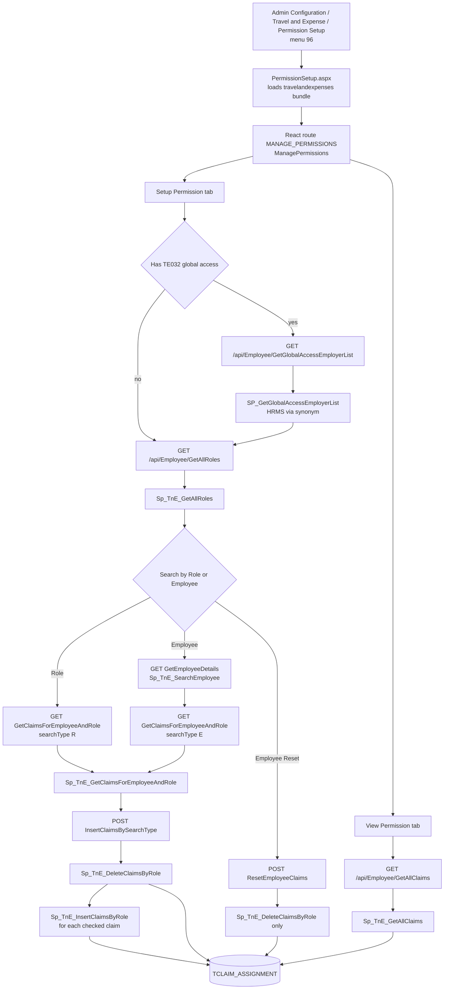
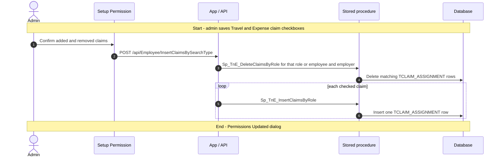
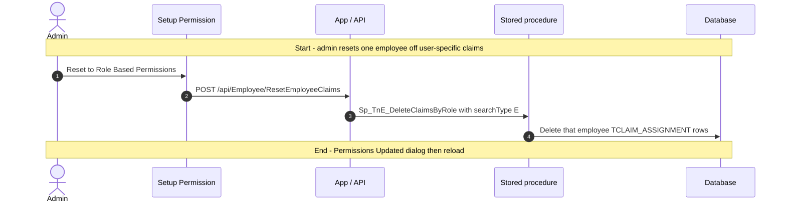
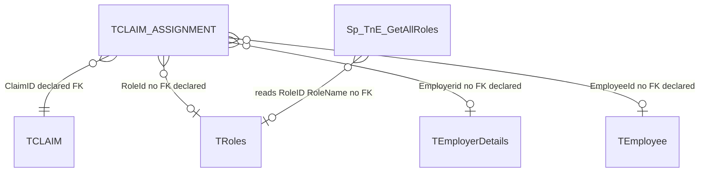

# Permission Setup

## Overview

An administrator needs Travel & Expense actions (create travel, approve expense, global org pickers, and the rest of the T&E claim catalog) granted by **role** or by **one employee**. On **Admin Configuration → Travel and Expense → Permission Setup** (menu node **96** under Travel and Expense **95**) they open `PermissionSetup.aspx`, which only seeds hidden session fields and loads the webpack Travel & Expense React app. The React route `MANAGE_PERMISSIONS` mounts **ManagePermissions** with two tabs: **Setup Permission** and **View Permission**.

On Setup Permission they pick an organisation when they hold claim `TE032` (global access), choose **Role** or **Employee**, tick Travel / Expense / Other claim checkboxes (`ModuleID` 1 / 2 / 0), and save. Save replaces that role’s or employee’s rows in `TCLAIM_ASSIGNMENT` in the Travel & Expense database (`HRMS_TRAVELNEXPENSE` / `TravelNExpense_Prod`). View Permission lists every employee-scoped assignment for the employer tree. This is **not** HRMS left-nav Access Right Management (`TRoles` / `TRolePagesMapping`); it is the T&E claim catalog on `TCLAIM` / `TCLAIM_ASSIGNMENT`.

**Who's involved:**

- **Administrator** with the Permission Setup menu — grants or revokes T&E claims for a role or one employee.
- **Global-access administrator** (claim `TE032`) — sees the organisation dropdown fed by `SP_GetGlobalAccessEmployerList`.
- **Employee** — never uses this screen; their effective T&E claims are read elsewhere through `Sp_TnE_GetUserClaims` (not called from this page).

There is no SystemModel-2 domain page for Travel & Expense permission setup. Table blurbs for `TCLAIM` and `TCLAIM_ASSIGNMENT` are in `llm-wiki/reference/tables/travelnexpense.md`. The glossary notes that “Claim” recurs across satellite modules (`llm-wiki/glossary/ubiquitous-language.md`, `llm-wiki/glossary/business-entities.md`).

## Workflow

## Request journey

### Save role or employee claims

### Reset employee to role-based claims

## Entry points

> The live screen is the WebForms host `HRM/TravelAndExpense/PermissionSetup.aspx`. It does not post back for claim saves. Claim work goes through the Travel & Expense Web API `EmployeeController` (`[Route("api/Employee/{action}")]`) against `DBSource.TravelAndExpense`. There is no React route outside this ASPX host. SourceCode SystemModel-2 has no Travel & Expense permission page.

| Entry point | Purpose | Live? |
|---|---|---|
| `~/HRM/TravelAndExpense/PermissionSetup.aspx` (`RouteConstants.MANAGE_PERMISSIONS`, menu **96**) | Host page; seeds employee/employer hidden fields; loads React | Yes |
| Setup Permission tab (`ManagePermissions` eventKey 1) | Role or employee claim grant UI | Yes |
| View Permission tab (`ManagePermissions` eventKey 2) | Read-only grid of employee claim assignments | Yes |
| `CommonUtil.LogActivity(TnEPermissionSetup)` on `Page_Load` | Activity type **328** | Yes |
| Legacy `GET GetClaimsByRole` / `GET GetClaimsBySearchType` / `POST InsertClaimsByRole` | Older claim APIs still on `EmployeeController` | Not called from this React page |

## Code → database call chain

The React UI calls `APIHelper` → Travel & Expense `EmployeeController`. Most reads go Controller → BLL → DAL. `GetAllClaims` and `GetClaimsForEmployeeAndRole` call `EmployeeDAL` directly from the controller.

| Step | Entry point | App code | Stored procedure |
|---|---|---|---|
| Activity on open | `PermissionSetup.aspx.cs:32` | `CommonUtil.LogActivity` (`Common.cs:52`) | `Sp_InsertActivityLog` (HRMS; activity **328**) |
| Organisation list when `TE032` | `setupPermissions.js:91` | `EmployeeController.GetGlobalAccessEmployerList` (`EmployeeController.cs:190`) → `EmployeeBLL.GetGlobalAccessEmployerList` (`EmployeeBLL.cs:125`) → `EmployeeDAL.GetGlobalAccessEmployerList` (`EmployeeDAL.cs:91`) | `SP_GetGlobalAccessEmployerList` (HRMS object; synonym in TRAVELNEXPENSE) |
| Role dropdown | `setupPermissions.js:110` | `EmployeeController.GetAllRoles` (`EmployeeController.cs:59`) → `EmployeeBLL.GetAllRoles` (`EmployeeBLL.cs:93`) → `EmployeeDAL.GetAllRoles` (`EmployeeDAL.cs:324`) | `Sp_TnE_GetAllRoles` |
| Load role or employee claim checkboxes | `setupPermissions.js:273` | `EmployeeController.GetClaimsForEmployeeAndRole` (`EmployeeController.cs:308`) → `EmployeeDAL.GetClaimsForEmployeeAndRole` (`EmployeeDAL.cs:691`) | `Sp_TnE_GetClaimsForEmployeeAndRole` |
| Employee search / select | `employeeSearchV1.js:66` | `EmployeeController.GetEmployeeDetails` (`EmployeeController.cs:21`) → `EmployeeBLL.GetEmployeeDetails` (`EmployeeBLL.cs:13`) → `EmployeeDAL.GetEmployeeDetails` (`EmployeeDAL.cs:21`) | `Sp_TnE_SearchEmployee` |
| Save claims | `setupPermissions.js:333` | `EmployeeController.InsertClaimsBySearchType` (`EmployeeController.cs:155`) → `EmployeeBLL.InsertClaimsBySearchType` (`EmployeeBLL.cs:53`) → `EmployeeDAL.DeleteClaimsBySearchType` (`EmployeeDAL.cs:185`) then `InsertClaimsBySearchType` (`EmployeeDAL.cs:237`) | `Sp_TnE_DeleteClaimsByRole` then `Sp_TnE_InsertClaimsByRole` per checked claim |
| Reset employee claims | `setupPermissions.js:428` | `EmployeeController.ResetEmployeeClaims` (`EmployeeController.cs:331`) → `EmployeeBLL.ResetEmployeeClaims` (`EmployeeBLL.cs:133`) → `EmployeeDAL.DeleteClaimsBySearchType` (`EmployeeDAL.cs:185`) | `Sp_TnE_DeleteClaimsByRole` |
| View Permission grid | `viewPermission.js:23` | `EmployeeController.GetAllClaims` (`EmployeeController.cs:91`) → `EmployeeDAL.GetAllClaims` (`EmployeeDAL.cs:381`) | `Sp_TnE_GetAllClaims` |

## API endpoints

This screen is not a WebForms postback for claim data. The ASPX only loads the React shell. Claim traffic is HTTP to the Travel & Expense Web API (`process.env.API_URL`), controller route `api/Employee/{action}`, with `[ClaimsAuthorize("TnE", "HRMS")]`.

| Method | Path | Purpose | Caller | Handler |
|---|---|---|---|---|
| GET | `/api/Employee/GetGlobalAccessEmployerList?employeeId=` | Organisations for global-access admins. Controller replaces `employeeId` with JWT EID | `setupPermissions.js` `populateOrganization` | `EmployeeController.GetGlobalAccessEmployerList` |
| GET | `/api/Employee/GetAllRoles?employerId=` | Role dropdown | `setupPermissions.js` `populateRoles` | `EmployeeController.GetAllRoles` |
| GET | `/api/Employee/GetClaimsForEmployeeAndRole?roleId=&employerId=&searchType=&employeeId=` | Claim checkbox state. `searchType` `R` or `E` | `setupPermissions.js` `loadClaims` | `EmployeeController.GetClaimsForEmployeeAndRole` |
| GET | `/api/Employee/GetEmployeeDetails?...` | Employee picker rows | `employeeSearchV1.js` | `EmployeeController.GetEmployeeDetails` |
| POST | `/api/Employee/InsertClaimsBySearchType` | Replace role or employee assignments | `setupPermissions.js` `saveFormData` | `EmployeeController.InsertClaimsBySearchType` |
| POST | `/api/Employee/ResetEmployeeClaims` | Delete employee-scoped assignments | `setupPermissions.js` `resetEmployeeClaims` | `EmployeeController.ResetEmployeeClaims` |
| GET | `/api/Employee/GetAllClaims?employerId=` | View Permission grid | `viewPermission.js` `componentDidMount` | `EmployeeController.GetAllClaims` |

`GetGlobalAccessEmployerList` ignores the query-string employee id and uses the JWT employee id (`EmployeeController.cs:193-197`).

## Stored procedures & tables involved

Inventory paths are under `HRMS-DATABASE/HRMS_TRAVELNEXPENSE/` unless noted. Procedure pages for Travel & Expense objects are under `/docs/database/hrms-travelnexpense/`. Shared HRMS objects keep the `hrms` slug.

| Object | File | Purpose | Database page |
|---|---|---|---|
| `Sp_TnE_GetAllRoles` | `STOREPROCEDURE/Sp_TnE_GetAllRoles.sql` | Role id/name for the employer (and employer 0) | [Sp_TnE_GetAllRoles](/docs/database/hrms-travelnexpense/Sp_TnE_GetAllRoles) |
| `Sp_TnE_GetClaimsForEmployeeAndRole` | `STOREPROCEDURE/Sp_TnE_GetClaimsForEmployeeAndRole.sql` | Claim catalog plus existence flags for role and optional employee | [Sp_TnE_GetClaimsForEmployeeAndRole](/docs/database/hrms-travelnexpense/Sp_TnE_GetClaimsForEmployeeAndRole) |
| `Sp_TnE_InsertClaimsByRole` | `STOREPROCEDURE/Sp_TnE_InsertClaimsByRole.sql` | Insert one `TCLAIM_ASSIGNMENT` row; activity log 171 | [Sp_TnE_InsertClaimsByRole](/docs/database/hrms-travelnexpense/Sp_TnE_InsertClaimsByRole) |
| `Sp_TnE_DeleteClaimsByRole` | `STOREPROCEDURE/Sp_TnE_DeleteClaimsByRole.sql` | Delete role- or employee-scoped assignments for an employer | [Sp_TnE_DeleteClaimsByRole](/docs/database/hrms-travelnexpense/Sp_TnE_DeleteClaimsByRole) |
| `Sp_TnE_GetAllClaims` | `STOREPROCEDURE/Sp_TnE_GetAllClaims.sql` | Employee-scoped assignment report for the root employer tree | [Sp_TnE_GetAllClaims](/docs/database/hrms-travelnexpense/Sp_TnE_GetAllClaims) |
| `Sp_TnE_SearchEmployee` | `STOREPROCEDURE/Sp_TnE_SearchEmployee.sql` | Employee search for the Employee mode picker | [Sp_TnE_SearchEmployee](/docs/database/hrms-travelnexpense/Sp_TnE_SearchEmployee) |
| `SP_GetGlobalAccessEmployerList` | `HRMS/STOREPROCEDURE/SP_GetGlobalAccessEmployerList.sql` (synonym in TRAVELNEXPENSE) | Global-access organisation list | [SP_GetGlobalAccessEmployerList](/docs/database/hrms/SP_GetGlobalAccessEmployerList) |

Tables these procedures read or write in Travel & Expense: `TCLAIM`, `TCLAIM_ASSIGNMENT`. Synonym / cross-db reads include `TRoles`, `TEmployee`, `TEmployeeInfo`, `TORGChart`, `TEmployerDetails`, `TUsers` / `TUserEmployee` (via `SP_GetGlobalAccessEmployerList`), plus name/role helpers. `llm-wiki/reference/tables/travelnexpense.md` catalogs `TCLAIM` and `TCLAIM_ASSIGNMENT` and records the declared FK `TCLAIM_ASSIGNMENT` → `TCLAIM`.

Direct nested callees (one level) already have HRMS pages: `Sp_OpenEncryptionKeys`, `SP_CloseEncryptionKey`, `Fn_GetEmployeeName`, `Sp_InsertActivityLog`, `USP_TFN_TUserEmployeeRole`, `Fn_DecryptData`, `FN_LocationBU_GetEmployeeDetails`.

## Table relationships

Declared foreign keys are labeled as such. Columns the procedures join without a foreign key are labeled **no FK declared**. Do not invent FKs for `RoleId`, `Employerid`, or `EmployeeId` on `TCLAIM_ASSIGNMENT` — the table script only declares `FK_ClaimAssm_Claim_Id`.

`TCLAIM.ModuleID` is an integer used by the UI as Travel `1`, Expense `2`, Other `0`. There is no foreign key from `ModuleID` to a module table in the TRAVELNEXPENSE `TCLAIM` script.

## Known gaps

- SourceCode `docs/SystemModels/SystemModel-2` has no Travel & Expense or Permission Setup domain page. Auth/role docs cover HRMS menu roles, not T&E `TCLAIM` grants.
- `llm-wiki/reference/tables/travelnexpense.md` describes `TCLAIM` as “claim types/labels associated with a module.” On this screen those rows are **permission** claims (short codes such as `TE032`), not expense-claim documents.
- Legacy APIs `GetClaimsByRole`, `GetClaimsBySearchType`, and `InsertClaimsByRole` still exist on `EmployeeController` and still execute `Sp_TnE_GetClaimsByRole` / the older insert path. This React page does not call them.
- `Sp_TnE_GetUserClaims` loads a signed-in user’s effective claims elsewhere. It is not called from Permission Setup.
- `Sp_TnE_InsertClaimsByRole` and `Sp_TnE_DeleteClaimsByRole` always call `Fn_GetEmployeeName` and `Sp_InsertActivityLog` with `@pEmployeeId`, which is `0` on role saves.
- `Sp_TnE_GetAllClaims.sql` and several sibling scripts begin with `USE [TravelNExpense_Prod]`.
- `GetAllClaims` and `GetClaimsForEmployeeAndRole` skip `EmployeeBLL` and call `EmployeeDAL` from the controller.
- Employee search builds dynamic SQL inside `Sp_TnE_SearchEmployee` (`Sp_executesql`). Nested helpers are documented one level only.
- Page-open `Sp_InsertActivityLog` for activity **328** runs through shared HRMS logging, not a Travel & Expense procedure page in this pass beyond the existing HRMS page.

## Reference

High confidence on the React → API → DAL → Travel & Expense procedure chain. Nested encryption and name helpers resolve through TRAVELNEXPENSE synonyms into HRMS.

### SourceCode

- `HRMS.Web/HRMS.Web/HRM/TravelAndExpense/PermissionSetup.aspx` and `PermissionSetup.aspx.cs`
- `HRMS.Web/HRMS.Web/HRM/TravelAndExpense/Areas/ManagePermissions/Containers/managePermissions.js`
- `HRMS.Web/HRMS.Web/HRM/TravelAndExpense/Areas/ManagePermissions/Components/setupPermissions.js`
- `HRMS.Web/HRMS.Web/HRM/TravelAndExpense/Areas/ManagePermissions/Components/viewPermission.js`
- `HRMS.Web/HRMS.Web/HRM/TravelAndExpense/Areas/ManagePermissions/Components/helper.js`
- `HRMS.Web/HRMS.Web/HRM/TravelAndExpense/Common/apiURLConstants.js`, `apiHelper.js`, `routeConstants.js`, `ClaimConstants.js`
- `HRMS.Web/HRMS.Web/HRM/TravelAndExpense/Areas/routes.js`
- `HRMS.TravelAndExpense/HRMS.TravelAndExpense.WebAPI/Controllers/EmployeeController.cs`
- `HRMS.TravelAndExpense/HRMS.TravelAndExpense.BLL/Employee/EmployeeBLL.cs`
- `HRMS.TravelAndExpense/HRMS.TravelAndExpense.DAL/Employee/EmployeeDAL.cs`
- `HRMS.Shared/HRMS.DataContract/Common/Enums.cs` (`TnEPermissionSetup = 328`)

### TDG HRMS DB

- `llm-wiki/reference/tables/travelnexpense.md`
- `llm-wiki/glossary/ubiquitous-language.md`
- `llm-wiki/glossary/business-entities.md`
- `HRMS-DATABASE/HRMS_TRAVELNEXPENSE/TABLES/TCLAIM.sql`, `TCLAIM_ASSIGNMENT.sql`
- `HRMS-DATABASE/HRMS_TRAVELNEXPENSE/SYNONYMS/SP_GetGlobalAccessEmployerList.sql`, `Sp_OpenEncryptionKeys.sql`, `SP_CloseEncryptionKey.sql`, `Fn_GetEmployeeName.sql`, `USP_TFN_TUserEmployeeRole.sql`
- Procedure scripts listed in the table above
- `HRMS-DATABASE/HRMS/DML/Tmenudetails DML.sql` (Permission Setup node **96**)
