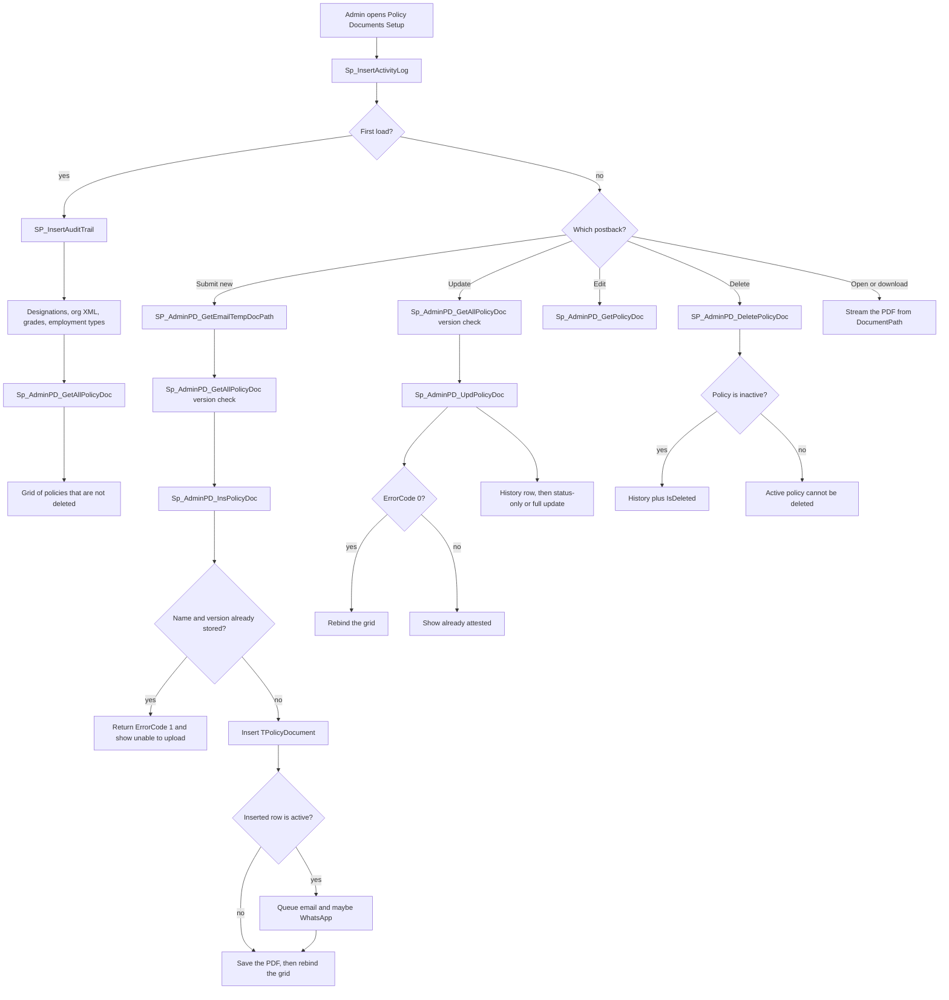
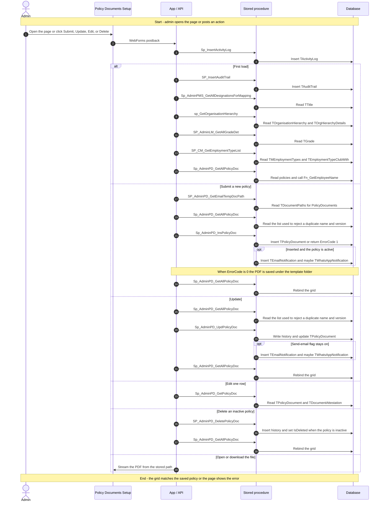
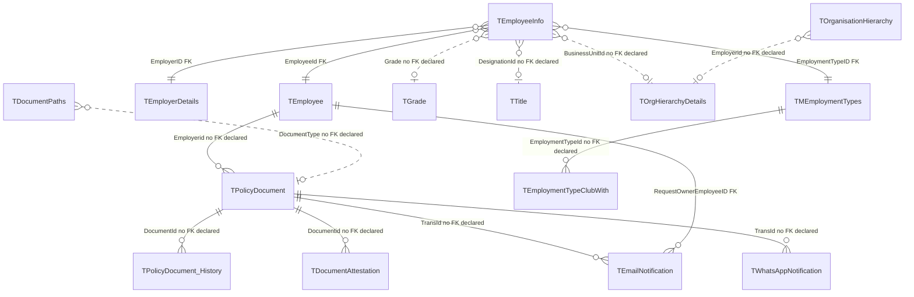

# Policy Documents Setup

## Overview

An administrator opens **Admin Configuration → Policy Documents Setup** to publish a company policy as a PDF. They enter a policy name, a version, an optional description, and the acknowledgement sentence employees will read. They can require sign-off within a number of days, pick how firmly that sign-off is enforced, turn on a repeating reminder, allow download, and exclude one group so the policy does not cover them. The exclusion is one of employment type, grade, designation, or business unit. The labels on the page say the selected group is not covered for existing employees and is not auto-started for new joiners.

**Submit** stores a new policy as active, writes the PDF under that customer's policy folder, and queues an activation email for each covered active employee. When WhatsApp is enabled for the employer, it also queues a WhatsApp row. **Update** changes a policy that nobody has attested yet. Once an employee has an attestation date, the page blocks a content change and says the record is already attested. Switching Active and Inactive is a separate path and can still succeed. **Delete** is only for an inactive policy. It keeps a history row and marks the policy deleted. Opening or downloading a row streams the PDF from disk.

Employee sign-off itself is **Self Attestation** (`SelfAttestation.aspx`), not this screen.

`docs/SystemModels/SystemModel-2` has no workflow or context page for this setup. `llm-wiki/reference/tables/hrms.md` has a one-line blurb for `TPolicyDocument` and leaves it with no referenced parent. There is no domain page for the policy-document lifecycle.

## Workflow

A new policy is saved as active, so the insert procedure queues notifications. The update procedure queues them only when its send-email flag stays on. The PDF is written after the insert procedure returns success.

## Request journey

## Entry points

The live menu node is **Policy Documents Setup** under **Admin Configuration** (`MenuPage.POLICY_DOCUMENT_SETUP` = 64). `docs/SystemModels/SystemModel-2` does not name a second page for this item. Self Attestation is menu id 66 and is out of scope.

| Entry | Purpose |
|---|---|
| `~/HRM/EmployeePolicy/PolicyDocumentsSetup.aspx` | Admin setup. Create, edit, delete, download, and export policy documents for the employer selected in the global-access control. |
| `~/HRM/EmployeePolicy/SelfAttestation.aspx` | Employee attestation. Not this menu item. |

Changing the global-access employer redirects back to the same setup URL.

## Code → database call chain

There is no policy Business Layer class. The page calls `PolicyDocDAL` directly. Designation and organisation lookups go through a BLL on the way to their DAL. Every database call uses Enterprise Library `GetStoredProcCommand`. Tab edit permission is read from session and does not call a procedure on this request.

| Entry | Method | Database |
|---|---|---|
| Every request, `PolicyDocumentsSetup.aspx.cs:39` | `CommonUtil.LogActivity` (`Common.cs:52`) → `LogUserActivity.LogActivity` (`LogUserActivity.cs:36`) → `ActivityLog.LogActivityAsync` (`ActivityLog.cs:22`) → `ActivityHelper.LogActivity` (`ActivityHelper.cs:32`) | `Sp_InsertActivityLog`. Activity type id is `ActivityDescription.PolicyDocumentSetup` = 320 (`Enums.cs:263`). |
| First load, `PolicyDocumentsSetup.aspx.cs:43` | `DBHelper.AuditTrail` (`DBHelper.cs:218`) | `SP_InsertAuditTrail`. |
| First load, `PolicyDocumentsSetup.aspx.cs:254` | `PerformanceManagementBLL.GetAllDesignationforMapping` (`PerformanceManagementBLL.cs:662`) → `PerformanceManagementDAL.GetAllDesignationforMapping` (`PerformanceManagementDAL.cs:1980`) | `Sp_AdminPMS_GetAllDesignationsForMapping`. |
| First load, `PolicyDocumentsSetup.aspx.cs:262` | `CommonBLL.GetOrgStructureXml` (`CommonBLL.cs:47`) → `CommonDAL.GetOrgStructureXml` (`CommonDAL.cs:504`) | `sp_GetOrganisationHierarchy`. |
| First load, `PolicyDocumentsSetup.aspx.cs:273` | `LeaveManagementDAL.GetAllGrades` (`LeaveManagementDAL.cs:236`) | `SP_AdminLM_GetAllGradeDet`. |
| First load, `PolicyDocumentsSetup.aspx.cs:278` | `EmployerDal.GetEmploymentTypeList` (`EmployerDAL.cs:93`) | `SP_CM_GetEmploymentTypeList`. |
| First load, rebind, and version check, `PolicyDocumentsSetup.aspx.cs:291`, `:505`, `:764` | `PolicyDocDAL.GetPolicyDocuments` (`PolicyDocDAL.cs:26`) | `Sp_AdminPD_GetAllPolicyDoc`. The grid `NeedDataSource` at `:165` calls the same method. |
| Submit, `PolicyDocumentsSetup.aspx.cs:65` | `PolicyDocDAL.GetTemplateDocumentPath` (`PolicyDocDAL.cs:12`) | `SP_AdminPD_GetEmailTempDocPath` with `DocumentType` `PolicyDocuments`. The folder is that path plus the customer's number. |
| Insert, `PolicyDocumentsSetup.aspx.cs:402` | `PolicyDocDAL.InsertPolicyDocument` (`PolicyDocDAL.cs:37`) | `Sp_AdminPD_InsPolicyDoc`. Success is `ErrorCode` `0`. The PDF is saved only after that. |
| Update, `PolicyDocumentsSetup.aspx.cs:483` | `PolicyDocDAL.UpdatePolicyDocument` (`PolicyDocDAL.cs:80`) | `Sp_AdminPD_UpdPolicyDoc`. Success is `ErrorCode` `0`. Any other code shows the attested message. |
| Edit, `PolicyDocumentsSetup.aspx.cs:93` and `:809` | `PolicyDocDAL.GetPolicyDocumentDetails` (`PolicyDocDAL.cs:141`) | `Sp_AdminPD_GetPolicyDoc`. |
| Delete, `PolicyDocumentsSetup.aspx.cs:103` | `PolicyDocDAL.DeletePolicyDocument` (`PolicyDocDAL.cs:124`) | `SP_AdminPD_DeletePolicyDoc`. The page shows `ErrorMessage` from the first row. |
| Edit permission, `PolicyDocumentsSetup.aspx.cs:225` | `WebCommonTab.GetTabsByMenu` (`Web.Common.Tab.cs:59`) | No stored procedure. Uses the tab lists already in session. When the menu is not editable, Submit and Reset are hidden. |
| Open or download, `PolicyDocumentsSetup.aspx.cs:115` and `:125` | `openFileAttachment` (`PolicyDocumentsSetup.aspx.cs:1030`) | No stored procedure. Streams the file at `DocumentPath` when it exists on disk. |

`PolicyDocDAL.PendingAttestationNotification` (`PolicyDocDAL.cs:154`) calls `SP_AdminPD_MailToEmployees`. The only call from this page is commented out (`PolicyDocumentsSetup.aspx.cs:412`).

## API endpoints

This screen is a WebForms postback. It does not call HRMS Core API, and it has no page method or AJAX endpoint of its own. Grid export uses the rows already loaded in the grid.

| Postback | Handler | What is posted | Purpose | Source |
|---|---|---|---|---|
| First load and every postback | `Page_Load` | Session employee, selected employer | Activity log on every request. First load also writes the audit row and binds lookups and the grid. | `PolicyDocumentsSetup.aspx.cs:37` |
| Submit or Update | `btnSubmit_Click` | Policy name, description, acknowledgement, version, PDF, active flag, inactive reason, download, sign-off days, enforcement mode (`MANDATORY`, `REMINDER`, or `NONE`), reminder cadence (`Day`, `Alternate Day`, `Week`, `Alternate Week`), and one exclusion list | Insert when the button text is Submit. Update otherwise. | `PolicyDocumentsSetup.aspx.cs:58` |
| Reset | `btnReset_Click` | None | Clears the form. No procedure. | `PolicyDocumentsSetup.aspx.cs:84` |
| Edit | `btnGridEditOptions` | `DocumentId` in `CommandArgument` | Loads one policy into the form and switches the button to Update. | `PolicyDocumentsSetup.aspx.cs:89` |
| Delete | `btnDeleteRecord_Click` | `hdnDocumentId` | Soft-deletes that policy for the selected employer. | `PolicyDocumentsSetup.aspx.cs:97` |
| Open or download | `OpenAttachment_Click`, `btnAttachment_Click` | File path | Streams the PDF. Upload allows `pdf` only, max 5,000,000 bytes. | `PolicyDocumentsSetup.aspx.cs:115`, `:125`, `PolicyDocumentsSetup.aspx:118` |
| Export | `grdPolicyDocuments_ItemCommand` | Excel, PDF, or Word command | Exports the current grid. Hides the edit and delete columns. | `PolicyDocumentsSetup.aspx.cs:167` |
| Change employer | `ucGlobalAccessEmployer_GlobalAccessOrganizationSelectionChangeEvent` | Selected employer | Redirects to `~/HRM/EmployeePolicy/PolicyDocumentsSetup.aspx`. | `PolicyDocumentsSetup.aspx.cs:54`, `Constants.cs:618` |

The page does not set `RepeatForEvery`. That integer goes to the procedure as `0`. Reminder start is today and the reminder end is today plus the sign-off day count, using calendar `AddDays`, and only when the reminder box is checked.

## Stored procedures & tables involved

Procedure names are the strings in `DBConstant.cs` and the literal `SP_AdminPD_DeletePolicyDoc` in `PolicyDocDAL`. `Sp_AdminPD_GetAllPolicyDoc` calls `Fn_GetEmployeeName`. None of the other procedures on this page call another procedure or function. `STRING_SPLIT` and `STRING_AGG` are built-ins.

| Object | File | Purpose | Wiki |
|---|---|---|---|
| [Sp_AdminPD_InsPolicyDoc](/docs/database/hrms/Sp_AdminPD_InsPolicyDoc) | `HRMS-DATABASE/HRMS/STOREPROCEDURE/Sp_AdminPD_InsPolicyDoc.sql` | Inserts one policy, or returns `ErrorCode` 1 when the same name and version already exist for the employer. Queues activation mail when the row is active. | `llm-wiki/reference/tables/hrms.md` (`TPolicyDocument`) |
| [Sp_AdminPD_UpdPolicyDoc](/docs/database/hrms/Sp_AdminPD_UpdPolicyDoc) | `HRMS-DATABASE/HRMS/STOREPROCEDURE/Sp_AdminPD_UpdPolicyDoc.sql` | Writes history, then either flips Active or replaces the row. Blocks a content change after an attestation date. | `llm-wiki/reference/tables/hrms.md` (`TPolicyDocument`, `TDocumentAttestation`) |
| [SP_AdminPD_DeletePolicyDoc](/docs/database/hrms/SP_AdminPD_DeletePolicyDoc) | `HRMS-DATABASE/HRMS/STOREPROCEDURE/SP_AdminPD_DeletePolicyDoc.sql` | Refuses an active policy. Otherwise writes history and sets `IsDeleted`. | `llm-wiki/reference/tables/hrms.md` (`TPolicyDocument`) |
| [Sp_AdminPD_GetAllPolicyDoc](/docs/database/hrms/Sp_AdminPD_GetAllPolicyDoc) | `HRMS-DATABASE/HRMS/STOREPROCEDURE/Sp_AdminPD_GetAllPolicyDoc.sql` | Grid list for one employer, excluding deleted rows. | `llm-wiki/reference/tables/hrms.md` (`TPolicyDocument`) |
| [Sp_AdminPD_GetPolicyDoc](/docs/database/hrms/Sp_AdminPD_GetPolicyDoc) | `HRMS-DATABASE/HRMS/STOREPROCEDURE/Sp_AdminPD_GetPolicyDoc.sql` | One policy for the edit form, including whether an attestation date exists. | `llm-wiki/reference/tables/hrms.md` (`TPolicyDocument`, `TDocumentAttestation`) |
| [SP_AdminPD_GetEmailTempDocPath](/docs/database/hrms/SP_AdminPD_GetEmailTempDocPath) | `HRMS-DATABASE/HRMS/STOREPROCEDURE/SP_AdminPD_GetEmailTempDocPath.sql` | Root folder for the uploaded PDF. | `llm-wiki/reference/tables/hrms.md` (`TDocumentPaths`) |
| [SP_InsertAuditTrail](/docs/database/hrms/SP_InsertAuditTrail) | `HRMS-DATABASE/HRMS/STOREPROCEDURE/SP_InsertAuditTrail.sql` | One page-access row on first load. | `llm-wiki/reference/tables/hrms.md` (`TAuditTrail`) |
| [Sp_InsertActivityLog](/docs/database/hrms/Sp_InsertActivityLog) | `HRMS-DATABASE/HRMS/STOREPROCEDURE/Sp_InsertActivityLog.sql` | One activity row on every request. | `llm-wiki/reference/tables/hrms.md` (`TActivityLog`) |
| [Sp_AdminPMS_GetAllDesignationsForMapping](/docs/database/hrms/Sp_AdminPMS_GetAllDesignationsForMapping) | `HRMS-DATABASE/HRMS/STOREPROCEDURE/Sp_AdminPMS_GetAllDesignationsForMapping.sql` | Active titles for the exclusion list. | `llm-wiki/reference/tables/hrms.md` (`TTitle`) |
| [sp_GetOrganisationHierarchy](/docs/database/hrms/sp_GetOrganisationHierarchy) | `HRMS-DATABASE/HRMS/STOREPROCEDURE/sp_GetOrganisationHierarchy.sql` | Organisation XML for the business-unit tree. | `llm-wiki/reference/tables/hrms.md` (`TOrganisationHierarchy`, `TOrgHierarchyDetails`) |
| [SP_AdminLM_GetAllGradeDet](/docs/database/hrms/SP_AdminLM_GetAllGradeDet) | `HRMS-DATABASE/HRMS/STOREPROCEDURE/SP_AdminLM_GetAllGradeDet.sql` | Active grades for the exclusion list. | `llm-wiki/reference/tables/hrms.md` (`TGrade`) |
| [SP_CM_GetEmploymentTypeList](/docs/database/hrms/SP_CM_GetEmploymentTypeList) | `HRMS-DATABASE/HRMS/STOREPROCEDURE/SP_CM_GetEmploymentTypeList.sql` | Active employment types for the exclusion list. | `llm-wiki/reference/tables/hrms.md` (`TMEmploymentTypes`, `TEmploymentTypeClubWith`) |
| [Fn_GetEmployeeName](/docs/database/hrms/Fn_GetEmployeeName) | `HRMS-DATABASE/HRMS/FUNCTIONS/Fn_GetEmployeeName.sql` | Display name of the uploader on the grid. Called by the list procedure. | `llm-wiki/reference/tables/hrms.md` (`TEmployee`) |
| `TPolicyDocument` | `HRMS-DATABASE/HRMS/TABLES/TPolicyDocument.sql` | Policy header. Later columns are added by the DDL and DML scripts in Reference. | `llm-wiki/reference/tables/hrms.md` |
| `TPolicyDocument_History` | `HRMS-DATABASE/HRMS/TABLES/TPolicyDocument_History.sql` | Snapshot written on update and delete. | Not listed in `llm-wiki/reference/tables/hrms.md` |
| `TDocumentAttestation` | `HRMS-DATABASE/HRMS/TABLES/TDocumentAttestation.sql` | Attestation rows. An attestation date locks content updates. | `llm-wiki/reference/tables/hrms.md` |
| `TEmailNotification` | `HRMS-DATABASE/HRMS/TABLES/TEmailNotification.sql` | Pending `PolicyDocumentActivation` or `PolicyDocumentDeactivated` mail. | `llm-wiki/reference/tables/hrms.md` |
| `TWhatsAppNotification` | `HRMS-DATABASE/HRMS/TABLES/TWhatsAppNotification.sql` | Pending `PolicyPublish` or `PolicySignOffRequired` rows. | Mentioned in `llm-wiki/domain/employee-lifecycle.md`. No table blurb. |
| `TDocumentPaths` | `HRMS-DATABASE/HRMS/TABLES/TDocumentPaths.sql` | Folder root for document type `PolicyDocuments`. | `llm-wiki/reference/tables/hrms.md` |
| `TEmployee`, `TEmployeeInfo` | `HRMS-DATABASE/HRMS/TABLES/TEmployee.sql`, `TEmployeeInfo.sql` | Covered employees, and the uploader's employment number. | `llm-wiki/reference/tables/hrms.md` |
| `[MSG-MESH].dbo.MessagingClientConfig` | Not in this repo | Read to decide whether WhatsApp rows are queued. | No wiki page |

## Table relationships

`llm-wiki/reference/tables/hrms.md` lists `TPolicyDocument` with no referenced parent. The diagram uses the `CREATE TABLE` scripts. A join this page or its procedures use is shown as a foreign key only when that script declares one. Other joins are labeled as not declared.

`TEmployeeInfo.Title` does reference `TTitle.ID`. This page does not use that column. The exclusion list stores `TTitle.ID` and the insert and update procedures compare it with `TEmployeeInfo.DesignationId`, which has no foreign key. `TPolicyDocument.EnforcementMode` has check constraint `CK_TPolicyDocument_EnforcementMode` (`NULL`, `MANDATORY`, `REMINDER`, or `NONE`). That is not a foreign key. `TPolicyDocument_History` has a primary key on `DocumentHistoryId` and no foreign key. The baseline `TPolicyDocument` and `TDocumentAttestation` scripts declare neither a primary key nor a foreign key.

## Known gaps

- **No SystemModel-2 page.** Nothing under `docs/SystemModels/SystemModel-2` names `PolicyDocumentsSetup`. The call chain is from the WebForms page and the DAL.
- **Self Attestation is a different page.** Employee sign-off, `SP_InsertDocumentAttestation`, and `Sp_GetDocumentAttestation` are not this menu item.
- **Reminder mail procedure is not called.** `SP_AdminPD_MailToEmployees` is implemented and `PolicyDocDAL.PendingAttestationNotification` wraps it. The setup page's call is commented out.
- **Baseline `TPolicyDocument.sql` is behind the procedures.** It stops at `ModifiedDate`. Later scripts add download, sign-off, deleted, deactivation, exclusion ids, enforcement mode, and `AcknStatement`. No script in `HRMS-DATABASE` was found that adds `IsReminderNotification`, `StartDate`, `RepeatForEvery`, `RepeatFor`, `EndDate`, or `NextRunDate` to `TPolicyDocument`, although the procedures read and write those columns and the history table defines them.
- **History does not store the acknowledgement.** Update and delete copy an explicit column list into `TPolicyDocument_History` and that list has no `AcknStatement`. `DML/178047_ACKStatement.sql` adds the column only on `TPolicyDocument`.
- **Duplicate check and the grid disagree about deleted rows.** The page rejects a duplicate from `Sp_AdminPD_GetAllPolicyDoc`, which hides `IsDeleted = 1`. `Sp_AdminPD_InsPolicyDoc` counts every `TPolicyDocument` row with that name, version, and employer, including deleted rows.
- **An attested policy can still change Active.** When the active flag changes, `Sp_AdminPD_UpdPolicyDoc` updates only the status fields and returns `ErrorCode` 0 even if an attestation date exists. The other posted fields are not written. The page then shows the success message. A content change with the flag left as-is returns `ErrorCode` 1.
- **The PDF is saved after the insert.** The procedure stores `DocumentPath` before `SaveAs`. A failed file write leaves the database row.
- **Sign-off end date uses calendar days.** The label says working days. `EndDate` is `DateTime.Today.AddDays` of the sign-off count. `RepeatForEvery` is never set on the page, and the procedure's next-run calculation is commented out. `NextRunDate` is `@StartDate`.
- **WhatsApp config is outside this database.** The insert and update procedures read `[MSG-MESH].dbo.MessagingClientConfig`. That database is not in `HRMS-DATABASE`, and no foreign key to it is declared.
- **`TPolicyDocument_History` has no wiki blurb.** `TWhatsAppNotification` is named in `llm-wiki/domain/employee-lifecycle.md` and is absent from the table catalog.

## Reference

Confidence is high because the setup page, `PolicyDocDAL`, the lookup DAL methods, and each procedure body on this path were read. Relationships are only the foreign keys declared on those tables.

### SourceCode

- `HRMS.Web/HRMS.Web/HRM/EmployeePolicy/PolicyDocumentsSetup.aspx`
- `HRMS.Web/HRMS.Web/HRM/EmployeePolicy/PolicyDocumentsSetup.aspx.cs`
- `HRMS.Shared/HRMS.DataAccessLayer/PolicyDocDAL.cs`
- `HRMS.Shared/HRMS.DataAccessLayer/DBConstant.cs`
- `HRMS.Shared/HRMS.DataContract/PolicyDoc/PolicyDocumentProcess.cs`
- `HRMS.Shared/HRMS.DataContract/Common/Enums.cs` (`PolicyDocumentSetup` 320, `POLICY_DOCUMENT_SETUP` 64)
- `HRMS.Shared/HRMS.DataContract/Common/Constants.cs`
- `HRMS.Shared/HRMS.Common/Common.cs`
- `HRMS.Shared/TDG.ActivityAuditLog/Activity/LogUserActivity.cs`
- `HRMS.Shared/TDG.ActivityAuditLog/ActivityLog/ActivityLog.cs`
- `HRMS.Shared/TDG.ActivityAuditLog/DAL/ActivityHelper.cs`
- `HRMS.Shared/HRMS.DataAccessLayer/DBHelper.cs`
- `HRMS.Shared/HRMS.BusinessLayer/ConfirmationAndPerformance/PerformanceManagementBLL.cs`
- `HRMS.Shared/HRMS.DataAccessLayer/ConfirmationAndPerformance/PerformanceManagementDAL.cs`
- `HRMS.Shared/HRMS.BusinessLayer/CommonBLL.cs`
- `HRMS.Shared/HRMS.DataAccessLayer/CommonDAL.cs`
- `HRMS.Shared/HRMS.DataAccessLayer/LeaveAttendanceARWFH/LeaveManagementDAL.cs`
- `HRMS.Shared/HRMS.DataAccessLayer/Employer/EmployerDAL.cs`
- `HRMS.Web/HRMS.Web/Common/Web.Common.Tab.cs`
- `docs/SystemModels/SystemModel-2` has no page for this screen

### TDG HRMS DB

- `HRMS-DATABASE/HRMS/STOREPROCEDURE/Sp_AdminPD_InsPolicyDoc.sql`
- `HRMS-DATABASE/HRMS/STOREPROCEDURE/Sp_AdminPD_UpdPolicyDoc.sql`
- `HRMS-DATABASE/HRMS/STOREPROCEDURE/SP_AdminPD_DeletePolicyDoc.sql`
- `HRMS-DATABASE/HRMS/STOREPROCEDURE/Sp_AdminPD_GetAllPolicyDoc.sql`
- `HRMS-DATABASE/HRMS/STOREPROCEDURE/Sp_AdminPD_GetPolicyDoc.sql`
- `HRMS-DATABASE/HRMS/STOREPROCEDURE/SP_AdminPD_GetEmailTempDocPath.sql`
- `HRMS-DATABASE/HRMS/STOREPROCEDURE/SP_AdminPD_MailToEmployees.sql` (not called by this page)
- `HRMS-DATABASE/HRMS/STOREPROCEDURE/SP_InsertAuditTrail.sql`
- `HRMS-DATABASE/HRMS/STOREPROCEDURE/Sp_InsertActivityLog.sql`
- `HRMS-DATABASE/HRMS/STOREPROCEDURE/Sp_AdminPMS_GetAllDesignationsForMapping.sql`
- `HRMS-DATABASE/HRMS/STOREPROCEDURE/sp_GetOrganisationHierarchy.sql`
- `HRMS-DATABASE/HRMS/STOREPROCEDURE/SP_AdminLM_GetAllGradeDet.sql`
- `HRMS-DATABASE/HRMS/STOREPROCEDURE/SP_CM_GetEmploymentTypeList.sql`
- `HRMS-DATABASE/HRMS/FUNCTIONS/Fn_GetEmployeeName.sql`
- `HRMS-DATABASE/HRMS/TABLES/TPolicyDocument.sql`
- `HRMS-DATABASE/HRMS/TABLES/TPolicyDocument_History.sql`
- `HRMS-DATABASE/HRMS/TABLES/TDocumentAttestation.sql`
- `HRMS-DATABASE/HRMS/TABLES/TEmailNotification.sql`
- `HRMS-DATABASE/HRMS/TABLES/TWhatsAppNotification.sql`
- `HRMS-DATABASE/HRMS/TABLES/TDocumentPaths.sql`
- `HRMS-DATABASE/HRMS/TABLES/TEmployee.sql`
- `HRMS-DATABASE/HRMS/TABLES/TEmployeeInfo.sql`
- `HRMS-DATABASE/HRMS/DDL/42444_AlterStatement_TPolicyDocument.sql`
- `HRMS-DATABASE/HRMS/DDL/128481_DML_PolicyDocument.sql`
- `HRMS-DATABASE/HRMS/DDL/89710/AlterTPolicyDocument.sql`
- `HRMS-DATABASE/HRMS/DDL/91304/DDL_TPolicyDocument.sql`
- `HRMS-DATABASE/HRMS/DDL/TPolicyDocument DDL.sql`
- `HRMS-DATABASE/HRMS/DML/178047_ACKStatement.sql`
- `llm-wiki/reference/tables/hrms.md`
- `llm-wiki/domain/employee-lifecycle.md` (`TWhatsAppNotification` only)
